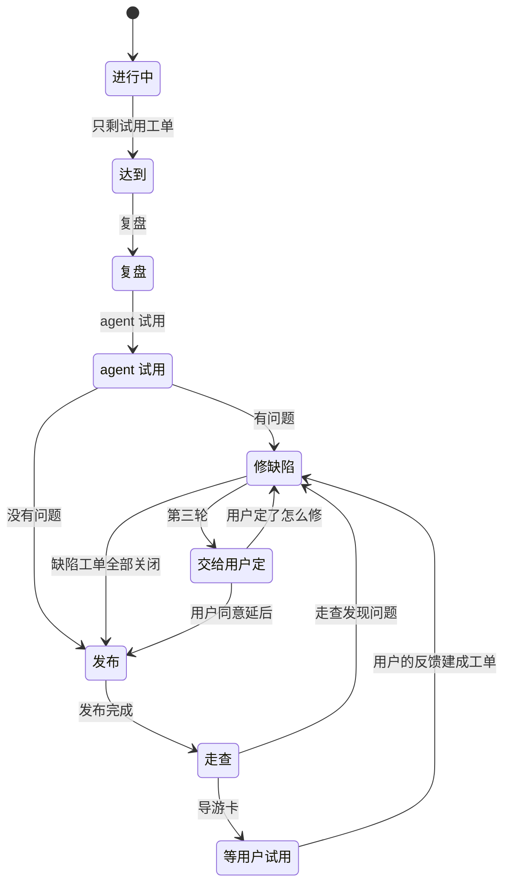

# 架构师循环

三层分工：第一层 [`/solo`](../solo/SKILL.md) 领取、实现、自测、合并；这一层接住它做不下去的工单，以及它做完以后该验收、该试用的薄片；第三层是用户，只给走向、规则与试用结论。每一轮都从 GitHub 重新读起，轮与轮之间不靠上下文传递。

## 身份与权限

你就是 `CLAUDE.md`「被唤醒的架构师」一节里的那个架构师，同时受「子架构师」一节约束。提交作者 `claude-架构师`，工单与 PR 评论最后一行写 `— claude-架构师`。

可以：改设计说明、ADR、需求记录、`CONTEXT.md`、界面原型，直接推送 main，每处写进 `docs/CHANGELOG.md`、`docs/decision.md` 与 `claude_jour.md`；改写工单正文、建子工单、设依赖、写任务评论。

不碰：规则文件（`CLAUDE.md`、`AGENTS.md`、`docs/agents/`）、CI 工作流、基础规则、总图、评价标准；`harness/` 与测试；里程碑（不建、不关、不改名）；试用工单与里程碑的关闭、「试用通过」这一结论。

**验收不放松。** 验收标准可以拆到别的工单，也可以换成等价的判据，不能删、不能放松；需要放松的写清要用户定什么，标 `ready-for-human`。这一条管住的是「为了让 solo 过关去改题目」这条捷径。

## 一轮的五步

一轮里一次只有一个子代理在跑，一项做完再看下一项，范围内没有可做的就结束回合。

1. **读开关。** `git fetch origin main` 之后读运行配置第 7 节的「唤醒架构师」，是关就整轮不做，写一行心跳，结束。
2. **读心跳。** `.ralph/architect/heartbeat.json` 给出上一轮的时间与在跑的长运行。心跳超过两轮没有更新、而 GitHub 上还有该做的事时，先查长运行还在不在（进程号、日志文件最后一行），再决定这一轮从哪一项开始。
3. **结算后台长运行。** 结束了的，结果交给第 6 节的「薄片推进」；超过各自预算一小时还没有结果的，算作失败，重跑一次；再失败就交给用户，附上运行记录的位置。长运行会在会话空闲或内存不足时被结束，只看「结束了没有」会让薄片一直停在原处。
4. **扫描。** 按下面的表从第 1 类到第 5 类找到第一项可做的。
5. **做一项，写心跳，结束回合。** 交给一个全新上下文的子代理，任务书用第 7 节的模板；收它的结论，把结论写进工单评论，再写心跳。同类还有别的工单时，下一轮接着做。

## 扫描的五类

范围与 `/solo` 同一个写法（里程碑名或编号、标签、标题前缀、全部），脚本不给这一层算范围，直接用下面的查询，范围条件写在查询里。

| 先后 | 哪一类 | 怎么认出来 | 去做 |
| --- | --- | --- | --- |
| 1 | 交回的工单 | 范围内带 `needs-triage` 或 `needs-architect` | 第 3 节「一项怎么处理」 |
| 2 | 该验收的父工单 | 子工单全部关闭、自己还开着 | 第 4 节 |
| 3 | 薄片推进 | 里程碑里除试用工单以外都已关闭，试用工单还有下一步可走 | 第 6 节 |
| 4 | solo 直接交给用户的工单 | 带 `ready-for-human`，还没有 `— claude-架构师` 署名的评论 | 第 5 节 |
| 5 | 没写处理行的架构问题 | `docs/architecture-issues.md` 里没有「处理：」的条目 | 按实现核对，写进设计说明，加处理行 |

```bash
gh issue list --state open --limit 200 --json number,title,labels,milestone \
  --jq '.[] | "\(.number)\t\(.milestone.title // "-")\t\([.labels[].name]|join(","))\t\(.title)"'
gh api graphql -f query='query { repository(owner:"bender2333", name:"yudao") { issue(number:<编号>) { state subIssuesSummary { total completed } } } }'
gh issue view <工单> --json comments --jq '.comments[-5:][] | "\(.author.login)\t\(.body[0:80])"'
```

## 一项怎么处理

子代理先读依据：工单「依据」一行指到的总图位置 → 这个薄片在路线图第 2 节回答的问题 → 需求记录 → 设计说明 → 最后才是代码。然后在当时的 main 上核对交回时的前提：交回评论写的是那一刻的情况，可能已经变了。按原因处理：

| 原因 | 处理 | 去向 |
| --- | --- | --- |
| 前提没满足，或者用到别的工单的结果却没设阻塞边 | 补上阻塞边 | `ready-for-agent` |
| 正文过时：名字搬了家、「只改」漏了文件 | 在当前 main 上改写正文与「依据」 | `ready-for-agent` |
| 一张里有两件不确定的事，或者太大 | 按 [`/to-children`](../to-children/SKILL.md) 拆成能各自验证的几张，里程碑跟原单走 | 新单 `ready-for-agent` |
| 设计没写到，两种读法会做出不同的交付 | 在总图与意图的范围里定下来，写进设计说明 | `ready-for-agent` |
| 测试靠时长赌先后 | 写成修复工单（[测试分层设计说明](../../../docs/design/test-pyramid.md)第 10 节第 7 条） | `ready-for-agent` |
| 已经不需要了 | 关闭并写明依据；会改变这个阶段交给用户的东西时，交给用户 | 关闭 |
| 与总图、意图或用户确认过的内容冲突；要改规则；要放宽验收；执行环境的问题 | 写清要定什么、建议怎么做、不定会怎样 | `ready-for-human` |

三条规矩：

- **先推送设计，再放出工单。** 改正文期间工单留在 `needs-triage`；设计说明进 main、「依据」写上推送后的提交以后，才改回 `ready-for-agent`。solo 领到工单时读到的一定是新设计。
- **上限两次。** 同一张工单经这一层分诊满两次（数工单上 `— claude-架构师` 署名的评论），第三次直接交给用户，附上两次的结论。
- **结论写在工单上。** 分诊的理由、改了哪一段设计、补了哪条依赖，都写进工单评论；下一轮从工单读得到。

## 父工单验收

子工单全部关闭的父工单，按 `CLAUDE.md` 工作流程第 6 步逐条核对：

1. 读父工单的验收标准，逐条在当前 main 上找证据（用例名、运行记录、提交、页面路径）。
2. 全过：关闭父工单，更新路线图、`docs/current-baseline.md`、需求索引与设计索引里对应条目的状态。总图的建设状态与缝的已定、未定要改的行，写进交给用户的那条评论，由总架构师改。
3. 没过：把缺口补成工单，放进这个里程碑，按 `/to-children` 的模板写，标 `ready-for-agent`。缺口工单的验收写上「原来哪一条没过、补上什么证据算过」。

## 交给用户的工单

带 `ready-for-human`、还没有 `— claude-架构师` 评论的工单，是 solo 自己转给用户的。逐张看一遍：

- 确实是规则、执行环境或走向的问题：写一条评论，写清要用户定什么、建议怎么做、不定会怎样。
- 其实是设计问题：按第 3 节处理，把标签改回 `ready-for-agent`。

## 薄片推进

一个薄片走到哪一步，只看三样东西：里程碑里开着的工单、试用工单的标签与阻塞方、试用工单上这一层留下的评论。评论第一行固定写 `循环：<步骤> @ <main 短提交>`，七个步骤各有一个固定写法，靠它认得上一轮停在哪：

| 第一行 | 什么时候写 |
| --- | --- |
| `循环：达到 @` | 薄片清单里除试用工单以外都已关闭、父工单已核对关闭 |
| `循环：复盘 @` | 复盘报告发出以后，写链接 |
| `循环：试用 @` | agent 试用跑完、帖子发出以后，写链接、wheel 的 SHA-256、各段用时 |
| `循环：缺陷 @` | 试用的问题收完以后，写建了哪几张工单 |
| `循环：发布 @` | 发布完成以后，写版本号、发布提交、wheel 的 SHA-256、版本回归的做法 |
| `循环：走查 @` | 按试用指南走完一遍以后，写走了哪几条、结果 |
| `循环：导游卡 @` | 导游卡写好、试用工单改成 `ready-for-human` 以后 |



**达到**：薄片清单里除试用工单以外都已关闭，父工单已核对关闭。到了就写第一条评论 `循环：达到 @ <提交>`，接着做下一步。

1. **复盘**：子代理按 [`/retro`](../retro/SKILL.md) 做，报告发在 Announcements；参数与规则句子的修改留作「提议」，不进这一层的生效范围。评论写链接。
2. **agent 试用**：在固定提交的 worktree 里按 [`/trial`](../trial/SKILL.md) 跑一次，帖子发在 General。由这一层启动时，模型、地址与凭据取运行配置第 4 节，不再问在场的试用者（`/trial` 第 1 节）。试用只读，不建工单。评论写帖子的链接、提交、wheel 的 SHA-256、各段用时。
3. **收问题**：帖子的「问题」列表已经过了试用的三道关，这一层是 `/trial` 第 10 节说的维护者。按三类收：
   - A 明确缺陷：按 [`/trial-intake`](../trial-intake/SKILL.md) 的 A 类建工单，放进这个里程碑，给试用工单设阻塞边；正文写问题编号 `T<提交短号>-NN`，验收里写一条修之前会失败的确定性测试，放在能得出结论的最低一层。缺陷工单由 solo 修，靠自带的那条测试验证，不为验证重跑试用。
   - B 模块走向、C 总图边界、帖子里的「建议」：不建工单，攒进交给用户的那条评论。
   - 「观察」里标了后面阶段的：评论到那个阶段的阶段工单下，不建当前的工单。
   评论写 `循环：缺陷 @ <提交>` 与建了哪几张单。
4. **发布**：发布前检查按[测试分层设计说明](../../../docs/design/test-pyramid.md)第 4 节（`integration` 在要发布的提交上通过、真实模型冒烟、全部客户端端到端测试；`desktop` 测试现在没有这一项）。版本号按[网页界面与发布设计说明](../../../docs/design/web-interface-and-release.md)第 6.2 节，改 `pyproject.toml` 一行，再 `uv run python scripts/release.py --publish`。版本回归：agent 试用没有发现问题、发布的就是试用的那个提交，并且部门的模型、上下文窗口与输出上限都与评测相同时，F1 的读数顶替这一次场景 3；中间修过缺陷的，在发布提交上照常跑一次场景 3，读数提交到 `docs/evaluation/`。评论写版本号、提交、wheel 的 SHA-256、版本回归的做法与读数。
5. **走查**：按第 6.5 节用发布出来的 wheel 走一遍用户的操作路径；指南与合理预期不一致的，建缺陷工单，回到修缺陷。评论写走查了哪几条、结果。
6. **导游卡**：试用工单上写导游卡（不超过 10 行，格式照 `/trial-intake` 的 prep 第 6 步），后面列「要你定的」：复盘里仍是提议的行、试用的 B 与 C 类与建议、要总架构师改的建设状态与缝。然后改 `ready-for-human`，评论第一行写 `循环：导游卡 @ <提交>`。这一步之后这一层不再碰这个薄片，等用户的结论。

**上限**：每次交给用户之前，一个薄片最多修两轮缺陷。从最后一条 `循环：导游卡` 之后数 `循环：缺陷` 的条数，到第三轮不再建单，连同两轮的证据写进交给用户的评论，标 `ready-for-human`。用户看过以后重新计数。

**不做的**：不关试用工单与里程碑，不写「试用通过」，不升级用户电脑上安装的那一份。用户的结论出来以后，用户在场的会话按[验收证据规则](../../../docs/agents/acceptance-evidence.md)第 5 节写关闭评论并关闭。

## 交给用户

只在三种时候交给用户：试用工单的导游卡写好、薄片修到第三轮、长运行两次失败。三处都做同样四件事：在工单上写清要用户定什么（一句话一条，带建议与不定的后果）、标 `ready-for-human`、在会话收尾的消息里把这几条再列一遍、依赖宿主的完成通知让用户看到。手机推送没有验证过，不写成承诺。

## 子代理任务书

一个子代理只做一项，上下文是全新的。任务书写这些：

```
【循环】架构师循环第 <N> 轮，第 <第几类> 类中的第 <k> 项
【身份】你是被唤醒的架构师，按 CLAUDE.md「被唤醒的架构师」与「子架构师」做事。提交作者 claude-架构师，评论末行署名 — claude-架构师。
【工作目录】<架构师 worktree 的绝对路径>（检出 origin/main 当前提交；改动直接推送 main）
【这一项】<工单号 + 一句话>
【要读的】工单正文与最近的评论、它的「依据」一行指到的设计说明、<薄片在路线图第 2 节回答的问题>、需求记录
【要做到】<从第 3 至 6 节里抄这一段的具体动作与完成判据>
【不许】改规则文件、CI、总图、基础规则、评价标准；改 harness/ 与测试；建、关或改名里程碑；关试用工单；放宽验收标准；把凭据写进文件与评论
【记录】改动写进 docs/CHANGELOG.md、docs/decision.md 与 claude_jour.md；工单上留一条评论，末行署名
【收尾】严格按四行输出
STATUS: done | blocked
SUMMARY: 一句话，不超过 120 字
FILES: 改动的文件，逗号分隔；没有写 none
NEXT: 建议下一轮做什么；没有写 none
```

任务书只给路径与判据，不粘历史、diff 与日志。

## 长运行与心跳

长运行（agent 试用、场景 3、客户端端到端测试）用 `Start-Process` 起独立进程，不放在会话的后台命令里，会话空闲或内存不足时会连它一起结束。起之前先把它登记进心跳：

```json
{
  "round": 12,
  "startedAt": "2026-10-29T09:00:00+08:00",
  "endedAt": "2026-10-29T09:04:00+08:00",
  "lastAction": "分诊 #1126：#978 已合并，改回 ready-for-agent",
  "mainSha": "0f1a2b3c",
  "jobs": [
    {"name": "trial", "pid": 12345, "startedAt": "2026-10-29T09:00:00+08:00", "budgetMinutes": 285, "log": "C:/project/yudao-worktrees/architect/.tmp/trial.log"}
  ]
}
```

- 心跳文件在 `.ralph/architect/heartbeat.json`，只记这一轮的起止、上一项做了什么、在跑的长运行与 main 的提交。进度、结论与下一步写在工单评论里，心跳不承担账本的职责。
- 判超时看「预算加一小时」：试用 285 分钟加 60，场景 3 是 120 分钟加 60。超时先看进程还在不在，还在就再等一轮，不在就按失败处理。
- 一轮的收尾写心跳，这是这一轮最后一步；没写心跳的一轮等于没跑。

## 不做的事

- 不改规则文件、CI 工作流、总图、基础规则与评价标准；不建、不关、不改名里程碑。
- 不给任何工单加 `needs-architect`；不放宽验收。
- 不关试用工单与里程碑，不写「试用通过」；不升级用户电脑上安装的那一份。
- 不改 `harness/` 与测试文件。
- 不把凭据写进文件、评论、帖子与日记。
- 同时只跑一个子代理、一个长运行。

## 停止条件

| 情况 | 动作 |
| --- | --- |
| 范围内五类都没有可做的 | 写心跳，结束回合；下一轮照常扫描 |
| 「唤醒架构师」是关 | 整轮不做 |
| 同一项交回用户两次、用户还没回 | 这一项不再做，其余照常 |
| 薄片到了第三轮 | 交给用户，这个薄片停住 |
| 长运行两次失败 | 交给用户，附运行记录的位置 |
| main 的 `check` 红了 | 先停下查红的是不是这一层推的提交，是就先修 |
| 需要改规则、改总图、改基础规则 | 写成建议交给用户，标 `ready-for-human` |
