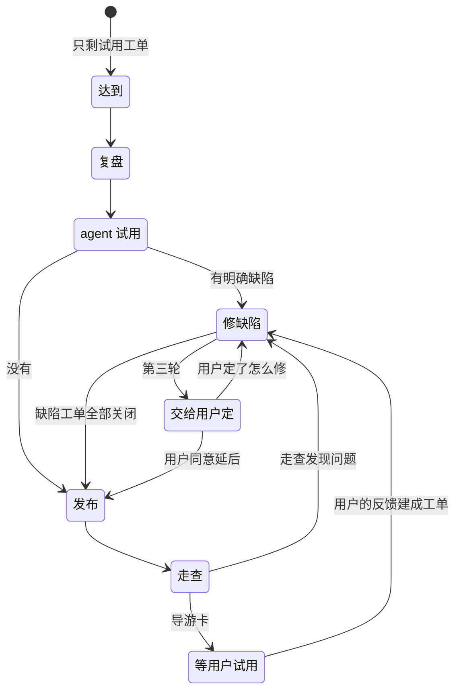

# 试用

流程的正本是[工作方式](../../../docs/agents/workflow.md)第 5、6 节；关闭的规矩在[验收证据规则](../../../docs/agents/acceptance-evidence.md)「试用工单与里程碑的关闭」。与 [`/trial`](../trial/SKILL.md) 的分工：`/trial` 是 agent 自己当用户跑一遍、写报告；这个技能把薄片推到用户手里，再把用户的反馈变成工单。用户只给试用结论。

## 何时用 / 何时不用

- 用：试用工单所在的薄片里，除试用工单以外都已关闭；试用工单还有下一步；用户试完给了反馈。
- 不用：父工单还没验收（先 `/verify`）；阶段的结束核对（总架构师）。

## 先读什么

置顶的阶段工单里这个薄片的清单、路线图第 2 节这个薄片回答的问题、试用工单上的 `TRIAL:` 评论（旧的 `循环：` 开头的评论同义）、`docs/design/web-interface-and-release.md`「谁在什么时候发布」「架构师的走查」「试用的交接」。

## 薄片推进

薄片走到哪一步，只看三样：里程碑里开着的工单、试用工单的标签与阻塞方、试用工单上最后一条 `TRIAL:` 评论。每一步做完写一条，第一行 `TRIAL: <步骤> @ <main 短提交>`。



1. **达到**：薄片清单里除试用工单以外都已关闭，父工单都有 `VERDICT:` 并已关闭。写 `TRIAL: 达到`。完成：清单与 GitHub 对得上。
2. **复盘**：按 [`/milestone-retro`](../milestone-retro/SKILL.md) 做，报告发在 Discussions 的 Announcements；参数与规则句子的修改留作「提议」，由用户在场的会话定。写 `TRIAL: 复盘` 与链接。
3. **agent 试用**：在固定提交的 worktree 里按 [`/trial`](../trial/SKILL.md) 跑一次，帖子发在 General；模型、地址与凭据取运行配置「模型」。试用只读，不建工单。写 `TRIAL: 试用`、帖子链接、提交、wheel 的 SHA-256、各段用时。
4. **收问题**：逐条裁定帖子里的问题（现场观察、是否独立复现、是否成立），体验候选另记是否采纳，都给依据；工单关闭不代替裁定。按三类收：
   - A 明确缺陷：按 [`/to-children`](../to-children/SKILL.md) 的模板建工单，带 `bug`，放进这个里程碑，给试用工单设阻塞；正文写问题编号 `T<提交短号>-NN`，验收写一条修之前会失败的确定性测试，放在能得出结论的最低一层。由 solo 修，靠那条测试验证，不为验证重跑试用。
   - B 模块走向、C 总图边界、帖子里的建议：不建工单，攒进导游卡后面的「要你定的」。
   - 标了后面阶段的观察：评论到那个阶段的阶段工单下。
   写 `TRIAL: 缺陷` 与建了哪几张。
5. **发布**：发布前检查按[测试分层设计说明](../../../docs/design/test-pyramid.md)「各角色运行哪一层」：`integration` 在要发布的提交上通过、真实模型冒烟、全部客户端端到端测试。版本号按 `docs/design/web-interface-and-release.md`「版本号」改 `pyproject.toml` 一行，再 `uv run python scripts/release.py --publish`。版本回归：没有发现问题、发布的就是试用的那个提交、部门的模型与上下文设置与评测相同时，试用的读数顶替这次场景 3；中间修过缺陷的，在发布提交上跑一次场景 3，读数提交到 `docs/evaluation/`。写 `TRIAL: 发布`、版本号、提交、wheel 的 SHA-256、版本回归的做法与读数。
6. **走查**：用发布出来的 wheel 按「架构师的走查」走一遍用户的操作路径，用临时虚拟环境、单独的数据目录与端口，不动用户安装的那一份。指南与合理预期不一致的建缺陷工单，回到修缺陷，不改指南迁就。写 `TRIAL: 走查`、走了哪几条、结果。
7. **导游卡**：写 `TRIAL: 导游卡`，正文是导游卡，后面列「要你定的」：复盘里的提议、B 与 C 类与建议、要总架构师改的缝。然后试用工单改成 `ready-for-human`。这一步之后不再碰这个薄片，等用户的结论。

   ```
   导游卡：<里程碑标题> · 薄片 <…>，版本 <v…>
   启动：<一条命令，装到哪、开哪个地址>
   第一个场景：照试用任务集 R1 的步骤原样操作一遍（<docs/trial/tasks.md 在 GitHub 上的链接>），之后随意
   这次看得见的变化：
   - <变化 1> — 去 <页面或位置> 看
   - <变化 2> — 去 <…> 看
   立住的缝：<总图第四节的缝名>；回答的问题：<路线图第 2 节这个薄片的问题>
   反馈：试完对我说，口语就行；或者写在试用工单 #<编号> 里
   ```

   不超过 10 行；变化只写用户在页面或命令行里看得到的，从这个薄片因交付关闭的工单里挑 2 至 3 个，不列内部重构。

**上限**：每次交给用户之前，一个薄片最多修两轮缺陷。从最后一条 `TRIAL: 导游卡` 之后数 `TRIAL: 缺陷`，到第三轮不再建单，连同两轮的证据交给用户，标 `ready-for-human`。用户看过以后重新计数。

试用期间继续推进下一个薄片，不等试用结论。

## 反馈

1. **收集**：把用户的反馈逐条编号，保留原话；没给参数就从试用工单的用户评论里读。
2. **定位**：每条派一个只读子代理（Explore），给它原话、试用的版本、总图与对照表的路径。要它回答：对应哪个页面或命令，代码在哪个文件哪几行；属于总图哪一节、哪个方框或哪道缝；设计说明怎么写的；代码与它一致还是不一致。几条同时派。
3. **分流**：
   - A 明确缺陷：代码与设计说明不一致，或者与用户的合理预期不一致而设计说明没写；修法落在一两个文件里。
   - B 模块走向：行为符合设计，用户想要的更好的做法要动一个模块的走向。
   - C 总图边界：触及总图的方框或缝，或者新想法在总图里没有位置。
4. **确认表**：一行一条，等用户确认分类：

   | 编号 | 原话 | 定位（文件:行） | 总图位置 | 类别 | 处理 |
   | --- | --- | --- | --- | --- | --- |

5. **办理**：A 按 `/to-children` 的模板建工单，正文引用用户原话，带 `bug`，标 `ready-for-agent`，挂到对应的父工单下、放进这个里程碑（试用中发现的缺陷可以进正在执行的里程碑）；B 用 [`/module-sync`](../module-sync/SKILL.md)，可以接着在本会话做；C 开 `architecture` 工单，写现象、总图哪一节、要定什么。完成：每条有类别与处理结果。

## 关闭

用户在试用工单上确认以后，用户在场的会话按验收证据规则「试用工单与里程碑的关闭」写关闭评论，关闭试用工单；最后一个薄片的试用工单关闭时连同里程碑。用户不在场时保持打开。

## 常见借口

| 借口 | 为什么不行 |
| --- | --- |
| 「agent 试用没发现问题，走查可以省了」 | agent 试用跑的是任务集，走查跑的是发布出来的那一份和指南 |
| 「这个缺陷很小，等用户试完一起修」 | 明确缺陷修在用户的时间之前 |
| 「指南写得不对，改一下指南」 | 指南与合理预期不一致是缺陷，不改指南迁就 |
| 「用户不在，试用通过先写上」 | 试用通过只由用户给 |

## 危险信号

- 导游卡里列的变化是内部重构。
- 同一个薄片的 `TRIAL: 缺陷` 超过两条，还没交给用户。
- 发布的提交与 agent 试用的提交不同，版本回归却没有重跑。

## 交付

推进：试用工单上的 `TRIAL:` 评论与下一步。反馈：确认表、建了的工单、转 `/module-sync` 的模块、`architecture` 工单。`claude_jour.md` 追加一条：里程碑、版本、建了哪些工单、转了哪些。
