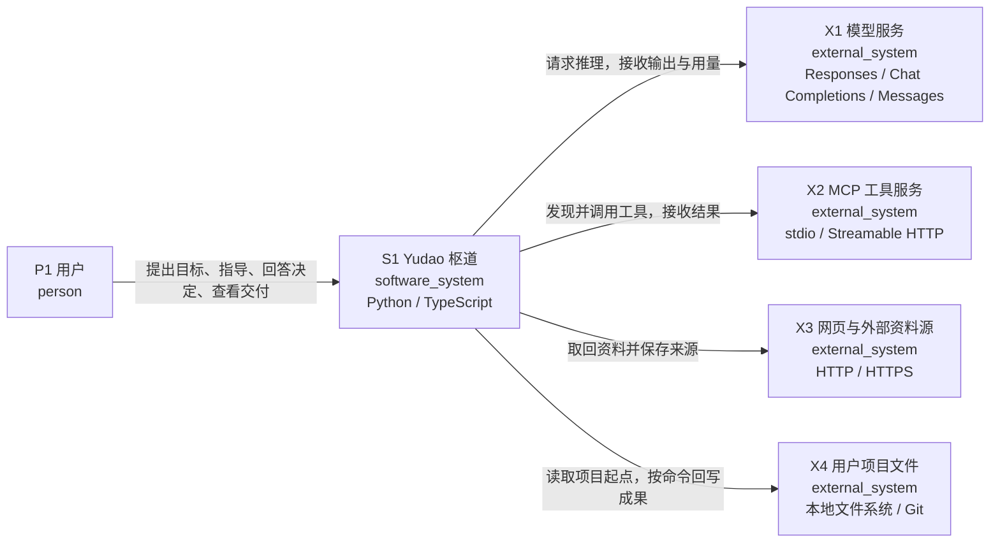

# C1：系统上下文

建模对象：`S1` Yudao。用户提供目标与决定；Yudao 负责组织部门工作、保存可追溯事实并输出可核验交付。产品、工程、质检是系统内由定义驱动的角色。

| 元素 | 职责 | 源码入口 |
| --- | --- | --- |
| `P1` 用户 | 提出目标、指导部门、回答决定、查看和取得交付 | [README.md](../../README.md) |
| `S1` Yudao 枢道 | 让产品、工程、质检围绕有效要求协作并提供可核验交付 | [README.md](../../README.md) |
| `X1` 模型服务 | 返回模型输出与用量 | [harness/providers/responses.py](../../harness/providers/responses.py) |
| `X2` MCP 工具服务 | 提供外部工具发现与调用 | [harness/mcp_client.py](../../harness/mcp_client.py) |
| `X3` 网页与外部资料源 | 提供可取回并记录来源的资料 | [harness/fetch.py](../../harness/fetch.py) |
| `X4` 用户项目文件 | 提供项目起点并接收经用户命令执行的回写；外部数据资源 | [harness/writeback.py](../../harness/writeback.py) |

`X4` 以外部数据资源表达系统责任之外的用户项目文件，读取与回写均使用本地文件访问。项目工作副本及不可变版本在 C2 内进一步表达。MCP 工具服务的协议与生命周期由外部实现提供，部署位置可以在本机或远程。

模型服务返回推理输出，工具服务返回执行结果。是否接纳成果、是否允许工具、是否结束运行由 Yudao 控制核心判断；C1 的交互关系不授予外部系统事实写入权限。
