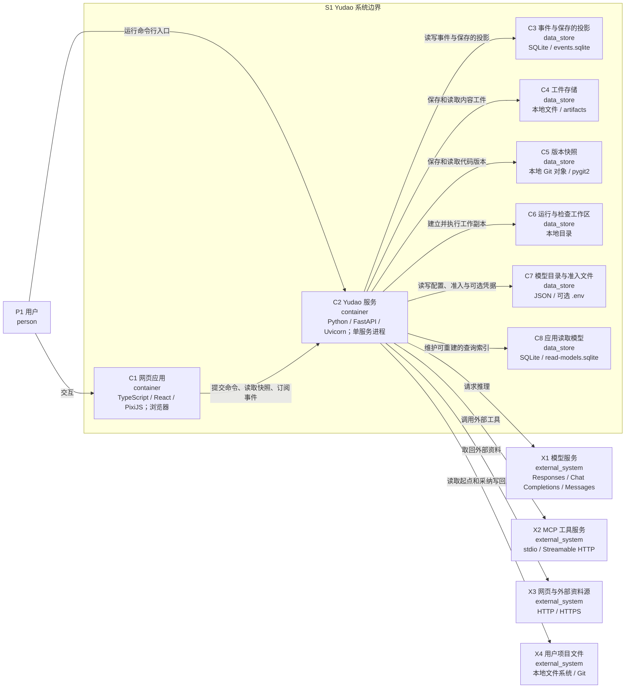

# C2：Yudao 内部容器

父级：`S1`。网页在浏览器中运行，服务在一个 Python 进程中运行。存储节点表示不同职责的数据存储，均由当前控制主机的本地实现提供。图中的文件存储没有各自独立的服务进程。

| 元素 | 职责 | 源码入口 |
| --- | --- | --- |
| `C1` 网页应用 | 提交命令、同步快照并呈现协作过程 | [client/src/renderer/src/main.tsx](../../client/src/renderer/src/main.tsx) |
| `C2` Yudao 服务 | 接收操作、驱动循环并控制事实写入 | [harness/__main__.py](../../harness/__main__.py) |
| `C3` 事件与保存的投影 | 保存事实、命令身份和可重建投影 | [harness/event_store.py · EventStore](../../harness/event_store.py) |
| `C4` 工件存储 | 按内容摘要保存请求、输出、证据等大对象 | [harness/artifacts.py · ArtifactStore](../../harness/artifacts.py) |
| `C5` 版本快照 | 保存不可变代码树与正式成果关联的版本 | [harness/git_versions.py · GitVersionStore](../../harness/git_versions.py) |
| `C6` 运行与检查工作区 | 提供工作副本与检查副本，保存动作执行期间的文件 | [harness/environment.py · Workspaces](../../harness/environment.py) |
| `C7` 模型目录与准入文件 | 保存连接、访问定义、准入与可选持久化凭据；凭据另可来自内存或环境 | [harness/providers/store.py · ProviderStore](../../harness/providers/store.py) |
| `C8` 应用读取模型 | 保存可由事件重建的尝试与流转查询索引；只读打开时在内存中重建 | [harness/app/application.py · Application.__init__](../../harness/app/application.py) |

`C3` 保存运行流、项目流与目录流，以及命令去重记录、决定请求投影和保存的投影。投影可以从事件重算。`C4` 与 `C5` 保存事件引用的内容和版本。`C6` 是执行期间的可变副本。`C7` 的配置与准入使用文件管理，凭据还可以来自进程内存与环境变量。`C8` 保存应用读取模型的增量索引；可写服务使用独立 SQLite 文件，只读打开在内存中从事件重建。

默认 `LoopSystem` 将数据库、工件和工作区放在数据目录内；Provider 配置支持显式路径，默认由命令行的数据目录规则派生。存储生命周期和可重建性需要分别处理。

运行中的可写服务持有同一数据目录的进程锁。命令行只读打开使用同一产品代码和持久化格式，属于服务代码的另一种进程实例；当前图以主要的网页使用方式展开。部署与只读模式见 [动态与部署视图](05-runtime.md)。
