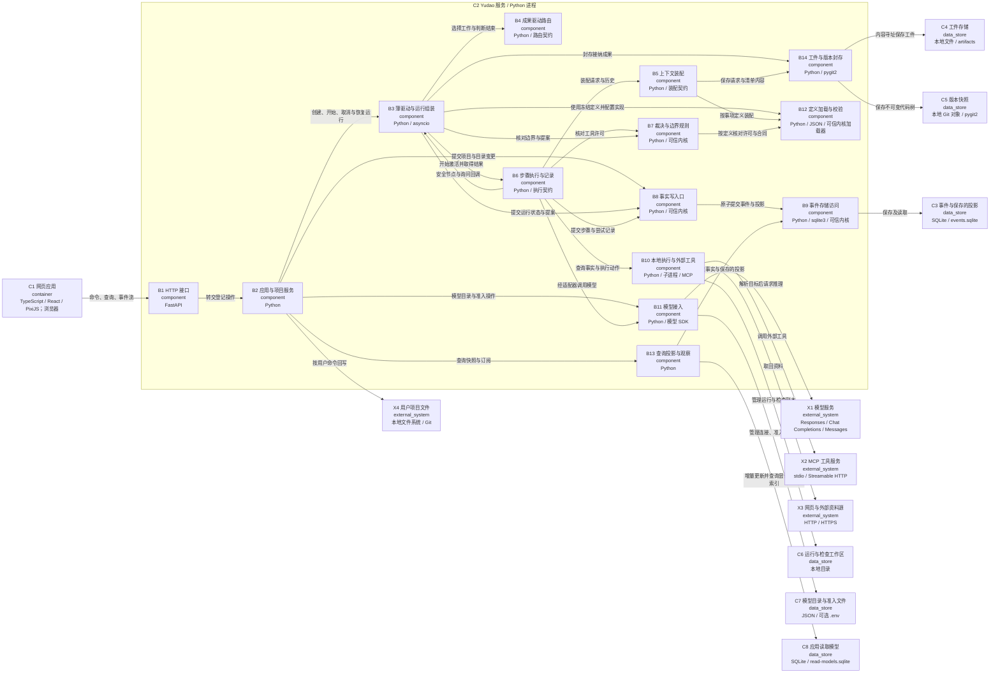
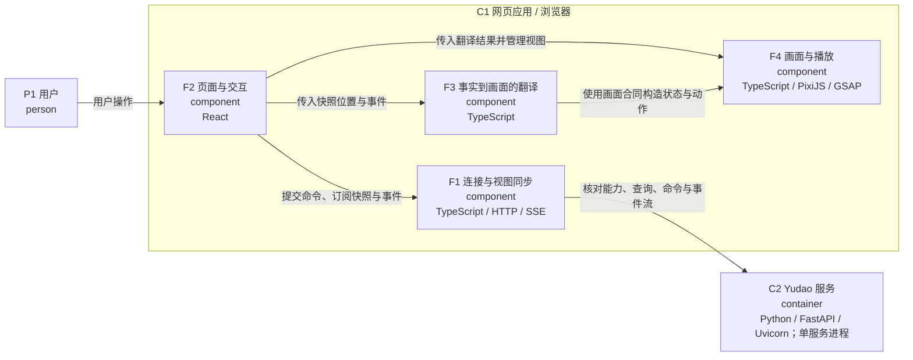

# C3：服务与网页组件

## C2 服务的内部结构

`B1` 接口层只经应用层处理领域操作。`B3` 负责组装与运行编排；默认路由、装配、执行实现由 `LoopSystem` 接入，三道契约规定交换的数据。边界框外保留网页、存储和外部依赖，以说明组件所在的运行环境。

| 元素 | 职责 | 源码入口 |
| --- | --- | --- |
| `B1` HTTP 接口 | 生成命令查询路由、提供 SSE 与页面文件并检查访问 | [harness/api/app.py · create_app](../../harness/api/app.py) |
| `B2` 应用与项目服务 | 处理登记的命令查询、项目事项、决定、配置与回写 | [harness/app/application.py · Application](../../harness/app/application.py) |
| `B3` 薄驱动与运行组装 | 组装依赖、管理运行激活、查询边界、处理询问与提案提交 | [harness/runtime.py · LoopSystem](../../harness/runtime.py) |
| `B4` 成果驱动路由 | 按事实选择工作并判断轮次和事项结束 | [harness/watched_outputs.py · WatchedOutputs](../../harness/watched_outputs.py) |
| `B5` 上下文装配 | 按冻结定义与部门历史构造请求及清单，处理压缩 | [harness/assembly.py · ContextAssembly](../../harness/assembly.py) |
| `B6` 步骤执行与记录 | 进行模型步骤、工具许可和动作调用，记录尝试与输出 | [harness/engine.py · StepDriver](../../harness/engine.py) |
| `B7` 裁决与边界规则 | 依据最小投影与事实核对工具许可、提案、合同与上限 | [harness/adjudication.py · tool_permission](../../harness/adjudication.py) |
| `B8` 事实写入口 | 组织读取判断提交事务，版本冲突重新判断，保存事件及投影 | [harness/write_path.py · WritePath.transact](../../harness/write_path.py) |
| `B9` 事件存储访问 | 实现数据库提交、读取与订阅通知 | [harness/event_store.py · EventStore.commit](../../harness/event_store.py) |
| `B10` 本地执行与外部工具 | 查询工作区事实并执行动作，返回回执，管理工作和检查副本 | [harness/environment.py · LocalEnvironment](../../harness/environment.py) |
| `B11` 模型接入 | 管理连接与准入，每次解析目标并执行模型请求 | [harness/providers/facade.py · ProviderFacade](../../harness/providers/facade.py) |
| `B12` 定义加载与校验 | 加载并校验角色、成果、工具与路由定义；JSON 数据归应用 | [harness/definitions/__init__.py](../../harness/definitions/__init__.py) |
| `B13` 查询投影与观察 | 从事实计算运行、项目、统计视图，提供快照和事件读取 | [harness/projection.py](../../harness/projection.py) |
| `B14` 工件与版本封存 | 保存内容与代码树，准备正式成果并绑定版本证据 | [harness/artifacts.py · ArtifactStore](../../harness/artifacts.py) |

`B7/B8/B9` 描述裁决、写入口和存储访问的职责。可信内核的逐文件归属以 `harness/definitions/kernel-manifest.json` 为准；C3 的聚合粒度不代替内核清单。契约圈包括路由、装配、执行、收紧检查及共用版本核对；契约与应用实现分别在模型证据中定位。

`B3` 使用边界规则和提案裁决，`B6` 使用工具许可裁决。`B8` 为调用方提供事务，`B9` 实现 SQLite 提交。`B13` 的应用投影和 `B7` 使用的最小投影具有各自职责。`B14` 汇集工件、版本与接纳成果封存，正式成果的事实记录仍通过 `B8`。

## C1 网页的内部结构

| 元素 | 职责 | 源码入口 |
| --- | --- | --- |
| `F1` 连接与视图同步 | 核对能力版本、提交命令、恢复事件流并刷新快照 | [client/src/renderer/src/contract/client-app.ts](../../client/src/renderer/src/contract/client-app.ts) |
| `F2` 页面与交互 | 组织项目、部门、模型与决定页面，提交用户操作 | [client/src/renderer/src/app.tsx](../../client/src/renderer/src/app.tsx) |
| `F3` 事实到画面的翻译 | 将查询快照翻译为状态，将事件翻译为带回链的画面动作 | [client/src/renderer/src/translate/room.ts](../../client/src/renderer/src/translate/room.ts) |
| `F4` 画面与播放 | 消费画面合同，管理角色场景、绘制和播放 | [client/src/renderer/src/pixel/contract.ts](../../client/src/renderer/src/pixel/contract.ts) |

页面将查询快照交给翻译层得到画面状态，将事件交给翻译层得到动作，然后把结果送入画面。`F3 → F4` 表示对画面合同的类型与构造约束的依赖；运行时传递由页面组织。画面消费状态与动作，事实读取和视图刷新集中在页面与连接侧。

主要静态依赖约束位于 `pyproject.toml` 的 import-linter 合同；关键验证入口见 [建模方法](06-code-to-model.md)。图的关系还包含依赖注入后的调用、回调和数据访问，需要结合关系证据阅读。
