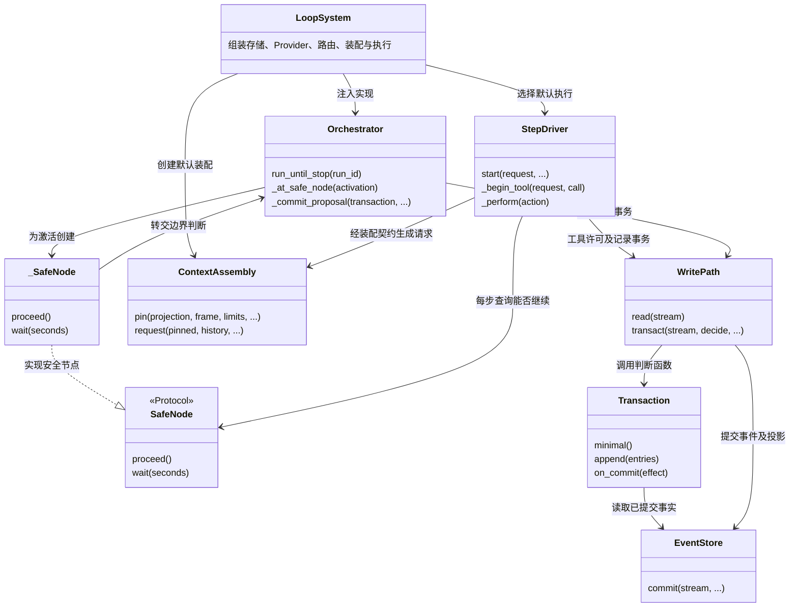

# C4：关键代码结构

父级：服务容器 `C2`。本视图展开 `B3` 薄驱动、`B6` 步骤执行、`B7` 裁决、`B8` 写入口之间的代码关系。类型名按当前代码保留；完整路径与定位行见 `model.json`。

`SafeNode` 定义在 `harness/execution_contract.py`；`_SafeNode` 在 `harness/orchestrator.py` 中实现。`ContextAssembly` 在图中表示 `harness/assembly.py` 的实现类；装配的同名 Protocol 位于 `harness/assembly_contract.py`。`StepDriver` 接受契约类型，默认实现由 `LoopSystem` 注入。这使安全节点的判断留在薄驱动一侧，也允许替换装配与执行实现。

| 代码入口 | 承担的保证 | 上层元素 |
| --- | --- | --- |
| `runtime.LoopSystem.__init__` | 显式选择路由、装配、执行，接上持久化依赖 | `B3` 的组装入口；C2 服务组成 |
| `engine.StepDriver._begin_tool` | 在写入口事务内读取事实、调用 `adjudication.tool_permission`，许可后记录工具开始 | `B6 → B7/B8/B10`；总图第四节执行、裁决、动作 |
| `orchestrator.Orchestrator._commit_proposal` | 提交时调用 `commit_decision`，核对当前依据 | `B3 → B7/B8`；总图第四节写入口、裁决 |
| `write_path.WritePath.transact` | 构造事务、调用判断、提交；遇到流版本冲突重新判断；成功后执行效果并通知 | `B8 → B9`；事实与投影一并保存 |
| `event_store.EventStore.commit` | 数据库事务核对版本、执行权与命令身份，并保存事件和投影 | `B9 → C3`；C2 唯一事件存储 |
| `minimal_projection.fold_events` | 从骨架事件计算裁决读取的最小投影 | `B7`；总图第二节可信内核 |

这里的箭头表示实际调用依赖。裁决函数在调用方的事务判断内执行；模型输出经校验和提交才成为接纳事实。模型服务的返回结果与接纳结果在模型中分别表达。

代码层没有枚举全部方法。完整类图会包含大量与架构判断无关的细节；当前选取的结构能够解释状态主权、边界检查、替换契约和原子提交四项保证。
