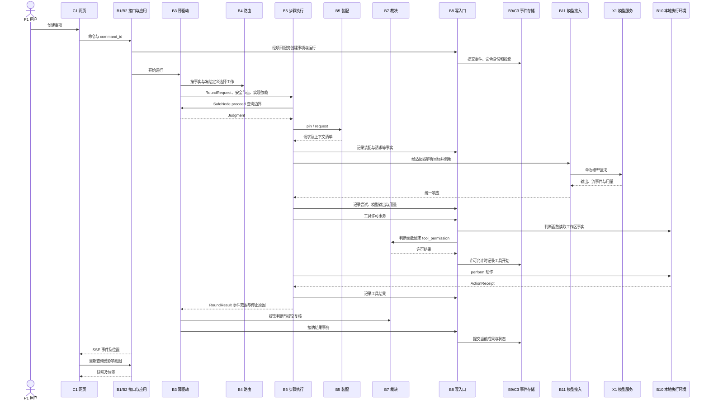
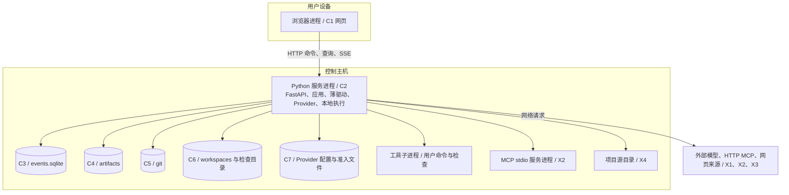

# 动态与部署视图

## 一次部门工作的主要路径

参与者沿用结构模型的元素标识。此图表达一次普通工具执行的因果顺序；一次工作可以多次请求模型、执行多个工具、产生询问分支或在安全节点停止。

时序图省略每次 `WritePath` 调用后的存储提交以保持可读性。工具许可事务的两条读取/判断消息由 `StepDriver._begin_tool` 提供的判断函数执行。只有通过许可的普通环境动作进入 `LocalEnvironment.perform`。提案、询问等宿主工具在 `StepDriver._execute_call` 及薄驱动内有各自分支，不能套用普通环境动作的执行路径。

`ask` 经 `SafeNode.ask` 进入 `Orchestrator._execute_ask` 和 `_run_ask_branch`，调用方等待工具结果，分支仍经过执行与装配契约。它在 C3 中属于已有组件的协作。取消、用量上限和等待决定通过安全节点影响步骤执行。具体放行条件由当前有效合同、交付及核验事实约束，相关测试见 `test_release_check.py`、`test_release_waits_for_input.py` 与 `test_routing_ask.py`。

## 当前部署

浏览器可以在控制主机本机，也可以在局域网另一台设备。`__main__.SERVICE_LOCK` 与命令行启动路径保证同一数据目录只有一个可写服务进程。服务内部共享事件循环；命令执行与 stdio MCP 可以启动子进程。当前本地执行实现为 `LocalEnvironment`，远程执行服务没有作为已实现容器加入本模型。

页面构建产物随 wheel 由 `api.pages.PageFiles` 提供，源码直接启动时取决于发布资源是否已构建。只读命令行入口通过 `Application` 的只读打开路径访问事件、工件和 Git；其进程是另一种运行方式，与可写服务共享产品代码。演示与 smoke 是工程入口。

事件投影能够重建，工件和 Git 对象保存事件引用的内容；工作区提供执行副本。配置文件与准入记录具有独立的文件生命周期，模型接入凭据存在内存、环境变量或 `.env`。因此，恢复和迁移时需要按这些存储的职责处理，不能仅凭“事件是唯一事实来源”推导所有文件都可删除。
