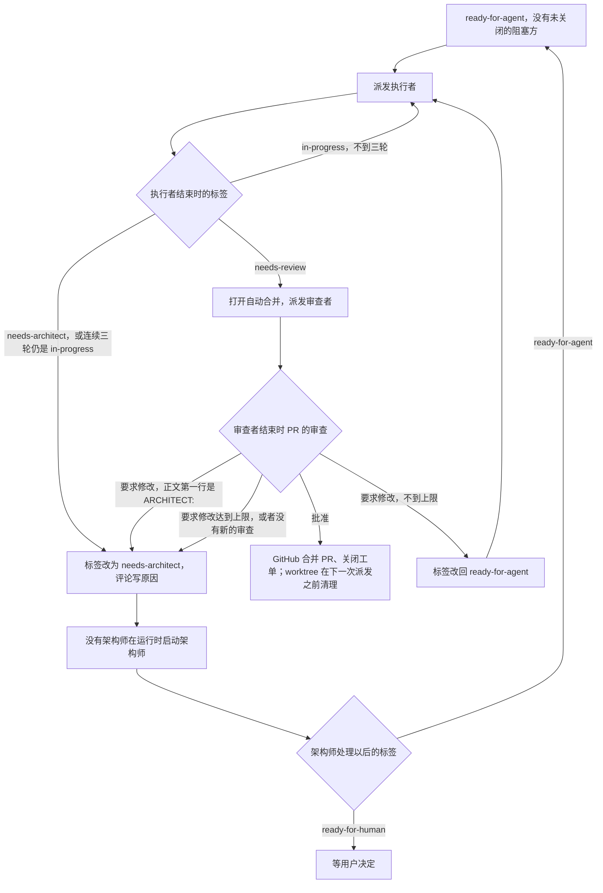

# 派发者

派发者在自主推进中调度工单：派发执行者与审查者，打开自动合并，把卡住的工单交给架构师并启动架构师。派发者不判断交付的内容：内容由审查者判断，机械的检查由 CI 运行，能不能合并由 main 的规则决定（第 4 节）。担任派发者的可以是 Claude，也可以是 doctor（Hermes）；机器、账号、路径与命令见[运行配置](autopilot-runtime.md)。

本文只写派发者的规则。执行者与审查者的规则在 `AGENTS.md`，架构师的规则在 `CLAUDE.md`，三类角色共同遵守的内容在[共同规则](shared-rules.md)。

## 1. 范围

用户明确说「自主推进」并指定范围（一个父工单、一组子工单或一个阶段）时开始，只处理范围内的工单。范围是阶段工单或父工单时，范围内的工单是它名下各级子工单（GitHub 的子工单关系），不含它自己。

工单正文、任务评论、工单之间的依赖、规则与设计文档由架构师维护。派发者只写状态说明（卡住的原因、失败的检查与运行链接），不写任务内容，不修改工单正文、依赖、规则与设计文档。

派发者只在运行配置第 1 节列出的目录中工作，不另建目录；临时的检出与检查放在集成层的 worktree，没有集成层在运行时使用。

## 2. 记录的分工

- 工单写要做什么：正文、架构师的任务评论、流程标签（`ready-for-agent`、`in-progress`、`needs-review`、`needs-architect`，含义见[分诊标签](triage-labels.md)）。
- PR 写做得怎么样：执行者每一轮的交付说明（第一行 `DELIVERY: 第 <k> 轮` 的评论），审查者的审查（批准或要求修改，正文写理由）。
- 一张工单一个 PR：分支 `issue-<编号>`，PR 正文写 `Closes #<编号>`，每一轮在同一个分支上推送。合并以后重新打开的工单从 main 重新建分支，开新的 PR。
- 由工单找 PR：`gh pr view issue-<编号>`。

## 3. 流程

1. 派发：先清理工单的 worktree：工单已经关闭的，按运行配置第 3 节的清理命令删除。清理看工单是否关闭，不在批准的那一刻做：自动合并要等 CI 通过以后才发生，派发者看到批准时往往还没有合并，审查者的进程也可能还在那个目录里。然后从范围内取 `ready-for-agent`、没有未关闭阻塞方、没有负责人的工单，按里程碑的阶段从小到大派发（阶段一先于阶段二），没有里程碑的与「待排期与阶段总览」里的最后派发；按运行配置的命令在工单的 worktree 中后台运行执行者。工单之间的先后只看 GitHub 的工单依赖，没有依赖的同时派发，不限张数，派发者不另外判断。派发之前不做核对：依据的设计说明有没有改动由执行者在动手前的三项核对里处理（`AGENTS.md` 执行者第 2 步，用户 2026-10-27 决定）。带 `in-progress` 并且没有执行者进程在跑的工单（上一轮做不完）也在派发之列，派给原来的执行者。
2. 交付以后：执行者把标签改为 `needs-review` 时 CI 已经通过（执行者一直修到 CI 通过才交付），直接进入第 3 步。集成层在合并以后由 CI 运行，失败按第 5 节处理。
3. 审查：打开自动合并（`gh pr merge <PR> --auto --squash`），然后在同一个 worktree 中按运行配置的命令后台运行审查者。自动合并只需要打开一次，以后的推送不会关掉它。
4. 审查结论：读 `gh pr view <PR> --json reviewDecision,reviews`。
   - 批准：GitHub 在第 4 节的条件满足时合并 PR，`Closes #<编号>` 随之关闭工单。派发者推进下一个，工单的 worktree 在下一次派发之前清理（第 1 步）。
   - 要求修改，审查正文第一行是 `ARCHITECT:`：审查者请架构师处理，把标签从 `needs-review` 改为 `needs-architect`（第 7 步）。
   - 其他要求修改：这个 PR 上要求修改的次数不到参数表的上限时，把标签从 `needs-review` 改回 `ready-for-agent`，回到第 1 步。审查就是下一轮的任务，执行者自己读取，派发者不另写任务评论。
5. 搁置：同一个 PR 要求修改达到上限，或者同一张工单连续三轮执行者结束时标签仍是 `in-progress`、连续两次审查者结束时 PR 上没有新的审查，把工单的标签改为 `needs-architect`，评论卡住的原因（第 7 步），然后推进下一个没有阻塞方的工单。不到这个数的，下一轮再派同一个角色接着做。执行者自己改为 `needs-architect` 的，原因已经写在它的 `ARCHITECT:` 评论里，派发者不另写。
6. main 上的 `check` 失败：关掉所有打开的 PR 的自动合并（`gh pr merge <PR> --disable-auto`），暂停打开新的自动合并；重新打开刚合并的那张工单，评论写明失败的检查与运行链接，标签改为 `ready-for-agent`，派发给原来的执行者。main 恢复通过以后，重新打开已批准 PR 的自动合并。
7. 唤醒架构师：范围内有工单带 `needs-architect`、参数表的「唤醒架构师」是开、没有架构师进程在运行时，按运行配置第 3 节的命令在架构师的 worktree 中后台启动一个，记下进程号。同一时间只有一个架构师进程，它一次处理全部带这个标签的工单。
   - 架构师进程结束时仍有工单带这个标签，再启动一次。同一张工单连续经过两次启动仍然带这个标签，改为 `ready-for-human`，评论写明架构师没有处理完。
   - 运行超过参数表的时长时，结束这个进程（只结束记下进程号的那一个），剩下的工单留给下一次启动。
   - 架构师处理以后把标签改为 `ready-for-agent`、`needs-review` 或 `ready-for-human`；派发者只看标签，不读处理的内容。`ready-for-human` 的工单等用户决定。

## 4. 合并的条件

main 的规则（定义见运行配置第 6 节）：

- 只通过 PR 合并，只允许 squash。
- CI 的检查 `check` 通过。
- 一个审查批准。分支有新的推送时，原来的批准作废；最后一次推送必须由推送者以外的人批准。
- 不要求分支跟上最新的 main：有先后的工单由工单依赖错开，main 上每次合并以后 CI 再运行一次（第 3 节第 6 步）。
- 只有仓库所有者账号可以豁免。派发者使用这个账号，但不使用豁免：不加 `--admin`，不改规则。架构师（包括被唤醒的架构师）用这个账号直接推送文档与日记。架构师每次会话开始时查一次豁免记录。

## 5. 集成层在合并以后的失败

CI 在 main 的每个合并提交上运行 `integration`（运行配置第 5 节），不挡合并。派发者每一轮查看最近的结果（`gh run list --workflow CI --branch main --event push --limit 10`），对 `integration` 失败的运行：

1. 重新运行失败的作业一次（`gh run rerun <运行编号> --failed`）。重新运行通过时，在这个合并提交对应的工单上评论失败项与两次运行的链接，按通过处理；失败项同样按第 2 步「没有新的失败项」一条记到不稳定项的工单。
2. 仍然失败时，把这次的失败项与最近 7 天里 main 上全部 `integration` 运行（推送、重新运行与手动触发）的失败项比较（`gh run list --workflow CI --branch main --created ">=<7 天前的日期>" --limit 100`，对其中失败的运行 `gh run view <运行编号> --log-failed | grep FAILED`）；前一个合并提交的 `integration` 还在运行时等它结束。
   - 没有新的失败项：不重新打开工单。这些项在别的提交上也失败过，是不稳定项，不是这次合并引起的。每个失败的测试文件，在标题写着这个文件名的打开的 `bug` 工单上评论这次的运行链接；没有这样的工单时新建一张，标题 `[集成层] <测试文件> 不稳定`，正文列出失败项与各次运行链接，标签 `bug` 与 `needs-architect`，里程碑取正在派发的里程碑中最早的一个（顺序见第 1 步），由架构师写成修复工单（第 3 节第 7 步）。这些打开的工单就是不稳定项的清单。
   - 有新的失败项：重新打开这个合并提交对应的工单（`gh api repos/bender2333/yudao/commits/<提交>/pulls --jq '.[].number'` 找到 PR，PR 正文的 `Closes #<编号>` 就是工单），评论写新的失败项与运行链接，标签改为 `ready-for-agent`，派发给原来的执行者。不暂停其他 PR 的合并，不另建工单。
3. 合并提交对应不到工单（直接推送到 main 的提交）时不处理，由架构师在里程碑发布之前核对 main 上的结果时处理。
