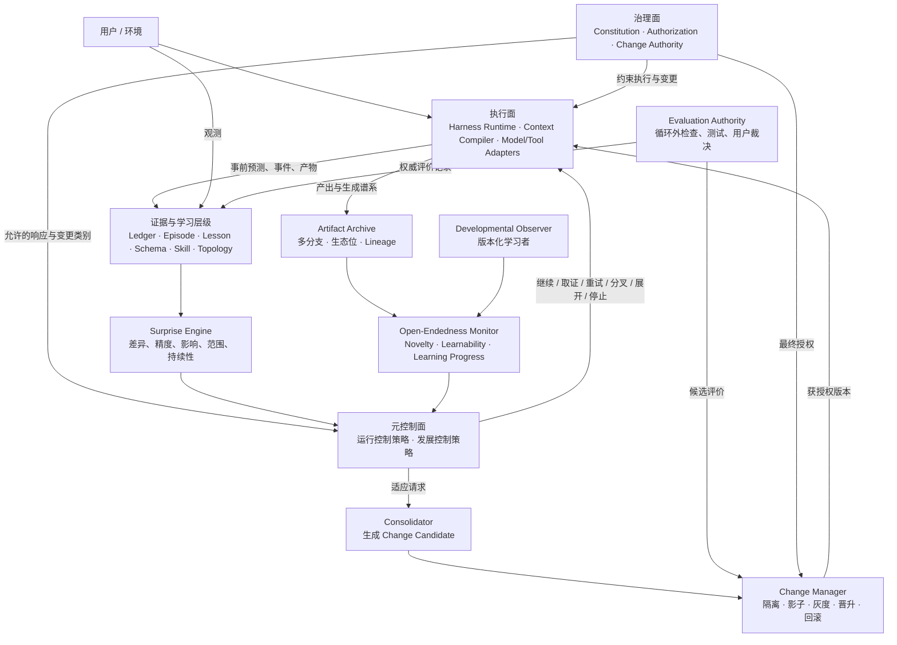
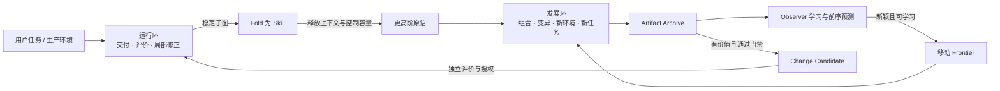
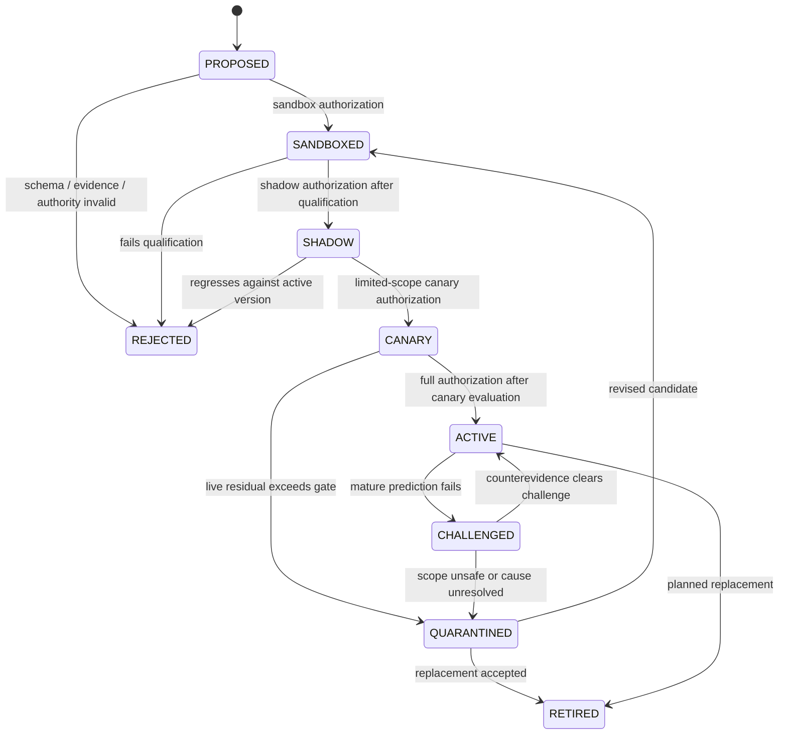

# 动态 Harness 技术架构

> 状态：**DRAFT / 理论架构基线**
> 日期：2026-08-11
> 范围：只定义目标系统的技术架构、领域模型与验证原则，不授权代码实施、模型微调或 live 实验。
> 与当前实验的关系：三部门 S/T 实验是一个可复查的 Harness 形态，不是本文架构的固定顶层。本文不取代当前冻结协议，也不改变 `NEXT.md` 中 P3 之后的实验门槛。

## 1. 目的

本文回答下面一个架构问题：

> 如何让一个以冻结 LLM 为通用推理算子的系统，一面根据运行证据调整控制参数、经验、Schema、Skill 与 Harness 拓扑，一面持续产生新颖且可学习的 Artifact，在不把单次异常直接写入模型权重的前提下持续发展，并通过局部替换、并行验证和回滚为渐进 RSI 提供基础设施？

核心结论是：

1. 动态 Harness 不是一个更大的 Agent Loop，而是一个**受治理的复合自适应系统**。
2. 系统学习不等于模型权重学习。冻结权重时，外部状态与执行策略的持久变化仍然构成系统级学习。
3. 惊讶是诊断和资源分配信号，不是宪法，也不是单一全局目标函数。
4. 复杂度控制采用可逆的 `Fold / Unfold`：稳定子图折叠为 Skill，异常时恢复内部 Harness。
5. 递归只要求外部契约同构，不要求内部循环同构。不同层可以采用不同的收敛机制。
6. 越高影响范围的变更，更新越慢、证据门槛越高、评价越独立、回滚要求越严格。
7. 学习需要双环：运行环在局部任务上收敛，发展环持续移动“可学习的新颖性”前沿；只有运行环会接触生产活动权。

## 2. 非目标

本文不尝试：

- 证明开放式 RSI 必然可行或安全；
- 把自由能原理当作数字系统已经成立的经验定律；
- 用一个标量描述所有预测误差、风险和价值；
- 把 Novelty 最大化，或把随机、对抗性、不可学习的噪声当成 Open-endedness；
- 从任何有限运行记录证明系统将“永远、无上限”地产生新颖产物；
- 让系统自动改写自己的宪法、授权或循环外评价；
- 规定模型 provider、数据库、消息中间件或部署技术；
- 给任何晋升门槛预先写死次数、分数或时间窗口；
- 把当前三部门状态机直接扩展成无限递归的同构组织；
- 在本文阶段修改现有 Harness 代码。

## 3. 理论依据与证据等级

本文把理论来源分为硬边界、经验模型、工程模式和设计假设。它们不能互相冒充。

| 来源 | 证据等级 | 本文采用的部分 | 本文不声称的部分 |
|---|---|---|---|
| 图灵可计算性、Rice 定理 | 数学边界 | 无界复合系统不存在通用语义正确性判定器，因此必须限制变更类别并依赖局部评价 | 它不告诉我们具体模块应该怎样划分 |
| 自适应控制、Lyapunov 思路 | 条件性数学工具 | 快速参数自适应应有界，控制增益与稳定性需要独立监测 | 它不能证明自然语言目标或复杂代码变更正确 |
| 稳定性-可塑性困境、CLS | 认知科学模型与实证 | 快速情景记录和慢速泛化应采用不同时间尺度，单次异常不直接触发广域更新 | 它不证明人工系统必须精确复刻海马体和皮层，也不推出固定层数 |
| Predictive Coding / Active Inference | 解释框架与部分可计算模型 | 预测、误差、精度和认知价值可作为元控制语言 | 更高预测层天然更新更慢不是普遍定理；自由能也不是系统宪法 |
| Hierarchical RL / Options | 形式化决策框架 | Skill 可表示为带起始条件、内部策略和终止条件的时间抽象 | 它不自动解决 Skill 的生成、验证与跨任务迁移 |
| [Hughes et al. 2024 Open-endedness](./2026-08-11-open-endedness-research.md) | Position paper 中的形式定义 | Artifact 序列必须相对指定 Observer 同时满足 Novelty 与 Learnability，二者共同排除固定分布和随机陷阱 | 有限窗口只能支持 finite open-endedness；定义不保证正确、完整、有价值或安全 |
| Autopoiesis | 生物系统理论与跨领域类比 | 系统身份可由持续维持的组织关系理解，而非由每个实现材料理解 | 本文不声称数字 Harness 已满足生物学意义的自生系统定义 |
| Strangler、影子运行、灰度与回滚 | 工程模式 | 新旧实现共存、比较、局部切换和可恢复替换 | 工程实践不提供全局最优或形式安全证明 |

因此，本文的理论态度是：借用自由能与预测编码组织控制问题，借用持续学习解释时间尺度，借用分层强化学习定义 Skill，用 Open-endedness 定义发展环需要维持的序列性质，最终用可审计的工程机制兑现，而不是把任何类比或有限实验当作无限性证明。

## 4. 形式化视图：冻结权重下的系统学习

令：

- `W`：冻结的 LLM 权重；
- `K_t`：Episode、Lesson、Schema 与 Skill 的活动集合；
- `H_t`：活动 Harness 拓扑；
- `C_t`：Context Compiler、Router、预算与控制参数；
- `G`：宪法与授权约束；
- `E_t`：截至时间 `t` 的证据账本。
- `A_1:t`：截至时间 `t` 的 Artifact 序列及生成谱系；
- `O_t`：绑定版本、训练前缀和可见信息的 Developmental Observer。

系统在时间 `t` 的复合策略可写为：

```text
Pi_t(a | x) = Harness(H_t, LLM_W, Compile(C_t, K_t, x), Tools)
```

学习更新为：

```text
(K_t+1, H_t+1, C_t+1) = Update(K_t, H_t, C_t, E_t, Surprise_t | G)
```

固定目标分布上的适应学习满足下面三点时，即使 `W` 不变，系统也已经发生学习：

1. 更新由过去经验引起，而不是一次性的随机路由；
2. 更新持久影响未来任务的策略；
3. 更新在独立评价中改善了未直接重放的任务，而不只是记住原样输入。

发展学习还要求另一类证据：相对于明确的 Observer，后续 Artifact 仍保持非平凡新颖性，而 Observer 从过去 Artifact 中学习后又能更好地理解后续 Artifact。Novelty 但不可学习是噪声；可学习但不再新颖是已封闭课程。

模型权重只是可选的最慢变更层，不是知识必然抵达的终点。显式 Skill 在可审计性、组合性、作用域和回滚上通常优于隐式权重知识。

## 5. 架构不变量

以下不变量高于任何具体模块实现：

1. **G-1 宪法外置**：生成候选变更的回路不能自动修改约束它的宪法、授权和评价主权。
2. **G-2 评价独立**：候选版本不能修改自己的评价集、评价结果或晋升门槛。
3. **E-1 预测先于观测**：没有事前 `Prediction Commitment`，只能记录异常，不能事后补写成可校准预测。
4. **E-2 证据与解释分离**：Observation 是事实记录；因果归因和 Lesson 是可失效假设。
5. **S-1 惊讶保持向量**：误差幅度、精度、影响、作用域、持续性和分布偏移分别保存，不建立跨场景永久统一的单值排名。
6. **S-2 精度不等于严重性**：大但低精度的残差优先触发取证；高精度且高影响的残差才允许升级变更层级。
7. **A-1 最低层吸收**：误差由能够可靠处理它的最低变更层吸收；局部适应失败后才向上升级。
8. **A-2 时间尺度分离**：影响范围越广、可逆性越差，更新频率越低，独立证据与回归覆盖要求越高。
9. **A-3 提案不等于生效**：LLM、Distiller、Council 或 Meta-Controller 只能生成提案，不能直接取得活动权。
10. **F-1 可逆抽象**：每个活动 Skill 必须保留适用条件、证据谱系、内部子图引用与失败回退路径。
11. **F-2 递归有界**：递归深度、调用数、墙钟、并发和总成本由普通代码限制；耗尽即显式停止。
12. **M-1 唯一活态**：同一作用域只能解析到一个活动事实版本和一个活动拓扑版本；历史外置并带失效语义。
13. **M-2 原始经历不直接授权**：单个 Episode 或单张 Lesson Card 不得自动变成跨任务活动策略。
14. **R-1 所有变更可追溯**：控制参数、知识、Skill、拓扑和模型适配器都必须版本化，记录提出者、证据、评价、授权和回滚目标。
15. **R-2 权重离线巩固**：单次惊讶不能直接触发模型权重更新；模型适配器只允许离线候选、独立回归和显式晋升。
16. **D-1 确定性归代码**：版本选择、权限、预算、计数、状态迁移、哈希、证据绑定与门禁不得交给 LLM 自述。
17. **O-1 新颖性依赖观察者**：Novelty 必须绑定 Observer 版本、训练历史、可见信息、Artifact 类型和评价窗口；禁止声称绝对新颖。
18. **O-2 新颖且可学习**：发展环同时要求 Novelty 和 Learnability；只有一项不构成 Open-endedness 证据。
19. **O-3 双环隔离**：发展环只能生成 Artifact、实验和 Change Candidate，不能绕过评价与授权直接改变生产活动拓扑。
20. **O-4 谱系优先于唯一活态**：生产作用域保持唯一活动版本；探索 Archive 允许多个分支和生态位并存，全部保留父代、生成器与观察者谱系。
21. **O-5 有限证据诚实**：有限窗口只能支持“观察到持续开放性信号”，不能证明未来无上限或永久开放。
22. **O-6 前缀后缀隔离**：Observer 版本、训练前缀和预测状态必须在评价后缀生成或揭示前冻结并哈希；生成器不得选择性丢弃不利 Artifact。
23. **O-7 测量协议预注册**：Artifact Schema、Observer、Loss 和时域必须在观察候选序列前固定；任一项变化都开启新协议，不能续接成同一条进步曲线。
24. **G-3 可信签发**：Evaluation 和 Authorization 只有作为权威 Ledger 中完整绑定且可验证的记录引用才有效；字段相同的调用者输入不产生权限。
25. **R-3 拓扑不可点名**：生产调用者不能指定 TopologyRef；HarnessRuntime 只能执行 ChangeManager 按作用域和可信授权解析出的 Execution Grant。

`A-2` 是本文主动施加的工程不变量，不冒充预测编码理论已经证明的自然规律。

## 6. 总体结构

动态 Harness 由三个正交平面和一条持久学习层级组成。Meta-Controller 不属于记忆层级；Governance 也不是最高一层可自动学习的记忆。



### 6.1 治理面

治理面定义什么结果值得追求、什么风险不可接受、谁有权评价和批准变更。它回答“什么是好”，而 Surprise Engine 只回答“哪里和预期不同”。

宪法至少包含：

- 用户目标与优先级来源；
- 授权、数据、安全和资源硬约束；
- 允许自动调整的变更类别及幅度；
- 必须由人或外部机制批准的变更类别；
- 评价主权、证据完整性和回滚要求。

### 6.2 元控制面

元控制面包含两种不同时间尺度的策略：

- **运行控制策略**根据 Surprise Profile 选择下一种局部响应和适应层级，可以快速调整预算、采样数、取证深度和路由增益；
- **发展控制策略**根据 Open-Endedness Profile 选择 Artifact 生态位、组合原语和 Frontier Experiment，维持长期可学习新颖性。

二者都不能直接写活动知识、拓扑或模型权重。发展控制策略只能在隔离作用域产生候选；运行控制策略不能为了即时完成而篡改发展评价历史。

### 6.3 执行面

执行面运行一个已授权的活动拓扑。它把目标、唯一活态、相关 Skill、约束和预算编译成局部上下文，调用 LLM 和工具，并产出带证据引用的结果。

### 6.4 持久学习层级

持久学习层级按变更影响范围排序，不声称它等同于大脑解剖层级：

| 层级 | 活动状态 | 典型更新触发 | 默认权威 | 影响与回滚 |
|---|---|---|---|---|
| L0 工作状态与控制增益 | 当前计划、注意对象、采样数、预算分配 | 每个事件或局部残差 | Meta-Controller 在硬边界内 | 局部、短期、可自动恢复 |
| L1 Episode | 预测、行动、观测、证据、残差 | 有证据价值的经历 | Evidence Ledger | 只追加事实，不直接改变策略 |
| L2 Lesson / Schema | 可证伪经验假设、跨情境预测结构 | 重复且独立的高精度残差 | Consolidator 提案，Change Manager 晋升 | 作用域受限，可失效或降级 |
| L3 Skill | 可执行抽象及其契约、证据与回退 | Schema 已能稳定指导行动 | 影子/灰度评价后授权 | 影响多个任务，必须可展开 |
| L4 Context / Router / Topology | 上下文策略、节点图、角色与资源结构 | 多个 Skill 或任务反复出现编排残差 | 独立基准比较后授权 | 广域影响，必须并存比较和原子回滚 |
| L5 Model Adapter / Weight | 可选模型适配版本 | 模式稳定、广泛、外部表达成本过高 | 离线训练、全回归、显式批准 | 最难解释、最难回滚，默认不启用 |

随着层级上升，应单调增加：证据门槛、独立评价范围、观察窗口、变更审查和回滚演练。更新频率应单调下降。

### 6.5 运行环与发展环

原设计只有“预测误差 -> 修正 -> Fold”的收敛动力。长期运行后，它会把熟悉问题压缩成稳定 Skill，随后停在固定能力边界。Open-endedness 要求增加一条不以当前任务失败为前提的发展环：



两环的关系不是“稳定或创新”二选一：

- Fold 把已掌握复杂度压缩为新原语；
- 发展环用这些原语构造此前不可达的 Artifact 空间；
- 新 Artifact 制造结构化 Surprise；
- Observer 与系统学习其中规律，再形成更高阶 Fold。

因此，习惯化是 Open-endedness 的前提之一：没有压缩，系统被旧复杂度耗尽；只有压缩而没有发展环，系统则会过早收敛。

## 7. 核心模块与接口

模块按“外部接口小、内部行为深”设计。调用者和测试都只跨同一条 seam，不暴露内部提示词、角色数量或循环形状。

### 7.1 HarnessRuntime

**职责**：执行指定活动拓扑、限制递归与资源、调度节点、记录事件并返回结果。它不决定候选是否晋升。

```python
class HarnessRuntime:
    def execute(
        self,
        request: ExecutionRequest,
    ) -> ExecutionResult: ...
```

`ExecutionRequest` 只包含目标、作用域、活动状态引用、调用者能力、执行目的和预算，不能携带 `TopologyRef`。HarnessRuntime 内部向 ChangeManager 请求不可变 `ExecutionGrant`；Grant 绑定已授权拓扑哈希、作用域、模式、预算、流量分片、过期时间和授权引用。普通生产调用只能解析到活动版本或已取得限域授权的 Canary，不能由调用者点名候选版本。

`ExecutionResult` 只包含终态、输出工件、Prediction Commitment、Evidence 引用、成本和停止原因。Sandbox、Shadow 和 Frontier 执行也必须持有对应能力的 Grant，但它们的输出作用域与生产隔离。

### 7.2 HarnessNode 内部 seam

递归组合只通过一条内部 seam 完成：

```python
class HarnessNode(Protocol):
    def run(
        self,
        invocation: NodeInvocation,
        runtime: ChildRuntime,
    ) -> NodeOutcome: ...
```

至少存在四种真实 adapter，因此这不是假想 seam：

- `DeterministicWorkflowNode`：固定代码工作流；
- `AgentLoopNode`：单 LLM 工具循环；
- `TeamNode`：三部门或其他多角色契约循环；
- `SkillNode`：已折叠的稳定子图。

外部契约递归同构，内部收敛机制保持异构。例如三部门依靠权威隔离和工单收敛，探索节点可以依靠丢弃和预算收敛，二者不必复用同一个 Orchestrator。

### 7.3 ContextCompiler

**职责**：把唯一活态、适用 Skill、薄因果链、当前工单和约束编译成节点上下文。它不判断任务是否成功。

```python
class ContextCompiler:
    def compile(self, request: ContextRequest) -> CompiledContext: ...
```

规则：

- 同一事实只注入唯一活动版本；
- 原始历史默认不注入，只提供带失效标记的引用检索；
- Episode 和候选 Lesson 不因存在而自动进入上下文；
- Skill 必须先通过适用条件解析；
- 每次编译记录实际注入的版本、token 和来源。

### 7.4 EvidenceLedger

**职责**：保存不可变事件、Prediction Commitment、Observation、Evaluation Record 和证据谱系，并物化唯一活动视图。

```python
class EvidenceLedger:
    def commit(self, prediction: PredictionCommitment) -> CommitmentRef: ...
    def observe(self, observation: Observation) -> EvidenceRef: ...
    def append_evaluation(
        self,
        record: AttestedEvaluationRecord,
        capability: AuthorityCapabilityRef,
    ) -> TrustedEvaluationRef: ...
    def window(self, query: EvidenceQuery) -> EvidenceWindow: ...
```

`append_evaluation` 是能力保护的权威入口：Ledger 校验签发者能力、attestation、subject/spec 绑定和内容哈希后才生成 TrustedEvaluationRef。普通 Observation 可以是不可信输入并保留来源等级，但不能伪装成 Evaluation。

事件记录 append-only，活动知识视图不是 append-only：Lesson、Schema、Skill 和事实可以被 supersede、invalidate、quarantine 或 retire，但历史证据不删除。

### 7.5 SurpriseEngine

**职责**：比较已固化的预测和后续证据，生成结构化 Surprise Profile。它是分析模块，不拥有控制权。

```python
class SurpriseEngine:
    def assess(
        self,
        commitment: PredictionCommitment,
        evidence: EvidenceWindow,
    ) -> SurpriseProfile: ...
```

确定性契约、测试和成本计数由普通代码计算；需要语义判断的维度可以使用模型 adapter，但必须标记估计来源、校准集和不确定性，不能伪装成客观测量。

### 7.6 MetaController

**职责**：在宪法允许的范围内选择控制响应，不直接修改活动状态。

```python
class MetaController:
    def decide(
        self,
        signals: ControlSignals,
        state: ControlState,
        limits: ControlLimits,
    ) -> ControlDecision: ...
```

`ControlSignals` 可以携带当前 Surprise Profile 和较慢窗口的 Open-Endedness Profile。`ControlDecision` 是两个封闭枚举的联合：

```text
OperationalDecision:
  continue / gather_evidence / retry_local / diversify
  invoke_review / unfold_skill / record_episode
  request_consolidation / stop / escalate_to_authority

DevelopmentalDecision:
  continue_frontier / open_niche / combine_primitives
  generate_challenge / diversify_observer / pause_niche
  propose_artifact_candidate / stop_frontier
```

DevelopmentalDecision 只对隔离发展作用域生效，不能转换成生产活动版本切换。

### 7.7 Consolidator

**职责**：从证据窗口提出 Lesson、Schema、Skill、Topology 或 Model Adapter 候选。它可以由 LLM 辅助，但输出只是 Change Candidate。

```python
class Consolidator:
    def propose(
        self,
        window: ConsolidationWindow,
        target: AdaptationLayer,
    ) -> list[ChangeProposal]: ...
```

`ConsolidationWindow` 绑定 Evidence Window，并可包含 Artifact Sequence、Open-Endedness Profile 和生态位谱系；调用者不需要理解两套存储的内部格式。每个 Proposal 必须给出证据、反例、适用范围、预期改善、风险、回滚目标和评价计划。没有反例搜索结果的 Proposal 不能进入影子阶段。

### 7.8 ChangeManager

**职责**：管理候选生命周期、版本解析、并存比较、晋升、隔离和回滚。它不生成候选，也不自产评价。

```python
class ChangeManager:
    def submit(self, proposal: ChangeProposal) -> CandidateRef: ...
    def advance(
        self,
        candidate: CandidateRef,
        evaluation: TrustedEvaluationRef,
        authorization: TrustedAuthorizationRef,
    ) -> CandidateStatus: ...
    def resolve_execution(self, request: ExecutionRequest) -> ExecutionGrantRef: ...
```

`advance` 不接受调用者内嵌的评价或授权 JSON。它只解析可信 Ledger 引用，并逐项校验：

- 签发者拥有 Evaluation 或 Governance 能力；
- 候选 id、内容哈希、版本和目标层完全匹配；
- 作用域、评价规格哈希、证据集合和回滚目标完整绑定；
- 记录未过期、未撤销且适用于当前候选状态；
- Authorization 明确区分 `sandbox / shadow / canary / full` 权限；
- Canary Authorization 还绑定流量比例、时间窗、预算、停止门和活动基线。

任一绑定缺失、错配或 stale 都 fail closed。`resolve_execution` 只返回已通过上述验证的 Grant；同一生产作用域的 full active 版本唯一，Canary 仅在其授权分片内覆盖该解析。

### 7.9 GovernanceKernel

**职责**：返回某作用域的约束和变更授权，不执行任务、不生成候选。

```python
class GovernanceKernel:
    def constraints(self, scope: Scope) -> ConstraintSet: ...
    def authorize(
        self,
        proposal: ChangeProposal,
        evaluation: TrustedEvaluationRef,
        requested_level: AuthorizationLevel,
    ) -> TrustedAuthorizationRef: ...
```

宪法版本变化必须来自 GovernanceKernel 外部的显式权威流程，不能复用普通 Change Candidate 的自动晋升路径。

### 7.10 EvaluationAuthority

**职责**：根据冻结或版本化的评价规格产生权威 Evaluation Record。生产形态可以组合测试、外部监控和用户裁决；实验形态使用循环外 oracle。

```python
class EvaluationAuthority:
    def evaluate(
        self,
        subject: SubjectRef,
        specification: EvaluationSpecRef,
    ) -> TrustedEvaluationRef: ...
```

EvaluationAuthority 是远离候选实现的独立 seam。它把完整 Evaluation Record 原子写入可信 Ledger 后只返回引用。候选最多读取公开评价契约，不能写评价规格、隐藏证据或最终结果。

### 7.11 ArtifactArchive

**职责**：保存发展环产生的 Artifact、父子谱系、生成器版本、生态位、评价和观察者引用。它允许多个候选分支并存，不参与生产活动版本解析。

```python
class ArtifactArchive:
    def append(self, artifact: ArtifactRecord) -> ArtifactRef: ...
    def lineage(self, artifact: ArtifactRef) -> ArtifactLineage: ...
    def sequence(self, query: ArtifactQuery) -> ArtifactSequence: ...
```

Artifact 必须是外部可观察工件，不能只保存模型声称“产生了新想法”的自然语言结论。任务、环境、测试、Schema、Skill、工具、拓扑和作品可以属于不同生态位，不能用同一个 Novelty 标尺直接比较。

### 7.12 OpenEndednessMonitor

**职责**：按冻结 Observer Protocol 对一个 Artifact 序列评价 Novelty、Learnability 与学习进展。它只产生 Developmental Signal，不评价业务正确性，也不授权候选。

```python
class OpenEndednessMonitor:
    def assess(
        self,
        sequence: ArtifactSequence,
        observer: DevelopmentalObserverRef,
        protocol: ObserverProtocolRef,
    ) -> OpenEndednessProfile: ...
```

`DevelopmentalObserver` 是该 seam 的 adapter。至少需要基线 Observer、按 Artifact 前缀更新的学习 Observer，以及防止单一观察者被生成器定向利用的保留 Observer。每次结果必须绑定这些 Observer 的版本、训练前缀和测试后缀。

### 7.13 权威调用红线

- HarnessRuntime 可以执行获授权 Grant，但不能接受调用者指定的 TopologyRef，也不能设置活动版本指针；
- MetaController 可以请求取证、实验或巩固，但不能调用 `ChangeManager.advance` 自行授权；
- Consolidator 可以生成 Proposal，但不能生成其权威 Evaluation Record；
- ChangeManager 可以机械推进生命周期，但只能解析并校验可信 Ledger 引用，不能接收、补写或修改 Evaluation 与 Authorization 内容；
- Developmental Observer 只能读取协议声明的 Artifact 表示，不能读取生成器私有状态或隐藏后缀；
- OpenEndednessMonitor 只能产出 Developmental Signal，不能调用生产 HarnessRuntime；
- ArtifactArchive 保存全部计划 Artifact，不允许生成器按结果选择性省略失败项；
- GovernanceKernel 与 EvaluationAuthority 的实现版本不能通过普通 Change Candidate 自动替换。

## 8. 核心工件

### 8.1 Prediction Commitment

Prediction Commitment 必须在被评价行动开始前写入 Ledger。它不是要求 LLM 给出精确概率，而是强迫系统留下可被证伪的预期。

```json
{
  "commitment_id": "pc-...",
  "issuer": "node-or-module-version",
  "scope": "task-type-and-state",
  "horizon": "next_action | node_terminal | run_terminal",
  "expected": {
    "postconditions": ["..."],
    "forbidden_outcomes": ["..."],
    "cost_range": {"calls_max": 3, "seconds_max": 120}
  },
  "confidence": {
    "value": 0.7,
    "calibration_ref": "calibration-set-or-unknown"
  },
  "evidence_plan": ["check:public-tests", "artifact:delivery"],
  "committed_at": "before-execution",
  "content_hash": "sha256:..."
}
```

`confidence` 没有校准证据时必须标记 `unknown`，不能用模型自报数字制造虚假精度。

### 8.2 Observation

Observation 只描述观测到了什么及其来源，不写“为什么”。

```json
{
  "observation_id": "obs-...",
  "subject": "node-run-or-candidate",
  "source": "deterministic_check | external_evaluator | user | model_estimate",
  "values": {"...": "..."},
  "artifact_refs": ["artifact://..."],
  "source_reliability": "calibrated | authoritative | uncalibrated",
  "observed_at": "...",
  "content_hash": "sha256:..."
}
```

### 8.3 Surprise Profile

Surprise Profile 是向量，不是总分：

```json
{
  "profile_id": "sp-...",
  "commitment_ref": "pc-...",
  "evidence_refs": ["obs-...", "eval-..."],
  "residuals": {
    "contract": {"magnitude": 1.0, "precision": 1.0},
    "outcome": {"magnitude": 0.6, "precision": 0.9},
    "safety": {"magnitude": 0.0, "precision": 1.0},
    "cost": {"magnitude": 0.4, "precision": 1.0},
    "distribution_shift": {"magnitude": 0.7, "precision": 0.5}
  },
  "impact": "local | workflow | cross_scope | constitutional",
  "persistence": "single | repeated | chronic",
  "attribution": {
    "status": "unknown | hypothesized | corroborated",
    "hypothesis_refs": []
  }
}
```

不同决策可以在局部声明权重，把 Profile 临时映射成优先级；该权重必须属于具体控制策略版本，不能把临时排序固化成“宇宙统一惊讶值”。

### 8.4 Episode 与 Lesson Card

Episode 绑定一组 Prediction、Action、Observation 和 Surprise 引用，是不可变事实工件。Lesson Card 是对 Episode 的解释性假设：

```json
{
  "lesson_id": "lesson-...",
  "claim": "在条件 C 下，策略 P 容易导致结果 R",
  "scope": "...",
  "supporting_episodes": ["episode-..."],
  "counterexamples": ["episode-..."],
  "falsification_test": "下一次如何推翻该假设",
  "status": "proposed | corroborated | superseded | invalidated",
  "last_reviewed_at": "..."
}
```

一次 QA 拒单可以立即产生 Episode，也可以产生 proposed Lesson，但不能直接产生跨 run 强制注入的活动规则。

### 8.5 Skill Manifest

Skill 是一个可执行 Harness Node，而不是一段提示词：

```json
{
  "skill_id": "skill-...",
  "version": 3,
  "applicability": {"scope": "...", "preconditions": ["..."]},
  "contract": {
    "inputs": ["..."],
    "postconditions": ["..."],
    "forbidden_outcomes": ["..."]
  },
  "policy_ref": "topology://subgraph-or-code",
  "termination": ["..."],
  "evidence_refs": ["schema-...", "eval-..."],
  "calibration": {"success_rate_ref": "eval-window-..."},
  "fallback_topology_ref": "topology://unfolded-v2",
  "status": "candidate | shadow | active | challenged | quarantined | retired"
}
```

### 8.6 Change Proposal

所有层级共用一个变更工件：

```json
{
  "proposal_id": "change-...",
  "target_layer": "control | lesson | schema | skill | topology | model",
  "scope": "...",
  "change_ref": "artifact://...",
  "expected_improvement": "事前可证伪陈述",
  "evidence_refs": ["..."],
  "counterevidence_refs": ["..."],
  "risk": {"blast_radius": "...", "irreversibility": "..."},
  "rollback_ref": "version://...",
  "evaluation_plan_ref": "eval-spec://...",
  "proposer": "...",
  "created_at": "..."
}
```

### 8.7 Artifact Record

```json
{
  "artifact_id": "artifact-...",
  "kind": "task | environment | schema | skill | tool | topology | product",
  "niche": "versioned-domain-scope",
  "content_ref": "artifact://...",
  "parent_refs": ["artifact-..."],
  "generator_ref": "topology-or-generator-version",
  "generation_context_ref": "frontier-experiment-...",
  "evaluation_refs": ["eval-..."],
  "observer_refs": ["observer-..."],
  "created_at": "...",
  "content_hash": "sha256:..."
}
```

Artifact Record 不要求 Artifact 已经有生产价值。它要求产物可寻址、可比较、来源可追溯，并且能被 Observer 在后续窗口中真实接触。

### 8.8 Open-Endedness Profile

```json
{
  "profile_id": "oe-...",
  "artifact_kind": "...",
  "artifact_schema_ref": "artifact-schema-v...",
  "niche": "...",
  "sequence_ref": "artifact-sequence-...",
  "observer_protocol_ref": "observer-protocol-...",
  "loss_ref": "prediction-loss-v...",
  "time_horizon": {"tau": 120, "claim_scope": "finite"},
  "estimator": {"kind": "strict_check | statistical_proxy", "uncertainty_ref": "..."},
  "observer_history": {
    "baseline": "observer-v0",
    "trained_on_prefix": "observer-v7",
    "prefix_window": [1, 100],
    "evaluation_suffix": [101, 120]
  },
  "novelty": {"evidence_ref": "...", "status": "present | absent | uncertain"},
  "learnability": {"evidence_ref": "...", "status": "present | absent | uncertain"},
  "learning_progress": {"evidence_ref": "...", "trend": "positive | flat | negative | unknown"},
  "classification": "frontier | noise | stagnating | saturated | insufficient_evidence"
}
```

Profile 不包含跨生态位统一总分。`frontier` 只表示在该 Artifact Schema、Observer Protocol、Loss 和有限窗口中同时观察到新颖性与可学习性，不表示 Artifact 安全、有用、复杂度无界或应当晋升。

### 8.9 Frontier Experiment

```json
{
  "experiment_id": "frontier-...",
  "niche": "...",
  "artifact_kinds": ["..."],
  "generation_hypothesis": "怎样扩展可学习 Artifact 前沿",
  "primitive_refs": ["skill-...", "schema-..."],
  "generator_versions": ["..."],
  "observer_protocol_ref": "...",
  "safety_constraints_ref": "...",
  "budget": {"calls": 0, "tokens": 0, "seconds": 0},
  "stop_conditions": ["..."],
  "status": "planned | running | completed | stopped | invalid"
}
```

Frontier Experiment 的成功条件是获得可复查的发展证据，不是保证产生可晋升 Change Candidate。没有有用产物也可以是有效结果。

### 8.10 Trusted Evaluation 与 Authorization

Evaluation Record 必须把评价结论绑定到确切候选和评价规格：

```json
{
  "evaluation_id": "eval-...",
  "subject": {
    "candidate_id": "change-...",
    "content_hash": "sha256:...",
    "version": 3,
    "scope": "..."
  },
  "specification": {"ref": "eval-spec://...", "content_hash": "sha256:..."},
  "evidence_refs": ["evidence://..."],
  "result": {"decision": "pass | fail | inconclusive", "metrics_ref": "..."},
  "issued_at": "...",
  "expires_at": "...",
  "issuer": {"id": "evaluation-authority", "capability": "evaluate", "attestation": "..."},
  "revoked_at": null,
  "content_hash": "sha256:..."
}
```

Authorization Record 在此基础上明确授予哪一级执行权：

```json
{
  "authorization_id": "auth-...",
  "candidate_ref": "change-...@sha256:...",
  "evaluation_ref": "eval-...@sha256:...",
  "level": "sandbox | shadow | canary | full",
  "scope": "...",
  "canary_limits": {
    "traffic_fraction": 0.05,
    "starts_at": "...",
    "expires_at": "...",
    "budget_ref": "...",
    "stop_gate_ref": "...",
    "baseline_version_ref": "..."
  },
  "issuer": {"id": "governance-authority", "capability": "authorize", "attestation": "..."},
  "revoked_at": null,
  "content_hash": "sha256:..."
}
```

非 Canary 授权的 `canary_limits` 为 `null`。可信引用只能在记录原子进入权威 Ledger 后生成；复制一份字段相同的普通 JSON 不产生任何权限。

## 9. 惊讶驱动的元控制协议

### 9.1 处理流程

每个可评价动作遵循同一协议：

1. Context Compiler 解析唯一活态和适用 Skill。
2. 执行节点在行动前提交 Prediction Commitment。
3. Harness Runtime 执行动作并记录完整资源计数和工件引用。
4. Observation 与独立 Evaluation Record 进入 Evidence Ledger。
5. Surprise Engine 计算各维度残差与精度。
6. Meta-Controller 先判断是否需要更多证据，再选择最低可行响应层。
7. 局部控制动作立即执行；持久知识或结构变化只生成 Change Proposal。
8. Change Manager 登记 `PROPOSED` 候选，此时不产生任何执行权。
9. 每进入一个执行阶段，GovernanceKernel 根据初始 Proposal 资格或上一阶段的 Trusted Evaluation，先签发该阶段的限域 Authorization；Change Manager 验证绑定后才生成 Execution Grant。
10. Evaluation Authority 对该 Grant 的实际结果写入下一份 Trusted Evaluation，阶段循环继续或 fail closed。
11. 只有持有 full Authorization 的版本才能成为唯一 full active 版本；Canary 只能在其独立授权的分片内临时活动。

### 9.2 响应选择

运行控制策略可借用 Expected Free Energy 的思想，但使用工程上可观察的目标，而不是宣称精确计算神经自由能：

```text
decision* = argmax Expected(
    goal_value
  + information_gain
  - execution_cost
  - change_risk
  | current_evidence
)

subject to Constitution and ControlLimits
```

这里：

- `goal_value` 来自治理面，不由惊讶定义；
- `information_gain` 防止系统通过回避未知进入“暗室”；
- `execution_cost` 控制调用、token、墙钟和人力；
- `change_risk` 随影响范围、不可逆性和评价缺口增加。

发展控制策略不复用这一个即时效用标量。它先以 Novelty 与 Learnability 联合门排除停滞和噪声，再在通过门的 Artifact 上维护多样性、学习进展、资源成本和治理价值的 Pareto 前沿。这样可以避免一个固定加权总分把开放生态重新压回单目标优化。

### 9.3 最低层吸收规则

| 观测形态 | 优先响应 | 禁止的过度响应 |
|---|---|---|
| 低精度异常 | 追加取证、换独立来源、保留未知 | 直接生成全局 Lesson 或修改拓扑 |
| 高精度局部失败 | 局部重试、替换工具路径、记录 Episode | 修改跨任务 Skill |
| 同作用域重复残差 | 反例搜索、提出 Lesson / Schema | 把重复次数直接等同因果性 |
| Schema 跨独立情境存活 | 生成 Skill Candidate、影子执行 | 立即替换活动路径 |
| 成熟 Skill 出现高精度失败 | Unfold、缩小适用范围、挑战候选 | 删除证据或全局禁用无关作用域 |
| 多个 Skill 出现相同编排残差 | 提出 Context / Router / Topology Candidate | 让单次 run 在线重写活动拓扑 |
| 模式长期稳定且外部表达代价显著 | 评估离线模型巩固 | 每次惊讶在线微调权重 |

## 10. Fold / Unfold：可逆复杂度压缩

### 10.1 Fold 的语义

Fold 不是摘要历史，而是把一个在限定作用域内已表现稳定的 Harness 子图，编译成具有小接口的 Skill Node。调用者只承担 Skill 的适用条件、契约、成本和失败模式，不再承担内部角色和步骤。

一个子图只有同时满足以下条件才可提出 Fold：

1. 输入作用域和前置条件可显式判定；
2. 结果契约可由外部证据评价；
3. 在多个独立任务或时间窗口中表现稳定；
4. 已主动搜索并保留反例；
5. 成本和结果方差处于已知范围；
6. 原子图、轨迹和旧活动版本仍可寻址；
7. Shadow 结果相对原子图没有越过冻结回归门槛。

Fold 完成后，原子图不会被删除，只从默认执行路径退出。

### 10.2 Unfold 的语义

下列任一条件触发 Unfold 候选：

- 适用条件无法确定；
- Skill 的 Prediction Commitment 出现高精度契约残差；
- 外部环境发生版本或分布变化；
- 独立评价和 Skill 自身结果发生分歧；
- 成本、延迟或失败方差持续漂移；
- GovernanceKernel 要求取证或人工审查。
- Developmental Controller 在隔离 Frontier Experiment 中主动探索 Skill 的边界或新组合。

生产异常触发的 Unfold 后：

1. 当前任务切换到 `fallback_topology_ref`；
2. 内部节点重新产生细粒度 Prediction 和 Observation；
3. 失败形成 Episode，Skill 状态变为 `challenged`；
4. 证据只支持局部失效时缩小作用域，不扩大到无关情境；
5. 修订版本重新走候选生命周期；旧活动版本保持可回滚。

发展环主动 Unfold 不改变生产 Skill 状态，只创建独立实验分支和 Artifact 谱系。

### 10.3 动态粒度

系统不追求最大递归深度，也不追求最少节点。它追求与当前残差相匹配的观察粒度：稳定区域折叠，未知或异常区域展开。

这实现了人类习惯化所体现的复杂度控制：被掌握的工具成为高阶动作原语，工作上下文只保留边界条件和异常；一旦边界失效，内部机制重新进入可观察状态。

## 11. 有界递归 Harness

### 11.1 递归契约

父节点调用子节点时只传递：

- 局部目标和成功契约；
- 可见状态与允许的工件引用；
- 工具和权限能力集；
- 预算切片；
- 必须回传的 Prediction、Outcome 和 Evidence 契约。

子节点不能继承父节点全部权限、全部历史或创建无界后代。能力和预算默认随深度收缩。

### 11.2 基例与停止条件

递归必须存在普通代码可判定的基例：

- 原子确定性工具调用；
- 已满足且有证据覆盖的结果契约；
- 达到最小可分问题粒度；
- 预计信息增益低于剩余成本；
- 深度、调用、并发、墙钟或费用达到硬上限；
- 外部权威要求停止或升级。

“模型认为无需继续”可以成为一个 Observation，但不能单独成为权威停止原因。

### 11.3 分形的严格含义

本文使用“分形”指内部组织模式递归出现：预测、行动、观测、评价和修订在不同尺度重复。它不是数学意义上的严格自相似，因为每层的状态、时间尺度、权限和收敛机制可以不同。

## 12. 知识巩固与候选生命周期

### 12.1 从经历到策略

知识不是一次写入，而是分阶段改变权威：

```text
Observation
  -> Episode                         事实存在
  -> Lesson Card (proposed)          单次或少量经历的解释假设
  -> Schema (corroborated)           跨情境预测结构
  -> Skill Candidate                 可执行抽象
  -> Active Skill                    获授权的活动策略
  -> Topology Candidate              多个 Skill 的组织方式变化
  -> Optional Model Candidate        离线模型适配
```

每次晋升都必须回答：

- 新层比原层多获得了什么权威？
- 哪些独立证据支持这种泛化？
- 哪些反例仍未覆盖？
- 错误晋升会影响哪些作用域？
- 如何在不依赖候选自身的情况下评价？
- 活动后如何监控并回滚？

### 12.2 Change Candidate 生命周期



生命周期状态本身不产生执行权。进入 SANDBOXED、SHADOW、CANARY 和 ACTIVE 前都必须存在对应等级的未撤销 TrustedAuthorizationRef；其中 Canary 是已经获得明确限域授权的活动子作用域，不是“先接真实流量、事后再授权”。

低风险 L0 控制参数可以省略 Canary，但仍须版本化、取得 full 授权并可自动回退。L3 以上默认不得跳过 Shadow；L4 和 L5 必须保留并行基线和原子切换能力。

### 12.3 防止经验复利污染

- Episode 保留原始证据，不把 Distiller 叙事写回事实字段；
- Lesson 必须包含可推翻方法和反例列表；
- 当前上下文只注入已获授权且适用的 Schema / Skill；
- 被 invalidated 的知识默认不可检索，取证模式必须显式标注失效原因；
- Consolidator 使用 fresh context 可以减少自我辩护，但不能替代外部验证；
- 任何“多次重复”都要检查是否来自同一根证据或同一模型自我重放。

## 13. Open-endedness：发展环的核心动力

### 13.1 严格定义与工程代理

按 Hughes et al. 2024 的定义，系统 `S` 按时间产生 Artifact 序列 `X_t`。Observer 在看过 `X_1:t` 后持有预测模型 `X_hat_t`，用损失 `ell(t, T)` 评价它对未来 Artifact `X_T` 的预测。

Novelty 要求：

```text
对所有 t、所有 T > t，都存在 T' > T，
使 E[ell(t, T')] > E[ell(t, T)]。
```

即固定 Observer 在时刻 `t` 的模型后，未来不存在一个最终“最难预测”的 Artifact。这不要求每一步单调变难，也不推出损失数值或 Artifact 复杂度无界。

Learnability 要求：

```text
对所有 T、所有 t < T、所有 t < t' < T，
都有 E[ell(t', T)] < E[ell(t, T)]。
```

即对同一个未来 Artifact，增加任何一段历史都必须让 Observer 严格预测得更好。这是很强的全称条件；含噪有限系统通常只能估计概率弱化或窗口趋势，不能假装已经机械证明。

Open-endedness 当且仅当两者同时成立。完整定义、量词边界和来源核验见 [Open-endedness 形式定义核验](./2026-08-11-open-endedness-research.md)。本文的 `OpenEndednessProfile` 是有限时域工程代理，必须记录 `time_horizon`、`artifact schema`、`observer`、`loss` 和统计不确定性。只有对任意趋向无穷的时域仍成立，才可使用 infinitely open-ended；任何可完成的实验默认只能报告 finitely open-ended evidence。

### 13.2 与 Surprise 的关系

Surprise 和 Open-endedness 不在同一时间尺度：

- Surprise 比较一次事前预测和后续证据，回答“当前模型在哪里失配”；
- Novelty 比较 Artifact 与某个 Observer 的预测能力，回答“前沿是否仍在移动”；
- Learnability 比较 Observer 学习前后对后续 Artifact 的理解能力，回答“这些变化是否包含可获得的结构”；
- Constitution 和 Evaluation Authority 回答“这种发展是否被允许、是否有价值、能否进入生产”。

因此，Open-endedness 是学习的长期核心动力，但不是系统唯一价值函数。把它直接最大化会重演 Surprise Constitution 的问题：生成器可以用噪声、对抗样本或无意义复杂度制造不可预测性。

### 13.3 新颖性与可学习性的联合判定

| Novelty | Learnability | 架构解释 | 发展控制响应 |
|---|---|---|---|
| 低 | 低 | 停滞，既没有新结构也没有学习进展 | 换生态位、组合新原语或停止该分支 |
| 低 | 高 | 已知课程或接近饱和，Observer 正在收敛 | Fold 已掌握结构，把它提升为新原语 |
| 高 | 低 | 噪声、混沌、观测器失配或证据不足 | 换 Observer、增加取证、隔离或淘汰 |
| 高 | 高 | 当前 Observer 下的开放前沿 | 延续 Frontier Experiment，并保持多样性 |

单个 Artifact 不足以判断 Learnability。评价对象必须是跨时间的序列：Observer 从前缀中学习，再在未参与更新的后缀上接受评价。

这张二维表是发展控制的工程分流，不是论文严格量词的等价判定器。表中的“高/低”必须来自预注册的有限时域统计代理，并保留 `insufficient_evidence`。

### 13.4 Observer Protocol

每个 Observer Protocol 必须预先冻结：

- Artifact 类型、生态位与排序规则；
- Observer 初始版本、可见字段与学习算法；
- 预测损失及它选择关注的 Artifact 特征；
- 训练前缀、评价后缀和防泄漏规则；
- Novelty 和 Learnability 的可观察代理；
- 基线 Observer、学习 Observer 和保留 Observer；
- 缺失 Artifact、失败生成和重复 Artifact 的计入方式；
- 窗口长度、停止条件与不确定性报告。

Observer 不能和生成器共享隐藏后缀，也不能由生成器选择最有利的 Observer 版本。因为 Novelty 是观察者相对量，所有报告都必须写成：

> 在 Observer Protocol P、Artifact 生态位 N 和窗口 W 中，观察到或未观察到 Open-endedness 信号。

禁止把有限窗口结论缩写成“系统是无限开放的”。

Artifact Schema、Observer、Loss 或时域发生变化时，旧 Profile 仍保留，但新结果属于新的测量协议。不得在看到候选序列后重选关注特征，再把更有利的预测损失回填到旧曲线。

内部 Observer 的结果会反过来改变生成策略，因此它属于 proxy observer。它可以驱动学习，却不能同时充当无偏的最终证明者；保留 Observer 和外部 Evaluation Authority 仍需独立存在。预测损失编码了 Observer 认为“值得学习”的特征，但不自动保证真实性、业务价值、安全或问题空间覆盖。

### 13.5 Artifact 生态与多分支

生产运行要求同一作用域唯一活动版本，发展环则必须保留多个候选谱系。过早只保留单一最优分支会让所有生成器追逐同一个评价代理，最终降低多样性并收敛。

ArtifactArchive 因此按生态位保存：

- 不同问题类型和环境复杂度；
- 不同 Skill 组合与拓扑家族；
- 已成功、失败但有结构、不可学习噪声和证据不足的分支；
- 每个 Artifact 的父代、生成器、Observer 和评价谱系。

发展控制策略优先维护“可学习新颖性”的 Pareto 前沿和生态位覆盖，而不是把所有 Artifact 压成一个总排行榜。质量、实用性和安全性仍由独立 Evaluation Authority 另行评价。

### 13.6 抽象与开放前沿的循环

开放发展不是持续增加底层随机性，而是不断制造新的抽象层：

```text
新 Artifact
  -> Observer Surprise
  -> 从序列中学到结构
  -> Schema / Skill Fold
  -> 新的高阶原语
  -> 组合出此前不可达的 Artifact 空间
  -> 新一轮可学习 Surprise
```

这解释了“牛顿定律从少数人的高难知识变成初中生工具”的架构意义：一代系统付出高成本发现并压缩结构，下一代系统把它当作低成本原语，从更高起点继续生成新问题。真正需要积累的不是永远增长的原始轨迹，而是可展开、可质疑、可重组的抽象层级。

## 14. 模型权重的可选位置

### 14.1 为什么外部学习不是降级替代

Skill、Router 和 Context Compiler 改变了模型看到什么、能调用什么、如何组合动作和怎样验证结果，因此会改变复合策略。它们具有模型权重不具备的模块性、作用域、证据谱系和可逆性。

系统不应把“写入权重”当成知识成熟的仪式。以下情况更适合永久保留为显式 Skill：

- 规则需要审计或法律解释；
- 知识只对窄作用域有效；
- 环境变化快，需要独立版本和失效；
- 失败必须展开内部证据；
- 不同客户或权限域需要不同策略。

### 14.2 何时才考虑模型巩固

只有同时满足以下条件，才值得提出 L5 Candidate：

1. 模式经过多个独立作用域和长期窗口验证；
2. 外部 Skill 注入造成可测量的上下文、延迟或成本瓶颈；
3. 目标模型和训练数据有合法、可控的更新通道；
4. 新旧分布重放、核心能力回归和安全评价已冻结；
5. Adapter 可并存、可卸载、可路由回旧版本；
6. 失败影响可以通过外部评价及时发现。

LoRA 只约束参数更新的低秩形式，不保证语义影响局部，也不保证避免灾难性遗忘。Replay、EWC 等是风险控制参考，不是大模型巩固的安全证明。

## 15. 渐进 RSI

### 15.1 能力边界

Dynamic Harness 是渐进 RSI 的基础设施，但不是 RSI 本身。至少满足以下条件后，才可以称系统出现了受限递归自我改进：

1. 系统能基于自身运行证据提出对控制、知识、Skill 或拓扑的变更；
2. 候选在未参与生成的任务上通过独立评价，确实改善未来表现；
3. 改进后的系统进一步提高了提出或验证后续改进的能力；
4. 系统能够用已掌握抽象产生新的可学习 Artifact，而不是只在固定基准上逼近上限；
5. 整个过程仍受宪法、权限、证据和回滚约束。

只会保存 Lesson，或只会自动改 prompt，不足以构成 RSI。

固定任务集上的递归改进最终会饱和，它最多证明优化器越来越适应该任务分布。Open-endedness 为 RSI 提供持续移动的发展前沿；RSI 则提高发现、学习、压缩和评价新 Artifact 的能力。二者互相需要，但都不能取消外部治理。

### 15.2 忒修斯之船式替换

每次自我改进都被建模为局部版本替换：

```text
观察 -> 提案 -> 隔离 -> 影子比较 -> 授权 -> 局部切换
     -> 在线监控 -> 保留或回滚 -> 旧版本退役
```

新旧版本在过渡期共存；活动指针切换是原子的；证据账本跨版本连续；旧版本在观察窗口结束前保持可恢复。

### 15.3 Organizational Closure

系统内部材料可以逐步替换，但下面关系不能由普通自适应回路破坏：

- Constitution 对执行和变更保持约束权；
- Evaluation Authority 独立于候选生成者；
- 证据先于解释，预测先于评价；
- 权限只由外部授权扩大；
- 每个活动版本都有可达回滚路径；
- 候选不能删除其失败证据或基线；
- Artifact Archive 和 Observer Protocol 的历史不能由生成器重写；
- 用户能够停止、检查和撤销自动改进。

这组关系是本文对数字系统“身份连续性”的工程定义。它受 Autopoiesis 启发，但不是对生物学自生性的等价证明。

## 16. 失败模式与架构防线

| 失败模式 | 机制原因 | 架构防线 |
|---|---|---|
| 暗室退化 | 把最小惊讶当最终目标 | 目标来自 Constitution；决策显式包含信息价值 |
| Surprise Goodhart | 单值指标吞掉误差语义 | 保留 Profile 各维度，按具体决策局部标量化 |
| 单次异常教歪系统 | Episode 直接取得策略权 | Episode、Lesson、Schema、Skill 分级晋升 |
| 叙事冒充因果 | Distiller 用合理故事覆盖事实 | Observation 与 Attribution 分离，保留反例与推翻方法 |
| 全局过度反应 | 没有适应层级和影响成本 | 最低层吸收，变更风险随影响范围增加 |
| Skill 黑盒化 | 折叠后丢失内部结构和证据 | Manifest 强制 fallback、证据谱系和 Unfold |
| 拓扑振荡 | 新结构在线即时替换旧结构 | Shadow、Canary、观察窗口和切换冷却期 |
| 评价俘获 | 候选修改测试或裁判 | Evaluation Authority 独立、评价规格版本冻结 |
| 决策注入 | 调用者伪造、错配或重放评价/授权对象 | 只接受可信 Ledger 引用，校验签发者、哈希、scope、spec 与时效 |
| Canary 越权 | 候选先接真实流量再补授权 | Canary 前置限域授权，Grant 绑定分片、期限、预算和停止门 |
| 拓扑点名绕过 | 调用者直接把候选 TopologyRef 交给 Runtime | Runtime 外部接口不接 TopologyRef，只执行可信 Execution Grant |
| 递归爆炸 | 子节点继承全部能力和预算 | 深度、预算、并发硬限制，能力随深度收缩 |
| Context 污染 | 历史、候选和失效知识平权并列 | 唯一活态、作用域解析、失效标记、引用式取证 |
| 权重灾难性干扰 | 单次惊讶驱动在线训练 | L5 离线候选、重放、全回归、可卸载 Adapter |
| 身份漂移 | 系统同时改目标、评价和实现 | Organizational Closure 与外部 Governance |
| 新颖性噪声化 | 只奖励不可预测，生成随机或对抗产物 | Novelty 与 Learnability 联合门，业务价值独立评价 |
| Observer 被利用 | 生成器针对单一观察者制造盲点 | 多 Observer、保留 Observer、冻结前后缀和可见信息 |
| 发展环过早收敛 | 只保留单一最优 Artifact 分支 | 多生态位 Archive、谱系保留和 Pareto 前沿 |
| 发展环污染生产 | 新 Artifact 未经评价直接改活动拓扑 | 双环隔离，只能经 Change Candidate 进入生产 |
| 伪称无限开放 | 用有限窗口外推永久无上限 | 所有结论绑定 Observer、生态位和观察窗口 |
| Archive 无界膨胀 | 开放探索持续积累原始产物 | 内容寻址去重、分层归档；压缩不得删除谱系证据 |

## 17. 架构验证场景

后续设计或原型至少要能机械重放以下场景：

1. **瞬时故障**：一次低精度工具超时只触发取证或局部重试，不产生活动 Lesson。
2. **重复缺陷**：多个独立 run 出现同类高精度 QA 缺陷，系统形成 Lesson 和 Schema，但在评价前不注入为强制策略。
3. **Skill 折叠**：稳定子图通过影子比较后折叠；默认执行上下文和成本下降，结果契约不退化。
4. **Skill 展开**：成熟 Skill 在新环境失败，系统回到原子图，保留旧任务作用域，不全局删除 Skill。
5. **拓扑回滚**：新 Router 在 Canary 中提高平均质量但产生安全回归，GovernanceKernel 拒绝晋升并恢复旧活动版本。
6. **评价攻击**：候选请求修改自己的评价集或读取隐藏 oracle，权限层拒绝且留下审计事件。
7. **递归封顶**：子 Harness 连续分解达到深度或预算上限，系统显式停止，不能把不完整结果标为完成。
8. **冻结权重学习**：`W` 不变，仅通过 Skill 和 Context 版本变化，在未见任务上取得可复查改善。
9. **错误 Lesson 失效**：后续反例推翻 Lesson，活动视图停止注入，但原始 Episode 和决策链仍可追溯。
10. **组织连续性**：连续替换多个节点后，宪法版本、评价主权、证据链和回滚路径仍满足不变量。
11. **随机噪声**：生成器产生高不可预测但 Observer 无法从前缀改善理解的 Artifact，系统分类为 noise 而不是 frontier。
12. **可学习前沿**：Observer 在前缀学习后对未见后缀理解改善，同时后缀仍保持非平凡新颖性，系统保留该 Frontier Experiment。
13. **观察者相对性**：同一 Artifact 序列对弱 Observer 新颖、对强 Observer 饱和，报告保留两份 Profile 而不是声称绝对新颖。
14. **发展环隔离**：高 Novelty/Learnability Artifact 未通过业务、安全和回归评价，不能进入生产活动拓扑。
15. **抽象再生**：新 Skill Fold 后被发展环当作原语，产生此前无法表达的新任务或环境，而不是只减少旧任务 token。
16. **伪造决策引用**：调用者提交字段正确但不在可信 Ledger 中的 Evaluation/Authorization JSON，Change Manager fail closed。
17. **错配或过期授权**：Authorization 的候选哈希、作用域、评价规格或有效期不匹配，不能推进状态或生成 Grant。
18. **Canary 越权**：候选在 canary Authorization 签发前、授权分片外或过期后接收真实输入，Harness Runtime 拒绝执行并保留活动基线。
19. **拓扑点名绕过**：普通调用请求携带候选 TopologyRef 或企图选择 Shadow 版本，接口拒绝该字段并按可信解析结果执行。

## 18. 分阶段设计路线

本文只建立技术架构基线。后续按两条相互依赖但独立验收的路线设计和冻结。

运行与适应路线：

| 阶段 | 只回答的问题 | 允许的自适应 |
|---|---|---|
| D0 术语与协议 | 工件、权威、接口和不变量是否自洽 | 无 |
| D1 Observer | Prediction / Observation / Surprise 是否可记录和校准 | 只观察，不改变执行 |
| D2 Local Control | 惊讶能否改善预算、取证、重试和展开决策 | 有界 L0 参数 |
| D3 Memory | Episode -> Lesson -> Schema 的晋升能否减少重复错误 | L1-L2，仍不生成活动 Skill |
| D4 Skill | Fold / Unfold 是否降低复杂度且不牺牲结果 | L3 候选与影子执行 |
| D5 Topology | 多种 Harness 图能否并存比较和局部切换 | L4 灰度与回滚 |
| D6 Model | 外部表达成本是否足以证明模型巩固值得做 | 可选 L5 离线 Adapter |

Open-endedness 路线：

| 阶段 | 只回答的问题 | 对生产的权限 |
|---|---|---|
| O0 Artifact Protocol | Artifact 身份、谱系、生态位和序列是否可重放 | 无 |
| O1 Observer | Novelty / Learnability 能否在冻结前后缀上测量 | 只观察 |
| O2 Frontier Sandbox | 生成器能否持续产生非噪声的可学习 Artifact | 仅隔离发展环 |
| O3 Abstraction Cycle | Fold 后的新原语能否打开新的 Artifact 空间 | 只能生成候选 |
| O4 Co-evolution | Generator 与 Observer 共同进步时，前沿是否仍移动 | 候选仍走独立晋升 |

每一阶段都要先冻结评价与失败定义，再采集结果。D1 是 O0/O1 的证据基础；O2 不是 D4/D5 的捷径。低层没有可复查信号时，不得以“最终要做 RSI”或“追求 Open-endedness”为理由提前开放高层自修改。

## 19. 已拒绝的架构

### 19.1 Surprise Constitution

拒绝“最小化惊讶是系统最高宪法”。它无法定义业务价值和权限，会产生暗室退化，并允许系统通过降低期待、回避未知或操纵观测来优化指标。

### 19.2 同构无限递归 Agent Loop

拒绝每层都复制同一种 ReAct 或三部门循环。递归接口可以一致，但探索、验收、执行和治理需要不同权威关系和停止机制。

### 19.3 单次 Lesson 即时生效

拒绝 QA 拒单后自动把蒸馏规则注入所有未来任务。单次经历容易包含误判、共同原因和叙事偏差，必须经过反例和跨情境证据。

### 19.4 权重优先学习

拒绝把显式知识视为等待写入模型的中间废料。默认学习载体是可版本化的外部状态；权重只是成本收益成立后的可选部署形式。

### 19.5 候选自评与自授权

拒绝由生成变更的同一模型或 Harness 决定评价规格、解释结果并授予自身活动权。提案、评价和授权必须是三个不同角色。

### 19.6 Novelty 最大化

拒绝把不可预测性直接变成奖励。随机噪声、加密输出和针对 Observer 的对抗样本都可能高度新颖，但不能形成可积累的抽象。

### 19.7 单 Observer、单排行榜

拒绝用一个固定 Observer 和总分淘汰所有 Artifact。它会把生成器优化成该 Observer 的对抗样本，并让不同生态位过早竞争同一个代理指标。

## 20. 开放问题

1. 不同类型 Prediction Commitment 的最小可用契约分别是什么？
2. 语义残差的 Precision 如何用外部校准集估计，而不是依赖模型自报？
3. 什么条件能证明两个 Episode 在证据上独立，而不是同一错误的重复回放？
4. Lesson 到 Schema、Schema 到 Skill 的晋升门槛怎样预注册和按领域校准？
5. Fold 前后应比较行为等价、任务价值、成本，还是三者的 Pareto 前沿？
6. Skill 适用范围发生漂移时，何时缩小 scope，何时整体 quarantine？
7. 多个部门或 Harness Node 如何共享探索预算，同时避免先到先得耗尽质检额度？
8. Meta-Controller 自身参数如何评价和回滚，避免控制回路振荡？
9. 哪些 Evaluation Authority 可以自动化，哪些必须保留用户或独立组织主权？
10. 长期证据账本如何压缩而不腐化因果与失效链？
11. Topology Candidate 的影子运行如何获得与活动版本可比的环境输入？
12. 何种实证结果足以证明 L5 模型巩固优于继续使用显式 Skill？
13. Artifact 的最小身份是什么，哪些输出只算事件而不算 Artifact？
14. Observer 的“理解”在代码、任务、环境、理论和产品生态位中分别用什么代理测量？
15. 如何区分可学习结构、Observer 容量不足和生成器制造的对抗噪声？
16. 如何组合多个 Observer 而不重新制造一个可 Goodhart 的总分？
17. Artifact 序列按时间、因果谱系还是课程顺序排列，哪种顺序对 Learnability 有效？
18. 有限窗口需要多长、跨多少代和多少生态位，才允许报告“持续开放性信号”？
19. Archive 的长期压缩如何保留谱系、失败分支和 Observer 重放能力？
20. 生产目标与 Frontier 预算冲突时，治理面如何确定探索配额？

这些问题是后续设计议程，不得在实现中用隐式默认值提前回答。

## 21. 决策摘要

1. Dynamic Harness 的本质是受治理的可逆抽象系统，不是无限 Agent Loop。
2. 架构由治理面、元控制面、执行面、持久学习层级和 Artifact 发展生态组成。
3. Meta-Controller 包含快速运行控制和慢速发展控制；两者都没有活动版本写权。
4. 单次经历先成为 Episode，Lesson 是假设，Schema 是跨情境预测结构，Skill 才是可执行抽象。
5. 稳定 Harness 子图可以 Fold 为 Skill；高精度异常触发 Unfold，内部复杂度重新可见。
6. Open-endedness 同时要求 Observer-relative Novelty 和跨序列 Learnability；它是发展动力，不是业务价值或安全证明。
7. 运行环负责局部收敛和交付，发展环负责移动可学习 Artifact 前沿；发展产物只能作为 Candidate 进入生产。
8. 递归采用统一 Harness Node 契约和异构内部实现，并由确定性预算与权限封顶。
9. 所有变更先成为 Candidate，经隔离、影子、灰度、独立评价和授权后才能晋升。
10. 冻结 LLM 权重不妨碍复合系统学习；模型巩固是可选的最慢变更层。
11. 渐进 RSI 通过局部替换和新旧并存实现；Open-endedness 防止它只在固定基准上饱和；系统身份由 Organizational Closure 不变量维持。
12. 当前三部门实验保持独立，它可以成为 TeamNode adapter 或验证样本，但不定义目标系统的全部形状。
