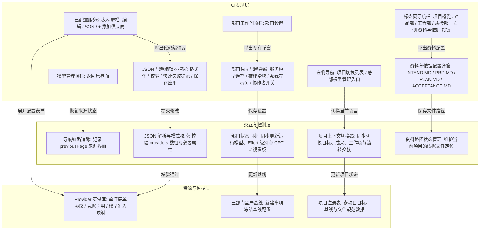

# 三部门协作与模型管理原型设计 (v6)

日期：2026-09-23。性质：界面原型设计说明与事实记录。

## 1. 原型要回答的问题

1. 如何将模型管理作为系统级全局设置时，提供随时返回来源工作界面的导航链路，避免打断当前进行中的工作流？
2. 如何在摒弃无交互的导出操作的同时，提供即时可编辑、可语法校验并能直接应用的 JSON 配置编辑器，满足高级配置与配置快速分发需求？
3. 如何优化模型服务列表的操作布局，将服务添加与原始数据编辑操作集中收拢至资源卡片库的操作工具栏？
4. 如何将部门内部的设置逻辑从深层下拉菜单收敛为专有弹窗，集中完成模型、推理努力程度、系统提示词以及协作机制的统一配置？
5. 如何支持多项目之间的平滑切换，并在切换时同步更新项目概览、三部门目标与流转历史？
6. 如何规避标签页导航在特定操作系统和浏览器中的异常滚动条，同时为原始资料（如 INTEND.MD、PRD 等）提供专属的配置入口？

## 2. 系统分层与信息架构

原型通过三层边界控制系统交互与配置复杂度：

## 3. 核心设计与交互规范

### 3.1 全局模型管理与无损返回导航
- **全局设置定位**：模型管理常驻于左侧导航栏底端，属于系统级全局资源视角。
- **上下文返回链路**：进入模型管理时，系统内部记录来源界面标识（例如正在推进的工程部工作间、质检部工作间或项目概览）。
- **动作位置调整**：移除顶部操作区原有的导出按钮与添加服务按钮，在原有位置配置专属的“返回原界面”按钮。用户完成模型维护或参数检查后，点击即可直接恢复至先前的具体工作页面，无缝接续当前操作。

### 3.2 资源卡片操作栏与添加供应商重构
- **位置集中**：将原分散在顶部的主操作下沉至“已配置的模型服务”列表标题栏区域，与“点击卡片任意区域可展开详情与模型映射”提示说明并列呈现。
- **操作组合**：提供“编辑 JSON”与“+ 添加供应商”两个并列操作按钮。
- **交互承接**：
  - 点击“+ 添加供应商”就地平滑展开服务配置面板，支持根据预置方案模板自动填入上游协议与默认端点。
  - 点击“编辑 JSON”呼出全功能 JSON 代码编辑器弹窗。

### 3.3 模型与 Provider JSON 编辑器
- **数据结构集成**：完整读取当前运行时中的全部 Provider 实例定义、已挂载模型映射（含上下文窗口大小、最大输出上限与准入状态）以及全局部门基线绑定。
- **代码编辑体验**：弹窗内提供等宽字符编辑区域，具备暗色代码阅读配色、规范缩进与舒适行高。
- **辅助与校验工具**：
  - **格式化 JSON**：对当前输入的文本进行标准两空格缩进的美化排版。
  - **重置内容**：放弃当前修改，重置为系统当前保存的配置状态。
  - **复制内容**：将配置数据一键写入系统剪贴板。
- **快速失败校验机制**：点击“保存并应用 JSON”时，严格执行 JSON 语法与顶层模式检查。若存在语法错误或缺少必要属性，立即中断保存流程并在文本域下方显示明确的错误原因提示框；核验通过后直接更新底层状态对象，即刻刷新页面列表与卡片视图。

### 3.4 三部门专属弹窗设置
- **触发入口优化**：移除部门工作间右上角原有的次级下拉菜单，以单体主操作按钮“部门设置”直接响应点击。
- **弹窗内部模块化划分**：
  - **运行服务与模型访问定义**：支持选择当前已准入的 Provider 服务实例与模型标识，提供 1 至 4 级推理思考努力程度（Effort: 低/中/深/极）滑块与刻度语义说明。
  - **部门专有系统提示词 (System Prompt)**：提供多行文本编辑框供用户定制该部门执行 Agent 的行为守则与交付合同要求，附带“恢复默认”操作。
  - **协同机制与 SubAgent 开关**：提供协作者子 Agent 派发控制开关，允许在繁重任务场景启用并发协助。
- **状态联动**：点击“保存部门设置”后，自动更新当前部门的全局参数，同步刷新部门房间墙壁上的复古 CRT 任务监视器字符显示与工作台状态。

### 3.5 多项目平滑切换与上下文联动
- **侧边栏项目列表动态化**：侧边栏项目列表由底层项目注册表（`projects`）统一驱动渲染，当前选中的项目高亮显示（`is-selected`）。
- **全要素数据隔离与切换**：切换项目时，系统自动更新当前项目的目标说明、基线成果、工作项统计、工作区物理路径、文件放置规范以及各部门房间的 CRT 任务监视目标，杜绝跨项目数据串扰。
- **顶栏面包屑即时响应**：顶栏项目名称（如“货物装载规划”、“实验记录助手”）根据选定项目即时联动更新。

### 3.6 标签页布局重构与消除横向滚动条
- **去除强制滚动容器**：废除原 `.yp-tabs` 上设置的 `overflow-x: auto`，采用标准的弹性两端对齐容器（`.yp-tabs-header-bar`），容器自身设置 `overflow: visible`，彻底解决 Windows 浏览器由于外边距或尺寸计算产生的异常滚动条问题。
- **操作与标签合并**：将“资料与依据”设置入口整合置于标签页导航栏的右侧操作区，形成“左侧部门视界切换、右侧项目依据配置”的清晰界面布局。

### 3.7 资料与依据放置配置弹窗
- **入口位置**：点击顶栏标签页右侧的“资料与依据”按钮即可随时呼出。
- **可配置依据规范**：
  - **原始用户需求文件路径 (User Intent / INTEND.MD)**：严格只读输入，保存用户的初始自然语言诉求与原始背景资料，执行阶段不予修改。
  - **产品需求规格说明书路径 (PRD.MD)**：产品部门根据原始输入整理输出的有效需求合同。
  - **工程事前实施计划路径 (PLAN.MD)**：工程部门在实施编码前必须提交的事前分解步骤与自测计划。
  - **质检独立验收标准路径 (ACCEPTANCE.MD)**：质检部门执行自动化检验与放行的判定规则。
  - **本地工作区物理路径 (Workspace Root)**：项目代码与工件运行的真实宿主磁盘根目录。
- **操作闭环**：提供“恢复默认规范路径”与“保存配置”，保存后即刻生效并刷新概览页中的依据芯片摘要信息。

## 4. 原型交付物

- 原型单文件：[department-workspace-v6.html](department-workspace-v6.html)
- 原型设计变更记录：[CHANGELOG.md](CHANGELOG.md)
- 运行方式：直接在任意现代主流浏览器中打开该 HTML 文件，无任何外部编译、服务端口或第三方脚本依赖。
