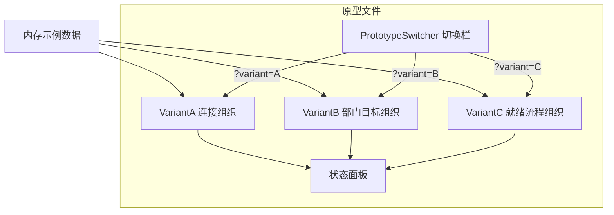
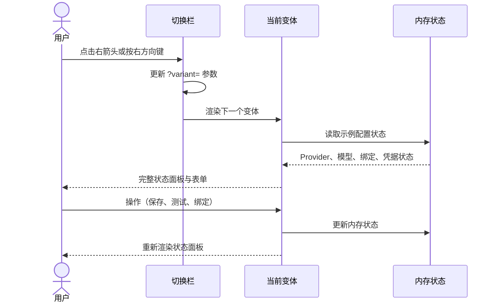

# Provider 配置原型重新设计

日期：2026-09-22。性质：一次性原型的设计说明，用于回答一个界面组织问题，不进入生产代码。

## 原型要回答的问题

模型与 provider 配置页面采用哪种信息组织方式，才能让连接、模型、准入、绑定、凭据五类配置各自清晰、状态可见。

## 问题定位

当前 provider 配置存在四类问题：

1. 协议归属错位。已有表单把 `protocol` 放在 Provider 表单上，实际数据模型已把协议放在模型访问定义上（ADR-0001，`ModelDefinition.protocol`）。一个 Provider 下的不同模型可以走不同协议，已有原型无法表达。
2. 配置生命周期缺失。ADR-0002 要求候选模型先通过一次模型测试（准入）才能绑定到部门。已有原型只有「保存 / 测试连接」，没有候选 → 准入 → 可绑定的状态推进。
3. 能力值不可信。`context_window` 与 `max_output_tokens` 是手工填写的占位值，没有核验状态。压缩失败（摘要超限、空摘要）直接源于模型输出上限填错（决策记录 2026-09-21）。
4. 凭据生命周期含糊。Key 默认只在进程内存有效，任务创建时冻结凭据引用，进程重启后旧任务因凭据丢失明确停止（`provider_credentials_lost`）。已有原型只显示「已配置 / 缺失」，没有把冻结与失效讲清楚。

原型数据形状采用修正后的概念模型（协议归于模型、含准入状态、含能力值核验状态、含凭据状态与冻结说明），作为目标概念结构的预览。真实系统的对应改造另行推进。

## 原型形态

UI 原型，单文件 HTML，三个结构不同的变体，底部浮层切换栏，`?variant=` 参数可分享。

文件位置：`docs/prototypes/provider-config/provider-config-redesign.html`。双击打开即可使用，无需构建或服务器。

## 三个变体

### 变体 A — 按连接组织

主问题：「配置了哪些服务连接？」

结构：左侧 Provider 列表，右侧该连接详情（地址、凭据引用、超时）及其模型列表；每个模型行内显示协议、能力值、准入状态；绑定区在页面底部。

覆盖场景：一个连接下挂多个模型、多协议。

### 变体 B — 按部门目标组织

主问题：「三个部门分别用什么模型？」

结构：顶部三块部门面板（产品 / 工程 / 质检），各自显示当前目标、就绪状态；点击部门面板配置目标；下方是「连接库」（Provider 与模型的新建、修改、删除）。

覆盖场景：日常最关心部门绑定结果，配置是手段。

### 变体 C — 按就绪流程组织

主问题：「距离能跑还缺什么？」

结构：顶部就绪检查清单（凭据 → 连接 → 模型准入 → 部门绑定），每步显示状态与操作入口；下方是当前步骤的详情面板。

覆盖场景：从零接入新服务，或排查「为什么创建不了事项」。

### 共同覆盖能力

三个变体覆盖相同配置能力（Provider 新建、修改、删除；模型新建、修改、删除与准入；三部门绑定；连接测试；导入导出），差异在信息层级与主操作入口。

## 推荐

变体 B。日常使用频率最高的是「部门用什么」，绑定状态与就绪缺口需要首屏可见；变体 C 的就绪清单作为变体 B 顶部的常驻状态条吸收；变体 A 的多模型管理保留在连接库区域内。

## 设计说明

### 架构

单 HTML 文件，内嵌样式与脚本。三个变体是三个独立渲染函数，切换栏只负责 URL 参数与调用渲染。



### 组件

- `PrototypeSwitcher`：底部浮层，左右箭头循环切换，显示变体编号与名称，键盘左右键可用，输入框聚焦时不拦截按键。
- `VariantA` / `VariantB` / `VariantC`：各自完整布局，不共享布局组件。
- 状态面板：每次操作后重新渲染完整配置状态，含能力值核验状态（声明 / 已核验 / 存疑）与凭据状态（已解析 / 缺失），以及冻结说明。
- 示例数据集：见下节，覆盖四类问题。

### 数据流

纯内存示例数据 → 变体渲染函数 → DOM。变体切换重新渲染，无持久化。操作（保存、测试、绑定）只改变内存状态并在状态面板显示结果，不发起网络请求。

逻辑数据形状：

```text
providers: [{id, name, base_url, credential_ref, timeout_sec, credential_status}]
models:    [{id, provider_id, model, protocol, context_window, max_output_tokens, admission, capability_status}]
bindings:  {product: {provider_id, model_id} | 未绑定, engineering: ..., quality: ...}
```

- `protocol` 取值 `responses` / `chat_completions` / `messages`，声明在模型上。
- `admission` 取值 `候选` / `已准入` / `已拒绝`。
- `credential_status` 取值 `已解析` / `缺失`。
- `capability_status` 取值 `声明` / `已核验` / `存疑`。

示例数据集：

| 对象 | 关键字段 | 覆盖的问题 |
| --- | --- | --- |
| Provider「opencode-go」 | 地址 `https://opencode.ai/zen/go/v1`，凭据引用 `YUDAO_OPENCODE_GO_KEY`，凭据状态「已解析」 | 正常连接 |
| 模型「glm-5.1-chat」 | 协议 `chat_completions`，窗口 128000，输出上限 8192，准入「已准入」，能力「已核验」 | 同一连接多协议 |
| 模型「glm-5.1-responses」 | 协议 `responses`，窗口 128000，输出上限 8192，准入「候选」，能力「声明」 | 准入状态推进 |
| Provider「custom-service」 | 地址 `https://api.example.com/v1`，凭据引用 `YUDAO_CUSTOM_KEY`，凭据状态「缺失」 | 凭据缺失 |
| 模型「custom-model」 | 协议 `messages`，窗口 32000，输出上限 4096，准入「已拒绝」，能力「存疑」 | 能力值存疑、准入被拒 |
| 绑定 | 产品 → opencode-go / glm-5.1-chat；工程 → 未绑定；质检 → opencode-go / glm-5.1-chat | 绑定不完整 |

### 交互



- 底部栏与 `?variant=` 同步，刷新后保持当前变体。
- 每个变体内，操作后重新渲染完整配置状态。
- 错误与等待状态展示在对应字段旁（凭据缺失、模型未准入、绑定不完整）。
- 视觉令牌沿用工作台原型契约：字体 Microsoft YaHei UI 系列，基础字号 14px、行高 1.5；主色 `#087f69`（浅色）/ `#56d1b3`（深色）；页面背景 `#f3f4f3` / `#171918`；表面色 `#ffffff` / `#1d1f1e`；边框 `#dfe2e0` / `#383c3a`；错误 `#b9473e` / `#ef8278`；等待 `#9a6200` / `#f1b949`。浅色深色跟随浏览器 `color-scheme`。

### 错误处理

原型使用完整示例数据，操作失败仅以字段级提示展示（「凭据引用未解析」「模型未通过准入」「部门绑定不完整」「能力值存疑，需核验」），不模拟网络异常。

## 验收标准

1. 双击打开 HTML 文件即可使用，无需构建或服务器。
2. 底部浮层在三个变体间循环切换，`?variant=` 参数与显示同步，刷新后保持。
3. 三个变体结构不同：信息层级、主操作入口、布局各不相同。
4. 示例数据覆盖四类问题：双协议模型、凭据缺失、模型未准入、部门绑定不完整。
5. 每次操作后状态面板完整重绘，配置状态、能力值核验状态、凭据状态与冻结说明可见。
6. 1440 与 390 宽度下均可完成配置查看与操作，无横向滚动。

## 边界

一次性原型，回答完问题后归档到抛出分支；选定的组织方式并入真实配置页面时重新编写，不直接复制原型代码。原型不连接真实后端、不持久化、不模拟网络异常、不覆盖部门 Prompt 配置（保持在项目设置）。
