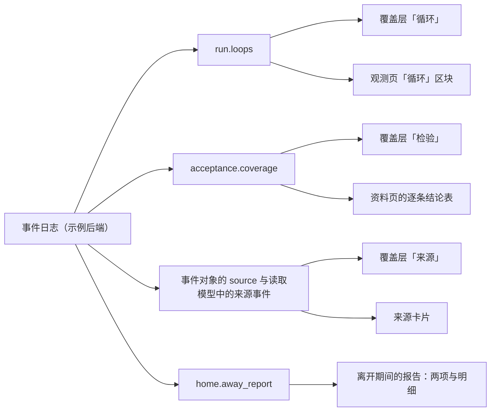

# 原型 v10：自举试点首批画面——循环、来源与检验

更新：2026-10-22（动作目录里执行命令的说明改为「执行命令」，命令不再登记，见 [原型变更记录](../CHANGELOG.md)）。2026-10-07。状态：定稿（用户看过截图联系表并确认四项决定，规格见父工单 [#395](https://github.com/bender2333/yudao/issues/395)）。

## 1. 范围

v10 由 v9 整份复制而来，只增加自举试点首批工单的画面（[决策记录](../../decision.md) 2026-10-07「Stage 3 剩余的两个专题」第 4、6 项，[自举需求记录](../../requirements/self-hosting.md)「第一层试点的配对验收约定」）：

- 项目楼层的三个覆盖层：「循环」「来源」「检验」（第 3、5、6 节）。
- 观测页的「循环」区块（第 4 节）。
- 画面上每个事实元素都能点开的来源卡片（第 5 节）。
- 离开期间的报告中「收敛状态的变化」与「带开环条件的放行」两项（第 7 节）。
- 资料页质检一项的逐条结论表，带检验方式与开环标记（第 6.3 节，属于 3.2D 的 #154）。

依据的设计：[循环与收敛设计说明](../../design/loops-and-convergence.md)第 5 节（五种收敛状态与 Stage 3 判定的范围），[应用层与接口层设计说明](../../design/app-and-interface.md)第 4.3 节（`run.loops`、`acceptance.coverage`、`home.away_report`）、第 5.2 节（事件对象的 `source`）、第 5.8 节（画面诚实性的七条不变式）、第 6.1 节（覆盖层），[验证的独立性设计说明](../../design/independent-verification.md)第 7 节（检验方式、检验覆盖比例与开环）。用词以 [CONTEXT.md](../../../CONTEXT.md) 为准。

保持 v9 原样的部分：像素引擎、项目楼层与部门房间的画法与动作、楼与机房、决定卡片、页面导航与其余页面；`Y10.api` 的查询、命令、事件形状只增加本文写到的内容。命名空间随版本从 `Y9` 改为 `Y10`（见 [BUILD.md](BUILD.md) 开头）。

## 2. 档位

新增一档「自举试点」（标识 `pilot`），排在 `3.2D` 与 `S4` 之间，包含 3.2D 及以前的全部内容。各项内容出现的档位：

| 内容 | 档位 | 依据 |
| --- | --- | --- |
| 质检的逐条结论（`criteria`，带检验方式）、资料页的逐条结论表 | `3.2D` | #151、#154 |
| 查询 `run.loops`，覆盖层「循环」，观测页的「循环」区块 | `pilot` | #397、#400 |
| 事件对象的 `source`，读取模型中事实元素的来源事件，来源卡片，覆盖层「来源」 | `pilot` | #396、#398 |
| 查询 `acceptance.coverage`，覆盖层「检验」，离开期间报告的两项 | `pilot` | #399、#401 |
| 项目层的收敛状态（同一故障的重复出现） | `S4` | 运维记录故障以后 |
| 激活层的收敛状态与「漂移」（计划条目带写入范围、部门账本记录完成事实）；决策模型给出的事实带概率 | `S5` | D26、[总体架构](../../design/architecture/overall-architecture.md)第 7.5 节 |

切换档位就能看到同一个画面随能力加入的变化：`pilot` 档激活层与项目层写「不判定」，`S4` 档项目层开始判定，`S5` 档激活层与「漂移」开始判定。

## 3. 覆盖层「循环」

覆盖层按钮在概览页循环画面上方的覆盖层条里，`pilot` 档起由能力清单列出。打开以后，整层照现有覆盖层的做法加一层半透明遮罩，在三处写出循环实例：

| 位置 | 循环层 | 写什么 |
| --- | --- | --- |
| 楼层的信息条，紧接「第 N 轮」与时间进度条 | 部门之间的循环（run） | 收敛状态（颜色与文字）；run 已经停止时写停止原因 |
| 每个部门房间的中央 | 部门激活 | 本部门在这个 run 中第几次激活、这次激活的已用时间与上限、收敛状态 |
| 正在工作的角色头顶 | 角色的步骤循环 | 已用步数与上限、收敛状态 |

五种收敛状态与「不判定」各有一种颜色，同时写文字，不只靠颜色区分：收敛中（绿）、停滞（黄）、震荡（橙）、漂移（紫）、达到边界（红）、不判定（灰）。画面右上角有图例。

「不判定」的标签点开是来源卡片的一种（第 5 节）：写明缺少的事实，例如激活层写「计划条目没有主机记录的完成事实（Stage 5 起判定）」。

覆盖层上的内容只来自 `run.loops` 的结果（H1）。回放时与其他覆盖层相同，不画覆盖层。

## 4. 观测页的「循环」区块

观测页「请求记录与用量」区块之后，新增「循环」区块，`pilot` 档起出现。

- 按事项分组，每个事项一棵树：项目循环 → run → 各部门的激活 → 每次激活中的步骤循环。每行一个循环实例，列为：层、实例（例如「工程 · 第 3 次激活」）、轮次、已用量与上限、收敛状态、停止原因。
- 点开一行，显示判定依据：进展度量的名称与每一轮的数值（例如 run 层「未满足的验收条件数：3 → 2 → 2 → 2」，用一排小柱表示），以及判定用的规则与轮数（例如「只计有可执行检验的条件，最近 3 轮未满足数不变，交付的树摘要在变：停滞」）。run 层每一轮的数值旁另写这一轮的开环数；开环的条件不计入收敛的判定（[循环与收敛设计说明](../../design/loops-and-convergence.md)第 5 节）。每一轮的数值可以点开来源卡片，来源是主机测量，事件是给出这一轮结论的那条事件。
- 「不判定」的行写明缺少的事实与开始判定的阶段。
- 已停止的实例写停止原因；达到边界的实例在已用量一列标出达到的那一项。

## 5. 事实来源

### 5.1 来源卡片

画面上的事实元素都可以点开来源卡片。项目楼层里的事实元素：门口的牌子、管道中与停放的包裹、质检的盖章、成果库架子上的箱子、信息条上的轮次与时间、三个覆盖层上的标签。点大厅的决定板仍然打开决定卡片。

来源卡片画在画面里，写法与决定卡片相同（一张小纸贴在被点的元素旁边，点纸外面关闭）：

- 来源种类：确定规则、决策模型、角色陈述、主机测量、用户，五种之一，带图标。
- 给出这条事实的事件：中文说明、事件种类、时间、提出者（`actor`）、全局位置。
- 决策模型给出的事实写概率（`S5` 档起有这样的事实）。
- 「在时间轴上查看」：时间轴跳到这条事件的刻度。

页面上的列表（离开期间报告展开的来源事件、观测页「循环」区块的每一轮数值）在每条事件旁写来源种类。

每个事实元素的来源由读取模型给出：`project.loop` 的事项、牌子、包裹、盖章与箱子各带给出它的事件位置与来源种类（H4）。来源种类按「事件加字段」取：事件对象的 `source` 按事件种类给出这条事件的主要事实；事件中的测量值（已用时间、已用次数与步数、检查回执的结果）按字段覆盖为主机测量。例如信息条上的「已用 1670 分」是主机测量，「第 2 轮」按事件种类是确定规则。没有来源的事实元素不画（第 9 节的检查）。

### 5.2 覆盖层「来源」

按五种来源给事实元素着色，让人一眼看出画面上哪些是部门自己说的、哪些是主机测出来的：画面其余部分调暗，事实元素按来源描边，确定规则灰、主机测量蓝、用户绿；角色陈述与决策模型给出的事实没有经过主机核实，用加粗的虚线描边。画面右上角的图例写出每种来源在画面上有几个元素。

## 6. 检验覆盖与开环

### 6.1 覆盖层「检验」

- 质检房间的中央写当前交付快照的检验覆盖比例与开环数，模型阅读的条件包含在开环之内，写成「覆盖 7/9 · 开环 2（其中模型阅读 1）」；开环为 0 时只写覆盖比例。开环数大于 0 时标签为黄底。凡是同时写这几个数的地方（逐条清单的标题、资料页的表头、放行盖章旁、离开期间的报告）用同一种写法。
- 点这个标签打开一张清单（写法与来源卡片相同）：每条验收条件一行，写检验方式、最近一次结果（通过、未通过、还没有在当前快照上运行）；开环的条件带「开环」标记。
- 质检房间里放行的盖章旁边写这次放行的覆盖比例。

### 6.2 数据

`acceptance.coverage` 按事项返回每条验收条件的检验方式、最近的结果与是否开环，以及检验覆盖比例、模型阅读的条件数、开环的条件数（[应用层与接口层设计说明](../../design/app-and-interface.md)第 4.3 节）。检验方式六种：命令检查、试用用例、主机测量、带参照材料的判定点、人、开环。

### 6.3 资料页的逐条结论表（3.2D）

资料页质检一项，每份 QAReview 一张表：每条验收条件一行，列为验收条件、检验方式、结果、证据（检查名称与试用用例）、截图缩略图；表头写交付快照的摘要与检验覆盖比例；开环的条件带「开环」标记。v9 的检查列表在 `3.2D` 档以前照旧显示。

## 7. 离开期间的报告

`pilot` 档起，汇总项增加两项，展开的方式与现有汇总项相同（列出来源事件，事件旁写来源种类，报告项与时间轴互相跳转）：

- **收敛状态的变化**：每条写事项、层、前后两种状态，例如「导入 CSV · run：收敛中 → 停滞」；来源事件是引起变化的那一轮事件。
- **带开环条件的放行**：展开以后先列出开环的条件，再列来源事件；每条开环条件可以跳到资料页质检一项的逐条结论表。

## 8. 示例数据与场景

### 8.1 示例数据

`pilot` 档时，四个项目一起覆盖全部状态：

| 状态 | 例子 |
| --- | --- |
| 收敛中 | 待办清单的 `w-todo-base`：未满足的验收条件数 1 → 0（第 1 轮 AC-5 不通过，返工后全部通过） |
| 停滞 | 待办清单新增事项「导入 CSV」：未满足数 3 → 2 → 2 → 2，交付的树摘要每轮都在变 |
| 震荡 | 北京地铁票价新增事项「夜间票价」：AC-2 的结论通过、不通过、通过、不通过 |
| 达到边界 | 「夜间票价」的 run 用完运行时间（7200/7200 秒），停止原因为运行时间上限 |
| 不判定 | 各事项的激活层与项目层 |
| 步骤循环 | 「导入 CSV」的工程角色连续 9 步没有被接纳的记录（停滞）；「夜间票价」的工程角色同名同参数的工具调用重复 3 次（震荡） |
| 开环 | 「导入 CSV」的验收条件 AC-6「导入大文件时界面不卡顿」没有可执行的检验；`w-todo-base` 的放行带一条开环条件 |
| 漂移（`S5`） | 「导入 CSV」的激活层：写入不属于任何计划条目的路径的比例上升 |

步骤循环与 run 层的判定按[循环与收敛设计说明](../../design/loops-and-convergence.md)第 5 节：步骤循环取 8 步与 3 次（参数）；run 层只计检验方式为命令检查、试用用例、主机测量的条件。示例数据里停滞与震荡都发生在有可执行检验的条件上。

### 8.2 场景

新增两个场景，档位为 `pilot`：

- **循环与收敛**：打开待办清单的概览，打开覆盖层「循环」；「导入 CSV」第 4 轮的质检结论到达，run 层从收敛中变为停滞；转到观测页，展开这一行看每一轮的数值。
- **来源与检验**：打开覆盖层「来源」，点停放的包裹看来源卡片；打开覆盖层「检验」，点质检房间的标签看逐条清单；`w-todo-base` 带开环条件放行；回到首页展开「带开环条件的放行」。

## 9. 验收

- 十档 × 现有页面 × 两种宽度与主题，控制台错误与横向溢出为零；二十一个场景全部能走完。
- 覆盖层不打开、不点击时，项目楼层在静止时与 v9 逐像素相同（BUILD.md 的回放比较）。
- 行为检查：三个覆盖层只在 `pilot` 档以后列出；覆盖层上的取值等于对应查询的结果（H1）；楼层上每个事实元素都有来源事件，来源卡片的种类等于事件的 `source`（H4）；每条开环的条件在覆盖层「检验」与资料页的表中都带开环标记（H5）；覆盖层「来源」的着色与图例计数按事实元素的来源。
- 截图联系表：两种宽度与两种主题下，三个覆盖层、来源卡片、观测页的「循环」区块、资料页的逐条结论表、离开期间报告的两项展开以后，各一张，交给用户确认画面。
