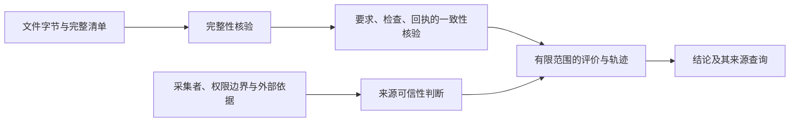

# 可信证据、独立评价与批次观察：研究依据与架构选择

> 日期：2026-09-06。范围：第二阶段 2.1 的离线证据、复核、批次统计和来源查询。
> 状态：研究与开发准备，本文不代表新增能力已经实现，也不代表第一阶段验收完成。
> 详细开发合同及验收矩阵见[离线证据、复核与批次分析设计](offline-review-design.md)；阶段依赖见[第二阶段计划](../archive/stage-2-plan.md)。
> 配套资料：[可观测性设计](observability-design.md)、[实验约定](experiment-protocol.md)。

## 1. 研究结论与近期选择

近期最有价值的能力是：一份交付经过真实本地复核后，可以脱离原工作目录保存；另一次进程能够只读核验、重建问题轨迹，并从批次结论追到原始字节。完成这条链路后，正式评价和经验验证才有可持续使用的材料基础。

资料支持采用三个已验证的职责：文件完整性由完整清单与内容核验负责，来源由对象、活动及责任关系表达，评价由固定检查对固定交付产生独立记录。它们解决不同问题，不能用一个“可信”布尔值代替。

| 近期选择 | 依据 | 实际边界 |
| --- | --- | --- |
| 本地自包含目录、完整清单、逐文件核验 | BagIt [R02](#r02-bagit)；RO-Crate [R03](#r03-ro-crate) | 采用其设计原则，不宣称当前实现符合 BagIt 或 RO-Crate 标准 |
| 内容身份与当前位置分离 | PROV [R01](#r01-w3c-prov)；RO-Crate 的相对引用 | 搬移只改变查找位置；原来源、执行环境和复核身份不重写 |
| 事实、评价活动、报告分别保存 | PROV；MLflow [R05](#r05-mlflow)；Langfuse [R06](#r06-langfuse) | 本地模块和 JSON 足以完成，不先部署跟踪服务 |
| 程序行为优先采用实际测试 | SWE-bench [R07](#r07-swe-bench) | 通过仅覆盖既定测试；原 QA 与独立评价分开表达 |
| 先展示数量、覆盖和逐项结果，再讨论收益 | SWE-bench；Dror 等 [R09](#r09-统计检验)；NIST [R10](#r10-分块实验) | 未知、损坏、重复和未完成可见；当前不自动发布显著性结论 |
| 运行遥测与持久证据建立链接 | OpenTelemetry [R04](#r04-opentelemetry) | 遥测可能采样、丢失或截断，不能成为唯一验收材料 |
| 模型评价保留为独立意见及需校准的方法 | Zheng 等 [R08](#r08-llm-judge) | 模型解释、角色名称和与人一致性都不自动提供软件正确性证明 |

这些选择是可长期保留的职责划分。后续如需外部平台，平台消费相同事实或增加查询能力；不以“以后更换”为理由先制造另一套任务状态权威。

## 2. 本项目已有基础与真正缺口

代码核对以本 worktree 的 `f39a40d` 为基线。未读取另一会话的运行中任务，也未把其尚在变化的接口作为已确认合同。

| 当前模块 | 已有能力 | 研究揭示的下一项约束 |
| --- | --- | --- |
| [records.py](../../harness/analysis/records.py) | 要求、检查、交付、QA、环境与观察记录 | 材料声明、任务、一次复核和文件内容不是同一种身份 |
| [evaluate.py](../../harness/analysis/evaluate.py) | 封存完整普通文件树，固定 Python 检查，独立副本，原始输出 | 重新执行是新活动；原环境描述不是可复现环境本身 |
| [trajectory.py](../../harness/analysis/trajectory.py) | 同口径区段中的持续问题、修复、复发及 QA 对照 | 持久读取必须核验真实字节及全部状态关系，不能信任反序列化后的状态字符串 |
| [report.py](../../harness/analysis/report.py) | 内存对象生成 JSON 与 Markdown，写出前检查部分证据 | 当前输出包含绝对定位；没有可搬移、可重载的闭合证据协议 |
| [demo.py](../../harness/analysis/demo.py) | 三份人为构造交付的实际主机复核 | 校准能证明工具识别能力，不能证明模型自然发生回归或错误放行 |

读取现有测试只能说明已有行为受到哪些检查覆盖；本轮未新增或运行业务实现，不把旧测试通过转述为本文设计已经验收。

## 3. 三种核验不能合并

完整性回答“当前字节是否与这份清单相符”。一致性回答“这些观察是否支持所声明的比较结果”。来源可信性回答“这些材料为什么可以被认作某次真实运行的记录”。前两项通过不推出第三项。

拥有整包写权限的人可以同时重写 stdout、退出码、要求和清单，让它们重新自洽。SHA-256 不能证明采集者诚实、模型实际收到过某段信息、记录的时间准确，或测试当时确实运行。BagIt 也明确将其完整性保证限定为防数据损坏，并不抵抗主动伪造。[R02](#r02-bagit)

近期本地材料明确标注“提供者声明”；主机本次实际复核可以记录真实执行来源，但从外部导入的 `host_execution` 文字本身没有证明力。可信采集接入后，才根据采集边界和可独立核对的来源形成更强判断。现在无需为此新建签名服务，也不能提前声称已具备真实性认证。

## 4. 标准与成熟实现如何取舍

| 方案 | 解决得好的问题 | 本项目直接采用的模式 | 当前不引入的部分及原因 |
| --- | --- | --- | --- |
| W3C PROV | 对象、生成活动、使用、责任、派生关系 | 要求/交付/输出是对象；封存/评价/分析是活动；每项判断注明来源 | 通用 RDF、OWL、SPARQL 和推理引擎。当前只有有限来源查询，不需要语义平台 |
| BagIt | 完整文件集合、传输和保存后的字节核验 | 核验集合完整再核验内容；文件负载视为原始字节；防止路径访问包外 | `fetch.txt` 远程补取、归档格式互操作及多算法协商。离线读取应自包含且不联网 |
| RO-Crate | 可搬移研究对象的元数据与上下文关系 | 根对象、数据文件、上下文来源分开；包内相对定位；记录生成软件及版本 | 完整 JSON-LD 合规。当前也没有外部 RO-Crate 消费者 |
| OpenTelemetry | 时间、资源、trace/span 关联及运行排障 | 区分事件发生时间和采集观察时间；用引用连接运行与后续复核 | 把 span 树当成任务账本或完整证据包；把普通遥测采样当成正式任务抽样 |
| MLflow | 运行、数据集、来源、参数及结果关联 | 显式记录每次复核消费的数据和方法；来源与经过变换的数据分开 | 部署服务及复用其数据摘要来代替完整文件核验；已读固定版本源码采用部分数据和截短 MD5 |
| Langfuse | 数据集条目、实验、trace 和 score 的关联展示 | 任务输入与一次实验结果分开；评价结果有自己的来源 | 照搬其重复条目语义。所读文档明确当前每实验每条目读取至多一项，不能覆盖本项目多次复核的成本与身份 |
| SWE-bench | 对明确软件实例应用交付并实际测试，保存分项结果 | 固定受测对象；保存脚本、产物和原始日志；区分未提交、未解决与执行错误 | 直接照搬基准规模、Docker 环境和排行榜数字。当前任务族和运行边界不同 |

采用成熟模式与部署成熟产品是不同决定。仓库当前运行依赖为空，Python 标准库已覆盖目录、JSON、哈希和固定子进程复核。近期增加外部服务会新增凭据、持久化、权限和部署责任，却不能自动解决证据真实性及统计单位问题。

## 5. 对证据包与清单设计的约束

### 5.1 一个可搬移目录需要闭合到什么程度

“自包含”应覆盖重建当前结论必需的要求、检查、全部交付字节、环境记录、终止回执及原始 stdin/stdout/stderr。源路径和远程地址只能是来源说明；读取不能依靠它们补齐缺失材料。PROV 的关系记录和 RO-Crate 的外部 URI 允许更宽的描述，但本项目对离线核验选择更严格的闭合范围。

完整性核验要检查文件集合相等，额外交付文件和丢失空目录都可能改变程序行为。RO-Crate 允许一些文件不逐项建元数据实体，因此“有 RO-Crate 元数据”本身不满足本项目完整交付验收；需要完整清单这一额外约束。

BagIt 的 payload manifest 不列目录，空目录常通过占位文件表示。本项目应另外保存空目录清单，不向被测交付植入 `.keep` 等新文件。这是项目完整交付语义的补充，也是不能将借鉴其原则直接称为格式合规的原因。

包内逻辑路径与主机历史位置分别保存。中文文件名保留，分隔符和比较约定固定。Windows 的盘符相对路径、UNC、大小写或尾点别名、设备名、重解析点等规则统一由详细设计的路径边界处理。RO-Crate 使用 URI 引用，项目本地逻辑路径不应悄悄兼任 URI；将来正式导出时再使用符合标准的编码器，不能现在自行 URL 解码后访问文件。

### 5.2 身份与版本的最小关系

同一材料多次执行可以产生不同观察；同一观察可以生成多个报告。内容哈希用于识别特定字节，不能成为独立任务身份。相同内容也可能来自不同真实运行，不同文件名也可能只是同包复制。

整体内容标识覆盖评价依据和原始记录，展示文件不参与其身份。搬移或重渲染保持复核身份；修改要求、检查或再次执行产生新的事实或评价活动。结构化内容使用项目明文确定的 JSON 约定，排序对象键不等于已实现跨语言规范化标准。

环境记录必须能指出当时解释器、执行器、依赖范围和比较规则。记录了解释器版本或哈希，不等于保存了可重建的整个系统镜像；本批支持旧事实读取，不承诺在任意机器得到同样执行结果。未来环境复现验收应单独证明，而不是把“包能搬移”写成“程序处处可重现”。

### 5.3 重新核验必须真的从证据推出结论

读取从真实字节恢复文本，并按检查约定重新比较 stdout 和退出码。JSON 中缓存的 stdout 文本、`passed` 状态和 `analysis` 都不能跳过这一步。合法 UTF-8 输出被声明为“无法解码”也应构成一致性错误；这正是当前纯内存分析路径不能独自承担持久读取边界的原因。

正常退出、超时、启动失败、受测内容变化和结果未知需要各自合法的回执组合。只有正常完成且符合固定重复、稳定性和交付对应条件的观察，才支持已确认通过或反例。超时留下恰好符合预期的部分 stdout 仍然可能是真超时，不能因此改判通过或否定超时；相反，互相矛盾的正常退出与超时声明需要拒绝。

重新加载核验的是字节及回执的自洽性，不会再次实证历史超时、故障原因或执行前快照。重新运行检查会形成新的评价，不得在只读命令中自动触发。

### 5.4 本地输入不能追认不存在的历史事实

清单提供者可以明确声明 QA 曾审阅某轮材料，报告应保留该声明及来源。工具不能为了完成绑定而自动把未知 QA 的交付哈希填成刚封存的内容，然后宣称发现真实系统错误放行。

本地有效要求可以用于当前材料复核；只有同时拥有原始用户目标及合法变化依据，才能判断这些要求是否忠实于原任务。缺少原始目标时，不得把当前检查范围内通过扩大为完整用户目标已满足。

静态结构和引用错误应在任何程序执行前全部发现。合法材料在运行中消失、检查超时或环境失败则是应保留的观察，不能从轮次序列中删去。详细实现及用例编号由[开发设计](offline-review-design.md)统一管理。

## 6. 独立评价怎样避免变成第二份自我肯定

SWE-bench 的可借鉴点是固定软件对象与实际测试的对应，而不是其分数。一个原 QA 放行与一个后来复现的反例可以同时成立；外评只追加事实，不重写原 QA 或原任务终态。[R07](#r07-swe-bench)

| 材料类别 | 可以用于什么 | 不能支持什么 |
| --- | --- | --- |
| 校准材料 | 修改观察器，检验持续/修复/复发等分类 | 未见任务收益、自然发生错误的频率 |
| 已揭示的开发经历 | 提炼候选，定位评价器遗漏 | 继续当作未见评价材料 |
| 预先保留的正式材料 | 按已确定方法比较冻结的策略或经验 | 让候选提炼者看过结果再在同批改候选 |
| 模型评价意见 | 提供有来源的判断，帮助安排人工或主机复核 | 无反例时确认软件违反要求，或自动批准自己提出的经验 |

隔离要落实到可访问材料和执行权限，不能只靠提示词说“不要看”。正式隐藏测试不得进入被评程序可读的工作区、模型上下文或候选提炼材料。当前本地工作副本只减少意外改写，不是安全沙箱；因此它支持可信本地程序的校准，还没有证明正式隐藏材料的运行隔离。

模型评价在主观或测试难覆盖的任务上仍可能有价值。采用前应单独记录评价模型、提示、参考资料、顺序、分歧及成本，并用本项目任务校准。Zheng 等展示了位置、冗长和推理能力的局限；其自我偏好实验同时明确证据不足，不能引用成“同模型一定偏爱自己”。[R08](#r08-llm-judge)

交换答案顺序、盲化身份、独立参考答案和人工抽查可以作为未来模型评价实验的候选措施，但不保证正确。一次意见一致不能建立独立评价权；反例、质量边界和采用决定继续分别保存。

## 7. 批次统计先确定“数的是什么”

### 7.1 至少区分五个单位

| 单位 | 含义 | 重复出现的处理 |
| --- | --- | --- |
| 提交项 | 用户这次输入的一个位置 | 每项都留行；缺失、损坏和重复均计入提交清单 |
| 材料声明 | 提供者声称的一组任务材料 | 可帮助归组，不自动构成真实任务身份或独立样本 |
| 一次复核 | 实际对材料执行的一次评价活动 | 新执行保留成本；复制证据包、搬移、重渲染不增加复核 |
| 一轮交付或一次检查尝试 | 同一任务内的相关观察 | 用于轨迹与检查覆盖，不膨胀独立任务数 |
| 独立任务 | 符合采样约定、身份和终点可核对的评价单元 | 重复运行属于该任务内的重复；是否独立需实验约定支持 |

同材料改一个名称不能制造独立任务；不同模型输出也不意味着来自独立任务。内容去重是工具行为，统计独立性是实验设计问题。Dror 等把相关观察列为常见检验仍未解决的边界，不能因为拥有统计库就忽略它。[R09](#r09-统计检验)

### 7.2 分母、缺失与成本

材料可用性可使用“核验通过提交数 / 总提交数”，同时显示重复数和去重包数。检查可判定覆盖只能使用可读取材料中声明的检查总数；坏包内有多少检查本来就可能未知，不能把它们默认为零后声称全批覆盖率完整。

来源未核验的损坏包不能因名称碰巧与一个有效包相同而合并消失。坏包声明的身份可供诊断展示，不享有与已核验身份相同的可信度。精确复制包可以在观察统计中去重，但副本作为本批输入的出现仍然可见。

放行反例至少同时报告全部声明放行轮次、可比较放行轮次、已确认同要求/同交付反例，以及材料来源。若只显示“有证据的若干项中有几项错误”，容易让读者误认为它是整个系统错误放行率。未知不代表通过，环境错误也不代表业务违反要求。

复核成本保留全部真实执行尝试；报告重新生成成本另列。累计检查耗时不是经过时间，尤其未来出现并行时。存在未知成本时，已知部分之和只能标作“已知累计”或整体成本下界，并显示成本记录覆盖；不能把缺失项从总成本中隐去。没有 token 或价格记录时标为未知，不记零。

### 7.3 近期描述统计与后续收益检验分开

近期批次模块输出数量、逐项状态、范围、来源及成本覆盖，不默认计算 p 值、置信区间或一个综合智能分。只要身份、采样和评价口径尚不足，就没有充分基础把目录集合当作统计总体的样本。

2.1-D 正式基线及 2.4 比较前，需要事先记录以下实验约定：

1. 任务族、任务选择方式、已见/未见边界及独立分析单元。
2. 基线、候选和对照组，评价及执行版本，质量和成本定义。
3. 每任务重复次数及其汇总规则，全部失败、超时和未知怎样处理。
4. 主比较与次比较，质量可接受差值、实际收益判据、样本量依据及停止规则。
5. 可控制的环境分块、无法控制因素的随机化顺序，以及服务波动如何记录。
6. 适合指标和依赖结构的统计方法；多个候选及多个指标的比较控制。

对相同任务比较策略时优先保留配对关系。成本通常不能假设呈对称或正态分布；成功/失败是离散结果；同一任务的多轮和多次复核有相关性。必须针对目标量和数据结构选择方法，不能把所有结果都送进普通独立样本 t 检验。

分块实验可控制任务难度、环境批次或服务时段等影响，但不会自动消除模型服务漂移、经验跨任务污染或选择性停止。NIST 的“控制可控制因素、随机化其余因素”是实验组织原则，不是对本项目抽样充分性的保证。[R10](#r10-分块实验)

未观察到统计差异不等于已证明质量不下降；统计显著也不等于收益大到值得采用。正式阶段必须结合预定质量边界、效应量、区间和实际成本讨论采用，不在本轮提前填写缺少依据的统一样本数或阈值。

## 8. 来源查询与可观测性如何衔接

第一阶段负责三部门当前状态、流转及人工控制。第二阶段应在同一运行旁增加“后来如何评价”及“证据能否核对”，而不是把外评失败涂改成原运行失败。

近期来源查询先实现有限且可逐项核验的关系：结论引用哪些观察；观察对应哪些要求、检查和交付；检查使用什么环境与原始输出；QA 决定是否具有同轮依据。修复后复发应返回失败、通过、再次失败整条支持链，不能只展示最终反例。

| 观察对象 | 应展示的时间或身份 | 不应推导的事实 |
| --- | --- | --- |
| 原运行事件 | 原事件身份和原系统记录时间 | 接收到事件的先后等于真实因果顺序 |
| 采集记录 | 采集者和观察时间 | 观察时间等于事件发生时间 |
| 后续复核 | 新复核身份、评价时间及受测版本 | 后来的检查是原 QA 当时看见的证据 |
| 重新渲染 | 渲染版本及读取时间 | 一个新报告是一轮新执行或一个新任务 |
| 来源关系 | 支持材料与关系提出者 | 两个节点有边就证明根因或因果影响 |

OTel 对 `Timestamp` 与 `ObservedTimestamp` 的区分可直接参考。trace/span 关联适合定位活动；日志级别、span 错误状态和遥测采样都不能代替任务终态、质量评价或正式采样清单。[R04](#r04-opentelemetry)

OTel 允许 SDK 限制事件/链接数量，批量处理队列到上限可丢 span。即使采用 OTel，也应由完整证据存储保存验收事实，再把稳定引用放入 trace 或报告。界面上的“当前没有查到”还需要区分未发生、未采集、采集延迟和材料丢失。

这里的关系足以支撑未来经验来源和影响查询，但还不是通用知识图谱，更不是因果模型。PROV 明确指出：活动使用过 A 并生成 B，不足以直接证明 B 派生自 A。项目应将“被提供”“被引用”“被采用”和“造成改善”分别取证。[R01](#r01-w3c-prov)

## 9. 分批开发应怎样使用这些资料

| 开发交付 | 开始前必须理解的依据 | 需要拿出的关键证据 |
| --- | --- | --- |
| L1：持久证据与核验 | BagIt 的 complete/valid，RO-Crate 的相对定位，PROV 的身份和活动 | 删除原目录、搬移证据后只读重建；缺失、篡改、路径越界及状态矛盾明确失败 |
| L2：本地清单复核 | SWE-bench 的受测对象/实际测试对应，独立评价范围与 QA 来源 | 三轮校准、声明缺失、超时、输入后来消失、QA 依据不足都进入有限结论 |
| L3：批次与查询 | Langfuse 的条目/实验区分及重复限制；统计单位、相关样本和分母 | 重复提交与新复核分开；坏包保留；结论回到原始观察；成本未知可见 |

L1 的持久读取对象应成为 L2 输出与 L3 输入的唯一核验入口。L3 不另写宽松读取器，也不直接解析可编辑 Markdown。L2 可先做清单静态验证，L3 可先做固定统计校准材料；共享记录与报告入口集中整合。更完整的场景编号以[开发设计第 12 节](offline-review-design.md#12-验收场景)为准。

真实事件接入、Web、局部控制、经验注入与失效、任务恢复仍沿阶段依赖推进。本轮研究可以准备它们的证据职责，不能在没有可信事实和基线时提前宣称这些闭环已经可用。

## 10. 一手资料记录

以下共 10 组来源，均于 **2026-09-06** 实际访问。标准和产品文档为所列相关章节的正文核验；论文分别注明摘要、正文与未读范围。未安装、部署或运行 MLflow、Langfuse、SWE-bench、RO-Crate 或 OTel 外部实现，产品行为依据官方文档，不是本机验证结论。

### R01 W3C PROV

- 来源：[PROV-DM: The PROV Data Model](https://www.w3.org/TR/prov-dm/)；[PROV-Overview](https://www.w3.org/TR/prov-overview/)。PROV-DM 为 2013-04-30 W3C Recommendation，Overview 为 Working Group Note。
- 阅读范围：Overview 第 1-2 节；PROV-DM 第 2.1.1-2.1.3 节、第 2.2.2 节及第 5 节的类型/关系说明。第 2 节为非规范性解释，不冒充强制实现合同；未系统审读 PROV-Constraints 或形式语义证明。
- 原文主张：entity、activity、agent 表达对象、处理活动和责任；usage、generation、derivation、attribution 等关系可以互操作交换；还能描述来源记录自身的来源。
- 限制：第 2.1.2 节明确使用和生成关系并不足以证明派生，派生是否成立由规范之外的方式确定。PROV 是描述模型，不是真实性认证或因果发现系统。
- 本项目采纳：用有限关系保存评价所依据的对象、活动和来源。保留事实、分析和解释身份，暂不部署 RDF 或推理系统。

### R02 BagIt

- 来源：[RFC 8493: The BagIt File Packaging Format (V1.0)](https://www.rfc-editor.org/rfc/rfc8493.txt)，2018-10，Informational RFC；不是 Internet Standards Track 标准。
- 阅读范围：第 1.1 节、第 2.1-2.4 节、第 3 节、第 5.1-5.4 节及第 6.1 节相关说明；读取原文文本，不只读取摘要。
- 原文主张：目录负载与描述信息分开；payload manifest 列出内容摘要；complete 要求必需元素与列举文件都存在，valid 进一步要求所有摘要通过。负载被视作字节，不需要理解其业务语义。
- 限制：第 1.1、5.4 节明确完整性用于发现损坏，不防主动攻击；第 5.1 节要求实现者防止路径读取或写入包外。格式本身不提供程序沙箱。
- 本项目采纳：完整集合核验、字节校验、自包含读取和路径边界。不采用远程 fetch，不宣称 JSON 证据包已符合 BagIt 文件布局，也不照搬其兼容升级策略。

### R03 RO-Crate

- 来源：[RO-Crate 1.2 规范入口](https://www.researchobject.org/ro-crate/specification/1.2/)，发布 2025-06-04；[Metadata](https://www.researchobject.org/ro-crate/specification/1.2/metadata.html)、[Data Entities](https://www.researchobject.org/ro-crate/specification/1.2/data-entities.html)、[Provenance](https://www.researchobject.org/ro-crate/specification/1.2/provenance.html)、[Handling Relative URI References](https://www.researchobject.org/ro-crate/specification/1.2/appendix/relative-uris.html)。访问时站点另列 1.3 为 newest release；本次明确审读上述 1.2 固定版本，未声称它是最新规范。
- 阅读范围：Metadata 的实体原则；Data Entities 的 File/Directory、外部文件和相对 `@id`；Provenance 的软件生成记录和变更记录；相对引用附录的 base URI、暂存位置与相对化警告。没有通读所有 profile 或运行其验证器。
- 原文主张：根数据对象、数据实体和上下文实体由 JSON-LD 描述；本地文件位置可相对根目录表示；生成文件的活动可以关联输入、输出、软件版本和责任人。
- 限制：外部文件可能变更或难以长期取回；规范并不要求每个文件都有独立 Data Entity；URI 解析/绝对化可能使临时目录影响身份，还可能生成指向根目录外的 `..` 引用。
- 本项目采纳：位置与身份分离、包内相对引用、生成活动与软件版本。近期仍用明确的本地 JSON 合同；若以后有标准互操作需求，再审查当时规范并实现合规导出。

### R04 OpenTelemetry

- 来源：[Logs Data Model](https://opentelemetry.io/docs/specs/otel/logs/data-model/)；[Trace SDK 正文](https://opentelemetry.io/docs/specs/otel/trace/sdk/index.md)。访问页显示 OTel 1.60.0；日志模型标为 Stable。
- 阅读范围：日志模型的 Timestamp、ObservedTimestamp、Trace Context、Resource、InstrumentationScope、EventName；Trace SDK 的 Span Limits、Batching Processor 配置及 Span Exporter 结果。未采纳其中标为 Development 的新增采样设计。
- 原文主张：用共同语义表示来自不同来源的日志，将发生与观察时间分开，并通过 trace/span、资源和 instrumentation scope 关联事件。
- 限制：SDK 可以丢弃超出限制的事件与链接；批处理队列满可以丢 span；导出失败也会丢批次。因此普通遥测不能天然满足完整保留验收证据的要求。
- 本项目采纳：时间与来源的明确语义，未来通过稳定引用连接 trace 和证据。当前不装采集器，不把遥测级别当质量结论或任务状态。

### R05 MLflow

- 来源：[mlflow.data 官方 API 文档](https://mlflow.org/docs/latest/api_reference/python_api/mlflow.data.html)。
- 源码依据：[mlflow/data/digest_utils.py](https://github.com/mlflow/mlflow/blob/87591ae965f45db07556420cd66a16685e1f82e5/mlflow/data/digest_utils.py)，固定 commit `87591ae965f45db07556420cd66a16685e1f82e5`，该文件 blob `ae1f0cfbee6bdac5c6624e5064b976bda45c601d`。通过 GitHub 官方 API 查询文件最近提交，再按该提交获取并 Base64 解码文件内容；没有把默认分支的可变 URL 当作固定源码版本。
- 阅读范围：文档的模块总览、Dataset、DatasetSource、`get_source`、`from_pandas` 及输入日志示例；上述源码文件全部 107 行，重点 `compute_pandas_digest`、`compute_numpy_digest` 和 `get_normalized_md5_digest`。未安装 MLflow 或运行这些函数。
- 原文主张：Dataset 包含名称、digest、schema、profile 和 source，能够记录到一次运行；DatasetSource 表示来源，而数据集的 features/targets 可能经过转换与过滤，与源材料不同。
- 源码实际行为：`MAX_ROWS = 10000`；Pandas 路径对前 10,000 行的字符串/数值列计算摘要，并加入总行数和列名；NumPy 路径截取扁平数组前 10,000 个元素并记录维度；最终使用 `hashlib.md5(usedforsecurity=False)` 并返回 8 个十六进制字符。这个摘要不等价于完整数据的逐字节内容标识。
- 限制：一个来源 URL 不保证取回当时实际参与评价的数据。源码结论仅限上述固定文件版本和调用实现，不推广为所有 MLflow 数据集格式的算法或当前所有产品功能；本文也未实际构造碰撞或运行性能实验。
- 本项目采纳：每次复核显式关联实际输入和方法，同时保留原来源。完整文件核验继续由本项目证据合同定义，不依赖平台中的 dataset 名称或 digest 标签。

### R06 Langfuse

- 来源：[Datasets](https://langfuse.com/docs/evaluation/experiments/overview)；[Experiments Data Model](https://langfuse.com/docs/evaluation/experiments/data-model)。前一 URL 在访问时页面标题为 Datasets；产品文档会变化。
- 阅读范围：数据集及条目创建、DatasetItem、DatasetRun、DatasetRunItem、端到端关系、Task/Evaluator/Run Evaluator 及 Local Datasets。
- 原文主张：固定输入和可选 expected output 属于数据集条目；一次实验结果关联条目与 trace；单项 evaluator 和整次 run evaluator 分别产生评价。
- 具体限制：所读文档明确当前假设一个实验没有重复条目，每个 dataset item 在实验读取中至多返回一项；本地 datasets 的 SDK 实验当前只创建 traces，不生成 dataset runs。未运行产品验证这些行为。
- 本项目采纳：材料与评价活动分离、逐项结果与汇总分离、来源 trace 可追踪。多次复核的身份及成本必须由本项目明确保留，不照搬会压缩重复信息的对象限制。

### R07 SWE-bench

- 来源：Jimenez 等，[SWE-bench: Can Language Models Resolve Real-World GitHub Issues? 摘要页](https://arxiv.org/abs/2310.06770)；[官方 Evaluation Guide](https://www.swebench.com/SWE-bench/guides/evaluation/)。
- 阅读范围：论文仅访问并阅读摘要，未阅读论文 PDF；官方指南正文核验 Overview、Prediction Format、Result Caching、Understanding Evaluation Results 及相关故障解释。
- 论文主张：从真实 GitHub issue/PR 构造软件工程任务，原始摘要描述 12 个 Python 仓库的 2,294 个问题。该数量仅说明其研究对象，不作为本项目采样建议。
- 实现模式：对实例应用预测补丁，在容器环境运行仓库测试；保存逐实例报告、实际测试输出、执行日志、脚本和补丁。指南区分总任务、提交、完成、缺失预测、解决、未解决、空补丁及错误，并提醒“harness 没崩溃”不等于实例已成功评价。
- 具体限制：文档声明按 `run_id` 和 `instance_id` 缓存结果，改变预测补丁后需要新 run_id 才会重新评价。由此不能认为相同任务 ID 的已有结果自然适用于新交付；测试通过也不提供未覆盖行为的正确性证明。
- 本项目采纳：交付/检查/活动三者对应、分项原始材料、明确失败分类与分母。当前不运行 SWE-bench、不复用其缓存键或样本规模，也不把 Docker 一词当作已验证的隔离保证。

### R08 LLM Judge

- 来源：Zheng 等，NeurIPS 2023，[Judging LLM-as-a-Judge with MT-Bench and Chatbot Arena](https://arxiv.org/abs/2306.05685)；[arXiv v4 HTML](https://arxiv.org/html/2306.05685v4)；[NeurIPS 正式 PDF](https://proceedings.neurips.cc/paper_files/paper/2023/file/91f18a1287b398d378ef22505bf41832-Paper-Datasets_and_Benchmarks.pdf)。
- 阅读范围：摘要、HTML 的第 3.3-3.4 节与第 4.2 节相关内容；正式 PDF 第 2-8 页的研究对象、第 3 节评价方式/限制/缓解及第 4 节一致性实验。读取了正文，不仅是摘要；未完整审读 29 页全部附录，正文与 v4 的表号可能不同，本文以章节和表名定位。
- 论文主张：强 LLM 在其对话偏好任务中可达到较高人类一致性，同时存在位置、冗长和推理判断问题；交换位置、参考答案等措施能缓解部分问题。
- 关键限定：超过 80% 的一致性需要核对任务、评价设置和平局处理。第 4.2 节 S1 包含平局与不一致，S2 排除平局，不能脱离口径引用。第 3.3 节关于 self-enhancement 明确表示数据有限，不能确定该偏差是否成立；第 3.4 节也指出高一致性不必然等于高准确性。
- 本项目采纳：模型评价要有自己的方法版本、适用范围、偏差校准和分歧记录；先依赖主机可复核行为。本文不把旧模型和对话任务上的一致性率外推成当前模型的软件验收准确率。

### R09 统计检验

- 来源：Dror、Baumer、Shlomov、Reichart，ACL 2018，[The Hitchhiker's Guide to Testing Statistical Significance in Natural Language Processing](https://aclanthology.org/P18-1128/)；[正式 PDF](https://aclanthology.org/P18-1128.pdf)。
- 阅读范围：摘要和正文印刷页 1384-1390，重点第 2 节假设与指标、第 3 节检验选择、第 4 节实践调查、第 5 节相关观察与交叉验证。未逐项审阅全部引用文献；未将图中启发式决策树直接实现为算法。
- 论文主张：检验选择取决于实验设置、指标和分布；阈值需事前确定；配对检验、重采样与其他方法各有条件。文章指出多重比较和相关样本在实践中的处理不足。
- 限制：这是方法讨论和 NLP 文献调查，不能给出本项目统一有效的样本数。第 5 节明确指出常用检验的独立同分布条件在相关数据中可能不成立；第 3.2.2 节提醒 bootstrap 对很小的测试集效果有限。
- 本项目采纳：保留任务配对和重复层级，先定义估计目标和比较计划，报告效应及不确定性。当前不把每轮返工当独立样本，也不默认根据一个 p 值决定经验采用。

### R10 分块实验

- 来源：[NIST/SEMATECH e-Handbook of Statistical Methods, 5.3.3.2 Randomized Block Designs](https://www.itl.nist.gov/div898/handbook/pri/section3/pri332.htm)。
- 阅读范围：该页正文关于 nuisance factors、blocking factors、分块示例、模型与参数估计；没有把其半导体示例当作本项目实验数据。
- 原文主张：把可控制的干扰因素作为块，在块内比较关注因素；对不能控制的因素采用随机化。实验者需要先识别哪些干扰值得记录或控制。
- 限制：分块降低某些干扰，不保证所有未观测因素被消除，也不提供本项目任务独立性、固定样本量或质量等价结论。
- 本项目采纳：正式比较考虑任务难度、运行环境和服务时段的组织方式；记录顺序、模型/服务版本及不完整块。具体设计在正式任务族与成本测量明确后确定。

## 11. 访问与验证限制

网页通过实际 HTTP 请求读取，部分大页面只抽取与本设计相关的正文段落。两篇明确读正文的论文从正式发布方 PDF 在内存中用 `pypdf` 提取文本；没有以文本提取结果进行论文版式评价，也没有将未读附录写成已经核验。

MLflow API 文档访问成功。首次尝试 raw.githubusercontent.com 上的 `mlflow/data/digest_utils.py` 时传输连接被远端关闭；尝试官方 `_modules` 对应页得到 AccessDenied。随后改用 GitHub 官方 API，成功取得固定提交的同一源码文件，阅读范围与版本见 R05。前两次失败不再阻塞源码核验，也没有根据文件名猜测实现。

arXiv v4 HTML 首次响应较慢，后续成功取得 HTTP 200；正式 NeurIPS PDF 也成功读取。初次 PDF 文本输出遇到本机控制台编码错误，改用 UTF-8 后重新读取成功。此问题属于读取过程，不是论文或被评软件的结果。

产品文档为访问当日的在线版本，不能证明将来的行为保持一致。开发时若选择接入某产品，应记录具体版本并另做适配验证；本文没有替代那项验证。

## 12. 待决问题与决策时点

| 待决事项 | 当前可采取的选择 | 何时必须决定 |
| --- | --- | --- |
| 真实任务和 QA 来源怎样取得外部依据 | 本地材料保持声明来源，不升级信任等级 | 第一阶段可信采集接入前 |
| 正式隐藏评价怎样与被评执行隔离 | 当前只运行可信本地校准；不声称安全沙箱 | 2.1-D 正式评价之前 |
| 任务族、独立单位、重复次数、收益与质量边界 | 先准备校准和诚实的描述统计 | 固定基线采样和候选比较之前 |
| 环境需要保存到什么程度 | 保存实际环境记录，保证证据可读；不承诺跨机器重执行一致 | 首次跨环境复现实验之前 |
| 是否需要 RO-Crate/BagIt 或平台互操作 | 当前采用明确本地合同，不加互操作层 | 出现明确外部消费者或交换要求时 |
| 来源关系是否需要数据库索引 | 先按包内有限关系查询；当前无新增依赖 | 查询规模或并发有实际测量依据后 |

这些待决事项不阻塞近期 L1-L3 的离线闭环。它们限定后续可以作出的结论，并为真实基线、经验验证和图形化分析保留清楚的接入条件。
