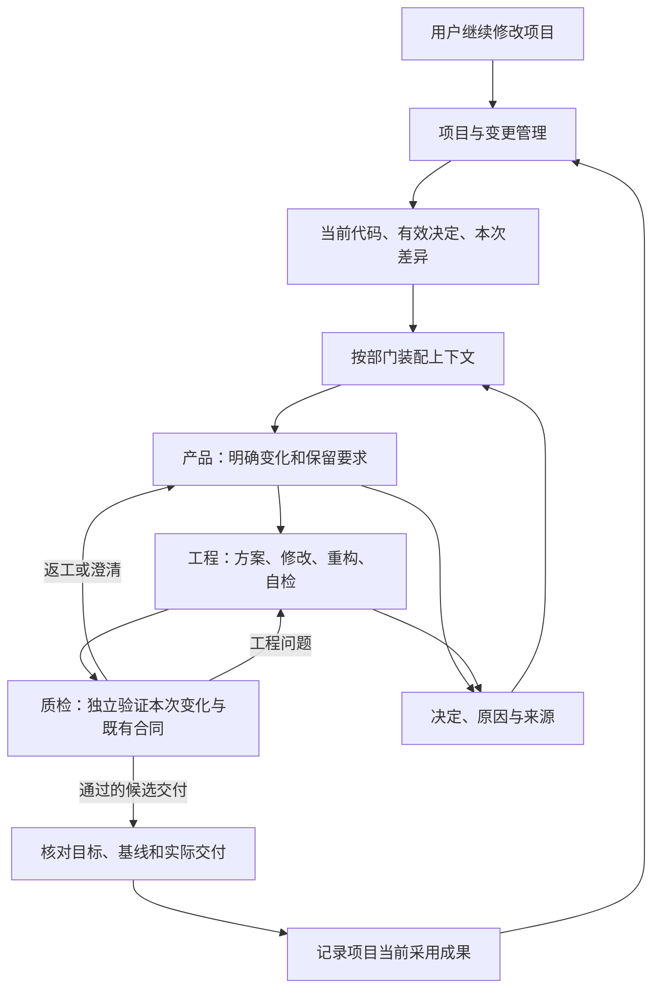

# Yudao 原生项目演化设计

> 日期：2026-09-06。状态：目标设计，尚未实现。代码核对基于本工作树 `28f166b`，不代表第一阶段另一会话的最新状态。
> 用户明确要求 Yudao 自身支持所承接项目的演化式开发。配套：[上下文与重构原则](evolutionary-development-context-design.md)、[AI 原生 SDLC 研究](ai-native-sdlc-insights.md)、总体架构。
> 第一阶段最新核对见设计对齐：主工作树已确认同任务持续输入、PRD、事前计划、双向协作及部门历史压缩；以下旧代码基线不是其当前实现。2.E 专注跨 run 项目连续性，不重复建设其任务内流程。

## 1. 原生支持的产品含义

用户在 Yudao 中进入已有项目，提出“基于现在的成果继续改”。系统知道现在有什么、为什么这样设计、本次改变什么、哪些行为仍要保留，能够在已有代码上完成修改与必要重构。下次进入项目时，这些结果继续有效，用户无需重新讲述全部历史或手工维护接续提示。

因此将项目作为跨任务持续存在的对象，将变更作为一次工作的业务单位，现有 run 作为完成这项工作的执行记录。一个项目有多次变更；一次变更可能有多次明确关联的执行尝试，每次尝试保留自己的结果、消耗与停止原因。重新运行不自动取得更多权限，也不把旧消耗清零；首版不因此新增自动重试调度器。

现有三部门负责一次变更的交付循环，项目管理责任负责把多次变更接起来。日常需求演进在第二阶段形成可用能力；第三阶段再加入持续并行、运行维护和持久恢复，第四阶段处理 Yudao 自主修改组织与规则。

## 2. 三层如何接入

| 层次 | 新增或扩展的责任 | 复用的基础 |
| --- | --- | --- |
| 界面 | 项目入口、继续修改、当前目标与实现差异、变更历史、决定原因和上下文来源 | 现有任务详情、三部门图、事件与证据视图 |
| 业务引擎 | 项目与变更管理；按任务提供有效项目知识；核验一次交付能否成为项目当前成果 | 三部门交接、Ask/React、QA、预算与取消；领域补全 |
| 基础设施 | 可取回的代码与工件版本、隔离工作副本、变更事实持久化、来源查询 | 现有 SQLite、文件工件、工作区、模型和工具接口 |

项目与变更管理是业务引擎中的一项内聚责任，不新增管理部门、第二套执行器或独立服务。运行控制管理“这次工作如何进行”；项目管理确定“它从哪里开始、结果归到哪里”；知识管理解释“当前依据及其原因”。三者通过有明确版本的公开结果交接。

图中的项目循环可以跨多次已结束的 run，不要求某个模型会话永久存活。工程内部自检与 QA 独立复核分别保留，不能用自检替代 QA。

## 3. 项目需要持续知道什么

| 项目材料 | 要解决的问题 | 权威与有效范围 |
| --- | --- | --- |
| 有效意图与要求 | 用户现在要什么，哪些约束和领域默认仍成立 | 原始输入及职责内接纳的决定；标明项目、工作分支与变更范围 |
| 当前采用成果 | 哪一份完整代码被采用，它经过哪些检查，还有哪些限制 | 明确采用记录引用的代码和验证证据；不会因规划更新而变化 |
| 工作副本事实 | 当前执行者实际面对的代码是否与采用成果一致 | 实际完整内容与来源，包括未提交修改；HEAD 和目录名都不单独代表内容 |
| 结构与合同 | 相关模块做什么、接口在哪里、哪些行为必须保持 | 与代码版本对应的说明和检查；模型生成的模块说明属于可核验派生材料 |
| 决定及原因 | 为什么这样做、何时需要重审、后来被什么取代 | 当时的简短说明及依据；未知原因保持未知 |
| 本次变更 | 从什么现状到什么目标，影响哪些行为和模块，哪些尚未完成 | 明确来源、采用目标和基线；与实际执行和交付关联 |

项目目录名、聊天会话和最新 run 都不足以充当项目身份。同一项目可以有分支或工作树，但“当前采用成果”总是属于明确的工作范围，不能用全局最后写入的结果覆盖其他分支。首版支持同一工作范围按序接纳变更；并行组织调度留给第三阶段，过期结果检测从首版就需要。

外部项目首次接入时读取其已有规范、代码和现有决定，登记可核对的起点。不能凭模型阅读一次就宣布整个项目已验证；检查缺失明确保留。用户原目录的未提交内容可作为明确记录的导入来源，执行在受控副本中进行，不覆盖原目录中的其他工作。

## 4. 一次变更贯穿三部门

### 接受变化

用户可以提出新功能、问题修复、结构调整或方向变化。系统保留原话，由领域补全和产品责任将其转为适用于现有项目的工作定义，区分本次新增或修改、仍须保持、明确废止的行为，以及未定的重要取舍。

用户已经明确的变化按已有授权推进；常规补全由相应部门完成。只在方向、重要成本或承诺存在无法推断的选择时提问。源文中的逐阶段人工批准不自动成为 Yudao 的默认流程。

### 形成方案并执行

工程在已有代码与模块合同上形成与改动规模相称的方案：影响范围、必要结构调整、可核验增量和证明方式。简单变化可以只有简短说明，重要架构变化需保留理由和代价。方案是工程工件，不要求新增一个部门或每次额外调用模型。

实际修改与原方案不一致时记录改变的原因和影响；职责内实现选择可以直接更新，改变用户目标或重要承诺的选择返回产品责任。不能为了保持方案看起来正确而隐去实际偏离，也不能要求实现永远服从最初计划。

模块重构是工程常规工作的一部分。工作区必须支持创建、修改、删除和移动，并保留相关代码与行为的对应；当前只有写入工具还不够。替代验证完成后删除旧实现与旧调用，不留下兼容层。文件改名、模块拆分及公开接口变化同步更新相关说明和上下文引用。

### 检查整个有效合同

QA 同时核对本次目标和仍有效的既有合同，结合影响范围选择检查。当前检查不能只覆盖新增功能；旧要求合法废止后，也不能继续用相反的旧测试否定新交付。

修复已有缺陷时，保留公开反例的修复前失败和修复后结果，防止执行者通过弱化检查消除问题。业务语义合法改变时，更新相关检查并说明依据；“修复时保护反例”不等于永久禁止修改所有测试。独立检查的来源和执行责任保持清楚。

纯重构验证约定行为保持；行为变化核验新合同。模块责任、已承诺接口与真实依赖变化可纳入审查，代码行数、抽象数量和模型的美观评分不作为结构改善证明。

## 5. 目标改变、运行通过与项目采纳

这三件事分别记录：新方向生效后项目可以显示待实现差异；QA 通过只说明本轮受测结果；项目采纳还要核对目标、基线和实际完整交付是否仍匹配。

例如 A 和 B 都基于版本 1 开始，A 已使项目采用版本 2。B 即使通过针对版本 1 的检查，也不能直接将项目改成自己的成果。需在当前基线上处理差异并重新验证受影响部分；B 的原交付和检查继续作为历史事实保留。无代码冲突也不能推断不存在接口或需求冲突。

首版采纳可在已有授权与有效条件下自动进行，不额外要求用户逐项批准。结果先封存为可核验、可取回的完整工件，再在同一次有效性核验中记录项目采用关系及对应说明来源。中途失败保留未采纳候选，项目仍指向上一完整成果；不让代码已更新而上下文仍无依据地指向旧状态。重复请求不得重复采纳或覆盖后来版本。

项目采用记录表示 Yudao 当前承接的成果，不等于部署已成功，也不意味着外部用户仓库已被修改。向其他工作树整合或向环境发布是有明确目标和实际回执的动作，不能由更新一条项目记录冒充完成。

## 6. 上下文必须由系统维护

每次模型请求根据项目、变更、代码版本、角色和任务步骤重新形成当前工作材料。默认内容包含当前目标、本次差异、相关模块合同、真实验证与限制、需要保留的决定和简短原因。跨 run 的完整对话、过时计划和失败尝试按具体问题查回，并同时显示历史状态和当前替代项。

当前 run 内的部门历史遵循用户最新 D08/D10：原始历史完整持久保留，跨激活延续；正常请求携带本部门历史的当前视图，临近窗口上限时自动生成有来源的摘要并保留近期完整回合。项目资料的选择性检索不能自行替代这项历史要求。进一步语义分解和历史选择属于后续优化，仍需检验关键理由、有效约束与工作连续性。

用户不需要手工写一份 `CLAUDE.md` 才能继续项目。Yudao 可以提供人可读的项目概览、变更说明和决定记录，但它们来自统一的有效来源。用户在说明中提出的新决定作为变更输入接纳，不能让摘要文件绕过实际代码、事件或权限成为另一事实来源。

上下文失效按引用和影响传播：要求改变影响相关默认、验收与待发工作；接口变化影响模块引用与依赖说明；代码变化影响受测证据适用性。旧通过记录不自动继承到新代码，无关材料也不全量重置。无法确定影响时说明不确定性并扩大必要核对范围。

装配记录要覆盖实际模型输入，包括历史和工具结果；原生适配器接收显式输入，不额外隐式加载其他来源。生成一份正确的提示文本还不足以证明实际请求隔离。历史原因查询返回的是资料，不重新授予旧命令执行权。窗口不足按 D10 压缩历史，固定原文与当前工作无法容纳时明确停止，不能删除仍有效的关键条件来凑长度；请求容量不等于任务 token 预算，后者已按 D09 从当前阶段删除。

在途变更沿用已有控制责任：接纳新方向、检查适用性和开始分派有共同控制顺序。受影响的待发步骤重装配，已发送动作尽可能停止并核实副作用，迟到结果按原绑定保留并判断能否复用。未实现持久恢复时，以明确关联的新执行继续工作，不能把 replay 状态还原称为恢复执行。

## 7. 代码与资料的一致来源

采用现有事件与工件体系，扩展项目与变更事实的独立作用范围；项目读模型从事实重建，不能通过扫描“最新一次 DONE”猜当前成果。现在的事件结构按 run 组织，真实接入需要显式扩展，不能把项目记录伪装为普通 run。

Git 或内容封存保存可取回代码，主机记录与实际回执证明执行，业务接纳记录证明目标和采用关系。Markdown 用于阅读与协作，索引用于定位；同一事实指定一个权威来源，其他位置只持引用或派生表示。提交链提供追溯，但单凭 commit 或 hash 一致不能证明检查真实发生。

先复用现有 Python、SQLite 和工件能力。已有离线分析的完整树封存可以供衔接核验，运行基线、证据包和被评工作区的权限仍分别处理，不把隐藏评价材料一起交给工程。暂不引入通用图数据库、跨仓库项目平台或新的持久工作流引擎。

## 8. 当前实现的接入位置

| 当前代码 | 可继承基础 | 需要新增的原生责任 |
| --- | --- | --- |
| `harness/runtime.py`、`orchestrator.py` | 创建和执行 run；需求修订与部门交接 | 项目入口、从基线启动变更、合法外部变化、交付关联和项目采纳 |
| `models.py`、`projection.py`、`event_store.py` | 有版本的运行工件和可重建状态 | 项目与变更作用范围、当前方向与采用成果分别投影 |
| `workspace.py`、`tools.py`、`artifacts.py` | 隔离目录、文件读写、检查绑定和工件 | 完整基线接续、工作副本识别、删除移动、完整候选封存和整合核验 |
| `context.py`、`sessions.py`、`adapters/` | 按部门重装配、来源清单与实际接入 | 项目材料、相关原因查询、摘要失效、实际输入范围核对 |
| `validation.py` | QA 绑定有效要求、交付、快照与主机检查 | 对本次变化及保留合同的覆盖，过期结果不能获得新范围的推进权 |
| `views.py`、`web/` | 三部门状态与运行详情 | 项目概览、继续修改、变更前后差异、采纳与未采纳结果 |

本基线的工作区按 run 新建；DeliverySpec 声明的文件不等于完整项目，“代码快照”摘要不够重建下一次工作的起点；工具尚无受控删除与移动。以上是接入缺口，不据此扩大第一阶段原承诺或推断其最新修复状态。

最新评审建议将运行中完整交付封存、受控删除与移动前移为第一阶段小增量，详见第一阶段设计对齐中的调整理由。2.E 接入时先核对其实际交付，复用稳定能力，不重复实现；跨 run 项目导入与成果采纳仍由 2.E 负责。

## 9. 开发顺序与首个完整验收

第二阶段新增横向工作包 **2.E 原生项目演化**，与可信观察、控制和经验工作分别推进。它不依赖先证明学习收益，但真实接入需要第一阶段稳定的事件、工作区、取消、上下文、模型与 QA 合同。

| 增量 | 可独立检查的交付 | 依赖 |
| --- | --- | --- |
| E0 | 固定项目演化故事、来源与变化合同、历史干扰和过期基线材料 | 现在即可准备；属于校准，不称原生能力已经可用 |
| E1 | 项目登记、完整代码起点、一次变更三部门执行、核验后采纳、下一次变更继承 | 第一阶段相关接口稳定；复用经核验的完整封存能力 |
| E2 | 原因查询、合法改方向、必要重构、实际上下文与失效、过期结果处理、新会话接续 | E1；接续不要求恢复旧执行 |
| E3 | 项目视图与跨三次变更的端到端验收 | E1/E2 与稳定 Web；三部门图继续复用 |

贯穿验收使用已有文本 CLI 任务领域：先形成逐行处理工具；第二次在已有代码上增加文件输入；第三次由用户明确把“保留重复行”改成“只保留首次出现”，并在真实需要时调整模块。系统须保留空输入等仍有效行为，更新去重相关要求和检查，能解释旧设计原因，并从新会话继续下一项工作。

额外验证方向已改而代码未完成、旧基线交付到达、人工未提交修改、重构删除旧接口、缺失原因、早期有效约束未被历史淹没、摘要过期及预算不足。每次变更都有真实代码与检查，固定脚本的预期结果不能代替真实三部门集成验收。完整场景与 [EC-01 至 EC-13](evolutionary-development-context-design.md#12-验收场景)共同使用。

## 10. 完成标准

原生能力验收须证明：同一项目可以多次增量开发，已有成果与有效合同被继承，合法新方向可以取代旧要求，必要重构能够完整落地，历史原因可查且不干扰当前执行，结果采纳与实际版本一致，新会话可以独立接续。

检查通过之外，记录从变更提出到可用交付的耗时、等待原因、需要人工补上下文的情况，以及因失效材料导致的错误。用户主动改方向、合理探索、缺陷返工和环境问题分别保留，不能靠阻止正常演化或压低变更数量证明效率提高。部署与实际使用反馈接回项目循环在第三阶段验收，Yudao 自身策略收益按第二、四阶段独立评价要求另行证明。
