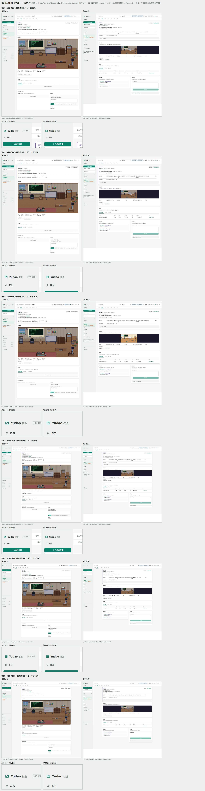
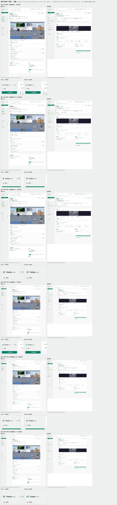
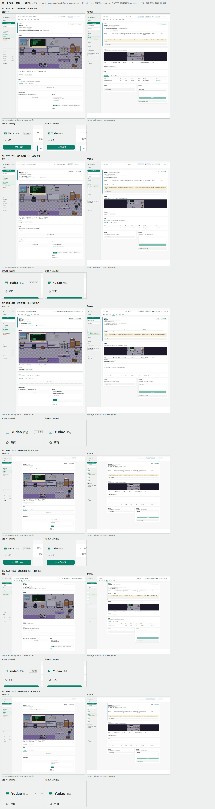
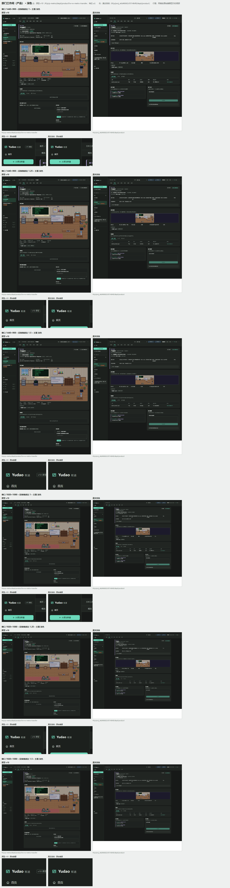
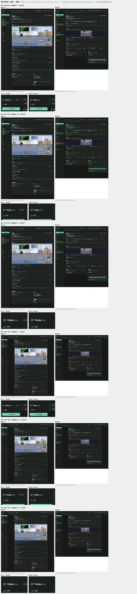
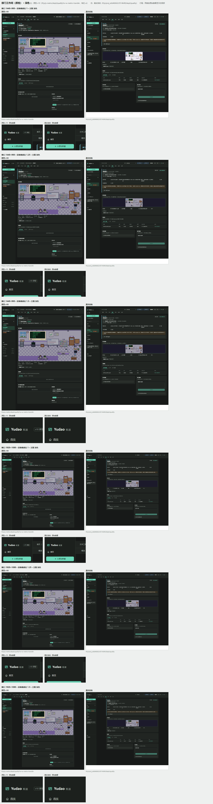

# 截图联系表 · 工单 #381

原型 v10 与真实系统的同一个页面并排。每张联系表六行：1440×900 与 1920×1080 两种窗口乘设备像素比 1、1.25、1.5；
每行左侧是原型 v10，右侧是真实系统，行尾附两侧按原始像素显示的局部。

真实系统一侧用端到端后端（`client/tests/e2e/backend.py` 的 default 预置：真实接口层、应用层与事件日志，
模型回答由 FakeAdapter 给出）；页面清单里的预置项目名在运行时换成服务端生成的项目标识。
机器、运行、工具与恢复四个页面在真实系统里当前是占位内容（由工单 #378、#380 填入），联系表照拍占位画面。

## 浅色

### 部门工作间（产品）（dept-product）



- 原型 v10 路由：`#/p/p-metro/dept/product?w=w-metro-transfer`（档位 `ui`，用原型自带的示例数据）
- 真实系统路由：`#/p/proj_e6d46662c9314649/dept/product` · 预置项目「文本工具」
- 行数：6 · 图片体积：1.02 MB

### 部门工作间（工程）（dept-engineering）



- 原型 v10 路由：`#/p/p-metro/dept/engineering?w=w-metro-transfer`（档位 `ui`，用原型自带的示例数据）
- 真实系统路由：`#/p/proj_e6d46662c9314649/dept/engineering` · 预置项目「文本工具」
- 行数：6 · 图片体积：1.14 MB

### 部门工作间（质检）（dept-quality）



- 原型 v10 路由：`#/p/p-metro/dept/quality?w=w-metro-transfer`（档位 `ui`，用原型自带的示例数据）
- 真实系统路由：`#/p/proj_e6d46662c9314649/dept/quality` · 预置项目「文本工具」
- 行数：6 · 图片体积：1.01 MB

## 深色

### 部门工作间（产品）（dept-product）



- 原型 v10 路由：`#/p/p-metro/dept/product?w=w-metro-transfer`（档位 `ui`，用原型自带的示例数据）
- 真实系统路由：`#/p/proj_e6d46662c9314649/dept/product` · 预置项目「文本工具」
- 行数：6 · 图片体积：1.02 MB

### 部门工作间（工程）（dept-engineering）



- 原型 v10 路由：`#/p/p-metro/dept/engineering?w=w-metro-transfer`（档位 `ui`，用原型自带的示例数据）
- 真实系统路由：`#/p/proj_e6d46662c9314649/dept/engineering` · 预置项目「文本工具」
- 行数：6 · 图片体积：1.14 MB

### 部门工作间（质检）（dept-quality）



- 原型 v10 路由：`#/p/p-metro/dept/quality?w=w-metro-transfer`（档位 `ui`，用原型自带的示例数据）
- 真实系统路由：`#/p/proj_e6d46662c9314649/dept/quality` · 预置项目「文本工具」
- 行数：6 · 图片体积：1.01 MB

## 重新生成

```
cd client && npm run build:pages
node scripts/build-page-contact-sheet.mjs --issue 381 --pages dept --depts product,engineering,quality --themes light,dark
```

页面清单与截图矩阵：`client/scripts/page-contact-sheet-pages.ts`（单元测试 `client/tests/unit/page-contact-sheet.test.ts`）。
原始整页截图写在 `.tmp/contact-sheet-raw/381/`，被 git 忽略。
