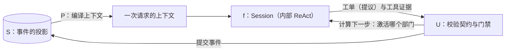
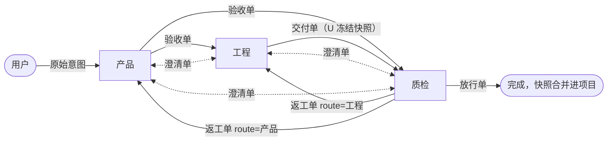
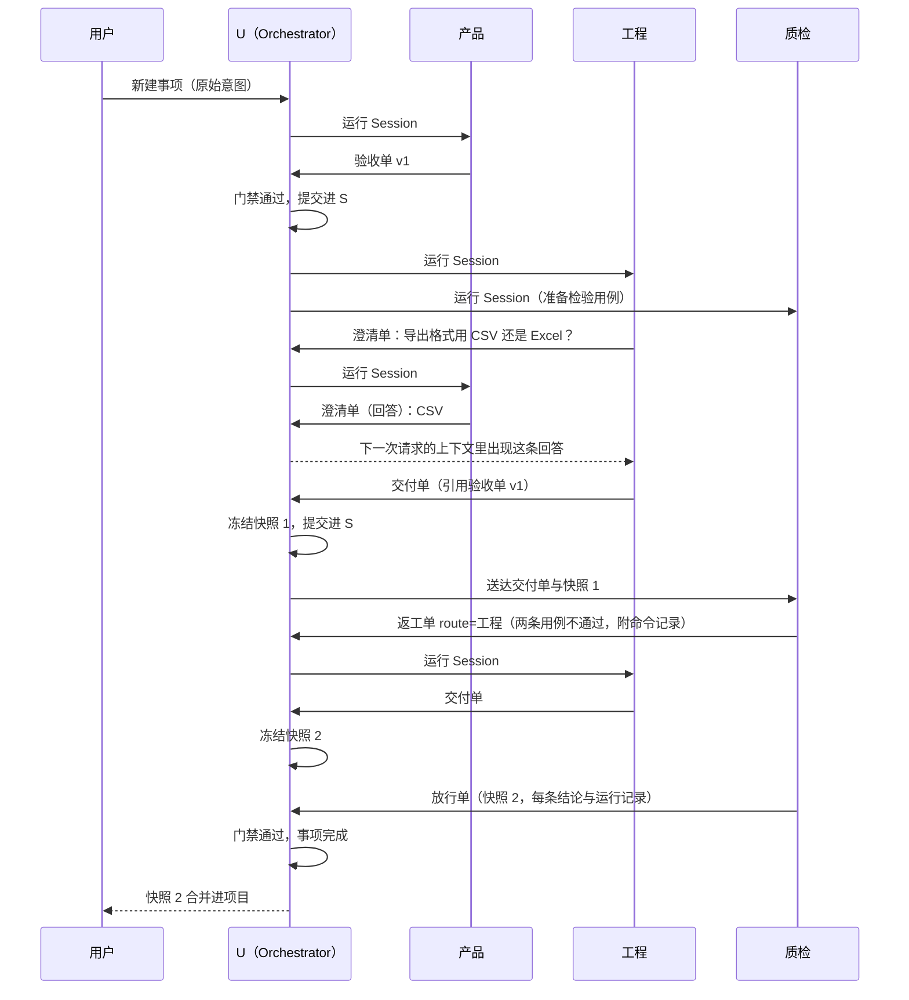

# Yudao 设计说明

更新：2026-10-12。状态：按根公式重写，用户确认（三个部门可以同时运行，部门之间只通过工单来往，事项是否完成由质检认定），全文待逐节讨论。

依据：`CLAUDE.md` 的项目表述；用户 2026-10-12 的意图与根公式；[Loop System 原理](../archive/native-harness/loop-system-principles.md)第 5 行、[Loop System 架构](../archive/native-harness/loop-system-architecture.md)第 57 行；用户 2026-09-06 的澄清（[设计日记](../archive/jour.md)第 241-246 行：「agent loop 那部分换成三个，做成三部门」，不做成多 agent 编排）。

参照实现：oh-my-pi（@ e3106be，下文写作 OMP，路径相对仓库根）；OpenCode（`anomalyco/opencode` @ bcf23b6，下文写作 OC，路径相对 `packages/core/src`）。参照只用于 Session 内部与工具，Yudao 不运行它们的完整 agent。

写法：第 1 至 3 节是 Yudao 自己的设计。其余各节与参照实现一致的部分写明参照的位置；与参照实现不同的地方写明多出来的这一项防止了什么问题，说不出来的不写进本文。

## 1. 根公式与目的

### 1.1 根公式

```
S_{t+1} = U(S_t, f(P(S_t)))
```

- S：真实状态，是事件的投影。
- P：ContextCompiler，每次请求都从 S 重新编译上下文。
- f：LLM，只提出提议。
- U：Orchestrator，不含 LLM 的校验与提交。

ReAct 的问题在于 U 和 f 合成了同一个东西：模型自己决定什么算完成、下一步做什么。整个架构只做一件事：把 U 从 f 里拆出来，并且永远不让它们合并。下文的每一节都从这个公式推出。

### 1.2 目的

1. 同一个模型下，交付质量高于单个 agent。
2. 用户不在场时，系统自己运行，直到质检放行，或者有原因地停下。

### 1.3 为什么是三个部门

- 部门有效，是因为角色异质：目标函数不同（挑错与完成），证据来源不同（独立运行检验与自己写代码）。错误因此相互独立，一个部门的错误由另一个部门的证据发现。
- 部门是三份数据契约加三道门禁。门禁只看产出是否符合契约，不关心背后是 LLM、代码还是人，所以以后可以换掉任何一个执行者，骨架不动。
- 单层已经图灵完备，再拆层不增加能力，只可能增加可靠性。可靠性的收益要求新增的角色带来真正独立的错误来源；只是结构上自相似的新层，不增加独立性。新增任何部门、角色或层，都要写明它带来的独立错误来源是什么。

## 2. 结构

| 部分 | 职责 | 调用 LLM | 参照 |
| --- | --- | --- | --- |
| U：Orchestrator | 校验工单的契约与门禁，提交进 S；按工单字段与计数确定地计算下一步；上限与停止 | 否 | Yudao 自己的设计（第 3 节） |
| P：ContextCompiler | 为一次请求从 S 编译上下文 | 否 | Yudao 自己的设计（第 3.5 节） |
| f：Session | 一个部门的一次工作：内部是 ReAct，带工具与压缩 | 是 | OMP `packages/agent/src/agent-loop.ts`；OC `session/runner/llm.ts` |
| 工具 | 文件、搜索、shell、网络取回、待办、技能、MCP；权限规则 | 否 | OC `tool/plugin/`、`shell.ts`、`permission.ts` |
| 模型接入 | Responses、Chat Completions、Anthropic Messages 三种协议，流式输出，重试 | — | 成熟的库 |
| 事件存储 | 唯一的事实来源；S 是事件的投影；只有 U 通过唯一的写入口写入 | 否 | OC 按聚合分开的事件流加投影表 |
| 接口与界面 | 显示 S 与事件；发出命令 | 否 | — |

- f 不能写入 S。f 的产出只有两样：工单（提议）与工具执行留下的证据。什么成为事实，由 U 裁决。
- 外层（U 推进状态、部门之间路由）不含任何 LLM 调用。ReAct 只存在于单个 Session 内部，是一个被调用组件的实现细节。
- Session 内部的子代理同样是实现细节，不形成新的一层。



## 3. 三部门：契约与门禁

### 3.1 部门定义

每个部门一个定义文件，写明：名称、目标函数、证据来源、系统提示词、模型、工具与权限、写入范围、可以提交的工单种类。三个部门可以使用不同的模型。

| 部门 | 目标函数 | 证据来源 | 写入范围 | 可以提交的工单 |
| --- | --- | --- | --- | --- |
| 产品 | 维护用户原始意图与有效要求，裁决目标与取舍 | 用户的原话、调研 | 需求目录 | 验收单、澄清单 |
| 工程 | 完成：按验收单设计、实现、自测 | 自己写的代码与自测 | 工作区 | 交付单、澄清单 |
| 质检 | 挑错：按验收单在冻结的快照上检验 | 自己在快照副本上重新运行的检验 | 检验目录 | 返工单、放行单、澄清单 |

加载定义时，U 核对：可以提交放行单的部门不能写入工作区，也不能提交交付单。U 的代码里不出现部门名称，部门之间的许可关系（谁可以向谁提交哪种工单）写在定义里。

### 3.2 工单

跨部门只认工单。每张工单都有：编号、种类、发出方、接收方（`route`）、版本号、内容哈希、引用（验收单版本、快照编号、被回答或被返工的工单）、按种类定义的结构化内容、状态。

| 工单 | 发出方 → 接收方 | 内容 | 门禁（U 核对） |
| --- | --- | --- | --- |
| 验收单 | 产品 → 工程、质检 | 有效要求的一个版本：目标、范围、逐条验收标准，每条写明检验方式 | 每条验收标准都有检验方式；版本号递增；内容哈希与需求目录中的文件一致 |
| 交付单 | 工程 → 质检 | 引用的验收单版本；交付说明：逐条写明实现位置与自测方式 | 引用的是当前的验收单版本；U 在提交时把工作区冻结为快照（git 提交），快照编号写进工单 |
| 返工单 | 质检 → 工程或产品（由 `route` 指定） | 针对的交付单；逐条结论；缺陷的复现步骤、期望与实际 | 针对的是最新的交付单；每条不通过的结论都附有质检在快照副本上运行的命令记录；`route` 属于定义允许的接收方 |
| 澄清单 | 任何部门 → 另一个部门或用户 | 问题与引用；回答也是一张澄清单，引用被回答的那一张 | 接收方是发出方以外的部门或用户；回答引用的澄清单存在且尚未回答 |
| 放行单 | 质检 → 完成 | 针对的交付单；每条验收标准的结论；检验报告 | 针对的是最新的交付单，引用的是当前的验收单版本；每条验收标准都有结论；质检在这份快照的副本上亲自运行过验证 |

- 门禁不通过时，U 把原因作为工具结果交回提交方的 Session，工单不进入 S。
- 验收单有了新版本以后，引用旧版本的交付单不能再被放行，工程需要按新版本重新交付。

### 3.3 下一步怎样确定

U 在每次提交工单以后，按 S 确定地计算下一步：

- 一个部门有送达给它、还没有处理的工单时，U 为它运行一个 Session。几个部门都有待处理的工单时，它们的 Session 同时运行，三个循环因此同时进行。
- 接收方由工单的种类与 `route` 字段决定。`route` 由提交方在定义允许的范围内填写，例如质检在返工单里写明交给工程还是产品。返工回到哪里、谁询问谁，都来自运行中的事实，状态机里不预先写死路径。
- 工单提交进 S 时，如果接收方的 Session 正在运行，P 在它下一次请求时重新编译上下文，新工单就出现在上下文里。工单因此在步与步之间送达，不需要另外的投递机制。
- 计数（返工次数、Session 次数、运行时间、费用）由 U 记录，用于上限与停止。



图中每一条箭头都经过 U：工单先过门禁、提交进 S，再由 U 送达接收方。部门之间没有不经过门禁的直接对话。

### 3.4 Session

- 一个 Session 是一个部门的一次工作。它的上下文由 P 从 S 编译，内部是 ReAct：模型请求、工具调用，直到模型不再调用工具，或者达到步数上限。
- Session 里可以提交多张工单，例如提交一张澄清单以后接着做别的事。提交是一次工具调用，工具结果是 U 的裁决：已提交（附工单编号），或者被拒绝（附原因）。
- Session 结束以后可以丢弃。它的过程留在事件里，不编译进以后的上下文。部门的连续性来自 S（工单、验收单版本、快照）与本部门目录里的文件。
- 等待回答的部门可以结束 Session。回答作为一张新工单送达以后，U 再为它运行一个新的 Session。

### 3.5 P：上下文的编译规则

为部门 D 的一次请求，P 只编译以下内容：

1. D 的系统提示词与工具；
2. 当前的验收单版本（D 的定义需要时）；
3. 送达给 D、还没有处理完的工单，以及它们引用的内容；
4. D 自己提交过的工单与 U 的裁决；
5. 本次 Session 进行中的模型请求与工具调用记录（接近窗口上限时按第 4 节压缩）。

别的部门的 Session 过程永远编译不进来。质检因此看不到工程的 scratch，只能依据验收单、交付单、快照与自己运行的检验作出判断。这条约束由编译规则在结构上保证。

### 3.6 写入与快照

- 每个部门的 Session 只能写入本部门的写入范围（第 3.1 节）。文件工具按路径核对；shell 的工作目录固定在本部门的目录。没有操作系统层面的隔离，这些规则只防止误操作，同 OC 的做法。
- U 在提交交付单时冻结工作区快照。质检的 Session 在这份快照的副本上工作，副本位于检验目录。
- 三个部门的写入范围互不重叠，同时运行也不会改到同一个文件。

### 3.7 停止

| 原因 | 条件 | 之后 |
| --- | --- | --- |
| 完成 | 放行单通过门禁 | 事项结束，快照合并进项目 |
| 用户取消 | 用户发出取消命令 | 事项结束 |
| 达到上限 | 运行时间、费用、返工次数或 Session 次数达到上限 | 用户提高上限以后可以继续 |
| 停滞 | 没有任何部门有待处理的工单，没有运行中的 Session，也没有等待用户回答的澄清单 | 用户提交一张工单即可继续 |
| 等待用户 | 没有运行中的 Session，并且有发给用户、还没有回答的澄清单 | 用户回答以后继续 |
| 模型服务失败 | 某个 Session 的模型请求重试次数用完 | 用户处理以后继续 |

- 每个 Session 的步数有上限，达到时下一步关闭工具、只输出文字，同 OMP 与 OC 的做法。
- 运行时间只计算至少有一个 Session 在运行的时间。上限的默认值写在配置里。

### 3.8 用户

- 用户的原始意图是事项的第一份输入，送达产品。目标只由用户修改。
- 用户可以向任何部门提交澄清单，也可以回答发给自己的澄清单。用户不在场时，其他部门照常工作。

### 3.9 一个事项的经过



## 4. Session 的内部

- 模型还有工具调用就继续；达到步数上限时，下一步关闭工具，只输出文字。同 OMP `packages/agent/src/agent-loop.ts`、OC `session/runner/llm.ts`。
- 本次 Session 的记录接近模型窗口时压缩，同 OMP `packages/agent/src/compaction/`、OC `session/compaction.ts`。压缩只作用于本次 Session 的记录；从 S 编译的部分每次请求都重新编译。
- 每一步前后各取一次本部门目录的快照，记录改动的文件，同 OC `session/runner/step.ts`、`snapshot.ts`。
- 子代理工具同 OC `tool/plugin/subagent.ts`：开一个新的上下文，结果作为工具结果交回，深度上限为 1，继承本部门的写入范围。它是 Session 内部的实现细节，不能提交工单。

## 5. 工具

| 工具 | 部门 | 参照 |
| --- | --- | --- |
| 读取、写入、编辑（编辑之前必须读过） | 全部，写入受第 3.6 节限制 | OC `tool/plugin/` |
| 文件匹配、内容搜索 | 全部 | OC `tool/plugin/` |
| shell | 全部，工作目录在本部门的目录 | OC `shell.ts`、`tool/plugin/shell.ts` |
| 网络取回、待办 | 全部 | OC 的同名工具 |
| 子代理 | 全部 | OC `tool/plugin/subagent.ts` |
| 技能、MCP | 按部门定义 | OMP 与 OC 的技能与 MCP 客户端 |
| 提交工单 | 按部门定义：每种工单一个工具，参数是这种工单的结构化内容 | 第 3.2 节 |

- 一个部门只拿到它可以提交的那几种工单的工具。
- 权限同 OC `permission.ts` 的 allow/ask/deny 通配规则，最后一条匹配的规则生效，按部门配置。默认值：本部门目录内允许，明显危险的命令拒绝。ask 规则命中时，这次调用等待用户回复，其他部门照常工作。
- shell 的输出只保留尾部交给模型，全文保存到文件并告诉模型路径；有超时，可以在后台运行，同 OC `shell.ts`。

## 6. 事件与恢复

- 事件存储是唯一的事实来源（SQLite）。只有 U 通过唯一的写入口写入；S 是事件的投影，可以完整重放。
- 事件种类：工单的提交与门禁裁决、快照的冻结、Session 的开始与结束、Session 内部的模型请求与输出、工具调用与结果、停止及原因。
- 进程重启以后，未结束的 Session 全部丢弃：它们的过程已经在事件里，副作用已经在文件里。U 按 S 重新计算下一步，为有待处理工单的部门运行新的 Session。Session 可以丢弃，恢复因此只需要重新计算一次下一步。

## 7. 项目、事项与目录

- 项目是一个代码仓库。事项是一次从原始意图到放行的循环。
- 每个事项有三个目录：需求目录、工作区（项目仓库的 git worktree）、检验目录。
- 事项完成时，放行的快照合并进项目分支。
- 同一个项目同一时间只有一个事项在运行；不同项目可以同时运行。

## 8. 界面

界面只显示 S 与事件、发出命令，后端不为界面的画法建立结构。

- 显示：事项列表与状态；工单的流转，也就是循环的轨迹，以及每张工单的门禁裁决；每个部门正在运行的 Session 及其实时输出；冻结的快照与检验结果；发给用户的澄清单。
- 命令：新建事项、取消、提交或回答澄清单、提高上限以后继续。

## 9. 度量

固定一组场景，Yudao 与单个 agent（OpenCode）各运行若干次，记录完成度、正确性、返工次数、澄清单数、Session 次数、费用与耗时，以及每个部门使用的模型。单独评估循环结构的作用时，三个部门与单个 agent 使用同一个模型。

## 10. 不在范围内

部门之间不经过门禁的直接对话；运行完整的外部 agent 并在它们之间转发消息；自我演化与规则登记、可信内核、判定点、语义系统与知识层、部门内的多角色、运维部门、外包角色、观察者、远程执行机器、computer use、收敛状态的判定。
