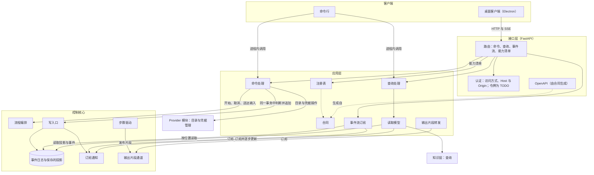
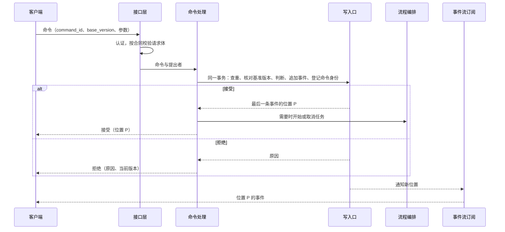
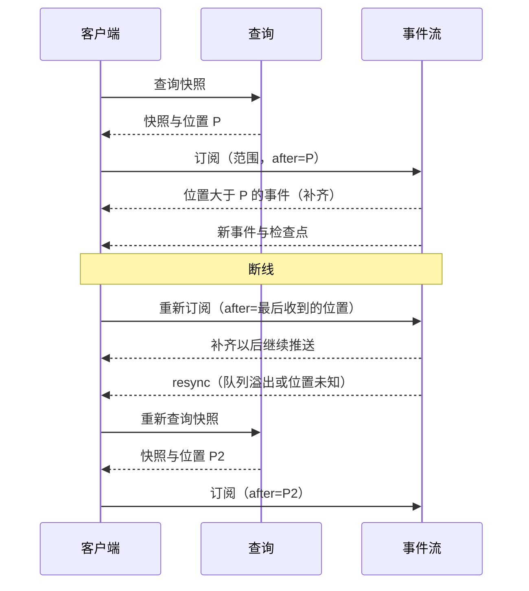

# 应用层与接口层设计说明

更新：2026-09-30。状态：设计说明，依据用户确认的 ADR-0015 与总体架构编写，第 10 节的事项由架构师决定；未实施。2026-09-28 用户决定界面工作线提前到 Stage 3，并增加系统首页（待你决定、离开期间的报告）、机器页、托盘提醒、接口版本核对与局域网访问方式（第 3.2、4.3、5.7、6、7.5 节）；只在局域网内使用期间，令牌与 TLS 保留位置并标为 TODO（第 6.3 节）。2026-09-29 用户决定 Stage 3 的每个工作包连同界面一起验收，D24 模型管理（#83）属于 Stage 3（第 7.5 节）；同日用户确认[接入已有项目](existing-project-onboarding.md)（3.8）与[执行环境服务](execution-environment.md)（3.2C）的设计，命令清单加入 `project.onboard`、`onboarding.restart`、`execution_placement.save`，已有代码只经 `project.onboard` 进入（第 3.2、4.3、10 节）。2026-09-30 原型设计结束，界面依据改为原型 v9（见下一段的依据）。

依据：[ADR-0015](../adr/0015-desktop-client-and-http-contracts.md)（桌面客户端与 HTTP 合同）、[ADR-0013](../adr/0013-event-log-and-single-write-path.md)（一份事件日志与全局位置）、[ADR-0011](../adr/0011-async-control-core.md)（异步）、[ADR-0007](../adr/0007-boundaries-for-distributed-deployment.md) 第 5 条、[总体架构](architecture/overall-architecture.md)第 2、5、7 节。需求：[D30](../requirements/web-game-frontend.md)。原型：[v7 设计说明](../prototypes/v7/design.md)第 7 节、[构建约定](../prototypes/v7/BUILD.md)第 3.5、5、6 节；依据改为原型 v9（原型设计已结束，[v9 设计说明](../prototypes/v9/design.md)与[构建约定](../prototypes/v9/BUILD.md)，屏幕清单、页面导航与接口层沿用 [v8 设计说明](../prototypes/v8/design.md)与[构建约定](../prototypes/v8/BUILD.md)），系统首页、机器页与托盘提醒以本文为准。界面要求：[语义系统设计说明](semantic-system.md)第 14 节、[部门内多角色设计说明](department-roles.md)第 15 节、[模型管理设计说明](model-management.md)第 9 节、[可观测性设计](../research/observability-design.md)第 5、6 节。用词以 `CONTEXT.md` 为准。

## 1. 要解决的问题

| 问题 | 现状与出处 | 影响 |
| --- | --- | --- |
| Web 直接引用内部模块 | `harness/web/server.py:16-35` 导入 `git_audit`、`models`、`observability`、`projection`、`replay_check`、`projects`、`runtime`、`tree_archive`、`views`；处理函数直接调用 `store.list_events`、`project_run` 与项目服务 | 违反 ADR-0007 第 5 条；#43、#44 每改一次内部模块，都要改 `server.py` 与约 2,900 行 Web 测试 |
| 读取可能写入事件 | `GET /api/projects/{id}` 调用 `projects.settle_pending`（`server.py:866`），它在 `projects.py:727-739` 写入采纳或未采纳候选的事件 | 违反总体架构第 2 节「查询不写入事件」；读取的次数与时机会改变事实 |
| 接口层持有执行 | `server.py:114-160` 由 Web 服务启动运行线程，判断「已有任务正在运行」，运行结束后调用结算 | 流程编排的职责（执行槽位、结算）放在接口层；与 ADR-0011「接口层与控制核心在同一个事件循环中运行」冲突 |
| 事件流定时查询数据库 | `server.py:994-1026`、`1223-1247` 每 0.2 秒或 1 秒查询一次；项目事件流的续传标识是各 run 序号的集合（`server.py:1028-1037`），因为没有全局位置 | 延迟与空转查询；无法做跨项目的事件流与缺口检测（ADR-0013） |
| 事件缺少部门、项目与完整载荷 | `harness/views.py:257-313` 的 `event_card` 只挑出固定的几十个字段，部门以 `role` 出现；run 事件流不带项目与事项（`server.py:1237`） | 构建约定第 6.1 节的事件对象需要项目、事项、部门与载荷（交接的物件、检查的退出状态、流式文字等），画面拿不到 |
| 每次查询从头重放 | `server.py:477、880、1169、1252` 与 `observability.py:320-322` 每次调用 `project_run` | 查询随事件数量变慢（ADR-0013 的背景） |
| 命令没有身份与基准版本 | 只有部门 Prompt 与登记命令带 `base_version`（`server.py:494-517`）；追加需求、部门指导、新建事项重试时会重复写入；结果返回局部投影 | 网络重试造成重复；客户端无法知道结果何时反映到读取中 |
| 没有合同类型 | 请求体逐字段手写校验（`server.py:426-517`、`1325-1335`） | 客户端无法生成类型（[前端技术调研](../research/web-frontend-technology.md)第 6 节） |
| 没有能力清单 | 原型用阶段档位切换显示；后端没有任何接口说明自己提供哪些能力 | 客户端无法按部署显示页面与覆盖层（调研第 3.3 节） |
| 没有认证 | `harness/__main__.py:124-127` 绑定非本机地址时只打印提示；凭据写入接口（`server.py:770-831`）没有保护 | 从本机以外访问时，API Key 与项目内容没有保护 |
| 后端提供界面文件 | `server.py:174-177`、`1290-1302` | 与 ADR-0015「后端不提供界面文件」冲突 |
| 事项内 Prompt 编辑仍在 | `POST /api/runs/{id}/prompts/{dept}`（`server.py:219-220`、`358-363`） | 模型管理设计说明第 10 节已决定删除 |
| 流式输出只有阶段 | `model_stream_progress` 每 0.25 秒写一条事件，只含阶段与 SDK 事件种类（`orchestrator.py:1244-1283`） | 画面无法逐字显示模型输出（原型第 6.3 节，ADR-0011） |
| 命令行直接读取内部模块 | `__main__.py` 的 `project list`、`project show`、`replay` 直接调用 `LoopSystem` 与投影 | 与 ADR-0015「命令行与客户端经过同一个应用层」冲突 |

## 2. 分层与模块

### 2.1 位置

应用层与接口层是[总体架构](architecture/overall-architecture.md)第 1 节分层图中的两层。依赖方向：客户端 → 接口层 → 应用层 → 控制核心、知识层、Provider 模块的管理接口。控制核心不依赖应用层；应用层需要的推送由控制核心的订阅接口提供（ADR-0013「写入以后在进程内通知订阅方」）。

### 2.2 模块

| 层 | 模块 | 职责 | 边界 |
| --- | --- | --- | --- |
| 应用层 | 合同 | 命令请求、命令结果、快照、事件对象、模型输出片段、能力清单的 pydantic 类型 | 只含可以序列化的数据 |
| 应用层 | 注册表 | 登记每个命令与查询：名称、请求类型、结果类型、处理函数、改变查询结果的事件种类 | 路由、OpenAPI 与能力清单都由它生成，不另写清单 |
| 应用层 | 命令处理 | 按命令身份查重、核对基准版本，交给控制核心判断与写入，返回接受或拒绝 | 修改只经过控制核心的写入口与流程编排；模型目录与凭据经过 Provider 模块的管理接口 |
| 应用层 | 查询处理 | 在一个读取事务中读取读取模型，返回快照与位置 | 不写入任何内容 |
| 应用层 | 读取模型 | 把保存的投影、知识层与事件整理成界面需要的形状；需要跨事件汇总的读取模型单独保存，按订阅逐步更新 | 只由事件与投影生成，可以删除后重建；出错不影响控制核心的写入 |
| 应用层 | 事件流订阅 | 按范围筛选、从位置补齐、转入实时推送、检测缺口、要求重新同步 | 只读取事件日志与订阅通知 |
| 应用层 | 输出片段转发 | 接收步骤驱动发布的模型输出片段，按范围转发，保存进行中调用尝试已收到的文字 | 片段不写入事件日志 |
| 接口层 | 路由 | 命令、查询、事件流、能力清单四组路径 | 不含业务规则，只调用应用层 |
| 接口层 | 合同文档 | OpenAPI 由应用层的 pydantic 类型生成 | 不另写接口描述 |
| 接口层 | 认证 | 访问方式、Host 与 Origin 检查；访问令牌保留位置（TODO） | 在路由处理之前完成 |
| 接口层 | 生命周期 | 启动时在同一个事件循环中建立控制核心、应用层与订阅 | 单机部署只有一个进程 |

### 2.3 模块关系

箭头表示调用或订阅的方向。

### 2.4 依赖规则

- 接口层只导入应用层；应用层只导入控制核心的公开接口（流程编排的入口、写入口、事件日志的读取与订阅、保存的投影、输出片段通道）、知识层的查询、Provider 模块的管理接口与执行环境池的只读接口（机器状态，3.2C）；控制核心不导入应用层。三条规则用 import-linter 的层次合同在测试中检查。
- 命令行在进程内调用应用层的同一套命令与查询，输出查询结果（快照与位置）或命令结果的 JSON。
- 单机部署时接口层、应用层与控制核心在一个进程、一个事件循环中运行（ADR-0011）；uvicorn 的事件循环就是控制核心的事件循环。
- 3.2C 把执行环境放到本机容器与登记的其他机器上时，接口层、应用层与客户端合同不变（[ADR-0018](../adr/0018-single-control-host-remote-execution.md)）。

### 2.5 代码位置

应用层放在 `harness/app/`，接口层放在 `harness/api/`。`harness/web/` 按第 7.3 节删除。

## 3. 命令

### 3.1 合同

**请求。** 每个命令是一个 pydantic 类型，公共字段：

| 字段 | 内容 |
| --- | --- |
| `command_id` | 客户端生成的 UUID，命令的身份；重试使用同一个值 |
| `base_version` | 用户作出这一操作时所依据对象的版本，取自查询结果；规则见下表 |
| 其余字段 | 该命令的参数 |

提出者由认证得出（第 6.2 节），写入事件的 `actor` 字段，不在请求体中出现。

**基准版本。** 基准版本指向命令作用的对象，对象的版本随查询结果一起返回。流版本由写入口在内部使用（ADR-0013），客户端不接触。

| 类别 | 命令 | 基准版本指向 | 核对 |
| --- | --- | --- | --- |
| 新建 | 新建项目、接入已有项目、重新开始建档、记录原文、新建事项 | 没有已存在的对象，为空 | 不核对 |
| 修改 | 项目的重命名、置顶、归档与恢复，项目部门设置，源目录登记，登记命令，工具授权，机器登记与项目的机器授权，项目的执行位置，同一项目的排队顺序，角色设置，执行槽位数，模型目录与部门默认，凭据，语义记录的纠正 | 被修改对象的版本：项目基本信息版本、该部门设置的版本、该项目源目录登记的版本、该登记命令的版本、该机器登记的版本、该项目机器授权的版本、该项目执行位置的版本、该项目排队顺序的版本、目录修订号、凭据版本、该条记录的版本 | 必须等于当前版本，否则拒绝，返回当前版本 |
| 追加与控制 | 追加需求、部门指导、取消事项、取消排队、开始排空、强制升级、目录的重新读取、获取模型列表、连接测试与模型测试 | 用户提交时看到的对象版本：事项的输入版本、该部门的指导版本、事项版本、排空状态的版本、目录修订号 | 写入事件作为依据，不要求相等；对象的状态不允许时拒绝 |
| 回答 | 回答决定请求 | 决定请求的版本 | 请求仍未回答且版本相等 |

修改类命令要求相等，因为基于旧内容的保存会覆盖别人或系统的修改（原型第 4.6 节「版本冲突时提示重新读取」）。追加类命令本身不覆盖任何内容，重新读取不会改变用户的意图，所以只记录依据。

**处理。** 命令处理在写入口的一个事务中完成：登记命令身份，读取保存的投影，核对基准版本与对象状态，由控制核心判断，追加事件。需要继续执行的工作（运行事项、连接测试）作为任务进行，结果以后续事件出现。

**查重。** 写入口在同一事务中登记命令身份、命令名称、请求内容的摘要与产生事件的位置。同一身份再次提交时返回原来的接受结果（`duplicate: true`），不再执行；同一身份、内容不同时拒绝（`command_id_reused`）。被拒绝的命令不登记，客户端用同一身份重试会重新判断。

**结果。**

| 结果 | HTTP | 内容 |
| --- | --- | --- |
| 接受 | 200 | `command_id`、`position`（本命令最后一条事件的位置）、`refs`（新建对象的标识，例如 `project_id`、`work_item_id`、`run_id`）、`duplicate`、`reminders`（照常保存时附带的提醒；所选模型不具备部门的建议能力时写明部门、角色（按角色的设置才有）、模型、缺少的能力与影响，模型管理设计说明第 5.6 节；没有时为空） |
| 拒绝 | 409 | `command_id`、`reason`（封闭清单中的原因代码）、`message`（中文说明）、`current_version`（修改类命令版本不符时） |
| 请求体不符合合同 | 422 | pydantic 的字段错误 |
| 未认证 | 401 | 无内容 |
| 命令名称不存在 | 404 | 无内容 |

接受表示事件已经追加。客户端在事件流到达位置 P 之前显示「已提交」，到达以后按事件显示最终状态（可观测性设计第 5 节）。

拒绝原因是一份封闭清单，每个命令在合同中声明自己可能返回的原因：`stale_base`（基准版本过期）、`not_found`、`already_exists`、`project_archived`、`work_item_in_progress`、`run_terminal`、`busy`（没有空闲的执行槽位；3.4A 加入排队以后由排队代替）、`provider_unavailable`（新建事项时项目的三个部门无法解析调用目标）、`catalog_invalid`（目录校验失败，附字段位置）、`in_use`（仍被引用，附引用方）、`decision_closed`（决定请求已回答或已撤销）、`option_invalid`、`not_allowed`（对象状态不允许，附说明）、`command_id_reused`、`container_engine_unavailable`（保存以本机容器为执行位置的设置时控制主机的容器引擎不可用，3.2C）、`source_invalid`（接入已有项目时源目录不存在或不可读、含有宿主私有路径、公开树中有无法表示的条目，附工作区内的相对路径与处理方法；3.8）。

### 3.2 命令清单

「现状」中「已有」写出现有路由，「新增」写出所属工单或阶段。事件名称为现有事件种类；新增事件的名称由所属工单的设计确定。

**项目（左侧栏、设置的基本信息）**

| 命令 | 作用 | 参数 | 领域事件 | 基准版本 | 现状 |
| --- | --- | --- | --- | --- | --- |
| `project.create` | 新建项目 | 名称、长期目标 | `project_registered` | 空 | 已有 `POST /api/projects` |
| `project.rename` | 重命名 | 项目、名称 | `project_renamed` | 项目基本信息版本 | 已有 `POST /api/projects/{id}/rename` |
| `project.set_goal` | 修改长期目标；之后开始的事项使用新目标，进行中的事项使用 `run_created` 记下的开始时的目标 | 项目、长期目标 | `project_goal_changed` | 项目基本信息版本 | 新增（#203） |
| `project.pin` | 置顶或取消置顶 | 项目、是否置顶 | `project_pinned` | 项目基本信息版本 | 已有 `POST /api/projects/{id}/pin` |
| `project.archive` | 归档 | 项目 | `project_archived` | 项目基本信息版本 | 已有 `POST /api/projects/{id}/archive` |
| `project.restore` | 恢复项目 | 项目 | `project_restored` | 项目基本信息版本 | 已有 `POST /api/projects/{id}/restore` |
| `project.onboard` | 接入已有项目：新建项目，登记源目录，只读采集代码快照，开始建档事项 | 名称、长期目标、源目录名称、源目录路径（控制主机上的路径） | `project_registered`（`source` 为 `existing`）、源目录登记事件、`work_item_created`（`kind` 为 `onboarding`）、`run_created`、`user_input_received` | 空 | 新增（3.8，[接入已有项目设计说明](existing-project-onboarding.md)第 3.1 节） |
| `onboarding.restart` | 重新开始建档：从登记的源目录重新采集快照，开始新的建档事项；只在项目来源为已有项目、还没有基线采纳、没有进行中或等待确认的建档事项时可用 | 项目、源目录（登记名） | `work_item_created`（`kind` 为 `onboarding`）、`run_created`、`user_input_received` | 空 | 新增（3.8） |

已有代码只经 `project.onboard` 进入 Yudao；建档以后源目录的修改不进入项目，要在源目录的新代码上工作时接入为新项目（接入已有项目设计说明第 5、12 节）。取消建档使用 `work_item.cancel`。

**事项与输入（概览、部门工作间）**

| 命令 | 作用 | 参数 | 领域事件 | 基准版本 | 现状 |
| --- | --- | --- | --- | --- | --- |
| `material.record` | 记录原文 | 项目、原文、部门（可选） | `material_recorded` | 空 | 已有 `POST /api/projects/{id}/materials` |
| `work_item.create` | 新建事项并开始执行，从项目的采纳成果开始 | 项目、事项原文、标题（可选） | `work_item_created`、`run_created`、`user_input_received` | 空 | 已有 `POST /api/projects/{id}/work-items`；删除 `max_cycles`、`run_time_limit_sec`、`context_window` 三个参数（D24 第 10 节，限额属于 ADR-0014 的定义）与代码快照来源 `source_dir`（已有代码经 `project.onboard` 进入，第 10 节第 6 项） |
| `work_item.append_input` | 追加需求 | 事项、原文 | `user_input_received` | 事项的输入版本（记录依据） | 已有 `POST /api/runs/{id}/inputs`，作用对象改为事项 |
| `work_item.cancel` | 取消事项 | 事项 | `run_failed`（停止原因 `cancelled`） | 事项版本（记录依据） | 已有 `POST /api/runs/{id}/cancel` |
| `work_item.reorder` | 调整同一项目排队中用户新要求的顺序；因升级重新开始的事项最前，其次是修复事项（Stage 4），这两类不参与调整 | 项目、排队中用户新要求的新顺序 | 由 #19 确定 | 该项目排队顺序的版本 | 新增（#19） |
| `guidance.send` | 发送部门指导 | 事项、部门、原文 | `department_guidance_received` | 该部门的指导版本（记录依据） | 已有 `POST /api/runs/{id}/departments/{dept}/guidance` |

`work_item.cancel` 由流程编排写入取消事实并取消该事项的任务；任务在取消以后交回的结果按执行权拒收（恢复契约第 45 行、第 80 行）。

**项目设置（部门设置弹窗、设置页）**

| 命令 | 作用 | 参数 | 领域事件 | 基准版本 | 现状 |
| --- | --- | --- | --- | --- | --- |
| `department_settings.save` | 保存项目部门设置；所选模型不具备部门的建议能力时照常保存，结果带提醒（D24） | 项目、部门、部门 Prompt、模型（模型访问定义引用或跟随部门默认）、推理档位（或跟随） | `department_prompt_configured`；模型与档位的事件由 D24 确定 | 该部门设置的版本 | 部门 Prompt 已有 `PUT /api/projects/{id}/prompts/{dept}`；模型与档位、提醒新增（D24 第 5.2、5.6 节） |
| `source_directory.save` | 登记与修改本项目的源目录；`project.onboard` 填写的路径是项目的第一条登记，`onboarding.restart` 从登记的源目录重新采集快照 | 项目、名称、路径 | 由界面工作线的工单确定 | 该项目源目录登记的版本 | 新增（界面工作线，#74） |
| `command_registration.save` | 登记与修改命令 | 项目、登记名、固定参数、允许的额外参数、时限、输出上限 | `command_configured` | 该登记命令的版本 | 已有 `PUT /api/projects/{id}/commands/{name}`；界面入口新增 |
| `tool_authorization.save` | 保存网络取回与 MCP 工具在本项目的授权范围 | 项目、授权范围 | 由 3.2B 确定 | 工具授权版本 | 新增（3.2B） |
| `machine_authorization.save` | 保存本项目可以使用的机器与授权 | 项目；每台机器的登记目录与可以执行的操作（3.2C）；是否作为本项目的运行环境与常设授权（Stage 4） | `machine_authorization_configured`（项目流）；运行环境与常设授权的事件由 Stage 4 确定 | 该项目机器授权的版本 | 新增（3.2C）；运行环境与常设授权在 Stage 4 加入 |
| `execution_placement.save` | 保存本项目的执行位置：运行工作区的位置，产品、工程、质检各自检查的位置（缺省与运行工作区相同），容器基础镜像（可选）；位置取值为本机进程、本机容器或一台授权的机器 | 项目、运行工作区的位置、各部门检查的位置、容器基础镜像 | `execution_placement_configured`（项目流） | 该项目执行位置的版本 | 新增（3.2C，[执行环境服务设计说明](execution-environment.md)第 7 节） |
| `role_settings.save` | 保存本项目的角色设置；所选模型不具备部门的建议能力时照常保存，结果带提醒 | 项目、部门、角色、模型、档位、角色 Prompt | 由 D26 确定 | 该角色设置的版本 | 新增（Stage 5，多角色设计第 14 节） |

**用户决定（通知、恢复页、部门工作间、元观察页）**

| 命令 | 作用 | 参数 | 领域事件 | 基准版本 | 现状 |
| --- | --- | --- | --- | --- | --- |
| `decision.answer` | 回答决定请求 | 决定请求、所选选项、说明（可选） | `decision_answered`（名称由 #49 确定）；项目流中的请求为 `project_decision_answered`（3.8） | 决定请求的版本 | 新增（#49）；项目流中的请求新增（3.8） |

**系统首页（界面工作线）**

| 命令 | 作用 | 参数 | 领域事件 | 基准版本 | 现状 |
| --- | --- | --- | --- | --- | --- |
| `home.mark_seen` | 用户点击「已看过」，把上次查看的位置更新为当前 | 查看到的全局位置 | 由界面工作线的工单确定 | 空 | 新增（界面工作线） |

控制主机只记录一个上次查看的位置（单人使用），在哪台电脑上点击「已看过」都更新同一个位置。

**机器（3.2C）**

| 命令 | 作用 | 参数 | 领域事件 | 基准版本 | 现状 |
| --- | --- | --- | --- | --- | --- |
| `machine.save` | 登记与修改机器 | 名称、地址、用途 | `machine_registered`、`machine_updated`（机器流） | 该机器登记的版本 | 新增（3.2C） |

机器由系统登记一次，登记与修改写在这台机器的机器流中，与项目流一样跨 Yudao 版本保存（[ADR-0019](../adr/0019-project-stream-across-versions.md)）；同一台机器可以被多个项目使用；每个项目用 `machine_authorization.save` 选择可以使用的机器，授权范围按项目分开（[ADR-0018](../adr/0018-single-control-host-remote-execution.md)），再用 `execution_placement.save` 在授权以内选择执行位置。控制主机不经过 `machine.save` 登记，本机进程与本机容器不需要授权。保存执行位置与修改授权时的核对见执行环境服务设计说明第 7.2 节；项目没有设置执行位置时全部在本机进程运行。

**升级（3.1）**

| 命令 | 作用 | 参数 | 领域事件 | 基准版本 | 现状 |
| --- | --- | --- | --- | --- | --- |
| `runtime.start_drain` | 开始排空：Yudao 停止开始新事项，等正在进行的 run 结束 | 无 | 由 3.1 确定 | 排空状态的版本（记录依据） | 新增（3.1） |
| `runtime.force_upgrade` | 强制升级：正在进行的 run 记为因升级停止，对应的事项用已采纳成果重新开始，并记下「因升级重新开始」的优先级；只在排空期间可用，其他时候以 `not_allowed` 拒绝 | 无（作用于全部进行中的 run） | 由 3.1 确定 | 排空状态的版本（记录依据） | 新增（3.1） |

升级的规则见 [ADR-0019](../adr/0019-project-stream-across-versions.md)：run 事件版本不同的升级先排空，排空状态由 `system.status` 返回。因升级重新开始的事项排在队列最前面，由 3.4A（#19）按 3.1 记下的优先级实现。

**运行与执行槽位（3.4A）**

| 命令 | 作用 | 参数 | 领域事件 | 基准版本 | 现状 |
| --- | --- | --- | --- | --- | --- |
| `runtime.set_slots` | 设置执行槽位数 | 槽位数 | 由 3.4A 确定 | 槽位设置版本 | 新增（#19） |
| `queue.cancel` | 取消排队 | 事项 | 由 3.4A 确定 | 事项版本（记录依据） | 新增（#19） |

**模型管理（D24）**

| 命令 | 作用 | 参数 | 领域事件 | 基准版本 | 现状 |
| --- | --- | --- | --- | --- | --- |
| `catalog.connection.save` | 新增或修改 Provider 配置及其模型访问定义（含容量确认与输入方式） | Provider 配置字段、模型访问定义列表（每个定义含输入方式：文本、图像，以及是否接受要求调用工具） | `catalog_revised`（第 10 节第 1 项） | 目录修订号 | 已有 `POST /api/providers`、`PUT /api/providers/{id}` |
| `catalog.connection.delete` | 删除 Provider 配置 | Provider 配置 | `catalog_revised` | 目录修订号 | 已有 `DELETE /api/providers/{id}` |
| `catalog.document.save` | 保存目录文档（编辑 JSON、导入） | 目录文档 | `catalog_revised` | 目录修订号 | 已有 `POST /api/providers`（带 `providers` 字段） |
| `catalog.reload` | 重新读取目录文件 | 无 | `catalog_revised`（修订号变化时） | 目录修订号（记录依据） | 已有 `POST /api/providers/reload` |
| `catalog.candidates.collect` | 获取模型列表；每个候选带预填的窗口、输出上限与输入方式，每个预填值带来源（上游模型列表，或模型能力表及其 revision） | Provider 配置、模型列表地址（可选） | `catalog_candidates_collected` | 目录修订号（记录依据） | 已有 `POST /api/providers/{id}/candidates` |
| `catalog.connection.test` | 连接测试 | Provider 配置 | `catalog_test_finished` | 目录修订号（记录依据） | 已有 `POST /api/providers/{id}/test`（`kind=connection`） |
| `catalog.model.test` | 模型测试，通过时写入准入 | Provider 配置、模型访问定义 | `catalog_test_finished`（带准入） | 目录修订号（记录依据） | 已有 `POST /api/providers/{id}/test`（`kind=model`） |
| `catalog.department_defaults.save` | 保存部门默认；所选模型不具备部门的建议能力时照常保存，结果带提醒 | 各部门的模型访问定义引用与请求档位 | `catalog_revised` | 目录修订号 | 已有 `PUT /api/department-bindings`；提醒新增（D24 第 5.6 节） |
| `catalog.role_defaults.save` | 保存角色默认；所选模型不具备部门的建议能力时照常保存，结果带提醒 | 各角色的模型访问定义引用与请求档位 | `catalog_revised` | 目录修订号 | 新增（Stage 5） |
| `credential.set` | 保存 API Key，只在本进程有效或写入 `.env` | 凭据引用、API Key、写入方式 | `credential_changed`（只含引用、来源与版本） | 凭据版本 | 已有 `POST /api/provider-credentials`（`action=set`） |
| `credential.clear_override` | 清除内存覆盖 | 凭据引用 | `credential_changed` | 凭据版本 | 已有（`action=clear_override`） |
| `credential.remove_persisted` | 删除持久凭据 | 凭据引用 | `credential_changed` | 凭据版本 | 已有（`action=remove_persisted`） |

模型管理属于 Stage 3 的 D24 工作包（#83）。容量「接受」是模型访问定义表中逐行的确认，随 `catalog.connection.save` 一起提交（模型管理设计说明第 4.3 节），不单独成为命令。连接测试、获取模型列表与模型测试需要请求上游，命令接受以后作为任务进行，结果以事件出现，界面在事件到达前显示「测试中」。

**运维（Stage 4）**

| 命令 | 作用 | 参数 | 领域事件 | 基准版本 | 现状 |
| --- | --- | --- | --- | --- | --- |
运维在事项的交付被采纳以后自动接手运行责任（D27），没有用户命令；运维需要用户的操作都经决定请求（第 3.3 节）。

**语义记录（Stage 5）**

| 命令 | 作用 | 参数 | 领域事件 | 基准版本 | 现状 |
| --- | --- | --- | --- | --- | --- |
| `semantic.mark_invalid` | 把一条内容标记失效 | 内容、理由 | 由 #37 确定 | 该条内容的版本 | 新增（#37） |
| `semantic.correct` | 写入更正 | 内容、更正文字、理由 | 由 #37 确定 | 该条内容的版本 | 新增（#37） |

命令共 41 个：由已有路由改成的 23 个（其中项目部门设置的模型与档位部分为新增），新增 18 个。原型构建约定第 3.5 节的命令标识由本清单代替。

### 3.3 用户决定的回答

总体架构第 7.4 节规定，凡是等待用户的事项都由流程编排发出决定请求，用户通过命令回答。所有种类使用同一个命令 `decision.answer`；可选项由决定请求给出，`decisions.list` 返回请求的全部内容（第 4.3 节）。原型中的 `resumeRun`、`decideUnknownAction`、`approveOnce`、`authorizeOpsAction`、`decideJudgment` 都是这个命令。

| 决定种类 | 选项 | 阻塞范围 | 来源 | 工单 |
| --- | --- | --- | --- | --- |
| 模型引用无法使用时的待恢复 | 继续执行（修复配置以后）、停止事项 | run | 模型管理设计说明第 5.5 节 | #49 |
| 暂停以后继续（停止原因 `no_tool_call`、`workspace_unrepresentable`） | 处理以后继续执行、停止事项 | run | [D09](../requirements/execution-limits.md) | #204 |
| 继续旧事项时定义版本不同（`definitions_changed`） | 按新版本继续、停止事项 | run | 总体架构第 7.4 节，[ADR-0014](../adr/0014-versioned-definitions.md) | #16 |
| 核实结果未知的动作 | 重新执行（只对契约声明可以重复的动作提供）、按当前实际状态继续、停止事项 | 动作 | 恢复契约第 4 节，原型第 4.3 节 | #17 |
| 质检无法核验 | 重新核验、停止事项 | run | [浏览器与 computer use 设计说明](browser-and-computer-use.md)第 8.4 节 | #151 |
| 授权网络取回与 MCP 工具，一次性批准 | 批准这一次、拒绝 | 动作 | 3.2B、原型第 4.6 节 | 3.2B |
| 授权常设授权清单以外的外部动作 | 批准这一次、拒绝 | 动作 | D27、原型第 4.2 节 | Stage 4 |
| 进入等待模型服务的通知 | 已阅；取消使用 `work_item.cancel` | 不阻塞 | D17、路线图第 5.1 节 | Stage 4 |
| 判定点置信不足时的裁定 | 判定点给出的选项 | 由判定点确定 | D28 | Stage 6 |
| 证据核对的校准样本裁定 | 由 #40 的校准设计给出 | 不阻塞 | 语义系统设计说明第 7.2、14 节 | #40、#41 |
| 采用 Stage 6 的定义候选 | 采用、不采用 | 不阻塞 | ADR-0014 | Stage 6 |
| 确认接入已有项目的初始 PRD（`initial_prd`） | 确认、提出修改（必须附说明，说明为空时以 `not_allowed` 拒绝） | 事项：建档事项与同一项目中排在它后面的事项；请求写在项目流中，不属于任何 run | [D33](../requirements/existing-project-onboarding.md)、[接入已有项目设计说明](existing-project-onboarding.md)第 3.2 节 | 3.8 |
| 同一故障连续修复失败后停止自动修复 | 由 D27 的设计给出 | 故障记录 | D27、路线图第 5.1 节 | Stage 4 |
| 需要恢复备份的回滚 | 回滚并恢复备份、不回滚 | 故障记录 | D27、路线图第 5.1 节 | Stage 4 |
| 反复退回的提醒 | 已阅 | 不阻塞 | 多角色设计说明第 12.5 节 | Stage 5 |

中断的 run 在 Yudao 启动时自动继续（恢复契约第 3 节）；事项记录的定义版本与当前加载的版本不同时，先发出上表中定义版本的决定请求。

决定请求写在 run 流或项目流中。`initial_prd` 写在项目流中，不属于任何 run，不占用运行时间与执行槽位，也不阻碍排空；Stage 4 中阻塞范围为故障记录的决定使用同一套项目流决定事件（接入已有项目设计说明第 3.2、3.3 节）。

回答被接受以后，流程编排按回答解除阻塞；重放使用记录的回答（#49）。已回答的请求再次回答时拒绝，原因 `decision_closed`。

### 3.4 删除的命令

- `POST /api/runs/{id}/prompts/{dept}`：事项内 Prompt 编辑，删除（模型管理设计说明第 10 节）。
- `POST /api/runs/{id}/replay`：重放核对不写入，改为查询 `replay.check`。
- `POST /api/runs`：只返回 404 的占位路由，删除。

## 4. 查询与读取模型

### 4.1 合同

- 每个查询是一个 pydantic 请求类型与一个结果类型。结果是快照：`{ position, data }`。
- `position` 是这份快照已经包含的最大全局位置。客户端据此从事件流的 `position` 之后续上（第 5.4 节）。
- 快照中每个可以修改的对象带自己的 `version`，作为命令的基准版本。
- 项目内的查询都接受事项范围参数 `work_item`（原型第 3.3 节的 `?w=`）。
- 查询不写入任何内容，也不触发结算、重读或模型调用。
- 分页查询的游标带第一页的位置；后续页只返回该位置以前的记录，翻页期间新出现的记录由事件流带来（可观测性设计第 5 节「历史回看固定读取所选时点」）。
- **按位置读取（回放）。** 第 4.3 节「位置」一列写明「可回放」的查询另接受参数 `at`（全局位置），返回处理到这个位置时的快照，供首页与概览的时间轴回放离开期间的画面（[原型 v9](../prototypes/v9/design.md) 沿用 [v8 设计说明](../prototypes/v8/design.md)第 5.5 节）：
  - 投影在内存中从事件重放到 `at` 为止，与 `replay.check` 的重放相同，不写入，不调用模型与工具；同一位置的结果可以缓存。
  - 结果的 `position` 等于 `at`；已经等待的时长等与时间有关的字段按位置 `at` 那条事件的写入时间计算；这个位置以后才出现的对象不在结果中。
  - `at` 大于日志末尾时返回 422；不是「可回放」的查询带 `at` 时返回 422。
  - 回放期间客户端不按事件流更新这些视图；回到现在时重新查询不带 `at` 的快照。

### 4.2 读取模型

| 读取模型的来源 | 内容 | 位置 |
| --- | --- | --- |
| 控制核心保存的投影 | 运行状态投影、项目投影、决定请求（#44、#49） | 投影与事件在同一事务中更新，位置就是读取事务看到的日志末尾 |
| 知识层的投影 | 轨迹、图谱、全文索引（#27 至 #37） | 各投影已处理到的位置 |
| 应用层保存的读取模型 | 调用尝试表（请求记录、用量、请求详情的索引）、流转记录 | 各读取模型已处理到的位置 |

- 一次查询在一个读取事务中读取它需要的全部来源，返回其中最小的位置。
- 应用层保存的读取模型通过订阅逐步更新，每个读取模型记录自己已处理到的位置；删除以后从事件重放重建，重放不调用模型与工具。读取模型在写入口的事务之外更新，出错只影响对应的查询（Marten 的异步投影采用同样的做法）。进程内订阅在写入以后立即通知，落后通常在毫秒级。
- 调用尝试表代替 `ObservabilityQuery._attempt_records` 每次扫描整个 run 的事件（`observability.py`），请求记录、用量与请求详情的列表部分都从它读取；请求内容、输出与 SDK 流事件仍按工件引用读取。
- 其余查询是对投影与按条件读取事件的纯函数，不另存。按条件读取事件使用事件日志中的项目、事项、部门与种类索引（第 10 节第 4 项）。
- 每个查询在注册时声明改变它结果的事件种类，列入能力清单（第 6.1 节），客户端收到这些事件时重新查询。

### 4.3 查询清单

「位置」一列只写特殊情况，其余为第 4.2 节的规则。

**外壳（左侧栏、顶栏、通知）**

| 查询 | 返回内容 | 位置 | 现状 |
| --- | --- | --- | --- |
| `system.status` | 部署身份与本次启动的身份、启动时间、服务重启后自动继续的事项数与待核实、待恢复的事项数（3.1）、Provider 就绪摘要、目录修订号与重读错误；排空状态（[ADR-0019](../adr/0019-project-stream-across-versions.md)）；首页状态项：结果未知的动作数（3.1）、离线的机器数与容器引擎是否可用（3.2C）、等待模型服务的 run 数、磁盘可用空间、正在修复的故障数（Stage 4） | 可回放（第 4.1 节 `at`） | 已有 `GET /api/health`；删除运行线程相关字段（`busy`、`active_run_id` 等）；排空状态新增（3.1）；首页状态项随所属工作包新增 |
| `projects.list` | 每个项目的名称、置顶、归档、进行中事项数量与状态标记 | 可回放（第 4.1 节 `at`） | 已有 `GET /api/projects`；排队、中断、待核实、待恢复标记新增（3.1、3.4A）；「建档中」「等待确认初始 PRD」「等待建档」标记新增（3.8） |
| `decisions.list` | 决定请求：身份、所属的项目、事项与 run、种类、阻塞范围、选项与说明、涉及的事实引用、状态（等待回答、已回答、已撤销）、回答；按项目、事项、种类、状态筛选，状态可以多选。等待用户的列表只取「等待回答」，run 结束时撤销的请求不在其中（参照 OpenCode 0027387 `packages/opencode/src/permission/index.ts:54-59`、`:168-171`）；发出时间（界面据此显示已经等待的时长）与挡住的对象（被阻塞的事项，以及同一项目中排在它后面的事项数量）；同时返回 run 流与项目流中的决定请求，项目流中的请求 `run_id` 为空；`initial_prd` 的材料（初始 PRD、结构说明、基线核验的汇总、快照来源、第几轮与上一轮的修改意见） | 可回放（第 4.1 节 `at`） | 新增（#49）；发出时间与挡住的对象新增（界面工作线）；项目流中的请求与 `initial_prd` 的材料新增（3.8） |

**系统首页（界面工作线）**

首页路径为 `#/home`，机器页为 `#/sys/machines`（[原型 v9](../prototypes/v9/design.md) 沿用 [v8 设计说明](../prototypes/v8/design.md)第 3 节）。首页顶部是一排状态项（`system.status` 的首页状态项与 `decisions.list` 的等待数量，托盘图标使用同一份数据），下面是一栋楼的像素画面（每个项目一层，地下室是机房），再往下依次是「待你决定」（`decisions.list` 中等待回答的请求，跨项目，按发出时间排列）、离开期间的报告、项目列表（`projects.list`）。

| 查询 | 返回内容 | 位置 | 现状 |
| --- | --- | --- | --- |
| `home.away_report` | 上次查看的位置与时间；所选范围内的汇总：完成与放行的事项、发现的故障、自动修复、部署与回滚、进入等待模型服务的次数、用量、磁盘与报到状态，每项带来源事件的引用；范围内的关键事实列表（时间、项目、种类、事件位置：交接、询问与回答、返工、放行、采纳、故障、修复、部署与回滚、进入与离开等待、决定请求的发出与回答），供画面回放与时间轴使用。范围可选「自上次查看」「最近 24 小时」「最近 7 天」 | 汇总到的全局位置 | 新增（界面工作线）；完成与放行、用量来自现有事件；故障、修复、部署、回滚、等待模型服务、磁盘与报到属于 Stage 4，所属工作包完成之前没有数据，该项不显示 |

每项数字都由事件汇总得到，没有来源事件的项不显示，不显示为零。

**概览**

| 查询 | 返回内容 | 位置 | 现状 |
| --- | --- | --- | --- |
| `project.overview` | 长期目标、当前成果（采纳版本与摘要；建档采纳时显示「建档基线」、快照来源与现有缺陷数）、事项统计、事项列表（看板的列、卡片的状态、事项的种类、所在部门、第几轮、待决问题或停止原因） | | 已有 `GET /api/projects/{id}` 与 `/board`，合并；删除读取时的结算；建档基线与事项的种类新增（3.8） |
| `project.loop` | 每个事项的颜色序号（按创建顺序）、种类与建档事项等待确认时的状态（3.8）、状态、当前部门、第几轮、已用时间与时间上限、门牌文字、恢复观察状态（3.1）、排队顺序（3.4A）；进行中的询问；成果库的采纳版本；执行槽位（3.4A）；本项目正在使用的机器与其上的动作（3.2C）；运维状态（Stage 4）与判定记录（Stage 6） | 可回放（第 4.1 节 `at`） | 新增；当前档的内容取自运行状态投影与项目投影 |
| `project.flow` | 流转记录：时间、方向、类型（需求交接、版本交付、问题反馈、咨询、返工）、内容、状态、原始事件 | 流转记录读取模型的位置 | 新增；数据现在散在 `GET /api/runs/{id}` 的 `timeline` 与 `GET /api/projects/{id}/work-items/{wid}` 的 `handoffs` |
| `work_item.inputs` | 输入记录：版本、来源、原文、接收时间、处理进度（已接收、已交给产品处理、已由有效需求接纳） | | 已有，在 `GET /api/runs/{id}` 的 `inputs` 中 |
| `event.detail` | 一条事件的完整内容，以及它引用的工件原文（PRD、PLAN、模型输入、输出、指导原文、压缩摘要与来源事件、交付的文件清单与 Git 版本） | 该事件的位置 | 已有 `GET /api/runs/{id}/events/{eid}` |

**部门工作间**

| 查询 | 返回内容 | 位置 | 现状 |
| --- | --- | --- | --- |
| `department.workspace` | 部门状态、部门消息、指导记录与处理状态、Context 快照（上下文清单与压缩记录）、部门 Prompt（项目配置版本与所选请求实际使用的版本）、当前生效的模型及来源、最近一次调用目标、当前生效模型不具备部门建议能力的角色及提醒（D24）；本部门进行中的试用会话与最近一张截图的引用（3.2D）；角色名单与部门账本（Stage 5） | | 已有 `GET /api/projects/{id}/departments/{dept}`、`GET /api/runs/{id}/departments/{dept}`；生效模型及来源、建议能力的提醒新增（D24）；试用会话新增（3.2D）；角色与账本新增（Stage 5） |
| `run.actions` | 动作列表：身份、部门或角色、工具、输入依据、回执（登记名、参数、退出状态、输出、截断、超时、耗时）；状态与前后快照（3.1）；执行位置说明（实现、机器、容器镜像身份、执行代码摘要），结果未知、迟到回执与核实记录（3.2C）；浏览器与屏幕动作的截图引用与会话身份（3.2D） | | 新增；回执已在 `tool_started`、`tool_called` 事件中（3.2A），状态与核实为 3.1 新增，执行位置与迟到回执为 3.2C 新增，截图与会话为 3.2D 新增 |
| `run.trials` | 按部门列出试用会话：种类、启动方式、试用副本的树摘要（质检的会话标明是否等于交付快照）、开始与结束、结束方式；质检的试用用例：引用的验收条件与原文、计划的操作与预期结果、步骤（工具、输入、结果状态、截图的工件引用、可访问性结构的摘录、收到这个结果的请求是否包含图像）、结论与观察到的结果、作为证据的步骤 | | 新增（3.2D，[浏览器与 computer use 设计说明](browser-and-computer-use.md)第 7.2 节） |
| `attempt.live` | 一个进行中调用尝试已收到的输出文字与字数；尝试已结束时返回结束状态 | 该尝试最后一条事件的位置，另带文字偏移 | 新增（第 5.6 节） |
| `role.detail` | 角色的历史，每一步的模型请求、工具调用与工具许可的结果，当前的焦点、目录与已附加的实体；预测性任务单独标示 | | 新增（Stage 5，多角色设计第 15 节、语义系统第 14 节） |
| `semantic.records` | 部门或项目可见的轨迹与图谱内容，按种类与状态筛选；冲突、更替链、数据流核对结果与缺少的编号 | 知识层投影的位置 | 新增（#27 至 #37） |
| `overlay.context_usage` | 每个角色的上下文用量占工作上限的比例，接近压缩阈值、清理旧工具结果与压缩的时刻 | 知识层投影的位置 | 新增（#24、#26；语义系统第 14 节） |

**恢复与动作核实（3.1）**

| 查询 | 返回内容 | 位置 | 现状 |
| --- | --- | --- | --- |
| `run.recovery` | 恢复观察状态、待恢复原因、最后已确认位置、未完成动作、核实记录、下一项合法操作、继续执行是否可用及原因、限额、执行所有权与迟到结果 | | 新增（#16 至 #18） |

**资料**

| 查询 | 返回内容 | 位置 | 现状 |
| --- | --- | --- | --- |
| `work_item.materials` | intend 各版本（字节范围、接收时间）、PRD 与 PLAN 各版本及接纳来源、交付各版本（文件清单、摘要、Git 差异）、质检结论与检查回执、项目材料；建档事项的各轮初始 PRD 与确认记录、现有结构说明、基线核验与基线检查、仓库概况（3.8）；交付说明中的启动方式、每份 QAReview 的逐条结论（验收条件、结果、证据：检查名称与试用用例）、试用用例的截图引用、无法核验的条目与原因（3.2D）；语义记录（Stage 5） | | 数据分散在 `GET /api/projects/{id}`、`GET /api/runs/{id}` 与事件详情中；聚合查询新增 |
| `delivery.file` | 一份已接纳交付中的一个文件，按摘要核对以后返回内容 | 所属交付事件的位置（放在响应头） | 已有 `GET /api/runs/{id}/events/{eid}/files` |
| `evidence.screenshot` | 按工件引用返回一张截图，按摘要核对以后返回内容 | 所属事件的位置（放在响应头） | 新增（3.2D） |

**观测**

| 查询 | 返回内容 | 位置 | 现状 |
| --- | --- | --- | --- |
| `project.attempts` | 请求记录，按事项、部门、角色（Stage 5）、状态、Provider、请求与实际模型、文字筛选，游标分页 | 调用尝试表的位置 | 已有 `GET /api/projects/{id}/model-attempts` 与 `GET /api/runs/{id}/model-attempts`，合并 |
| `project.usage` | 用量汇总，按事项与筛选条件分组，未上报的项为空 | 调用尝试表的位置 | 已有 `GET /api/projects/{id}/model-usage` 与 `GET /api/runs/{id}/model-usage`，合并 |
| `run.attempt` | 请求详情：输入、输出、SDK 流事件、用量、错误；调用目标的公开部分，含输入方式（D24 第 6 节，取自请求事件）；按栏目的来源、用量与上限及放入原因（#24）；语义视图（Stage 5） | | 已有 `GET /api/runs/{id}/model-attempts/{aid}`；调用目标新增（D24）；栏目与语义视图新增（#24、Stage 5） |

**设置**

| 查询 | 返回内容 | 位置 | 现状 |
| --- | --- | --- | --- |
| `project.settings` | 基本信息与版本、各部门的项目部门设置与版本（Prompt；模型与档位为 D24）、部门建议能力的提醒（D24，按模型管理设计说明第 5.3 节解析出的本项目各部门及各角色的生效模型判断，包括跟随部门默认或角色默认）、登记的源目录与版本（界面工作线）、登记命令与版本、工具授权（3.2B）、机器授权与版本（登记目录与可以执行的操作为 3.2C，是否作为运行环境与常设授权为 Stage 4）、执行位置与版本（3.2C）、观察窗口与修复失败次数上限（Stage 4）、角色设置（Stage 5） | | 部分已有：`GET /api/projects/{id}/prompts/{dept}`、`/commands`、`/commands/{name}` |

**系统页**

| 查询 | 返回内容 | 位置 | 现状 |
| --- | --- | --- | --- |
| `catalog` | 服务方案预置表与修订号、模型能力表的 revision、快照日期与来源链接，以及预置服务方案在能力表中的条目（手动添加模型访问定义时客户端据此预填）、Provider 配置、模型访问定义（含输入方式：文本、图像）、准入记录、凭据状态（不含 Key）、候选与采集时间（候选的预填值带来源）、部门默认与角色默认（角色默认为 Stage 5），各带当前的建议能力提醒；目录修订号 | | 已有 `GET /api/providers`、`/api/provider-presets`、`/api/department-bindings`，合并；按 D24（#83）修改 |
| `catalog.document` | 目录文档（编辑 JSON 与导出使用），不含 Key、准入记录与项目部门设置 | | 数据已有（`to_document`），查询新增 |
| `catalog.change_impact` | 按拟议的修改计算会作废准入的定义、引用方（部门默认的哪个部门、哪个项目的哪个部门）与正在使用它们的进行中事项，不写入任何内容（模型管理设计说明第 4.4 节） | | 新增（#90） |
| `runtime.slots` | 槽位数、占用、跨项目队列、重启后的队列状态 | | 新增（#19） |
| `tools.registry` | 网络授权与最近的取回、MCP 服务与工具及恢复约定（3.2B）；内置工具：Playwright MCP 的版本、浏览器工具与恢复契约，屏幕工具与屏幕尺寸，每个工具是否需要图像输入（3.2D）；只读观察者（Stage 5，#98）；准入钩子（Stage 6） | | 新增（3.2B）；内置工具随 3.2D 加入；观察者与准入钩子随所属阶段加入 |
| `machines.list` | 控制主机一项：容器引擎状态、正在运行的容器（3.2C）；登记的机器：名称、地址、用途、在线状态（最近一次成功探测的时间）、系统与架构、执行代码是否一致、安装命令与升级命令、正在执行的动作（项目、部门、工具）、授权使用它的项目（3.2C）；它是哪些项目的运行环境（Stage 4） | 可回放（第 4.1 节 `at`） | 新增（3.2C，执行环境服务设计说明第 7.4 节）；运行环境在 Stage 4 加入 |
| `agent.package` | 执行代理的安装包（wheel）：控制主机正在运行的版本，按当前的执行代码生成；远程机器按 `machines.list` 给出的安装与升级命令下载，接口以局域网访问方式运行时远程机器才能下载 | | 新增（#144，执行环境服务设计说明第 5.3.2 节） |
| `ops.status` | 运行责任、发布记录、故障链路、故障记录与修复失败次数、备份、运行指标、待授权的外部动作 | | 新增（Stage 4） |
| `meta.observations` | 流转统计、不符合项、判定点与判定记录 | | 新增（Stage 6） |

**命令行与维护**

| 查询 | 返回内容 | 位置 | 现状 |
| --- | --- | --- | --- |
| `run.export` | 一个 run 的全部事件、投影与观测记录 | | 已有 `GET /api/runs/{id}/export` |
| `replay.check` | 删除保存的投影后在内存中重放一个 run 或项目，与保存的投影比较，返回是否一致与差异 | | 已有 `POST /api/runs/{id}/replay` 与命令行 `replay`，改为查询 |

查询共 34 个：由已有路由改成或合并的 14 个，新增 20 个。

### 4.4 删除的读取路由

`GET /`、`/static/*`（后端不提供界面文件）；`GET /api/runs`；`GET /api/runs/{id}`（整包内容按上表拆分）；`GET /api/runs/{id}/board`；`GET /api/runs/{id}/events`（由事件流补齐代替）；`GET /api/runs/{id}/stream` 与 `GET /api/projects/{id}/stream`（由统一事件流代替）；`GET /api/projects/{id}/work-items/{wid}`（由 `project.overview` 与 `project.flow` 代替）。

## 5. 事件流

### 5.1 路径与参数

`GET /api/events`，SSE，使用 FastAPI 自带的 `EventSourceResponse`。

| 参数 | 内容 |
| --- | --- |
| `after` | 从这个全局位置之后开始；也可以用 `Last-Event-ID` 请求头给出，请求头优先 |
| `project` | 项目，可以重复；省略时为全部项目 |
| `work_item` | 事项 |
| `run` | run |
| `department` | 部门 |
| `role` | 角色（Stage 5） |
| `type` | 事件种类，可以重复 |
| `live` | 是否附带模型输出片段（第 5.6 节） |

### 5.2 事件对象

| 字段 | 内容 |
| --- | --- |
| `position` | 全局位置 |
| `previous` | 本连接上一条消息的位置（第 5.5 节） |
| `event_id` | 事件身份 |
| `type` | 事件种类 |
| `at` | 写入时间 |
| `stream`、`stream_version` | 所属的流（项目、事项、run 等）与流内版本 |
| `project_id`、`work_item_id`、`run_id` | 所属对象；没有时为空 |
| `department` | 部门；项目事件为空 |
| `role` | 角色（Stage 5 起） |
| `actor` | 提出者：`user:local`（加入令牌以后为 `user:<令牌名称>`）、`department:<部门>`、`system`、`observer:<名称>` |
| `command_id` | 引起这条事件的命令；没有时为空 |
| `label` | 一句中文说明，由应用层按事件种类生成，客户端与命令行共用 |
| `payload` | 该事件种类的完整载荷；每个种类一个 pydantic 类型，工件以引用出现，原文用 `event.detail` 取得 |

与构建约定第 6.1 节的对应：`seq` 改为 `position`；`projectId`、`workItemId` 改为 `project_id`、`work_item_id`；`tool` 在工具事件的载荷中；原型读取的载荷字段（交接的方向与物件、质检结论、重试的第几次、退出状态与超时、停止原因、采纳版本等）都在完整载荷中。`x_` 开头的临时事件名由各工作包的设计确定以后进入载荷类型的联合。

事件种类与载荷类型是一个以 `type` 区分的联合，OpenAPI 中完整列出，客户端生成的类型与之一致。

`actor` 由写入方经写入口声明，每条事件都有：命令写入的事件为命令的提出者；角色任务中的记录与提案为 `department:<部门>`；流程编排与控制核心自己的判断（激活的开始与结束、交接、停止、结算）为 `system`；观察者的提案为 `observer:<名称>`。`role` 在 Stage 5 之前为空，部门只在 `department` 字段中出现。

### 5.3 范围筛选

- 项目、事项、run、部门、角色、种类各参数之间取交集，同一参数的多个值取并集。
- 省略 `project` 为跨项目，系统页（执行槽位、排队、待恢复提示）使用。
- 筛选依据事件日志中每条事件的项目、事项、run、部门与种类列（第 10 节第 4 项）。
- 观察者按读取范围订阅时（总体架构第 7.2 节观察者合同）使用同一个模块，读取范围由控制核心给出，观察者不能扩大（Stage 6、D28）。

### 5.4 补齐与实时

一个连接的处理顺序：

1. 先向事件日志的订阅通知登记一个有界队列。
2. 从 `after` 开始按范围分批读取历史事件并发送，直到日志末尾。
3. 从队列中取出位置大于已发送位置的事件继续发送。
4. 空闲 5 秒，或连续跳过 1,000 条不在范围内的事件时，发送 `checkpoint`，位置为已扫描到的位置。
5. 每 15 秒发送一次 SSE 注释作为保活。

每条事件与检查点的 SSE `id` 都是位置，断线以后客户端从最后收到的位置续上，没有遗漏也没有重复。跨项目读取按全局位置排序。

### 5.5 缺口检测与重新同步

- 服务端按位置顺序发送，每条消息带 `previous`：本连接上一条事件或检查点的位置，第一条为 `after`。客户端核对 `previous` 等于自己最后收到的位置，不相等就是缺口。
- 服务端在两种情况下发送 `resync`（带原因与当前末尾位置）并关闭连接：连接的队列溢出（客户端处理太慢）；`after` 大于日志末尾，或客户端记录的日志身份与能力清单中的不同（换了部署或数据目录）。
- 客户端发现缺口或收到 `resync` 时：把已打开的视图标为「数据可能过时」，重新查询这些视图的快照，再从快照位置中最小的一个重新订阅；重新同步期间保留最后已知的状态（可观测性设计第 6 节）。
- 重复的事件（位置不大于已收到的位置）直接丢弃。

### 5.6 模型输出片段

- 持久事实保持现有事件：`model_requested`（带调用目标的公开部分，含输入方式）、`model_stream_progress`（阶段）、`model_attempt_finished` 或 `model_attempt_failed`（输出与 SDK 流事件以工件引用保存）。
- 步骤驱动从模型调用合同的流式输出中取得片段，发布到控制核心的输出片段通道。通道在进程内，片段不写入事件日志。
- 输出片段转发订阅这个通道：每个调用尝试每 100 毫秒合并一次片段，发送给带 `live=1`、范围匹配的连接；同时保存每个进行中调用尝试已收到的文字，供 `attempt.live` 查询；调用尝试结束或失败以后释放。
- SSE 中片段的事件名为 `delta`，没有 `id`，不改变续传位置。内容：`attempt_id`、`logical_call_id`、`project_id`、`work_item_id`、`run_id`、`department`、`role`、`channel`（`output` 输出文字、`reasoning` 推理内容、`tool_arguments` 工具参数）、`offset`（本片段在该通道中的起始字数）、`text`。
- 客户端在调用尝试进行中打开部门房间时，先查询 `attempt.live`，再接上 `offset` 不小于已有字数的片段；`offset` 跳过时重新查询 `attempt.live`；调用尝试结束以后以 `run.attempt` 为准。断线丢失的片段不补发，最终输出在持久事实中。
- OpenCode 用同样的划分（提交 `0027387`，`packages/schema/src/v1/session.ts`）：第 502-507 行的 `durable` 选项使 `message.part.updated`（第 612 行）持久保存，第 632 行的 `message.part.delta` 没有这个选项，只推送不保存。

### 5.7 客户端的同步规则

这些规则属于 D30 客户端，列在这里是因为合同依赖它们：

- 每个视图保存快照与位置；位置不大于快照位置的事件不作用于这个视图。
- 视图按能力清单中查询声明的事件种类重新查询，200 毫秒内的多条事件合并为一次。
- 像素画面的状态以查询结果为准（`setModel`），事件只播放动作（`playEvent`），与构建约定第 5.2 节一致。
- 切换项目或事项以后，迟到的旧查询结果丢弃（可观测性设计第 5 节）。
- 连接恢复不触发任何命令，不重新执行事项（可观测性设计第 6 节）。
- 托盘提醒：客户端常驻系统托盘，窗口关闭时保持一条不按项目筛选的事件流连接。出现新的决定请求、进入等待模型服务、磁盘空间不足（事件名称由 Stage 4 确定）时发出系统通知；托盘图标显示 `decisions.list` 中等待回答的数量。提醒只依据事件流与查询，不另设通知接口。

## 6. 能力清单与认证

### 6.1 能力清单

`GET /api/capabilities`，由注册表生成：

| 字段 | 内容 |
| --- | --- |
| `deployment` | 日志身份（换数据目录时改变）、本次启动的身份、服务版本、接口版本、访问方式 |
| `queries` | 每个查询的名称、改变它结果的事件种类，以及是否可回放（接受第 4.1 节的 `at`） |
| `commands` | 每个命令的名称与可能的拒绝原因 |
| `decisions` | 当前部署会发出的决定种类 |
| `event_types` | 当前部署会写入的事件种类 |
| `overlays` | 覆盖层的名称与它依赖的查询；依赖的查询都已登记时才列出 |
| `stream` | 是否提供模型输出片段、支持的范围参数 |

- 覆盖层的清单（标识：名称，依赖的查询）：`flow`：交接流向（`project.flow`）；`waiting`：等待关系（`project.loop`、`decisions.list`）；`recovery`：待核实与风险（`run.recovery`）；`context_usage`：上下文占用（`overlay.context_usage`）；`semantic_records`：语义记录（`semantic.records`）。覆盖层的定义登记在注册表中，能力清单按依赖的查询是否都已登记自动列出；`overlays` 字段与五个定义由 #73 加入。
- 接口版本在删除或改变已有的查询、命令、事件种类及其字段时提高；增加查询、命令、事件种类或字段时不变。
- 客户端在连接时读取能力清单并核对接口版本：与客户端构建时的接口版本不同时，只显示「请更新客户端」的提示，不打开任何页面，不执行命令；相同时，只显示所需查询与命令都已列出的页面、区块与覆盖层（前端技术调研第 3.3 节「研究后才出现的覆盖层」），同一接口版本内新增的查询与页面由能力清单决定是否显示，不要求更新客户端。
- 本次启动的身份改变时（服务重启），客户端重新读取能力清单并重新同步。
- 能力清单的读取不需要先有项目。

### 6.2 访问方式与认证

部署有两种访问方式，由启动设置给出，列在能力清单中。

| 访问方式 | 监听地址 | 认证 | 其他检查 |
| --- | --- | --- | --- |
| 本机（默认） | 只能是回环地址（`127.0.0.1`、`::1`）；设置了其他地址时拒绝启动 | 不需要令牌；提出者为 `user:local` | `Host` 必须是 `127.0.0.1`、`localhost` 或 `[::1]` 加端口，防止 DNS 重新绑定；带 `Origin` 的请求只接受桌面客户端页面的来源；命令只接受 `application/json`；CORS 只允许客户端页面的来源 |
| 局域网 | 任意地址 | 认证这一步保留，当前直接通过；提出者为 `user:local`（TODO：离开局域网访问之前改为访问令牌加 TLS，见第 6.3 节） | 带 `Origin` 的请求只接受桌面客户端页面的来源；命令只接受 `application/json`；CORS 只允许客户端页面的来源 |

- 控制主机是一台常开的机器（[ADR-0018](../adr/0018-single-control-host-remote-execution.md)），客户端通常运行在用户日常使用的电脑上，使用局域网访问方式，只在家里的局域网内访问。2026-09-28 用户决定：只在局域网内使用期间，安全只保留位置并标为 TODO。从外面访问与手机使用随消息渠道（路线图第 5.4 节）放到以后。本机访问方式用于客户端与服务在同一台电脑上的情况（第 10 节第 8 项）。
- 接口层的认证这一步与客户端连接设置中的令牌一栏保留位置，局域网访问方式下不校验。
- 事件中只有凭据引用、来源与版本；局域网内凭据命令以明文传输（TODO，随第 6.3 节加入 TLS）。
- 后端不提供界面文件；FastAPI 自带的文档页面（`/docs`、`/redoc`）关闭，只提供 `/openapi.json`。

### 6.3 令牌与 TLS（TODO）

离开局域网访问之前实现，当前不实施：

- 所有路径（能力清单、OpenAPI、查询、命令、事件流）都需要 `Authorization: Bearer <令牌>`，提出者为 `user:<令牌名称>`；认证失败返回 401，不附原因。
- 服务自己提供 TLS（配置证书与私钥），或只监听回环地址并由同机的反向代理终止 TLS；证书的来源与客户端的信任方式在那时确定。
- 令牌只放在请求头中，不出现在地址里；桌面客户端的事件流使用可以传入自定义 fetch 的 SSE 客户端（npm `eventsource`），在请求头中带令牌。
- 命令行 `python -m harness token create --name <名称>` 生成 256 位随机令牌，只显示一次；`token list` 列出名称与创建时间；`token revoke <名称>` 撤销。令牌以 SHA-256 摘要与名称、创建时间保存在数据目录的 `access-tokens.json`，令牌本身不落盘。令牌管理只在服务所在机器的命令行进行，不提供命令。
- OpenCode 的做法（提交 `0027387`）：`packages/opencode/src/server/auth.ts:17-33` 由环境变量设置一个可选的服务密码，使用 Basic 认证；`middleware/authorization.ts:12` 另允许地址参数 `auth_token`。Yudao 使用按设备分开、可以撤销的令牌，只放在请求头中。
- 控制主机与执行代理之间的连接同样在那时加入执行代理自己的访问令牌与 TLS（3.2C、[ADR-0018](../adr/0018-single-control-host-remote-execution.md)），不使用这里的令牌。

## 7. 与现有实现的对照和迁移

### 7.1 路由对照

新接口不保留旧路由，旧路由随第 7.3 节的删除工单一起删除。

| 旧路由 | 新的查询或命令 |
| --- | --- |
| `GET /`、`/static/*` | 删除 |
| `GET /api/health` | `system.status` |
| `GET /api/runs`、`POST /api/runs` | 删除 |
| `GET /api/runs/{id}` | 拆分为 `work_item.inputs`、`project.flow`、`work_item.materials`、`department.workspace`、`project.overview` |
| `GET /api/runs/{id}/board` | `project.overview`、`project.loop` |
| `GET /api/runs/{id}/model-attempts`、`/model-usage` | `project.attempts`、`project.usage`（事项范围） |
| `GET /api/runs/{id}/model-attempts/{aid}` | `run.attempt` |
| `GET /api/runs/{id}/departments/{dept}` | `department.workspace` |
| `GET /api/runs/{id}/events` | 事件流补齐 |
| `GET /api/runs/{id}/events/{eid}` | `event.detail` |
| `GET /api/runs/{id}/events/{eid}/files` | `delivery.file` |
| `GET /api/runs/{id}/stream`、`GET /api/projects/{id}/stream` | `GET /api/events` |
| `GET /api/runs/{id}/export` | `run.export` |
| `POST /api/runs/{id}/cancel` | `work_item.cancel` |
| `POST /api/runs/{id}/replay` | `replay.check` |
| `POST /api/runs/{id}/inputs` | `work_item.append_input` |
| `POST /api/runs/{id}/prompts/{dept}` | 删除 |
| `POST /api/runs/{id}/departments/{dept}/guidance` | `guidance.send` |
| `GET /api/projects` | `projects.list` |
| `POST /api/projects` | `project.create` |
| `GET /api/projects/{id}`、`/board`、`/work-items/{wid}` | `project.overview`、`project.flow` |
| `GET /api/projects/{id}/departments/{dept}` | `department.workspace` |
| `GET /api/projects/{id}/prompts/{dept}`、`/commands`、`/commands/{name}` | `project.settings` |
| `GET /api/projects/{id}/model-attempts`、`/model-usage` | `project.attempts`、`project.usage` |
| `POST /api/projects/{id}/rename`、`/pin`、`/archive`、`/restore` | `project.rename`、`project.pin`、`project.archive`、`project.restore` |
| `POST /api/projects/{id}/work-items` | `work_item.create` |
| `POST /api/projects/{id}/materials` | `material.record` |
| `PUT /api/projects/{id}/prompts/{dept}` | `department_settings.save` |
| `PUT /api/projects/{id}/commands/{name}` | `command_registration.save` |
| `GET /api/providers`、`/api/provider-presets`、`/api/department-bindings` | `catalog` |
| `POST /api/providers`、`PUT /api/providers/{id}` | `catalog.connection.save`；带 `providers` 字段时为 `catalog.document.save` |
| `DELETE /api/providers/{id}` | `catalog.connection.delete` |
| `POST /api/providers/reload` | `catalog.reload` |
| `POST /api/providers/{id}/candidates` | `catalog.candidates.collect` |
| `POST /api/providers/{id}/test` | `catalog.connection.test`、`catalog.model.test` |
| `POST /api/provider-credentials` | `credential.set`、`credential.clear_override`、`credential.remove_persisted` |
| `PUT /api/department-bindings` | `catalog.department_defaults.save` |

新接口的路径：`POST /api/commands/{名称}`、`GET /api/queries/{名称}`、`GET /api/events`、`GET /api/capabilities`、`GET /openapi.json`。名称就是第 3.2 与 4.3 节的名称，与能力清单一一对应。

### 7.2 执行与结算的归属

- 事项的执行由流程编排在接口进程的事件循环中作为任务运行；`work_item.create` 被接受以后由流程编排开始任务。3.4A 之前只有一个执行槽位，已有事项在执行时新建被拒绝（`busy`）；3.4A 以后按执行槽位排队。
- run 结束以后的结算（采纳）由流程编排在 run 结束时完成；服务启动时流程编排补做未完成的结算（#17 的「采纳结算幂等」）。查询不再结算。
- 同一个数据目录只允许一个服务进程：新接口启动时取得数据目录的进程锁（恢复契约为 3.1 规定的单机进程锁），旧控制台在删除之前同样取得这个锁。写入数据目录的子命令（`demo`、`smoke`）同样取得这个锁，服务运行时拒绝；只读的子命令（`project list`、`project show`、`replay`）按第 7.4 节经应用层的查询，以只读方式打开数据目录，不写入保存的投影，不需要锁。

### 7.3 Web 控制台的去留

旧控制台（`harness/web/`、`__main__.py` 的 `serve`）冻结，不增加功能，也不改接新接口；新接口以 `python -m harness api` 启动。D30 当前档的项目页面与模型管理页通过验收以后，由一张工单删除 `harness/web/`、`serve` 子命令与相关测试（`test_web.py`、`test_web_ui.js`、`test_projects_web.py`、`test_provider_config_web.py`，以及 `test_collaboration_views.py`、`test_observability.py` 中通过旧路由的部分），无参启动改为启动新接口。

理由：

- 规则 3「绝不为了未完成的复杂度拆掉能跑的东西」：桌面客户端当前档页面完成之前，旧控制台是用户观察运行过程的唯一界面；#15 的真实全链路验收与 D25 的真实模型验收（#42）都需要看过程。
- 规则 1「不保留向后兼容」：旧控制台不改接新接口，新接口也不带旧路由，两者之间没有兼容层；删除的时机由工单依赖表达。
- 冻结期间的成本只有现状已有的一项：#43、#44 修改内部模块时保持旧控制台能运行。
- 旧控制台的问题（读取时结算、定时查询、运行线程）在冻结期间保持原样，新功能（用户决定、恢复、并行）只进入新接口与桌面客户端。

### 7.4 命令行

| 命令行 | 改为 |
| --- | --- |
| `project list`、`project show` | 调用 `projects.list`、`project.overview` |
| `replay <run>`、`replay --project` | 调用 `replay.check` |
| `demo`、`smoke` | 通过应用层的命令新建项目与事项 |
| `serve` | 按第 7.3 节删除；`api` 启动新接口 |
| 新增 `token create`、`token list`、`token revoke` | 第 6.3 节 |

### 7.5 对其他工单与文档的影响

- 界面工作线（2026-09-28 用户决定）：应用层、接口层与桌面客户端提前到 Stage 3，与 #49、#45、3.1 同时进行；#70 的子工单排在 3.1 之前，其后是客户端外壳 #79 与当前档页面。3.1、3.2C、3.4A、3.2B、3.2D、3.8、D24 与 Stage 4 运维各自连同界面一起验收：工作包的后端工单与对应的 D30 子工单同属这个工作包的验收，界面工单挂在所属工作包的父工单下，界面没有通过验收时工作包不关闭。系统首页、托盘提醒与接口版本核对属于 #71 的范围；机器页面与机房画面是 3.2C 的 D30 子工单；模型管理页与部门设置弹窗的模型部分是 D24（#83）下的 #93 至 #95。
- #44：事件日志为每条事件保存项目、事项、run、部门与种类并建立索引，供范围筛选；写入口提供「在同一事务中读取保存的投影、判断并追加」的接口，并在同一事务中登记命令身份（唯一约束）；#44 提供事件日志的订阅接口，统一事件流由本设计的事件流工单完成（第 10 节第 3 项）。
- #49：回答命令与决定请求的查询通过本设计的骨架工单登记，#49 排在骨架工单之后（第 10 节第 2 项）。
- #17、#49：核实结果未知的动作（#17）与模型引用无法使用时的待恢复（#49）都由 `decision.answer` 回答，命令行与接口共用这一个入口；中断的 run 在启动时自动继续，不发出决定请求（第 3.3 节）。
- 3.1（#119）：新增 `runtime.start_drain`、`runtime.force_upgrade`；强制升级只记下「因升级重新开始」的优先级。
- #19：`busy` 拒绝由排队代替；新增 `runtime.slots`、`runtime.set_slots`、`queue.cancel`；按 3.1 记下的优先级把因升级重新开始的事项排在队列最前面。
- #74：新增 `source_directory.save`；`work_item.create` 没有代码快照来源。
- 3.8（#124）：新增 `project.onboard`、`onboarding.restart`、拒绝原因 `source_invalid`、项目流中的决定请求与 `initial_prd` 种类；删除 `work_item.create` 的代码快照来源（接入已有项目设计说明第 13 节）。
- 3.2C（#120）：`machine.save`、`machine_authorization.save` 的事件，新增 `execution_placement.save`；`machines.list`、`system.status`、`project.settings`、`run.actions` 的执行位置与机器内容（执行环境服务设计说明第 7、12 节）。
- 3.2D（#123）：新增查询 `run.trials`、`evidence.screenshot` 与决定种类「质检无法核验」；`work_item.materials`、`run.actions`、`department.workspace`、`tools.registry` 增加试用与截图的内容；命令不变（[浏览器与 computer use 设计说明](browser-and-computer-use.md)第 7.2、12 节，工单 #151、#152）。
- #24：「按栏目读取上下文清单的查询接口」登记为应用层查询（`run.attempt` 的栏目部分）。
- #37：`semantic.mark_invalid`、`semantic.correct` 登记为应用层命令。
- 原型构建约定第 3.5 节的命令标识、第 6.1 节的事件对象由本设计代替；设计文档索引加入本文件；[部门定向指导](department-guidance.md)状态行「指导接口已在 `harness/web/server.py` 实现」在删除工单中修改；前端技术调研第 6 节的现状在删除工单以后更新；总体架构第 10 节加入本设计的工单。

## 8. 使用的技术

版本为 2026-09-26 在 PyPI 与 npm 查到的最新版本。

| 部分 | 选择 |
| --- | --- |
| 接口层 | FastAPI 0.141.1（0.135.0 起自带 SSE：`fastapi.sse.EventSourceResponse`，支持 `Last-Event-ID` 续传，产出的 pydantic 类型进入 OpenAPI；[官方说明](https://fastapi.tiangolo.com/tutorial/server-sent-events/)）、uvicorn 0.54.0 |
| 合同 | pydantic 2 |
| 分层检查 | import-linter 2.15 |
| 客户端接口类型 | `@hey-api/openapi-ts` 0.99.0（OpenCode 的 SDK 用它生成） |
| 客户端事件流 | npm `eventsource` 5.1.2，可以传入自定义 fetch，在请求头中带令牌 |
| 客户端外壳 | Electron 44.4.5；界面按 ADR-0015 |
| 端到端测试 | Playwright 启动 Electron 应用（ADR-0015） |

## 9. 验收

所有验收使用真实运行的系统：模型回答由 FakeAdapter 脚本给出，事件日志、工件与工作区都是真实实现，不使用模拟对象。

1. OpenAPI 由 pydantic 类型生成；OpenAPI 文档的快照测试在合同变化时失败，已有的查询、命令或字段被删除或改变类型而接口版本没有提高时同样失败；由它生成的 TypeScript 类型在客户端编译通过。客户端连接接口版本不同的部署时只显示更新提示，不打开页面。
2. import-linter 检查：接口层只导入应用层；控制核心不导入应用层；应用层不导入控制核心的非公开模块。
3. 对已登记的每个查询，在有数据的系统上调用以后，事件日志末尾位置与保存的投影不变。
4. 同一 `command_id` 提交两次只产生一次效果，第二次返回原来的位置与 `duplicate: true`；同一身份、内容不同时被拒绝。
5. 修改类命令的基准版本过期时被拒绝，返回 `stale_base` 与当前版本；追加类命令在对象版本变化以后仍被接受，事件中记录依据的版本。
6. 快照的位置与事件流衔接：取快照以后发生的事件全部从事件流到达，取快照之前的事件一条也不重复。
7. 事件流断线以后按位置补齐，没有遗漏与重复；按项目、事项、部门、种类筛选的结果与按条件读取日志的结果相同；跨项目的事件按全局位置排序。
8. 队列溢出与未知位置时服务端发送 `resync`；`previous` 与客户端最后位置不符时客户端重新同步；写入以后推送不依赖定时查询（推送延迟在事件写入以后 100 毫秒以内）。
9. 调用尝试进行中，带 `live=1` 的连接收到按 `offset` 连续的片段；`attempt.live` 返回的文字与已发送片段拼接一致；尝试结束以后 `run.attempt` 的输出与片段拼接一致。
10. 能力清单由注册表生成，与路由与 OpenAPI 中的查询、命令完全一致。
11. 本机访问方式下设置非回环地址时拒绝启动；`Host` 不属于本机名称、`Origin` 与客户端来源不同的请求被拒绝。局域网访问方式下监听任意地址，`Origin` 与客户端来源不同的请求被拒绝。
12. 同一场景把历史事件数量增加十倍，每个查询的耗时不随之增加。
13. 命令行的 `project list`、`project show`、`replay` 输出与对应查询的结果相同。
14. 删除工单完成以后，仓库中没有 `harness/web/`，后端不返回任何界面文件。

## 10. 决定

2026-09-26 由架构师在 ADR-0013、ADR-0014、ADR-0015 与总体架构的范围内决定：

1. **模型目录与凭据的写入。** 目录、准入与凭据的内容仍由 Provider 模块保存（模型管理设计说明第 3 节）。每次被接受的修改、文件的外部修改与重读、测试结果，都经写入口追加一条事件（`catalog_revised`、`catalog_candidates_collected`、`catalog_test_finished`、`credential_changed`，只含修订号、变化的部分与结果，不含 Key），使事件流与查询反映目录变化；启动时目录修订号与最后一条 `catalog_revised` 不同则补写一条。
2. **#49 的顺序。** #49 排在本设计的骨架工单之后：骨架提供注册表、命令与查询的处理框架，#49 通过它登记回答命令与决定请求的查询。查询、命令、事件流、认证与桌面客户端的其余工单与 #49、#45 并行。
3. **#44 与统一事件流。** #44 提供事件日志的订阅接口；统一事件流由本设计的事件流工单完成。冻结的旧控制台的两个事件流在删除之前改为按全局位置读取，保持现有的定时查询。
4. **#44 的日志列与写入口接口。** 事件日志保存每条事件的项目、事项、run、部门与种类并建立索引；写入口提供同一事务内的「读取保存的投影、判断、追加」接口与命令身份的唯一约束。两项写进 #44。
5. **流式进度事件的数量。** 输出片段加入以后，`model_stream_progress` 只在阶段变化时写入；这会改变 #43 的事件序列基准，在事件流工单中实施并有意识地更新基准。
6. **接入已有项目的源目录。** 已有代码只经 `project.onboard` 进入（2026-09-29 用户决定，接入已有项目设计说明第 12 节第 1 项）；`work_item.create` 没有代码快照来源。`project.onboard` 填写的源目录路径是控制主机上的路径，同时成为这个项目的第一条源目录登记；以后在项目设置中用 `source_directory.save` 查看与修改，`onboarding.restart` 只能选择登记过的源目录。
7. **Web 控制台的去留。** 按第 7.3 节：冻结，D30 当前档的项目页面与模型管理页通过验收以后删除。
8. **桌面客户端启动本机后端。** 连接「本机」时，桌面客户端的主进程在后端没有运行时启动它（`python -m harness api`），作为附属进程管理；也可以按地址连接已经运行的本机或远端部署（与 OpenCode 桌面版相同）。
9. **执行槽位数。** 执行槽位数是部署设置，经命令修改并写成事件；它取决于运行机器的能力，不属于随系统发布的定义。
10. **取消排队的结果。** 由 3.4A（#19）的设计确定。
11. **D24 的实施工单。** D24 模型管理属于 Stage 3，父工单 #83，子工单 #84 至 #96；其中 #93、#94 建立模型管理页，#95 建立部门设置弹窗与部门工作间的模型显示，它们依赖 D24 的后端工单。D26 的后端工单是 #50 下的子工单。
12. **长期目标的修改。** 长期目标可以修改（2026-09-30 用户决定），经 `project.set_goal` 写成项目流中的事件。创建 run 时在 `run_created` 中记下当时的长期目标，部门请求中的项目上下文使用这个值：之后开始的事项使用新目标，进行中的事项按开始时的目标做完。由 #203 实施，设置页的修改入口由 #80 实现。
