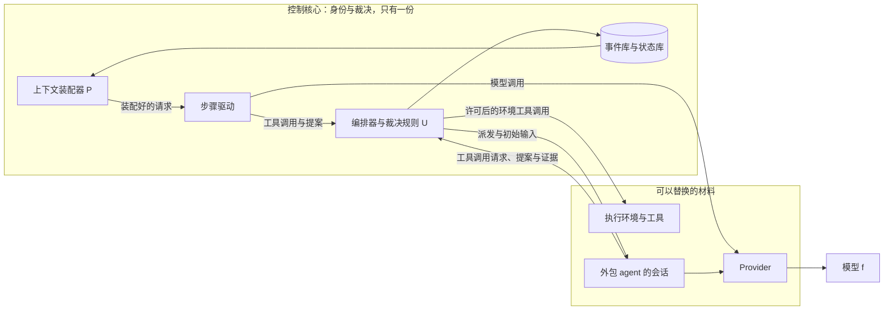
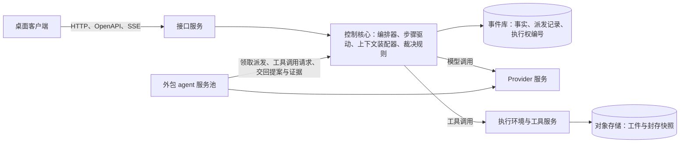

# 系统架构原理：控制核心与可替换的材料

更新：2026-09-26。状态：架构讨论记录。用户的陈述与确认单独标注；其余是架构师的分析，经用户确认后写入 ADR、需求记录与各模块设计。2026-09-26 用户确认每次模型请求在控制核心装配、自有角色的步骤由控制核心驱动（[ADR-0010](../../adr/0010-control-core-drives-role-steps.md)），第 2、6、7、8、9 节按此修改；教训的来源与反复退回的处理按用户同日的决定修改第 4.2 节；同日确认的 [ADR-0011](../../adr/0011-async-control-core.md) 至 [ADR-0015](../../adr/0015-desktop-client-and-http-contracts.md) 写入第 7、9、11 节。

依据：[Loop System 原理](../../archive/native-harness/loop-system-principles.md)、[Loop System 架构](../../archive/native-harness/loop-system-architecture.md)、[ADR-0007](../../adr/0007-boundaries-for-distributed-deployment.md)、[D29 分布式部署](../../requirements/distributed-deployment.md)、[D31 部门内的外包角色](../../requirements/outsourced-agent-roles.md)、[恢复契约](../recovery-contract-and-fault-matrix.md)，以及三份调研：[Loop engineering](../../research/loop-engineering-2026.md)、[Graph engineering](../../research/graph-engineering-2026.md)、[Anthropic AI-native SDLC](../../research/anthropic-ai-native-sdlc-sources.md)。分层与模块见 [总体架构：职责分层](overall-architecture.md)。

## 1. 出发点

用户的陈述（2026-09-25 至 2026-09-26）：

- 做 Yudao 而没有直接使用多 agent，是为了建立确定性的编排架构与循环，防止 agent 只靠 prompt 无法遵守规则。
- 部门之间的流转是动态的，按运行中的事实决定；langchain 一类的静态编排预先写好流转路径。
- 直接从 LLM 调用做起，是为了直接控制上下文工程，解决上下文污染，同时控制信息流向与规则。
- 出发点是用确定性流程消除 LLM 的概率性输出。
- Yudao 是循环系统，灵感来自 Ralph 循环与 GPT-6 Astra 的循环。循环结构能带来意想不到的效果；Yudao 借助循环，同时能控制循环。
- 三部门、每个部门只有一个角色时，Yudao 就开始控制 LLM 调用，并以此维持部门这个角色。当初反对持久 agent 的理由：
  - 检查点驱动的会话重启要求会话可以丢弃，让持久 agent 表现得像失忆，比每次从上下文装配器重新开始多绕一圈，其中全是可能泄漏历史的缝隙。
  - 质检看不到工程的对话过程，这条约束在「每次全新循环、上下文完全由装配器决定」的模型里在结构上成立；换成持久 agent 就变成靠纪律维持的边界。
  - 一次性循环天然支持并发与调度，持久 agent 要支持并发，最终还是要维护实例池。
  - 会话应该一次性，底层执行环境不必一次性：环境可以持久，身份不可以。

## 2. 核心公式与部门的身份

原理文档把系统写成 `Sₜ₊₁ = U(Sₜ, f(P(Sₜ)))`：P 从外部状态装配上下文，f 是 LLM 的输出，U 校验并应用这个输出。P 与 U 是确定性的系统部分；f 与会话内部的 ReAct 是被调用的组件。最高优先级的不变量是 LLM 只能提议状态变化，不能宣布状态已经改变（U ≠ f）。

部门的身份由四样东西构成，全部保存在控制核心：

1. 在权威拓扑中的位置：谁能拒绝谁。
2. 目标函数与证据来源：挑错或完成，跑测试或写代码。
3. 上下文装配规则：每次给它装配什么。
4. 外置的私有历史。

提供模型调用的服务、执行工具的机器与容器、外包 agent 的会话是可以替换的材料。原理第 9 节：身份由组织闭包决定，材料的替换不改变身份，前提是四条不变量保持不变（目标层只由用户修改、权威拓扑是设计时的常量、U ≠ f、失败即失败）。f 从一开始就运行在模型厂商的机器上。部门内多角色（D26）按同一方式实现：每个角色是一套上下文装配规则与工具许可，它的每一步由控制核心驱动（[ADR-0010](../../adr/0010-control-core-drives-role-steps.md)），记忆只存在于外置的历史、轨迹与图谱中。

Yudao 在三个层次上控制 agent：

| 控制的层次 | 内容 | 做法 |
| --- | --- | --- |
| 流程 | 谁接着工作、交接、询问、返工、放行 | 编排器按已记录的事实与规则决定，不调用 LLM；agent 只提交提案 |
| 信息流向 | 每个部门与角色能看到什么，什么内容可以越过部门边界 | 部门私有历史，部门之间按内容摘要传递快照，询问经过编排器记录与派发（D07） |
| 循环内部 | 每次模型调用的上下文、工具许可、压缩 | 控制核心的步骤驱动每一步装配请求、判断工具许可，需要时清理旧工具结果与压缩（ADR-0010） |

## 3. 确定性流程能消除什么

f 的输出始终是概率性的。确定性流程把概率限制在提案里，由不含 LLM 的规则决定什么成为事实，系统状态中只存在经过裁决的内容。

消除的程度取决于验收中有多少能由代码执行检查。测试、类型检查、构建、改动范围检查的结论对同一个提案每次相同，这部分是真正的消除。质检阅读 PRD 作出的判断仍然依赖 LLM，只能靠错误独立相乘来降低（原理第 4 节）。这决定了 Yudao 的可靠性上限。提高上限的手段：

- 把 PRD 条目写成可以执行的检查。Anthropic 的 harness 设计实验在动手之前协商 sprint contract，为每条标准设硬阈值，任何一条低于阈值即判定失败。
- 质检使用与工程不同的模型与不同的证据来源。
- 人留在意图这一层（不变量：目标、约束与验收标准只由用户明确批准修改）。

## 4. 循环系统

### 4.1 意外效果的来源

Ralph 循环（Geoffrey Huntley，2025-07-14）的最简形式是 `while :; do cat PROMPT.md | claude-code ; done`：每轮全新的上下文，装载同样的计划与规格文件，每轮只做一项，用测试、构建、类型检查作为回压拒收错误的生成。作者称它构建了一门训练数据中没有的编程语言，并能用这门语言编程。

GPT-6 Astra（2026-09-03 有限预览，次日全面开放）的做法称为 recurrent depth（looped transformer）：同一组层的权重重复应用，可以按 token 自适应停止；这类做法提升多步推理，记忆量几乎不变。OpenAI 首席科学家称 Astra 的计算深度与 GPT-4 相差不到两倍，Astra 在多大程度上采用循环结构存在争议；系统卡承认推理记录的可监控性下降。

两者的结构相同：同一个固定的变换反复作用在一份状态上，提示词或参数不变，能力来自迭代次数与每轮的选择压力。结果是整个动态过程的性质，单独看一步推不出来，这是意外效果的来源。原理第 3 节：图灵完备性主要来自循环，与 LLM 本身无关。

Yudao 的循环有四层：角色任务内部的步骤循环（ReAct）、部门的激活、三部门之间的循环（需求、工程、质检与返工）、项目层的循环（运行中的问题成为新的意图，D27）。

### 4.2 Yudao 把 Ralph 中由人完成的控制换成规则

| Ralph 循环 | 由谁完成 | Yudao 的对应设计 |
| --- | --- | --- |
| 每轮同一份提示词，全新上下文 | 脚本 | 每次调用由上下文装配器重新装配 |
| 计划文件与规格文件 | 文件 | PLAN 与 PRD，只注入当前有效的版本 |
| 用测试、构建、类型检查拒收错误的生成 | 确定性工具 | 质检独立核验，确定性检查作为证据 |
| 出错后往提示词里加一条提醒 | 人凭经验调整 | 教训：由教训发现模块单独审查事件与事实找出（待设计，[D25](../../requirements/semantic-system.md)），经 U 写入，由上下文装配器按规则放入 |
| 跑偏时删掉任务清单或回退代码，重新生成计划 | 人凭感觉判断 | 返工回到需求或工程；部门连续 3 轮没有进展时重新规划，连续角色从新的历史开始；同一计划条目反复被审查退回时提醒用户（[D26](../../requirements/department-roles.md)） |
| 没有构建与测试错误时打标签；任务清单做完；跑偏由人停下 | 一部分确定，一部分靠人 | 停止原因是定义中的一份封闭清单（[ADR-0014](../../adr/0014-versioned-definitions.md)） |

Ralph 由操作者补上的那一半控制，Yudao 换成代码可以判定的规则，循环可以在没有操作者的情况下长时间运行，每一次停止都有明确的原因；同一计划条目反复被退回这类需要判断方向的情况，由规则识别出来以后提醒用户。

### 4.3 控制放在接纳与边界上

- 生成保持开放：部门会话在权限范围内可以提出任何方案，这是意外效果的来源。
- 接纳严格：只有经过裁决、有证据的提案成为事实，这是可靠性的来源。
- 边界：预算、递归深度不超过 2、停止原因只能是枚举中的一项。自适应机制只调整这些参数的数值，不改变循环的结构（原理第 8 节）。

偏离这个位置有两种失败：

1. 控制伸进生成（计划过于死板、每次激活的范围一直很窄、返工上限太低），循环躲进暗室（原理第 10 节），回避一切有风险的探索，意外效果不会出现。这是过早停止在验证一侧的镜像。
2. 回压太弱，循环漂移（原理第 11 节），对应 Ralph 所说的完全跑偏。

Yudao 能产生多少意外效果，取决于回压提供的信息量：测试是否有真实的信号，质检的缺陷记录是否具体。

### 4.4 模型内部的循环

Astra 把循环放进模型内部，代价是过程不可见。Yudao 的控制只依据输出与证据，不依赖模型的推理记录，模型内部的循环越多，控制依然成立；外层每一轮循环都作为事件记录，可以审计。模型把越多的循环藏进内部，这层可见、可控的外层循环越有价值。

## 5. 与 2026 年三条动向的对照

| | loop 工程 | graph 工程 | Anthropic AI-native SDLC 手册 | Yudao |
| --- | --- | --- | --- | --- |
| 下一步由谁决定 | 代码只决定是否再运行一轮（触发、预算、继续条件），具体动作由工作中的模型决定 | 图的结构，或模型事先写好、由运行时执行的脚本；LLM 在判断节点作选择 | 阶段顺序由文件的提交与合并决定；阶段内的步骤由 Claude 决定 | 编排器按已记录的事实计算，不调用 LLM |
| 什么算完成、什么成为事实 | 工作中的模型自己宣布（Codex `update_goal`），或由不运行工具、只读对话记录的小模型判断（Claude `/goal`） | LangGraph 的节点更新由 reducer 直接合并进状态；「输出只算主张」仍是研究方向（Proof-or-Stop，2026-07-16） | 每个关口由人接受；Claude 的评审意见不能单独批准或阻止合并；hook、测试、分支保护是确定性的 | 只有编排器能写入事实；质检在封存快照上自己运行检查 |
| 每次调用的上下文 | 多数在同一会话中累加并压缩；Ralph 与 routines 每轮全新，从文件装配 | 消息默认累加；子 agent 隔离上下文是通用做法 | 阶段之间只通过文件传递；子 agent 与验证者使用全新上下文 | 每次调用从当前状态重新装配 |
| 持久性 | 会话级或线程级；跨任务的记忆放在文件里 | 检查点加线程 | 不保留长期会话；知识放在 git 管理的文件里 | 会话可以丢弃；身份与历史在事件库 |

三条动向都在向 Yudao 的原理靠近：

- 手册：「A skill is a control, though an advisory one … the hook makes them close to impossible」，对应规则由代码执行、不靠提示词。
- 手册总结的一次内部事故：事故响应 agent 通过 Slack 请另一个能写代码的 Claude 推送修复；教训是「draw the boundary around access and actions, not around a model's instructions」，对应权威拓扑是设计时的常量、执行者之间没有直接通道。
- 手册的交接文件链 intent → spec → plan，对应 Yudao 的 intend → PRD → PLAN（2026-09-06 的比较见 [AI 原生 SDLC 对 Yudao 的启示](../../research/ai-native-sdlc-insights.md)）。
- loop 工程中 Ralph 与 routines 每轮全新会话、从文件装配，以及 maker 与 checker 分开，对应会话可以丢弃与独立核验。
- graph 工程中由脚本决定下一步，对应编排器不调用 LLM。
- Proof-or-Stop：「Agent outputs may propose lifecycle claims, but do not themselves constitute lifecycle state」，对应 U ≠ f。
- David Khourshid 指出 loop 与 graph 都是状态机，原理文档第 0 节把 Yudao 定义为「状态机驱动的循环」。Yudao 的区别在于哪些事情由确定性的规则决定：流转、事实的接纳、每次调用的信息。

Yudao 与三条动向的区别在关口。业界把关口交给人，或交给读工作者报告的模型；Yudao 交给确定性的控制层与证据来源独立的部门。这是 Yudao 最核心的一步，也是可靠性最弱的地方：Anthropic 的 harness 设计文章写道「Out of the box, Claude is a poor QA agent」，agent 倾向于「confidently praising the work」，Yudao 的质检部门正是这样的 agent。loop 工程的批评者得出同样的结论：循环只在验证便宜的地方有效，其余地方会出现走过场的验证。第 3 节的三项手段针对的就是这一点。

## 6. 原生核心与可替换的材料

必须原生的部分，每一处对应一条原理：

| 必须原生的部分 | 对应的原理 |
| --- | --- |
| P：发给模型的每一个字节，包括系统提示词、工具结果与压缩结果 | 上下文只包含当前状态，旧版本在结构上不存在 |
| U：工具调用与完成声明在执行之前作为提案被拦截 | U ≠ f |
| 每次模型输出记录为事件 | 重放时不重新调用模型 |
| 按调用计数的次数与预算 | 失败即失败 |

其余部分是材料：Provider 的协议适配、文件编辑工具、沙箱、界面，以及外包 agent 的会话内部循环。自有角色的步骤循环由 P 与 U 组成，属于核心（[ADR-0010](../../adr/0010-control-core-drives-role-steps.md)）。

2026 年的产品已经提供材料层的基础功能（loop、goal、workflow、hook、subagent、worktree、routine），它们的默认行为与核心的要求相反：

| 产品的默认行为 | 核心的要求 |
| --- | --- |
| hook 在 exit 1 且没有有效 JSON、超时、脚本路径错误时不阻止动作，文档原话「leaves the gate silently disabled」 | 失败即关闭 |
| 沙箱无法启动时在沙箱外运行命令，设置 `failIfUnavailable` 才启动失败 | 失败即关闭 |
| CLAUDE.md 与自动记忆「Claude treats them as context, not enforced configuration」 | 规则由代码强制执行 |
| `/goal` 在同一会话中累加并压缩上下文 | 每次调用重新装配上下文 |
| `/goal` 的判断模型只读工作者的报告 | 质检用独立来源的证据 |

所以核心只能原生；外包 agent 的编码循环属于材料，可以借用（第 8 节）。全部做在一起的代价有两项：自己维护产品已经提供的通用部分；核心与材料在同一份代码里，边界靠纪律维持。ADR-0007 的理由部分列出的混合已经发生：激活时向部门循环传入十一个回调函数、进程内的锁与取消标志、只在内存中的运行开始时间与凭据快照、Web 直接引用内部模块。ADR-0010 让自有角色的步骤由控制核心驱动，十一个回调随之取消。

架构形态：一个小而明确的原生核心（上下文装配器、步骤驱动、编排器、裁决规则、事件库、权威拓扑、限额），加上可以替换的材料。核心与材料之间只通过带身份的消息往来（ADR-0007 第 1 条），边界在结构上成立。分布式部署、外包角色与全部做在一起的利弊，都是这同一条边界。

## 7. 分布式部署

用户的方向（2026-09-25）：考虑 RPC 是为了分布式部署与微服务化，希望把部门或其中的 agent 角色单独做成服务，通过集群部署 Yudao，成为云原生应用。

### 7.1 对照原理核对

| 原理 | 分布式部署 | 外包角色 |
| --- | --- | --- |
| U ≠ f | 提交只在控制核心进行，执行节点只交回模型输出与工具回执 | agent 宣布完成只算交回提案 |
| 权威拓扑是设计时的常量 | 执行节点之间没有直接通道，询问与交接都经过编排器 | agent 提出询问只能调用 Yudao 提供的请求工具，由编排器派发 |
| 会话一次性，每次调用重新装配上下文 | 执行节点不保存状态，任何一台都能处理任何一次模型调用或工具调用；角色任务的状态在事件中 | 每次激活开新会话，使用全新的 agent 状态目录，不续接旧会话 |
| 独立性靠结构成立 | 执行节点只收到本次调用需要的内容，机器上没有别的资料 | 容器里只放这个角色的资料，工作区从不带历史的快照重建 |
| 单一会话内部的累加也是污染 | 与单机部署相同 | agent 自己压缩上下文，Yudao 用预算限制单个会话 |
| 核验有效的条件是错误独立 | 质检可以在不同平台上运行，得到新的独立证据 | 核验它的下游角色使用不同的证据来源与不同的模型 |
| 失败即失败 | 次数与预算由编排器计数 | agent 内部的重试计入预算，到达上限由编排器终止 |

### 7.2 控制核心保持一份，执行层做成服务池

用户贴出的三条理由说明了分布式为什么容易：会话可以丢弃，任何节点都能接手；没有连续记忆，不需要迁移状态；一次性循环天然是实例池。

- 做成服务池、按需扩容的是执行环境、Provider 与外包 agent 的运行容器。
- 控制核心（编排器、步骤驱动、上下文装配器、裁决规则、事件库与状态库）的裁决不使用模型，每一步的工作量很小，等待模型与工具时不占用其他任务；拆成多个服务会把 U 与权威关系分散到多处，所以保持一份，为可用性做主备。
- 「把部门做成服务」对应把这个部门需要的执行环境与外包 agent 做成服务池，部门的身份与每一步的控制留在控制核心。
- 执行环境可以保持温热：依赖缓存、编译缓存与工具链可以复用；工作区内容每次从封存快照重建，上一次被拒绝的尝试留下的文件同样是污染。

跨网络传递的内容只有三种：模型调用、工具调用、外包 agent 的派发与交回（装配好的初始输入、提案与证据）。网络带来的新故障是消息丢失、重复送达与迟到，由控制核心处理：每条消息有身份，提交时按身份去重；执行权带有编号，旧编号的结果只记录、不接纳。

### 7.3 不引入外部执行引擎

会话可以丢弃，恢复时丢弃旧会话、从已提交的状态重新装配，从来不需要恢复会话的内存。控制核心本身就是按事件重放的确定性状态机。外部工作流引擎的核心能力是让执行到一半的代码接着运行，Yudao 用不上；引擎的执行历史还会成为事件库之外的第二份事实，违背「事件库是唯一的事实来源」。

外包 agent 的派发用事件库中的派发记录与执行权编号实现，外包 agent 领取派发、交回提案与证据；模型调用与工具调用带身份，按身份去重。[恢复契约](../recovery-contract-and-fault-matrix.md)第 3 节的执行权与一致边界是正确的基础；执行权编号需要在不同机器之间也能核对（ADR-0007 第 3 条）。

### 7.4 协议

2026-09-26 用户确认（[ADR-0015](../../adr/0015-desktop-client-and-http-contracts.md)）：

- 桌面客户端与接口服务之间：HTTP、由 pydantic 类型经 FastAPI 生成的 OpenAPI、按全局位置推送的 SSE 事件流，断线按位置补齐。
- 服务之间的请求与应答（控制核心调用 Provider 与执行环境，外包 agent 的适配程序与控制核心往来，观察者订阅与提案）：HTTP 加 JSON，流式结果使用 SSE 或分块传输；合同只有 pydantic 一种来源。
- 单机部署运行同一套服务，桌面客户端按地址连接本机或远端的部署；从本机以外访问需要认证。

## 8. 外包角色

用户确认（2026-09-25）：部门内会有外包角色，由外部 agent 担任，例如 Claude、pi；这项需求一定要做。需求记录见 [D31](../../requirements/outsourced-agent-roles.md)。

原理第 2 节：ReAct 被限定作用域，成为被调用组件的内部实现。外部 agent 是这个内部实现的另一种写法，U ≠ f 照样成立。外包角色与自有角色使用同一个角色定义；自有角色的每一步由控制核心驱动，外包角色由控制核心派发给外部 agent（ADR-0010），通过 ACP 接入（Claude 经 `@agentclientprotocol/claude-agent-acp`，pi 经 `pi-acp`，OMP 与 OpenCode 自带 ACP 支持）。

可以外包的判据：这个角色的输出会被一个独立的下游角色核验。

- 开发者可以外包，质检用运行测试得到的证据核验它。
- 质检的放行位于信任链末端，没有下游核验者（原理第 5 节），不能外包；做成黑箱后末端的错误无法观察。
- 产品的取舍是所有下游角色的参照，同样没有下游核验者，不能外包。

外部 agent 按持久助手设计，泄漏历史的缝隙有四处：记忆文件（例如 CLAUDE.md、用户目录下的配置与自动记忆）、续接以前的会话、agent 自己生成的压缩摘要、工作区里的 git 历史。对应的结构性封闭：每次激活使用全新的 agent 状态目录，不传续接参数，工作区从不带历史的封存快照重建。

外包放弃会话内部每一次调用的上下文精度与过程中的规则遵守：外部 agent 自己管理会话内的上下文，控制核心只装配它的初始输入，每次请求重新计算的当前状态栏目对它无效；它的工具调用经过 Yudao 的工具，工具许可、接触时附加与查询范围照样有效。系统的可靠性来自 U 与独立核验，会话内部的质量体现为提案的好坏，差的提案被核验拦下，代价是返工次数，由事件库记录。外部 agent 的模型调用经 Provider 提供的协议兼容入口，凭据由 Yudao 管理，调用尝试与用量照样记录。

## 9. 界面与后端的技术方向

用户的陈述（2026-09-25）：前端与 UI 解耦，前端技术可以单独选型；项目一直处于演示与探索阶段，所以使用 Web 加 Python；Web 不方便，桌面程序能更好地保持画面与展示信息；后端希望更加分层，考虑未来的分布式部署与微服务化，这样对测试、单元测试与功能实现都更好。

已确认的界面技术（2026-09-25）：React 19、TypeScript、Vite；画面渲染 PixiJS v8，画面对象命令式编写，React 只负责挂载与传入模型；角色行为 XState v5；补间动画 GSAP；中文像素字体 Fusion Pixel Font；网格寻路自己实现广度优先搜索。

2026-09-26 用户确认（[ADR-0015](../../adr/0015-desktop-client-and-http-contracts.md)、[ADR-0011](../../adr/0011-async-control-core.md)）：

- 桌面外壳使用 Electron：各平台同一个 Chromium 内核，PixiJS 的 WebGL 与 WebGPU 表现一致；外壳进程同样使用 TypeScript。桌面程序提供独立窗口（循环画面可以放在第二块屏幕）、托盘、窗口被遮挡时照常刷新、系统通知定位、窗口布局记忆，并能连接本机或远端的部署。
- 后端不再提供界面文件。界面代码只通过一层很薄的外壳接口使用桌面功能，其余部分可以在普通测试环境中运行；端到端测试用 Playwright 启动 Electron 应用。
- 后端继续使用 Python 与 asyncio，按职责分层：接口层（FastAPI，路由、合同、事件流）、应用层（命令处理与查询处理，所有客户端唯一的入口）、控制核心（编排器、步骤驱动、上下文装配器、裁决规则、写入口、事件日志）、知识层（语义系统的投影与查询）、执行层（Provider、执行环境、外包 agent 的运行容器）与工件存储。分层与合同见[总体架构](overall-architecture.md)。控制核心不直接读写文件与网络，给定事件序列即可验证状态与决定，是单元测试的主要对象；基础设施通过接口隔开，测试使用真实实现（例如临时目录中的 SQLite），不使用 mock。

## 10. 项目的意义

手册开篇写道「Code is no longer the bottleneck」：规划、评审与测试、发布仍按人的速度进行，并行会话的数量受人能评审多少的限制。用户在规则文件中写道：由于实现的成本低了，软件开发模式也变了。

Yudao 的意义是把关口从人的速度提到机器的速度，同时保持可靠：由确定性的规则决定什么成为事实，由证据来源独立的部门核验，人留在意图这一层。只要单步正确率 p 小于 1，长任务的成功率按 pᴺ 衰减（0.99 的单步正确率走 100 步约为 0.37），决定什么算事实、什么算完成的核心不随模型进步而贬值。2026 年学术界开始研究「主张与状态分开」（Proof-or-Stop、ResearchLoop 的 claim ledger、2026-09-23 的「From Agent Output to Authorized Transition」），这是 Yudao 一开始就定下的不变量。

## 11. 待用户确认的事项

1. D31 中待确认的规则：哪些角色允许外包（架构师建议按第 8 节的判据）、凭据与用量（订阅账号或 API 密钥）、路线位置。外部 agent 的模型调用经过 Provider 的入口、文件与命令经过执行环境，已由[总体架构](overall-architecture.md)第 7 节的外包派发合同与动作合同确定。

## 12. 来源

- Ralph 循环：https://ghuntley.com/ralph/ （2025-07-14）
- GPT-6 Astra：https://en.wikipedia.org/wiki/GPT-6_Astra ；Sebastian Raschka，「GPT-6 Astra, Looped Transformers, and Hidden Reasoning」，https://magazine.sebastianraschka.com/p/gpt-6-astra-looped-transformers-and （2026-09-09）。OpenAI 发布页 https://openai.com/index/gpt-6-astra/ 返回 403，未读取原文。
- Addy Osmani，「Loop Engineering」，https://addyosmani.com/blog/loop-engineering/ （2026-06-07）
- Claude Code `/goal`：https://code.claude.com/docs/en/goal ；动态工作流：https://code.claude.com/docs/en/workflows ；hooks：https://code.claude.com/docs/en/hooks ；记忆：https://code.claude.com/docs/en/memory
- LangChain，「3 years of graph engineering with LangGraph」，https://www.langchain.com/blog/3-years-of-graph-engineering-with-langgraph （2026-07-22）
- Proof-or-Stop，https://arxiv.org/abs/2607.14890 （2026-07-16）
- Louis Claxton，「The AI-Native SDLC playbook」，https://claude.com/blog/the-ai-native-sdlc-playbook （2026-08-21）
- 「How Anthropic secures its AI-native software development lifecycle」，https://claude.com/blog/how-anthropic-secures-its-ai-native-software-development-lifecycle （2026-07-21）
- 「Harness design for long-running application development」，https://www.anthropic.com/engineering/harness-design-long-running-apps （2026-03-24）
- 其余来源见三份调研文档。
