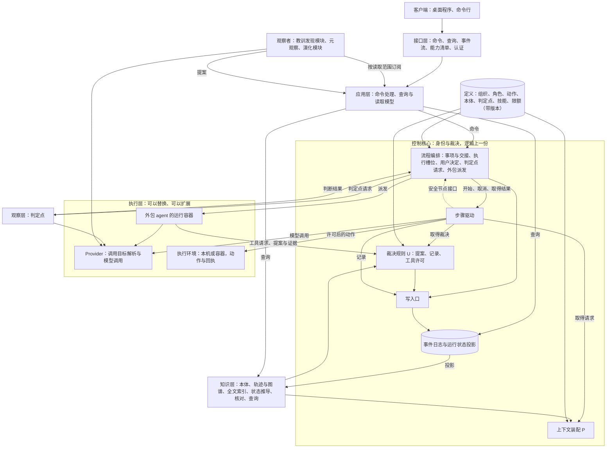
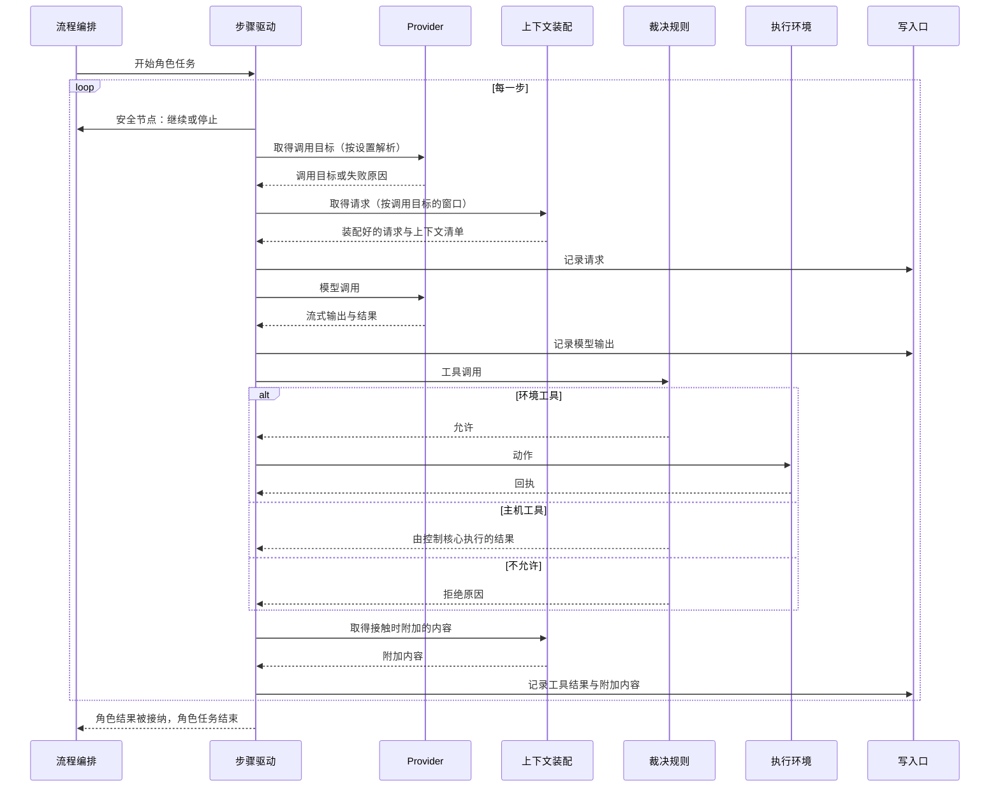

# 总体架构：职责分层

更新：2026-09-26。状态：设计，用户已确认（2026-09-26 认可分层图与职责分层表；同日确认 [ADR-0010](../../adr/0010-control-core-drives-role-steps.md) 至 [ADR-0015](../../adr/0015-desktop-client-and-http-contracts.md) 与第 3 节的十项长期决定）。未实施的部分按[总体路线图](../../program-roadmap.md)推进，第 10 节是近期的实施顺序。

原理依据：[系统架构原理：控制核心与可替换的材料](core-and-materials.md)。本文把路线图中的全部模块放进同一个结构，写明各层的职责与边界、长期决定、合同与使用的技术。

## 1. 分层图

## 2. 各层的职责与边界

| 层 | 职责 | 边界 |
| --- | --- | --- |
| 客户端 | 展示与操作 | 只通过接口层读写 |
| 接口层 | 路由、合同、事件流、能力清单、认证 | 不含业务规则，只调用应用层 |
| 应用层 | 命令处理（按身份去重、核对基准版本）、查询与读取模型（循环画面、流转、回放、报告） | 修改只经过控制核心；读取只读投影；查询不写入事件 |
| 控制核心 | 身份与裁决：流程编排、步骤驱动、上下文装配（P）、裁决规则（U）、写入口、事件日志 | 裁决不使用模型；是唯一写入事实的地方；逻辑上一份（[ADR-0012](../../adr/0012-single-control-core-scalable-execution.md)） |
| 定义 | 组织、角色、动作、提案合同、本体、判定点、技能、限额、停止原因、服务方案预置表 | 带版本；只在发布新版本或经用户批准采用时改变；运行中不可修改（[ADR-0014](../../adr/0014-versioned-definitions.md)） |
| 知识层（[D25 语义系统](../../requirements/semantic-system.md)的整理部分） | 由事件派生轨迹、图谱与全文索引，推导内容的状态，计算要求链与数据流核对，提供查询 | 只由事件生成，不调用模型，不写入事实；派生内容是否进入上下文由 P 决定 |
| 观察层（[D28](../../requirements/meta-observer.md)） | 在判定点给出判断；语义系统的证据核对与元观察的判定都是判定点 | 只在编排器预先规定的判定点被调用，判断是编排器的输入 |
| 观察者 | 教训发现模块、元观察、Stage 7 的演化模块、校准抽样 | 按读取范围订阅事件，只以提案形式提交结果；读取范围由控制核心确定 |
| 执行层 | Provider、执行环境、外包 agent 的运行容器 | 只交回模型输出、动作回执、提案与证据；不持有领域状态 |

各部门（产品、工程、质检，以及 Stage 5 的[运维部门](../../requirements/operations-department.md)）的身份在控制核心：权威位置、装配规则、私有历史，写在定义中。自有角色的每一步由控制核心驱动，模型调用与动作在执行层运行；外包角色（[D31](../../requirements/outsourced-agent-roles.md)）由控制核心派发给外部 agent。元观察在组织上是一个部门，运行时是一个观察者加判定点。

## 3. 十项长期决定

1. **一份事件日志与唯一写入口**（[ADR-0013](../../adr/0013-event-log-and-single-write-path.md)）：每条事件有全局位置、所属的流与流内版本；所有写入只经过写入口，在同一个事务中核对执行权编号与流版本、接收 U 的裁决、追加事件、更新投影；投影保存下来，随写入逐步更新。
2. **异步执行**（[ADR-0011](../../adr/0011-async-control-core.md)）：控制核心在一个异步事件循环中运行，事项与角色任务都是可以取消的任务；模型调用、动作的进程与事件推送都以异步方式等待。
3. **部署形态与执行权**（[ADR-0012](../../adr/0012-single-control-core-scalable-execution.md)）：控制核心逻辑上一份并持有每个 run 的执行权；执行层与观察者可以扩展；部门不单独部署成服务；不引入外部工作流引擎。
4. **合同**（第 7 节）：模型调用、动作、外包派发、判定点、观察者订阅与提案，以及客户端的命令、查询与事件流，都是可以序列化、带身份的 pydantic 类型。
5. **调用目标每次请求解析**（[ADR-0005](../../adr/0005-resolve-call-target-per-request.md)）：每次模型请求之前由 Provider 模块解析；控制核心不持有明文凭据，凭据在执行调用的地方按引用读取。实施排在 3.1 之前。
6. **动作契约与执行环境**（第 7.3 节）：所有环境工具都是动作，每类动作有契约；执行环境是一个接口，有本机与容器两种实现，从封存快照建立；控制核心不直接读写工作区文件。
7. **带版本的定义**（[ADR-0014](../../adr/0014-versioned-definitions.md)）：组织、角色、动作、本体、判定点、技能、限额与停止原因作为带版本的数据；每个事项记录它使用的定义版本，每次请求与裁决记录所用的版本。
8. **用户决定**（第 7.4 节）：所有等待用户的事项使用同一种机制，决定请求与回答都写成事件。
9. **观察者**：需要调用模型的派生工作（教训发现、元观察、演化、校准抽样）按读取范围订阅事件，结果作为提案经过 U；Stage 7 隐藏的评价材料放在任何 agent 与观察者都读不到的存储中。
10. **应用层与界面**（[ADR-0015](../../adr/0015-desktop-client-and-http-contracts.md)）：接口层使用 FastAPI；命令、查询与一条按范围筛选的事件流；能力清单；远程访问需要认证；客户端是 Electron 桌面程序，后端不提供界面文件。

## 4. 语义系统在各层中的位置

| 位置 | 语义系统的部分 | 边界 |
| --- | --- | --- |
| 知识层 | 本体；轨迹、图谱、全文索引这三种投影；状态推导（有效、待复核、取代、失效）；要求链与数据流核对；查询 | 只由事件生成，不调用模型，不写入事实 |
| 控制核心 · P | 栏目、目录、接触时附加、通知送达、旧工具结果清理、轨迹节录、上下文清单 | 只读取知识层、材料与事件 |
| 控制核心 · U | 按本体校验记录与尝试；安排整理请求与复盘这两种角色任务 | 校验与写入在写入口的同一个事务里完成，并行角色同时新建同名实体时只有一个成功 |
| 观察层 | 证据核对，作为编排器事先规定的一种判定点；JEV 的结论交给编排器，写成事件 | 只能让事实变为待复核 |

需要调用模型的整理工作（整理尝试、复盘）是角色任务，产出作为提案经过 U。教训与洞见由教训发现模块找出，它是一个观察者。细节见[语义系统设计说明](../semantic-system.md)第 4 节。

## 5. 依赖方向

- 定义 ← 事件日志 ← 知识层与运行状态投影 ← P 与 U ← 步骤驱动 ← 流程编排 ← 应用层 ← 接口层 ← 客户端。
- 步骤驱动向上只通过流程编排提供的安全节点接口（依赖倒置），在每个安全节点得到继续或停止；新输入的分派与通知的送达在这里完成。
- 控制核心只通过合同调用执行层与观察层；执行层不依赖控制核心的内部。
- 观察者只通过应用层订阅事件与提交提案，不依赖控制核心的内部。
- 职责分层表按「谁有权做什么」划分，依赖方向按本节写明。原架构文档（[Loop System 架构](../../archive/native-harness/loop-system-architecture.md)第 2 节）的 L0 至 L4 把两者合在一起，L1 的 ContextAssembler 读取 L2 的 StateStore，与它自己「只允许向下依赖」的规则矛盾；本架构采用它的不变量与原理，层次按本节的依赖方向确定。

## 6. 控制核心内部

### 6.1 模块

| 模块 | 职责 | 现在的代码位置 |
| --- | --- | --- |
| 流程编排 | 事项与交接、角色任务状态、执行槽位、放行、停滞与反复退回的提醒、用户决定、判定点请求、外包 agent 的派发；提供安全节点接口 | `orchestrator.py` 的运行生命周期与激活部分 |
| 步骤驱动 | 一个角色任务内部的步骤循环：取得调用目标、取得请求、模型调用、重试、工具许可、执行动作、记录 | `engine.py`；`orchestrator.py` 的模型请求与观测记录部分 |
| 上下文装配（P） | 第 4 节表格中 P 那一行的全部内容，以及按调用目标的窗口计算阈值 | `context.py`、`compaction.py`；`orchestrator.py` 的装配与压缩部分 |
| 裁决规则（U） | 提案校验、记录与尝试按本体校验、工具许可；许可规则可以增加，只能收紧 | `validation.py`；`orchestrator.py` 的工具准入与提案接纳部分 |
| 写入口与事件日志 | 执行权与流版本的核对、追加事件、更新保存的投影、通知订阅方 | `event_store.py`、`projection.py`、`submissions.py` 的提交部分 |

- 流程编排只调用步骤驱动的开始、取消与取得结果，不接触步骤内部。
- 步骤驱动只通过 P 与 U 的接口取得请求与裁决结果。
- 所有写入只经过写入口。
- 控制核心同时驱动多个角色任务，等待模型、动作与网络时不占用其他任务。

### 6.2 一步的顺序

### 6.3 两类工具

- **主机工具**：提交、记录、查询、读取材料、分派。由控制核心执行，读取知识层；查询范围由控制核心按角色身份填入，模型给出的参数不能扩大这个范围。
- **环境工具**：读写文件、运行检查与命令，以及以后的网络、MCP 与外部动作。每次调用是一个动作（第 7.3 节），经过工具许可以后在执行环境中执行，回执回到控制核心，由 P 附加内容。

外包 agent 的工具调用走同一套工具，工具许可、接触时附加与查询范围对它照样有效。

## 7. 合同

所有合同都是 pydantic 类型，可以序列化，不含进程内的对象；跨进程时按 [ADR-0015](../../adr/0015-desktop-client-and-http-contracts.md) 使用 HTTP 加 JSON。

### 7.1 身份

- 项目 > 事项 > run > 交接 > 计划条目 > 角色任务 > 步骤。
- 一次模型调用是一个逻辑调用，下面有一次或多次调用尝试（D21）。
- 一个动作是一个逻辑动作，下面有一次或多次动作尝试。
- 协作请求、决定请求、判定、提案各有自己的身份。
- 每条往来带身份，接收方按身份去重，旧执行权编号的结果只记录、不接纳。

### 7.2 五种合同

| 合同 | 双方 | 内容 |
| --- | --- | --- |
| 模型调用 | 步骤驱动与 Provider | 身份（run、角色任务、步骤、逻辑调用、尝试）；调用目标的选择；装配好的输入、工具定义与缓存断点或缓存键；流式输出；结果与用量；按尝试取消 |
| 动作 | 步骤驱动与执行环境 | 逻辑动作与尝试的身份；动作类别；输入；前置条件（树摘要、文件版本）；预期效果；授权依据；回执（结果、证据、执行以后的树摘要）；结果未知时的核实方法 |
| 外包派发 | 流程编排与外包 agent 的运行容器 | 角色定义与版本、任务说明、资料引用、工作区快照摘要、工具入口、模型入口；工具请求（转为动作合同）；提案与证据；续期与取消 |
| 判定点 | 流程编排与观察层 | 判定点与版本、问题、参照材料、选项；概率、模型版本与选项顺序；重放使用记录的结果 |
| 观察者 | 观察者与应用层 | 从某个全局位置开始按读取范围订阅事件；提案（教训、洞见、发现、演化候选）带身份与依据 |

客户端的合同：命令带身份与基准版本，返回接受或拒绝；查询返回快照与对应的全局位置；事件流按全局位置推送与补齐，发现缺口时重新同步快照；能力清单列出当前部署提供的查询、命令与覆盖层。

### 7.3 动作契约

每类动作的契约回答[恢复契约](../recovery-contract-and-fault-matrix.md)第 4 节的问题：谁有权做，作用于什么，怎样识别同一动作与不同尝试，成功证据是什么，结果未知时向哪里查，何时可以重复，取消能否确认停止，谁负责未解决的结果。没有可以验证的恢复方法时，结果保持待核实，不自行补偿。

| 动作类别 | 执行环境 | 授权 | 出现时间 |
| --- | --- | --- | --- |
| 读取、搜索 | 本机或容器 | 角色的工具许可 | 已有 |
| 写入、编辑、删除、移动 | 本机或容器 | 角色的工具许可与工程计划的范围 | 已有 |
| 登记的本地命令 | 本机或容器 | 登记表 | 3.2A |
| 检查 | 检查副本 | 质检角色 | 已有 |
| 网络取回、MCP 工具 | 本机或容器 | 用户决定 | 3.2B |
| 外部动作（部署、回滚、重启） | 目标环境 | 每次由用户决定 | Stage 5 |
| 外包 agent 的文件与命令请求 | 外包 agent 的容器 | 与自有角色相同 | D31 |

执行环境从封存快照建立，依赖缓存与编译缓存可以保留；工作区内容每次从快照重建。本机实现只运行登记的命令；运行外来代码使用容器实现。

### 7.4 用户决定

凡是等待用户的事项，都由流程编排发出决定请求：身份、阻塞范围（一个动作、一个角色任务、一个 run，或不阻塞）、由合同给出的选项与说明。用户通过命令回答，请求与回答都写成事件，重放时使用记录的回答。

| 决定 | 来源 |
| --- | --- |
| 授权网络取回、MCP 工具与外部动作，一次性批准 | 3.2B、D27、原型 v7 |
| 核实结果未知的动作：重新执行、接受当前结果、停止 | 恢复契约第 4 节 |
| 继续执行中断的 run | 3.1 |
| 模型引用无法使用时的待恢复 | 模型管理设计说明第 5.5 节 |
| 判定点置信不足时的裁定 | D28 |
| 证据核对的校准样本裁定 | D25、#41 |
| 采用 Stage 7 的定义候选 | Stage 7 |
| 反复退回的提醒（只通知，不阻塞） | D26 |

## 8. 路线图对照

| 路线图项 | 用到的决定 | 在架构中的位置 |
| --- | --- | --- |
| 3.2A 本地工具（#15） | 6 | 本机执行环境与动作契约 |
| 控制核心重构（#43） | 2、4 | 控制核心的五个模块，异步步骤驱动 |
| 一份事件日志（#44） | 1 | 写入口与保存的投影 |
| 调用目标每次请求解析（#45） | 5 | Provider 的解析与步骤驱动的顺序 |
| 3.1 恢复（#16 至 #18） | 1、3、6、8 | 写入口核对执行权；从已提交的状态重新装配；结果未知的动作交给用户决定 |
| 3.4A、3.4B 并行与采纳 | 1、2 | 流程编排调度执行槽位；采纳在写入口做原子比较 |
| 3.2B 网络与 MCP | 6、8 | 新的动作类别；授权走用户决定 |
| 3.3 其他 Provider | 4 | 服务方案预置表增加一行 |
| 3.7 扩展与接口 | 7、10 | U 中只能收紧的许可规则；只读观察接口就是应用层的查询与事件流；新检查是新的动作定义 |
| D24 模型管理 | 5、7 | Provider 的目录与解析；角色层设置 |
| D25 语义系统（#22） | 1、9 | 知识层投影；P 与 U；证据核对判定点 |
| JEV 接入 | 4 | 判定点合同；Provider 的 systemone 协议 |
| D26 部门内多角色 | 2、7 | 角色定义；同时驱动多个角色任务 |
| 技能 | 7 | 定义中的技能；P 的目录；主机工具取得全文 |
| D30 界面与可观测性 | 10 | 应用层、接口层与桌面客户端 |
| D27 运维部门 | 6、7、8 | 新部门与运维事项这一事项种类；外部动作契约与授权 |
| D28 元观察 | 4、9 | 观察者加判定点 |
| D31 外包角色 | 4、6 | 外包派发合同；工具请求转为动作合同 |
| 教训发现模块与惊讶机制 | 9 | 观察者 |
| Stage 6 分布式部署 | 1、3、4、6 | 合同改为网络传输；执行权加入期限与续期；事件日志与工件换成服务端数据库与对象存储，接口不变 |
| Stage 7 受治理的演化 | 7、8、9 | 演化模块是观察者；候选是定义的新版本；采用是用户决定；隔离比较按指定的定义版本运行事项 |

## 9. 使用的技术

| 部分 | 选择 |
| --- | --- |
| 运行方式 | Python 3.11 以上，asyncio |
| 数据类型与合同 | pydantic 2 |
| 事件日志、投影、全文检索 | 单机使用 SQLite（WAL、FTS5 trigram）；Stage 6 使用服务端数据库，产品在 Stage 6 按故障场景比较后选定，接口不变 |
| 工件与快照 | 按内容摘要寻址；Stage 6 使用对象存储 |
| 模型调用 | openai 与 anthropic 官方异步客户端，JEV 的 systemone 协议 |
| 接口层 | FastAPI，OpenAPI 由 pydantic 类型生成，事件流使用 SSE |
| 客户端 | Electron；React 19、TypeScript、Vite、PixiJS 8、XState 5、GSAP |
| 服务之间的传输 | HTTP 加 JSON，流式结果使用 SSE 或分块传输 |
| 执行环境 | 本机进程；运行外来代码时使用容器 |
| 扩展协议 | MCP 使用官方 Python SDK（3.2B）；外包 agent 使用 ACP（D31） |

## 10. 近期实施顺序

#15（3.2A）→ #43（控制核心重构）→ #44（一份事件日志）→ #45（调用目标每次请求解析）→ #16 至 #18（3.1 恢复）→ 3.4A、3.4B。#22 的子工单依赖 #43，其中 #27 同时依赖 #44。

## 11. 待讨论的事项

1. 判定点与元观察（D28）：判定点的清单、校准样本与升级规则。
2. 教训发现模块与惊讶机制（D25）：单独审查事件与事实，找出教训与洞见；可能与元观察结合；参考主动推断与自由能原理。
3. 运维事项（D27）：项目层长期存在的运维部门与事项、run 之间的往来。
4. 技能的定义（Stage 4）：注册、适用性、执行与展开。
5. 执行环境容器实现的引入时间点。
6. Stage 7 与持续改进工作线的需求记录。
