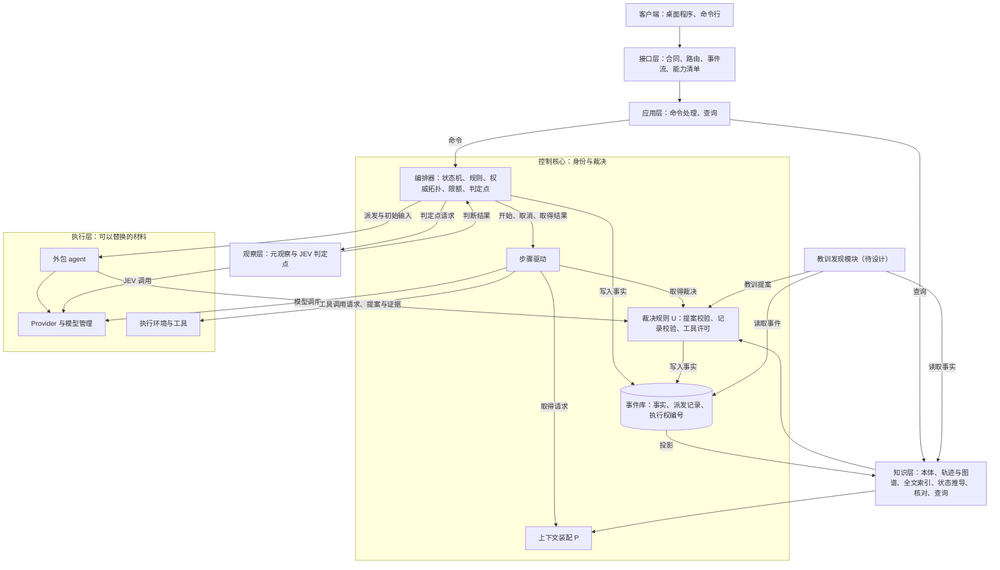
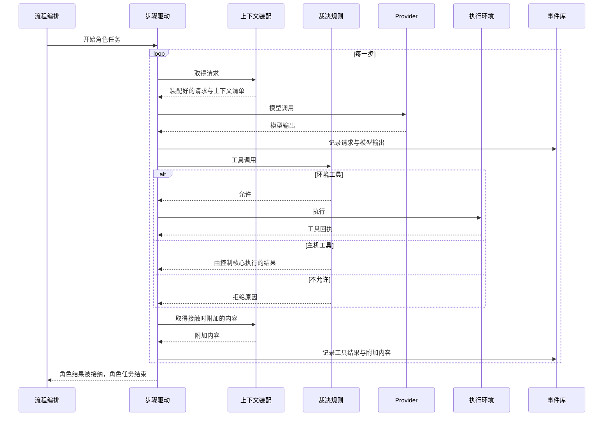

# 总体架构：职责分层

更新：2026-09-26。状态：草案。用户 2026-09-26 认可分层图与职责分层表（原话：「你的架构与总体设计图很好，职责分层图也很好」）；同日确认每次模型请求在控制核心装配、自有角色的步骤由控制核心驱动（[ADR-0010](../../adr/0010-control-core-drives-role-steps.md)），以及语义系统在各层中的位置（第 3 节）。第 6 节的事项继续讨论。

原理依据：[系统架构原理：控制核心与可替换的材料](core-and-materials.md)。分层按「控制核心加可以替换的材料」这一原则，把路线图中的全部模块放进同一个结构。

## 1. 分层图

## 2. 各层的职责与边界

| 层 | 职责 | 边界 |
| --- | --- | --- |
| 客户端 | 展示与操作 | 只通过接口层读写 |
| 接口层 | 合同、路由、事件流、能力清单 | 不含业务规则 |
| 应用层 | 命令处理、查询（循环报告、回放、轨迹与图谱面板） | 修改只经过控制核心，读取只读投影 |
| 控制核心 | 身份与裁决：编排器、步骤驱动、上下文装配（P）、裁决规则（U）、事件库 | 裁决不使用模型，是唯一写入事实的地方 |
| 知识层（[D25 语义系统](../../requirements/semantic-system.md)的整理部分） | 由事件派生轨迹、图谱与全文索引，推导内容的状态，计算要求链与数据流核对，提供查询 | 只由事件生成，不调用模型，不写入事实；派生内容是否进入上下文由 P 决定 |
| 观察层（[D28 元观察与规则检查部门](../../requirements/meta-observer.md)） | 在判定点给出判断；语义系统的证据核对是其中一种判定点 | 只在编排器预先规定的判定点被调用，判断是编排器的输入 |
| 教训发现模块（待设计） | 单独审查事件与事实，找出教训 | 产出作为提案经过 U；可能与元观察结合（[D25](../../requirements/semantic-system.md)「TODO：惊讶机制与教训发现模块」） |
| 执行层 | Provider 与模型管理、执行环境与工具、外包 agent | 模型调用与环境工具调用由控制核心发出，执行节点只交回模型输出与工具回执；外包 agent 只收到装配好的初始输入，只交回提案与证据 |

各部门（包括 [D27 运维部门](../../requirements/operations-department.md) 与 [D26 部门内多角色](../../requirements/department-roles.md)）的身份在控制核心：权威位置、装配规则、私有历史。自有角色的每一步由控制核心驱动，模型调用与环境工具在执行层运行；外包角色（[D31](../../requirements/outsourced-agent-roles.md)）由控制核心派发给外部 agent。

## 3. 语义系统在各层中的位置

| 位置 | 语义系统的部分 | 边界 |
| --- | --- | --- |
| 知识层 | 本体；轨迹、图谱、全文索引这三种投影；状态推导（有效、待复核、取代、失效）；要求链与数据流核对；查询 | 只由事件生成，不调用模型，不写入事实 |
| 控制核心 · P | 栏目、目录、接触时附加、通知送达、旧工具结果清理、轨迹节录、上下文清单 | 只读取知识层、材料与事件 |
| 控制核心 · U | 按本体校验记录与尝试；安排整理请求与复盘这两种角色任务 | 校验与写入放在同一个事务里，并行角色同时新建同名实体时只有一个成功 |
| 观察层 | 证据核对，作为编排器事先规定的一种判定点；JEV 的结论交给编排器，写成事件 | 只能让事实变为待复核 |

需要调用模型的整理工作（整理尝试、复盘）是角色任务，产出作为提案经过 U。教训由教训发现模块找出。细节见[语义系统设计说明](../semantic-system.md)第 4 节。

## 4. 依赖方向

- 事件库 ← 知识层与运行状态投影 ← P 与 U ← 应用层 ← 接口层 ← 客户端。
- 控制核心只通过合同调用执行层，执行层不依赖控制核心的内部。
- 职责分层表按「谁有权做什么」划分，依赖方向按本节写明。原架构文档（[Loop System 架构](../../archive/native-harness/loop-system-architecture.md)第 2 节）的 L0 至 L4 把两者合在一起，L1 的 ContextAssembler 读取 L2 的 StateStore，与它自己「只允许向下依赖」的规则矛盾；本架构采用它的不变量与原理，层次按本节的依赖方向确定。
- 每一步都要装配、都要读取知识层，所以投影随事件写入逐步更新并保存；从头重放只用于重建与核对重放一致。

## 5. 控制核心内部

### 5.1 模块

| 模块 | 职责 | 现在的代码位置 |
| --- | --- | --- |
| 流程编排 | 部门交接、角色任务状态、放行、停滞与反复退回的提醒、判定点请求、外包 agent 的派发 | `orchestrator.py` 的运行生命周期与激活部分 |
| 步骤驱动 | 一个角色任务内部的步骤循环 | `engine.py`；`orchestrator.py` 的模型请求与观测记录部分 |
| 上下文装配（P） | 第 3 节表格中 P 那一行的全部内容 | `context.py`、`compaction.py`；`orchestrator.py` 的装配与压缩部分 |
| 裁决规则（U） | 提案校验、记录与尝试按本体校验、工具许可 | `validation.py`；`orchestrator.py` 的工具许可与提案接纳部分 |
| 事件库与运行状态投影 | 事实与事项状态 | `event_store.py`、`projection.py` |

- 流程编排只调用步骤驱动的开始、取消与取得结果，不接触步骤内部。
- 步骤驱动只通过 P 与 U 的接口取得请求与裁决结果。
- 控制核心同时驱动多个角色任务，等待模型与工具时不占用其他任务的执行。

### 5.2 一步的顺序

### 5.3 两类工具

- **主机工具**：提交、记录、查询、读取材料、分派。由控制核心执行，读取知识层；查询范围由控制核心按角色身份填入，模型给出的参数不能扩大这个范围。
- **环境工具**：读写文件、运行命令。经过工具许可以后在执行环境中执行，结果回到控制核心，由 P 附加内容。

外包 agent 的工具调用走同一套工具，工具许可、接触时附加与查询范围对它照样有效。

## 6. 待讨论的事项（按依赖顺序）

1. 控制核心与执行层之间的合同：模型调用与环境工具调用的消息、外包 agent 的派发与交回、执行权与恢复。3.1 可靠恢复建立在它上面（[恢复契约](../recovery-contract-and-fault-matrix.md)、[ADR-0007](../../adr/0007-boundaries-for-distributed-deployment.md) 第 1、3 条）。
2. 判定点与元观察（D28）。
3. 教训发现模块与惊讶机制（D25）：单独审查事件与事实，找出教训；可能与元观察结合；参考主动推断与自由能原理。
4. 接口层、应用层与桌面客户端（[D30](../../requirements/web-game-frontend.md)）。
5. 部署形态（[D29](../../requirements/distributed-deployment.md)）。

知识层与上下文装配的关系（D25）见第 3 节；部门内循环（D26）在本结构中的形态见[部门内多角色设计说明](../department-roles.md)第 5 节。
