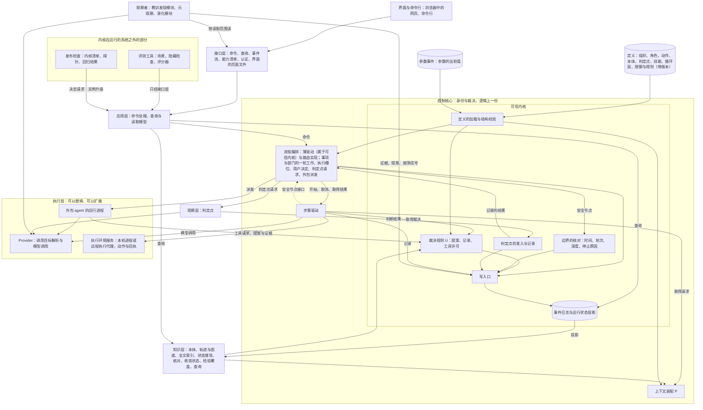
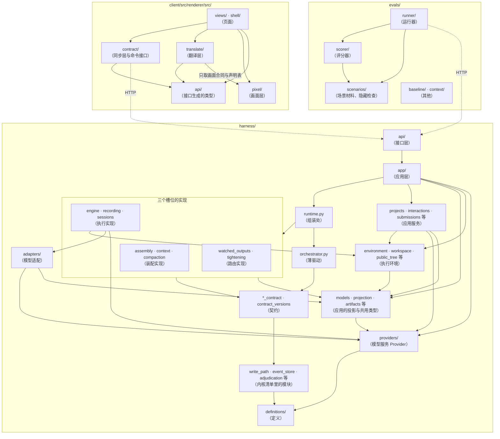
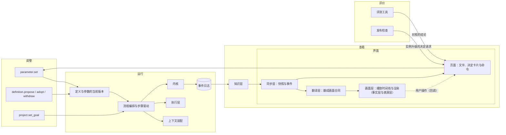
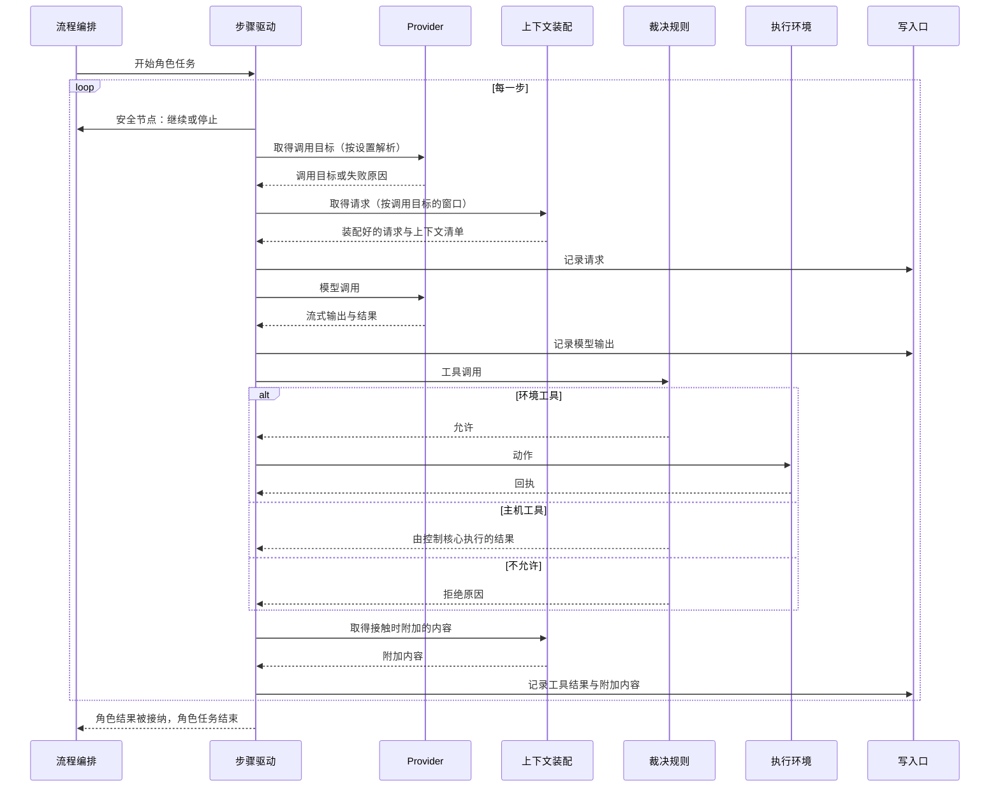

# 总体架构：总图与职责分层

总图位置：全部六节的技术对照；第 1.3 节对应第四节「要守的缝」。

正本：[总图](../../architecture.html)。本文把路线图中的全部模块放进同一个结构：第 1 节是总图，其余各节写明各层的职责与边界、长期决定、合同与使用的技术。

## 1. 模块图

给子架构师看的两张图：模块（谁做什么、谁能改）与数据（存了什么、谁写谁读）。给用户看的总图是 `docs/architecture.html`。模块图只由总架构师改；其余各节与各份设计说明是细化。

### 1.1 模块与 1.2 数据

两张图的正本是总图（`docs/architecture.html`）第一、三、六节：方框与三档状态、一轮工作的经过、拆开部署。这里不另画，避免两处各自漂。

### 1.3 给子架构师：缝与设计说明

维护规则：缝的名字、两侧、保证、规矩、交换什么与已定、未定，以总图第四节为准；这张表只是技术对照，记两侧、合同的意思与设计说明的位置。模块与缝的增减先交总架构师改总图，再改这张表；设计说明挂在总图的一个方框或一道缝上，不新增总图没有的模块或缝。

与总图的对应：总图的十道缝是写入口、路由、装配、执行、模型、动作、投影、接口、画面、定义，系统之外三道是评价、观察者、看门狗。「裁决」与「最小投影」在总图里属于内核内部，不是缝；「观察者、判定点、外包派发」拆开看：观察者是总图的外部缝，判定点属于定义与装配的规矩，外包是执行的一种实现；「健康协议」就是看门狗那道缝。

**缝的清单**（两侧、合同、细化在）：

| 缝 | 两侧 | 合同（意思，不写类型） | 细化在 |
| --- | --- | --- | --- |
| 写入口 | 一切写入方 ↔ 内核 | 执行权、流版本、同一事务里的裁决 | [可信内核](../trusted-kernel.md) |
| 路由 | 薄驱动 ↔ 路由实现 | 谁开工、一轮怎么结束、事项怎么结束 | [骨架与应用](../skeleton-and-application.md)「路由契约」 |
| 装配 | 执行实现 ↔ 装配实现 | 四个操作：取部门历史、固定一步的材料与工具、接上历史得到请求与上下文清单、由压缩的回答生成检查点；视图是事件日志与规则的纯函数 | [骨架与应用](../skeleton-and-application.md)「装配契约」；减法规则见[上下文装配](../context-assembly.md) |
| 执行 | 薄驱动 ↔ 执行实现 | 步骤驱动与安全节点 | [骨架与应用](../skeleton-and-application.md)「执行契约」 |
| 模型 | 执行实现 ↔ Provider | 调用目标、流式输出、用量 | [模型管理](../model-management.md)（含「统一调用、取消与观测」） |
| 动作 | 执行实现 ↔ 工具 ↔ 执行环境 | 每类动作的契约与回执；远程经 HTTP | [执行环境服务](../execution-environment.md)、[本地通用工具](../local-tools.md)、[网络取回与 MCP](../network-and-mcp.md)、[浏览器](../browser-and-computer-use.md) |
| 投影 | 一份事实 → 读的人 | 骨架自己折叠的最小投影（裁决读）、应用层的投影（应用层读取模型读） | [骨架与应用设计说明](../skeleton-and-application.md)、[应用层与接口层设计说明](../app-and-interface.md)、[语义系统设计说明](../semantic-system.md)（知识层） |
| 接口 | 界面、命令行、评测 ↔ 接口层 | 命令、查询、事件流、能力清单 | [应用层与接口层](../app-and-interface.md) |
| 画面 | 翻译层 ↔ 画面层 | 状态、动作、实时内容、回调 | [画面与播放](../visualization.md) |
| 定义 | 定义 ↔ 加载与校验 | 定义文件的结构；角色的写入范围、是否核验角色及核验谁、成果种类与提案合同；路由自己的定义 | [规则登记与参数](../rules-and-parameters.md) |
| 评价 | 评价材料 → 应用 | 只经接口层 | [评测场景](../evaluation-scenarios.md)、[测试分层](../test-pyramid.md) |
| 观察者 | 观察者 ↔ 接口（读）与写入口（写） | 按读取范围读，证据、提案与振荡信号经写入口 | 第 7.2、7.5 至 7.7 节；振荡信号见[循环与收敛](../loops-and-convergence.md)「收敛的检测」 |
| 看门狗 | 看门狗 ↔ 实例 | 心跳、冒烟、金丝雀 | [骨架与应用](../skeleton-and-application.md)「看门狗与健康协议」 |

判定点和外包不是单独的缝：判定点在定义与装配里，合同是问题与去向（第 7.5 节）；外包派发是执行契约的一种实现，合同是 ACP（第 7.2 节）。

**内核内部（不是缝）**：裁决（写入口 ↔ 裁决，路由 → 裁决的收紧检查：工具许可、合同的通用条件、收紧接口），细化在[可信内核](../trusted-kernel.md)与[骨架与应用](../skeleton-and-application.md)「裁决的分工：内核的通用检查与路由的收紧检查」。最小投影（骨架事件 → 裁决、边界、薄驱动：固定的几样事实），细化在[骨架与应用](../skeleton-and-application.md)「最小投影」。

**设计说明挂在哪个模块**：看门狗与评价材料：[骨架与应用](../skeleton-and-application.md)「看门狗与健康协议」、[评测场景](../evaluation-scenarios.md)、[测试分层](../test-pyramid.md)、[可信内核](../trusted-kernel.md)。内核：[可信内核](../trusted-kernel.md)、[循环与收敛](../loops-and-convergence.md)、[恢复契约](../recovery-contract-and-fault-matrix.md)。薄驱动与三道缝：[骨架与应用](../skeleton-and-application.md)。形态、核验角色、直做与子组织：[形态与核验角色](../forms-and-verifier-role.md)、[验证的独立性](../independent-verification.md)。路由实现：[三部门的循环结构](../department-loop.md)、[部门定向指导](../department-guidance.md)、[部门内多角色](../department-roles.md)。装配与知识层：[语义系统](../semantic-system.md)。Provider：[模型管理](../model-management.md)（含「统一调用、取消与观测」）。工具与执行环境：[本地通用工具](../local-tools.md)、[执行环境服务](../execution-environment.md)、[网络取回与 MCP](../network-and-mcp.md)、[浏览器与 computer use](../browser-and-computer-use.md)。应用层、接口层、界面：[应用层与接口层](../app-and-interface.md)、[接入已有项目](../existing-project-onboarding.md)、[项目的起始文件夹](../project-initial-files.md)、[网页界面的提供与发布](../web-interface-and-release.md)、[画面与播放](../visualization.md)。定义：[规则登记与参数](../rules-and-parameters.md)。任务池路由没有设计说明，材料在 D39。

**总图的词与代码名的对照**：[name-map.md](name-map.md)，按缝列出总图的词、代码里现在的名字与一致、不一致、代码里还没有；代码名随立缝工单改成总图的词，立缝工单关闭时由子架构师改那一行。

### 1.4 副图：职责分层

按「谁负责什么」画的分层图，与第 2 节的职责分层表对应。主图回答能不能动，副图回答做什么。

副图的层名是技术对照里的说法，总图不用它们。总图按能不能动分三环加定义，按两侧的合同分十三道缝；两种划分交叉，对应如下：

| 副图与各份设计说明里的层 | 在总图里的位置 |
| --- | --- |
| 界面与命令行 | 第一节「界面」方框；接口缝外侧的读者与发命令的一方；画面缝的两侧都在这里 |
| 接口层 | 接口缝本身：命令、查询、事件流 |
| 应用层 | 接口缝的内侧：命令处理与读取模型；读取模型是投影缝里「应用的投影」 |
| 控制核心 | 薄驱动、三个槽位的实现（路由、装配、执行）与内核（写入口、裁决、边界）合在一起的叫法。只有一份的是写入口、裁决、边界与薄驱动（总图第六节）；三个槽位的实现在第二节「可以整体重写」那一环 |
| 可信内核 | 第二节「只由你批准」那一环：写入口、裁决、边界、薄驱动与插件加载、评价材料、看门狗 |
| 定义 | 第二节「定义」；定义缝 |
| 知识层 | 投影缝里「应用的投影」（轨迹、图谱、状态视图）；装配从这里读 |
| 观察层 | 判定点：定义里声明、装配与路由使用的规矩（第三节「判定点」），不是一层 |
| 观察者 | 系统之外的观察者缝 |
| 执行层 | 第一节「模型与工具」方框：模型缝与动作缝的另一侧；外包是执行缝的一种实现 |



### 1.4A 包图

这张图画 `harness/`、`client/`、`evals/` 三个顶层包下的包与模块组，以及包之间允许的直接导入方向：箭头从导入的一方指向被导入的一方，图里没有箭头的两个包不能直接导入（下面三处省略除外）。虚线是进程之间经接口的调用，不是导入；评测工具里的实线多是运行评分器、读场景材料，也不是 Python 导入。模块图（第 1.1 节起）画概念上的部件与合同，包图画代码放在哪、谁能导入谁。节点写目录或文件的真实名字（不带后缀的是 `harness/` 顶层的 Python 模块），括号里是总图的词，总图里没有对应词的写一句话说明；几个文件并成一组时只列有代表性的名字，完整的对应见[总图的词与代码名的对照](name-map.md)。

三处省略：一是指向内核模块与 `definitions/` 的箭头：除了图上画出的契约与 Provider 两处限制（契约只导入内核，Provider 只导入 `definitions/`），`harness/` 里其余的包都可以导入它们，只有接口层不能（它只导入应用层），应用层只能导入其中的公开接口模块；内核自己只导入内核文件、标准库与 pydantic。二是组装处 `runtime.py`、入口模块（`__main__`、`demo`、`smoke`）和客户端的 `app.tsx`、`main.tsx`：它们负责把各包接在一起，可以导入各自顶层包里的任何包，图里只画 `runtime.py` 接薄驱动与三个实现的箭头。三是各顶层包自己的 `tests/`：可以导入包里的任何东西，没有包导入测试。



**依据。** 方向由下面的检查守着，它们都在合并前的 CI 里运行，失败不能合并（[测试分层设计说明](../test-pyramid.md)「缝的合同检查」一节）：

- `harness/tests/test_layers.py` 运行 `pyproject.toml` 里的五条 import-linter 合同：接口层只导入应用层；控制核心不导入应用层与接口层，应用层不导入接口层；应用层只导入控制核心的公开接口（[应用层与接口层设计说明](../app-and-interface.md)「依赖规则」一节按类列出）；契约模块只导入内核与标准库；应用层与三个实现的主要文件不导入薄驱动。
- 契约：`harness/tests/test_contract_modules.py` 再核对一遍契约模块只导入内核清单里的模块、标准库与契约模块自己；`harness/tests/kernel/test_contract_surface.py` 守契约的公开名称与版本只增不删（这是兼容，不是导入方向）。
- 内核：`harness/tests/kernel/test_manifest.py` 核对内核清单（`harness/definitions/kernel-manifest.json`）里 kind 为 module 的文件只导入内核文件、标准库与 pydantic，并核对行数上限；发布检查（`harness/release_check.py`）对待发布的提交再做一次（[可信内核设计说明](../trusted-kernel.md)「发布检查与探针」一节）。最小投影模块的同一条限制另有 `harness/tests/kernel/test_minimal_projection.py`；`harness/tests/kernel/test_single_write_path.py` 核对只有写入口调用事件日志的写入函数，只有事件日志打开数据库（应用的读取模型有自己可重建的数据库，除外）。
- 路由与决定请求：`harness/tests/test_routing_contract.py` 核对路由实现不导入薄驱动与最小投影；`harness/tests/test_decision_flow.py` 核对决定请求与建档的流转不导入薄驱动。
- 动作缝：`harness/tests/test_workspace_boundary.py` 核对控制核心里的步骤驱动、装配、裁决与提交等模块不直接读写工作区文件，只经执行环境。
- 界面：`client/tests/unit/pixel-imports.test.ts` 核对画面层不导入页面、`contract/`、接口生成的类型、翻译层与 React，翻译层只从画面层取画面合同与三张声明表（[画面与播放设计说明](../visualization.md)「分层与边界」一节）。
- 评测工具：`evals/tests/test_no_harness_import.py` 与 `evals/tests/test_no_harness_paths.py` 核对评测工具不导入 `harness`，也不写死它内部文件的路径。
- 测试：`harness/tests/test_test_imports.py` 核对测试文件不互相导入，只从辅助模块取共用代码。

靠约定、没有检查守着的方向：

- 薄驱动只导入契约与内核（[骨架与应用设计说明](../skeleton-and-application.md)「薄驱动」一节）。上面的检查只管应用不导入薄驱动，反方向没有检查；`harness/tests/test_thin_driver_names.py` 查的是薄驱动源码里没有部门与成果的名字，不是导入。
- 路由、装配、执行三个实现之间不互相导入，只经契约和薄驱动相连。
- Provider 只导入 `definitions/`（[模型管理设计说明](../model-management.md)「模块边界」一节）：`harness/tests/test_providers_module.py` 只核对导入 `harness.providers` 时加载了哪些模块，函数里的延迟导入看不到。
- 执行环境与模型适配不导入应用服务和三个实现；应用服务、应用的投影与执行环境之间自上而下的顺序。
- 界面里页面、翻译层、同步层之间的方向（画面层与翻译层那两条除外）。
- 评测工具内部：运行器、评分器、场景材料之间的方向。

`harness/tests/test_layer_boundaries.py` 里的「层」指单元、模块、集成三层测试各自能做什么，不是包的分层，不查导入方向。

| 包 | 总图里的位置 | 备注 |
| --- | --- | --- |
| `harness/api/` | 接口缝的外侧：接口层 | 只导入 `app/`；HTTP 接口、事件流、认证与界面的页面文件 |
| `harness/app/` | 接口缝的内侧：应用层 | 命令处理、查询与读取模型；只导入控制核心的公开接口 |
| `runtime.py` | 薄驱动与插件加载：组装处 | 启动时把路由、装配、执行三个实现接上薄驱动 |
| `orchestrator.py` | 薄驱动 | 总图第二节「只由你批准」那一环；它要接契约模块，而内核文件只导入内核文件，所以与内核模块分开画；代码里叫流程编排，见对照表 |
| `watched_outputs`、`tightening` | 路由缝的实现 | 成果驱动的路由与它的收紧检查 |
| `assembly`、`context`、`compaction` | 装配缝的实现 | 可以整体重写 |
| `engine`、`recording`、`sessions` | 执行缝的实现 | 步骤驱动与它的记录 |
| `projects`、`interactions`、`submissions` 等 | 写入口的写入方、投影的读取方 | 项目、交互与提交的写入，恢复与核对；总图里没有对应的方框 |
| `environment`、`workspace`、`public_tree` 等 | 动作缝：执行环境 | 本机实现；工作区、封存快照、命令与检查在这里 |
| `harness/adapters/` | 模型缝，执行一侧 | 步骤驱动调模型用的接口，含测试用的假模型 |
| `harness/providers/` | 模型缝，模型服务一侧 | 可以单独使用与测试；只导入 `definitions/` |
| `models`、`projection`、`artifacts` 等 | 投影缝：应用的投影 | 内核事件以外的类型、折叠与工件存储 |
| `routing_contract` 等五个模块 | 契约，只能向后兼容 | 带版本，实现声明实现哪一版，薄驱动接受当前版与上一版 |
| 内核清单里的模块 | 内核，只由用户批准 | 写入口、裁决、边界、最小投影 |
| `harness/definitions/` | 定义 | 加载与校验在内核清单里，数据文件（JSON）不在 |
| `client/src/renderer/src/views/`、`shell/` | 界面：页面 | 两个目录互相导入，合成一格 |
| `client/src/renderer/src/contract/` | 接口缝读者一侧：同步层与命令接口 | 目录叫 contract，不是三道槽位的契约 |
| `client/src/renderer/src/translate/` | 画面缝：翻译层 | 唯一同时认识 Yudao 的说法与画面的说法的地方 |
| `client/src/renderer/src/pixel/` | 画面缝：画面层 | 独立模块，只认画面合同 |
| `client/src/renderer/src/api/` | 接口缝：接口生成的类型 | 生成的代码，不手写 |
| `evals/runner/` | 评价：运行器 | 只经接口层驱动 Yudao |
| `evals/scorer/` | 评价：评分器 | 在内核清单里 |
| `evals/scenarios/` | 评价：场景材料 | 隐藏检查与参考解法在内核清单里 |
| `evals/baseline/`、`context/` | 评价之外的离线工具 | 读 GitHub、事件库与工件库，不导入 `harness` |

### 1.5 固定的结构与内核的位置

固定的结构有三样：循环、边界、裁决。部门、角色、核验角色、观察者、判定点、使用者、机器、写入者都是填进这个结构的内容，增加其中一项应当只写声明。

| 结构 | 在架构中由什么承载 | 怎样修改 |
| --- | --- | --- |
| 循环 | 定义中的循环层声明；步骤驱动与流程编排负责运行 | 增减层属于结构修改，走候选、结构校验与用户批准 |
| 边界 | 限额、工具许可、可见范围、观察者的读取范围 | 数值在界限以内直接修改；界限与词表属于结构 |
| 裁决 | 裁决规则 U、判定点、决定请求 | 裁决规则属于内核；判定点是定义 |

独立的证据由核验角色取得，是填进结构的内容，见[形态与核验角色](../forms-and-verifier-role.md)。

可信内核是决定什么成为事实、评价一个版本好坏所用到的全部代码与材料：写入口与事件日志的追加规则、骨架自己算的最小投影（每条流的当前版本、执行权、已用限额、每种正式成果的当前版本、运行状态与待回答的决定请求、定义与参数版本）、裁决规则及其调用的合同与协作规则、边界的核对（时间、轮次、深度的计数与停止原因的写入）、定义的加载与结构校验、判定点的准入与记录、薄驱动与插件加载（按定义里的名字接上路由、装配、执行三个槽位的实现）、内核的不变式测试，以及在运行的系统之外的评测场景隐藏检查、参考解法、评分器、发布检查与看门狗（总图第二节「只由你批准」）。路由实现（流程编排的调度）、执行实现（步骤驱动）、装配实现（上下文装配）、知识层、读取模型、应用层、接口层与执行层不属于内核。内核清单列出内核的路径；运行中的实例改内核由用户经决定请求批准，开发仓库里不事前批准，守的是 CI 里的内核测试、清单检查与测试覆盖；内核的边界、清单与保证见[可信内核设计说明](../trusted-kernel.md)。

系统分两层：骨架要向后兼容，由可信内核（谁能改：只由用户批准，含薄驱动与插件加载）与契约（怎么改：只能向后兼容，含路由契约、装配契约、执行契约、骨架事件的种类、对外的合同与定义的格式）组成；应用一次完成，可以整体重写，包括路由实现、装配实现、执行实现、应用的投影、应用层、接口层、界面、工具实现与定义的数据文件。分界的判据、清单与兼容规则见 [骨架与应用设计说明](../skeleton-and-application.md)。

### 1.6 模块交互

调整的命令把参数与候选写进定义与参数事件；运行时由流程编排按定义与参数的当前版本驱动，创建 run 时冻结两者的版本；裁决、边界的核对与写入口在内核里；事件日志经知识层生成循环实例、收敛状态与检验覆盖；界面的同步层取快照、接收事件，翻译层把它们翻成画面合同，画面按事实层与表演层显示，命令只由页面发出（[画面与播放设计说明](../visualization.md)「分层与边界」）；评测工具与发布检查在运行的系统之外，对照的结论与升级的决定请求回到用户。



## 2. 各层的职责与边界

| 层 | 职责 | 边界 |
| --- | --- | --- |
| 界面与命令行 | 展示与操作。界面内部分同步层（取快照、接收事件、按刷新清单重新查询）、翻译层（把查询结果翻成状态、事件翻成动作）、画面层（播放时间线与三个场景的渲染）与页面（文字、决定卡片、发命令） | 只通过接口层读写；画面层只认画面合同，不导入 Yudao 的代码，不发命令（[画面与播放设计说明](../visualization.md)「分层与边界」） |
| 接口层 | 路由、合同、事件流、能力清单、认证，以及提供界面的页面文件 | 不含业务规则，只调用应用层 |
| 应用层 | 命令处理（按身份去重、核对基准版本）、查询与读取模型（循环画面、流转、回放、报告） | 修改只经过控制核心；读取只读投影；查询不写入事件 |
| 控制核心 | 身份与裁决：流程编排、步骤驱动、上下文装配（P）、裁决规则（U）、写入口、事件日志 | 每个决定只依据已记录的事实与事先规定的去向，模型的判断先写成事件再被使用；是唯一写入事实的地方。写入口、裁决、边界与薄驱动在控制主机上只有一份；执行实现运行的会话（部门成员）可以多份、放在别处，经写入口写回（第 3 节第 3 条，总图第六节；[ADR-0018](../../adr/0018-single-control-host-remote-execution.md)） |
| 可信内核 | 决定什么成为事实、评价一个版本好坏所用到的代码与材料：写入口与事件日志、最小投影、裁决规则、边界的核对、薄驱动与插件加载、定义的加载与结构校验、判定点的准入与记录、内核的不变式测试，以及评测的隐藏检查、参考解法、评分器、发布检查与看门狗 | 由用户所有；内核清单列出路径、行数上限与允许的导入；内核文件只导入内核文件、标准库与 pydantic；运行中的实例改内核由用户经决定请求批准；开发仓库里不事前批准，守的是内核测试、清单检查与测试覆盖（[可信内核设计说明](../trusted-kernel.md)） |
| 定义 | 组织、角色（含写入范围、是否核验角色及核验谁）、成果种类、动作、提案合同、本体、判定点、技能、循环层、限额与规则、停止原因、服务方案预置表 | 带版本；限额与规则的取值是参数，在界限以内由用户用 `parameter.set` 修改，当前值写成事件，创建 run 时冻结；其余内容只在发布新版本或经用户批准采用候选时改变；运行中不可修改 |
| 知识层（[D25 语义系统](../../requirements/semantic-system.md)的整理部分） | 由事件派生轨迹、图谱与全文索引，推导内容的状态，计算要求链与数据流核对，提供查询 | 只由事件生成，不调用模型，不写入事实；派生内容是否进入上下文由 P 决定 |
| 观察层（[D28](../../requirements/meta-observer.md)） | 在判定点给出判断；语义系统的证据核对与元观察的判定都是判定点 | 只在定义中事先声明的判定点被调用；判断先写成 `judgement_recorded` 事件，再作为编排器的输入，校准通过之前只记录，不改变流程（第 7.5 节） |
| 观察者 | 教训发现模块、元观察、演化模块、校准抽样 | 在系统外，按读取范围经接口读事实；统计证据、改进提案与振荡信号都经写入口写入、经裁决，不动手（总图第四节「观察者」）；读取范围写在定义里 |
| 执行层 | Provider、执行环境、外包 agent 的运行进程 | 只交回模型输出、动作回执、提案与证据；不持有领域状态 |

各部门（产品、工程、质检，以及[运维部门](../../requirements/operations-department.md)）的身份在一份事实与定义里：权威位置、装配规则（含可见范围）、作者的工作过程所在的私有历史；部门的定义写明它内聚的目标函数、证据来源与工作过程。部门拥有的是定义、角色材料与知识，不是代码。自有角色的每一步由执行实现驱动，模型调用与动作在执行层运行；外包角色（[D31](../../requirements/outsourced-agent-roles.md)）是执行契约的另一种实现（第 7.2 节）。元观察是一个观察者加判定点，不是部门。

## 3. 十项长期决定

1. **一份事件日志与唯一写入口**：每条事件有全局位置、所属的流与流内版本；所有写入只经过写入口，在同一个事务中核对执行权编号与流版本、接收 U 的裁决、追加事件、更新投影；投影保存下来，随写入逐步更新。
2. **异步执行**：控制核心在一个异步事件循环中运行，事项与角色任务都是可以取消的任务；模型调用、动作的进程与事件推送都以异步方式等待。
3. **部署形态与执行权**（[ADR-0018](../../adr/0018-single-control-host-remote-execution.md)）：控制核心、事件日志（SQLite）、工件存储、Provider 模块与观察者在一台控制主机上运行；控制核心只有一份，持有每个 run 的执行权，执行权没有期限与续期；执行环境可以分布到用户登记的其他电脑与开发板上；不引入外部工作流引擎。部门不单独部署成服务：部门的身份、历史与路由都在一份事实与定义里，部门没有自己的服务与状态。部门成员（一个成员就是一个会话，即执行实现运行的一轮工作或一个询问分支）可以多份、放在任何登记的位置，同一部门可以有几个成员同时在不同的地方；它们经模型、动作与写入口三道缝回到控制主机，模型凭据只在控制主机（总图第六节）。谁放在哪里写在带版本的定义里（[执行环境服务设计说明](../execution-environment.md)「三层设置」）。
4. **合同**（第 7 节）：模型调用、动作、外包派发（执行契约的一种实现）、判定点、观察者的读取与写入，以及界面与命令行使用的命令、查询与事件流，都是可以序列化、带身份的 pydantic 类型。
5. **调用目标每次请求解析**：每次模型请求之前由 Provider 模块解析；控制核心不持有明文凭据，凭据在执行调用的地方按引用读取。
6. **动作契约与执行环境**（第 7.3 节）：所有环境工具都是动作，每类动作有契约；执行环境是一个服务，有本机进程与远程执行代理两种实现：本机进程在控制核心的进程内调用，远程执行代理经过 HTTP 加 JSON 的合同；代码在执行位置上直接运行（总图第六节画了「容器」作为放置成员的地方，两种读法交用户决定，见[架构问题](../../architecture-issues.md)「总图 第六节：容器」一条）；执行环境从封存快照建立；控制核心不直接读写工作区文件。
7. **带版本的定义**：组织、角色、动作、本体、判定点、技能、循环层、限额与规则、停止原因作为带版本的数据；参数的当前值写成事件；每个事项记录它使用的定义版本与参数版本，每次请求与裁决记录所用的版本。
8. **用户决定**（第 7.4 节）：所有等待用户的事项使用同一种机制，决定请求与回答都写成事件。
9. **观察者**：需要调用模型的派生工作（教训发现、元观察、演化、校准抽样）在系统外按读取范围经接口读事实，证据、提案与振荡信号经写入口写入、经过 U；振荡信号是边界的输入，内核按定义停下受影响的分支并交给用户（[循环与收敛设计说明](../loops-and-convergence.md)「收敛的检测」）；隐藏的评价材料放在任何 agent 与观察者都读不到的存储中。
10. **应用层与界面**：接口层使用 FastAPI；命令、查询与一条按范围筛选的事件流；能力清单；访问令牌在自举项目的执行位置设到控制主机以外之前加入，TLS 在离开局域网之前加入；界面是 Yudao 服务提供的网页，构建好的页面文件随 wheel 发布，由接口层提供，在浏览器中打开服务的地址使用。

## 4. 语义系统在各层中的位置

| 位置 | 语义系统的部分 | 边界 |
| --- | --- | --- |
| 知识层 | 本体；轨迹、图谱、全文索引这三种投影；状态推导（有效、待复核、取代、失效）；要求链与数据流核对；查询 | 只由事件生成，不调用模型，不写入事实 |
| 控制核心 · P | 栏目、目录、接触时附加、通知送达、旧工具结果清理、压缩之前的整理请求、轨迹节录、上下文清单 | 只读取知识层、材料与事件 |
| 控制核心 · U | 按本体校验记录、尝试、复盘的产出 | 校验与写入在写入口的同一个事务里完成，并行角色同时新建同名实体时只有一个成功 |
| 控制核心 · 流程编排 | 在成果被接纳后与事项结束时安排复盘，由中心角色通过一次单独的请求完成 | 复盘的产出作为提案经过 U |
| 观察层 | 证据核对，作为编排器事先规定的一种判定点；JEV 的结论交给编排器，写成事件 | 只能让事实变为待复核 |

需要调用模型的整理工作（压缩之前的整理请求、复盘）由角色自己的请求完成，产出作为提案经过 U。教训与洞见由教训发现模块找出，它是一个观察者。细节见[语义系统设计说明](../semantic-system.md)「分层与模块关系」。

## 5. 依赖方向

- 定义 ← 事件日志 ← 知识层与运行状态投影 ← P 与 U ← 步骤驱动 ← 流程编排 ← 应用层 ← 接口层 ← 界面与命令行。
- 界面内部：画面层 ← 翻译层 ← 同步层，页面只做连接；画面层不导入页面、接口生成的类型、`contract/` 与命令接口，由导入方向的测试核对（[画面与播放设计说明](../visualization.md)「分层与边界」）。
- 步骤驱动向上只通过流程编排提供的安全节点接口（依赖倒置），在每个安全节点得到继续或停止；新输入的分派与通知的送达在这里完成。接口有四个操作：继续判断在每个安全节点调用（每一步开始、尝试失败以后、工具前后、重试等待中），分派新输入与指导并判断是否停止，停止只来自取消、暂停与上限；开始新工作之前的核对在准备每一步、开始请求、安排重试与工具开始之前调用，把 PRD 的新版本与指导作为通知加入部门的历史（[三部门的循环结构](../department-loop.md)「工作中途要求变化」与「指导」）；重试等待可以被新输入、指导与取消唤醒；结束运行写入终态时核对作出停止判断时的流版本，此后有用户命令或输入写入时按写入以后的状态重新判断。取消由发起的一方写入；激活与运行循环交回的运行状态包含已经开始的取消，取消还没有写入时等它写入以后再交回。
- 控制核心只通过合同调用执行层与观察层；执行层不依赖控制核心的内部。
- 观察者只经接口层按读取范围读事实，只经写入口写入证据、提案与振荡信号，不依赖控制核心的内部。
- 内核文件只导入内核文件、标准库与 pydantic，由导入方向的测试核对；内核之外的模块经内核的公开接口调用它。
- 职责分层表按「谁有权做什么」划分，依赖方向按本节写明。

## 6. 控制核心内部

### 6.1 模块

| 模块 | 职责 | 现在的代码位置 |
| --- | --- | --- |
| 流程编排（分为可信内核里的薄驱动与应用里的路由实现，见 [骨架与应用设计说明](../skeleton-and-application.md)「路由契约」与「薄驱动」） | 事项与部门的一轮工作（按关注的成果开始，[三部门的循环结构](../department-loop.md)「部门按关注的成果开始工作」）、角色任务状态、执行槽位、放行、复盘的安排、停滞与反复退回的提醒、用户决定、判定点请求、外包 agent 的派发；提供安全节点接口 | `orchestrator.py`（调度、队列、激活的准备与收尾、安全节点接口的实现、提案接纳后的流转；边界的核对由内核模块提供） |
| 边界的核对（内核） | 时间、轮次、深度的计数；已用的时间与次数在每个安全节点写入事件，进程重启以后连续累计；停止原因的写入；各种等待的时长上限；子循环的深度与剩余量的核对 | `bounds.py`（内核模块） |
| 步骤驱动 | 一个角色任务内部的步骤循环：取得调用目标、取得请求、模型调用、重试、工具许可、执行动作、记录 | `engine.py` 的 `StepDriver`；`recording.py`（记录接口 `StepRecorder`） |
| 上下文装配（P） | 第 4 节表格中 P 那一行的全部内容，以及按调用目标的窗口计算阈值 | `assembly.py`（部门历史、每一步的装配、压缩完成后的检查点）；`context.py`、`compaction.py` |
| 裁决规则（U） | 提案校验、记录与尝试按本体校验、工具许可；许可规则可以增加，只能收紧；判定点的准入与记录、定义的加载与结构校验与它同属内核 | `adjudication.py`（工具许可、提案校验与提交判断的入口）；`validation.py` |
| 写入口与事件日志 | 执行权与流版本的核对、追加事件、更新保存的投影、通知订阅方 | `write_path.py`（写入口 `WritePath`：同一事务中读取保存的投影、判断并追加，期望版本、命令身份与执行权编号的核对）、`event_store.py`（一份事件日志、按全局位置与范围读取、订阅）、`projection.py`（保存的投影、重放核对） |

执行层中，执行环境在 `environment.py`（本机实现 `LocalEnvironment`：从封存快照建立工作区、只读查询 `FactsQuery`、执行动作并交回回执、交付封存所需的 `snapshot()`），动作合同在 `actions.py`，模型调用合同在 `providers/call.py`。定义层在 `harness/definitions/`：限额、停止原因、组织、角色、工具、提案合同与服务方案预置表七个 JSON 文件，加载与 pydantic 校验在 `__init__.py`，版本由全部文件的内容摘要确定。应用层与接口层在 `harness/app/` 与 `harness/api/`。

- 流程编排只调用步骤驱动的开始、取消与取得结果，不接触步骤内部。
- 步骤驱动只通过 P 与 U 的接口取得请求与裁决结果。
- 所有写入只经过写入口。
- 控制核心同时驱动多个角色任务，等待模型、动作与网络时不占用其他任务。

### 6.2 一步的顺序



### 6.3 两类工具

- **主机工具**：提交、记录、查询、读取材料、分派。由控制核心执行，读取知识层；查询范围由控制核心按角色身份填入，模型给出的参数不能扩大这个范围。
- **环境工具**：读写文件、运行检查与命令、网络取回、MCP 工具，以及以后的外部动作。每次调用是一个动作（第 7.3 节），经过工具许可以后在执行环境中执行，回执回到控制核心，由 P 附加内容。读写文件、运行检查与命令随 run 的执行位置，网络取回与 MCP 工具固定在控制主机（[网络取回与 MCP 工具设计说明](../network-and-mcp.md)「放置」）。

**工具许可的结果**有两种：允许；拒绝并说明原因。允许时写入 `tool_started` 并执行，拒绝时写入 `tool_skipped`，原因作为工具结果返回（[网络取回与 MCP 工具设计说明](../network-and-mcp.md)「工具的提供与工具许可」）。

外包 agent 的工具调用走同一套工具，工具许可、接触时附加与查询范围对它照样有效。

**工作区的事实。** 控制核心不直接读取工作区。U 需要的工作区事实（公开树的清单与摘要、路径在工作区中的规范形式与种类、检查回执）由执行环境的只读查询提供：步骤驱动在工具许可之前取得，流程编排在提案判断之前取得，作为输入交给 U；U 只根据投影、事件与交给它的事实判断。判断所依据的摘要写进承载判断结果的事件（工具开始、提案接纳或拒绝），重放时从事件读取，不再查询。动作合同的前置条件（树摘要、文件版本）使用同一个查询。执行环境是远程执行代理时，这个查询与动作一样经过合同。

## 7. 合同

所有合同都是 pydantic 类型，可以序列化，不含进程内的对象；跨进程时使用 HTTP 加 JSON。

### 7.1 身份

- 项目 > 事项 > run > 一轮工作 > 计划条目 > 角色任务 > 步骤。
- 一轮工作可以开子事项；子事项也是事项，带上一层的事项、一轮、角色的引用与层数（[形态与核验角色](../forms-and-verifier-role.md)「子组织（位置与规矩）」）。
- 一次模型调用是一个逻辑调用，下面有一次或多次调用尝试（D21）。
- 一个动作是一个逻辑动作，下面有一次或多次动作尝试。
- 询问、决定请求、判定、提案各有自己的身份；询问分支记录它所属的询问与开出时部门历史的位置（[三部门的循环结构](../department-loop.md)「询问与回答」）。
- 每条往来带身份，接收方按身份去重，旧执行权编号的结果只记录、不接纳。
- 派发编号（总图第一节方程里的 U、第三节「重派与迟到的结果」）：每开始一轮工作或一次外包派发，控制主机经写入口写一条事件，发一个派发编号；重派先写事件、编号加一。这一轮交回的工具请求、提案与回执都带派发编号，写入口在同一事务里与执行权编号、流版本一起核对，旧编号交回的结果只记录、不接纳。执行权属于事项、没有期限；派发编号属于一轮工作。会话放到别处（总图第六节）之前，这项核对要先具备。

### 7.2 五种合同

| 合同 | 双方 | 内容 |
| --- | --- | --- |
| 模型调用 | 步骤驱动与 Provider | 身份（run、角色任务、步骤、逻辑调用、尝试）；调用目标的选择；装配好的输入、工具定义与缓存断点或缓存键；流式输出；结果与用量；按尝试取消 |
| 动作 | 步骤驱动与执行环境 | 逻辑动作与尝试的身份；动作类别；输入；前置条件（树摘要、文件版本）；预期效果；授权依据；回执（结果、证据、执行以后的树摘要）；结果未知时的核实方法 |
| 外包派发 | 薄驱动与外包 agent 的运行进程；不是单独的缝，是执行契约的一种实现（总图第四节「执行」） | 角色定义与版本、任务说明、资料引用、无历史的工作区快照摘要、全新的状态目录、工具入口与模型入口（都是受控入口，经工具许可与写入口）、派发编号；工具请求（转为动作合同）；提案与证据；取消。没有下游核验角色时也可以外包，事项记为开环完成 |
| 判定点 | 流程编排与观察层 | 判定点与版本、问题、参照材料、选项；两个阈值（通过、不通过）；通过、不通过、不确定三种结果各自的去向（取自一份允许清单，清单里没有放行、接纳产品合同、采用定义与修改限额）；校准状态（只记录、已校准）；拦截什么与花费多少；概率、模型版本与选项顺序；重放使用记录的结果 |
| 观察者 | 观察者与接口层（读）、写入口（写） | 从某个全局位置开始按读取范围读事件；写入统计证据、提案（教训、洞见、发现、演化候选）与振荡信号（哪个事项、哪条分支、依据的事件），都带身份与依据，经裁决 |

界面与命令行使用的合同：命令带身份与基准版本，返回接受或拒绝；查询返回快照与对应的全局位置；事件流按全局位置推送与补齐，发现缺口时重新同步快照；能力清单列出当前部署提供的查询、命令与覆盖层。

### 7.3 动作契约

每类动作的契约回答[恢复契约](../recovery-contract-and-fault-matrix.md)「动作分类与处置」的问题：谁有权做，作用于什么，怎样识别同一动作与不同尝试，成功证据是什么，结果未知时向哪里查，何时可以重复，取消能否确认停止，谁负责未解决的结果。没有可以验证的恢复方法时，结果未知的动作交还发出它的会话，由模型决定；主机发起的动作（例如采纳写回）保持结果未知，等待下一次核实。不自行补偿。

| 动作类别 | 执行环境 | 授权 |
| --- | --- | --- |
| 读取、搜索 | 本机或执行代理 | 角色的工具许可 |
| 写入、编辑、删除、移动 | 本机或执行代理 | 角色的工具许可；运行工作区按角色的写入范围写入，默认三部门里是工程的一轮工作（[三部门的循环结构](../department-loop.md)「同时运行的条件」） |
| 命令（bash，接受任意命令字符串，可以后台运行） | 本机或执行代理；工程的一轮工作在运行工作区运行，其他会话在各自的检查工作区运行 | 角色的工具许可 |
| 检查 | 快照的全新副本 | 核验角色 |
| 网络取回、MCP 工具 | 控制主机，与 run 的执行位置无关（[网络取回与 MCP 工具设计说明](../network-and-mcp.md)「放置」） | 取回任何 http 与 https 地址（拒绝 Yudao 服务自己的地址）；项目设置中的 MCP 服务器提供的工具全部直接提供 |
| 浏览器（Playwright MCP）与 computer use | run 的执行位置；computer use 只在控制主机的交互桌面上（[浏览器与 computer use 设计说明](../browser-and-computer-use.md)「屏幕与桌面会话」） | 角色的工具许可；按普通浏览器 MCP 的默认做法运行，不另加限制；computer use 只提供给模型能看图的部门；核验角色只按交付说明中的启动方式启动交付的软件（[D34](../../requirements/browser-and-computer-use.md)、[浏览器与 computer use 设计说明](../browser-and-computer-use.md)） |
| 外部动作（部署、回滚、重启、读取运行数据） | 登记的运行环境上的执行代理 | 常设授权清单以内由运维直接执行；清单以外由用户决定 |
| 外包 agent 的文件与命令请求 | 外包 agent 的进程 | 与自有角色相同 |

动作类别按放置分两种：随 run 的执行位置（读写文件、命令、检查、试用会话、浏览器与屏幕动作），固定在控制主机（网络取回、MCP 工具，由执行环境服务的本机进程实现提供，执行代理不实现）。两种使用同一份动作合同。

执行环境是一个服务，两种实现使用同一个接口与同一组 pydantic 类型（[D29](../../requirements/remote-execution.md)、[ADR-0018](../../adr/0018-single-control-host-remote-execution.md)、[执行环境服务设计说明](../execution-environment.md)）：
- 本机进程：在控制主机上直接运行命令与检查。控制核心在进程内直接调用执行代码，不经过 HTTP，没有心跳；控制主机重新启动时的遗留进程，有核实方法的动作先自动核实，其余结果未知的动作交还发出它的会话，由模型决定是否重新执行。
- 远程执行代理：运行在用户登记的其他电脑或开发板（例如树莓派、Orange Pi AIpro）上的一个小服务，在登记的目录中读写文件、启动进程并交回动作回执，经局域网用 HTTP 加 JSON 的合同调用。用户在系统中登记机器，写明名称、地址与用途，登记与修改写在这台机器的机器流中，与项目流一样跨 Yudao 版本保存（[ADR-0019](../../adr/0019-project-stream-across-versions.md)）；每个项目授权使用其中的机器，写明登记的目录，有了运维部门以后另写是否作为运行环境与常设授权；只在局域网内使用期间，连接的认证与加密保留位置并标为 TODO，离开局域网之前加入访问令牌与 TLS；模型凭据只保存在控制主机。执行代理在动作进行期间按时发送心跳，超过时限没有心跳时动作结果记为未知，按[恢复契约](../recovery-contract-and-fault-matrix.md)「动作分类与处置」核实；之后到达的回执按动作身份记为迟到事实。

执行环境从封存快照建立，依赖缓存与编译缓存可以保留。工程的一轮工作在运行工作区写入与运行命令；其他会话各自有一个检查工作区，从当前快照建立（核验角色的从封存的交付建立），会话结束时删除；检查在快照的全新副本中运行。来源不明的代码，把项目的执行位置设到另一台登记的机器（[执行环境服务设计说明](../execution-environment.md)「代码的权限、认证与加密」）。

进程类动作（检查、命令）以异步方式启动与等待。超时或取消时结束整个进程树，回执记为超时或已取消，带截至结束时的输出，取消能够确认停止；取消在动作开始之前到达时不启动进程。

### 7.4 用户决定

凡是等待用户的事项，都由流程编排发出决定请求：身份、阻塞范围（一个动作、一个角色任务、一个 run，或不阻塞）、由合同给出的选项与说明。用户通过命令回答，请求与回答都写成事件，重放时使用记录的回答。

| 决定 | 来源 |
| --- | --- |
| 常设授权清单以外的外部动作，一次性批准 | D27 |
| 模型引用无法使用、机器离线或需要升级时的待恢复 | [模型管理设计说明](../model-management.md)「引用无法使用时」、[执行环境服务设计说明](../execution-environment.md)「等待机器」 |
| 暂停以后继续：模型连续 4 次回复不调用工具，或者工作区出现无法表示的条目时，处理以后继续执行、停止事项 | D09 |
| 继续旧事项时，事项记录的定义版本与当前加载的版本不同：按新版本继续、停止事项 | [骨架与应用设计说明](../skeleton-and-application.md)「薄驱动」 |
| 核验角色无法核验：重新核验、停止事项 | [浏览器与 computer use 设计说明](../browser-and-computer-use.md)「无法核验」 |
| 确认接入已有项目的初始 PRD：确认、提出修改 | 接入已有项目设计说明、D33 |
| 进入等待模型服务的通知（只通知一次，用户可以取消 run） | D17 |
| 角色拿不准时按角色材料选择问用户：选项由角色给出，阻塞范围是发出它的那个角色这一轮（第 7.7 节） | 总图第三节「判定点」 |
| 证据核对的校准样本裁定 | D25 |
| 采用定义候选（`definition.adopt`；含系统提出的候选） | [规则登记与参数设计说明](../rules-and-parameters.md)「采用与撤回」 |
| 内核修改：交付相对基线的改动路径与内核清单有交集时，附差异；批准采纳、拒绝 | [可信内核设计说明](../trusted-kernel.md)「路径守卫」 |
| 实例升级：发布检查对待发布的提交运行以后，附检查结果；批准升级、拒绝 | [可信内核设计说明](../trusted-kernel.md)「发布检查与探针」 |
| 等待超过时长上限：等待模型服务、等待机器、等待桌面、等待桌面解锁各自超过 `wait.<种类>.max_sec`（暂定默认值）时发出一次，同时通知用户一次；选项为继续等待、停止事项；等待用户的决定本身没有上限，由用户结束 | [循环与收敛设计说明](../loops-and-convergence.md)「一定会停」 |
| 反复退回的提醒（只通知，不阻塞） | D26 |

中断的 run 在 Yudao 启动时自动继续；事项记录的定义版本与当前加载的版本不同时，先发出定义版本的决定请求；结果未知的外部动作按上表第二行交给用户。

### 7.5 判定点的校准、记录与重放

判定点是定义。结构校验由代码执行，不满足的声明被拒绝：

1. `reference` 非空，问题只引用其中列出的材料，判定的输入里不放其他内容；
2. `routes` 三项齐全，动作来自允许清单；清单里没有放行、接纳产品合同、采用定义、修改限额；
3. `model_id` 是固定版本；
4. 校准状态为 `record_only` 时，`routes` 不生效，流程按没有判定点时的去向继续。

校准：样本从真实运行中抽取，分两批，第一批选阈值，第二批复核；自动判定部分的准确率与自动判定的比例都达到声明值以后状态改为已校准，记录两批样本的摘要、模型版本与阈值。模型版本变化、问题文本变化、抽样复核的不一致率超过界限时，状态自动回到只记录；降级自动发生，升级只经校准。

每次判定先写成 `judgement_recorded` 事件，再被使用：

```json
{"type": "judgement_recorded", "point": "ask_answered@3", "means": "decision_model",
 "input_digest": "sha256:…", "question": "这份回答回应了询问中提出的问题",
 "option_order": ["true"], "model": "jev-1.13.0", "probabilities": {"true": 0.93},
 "thresholds": {"pass": 0.90, "fail": 0.15}, "outcome": "pass", "route_taken": "continue",
 "calibration": "calibrated"}
```

重放读取 `outcome` 与 `route_taken`，不发出判定请求。判定点负责的是有参照材料的局部问题；核验角色的放行、产品取舍与规则修改不交给判定点，跨步骤的因果判断与代码是否正确无法用结构排除，靠判定点属于结构性定义、采用之前经用户批准来把关。

### 7.6 事实的来源

每条事实的来源由事件种类决定，对应表写在定义里，事件载荷不增加字段，`actor` 的取值不变：

| 来源 | 事件的例子 |
| --- | --- |
| 确定规则判定 | 提案被接纳或拒绝、工具许可的结果、达到上限 |
| 决策模型判定（附概率） | `judgement_recorded` |
| 角色陈述 | 交付说明里的陈述、角色记录的事实与决定、质检结论中的文字 |
| 主机测量 | 检查回执、树摘要、用量、耗时、心跳、机器的上线与离线 |
| 用户 | 意图原文、决定请求的回答、参数的修改 |

机器的上线与离线是主机测量，写入这台机器的机器流；探测得到的瞬时值只经实时通道显示，不进入事实层。

### 7.7 拿不准时继续还是问用户

拿不准时继续还是发决定请求问用户，不是结构上的规则（总图第三节「判定点」）：结构不看下游有没有核验角色来定去向，由当时在工作的角色按自己的角色材料判断。结构只保证三件事：判断写成事件再被使用；重放读事件，不再问模型；事后查得到当时选了什么。

- 判定点的结果为不确定时，按判定点声明的去向走；去向取自第 7.5 节的允许清单，其中可以是「交回提问的角色」，由这个角色按材料决定继续还是问用户。
- 证据核对声明的去向是只标记「不确定」，事实的状态不变，并作为开环列出。
- 角色选择问用户时发出的决定请求与其他决定请求一样写成事件、计入注意力的度量（[验证的独立性设计说明](../independent-verification.md)「什么事到用户面前」）。
- 开环完成不因为缺少核验发请求（[形态与核验角色设计说明](../forms-and-verifier-role.md)「开环完成」）；内核与定义的修改要用户批准，这两件是结构上的请求，不归角色材料。

不另设「先问一个更强的模型」的一步：判定点只处理有参照材料的小问题；需要另一个模型独立判断的地方，是定义里的一个角色或检查，作为独立的证据，不是判定点的升级。

## 8. 路线图对照

阶段与薄片在总图上的位置见[总体路线图](../../program-roadmap.md)「五个阶段」与「五条判据与总图的阶段对照」。第二层自举的前置条件、分步与完成条件见 [D35](../../requirements/self-hosting.md)「第二层的前置条件与完成条件」。

## 9. 使用的技术

| 部分 | 选择 |
| --- | --- |
| 运行方式 | Python 3.11 以上，asyncio |
| 数据类型与合同 | pydantic 2 |
| 事件日志、投影、全文检索 | SQLite（WAL、FTS5 trigram），在控制主机上 |
| 工件与快照 | 按内容摘要寻址，存放在控制主机上 |
| 模型调用 | openai 与 anthropic 官方异步客户端，JEV 的 systemone 协议 |
| 接口层 | FastAPI，OpenAPI 由 pydantic 类型生成，事件流使用 SSE |
| 界面 | 由接口层提供的网页，以 Windows 上的 Edge 与 Chrome 为准；React 19、TypeScript、Vite、PixiJS 8、XState 5、GSAP |
| 服务之间的传输 | HTTP 加 JSON，流式结果使用 SSE 或分块传输 |
| 执行环境 | 本机进程；其他电脑与开发板上使用执行代理；代码在执行位置上直接运行（[执行环境服务设计说明](../execution-environment.md)「代码的权限、认证与加密」） |
| 扩展协议 | MCP 使用官方 Python SDK；外包 agent 使用 ACP（D31） |

## 10. 近期实施顺序

实施顺序见[总体路线图](../../program-roadmap.md)「五个阶段」「十条内容道」与「三个空间：楼、机房、城」。

## 11. 待讨论的事项

1. 判定点的清单（合同、校准与去向见第 7.5、7.7 节；证据核对是其中一个判定点，流转上的判定点各自校准以后加入）与元观察（D28）。
2. 教训发现模块与惊讶机制（D25）：单独审查事件与事实，找出教训与洞见；可能与元观察结合；参考主动推断与自由能原理。
3. 修复事项（D27）：运维发起的修复事项自动开始，不需要用户批准；同一项目一次只进行一个事项，按优先级排队，修复事项在前；登记的运行环境带常设授权清单，清单以外的动作走用户决定。项目层长期存在的运维部门与 run 内各部门之间的询问方式在设计运维部门时确定。
4. 技能的定义：注册、适用性、执行与展开。
