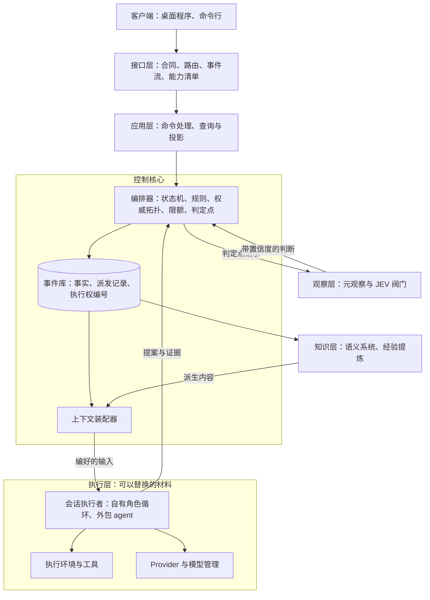

# 总体架构：职责分层

更新：2026-09-26。状态：草案。用户 2026-09-26 认可分层图与职责分层表（原话：「你的架构与总体设计图很好，职责分层图也很好」）；第 3 节的讨论顺序与第 4 节的建议待确认，在下一次会话继续讨论。

原理依据：[系统架构原理：控制核心与可替换的材料](core-and-materials.md)。分层按「控制核心加可以替换的材料」这一原则，把路线图中的全部模块放进同一个结构。

## 1. 分层图

## 2. 各层的职责与边界

| 层 | 职责 | 边界 |
| --- | --- | --- |
| 客户端 | 展示与操作 | 只通过接口层读写 |
| 接口层 | 合同、路由、事件流、能力清单 | 不含业务规则 |
| 应用层 | 命令处理、查询与投影（循环报告、回放） | 修改只经过控制核心，读取只读投影 |
| 控制核心 | 身份与裁决 | 不调用模型，是唯一写入事实的地方 |
| 知识层（[D25 语义系统](../../requirements/semantic-system.md)、经验提炼） | 从事实派生知识，供上下文装配器使用 | 只读事件；派生内容是否进入上下文由装配器决定；不能写入事实 |
| 观察层（[D28 元观察与规则检查部门](../../requirements/meta-observer.md)） | 在判定点给出通过、不通过、不确定的判断 | 只在编排器预先规定的判定点被调用，判断是编排器的输入 |
| 执行层 | 运行会话、动作与模型调用 | 只收到编好的输入，只交回提案与证据 |

各部门（包括 [D27 运维部门](../../requirements/operations-department.md) 与 [D26 部门内多角色](../../requirements/department-roles.md)）的身份在控制核心（权威位置、装配规则、私有历史），运行在执行层。外包角色（[D31](../../requirements/outsourced-agent-roles.md)）是执行层中的另一种会话执行者，接在同一个派发边界上。

## 3. 待讨论的事项（按依赖顺序）

1. 控制核心与执行者之间的合同：激活消息、提案与证据、派发与执行权。其余各项都依赖它，3.1 可靠恢复建立在它上面（[恢复契约](../recovery-contract-and-fault-matrix.md)、[ADR-0007](../../adr/0007-boundaries-for-distributed-deployment.md) 第 1、3 条）。
2. 知识层与上下文装配器的关系（D25）。D25 的整理部分与上下文组装专题已由用户确认（[D25](../../requirements/semantic-system.md)「已确认」与「专题中已确认」），[语义系统设计说明](../semantic-system.md)待按这些决定改写；本项核对这些决定在分层中的位置。
3. 部门内循环在这个结构中的形态（D26）。内部循环已于 2026-09-25 确定为中心型协作，[设计草案](../department-roles.md)已按其改写；本项核对中心角色、经理、工具角色、预测性探索与执行槽位在分层中的位置。
4. 判定点与元观察（D28）。
5. 接口层、应用层与桌面客户端（[D30](../../requirements/web-game-frontend.md)）。
6. 部署形态（[D29](../../requirements/distributed-deployment.md)）。

## 4. 第 1 项中需要先确定的问题

会话进行中的上下文变化（追加工具结果、压缩，压缩属于上下文装配）在哪里执行。架构师建议：

- 激活时控制核心装配初始输入，并给出这次允许读取的资料清单。
- 会话内部的上下文演变由执行者使用同一份带版本的装配器代码完成，输入只限于清单中的资料。
- 每次模型调用前，把装配结果的摘要记录为事件（原架构文档中的 `assembled_context_digest`）。

这样上下文装配仍是 Yudao 自己的确定性代码，信息流向由清单控制，会话中的每一次压缩都不需要经过网络回到控制核心。

这项建议需要先与 D25 上下文组装的已确认决定核对：其中四种放入方式（常驻栏目、目录、按需查询、接触时附加）意味着会话进行中还会向知识层取得内容，允许读取的范围可能需要用角色的可见范围表达，只列资料清单不够。
