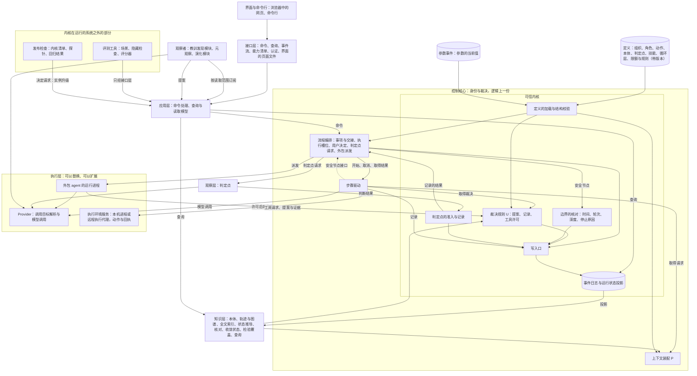
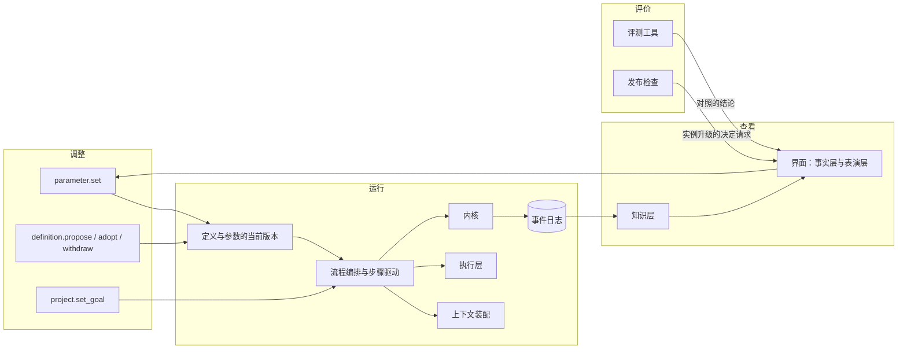
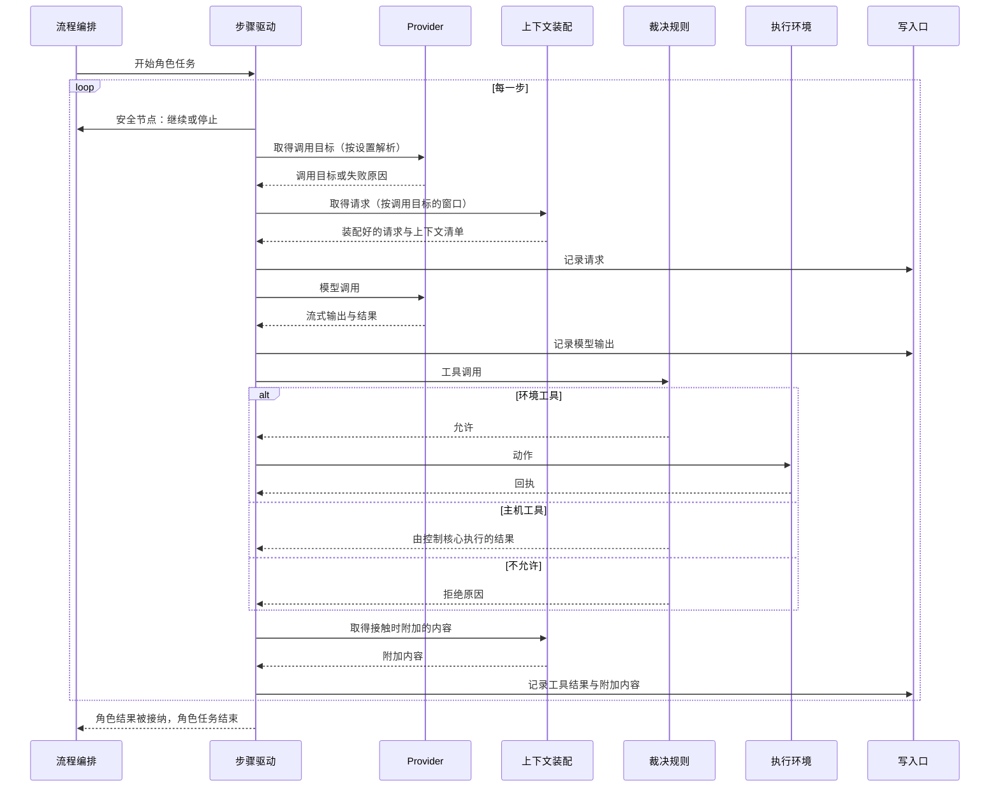

# 总体架构：职责分层

更新：2026-10-02。状态：设计，用户已确认（2026-10-01 按 [ADR-0025](../../adr/0025-network-and-mcp-run-on-control-host.md) 修改第 6.3 节与第 7.3 节：网络取回与登记的 MCP 服务器固定在控制主机；2026-09-26 认可分层图与职责分层表；同日确认 [ADR-0010](../../adr/0010-control-core-drives-role-steps.md) 至 [ADR-0015](../../adr/0015-desktop-client-and-http-contracts.md) 与第 3 节的十项长期决定；2026-09-28 确认 [ADR-0018](../../adr/0018-single-control-host-remote-execution.md)，第 3 节第 3、6 项按它修改；2026-09-29 用户确认本机进程在进程内调用以及机器流，第 3 节第 6 项、第 7.3 节按它修改；2026-09-30 按 [ADR-0022](../../adr/0022-run-directly-without-containers.md) 修改第 3 节第 6 项与第 7.3 节；2026-10-07 用户确认按意图校准整理项目，按 [ADR-0027](../../adr/0027-trusted-kernel-outside-self-modification.md) 至 [ADR-0031](../../adr/0031-declared-loop-layers-and-sub-loops.md) 与[系统意图](../../requirements/system-intent.md)新增第 1.1、1.2 节与第 7.5 至 7.7 节，修改第 1、2、3、5、6.1、7.2、7.4、8、10、11 节；同日按 [ADR-0032](../../adr/0032-interface-served-as-web-pages.md)，界面是 Yudao 服务提供的网页，页面文件由接口层提供，见第 1、1.2、2、3、5、7.2、8、9、10 节）。未实施的部分按[总体路线图](../../program-roadmap.md)推进，第 10 节是近期的实施顺序。

原理依据：[系统架构原理：控制核心与可替换的材料](core-and-materials.md)。本文把路线图中的全部模块放进同一个结构，写明各层的职责与边界、长期决定、合同与使用的技术。

## 1. 分层图



### 1.1 固定的结构与内核的位置

固定的结构有四样：循环、边界、裁决、独立的证据。部门、角色、观察者、判定点、使用者、机器、写入者都是填进这个结构的内容，增加其中一项应当只写声明。

| 结构 | 在架构中由什么承载 | 怎样修改 |
| --- | --- | --- |
| 循环 | 定义中的循环层声明；步骤驱动与流程编排负责运行 | 增减层属于结构修改，走候选、结构校验与用户批准 |
| 边界 | 限额、工具许可、可见范围、观察者的读取范围 | 数值在界限以内直接修改；界限与词表属于结构 |
| 裁决 | 裁决规则 U、判定点、决定请求 | 裁决规则属于内核；判定点是定义 |
| 独立的证据 | 主机运行的检查与回执、另一个模型的判断、用户的回答 | 每条事实记录来源（第 7.6 节） |

可信内核是决定什么成为事实、评价一个版本好坏所用到的全部代码与材料：写入口与事件日志的追加规则、裁决读取的运行状态投影、裁决规则及其调用的合同与协作规则、边界的核对（时间、轮次、深度的计数与停止原因的写入）、定义的加载与结构校验、判定点的准入与记录、内核的不变式测试，以及在运行的系统之外的评测场景隐藏检查、参考解法、评分器与发布检查。流程编排的调度、步骤驱动、上下文装配、知识层、读取模型、应用层、接口层与执行层不属于内核。内核清单列出内核的路径，只由用户修改；内核的边界、清单与保证见[可信内核设计说明](../trusted-kernel.md)。

### 1.2 模块交互

调整的命令把参数与候选写进定义与参数事件；运行时由流程编排按定义与参数的当前版本驱动，创建 run 时冻结两者的版本；裁决、边界的核对与写入口在内核里；事件日志经知识层生成循环实例、收敛状态与检验覆盖，界面按事实层与表演层显示；评测工具与发布检查在运行的系统之外，对照的结论与升级的决定请求回到用户。



## 2. 各层的职责与边界

| 层 | 职责 | 边界 |
| --- | --- | --- |
| 界面与命令行 | 展示与操作 | 只通过接口层读写 |
| 接口层 | 路由、合同、事件流、能力清单、认证，以及提供界面的页面文件 | 不含业务规则，只调用应用层 |
| 应用层 | 命令处理（按身份去重、核对基准版本）、查询与读取模型（循环画面、流转、回放、报告） | 修改只经过控制核心；读取只读投影；查询不写入事件 |
| 控制核心 | 身份与裁决：流程编排、步骤驱动、上下文装配（P）、裁决规则（U）、写入口、事件日志 | 每个决定只依据已记录的事实与事先规定的去向，模型的判断先写成事件再被使用；是唯一写入事实的地方；在控制主机上只有一份（[ADR-0012](../../adr/0012-single-control-core-scalable-execution.md)、[ADR-0018](../../adr/0018-single-control-host-remote-execution.md)） |
| 可信内核 | 决定什么成为事实、评价一个版本好坏所用到的代码与材料：写入口与事件日志、裁决规则、边界的核对、定义的加载与结构校验、判定点的准入与记录、内核的不变式测试，以及评测的隐藏检查、参考解法、评分器与发布检查 | 由用户所有；内核清单列出路径、行数上限与允许的导入；内核文件只导入内核文件、标准库与 pydantic；内核的修改每次由用户经决定请求批准（[可信内核设计说明](../trusted-kernel.md)） |
| 定义 | 组织、角色、动作、提案合同、本体、判定点、技能、循环层、限额与规则、停止原因、服务方案预置表 | 带版本；限额与规则的取值是参数，在界限以内由用户用 `parameter.set` 修改，当前值写成事件，创建 run 时冻结；其余内容只在发布新版本或经用户批准采用候选时改变；运行中不可修改（[ADR-0014](../../adr/0014-versioned-definitions.md)） |
| 知识层（[D25 语义系统](../../requirements/semantic-system.md)的整理部分） | 由事件派生轨迹、图谱与全文索引，推导内容的状态，计算要求链与数据流核对，提供查询 | 只由事件生成，不调用模型，不写入事实；派生内容是否进入上下文由 P 决定 |
| 观察层（[D28](../../requirements/meta-observer.md)） | 在判定点给出判断；语义系统的证据核对与元观察的判定都是判定点 | 只在定义中事先声明的判定点被调用；判断先写成 `judgement_recorded` 事件，再作为编排器的输入，校准通过之前只记录，不改变流程（第 7.5 节） |
| 观察者 | 教训发现模块、元观察、Stage 6 的演化模块、校准抽样 | 按读取范围订阅事件，只以提案形式提交结果；读取范围由控制核心确定 |
| 执行层 | Provider、执行环境、外包 agent 的运行进程 | 只交回模型输出、动作回执、提案与证据；不持有领域状态 |

各部门（产品、工程、质检，以及 Stage 4 的[运维部门](../../requirements/operations-department.md)）的身份在控制核心：权威位置、装配规则（含可见范围）、作者的工作过程所在的私有历史，写在定义中；部门的定义写明它内聚的目标函数、证据来源与工作过程。自有角色的每一步由控制核心驱动，模型调用与动作在执行层运行；外包角色（[D31](../../requirements/outsourced-agent-roles.md)）由控制核心派发给外部 agent。元观察在组织上是一个部门，运行时是一个观察者加判定点。

## 3. 十项长期决定

1. **一份事件日志与唯一写入口**（[ADR-0013](../../adr/0013-event-log-and-single-write-path.md)）：每条事件有全局位置、所属的流与流内版本；所有写入只经过写入口，在同一个事务中核对执行权编号与流版本、接收 U 的裁决、追加事件、更新投影；投影保存下来，随写入逐步更新。
2. **异步执行**（[ADR-0011](../../adr/0011-async-control-core.md)）：控制核心在一个异步事件循环中运行，事项与角色任务都是可以取消的任务；模型调用、动作的进程与事件推送都以异步方式等待。
3. **部署形态与执行权**（[ADR-0012](../../adr/0012-single-control-core-scalable-execution.md)、[ADR-0018](../../adr/0018-single-control-host-remote-execution.md)）：控制核心、事件日志（SQLite）、工件存储、Provider 模块与观察者在一台控制主机上运行；控制核心只有一份，持有每个 run 的执行权，执行权没有期限与续期；执行环境可以分布到用户登记的其他电脑与开发板上；部门不单独部署成服务；不引入外部工作流引擎。
4. **合同**（第 7 节）：模型调用、动作、外包派发、判定点、观察者订阅与提案，以及界面与命令行使用的命令、查询与事件流，都是可以序列化、带身份的 pydantic 类型。
5. **调用目标每次请求解析**（[ADR-0005](../../adr/0005-resolve-call-target-per-request.md)）：每次模型请求之前由 Provider 模块解析；控制核心不持有明文凭据，凭据在执行调用的地方按引用读取。实施排在 3.1 之前。
6. **动作契约与执行环境**（第 7.3 节）：所有环境工具都是动作，每类动作有契约；执行环境是一个服务，有本机进程与远程执行代理两种实现（3.2C）：本机进程在控制核心的进程内调用，远程执行代理经过 HTTP 加 JSON 的合同；代码在执行位置上直接运行（[ADR-0022](../../adr/0022-run-directly-without-containers.md)）；执行环境从封存快照建立；控制核心不直接读写工作区文件。
7. **带版本的定义**（[ADR-0014](../../adr/0014-versioned-definitions.md)）：组织、角色、动作、本体、判定点、技能、循环层、限额与规则、停止原因作为带版本的数据；参数的当前值写成事件；每个事项记录它使用的定义版本与参数版本，每次请求与裁决记录所用的版本。
8. **用户决定**（第 7.4 节）：所有等待用户的事项使用同一种机制，决定请求与回答都写成事件。
9. **观察者**：需要调用模型的派生工作（教训发现、元观察、演化、校准抽样）按读取范围订阅事件，结果作为提案经过 U；Stage 6 隐藏的评价材料放在任何 agent 与观察者都读不到的存储中。
10. **应用层与界面**（[ADR-0015](../../adr/0015-desktop-client-and-http-contracts.md)、[ADR-0032](../../adr/0032-interface-served-as-web-pages.md)）：接口层使用 FastAPI；命令、查询与一条按范围筛选的事件流；能力清单；访问令牌在自举项目的执行位置设到控制主机以外之前加入，TLS 在离开局域网之前加入；界面是 Yudao 服务提供的网页，构建好的页面文件随 wheel 发布，由接口层提供，在浏览器中打开服务的地址使用。

## 4. 语义系统在各层中的位置

| 位置 | 语义系统的部分 | 边界 |
| --- | --- | --- |
| 知识层 | 本体；轨迹、图谱、全文索引这三种投影；状态推导（有效、待复核、取代、失效）；要求链与数据流核对；查询 | 只由事件生成，不调用模型，不写入事实 |
| 控制核心 · P | 栏目、目录、接触时附加、通知送达、旧工具结果清理、压缩之前的整理请求、轨迹节录、上下文清单 | 只读取知识层、材料与事件 |
| 控制核心 · U | 按本体校验记录、尝试、复盘的产出 | 校验与写入在写入口的同一个事务里完成，并行角色同时新建同名实体时只有一个成功 |
| 控制核心 · 流程编排 | 在成果被接纳后与事项结束时安排复盘，由中心角色通过一次单独的请求完成 | 复盘的产出作为提案经过 U |
| 观察层 | 证据核对，作为编排器事先规定的一种判定点；JEV 的结论交给编排器，写成事件 | 只能让事实变为待复核 |

需要调用模型的整理工作（压缩之前的整理请求、复盘）由角色自己的请求完成，产出作为提案经过 U。教训与洞见由教训发现模块找出，它是一个观察者。细节见[语义系统设计说明](../semantic-system.md)第 4 节。

## 5. 依赖方向

- 定义 ← 事件日志 ← 知识层与运行状态投影 ← P 与 U ← 步骤驱动 ← 流程编排 ← 应用层 ← 接口层 ← 界面与命令行。
- 步骤驱动向上只通过流程编排提供的安全节点接口（依赖倒置），在每个安全节点得到继续或停止；新输入的分派与通知的送达在这里完成。接口有四个操作：继续判断在每个安全节点调用（每一步开始、尝试失败以后、工具前后、重试等待中），分派新输入并判断是否停止；开始新工作之前的核对在准备每一步、开始请求、安排重试与工具开始之前调用，另外关闭依据已经改变的协作请求，并核对角色任务的工作依据（合同、计划、协作请求）；重试等待可以被新输入、指导与取消唤醒；结束运行写入终态时核对作出停止判断时的流版本，此后有用户命令或输入写入时按写入以后的状态重新判断。取消由发起的一方写入；激活与运行循环交回的运行状态包含已经开始的取消，取消还没有写入时等它写入以后再交回。
- 控制核心只通过合同调用执行层与观察层；执行层不依赖控制核心的内部。
- 观察者只通过应用层订阅事件与提交提案，不依赖控制核心的内部。
- 内核文件只导入内核文件、标准库与 pydantic，由导入方向的测试核对；内核之外的模块经内核的公开接口调用它。
- 职责分层表按「谁有权做什么」划分，依赖方向按本节写明。原架构文档（[Loop System 架构](../../archive/native-harness/loop-system-architecture.md)第 2 节）的 L0 至 L4 把两者合在一起，L1 的 ContextAssembler 读取 L2 的 StateStore，与它自己「只允许向下依赖」的规则矛盾；本架构采用它的不变量与原理，层次按本节的依赖方向确定。

## 6. 控制核心内部

### 6.1 模块

| 模块 | 职责 | 现在的代码位置 |
| --- | --- | --- |
| 流程编排 | 事项与交接、角色任务状态、执行槽位、放行、复盘的安排、停滞与反复退回的提醒、用户决定、判定点请求、外包 agent 的派发；提供安全节点接口 | `orchestrator.py`（调度、队列、激活的准备与收尾、安全节点接口的实现、提案接纳后的流转；边界的核对由内核模块提供） |
| 边界的核对（内核） | 时间、轮次、深度的计数；已用的时间与次数在每个安全节点写入事件，进程重启以后连续累计；停止原因的写入；各种等待的时长上限；子循环的深度与剩余量的核对 | 从 `orchestrator.py` 的 `_prepare_activation`、`_pause`、`_fail` 分出的内核模块（B2） |
| 步骤驱动 | 一个角色任务内部的步骤循环：取得调用目标、取得请求、模型调用、重试、工具许可、执行动作、记录 | `engine.py` 的 `StepDriver`；`recording.py`（记录接口 `StepRecorder`） |
| 上下文装配（P） | 第 4 节表格中 P 那一行的全部内容，以及按调用目标的窗口计算阈值 | `assembly.py`（部门历史、每一步的装配、压缩完成后的检查点）；`context.py`、`compaction.py` |
| 裁决规则（U） | 提案校验、记录与尝试按本体校验、工具许可；许可规则可以增加，只能收紧；判定点的准入与记录、定义的加载与结构校验与它同属内核 | `adjudication.py`（工具许可、提案校验与提交判断的入口）；`validation.py` |
| 写入口与事件日志 | 执行权与流版本的核对、追加事件、更新保存的投影、通知订阅方 | `write_path.py`（写入口 `WritePath`：同一事务中读取保存的投影、判断并追加，期望版本、命令身份与执行权编号的核对）、`event_store.py`（一份事件日志、按全局位置与范围读取、订阅）、`projection.py`（保存的投影、重放核对） |

执行层中，执行环境在 `environment.py`（本机实现 `LocalEnvironment`：从封存快照建立工作区、只读查询 `FactsQuery`、执行动作并交回回执、交付封存所需的 `snapshot()`），动作合同在 `actions.py`，模型调用合同在 `providers/call.py`。定义层在 `harness/definitions/`：限额、停止原因、组织、角色、工具、提案合同与服务方案预置表七个 JSON 文件，加载与 pydantic 校验在 `__init__.py`，版本由全部文件的内容摘要确定。应用层与接口层在 `harness/app/` 与 `harness/api/`。

- 流程编排只调用步骤驱动的开始、取消与取得结果，不接触步骤内部。
- 步骤驱动只通过 P 与 U 的接口取得请求与裁决结果。
- 所有写入只经过写入口。
- 控制核心同时驱动多个角色任务，等待模型、动作与网络时不占用其他任务。

### 6.2 一步的顺序



### 6.3 两类工具

- **主机工具**：提交、记录、查询、读取材料、分派。由控制核心执行，读取知识层；查询范围由控制核心按角色身份填入，模型给出的参数不能扩大这个范围。
- **环境工具**：读写文件、运行检查与命令、网络取回、MCP 工具，以及以后的外部动作。每次调用是一个动作（第 7.3 节），经过工具许可以后在执行环境中执行，回执回到控制核心，由 P 附加内容。读写文件、运行检查与命令随 run 的执行位置，网络取回与登记的 MCP 工具固定在控制主机（[ADR-0025](../../adr/0025-network-and-mcp-run-on-control-host.md)）。

**工具许可的结果**有三种：允许；拒绝并说明原因；需要批准，带决定种类与批准的对象（登记之外的取回地址，或「使用前询问」的 MCP 工具）。需要批准时步骤驱动发出决定请求，阻塞这个动作；批准以后写入 `tool_started` 并执行，拒绝时写入 `tool_skipped`，原因作为工具结果返回（[网络取回与 MCP 工具设计说明](../network-and-mcp.md)第 5 节）。

外包 agent 的工具调用走同一套工具，工具许可、接触时附加与查询范围对它照样有效。

**工作区的事实。** 控制核心不直接读取工作区。U 需要的工作区事实（公开树的清单与摘要、路径在工作区中的规范形式与种类、检查回执）由执行环境的只读查询提供：步骤驱动在工具许可之前取得，流程编排在提案判断之前取得，作为输入交给 U；U 只根据投影、事件与交给它的事实判断。判断所依据的摘要写进承载判断结果的事件（工具开始、提案接纳或拒绝），重放时从事件读取，不再查询。动作合同的前置条件（树摘要、文件版本）使用同一个查询。执行环境是远程执行代理时，这个查询与动作一样经过合同。

## 7. 合同

所有合同都是 pydantic 类型，可以序列化，不含进程内的对象；跨进程时按 [ADR-0015](../../adr/0015-desktop-client-and-http-contracts.md) 使用 HTTP 加 JSON。

### 7.1 身份

- 项目 > 事项 > run > 交接 > 计划条目 > 角色任务 > 步骤。
- 一次模型调用是一个逻辑调用，下面有一次或多次调用尝试（D21）。
- 一个动作是一个逻辑动作，下面有一次或多次动作尝试。
- 协作请求、决定请求、判定、提案各有自己的身份。
- 每条往来带身份，接收方按身份去重，旧执行权编号的结果只记录、不接纳。

### 7.2 五种合同

| 合同 | 双方 | 内容 |
| --- | --- | --- |
| 模型调用 | 步骤驱动与 Provider | 身份（run、角色任务、步骤、逻辑调用、尝试）；调用目标的选择；装配好的输入、工具定义与缓存断点或缓存键；流式输出；结果与用量；按尝试取消 |
| 动作 | 步骤驱动与执行环境 | 逻辑动作与尝试的身份；动作类别；输入；前置条件（树摘要、文件版本）；预期效果；授权依据；回执（结果、证据、执行以后的树摘要）；结果未知时的核实方法 |
| 外包派发 | 流程编排与外包 agent 的运行进程 | 角色定义与版本、任务说明、资料引用、工作区快照摘要、工具入口、模型入口；工具请求（转为动作合同）；提案与证据；续期与取消 |
| 判定点 | 流程编排与观察层 | 判定点与版本、问题、参照材料、选项；两个阈值（通过、不通过）；通过、不通过、不确定三种结果各自的去向（取自一份允许清单，清单里没有放行、接纳产品合同、采用定义与修改限额）；校准状态（只记录、已校准）；拦截什么与花费多少；概率、模型版本与选项顺序；重放使用记录的结果 |
| 观察者 | 观察者与应用层 | 从某个全局位置开始按读取范围订阅事件；提案（教训、洞见、发现、演化候选）带身份与依据 |

界面与命令行使用的合同：命令带身份与基准版本，返回接受或拒绝；查询返回快照与对应的全局位置；事件流按全局位置推送与补齐，发现缺口时重新同步快照；能力清单列出当前部署提供的查询、命令与覆盖层。

### 7.3 动作契约

每类动作的契约回答[恢复契约](../recovery-contract-and-fault-matrix.md)第 4 节的问题：谁有权做，作用于什么，怎样识别同一动作与不同尝试，成功证据是什么，结果未知时向哪里查，何时可以重复，取消能否确认停止，谁负责未解决的结果。没有可以验证的恢复方法时，结果保持待核实，不自行补偿。

| 动作类别 | 执行环境 | 授权 | 出现时间 |
| --- | --- | --- | --- |
| 读取、搜索 | 本机或执行代理 | 角色的工具许可 | 已有 |
| 写入、编辑、删除、移动 | 本机或执行代理 | 角色的工具许可与工程计划的范围 | 已有 |
| 登记的本地命令 | 本机或执行代理 | 登记表 | 3.2A |
| 检查 | 检查副本 | 质检角色 | 已有 |
| 网络取回、登记的 MCP 工具 | 控制主机，与 run 的执行位置无关（[ADR-0025](../../adr/0025-network-and-mcp-run-on-control-host.md)） | 项目登记的来源与工具；登记之外经一次性批准（用户决定） | 3.2B |
| 浏览器（Playwright MCP）与 computer use | run 的执行位置；computer use 只在控制主机的交互桌面上（[ADR-0026](../../adr/0026-desktop-trials-on-control-host-desktop.md)） | 角色的工具许可；按普通浏览器 MCP 的默认做法运行，不另加限制；computer use 只提供给模型能看图的部门；质检只按交付说明中的启动方式启动交付的软件（[D34](../../requirements/browser-and-computer-use.md)、[浏览器与 computer use 设计说明](../browser-and-computer-use.md)） | 浏览器 3.2D；computer use 为以后阶段的专题 |
| 外部动作（部署、回滚、重启、读取运行数据） | 登记的运行环境上的执行代理 | 常设授权清单以内由运维直接执行；清单以外由用户决定 | Stage 4 |
| 外包 agent 的文件与命令请求 | 外包 agent 的进程 | 与自有角色相同 | D31 |

动作类别按放置分两种：随 run 的执行位置（读写文件、登记的命令、检查、试用会话、浏览器与屏幕动作），固定在控制主机（网络取回、登记的 MCP 工具，由执行环境服务的本机进程实现提供，执行代理不实现）。两种使用同一份动作合同。

执行环境是一个服务，两种实现使用同一个接口与同一组 pydantic 类型（[D29](../../requirements/remote-execution.md)、[ADR-0018](../../adr/0018-single-control-host-remote-execution.md)、[ADR-0022](../../adr/0022-run-directly-without-containers.md)、[执行环境服务设计说明](../execution-environment.md)）：
- 本机进程：在控制主机上直接运行登记的命令与检查。控制核心在进程内直接调用执行代码，不经过 HTTP，没有心跳；控制主机重新启动时的遗留进程由 3.1 的核实处理。
- 远程执行代理：运行在用户登记的其他电脑或开发板（例如树莓派、Orange Pi AIpro）上的一个小服务，在登记的目录中读写文件、启动进程并交回动作回执，经局域网用 HTTP 加 JSON 的合同调用（3.2C）。用户在系统中登记机器，写明名称、地址与用途，登记与修改写在这台机器的机器流中，与项目流一样跨 Yudao 版本保存（[ADR-0019](../../adr/0019-project-stream-across-versions.md)）；每个项目授权使用其中的机器，写明登记的目录与可以执行的操作，是否作为运行环境与常设授权在 Stage 4 加入；只在局域网内使用期间，连接的认证与加密保留位置并标为 TODO，离开局域网之前加入访问令牌与 TLS；模型凭据只保存在控制主机。执行代理在动作进行期间按时发送心跳，超过时限没有心跳时动作结果记为未知，按恢复契约第 4 节核实；之后到达的回执按动作身份记为迟到事实。

执行环境从封存快照建立，依赖缓存与编译缓存可以保留；工作区内容每次从快照重建。本机进程只运行登记的命令；来源不明的代码，把项目的执行位置设到另一台登记的机器（[ADR-0022](../../adr/0022-run-directly-without-containers.md)）。

进程类动作（检查、登记的命令）以异步方式启动与等待。超时或取消时结束整个进程树，回执记为超时或已取消，带截至结束时的输出，取消能够确认停止；取消在动作开始之前到达时不启动进程。

### 7.4 用户决定

凡是等待用户的事项，都由流程编排发出决定请求：身份、阻塞范围（一个动作、一个角色任务、一个 run，或不阻塞）、由合同给出的选项与说明。用户通过命令回答，请求与回答都写成事件，重放时使用记录的回答。

| 决定 | 来源 |
| --- | --- |
| 登记之外的网络取回与「使用前询问」的 MCP 工具，一次性批准：批准（本事项内对同一个主机或同一个工具有效）、拒绝 | 3.2B、[网络取回与 MCP 工具设计说明](../network-and-mcp.md)第 5 节 |
| 常设授权清单以外的外部动作，一次性批准 | D27、原型 v7 |
| 核实结果未知的动作：重新执行（只对契约声明可以重复的动作）、按当前实际状态继续、停止事项；只在自动核实与自动重新执行一次都没有得到结果时发出 | 恢复契约第 4 节 |
| 模型引用无法使用、机器离线或需要升级时的待恢复 | 模型管理设计说明第 5.5 节、执行环境服务设计说明第 6.5 节 |
| 暂停以后继续：模型连续 4 次回复不调用工具，或者工作区出现无法表示的条目时，处理以后继续执行、停止事项 | D09 |
| 继续旧事项时，事项记录的定义版本与当前加载的版本不同：按新版本继续、停止事项 | 3.1、[ADR-0014](../../adr/0014-versioned-definitions.md) |
| 质检无法核验：重新核验、停止事项 | 3.2D，浏览器与 computer use 设计说明第 8.4 节 |
| 确认接入已有项目的初始 PRD：确认、提出修改 | 接入已有项目设计说明、D33 |
| 进入等待模型服务的通知（只通知一次，用户可以取消 run） | Stage 4、D17 |
| 判定点升级以后仍然不确定、并且没有独立的下游核验时的裁定：不确定的结果先升级给更强的、与生成者不同的模型，仍然不确定并且没有独立的下游核验时发出，阻塞范围取能够隔开的最小范围 | D28、[ADR-0028](../../adr/0028-three-means-of-adjudication.md)、[ADR-0020](../../adr/0020-block-only-when-no-downstream-check.md) |
| 证据核对的校准样本裁定 | D25、#41 |
| 采用定义候选（`definition.adopt`；系统提出的候选在 Stage 6） | [ADR-0030](../../adr/0030-rules-are-provisional-defaults.md)、Stage 6 |
| 内核修改：交付相对基线的改动路径与内核清单有交集时，附差异；批准采纳、拒绝 | [ADR-0027](../../adr/0027-trusted-kernel-outside-self-modification.md)、[可信内核设计说明](../trusted-kernel.md)第 4.2 节 |
| 实例升级：发布检查对待发布的提交运行以后，附检查结果；批准升级、拒绝 | ADR-0027、可信内核设计说明第 4.4 节 |
| 等待超过时长上限：等待模型服务、等待机器、等待桌面、等待桌面解锁各自超过 `wait.<种类>.max_sec`（暂定默认值，见规则登记）时发出一次，同时通知用户一次；选项为继续等待、停止事项；等待用户的决定本身没有上限，由用户结束 | [ADR-0031](../../adr/0031-declared-loop-layers-and-sub-loops.md)、[循环与收敛设计说明](../loops-and-convergence.md)第 3 节 |
| 反复退回的提醒（只通知，不阻塞） | D26 |

中断的 run 在 Yudao 启动时自动继续；事项记录的定义版本与当前加载的版本不同时，先发出定义版本的决定请求；结果未知的外部动作按上表第二行交给用户。

### 7.5 判定点的校准、记录与重放

判定点是定义。结构校验由代码执行，不满足的声明被拒绝：

1. `reference` 非空，问题只引用其中列出的材料，判定的输入里不放其他内容；
2. `routes` 三项齐全，动作来自允许清单；清单里没有放行、接纳产品合同、采用定义、修改限额；
3. `model_id` 是固定版本；
4. 校准状态为 `record_only` 时，`routes` 不生效，流程按没有判定点时的去向继续。

校准：样本从真实运行中抽取，分两批，第一批选阈值，第二批复核；自动判定部分的准确率与自动判定的比例都达到声明值以后状态改为已校准，记录两批样本的摘要、模型版本与阈值。模型版本变化、问题文本变化、抽样复核的不一致率超过界限时，状态自动回到只记录；降级自动发生，升级只经校准。

每次判定先写成 `judgement_recorded` 事件，再被使用：

```json
{"type": "judgement_recorded", "point": "ask_answered@3", "means": "decision_model",
 "input_digest": "sha256:…", "question": "这份回答回应了询问中提出的问题",
 "option_order": ["true"], "model": "jev-1.13.0", "probabilities": {"true": 0.93},
 "thresholds": {"pass": 0.90, "fail": 0.15}, "outcome": "pass", "route_taken": "continue",
 "calibration": "calibrated"}
```

重放读取 `outcome` 与 `route_taken`，不发出判定请求。判定点负责的是有参照材料的局部问题；质检放行、产品取舍与规则修改不交给判定点，跨步骤的因果判断与代码是否正确无法用结构排除，靠判定点属于结构性定义、采用之前经用户批准来把关。

### 7.6 事实的来源

每条事实的来源由事件种类决定，对应表写在定义里，事件载荷不增加字段，`actor` 的取值不变：

| 来源 | 事件的例子 |
| --- | --- |
| 确定规则判定 | 提案被接纳或拒绝、工具许可的结果、达到上限 |
| 决策模型判定（附概率） | `judgement_recorded` |
| 角色陈述 | 交付说明里的陈述、角色记录的事实与决定、质检结论中的文字 |
| 主机测量 | 检查回执、树摘要、用量、耗时、心跳、机器的上线与离线 |
| 用户 | 意图原文、决定请求的回答、参数的修改 |

机器的上线与离线是主机测量，写入这台机器的机器流；探测得到的瞬时值只经实时通道显示，不进入事实层。

### 7.7 不确定时的升级

判定点的结果为不确定时，先升级给一个更强的模型，它必须与生成这份产出的模型不同；它的回答同样只有通过、不通过、不确定三种，同样写成记录。仍然不确定时按判定点声明的去向处理：没有独立的下游核验能挡住错误时发出决定请求（第 7.4 节，[ADR-0020](../../adr/0020-block-only-when-no-downstream-check.md) 的判据）；证据核对声明的去向是只标记「不确定」，事实的状态不变，并作为开环列出。「不自动改用其他模型」只适用于角色的模型失败的情况；升级使用判定点声明的第二个判定者，角色的模型不变。

## 8. 路线图对照

| 路线图项 | 用到的决定 | 在架构中的位置 |
| --- | --- | --- |
| 3.2A 本地工具（#15） | 6 | 本机执行环境与动作契约 |
| 控制核心重构（#43） | 2、4 | 控制核心的五个模块，异步步骤驱动 |
| 一份事件日志（#44） | 1 | 写入口与保存的投影 |
| 调用目标每次请求解析（#45） | 5 | Provider 的解析与步骤驱动的顺序 |
| 3.1 恢复（#119，#16 至 #18） | 1、3、6、8 | Yudao 启动时自动继续中断的 run；写入口核对执行权；从已提交的状态重新装配；结果未知的外部动作交给用户决定；run 事件版本不同的升级先排空，强制升级时事项记下「因升级重新开始」的优先级（ADR-0019） |
| 3.2C 执行环境服务 | 3、4、6 | 远程执行代理这种新实现，经过 HTTP 加 JSON 的合同，本机进程在进程内调用；机器流；项目的执行位置；远程动作按心跳判断存活 |
| 3.4A 并行 | 1、2 | 流程编排调度执行槽位；同一项目的事项按优先级排队，因升级重新开始的事项排在最前面 |
| 3.2B 网络与 MCP | 6、8 | 新的动作类别，固定在控制主机；登记就是常设授权，登记之外经一次性批准（用户决定）；MCP 客户端模块放在执行代码包中，3.2D 共用 |
| 3.2D 浏览器 | 6 | 使用 3.2B 的 MCP 客户端模块接入 Playwright MCP，不经项目登记；computer use 是以后阶段的专题（[各阶段需求概览](../../requirements/stage-requirements-overview.md)第 6 节）；质检部门的建议能力是图像输入，不满足时只提醒（模型管理设计说明第 5.6 节）；试用会话的浏览器拒绝 Yudao 服务自己的地址，与网络取回使用同一条规则 |
| D24 模型管理（#83） | 5、7 | Provider 的目录与解析；推理档位；部门的建议能力只用于提醒；角色层设置 |
| D25 语义系统（#22） | 1、9、10 | 知识层投影；P 与 U；证据核对判定点；只读观察者（#98）就是应用层的查询与事件流加提案 |
| JEV 接入 | 4 | 判定点合同；Provider 的 systemone 协议 |
| D26 部门内多角色 | 2、7 | 角色定义；同时驱动多个角色任务 |
| 技能 | 7 | 定义中的技能；P 的目录；主机工具取得全文 |
| D30 界面与可观测性 | 10 | 应用层、接口层与界面 |
| D27 运维部门 | 6、7、8 | 新部门与修复事项这一事项种类；外部动作经执行代理执行，常设授权清单以内直接执行，清单以外走用户决定 |
| Stage 4 长时间运行 | 3、5、8 | 操作系统的服务管理重新启动 Yudao 后按 3.1 继续；Provider 重试用完以后 run 进入等待模型服务，恢复后自动继续 |
| D28 元观察、判定点 | 4、9 | 观察者加判定点；判定点的通用合同、校准与准入、记录与重放（Stage 5，证据核对是第一个判定点） |
| D31 外包角色 | 4、6 | 外包派发合同；工具请求转为动作合同 |
| 教训发现模块与惊讶机制 | 9 | 观察者 |
| Stage 6 受治理的演化 | 7、8、9、10 | 演化模块是观察者；候选是定义的新版本；采用是用户决定；隔离比较按指定的定义版本运行事项；准入钩子是 U 中只能收紧的许可规则，新检查是新的动作定义；完整命令行调用应用层的全部命令与查询 |
| 迭代底座 B1、B7（内核清单与发布检查） | 3、4、7 | 内核清单、不变式测试、路径守卫；接口的访问令牌；发布检查由已安装的实例提供（M3） |
| 迭代底座 B2（边界的核对） | 2、3 | 边界的核对从流程编排分出，已用时间写入事件，挂在 3.1 下（M2） |
| 迭代底座 B3（规则登记与参数） | 7 | 定义增加四项记录与界限；参数事件与 `parameter.set`（M2） |
| 迭代底座 B5（可见范围与先判断后看解释） | 4 | 可见范围词表扩充；交付说明字段分为事实与解释；独立判断事件（M4） |
| 迭代底座 B8（采纳写回） | 3、6 | 采纳的成果以写回时 main 的当前提交为基线生成分支与合并请求，挂在 3.8 下（M2） |
| 自举工作线 | 3、5、6、7 | 第一层：已发布的实例把 Yudao 仓库当作普通项目，试点在 M2 关闭并且五项前置条件完成以后开始（决定 2） |

## 9. 使用的技术

| 部分 | 选择 |
| --- | --- |
| 运行方式 | Python 3.11 以上，asyncio |
| 数据类型与合同 | pydantic 2 |
| 事件日志、投影、全文检索 | SQLite（WAL、FTS5 trigram），在控制主机上 |
| 工件与快照 | 按内容摘要寻址，存放在控制主机上 |
| 模型调用 | openai 与 anthropic 官方异步客户端，JEV 的 systemone 协议 |
| 接口层 | FastAPI，OpenAPI 由 pydantic 类型生成，事件流使用 SSE |
| 界面 | 由接口层提供的网页，以 Windows 上的 Edge 与 Chrome 为准；React 19、TypeScript、Vite、PixiJS 8、XState 5、GSAP |
| 服务之间的传输 | HTTP 加 JSON，流式结果使用 SSE 或分块传输 |
| 执行环境 | 本机进程；其他电脑与开发板上使用执行代理（3.2C）；代码在执行位置上直接运行（ADR-0022） |
| 扩展协议 | MCP 使用官方 Python SDK（3.2B）；外包 agent 使用 ACP（D31） |

## 10. 近期实施顺序

已完成：#46、#47、#101、#103、#106、#43（控制核心重构）与 #44（一份事件日志），2026-09-27。接下来：#110（工作区的建立与封存经过执行环境）与 #72（应用层与接口层的骨架）→ #49（用户决定）→ #45（调用目标每次请求解析）→ #16 至 #18（3.1 恢复）→ 3.2C（执行环境服务，同时依赖 #110）；3.2B（#68、#69）与 3.2D 在执行环境的合同（#128）之后开始；3.4A 在 3.1 之后开始；3.9 的组合验收（#100）第一次执行 D32 对照实验。#48（带版本的定义）在 #43 之后，与 #44 并行；#102（要求调用工具）、#104（公开树按忽略规则取得）与 #105（请求时限只计算等待提供方的时间）同样在 #43 之后，3.9 的组合验收（#100）依赖 #104；#105、#107（偶发失败的测试）、#108（Messages 断流重试）与 #109（其余测试的私有访问）可以与 #44 并行。应用层的查询、命令、事件流、认证与模型目录（#73 至 #77）在 #72 之后，与 #49、#45 并行；界面（#71 下的 #79、#80、#82）在 #72、#75、#76 之后开始。这些工单属于 Stage 3 的界面工作线，#73 至 #77 排在 3.1 之前；此后 3.1、3.2C、3.4A、3.2B、3.2D、3.8、D24 与 Stage 4 运维各自连同界面一起验收，界面工单挂在所属工作包的父工单下。D24 模型管理（#83 下的 #84 至 #96）属于 Stage 3，模型管理页由 #93、#94 建立。#22 的子工单依赖 #43，其中 #27 同时依赖 #44 与 #48。D26（#50 下的 #51 至 #65）在 D25 的真实模型综合验收（#42）之后开始。3.2A（#12 至 #15）已于 2026-09-26 验收。迭代底座与自举工作线的顺序见总体路线图：B3、B6 与 B2 在 M2（B2 与 #16 一起验收），B1、B7 在 M3，B5 在 M4；自举试点在 M2 关闭并且五项前置条件完成以后开始。

应用层与接口层的设计见[应用层与接口层设计说明](../app-and-interface.md)。

## 11. 待讨论的事项

1. 判定点的清单（合同、校准与升级规则见第 7.5、7.7 节；证据核对是第一个判定点，流转上的判定点各自校准以后加入）与元观察（D28）。
2. 教训发现模块与惊讶机制（D25）：单独审查事件与事实，找出教训与洞见；可能与元观察结合；参考主动推断与自由能原理。
3. 修复事项（D27）：运维发起的修复事项自动开始，不需要用户批准；同一项目一次只进行一个事项，按优先级排队，修复事项在前；登记的运行环境带常设授权清单，清单以外的动作走用户决定。项目层长期存在的运维部门与 run 内各部门之间的询问方式在 Stage 4 设计时确定。
4. 技能的定义（Stage 5）：注册、适用性、执行与展开。
5. Stage 6 与持续改进工作线的需求记录。
