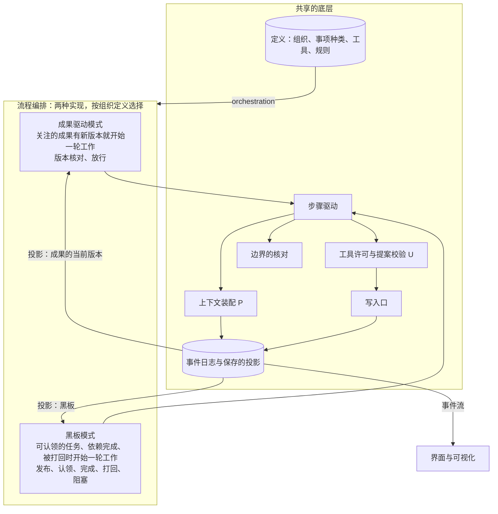
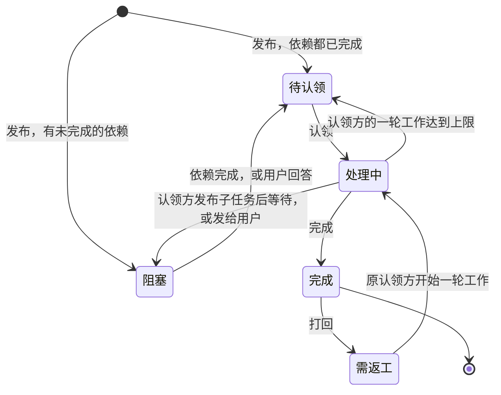
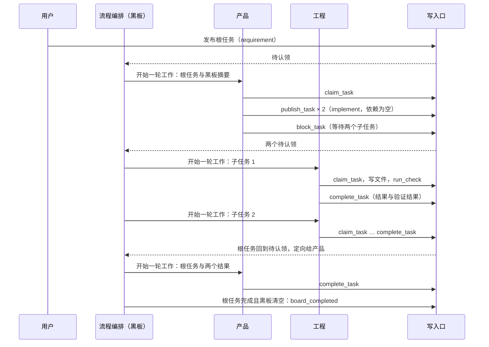

# 黑板编排设计说明

日期：2026-10-22。状态：设计草案，两种模式并存与共用底层已由用户决定（[ADR-0041](../adr/0041-two-orchestration-modes-share-control-core.md)），第 15 节的暂定默认值待用户确认，未实施。需求：[D39](../requirements/blackboard-orchestration.md)、[D38](../requirements/system-intent.md)。前置设计：[总体架构：职责分层](architecture/overall-architecture.md)、[三部门的循环结构](department-loop.md)（成果驱动模式）、[循环与收敛](loops-and-convergence.md)、[规则登记与参数](rules-and-parameters.md)。术语以 [CONTEXT.md](../../CONTEXT.md) 为准。

## 1. 要解决的问题

| 问题 | 现状 | 影响 |
| --- | --- | --- |
| 部门之间的交接单位是整份成果 | 成果驱动模式里，工程等整份 PRD，质检等整份交付；返工以整份缺陷记录回传 | 部门之间没有小块的正向传递与回传，一轮循环的周期长 |
| 循环的形状由成果之间的依赖决定 | 组织定义写明每个部门关注哪些成果 | 要改循环的形状就要改成果种类与关注关系；用户希望循环的形状由任务本身决定 |
| 独立性由结构保证 | 验证者与作者分开、先判断后看解释、版本核对与放行 | 这些结构在动态方式里是负担；用户决定在黑板模式里不要求 |
| 只有一种流转方式 | 流程编排只有成果驱动一种实现 | 两种方式没有办法在同一套评测上比较 |

## 2. 两种模式与共享的底层

### 2.1 分工

| 部分 | 共享 | 成果驱动模式 | 黑板模式 |
| --- | --- | --- | --- |
| 写入口与事件日志、保存的投影 | 是 | 正式成果的版本链 | 黑板投影 |
| 步骤驱动、上下文装配、工具许可、边界的核对 | 是 | 部门历史连续 | 每轮按任务装配（第 5.3 节） |
| 定义的加载与结构校验、判定点、Provider、执行环境 | 是 | | |
| 接口层：命令、查询、事件流 | 是 | 部门状态的查询 | 黑板的查询 |
| 让部门开始一轮工作的条件 | | 关注的成果有新版本 | 有可以认领的任务、依赖完成、被打回 |
| 一轮工作的结束 | | 提交正式成果或回答用户 | 完成、打回或阻塞一个任务 |
| 部门之间的问答 | | 询问是一次工具调用 | 问题是一个任务（第 5.2 节） |
| 独立性 | | 验证者与作者分开，先判断后看解释 | 不要求，记为开环 |
| 事项的结束 | | 质检的放行 | 根任务完成且黑板上没有未完成的任务（第 8.1 节） |
| 评测与隐藏检查 | 是 | | |

### 2.2 分层



### 2.3 模式在定义里

组织定义增加一个字段：

```json
{
  "orchestration": "blackboard",
  "departments": [
    {"id": "product", "label": "产品", "roles": ["product"], "capabilities": ["requirement", "clarify"]},
    {"id": "engineering", "label": "工程", "roles": ["engineering"], "capabilities": ["implement"]},
    {"id": "quality", "label": "质检", "roles": ["quality"], "capabilities": ["verify"]}
  ]
}
```

`orchestration` 取 `watched_outputs` 或 `blackboard`。`capabilities` 是部门的能力标签，只在黑板模式使用；成果驱动模式使用关注的成果。结构校验：黑板模式下每个部门至少一个能力标签，事项种类的根任务标签至少被一个部门覆盖。一个事项按开始时的定义版本确定模式，中途定义改版时按现有规则发出决定请求。

## 3. 黑板

### 3.1 任务

任务是黑板上的一个节点，字段固定：

| 字段 | 内容 | 谁写 |
| --- | --- | --- |
| 编号 | 事项内唯一 | 写入口 |
| 状态 | 第 3.2 节的五种 | 写入口按事件计算 |
| 能力标签 | 一个或几个 | 发布方 |
| 定向的部门 | 可以为空；填了就只有这个部门能认领 | 发布方 |
| 依赖 | 必须先完成的任务编号 | 发布方 |
| 父任务 | 拆分它的任务编号，根任务为空 | 写入口 |
| 发布方、认领方 | 用户或部门标识 | 写入口 |
| 说明 | 标题、要做什么、希望得到什么、材料引用 | 发布方 |
| 结果 | 做了什么、产出的材料引用 | 认领方 |
| 验证结果 | 检查了什么、怎么检查的、主机回执的引用 | 认领方 |
| 打回记录 | 每次打回的发起方与原因 | 写入口按事件计算 |

任务载荷里没有置信度一类的数字。作者对结果的把握写在结果的文字里，是作者的陈述，控制核心不读取它。

### 3.2 状态



五种状态：待认领、处理中、完成、需返工、阻塞。每次迁移是一条事件。

### 3.3 事件与投影

事件种类：`task_published`、`task_claimed`、`task_completed`、`task_returned`、`task_blocked`、`task_unblocked`。每条带事项、任务编号、动作方与载荷。黑板是这些事件的保存的投影：每个任务的当前字段、按状态与标签的索引、任务之间的边（父子、依赖、打回）。任务之间的边允许成环（质检打回产品，产品打回工程），投影的遍历记录已访问的节点。

写入口的核对：认领带期望的黑板版本，另一方先认领时这次认领被拒绝；完成与打回只允许从第 3.2 节写明的状态迁移；事件、投影、重放与成果驱动模式共用同一套机制（[ADR-0013](../adr/0013-event-log-and-single-write-path.md)）。

## 4. 发布与认领

### 4.1 谁能发布

用户与部门。观察者仍然只提出提案，不发布任务。用户的输入都成为任务（第 7 节）。部门在一轮工作中可以发布任意个任务：拆出子任务、发给别的部门、把问题发给发起方或用户。

### 4.2 定向与标签

- 定向发布：填写定向的部门，只有它能认领。
- 标签发布：填写能力标签，能力标签覆盖它的部门都能认领。

### 4.3 认领

控制核心里没有常驻等待的模型会话，所以「部门监听并认领」由流程编排代为触发：

1. 一个任务进入待认领时，流程编排找出能认领它、并且在等待工作的部门（定向发布时只有一个）。
2. 让这些部门各开始一轮工作，请求里放这个任务与黑板摘要；部门的第一个动作是调用认领工具。
3. 写入口只让第一次认领成功。没有认领到的部门收到工具结果「已被认领」，这一轮工作结束，不计入它的打回与任务统计，只计模型用量。
4. 待认领的任务多于一个时，每个等待工作的部门一次只开始一轮工作，由它自己在黑板摘要里选择认领哪一个。

能力标签互不重叠时（现在的三个部门就是这样）不会出现第 3 步的竞争。

### 4.4 依赖与打回

- 有未完成依赖的任务处于阻塞；依赖全部完成时写 `task_unblocked`，任务进入待认领。认领方发布子任务并等待它们时，调用阻塞工具把自己的任务挂起，子任务都完成后这个任务回到待认领并定向给原认领方。
- 打回：任何部门可以把已完成的任务打回，写明原因；任务进入需返工，原认领方在等待工作时开始一轮工作处理它。打回次数达到上限（第 8.2 节）时任务进入阻塞并发给用户。

## 5. 部门在黑板模式下

### 5.1 一轮工作

部门仍然是上下文容器与职责边界。一轮工作从认领一个任务开始，以完成、打回或阻塞这个任务结束。一个部门同一时刻最多一轮工作；运行工作区只由工程写入，这两条与成果驱动模式相同（[三部门的循环结构](department-loop.md)第 3.2 节）。部门内部并行处理几个任务属于部门内多角色（Stage 5），在那里解决工作区的划分。

### 5.2 工具

共享的读取、写入、命令与检查工具不变。黑板模式增加五个主机工具，只在 `orchestration` 为 `blackboard` 时进入工具清单：`claim_task`、`publish_task`、`complete_task`、`return_task`、`block_task`。成果驱动模式的 `ask`、`answer`、`submit_*` 在黑板模式不出现。部门之间的问题是一个任务：提问方发布一个定向任务并阻塞自己的任务，被问方认领、在结果里回答、完成，提问方的任务回到待认领并定向给它，下一轮的请求里带着回答。

### 5.3 每轮的上下文

每轮按固定规则装配，不调用模型（[ADR-0009](../adr/0009-deterministic-context-assembly.md)）：

1. 常驻栏目：部门 Prompt、事项种类的工作说明、项目资料。
2. 当前任务：说明、材料引用、打回记录。
3. 依赖的结果：当前任务依赖的任务与父任务的结果载荷，按依赖拉取。
4. 本部门在本事项中完成过的任务：标题与结果，列表形式；步骤过程不进入。
5. 黑板摘要：未完成的任务的标题、状态、标签与认领方。
6. 这一轮的步骤历史。

部门的步骤过程保存在事件里，用于重放、界面与复盘，不进入以后的轮次。

## 6. 验证与完成

- 完成任务时写验证结果：检查了什么、怎么检查的、主机回执的引用。写了命令检查的，回执必须是主机执行的。
- 控制核心不判断结果是否正确、验证是否充分。任何部门看到问题可以打回。
- 这一处是开环：没有结构保证验证者与作者分开，也没有先判断后看解释。离开期间的报告与放行记录的对应位置写明「黑板模式：完成由认领方自述，未经独立核验」。独立的评价来自评测场景的隐藏检查，在两种模式之外。

## 7. 用户

- 用户发起事项的输入成为根任务，能力标签取事项种类定义的默认值（普通事项默认 `requirement`），用户可以改。
- 发给用户的任务在界面上作为决定请求显示（[总体架构](architecture/overall-architecture.md)第 7.4 节）；用户的回答写成完成事件，依赖它的任务解除阻塞。
- 用户在事项进行中的输入成为新任务，标签同样取默认值并可以改；要改已有任务的，以新任务定向给它的认领方。
- 默认推进写在部门 Prompt 里：遇到模糊点先做合理的假设并写进结果，假设错了代价很大时才发给用户。这是定义里的数据。

## 8. 一定会停与收敛

### 8.1 结束

事项结束的条件，由流程编排在每个安全节点核对：

- 根任务完成，并且黑板上没有待认领、处理中、需返工的任务：停止原因 `board_completed`，结果为完成。阻塞于用户的任务存在时事项等待用户决定，按现有的等待规则处理。
- 事项运行时间上限、任务数上限：按现有的停止原因与新增的 `max_tasks`。
- 用户取消、暂停：与现有规则相同。

### 8.2 上限

进入规则登记的参数，带四项记录：

| 参数 | 现值 | 拦截什么 |
| --- | --- | --- |
| `blackboard.max_tasks_per_item` | 200 | 不断拆分或重复发布 |
| `blackboard.max_returns_per_task` | 3 | 两个部门之间来回打回；达到时任务阻塞并发给用户 |
| `blackboard.max_steps_per_round` | 与 `max_model_steps` 相同 | 一轮工作不结束 |

事项运行时间上限、单次请求与动作的时限、安全节点的写入与成果驱动模式共用。

### 8.3 收敛状态

收敛状态投影（[循环与收敛](loops-and-convergence.md)第 5 节）在黑板模式用自己的进展度量：

| 状态 | 判定 |
| --- | --- |
| 收敛中 | 未完成的任务数在最近几轮严格下降，或根任务已完成 |
| 停滞 | 未完成的任务数不变，并且没有新的完成事件 |
| 震荡 | 同一个任务被打回两次以上；或说明摘要相同的任务被重复发布 |
| 达到边界 | 停止原因属于限额类 |

轮数与次数是参数，与成果驱动模式的条目并列登记。

## 9. 界面与可视化

- 黑板的查询（`run.board`）返回投影：任务、状态、边、认领方。
- 事件流照常按全局位置推送六种任务事件；可视化只订阅事件流，与现有画面相同。
- 画面把认领、完成、打回映射成人物与场景的动作；事件时间与播放时间的分离、合并与快进属于客户端（[应用层与接口层](app-and-interface.md)的表演层），控制核心不知道它。

## 10. 两种模式的比较

两种模式跑同一套评测场景，隐藏检查与评分器相同。比较按[规则登记与参数设计说明](rules-and-parameters.md)第 4 节的对照：同一场景各跑几次，比较完成度、正确性、循环次数、用量与费用，差值超出噪声范围才算数。报告按模式分列，并为黑板模式单独列出打回次数、任务数与开环的条目数。

## 11. 定义的改动

| 文件 | 改动 |
| --- | --- |
| `organization.json` | `orchestration`；部门的 `capabilities`；结构校验的两条规则 |
| `work_items.json` | 事项种类的根任务默认标签；黑板模式下各部门的 Prompt 补充与工具清单 |
| `tools.json` | 五个任务工具，标明只在黑板模式可用 |
| `proposal_contracts.json` | 五个任务工具的载荷合同 |
| `rules.json` | 第 8.2、8.3 节的参数 |
| `stop_reasons.json` | `board_completed`（完成）、`max_tasks`（暂停） |

## 12. 模块交互



## 13. 与现有代码的差异

| 现有做法 | 改为 | 位置 |
| --- | --- | --- |
| 阶段状态机决定持有交接的部门 | 由 #474 改为成果驱动模式；流程编排再分出模式无关的部分与两种实现 | `harness/orchestrator.py` |
| 组织定义没有模式与能力标签 | 第 2.3 节 | `harness/definitions/organization.json`、`harness/models.py` 的结构校验 |
| 工具清单按部门固定 | 按模式过滤 | `harness/definitions/tools.json`、`harness/context.py` |
| 部门历史连续装配 | 黑板模式每轮按第 5.3 节装配 | `harness/assembly.py` |
| 保存的投影只有运行状态 | 增加黑板投影 | `harness/projection.py` |
| 停止原因清单 | 增加两项 | `harness/definitions/stop_reasons.json` |
| 查询与事件卡片 | 增加 `run.board` 与六种任务事件的卡片 | `harness/api/`、`harness/views.py` |

## 14. 验收

1. 同一份控制核心，组织定义分别取两种模式，三个评测场景都能运行到结束，并在报告中按模式分列。
2. 两个部门能力标签重叠时同时认领同一个任务，只有一次认领成功，另一方收到「已被认领」。
3. 事件重放得到相同的黑板投影；进程重启以后处理中的一轮工作继续，阻塞的任务在依赖完成时解除。
4. 打回达到上限的任务阻塞并发给用户；任务数达到上限时事项暂停，停止原因 `max_tasks`。
5. 收敛状态投影对录制的黑板事件夹具给出第 8.3 节的四种状态。
6. 黑板模式下工具清单里没有 `ask`、`answer` 与 `submit_*`；成果驱动模式下没有五个任务工具。
7. 离开期间的报告在黑板模式写明开环的条目。
8. [循环与收敛](loops-and-convergence.md)第 6 节的五条判据对两种模式都通过。

## 15. 暂定默认值与待用户确认

以下取值是暂定默认值（[ADR-0030](../adr/0030-rules-are-provisional-defaults.md)），由运行证据调整；其中前四条请用户确认是否接受：

1. 认领由流程编排触发，标签重叠时几个部门各开始一轮工作、先认领的成功（第 4.3 节）。另一种做法是流程编排直接指派给一个部门，少花一次模型调用，但指派规则写在代码里。
2. 黑板模式没有询问工具，问题是任务（第 5.2 节）。另一种做法是保留询问分支，提问方的思路连续，但两套问答机制并存。
3. 部门在黑板模式的上下文每轮重新装配，只带完成过的任务的结果列表，不带步骤过程（第 5.3 节）。
4. 一个部门同一时刻最多一轮工作（第 5.1 节）。
5. 参数的现值：任务数 200、打回 3 次（第 8.2 节）。
6. 根任务的默认标签 `requirement`，三个部门的能力标签如第 2.3 节。

## 16. 与现有设计的关系

- [三部门的循环结构](department-loop.md)：成果驱动模式的设计说明，不改。
- [循环与收敛](loops-and-convergence.md)：第 5 节的进展度量按模式各自定义；第 6 节的判据对两种模式都适用。
- [验证的独立性](independent-verification.md)：只适用于成果驱动模式。
- [规则登记与参数](rules-and-parameters.md)：第 8.2、8.3 节的参数进入规则登记；两种模式的比较用第 4 节的对照。
- [应用层与接口层](app-and-interface.md)：黑板的查询与事件卡片。
- [部门内多角色](department-roles.md)：部门内并行处理几个任务在那里解决。
- [可信内核](trusted-kernel.md)：写入口对任务状态迁移的核对属于内核；黑板模式的流程编排属于调度，不属于内核。
