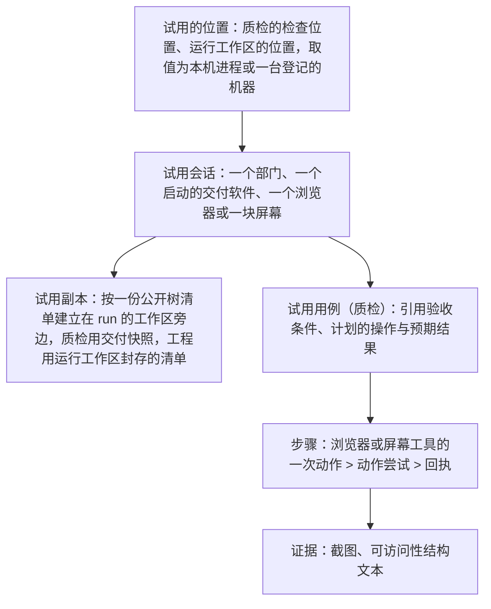
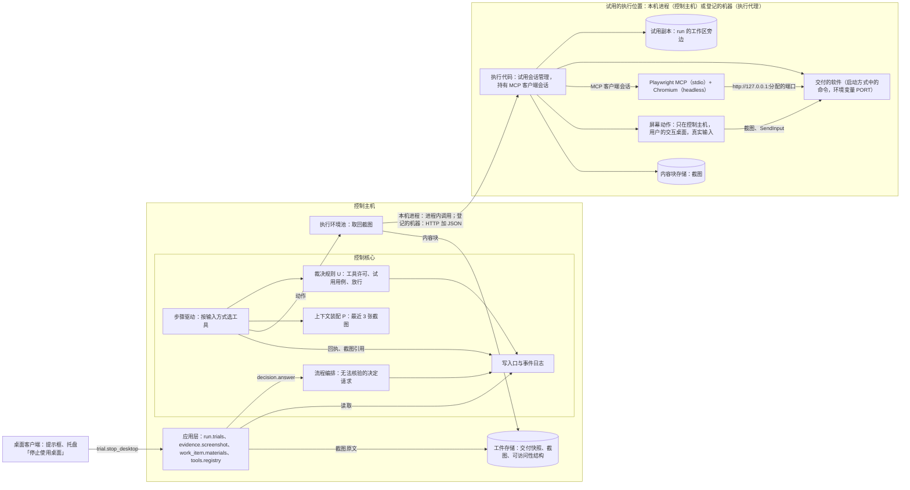
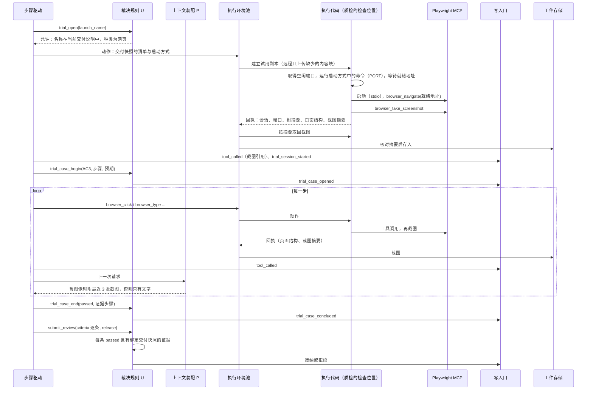
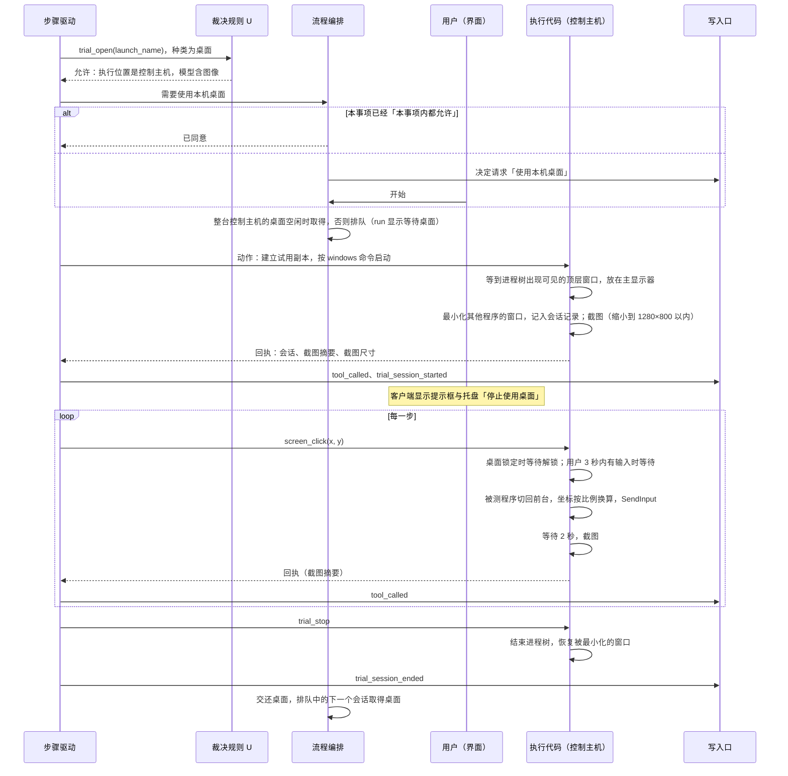
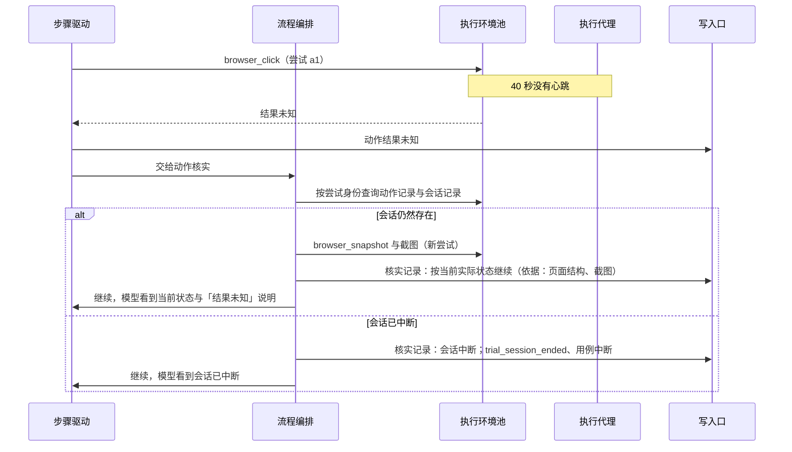

# 浏览器与 computer use 设计说明

总图位置：第四节「动作」的缝（浏览器与桌面是动作的两个类别）；第一节「模型与工具」方框。依据：需求 [D34](../requirements/browser-and-computer-use.md)；[ADR-0038](../adr/0038-function-first-commands-without-registration.md)（试用启动命令的环境与命令相同，桌面会话的同意单独说明）；[执行环境服务设计说明](execution-environment.md)（执行环境服务、执行代理、执行位置、执行位置上的程序、动作回执）；[模型管理设计说明](model-management.md)第 4.3、5.6、6 节（输入方式、部门的建议能力、请求时按输入方式提供工具）；[总体架构](architecture/overall-architecture.md)第 6.3、7.3、7.4 节；[恢复契约与故障矩阵](recovery-contract-and-fault-matrix.md)第 4 节；[应用层与接口层设计说明](app-and-interface.md)第 3.2、3.3、4.3 节；[本地通用工具设计说明](local-tools.md)第 2 节；[语义系统设计说明](semantic-system.md)第 5.5、13 节；[评测场景](evaluation-scenarios.md)场景 1；[原型 v9 设计说明](../archive/prototypes/v9/design.md)（沿用 [v8 设计说明](../archive/prototypes/v8/design.md)第 7.1、7.3、8.3、9.4 节）；调研：[浏览器与 computer use 调研](../archive/research/browser-and-computer-use.md)、[computer use 实现调研](../archive/research/computer-use-implementations.md)。

范围：computer use 的设计（第 5 节、第 11.2 节、第 16 节第 6 至 10 项与第 12 项，以及其余各节中的屏幕工具 `screen_*`、桌面种类的试用会话与启动方式、「使用本机桌面」决定请求、`trial.stop_desktop`、等待桌面与等待桌面解锁、桌面程序的无法核验与故障，第 14 节场景 2 与场景 3 中桌面程序的部分）作为以后专题讨论的材料（[D34](../requirements/browser-and-computer-use.md)「computer use 专题待重新确定的事项」），列出的各节仍保留在本文。

参照实现的提交号：Playwright MCP `microsoft/playwright-mcp` v0.0.83（2026-09-28，`main` 提交 `f183dad`，依赖 Playwright `1.64.0-alpha-1790635538000`）；Anthropic `claude-quickstarts` 提交 `dee7116`；OMP `C:\project\codes\oh-my-pi` 提交 `fdfeef1f78`；OpenCode `C:\project\codes\opencode` 提交 `0027387`。

## 1. 范围

3.2D 交付：

- **试用会话**：在 run 的执行位置上，从一份公开树清单建立试用副本，按启动方式启动交付的软件，再打开浏览器或屏幕供部门操作。启动方式由工程写在交付说明中，质检按交付说明启动。
- **浏览器工具**：内置的 Playwright MCP 服务，经 3.2B 的 MCP 客户端调用，每个动作一个工具；每一步把页面的可访问性结构交给模型，模型能看图时同时附上截图；每一步的截图都保存为证据。
- **computer use**（以后阶段的专题）：8 个屏幕工具（截图、点击、拖动、移动、滚动、输入文字、按键、等待），坐标是截图像素；桌面程序只在控制主机上试用，使用用户已经登录的交互桌面与真实输入，开始前经用户同意，整台控制主机同一时刻只有一个桌面会话（第 5 节）。
- **按模型输入方式提供工具**：调用目标不含图像时不提供屏幕工具与浏览器截图工具，浏览器只给可访问性结构，截图只保存为证据（模型管理设计说明第 5.6 节）。
- **截图作为证据**：存进工件存储，绑定动作回执、试用会话与交付快照；在质检试用台、试用记录与资料页显示。
- **试用记录与放行**：质检按 ProductSpec 的验收条件建立试用用例，逐条给出结论；每条验收条件都有绑定当前交付快照的通过证据才能放行；没能核验的条目如实报告，事项不能放行。
- **工程的研发自测**：工程可以在自己的运行工作区的副本上使用浏览器，模型能看图时也可以使用屏幕工具；这些结果只是动作回执，不能作为质检的证据。

不在范围内：运维部门是否使用这两个工具（Stage 4 设计运维部门时决定）；实时画面（VNC）；在控制主机以外的执行位置上试用桌面程序。

## 2. 概念与分层

### 2.1 概念层级

本文的「质检」指核验角色，三部门里是质检；试用用例工具、逐条结论与放行规则属于核验，任何路由里的核验角色都用同一套（[形态与核验角色设计说明](forms-and-verifier-role.md)第 4.2 节）。

- **试用会话**属于一个部门，同一时刻每个部门最多一个；开始新的会话时，本部门原来的会话先结束。会话有种类：网页（浏览器）或桌面（屏幕），由所用启动方式的种类决定。桌面会话只在控制主机上进行，使用用户的交互桌面，整台控制主机同一时刻只有一个（第 5.1 节）。
- **试用副本**是会话专用的一次性目录，按清单建立在这个 run 的工作区旁边，会话结束时删除（第 3.1 节）。它的树摘要写进每一步的回执，质检的试用副本的树摘要等于交付快照的摘要。
- **试用用例**只属于质检。用例打开到结束之间，本部门在同一会话中的浏览器与屏幕动作都是这个用例的步骤。
- **试用记录**是一个 run 中质检全部试用用例及其步骤、证据与结论的总称，由事件派生，不另外保存。

### 2.2 分层与职责

| 层 | 模块 | 3.2D 增加的职责 | 边界 |
| --- | --- | --- | --- |
| 定义 | `harness/definitions/` | 试用工具、浏览器工具与屏幕工具的定义，每个工具的动作类别、恢复契约与是否需要图像输入；各部门可用的工具；交付说明的提案合同增加启动方式；限额（屏幕尺寸、截图前的等待、就绪时限的默认值与上限）；工程的内置 Prompt 中写启动方式的规则，质检的内置 Prompt 中生成测试的规则 | 随系统发布，运行中不可修改（[总体架构](architecture/overall-architecture.md)第 3 节） |
| 控制核心 · 步骤驱动 | `engine.py` | 按调用目标的输入方式选出这次请求提供的工具；把回执中的截图交给 P | 不读取截图内容 |
| 控制核心 · P | `assembly.py` | 调用目标包含图像时，把最近 3 张截图放进请求，更早的换成带证据编号的占位文字 | 只读取事件与工件 |
| 控制核心 · U | `adjudication.py`、`validation.py` | 工具许可：质检只能使用当前交付说明中的启动方式，模型不含图像或执行位置不是控制主机时拒绝桌面种类的试用会话；交付说明中启动方式的核对；试用用例的开始与结束；QAReview 的逐条结论与放行规则 | 不调用模型 |
| 控制核心 · 流程编排 | `orchestrator.py` | 桌面会话开始前发出「使用本机桌面」决定请求；整台控制主机的桌面会话排队；质检无法核验时发出决定请求；回答「重新核验」后重新激活质检 | 经决定请求机制（总体架构第 7.4 节） |
| 执行层 · 执行代码 | `harness/execution/` | 试用会话管理（核对试用需要的程序、建立试用副本、分配端口、启动与就绪、结束进程树）、Playwright MCP 的客户端会话、屏幕动作（Windows 交互桌面上的截图与真实输入、最小化与恢复其他窗口、等待解锁与等待用户停止操作）、截图写进内容块存储 | 不导入 Yudao 的其他模块 |
| 执行层 · 执行代理 | `harness/agent/` | 新的动作类别 `trial`、`browser`、`screen` 经已有的 `/actions` 路径执行；会话记录与动作记录一起保存在本机 | 合同与 3.2C 相同 |
| 执行层 · 执行环境池 | `harness/environments/` | 按回执中的内容摘要取回截图，核对摘要后存进工件存储 | 不写事件 |
| 应用层 | `harness/app/` | 查询：试用记录、截图原文、资料中的逐条结论与启动方式、工具清单中的内置工具 | 查询不写入 |
| 界面 | Yudao 服务提供的网页 | 质检试用台、工程显示器、试用记录页签、资料页中的截图；桌面会话期间的提示框与托盘菜单「停止使用桌面」 | 只经接口层 |

### 2.3 模块交互

## 3. 试用会话

### 3.1 试用的位置

试用在 run 的执行位置上直接进行（总体架构第 7.3 节 3.2D 行）：质检的试用在质检的检查位置上进行，工程的试用在运行工作区的位置上进行。位置是本机进程（控制主机，Windows）或一台登记的机器（例如 Orange Pi AIpro 开发板，Linux arm64）。质检的检查与试用在同一个位置，两者按同一份交付快照的清单建立。网页种类的会话在任何位置上都可以进行；桌面种类的会话只在本机进程（控制主机）上进行，其他位置的 `trial_start` 被工具许可拒绝（第 5.1 节）。

试用副本是按清单建立的一个目录，放在这个 run 的工作区旁边，会话结束时删除：质检用交付快照的清单，工程用运行工作区封存的清单（第 3.4 节）。远程机器上试用副本放在 `<登记的目录>/<run 身份>/` 下（3.2C 第 5.3.1 节）。

### 3.2 执行位置上的程序

试用需要的程序由用户在执行位置所在的机器上安装：

| 程序 | 用途 | 版本 |
| --- | --- | --- |
| Node.js | 运行 Playwright MCP | Node.js 24 LTS |
| Playwright MCP | `@playwright/mcp`，浏览器工具的 MCP 服务（第 4 节） | 0.0.83，定义中的浏览器工具由这个版本生成（第 4.1 节） |
| Chromium | 由 Playwright MCP 依赖的 Playwright 自带的安装命令安装（`install chromium`；Linux 上加 `--with-deps`，同时安装 Chromium 需要的系统库）。Windows 与 Linux arm64 都使用 Playwright 安装的 Chromium | 由 Playwright `1.64.0-alpha-1790635538000` 确定 |
| 字体 | 显示中文界面：Linux 上安装 `fonts-noto-cjk`，Windows 自带中文字体 | 软件源中的版本 |

以上程序只用于网页种类。桌面种类在控制主机上使用 Windows 自带的接口，不需要另外安装程序；运行交付软件需要的程序（例如 Python 与它自带的 Tk）由用户安装。

执行环境的环境信息列出这些程序与版本（执行环境服务设计说明第 4.1、5.2 节）。缺少其中的程序时，`trial_start` 的回执写明缺少的程序，会话不建立；质检据此把依赖试用的条目报告为无法核验（第 8.4 节）。

### 3.3 启动方式

交付的软件怎样启动由工程决定，写在交付说明（DeliverySpec）的 `launch` 字段中；质检按交付说明启动，用户不需要另外登记启动命令。工程最清楚依赖怎样安装、怎样构建、监听哪个端口；启动方式随交付说明提交，与代码绑定同一份交付快照，返工时一起修改。

`launch` 是可选字段，交付的软件需要试用的每个入口一项，通常只有一项；只交付库或命令行程序时不写。每一项：

| 字段 | 取值 |
| --- | --- |
| `name` | 入口名称，在这份交付说明中唯一，例如 `web` |
| `kind` | `web`（网页应用）或 `desktop`（桌面程序） |
| `commands` | 按执行位置的系统给出的 argv 列表，键是 `windows` 或 `linux`，至少一项，例如 `{"linux": ["sh", "-c", "npm ci && npm run build && npm start"], "windows": ["cmd", "/c", "npm ci && npm run build && npm start"]}` |
| `ready_url` | 只用于网页应用：执行位置本机（`127.0.0.1` 或 `localhost`）上带 `{port}` 的一个 `http` 地址，例如 `http://127.0.0.1:{port}/`；执行代码把 `{port}` 替换成这个会话的端口以后使用 |
| `ready_timeout_sec` | 可选，默认 300、范围 10 至 3600（取值与界限取自规则登记里的 `execution.readiness_timeout_sec`） |

就绪条件：网页应用是对替换端口以后的 `ready_url` 的请求得到任何 HTTP 响应，会话随后在浏览器中打开这个地址；桌面程序是启动的进程树中出现第一个可见的顶层窗口，执行代码把它放在主显示器上（第 5.2 节）。

`trial_start` 按所在执行位置的系统从 `commands` 中选用命令。创建 run 冻结执行位置时同时记录每个位置的系统（执行环境服务设计说明第 7.2 节），部门的请求中写明运行工作区与质检的检查位置各是什么系统。`commands` 中没有这个系统的命令时，按「交付说明没有写需要的启动方式」处理（下面「两个部门怎样使用」与第 8.4 节），缺陷写明缺少哪个系统的启动命令。

U 接纳交付说明时核对：名称不重复；种类是两者之一；`commands` 至少一项，键是 `windows` 或 `linux`，每个 argv 不为空；网页应用有符合上面要求的 `ready_url`，桌面程序没有 `ready_url`；就绪时限不超过上限。不符合时按现有的提案拒绝流程返回字段级错误。U 不核对 `commands` 是否覆盖执行位置的系统，缺少时由 `trial_start` 处理。

启动命令在试用副本中运行，工作目录是副本的根目录，环境与命令相同（Yudao 进程或执行代理进程的全部环境变量与依赖缓存，3.2C 第 5.2、8 节），另外设置 `PORT`。依赖目录与构建产物不在公开树中，启动命令负责准备它们，下载的内容来自这台机器上的依赖缓存，就绪时限因此包含安装与构建的时间。启动的进程一直运行到会话结束，没有单独的运行时限。

端口：每个试用会话开始时，执行代码在执行位置上取得一个空闲的 TCP 端口，启动交付的软件时经环境变量 `PORT` 传入，并用它替换 `ready_url` 中的 `{port}`。同一台机器上的 run 共用端口，固定端口会在并行的项目之间冲突，也会和用户自己的程序冲突。

两个部门怎样使用：

- **工程**：内置 Prompt 写明，交付网页应用或桌面程序时在交付说明中写启动方式，网页应用从 `PORT` 读取端口、`ready_url` 中的端口写成 `{port}`，交付之前用 `trial_start` 以同一个启动方式确认它能够就绪。`commands` 写质检检查位置所用系统的命令；运行工作区与检查位置的系统不同时两种都写，工程只能自测运行工作区所用系统的那一条，另一条由质检第一次运行。需求中写明了启动方式时（例如评测场景 1 的接口约定），工程按需求写。
- **质检**：`trial_open` 只接受当前交付说明中的启动方式名称。交付说明没有写启动方式（或者没有检查位置所用系统的命令）、而验收条件需要在界面上核验时，质检把这些条目记为 `failed`，以 `rework_engineering` 退回工程，缺陷写明「交付说明没有写启动方式」或缺少哪个系统的启动命令。这样处理的理由：启动方式是工程交付的一部分，缺少它与「交付的软件无法启动」同属交付的缺陷（第 8.4 节第一行），工程自己就能补上，循环不需要用户参与；`cannot_verify` 只用于质检自己的条件不够、需要用户修改设置的情况，两类原因各有一种处理，规则保持一致。

### 3.4 试用工具

| 工具 | 部门 | 输入 | 作用 | 回执 |
| --- | --- | --- | --- | --- |
| `trial_start` | 工程 | `launch`（一个启动方式，字段同第 3.3 节） | 结束本部门原来的会话；桌面种类先经用户同意并排队取得控制主机的桌面（第 5.1 节）；核对执行位置上有试用需要的程序（第 3.2 节）；建立试用副本；取得空闲端口；按执行位置的系统选用命令，启动交付的软件并等待就绪；网页种类启动 Playwright MCP 并打开就绪地址，桌面种类最小化其他程序的窗口（第 5.2 节） | 会话身份、种类、端口与就绪地址、试用副本的树摘要、启动输出的开头部分；网页种类带页面的可访问性结构与截图，桌面种类带屏幕截图与截图尺寸；缺少程序时写明缺少的程序 |
| `trial_open` | 质检 | `launch_name`（当前交付说明中一个启动方式的名称） | 与 `trial_start` 相同 | 与 `trial_start` 相同 |
| `trial_output` | 质检、工程 | 可选的字节数 | 取回交付软件到目前为止的标准输出与标准错误的末尾部分 | 输出、截断标记 |
| `trial_stop` | 质检、工程 | 无 | 结束会话：关闭 MCP 服务与浏览器，结束交付软件的进程树，桌面种类恢复被最小化的窗口并交还桌面，删除试用副本 | 结束方式、输出的末尾部分 |

同一个工具名不能在两个部门有不同参数，所以工程用 `trial_start`、质检用 `trial_open`，其余相同。质检给出的名称不在当前交付说明中时，工具许可拒绝，原因写明交付说明中已有的启动方式名称（没有时写明交付说明没有写启动方式）。

试用副本的来源：

- **质检**：本次检查的交付快照的清单。流程编排在质检激活时已经封存了交付（3.2C 第 4.3 节），执行环境池按这份清单在质检的检查位置上建立试用副本，远程机器只上传那里缺少的内容块。
- **工程**：`trial_start` 时对运行工作区执行一次封存（3.2C 第 4.3 节「在其他位置检查」的同一个操作），按得到的清单在运行工作区的位置上建立试用副本。之后工程修改的文件要在新的会话中才能看到。

会话记录（身份、部门、种类、端口、试用副本、各进程的进程号与启动时间；桌面种类另有被最小化的窗口）与动作记录保存在一起。持有会话的进程（执行代理或 Yudao 进程）重新启动时，进行中的会话记为中断，仍然存在的遗留进程树由执行代理（3.2C 第 5.3.1 节）或 3.1 的核实结束；桌面种类在结束进程树以后恢复会话记录中被最小化的窗口，并交还桌面。run 进入终态时，执行环境池删除工作区之前先结束全部会话。

## 4. 浏览器工具（Playwright MCP）

### 4.1 运行方式

Playwright MCP 是 Yudao 内置的 MCP 服务（工具定义随 Yudao 发布，程序由用户安装，第 3.2 节），由试用会话在执行位置上以 stdio 方式启动，每个网页种类的会话一个进程。MCP 客户端使用 3.2B 的 MCP 客户端模块（官方 SDK 的会话、进程管理与取消，放在执行代码包中，不导入 Yudao 的其他模块；项目设置中的 MCP 服务器在控制主机上使用同一个模块，[网络取回与 MCP 工具设计说明](network-and-mcp.md)第 7.1 节），客户端会话放在执行代码中，由执行代码所在的进程持有：本机进程时是控制核心的进程，远程时是执行代理。控制核心经执行环境的动作合同调用它，与其他动作一样有动作记录与按尝试身份去重，远程时有心跳（3.2C 第 4.4、6 节）。内置服务的工具许可按角色的定义，不写在项目设置中（总体架构第 7.3 节：按普通浏览器 MCP 的默认做法运行，不另加限制）。

启动参数：

| 参数 | 取值 | 原因 |
| --- | --- | --- |
| `--browser` | `chromium` | 默认的 `chrome` 渠道在 Linux arm64 上没有，Windows 与 Linux arm64 都使用 Playwright 安装的 Chromium |
| `--headless` | 开启 | 网页试用不需要屏幕，在控制主机上也不会在用户的桌面上打开窗口；截图由 Playwright 从页面取得 |
| `--isolated` | 开启 | 浏览器配置保存在内存中，每个会话从空白状态开始，同一份交付的两次试用结果可以比较 |
| `--viewport-size` | `1280x800` | 与屏幕工具的截图尺寸相同（第 5.2 节）；Anthropic 文档对网页任务建议的尺寸之一 |
| `--caps` | `testing` | 启用 `browser_verify_*` 断言工具 |
| `--image-responses` | `allow` | 截图以 MCP 图像内容返回，由 Yudao 决定是否放进请求（第 6 节） |
| `--snapshot-mode` | `full` | 每个动作的结果带页面的可访问性结构 |
| `--output-dir` | 会话目录中的 `mcp-output` | 工具以文件名保存的内容留在会话目录，会话结束时删除 |
| 来源限制 | 阻止 Yudao 服务自己监听的全部地址与端口 | 与网络取回使用同一条规则（[网络取回与 MCP 工具设计说明](network-and-mcp.md)第 6.3 节）：会话中的页面不能经浏览器读到服务的接口，也就读不到作者的工作过程、评价材料与全部事件 |
| 其余参数 | 默认值 | 动作时限 5 秒、导航时限 60 秒 |

工具定义由代码仓库中的提取脚本从这个固定版本的 `tools/list` 生成，写进定义；升级 Playwright MCP 时同时更新第 3.2 节的版本与生成的定义。Yudao 直接使用 Playwright MCP 给出的工具定义与只读标注，不在调用时另外核实。

### 4.2 提供的工具

| 工具 | Playwright 只读标注 | 需要图像输入 |
| --- | --- | --- |
| `browser_navigate`、`browser_navigate_back` | 否 | 否 |
| `browser_click`、`browser_hover`、`browser_drag`、`browser_type`、`browser_fill_form`、`browser_select_option`、`browser_press_key`、`browser_file_upload`、`browser_drop`、`browser_handle_dialog` | 否 | 否 |
| `browser_wait_for`、`browser_tabs`、`browser_resize`、`browser_emulate_media`、`browser_close` | 否 | 否 |
| `browser_snapshot`、`browser_find`、`browser_console_messages`、`browser_network_requests`、`browser_network_request` | 是 | 否 |
| `browser_verify_element_visible`、`browser_verify_text_visible`、`browser_verify_list_visible`、`browser_verify_value` | 否 | 否 |
| `browser_generate_locator` | 是 | 否 |
| `browser_take_screenshot` | 是 | 是 |

不提供的工具：`browser_evaluate` 与 `browser_run_code_unsafe`，原因是试用记录要反映用户在界面上能做的操作，脚本可以绕过界面直接修改页面状态，这样得到的结论不能说明用户能完成这项操作（第 16 节第 5 项）。`vision`、`pdf`、`storage`、`devtools` 能力不启用：坐标操作由屏幕工具承担，其余三项与核验交付无关。

`browser_file_upload` 与 `browser_drop` 的路径是试用副本中的相对路径，执行代码把它转成执行位置上的绝对路径；副本之外的路径拒绝。

### 4.3 每一步交给模型的内容

- 每个浏览器工具的结果是 Playwright MCP 返回的文本，包括动作的说明与页面的可访问性结构（带元素引用）。
- 只读标注为否的工具执行以后，执行代码在同一个动作中接着调用一次 `browser_take_screenshot`（视口，PNG），截图写进内容块存储，回执带它的摘要；`trial_start` 打开就绪地址以后同样截一张。这样每一个改变页面的步骤都有截图作为证据，与模型能否看图无关。
- 调用目标包含图像时，这张截图随工具结果放进请求；不包含时只保存为证据（第 6 节）。
- 模型自己调用 `browser_take_screenshot` 时（只提供给能看图的模型），返回的图像同样保存为证据。

这与 OMP 浏览器工具的提示一致：默认使用可访问性结构操作，只在需要看外观时截图（`packages/coding-agent/src/prompts/tools/browser.md` 第 30 行）。

## 5. computer use

本节属于以后阶段的 computer use 专题（见文件开头的「范围」）。

### 5.1 屏幕与桌面会话

桌面程序在控制主机上、用户已经登录的交互桌面上试用，输入是真实输入。这与 Codex 在 Windows 上的做法相同：在当前桌面上运行，移动真实光标，占用前台，要求桌面没有锁定（[computer use 调研](../archive/research/computer-use-without-containers.md)第 2.3 节）。

- **只在控制主机上**：Yudao 服务由用户在自己的登录会话中手动启动（[网页界面的提供与发布设计说明](web-interface-and-release.md)第 4.2 节），能看到交互桌面。开发板没有屏幕；登记的 Windows 机器上执行代理以服务运行，处在 Session 0，没有交互桌面。执行位置不是本机进程时，桌面种类的 `trial_start` 被工具许可拒绝，原因写明「桌面程序只能在控制主机上试用」；质检把依赖它的条目记为无法核验，决定请求的说明写明要把质检的检查位置改为控制主机以后重新开始事项（执行位置在创建 run 时冻结）。
- **只用真实输入**：输入用 `SendInput`，不使用后台投递（`PostMessage`）。后台投递对 Tk 的按键与文字、Chromium 的全部事件、WPF 的大部分事件无效（OMP `fdfeef1f78` 的 `crates/pi-natives/src/desktop/win32/delivery.rs` 第 63–88 行）；试用记录要反映用户能完成的操作，这与第 4.2 节不提供脚本工具的理由相同。
- **开始前经用户同意**：桌面种类的 `trial_start` 先发出决定请求「使用本机桌面」，阻塞范围为这个动作，其他动作照常进行。说明写明部门、要启动的程序、期间会移动鼠标与输入文字。选项：「开始」（本次会话）、「本事项内都允许」（同一事项之后的桌面会话不再询问，从决定事件重建，重新启动以后仍然有效）、「拒绝」（`trial_start` 的结果写明用户没有交出桌面，质检把依赖它的条目记为无法核验）。
- **同一时刻只有一个桌面会话**：范围是整台控制主机的全部项目、run 与部门。已有桌面会话时，另一个桌面种类的 `trial_start` 在同意以后排队，按请求的先后取得桌面，run 显示「等待桌面」，不报错；等待的时长上限是 `wait.desktop.max_sec`（暂定默认值），超过时发出决定请求并通知用户一次。网页种类的会话使用 headless 浏览器，不受影响。
- **锁屏与安全桌面**：每个屏幕动作发出之前，执行代码核对当前的输入桌面是用户的普通桌面、没有锁定。锁定或处在 UAC 等安全桌面时动作不发出，run 显示「等待桌面解锁」，解锁以后自动继续；等待时间不计入运行时间上限，与等待机器相同（3.2C 第 6.5 节），各有时长上限（`wait.desktop_unlock.max_sec`，暂定默认值），超过时发出决定请求并通知用户一次。
- **用户正在操作**：会话期间执行代码用低层鼠标与键盘钩子记录用户真实输入的时间，按系统的注入标记排除 Yudao 自己发出的输入。最近 3 秒内有用户输入时，动作等到用户停止操作满 3 秒才发出；动作发出之前先把被测程序的窗口切回前台。
- **提示与停止**：桌面会话期间，客户端在主显示器边缘显示一圈提示框，写明「质检正在使用桌面」（工程会话写工程），提示框不出现在截图中（`WDA_EXCLUDEFROMCAPTURE`）、鼠标可以穿透，做法与 UI-TARS-desktop、Cua Driver 相同；托盘菜单出现「停止使用桌面」，选择后经命令 `trial.stop_desktop` 结束会话，结束方式记为「用户停止」，部门看到的工具结果写明用户停止了试用会话。不设置全局快捷键，被测程序自己可能使用这些按键。

界面显示作为证据的截图，不提供实时画面（第 1 节）。

### 5.2 坐标空间与截图

- **只用主显示器**。会话开始时执行代码最小化其他程序的顶层窗口，记进会话记录，会话结束时恢复；截图中只有被测程序，用户的其他窗口不进入证据，模型也不会误点它们。这与 Claude 桌面应用在 Windows 上隐藏其他窗口、结束后恢复的做法相同。被测程序的窗口放在主显示器上。
- **截图**：截取主显示器整屏的物理像素，等比缩小到不超过 1280×800（例如 1920×1080 缩成 1280×720，2560×1600 缩成 1280×800），原尺寸在范围以内时不缩放。1280×800 在各家的限制以内：长边 1280 小于旧版 Claude 模型的 1568 像素上限；按 Anthropic 的算法约 1334 个视觉 token（`⌈1280/28⌉ × ⌈800/28⌉`），小于 4784。
- **坐标**：模型给出的坐标是最近一次截图的像素，原点在左上角；执行时按缩放比例换算回主显示器的物理像素。超出截图范围时工具返回错误，不执行。执行代码的进程声明 per-monitor DPI awareness v2，截图与输入都按物理像素计算，不受显示缩放的影响。
- 截图是 PNG，写进内容块存储；回执与工具结果写明截图尺寸。

### 5.3 动作集合

每个动作一个工具，与浏览器工具的形式相同。工具以 Yudao 自己的函数工具提供给任何支持工具调用、能看图的模型，不使用各家的原生 computer 工具：Anthropic 的 `computer_toolset_20260801` 只由支持它的 Claude 模型发出，OpenAI 与 Gemini 的动作名称与坐标空间各不相同（computer use 实现调研第 6 节），Yudao 的模型由用户提供，协议不限于一家。

| 工具 | 输入 | 对应的 Anthropic 成员 | 返回 |
| --- | --- | --- | --- |
| `screen_screenshot` | 无 | `screenshot` | 截图 |
| `screen_click` | `x`、`y`；`button`（left、right、middle，默认 left）；`count`（1 至 3，默认 1）；`modifiers`（可选，例如 `ctrl+shift`） | `left_click`、`right_click`、`middle_click`、`double_click`、`triple_click` | 截图 |
| `screen_drag` | `from_x`、`from_y`、`to_x`、`to_y`；`modifiers`（可选） | `left_click_drag` | 截图 |
| `screen_move` | `x`、`y` | `mouse_move` | 截图 |
| `screen_scroll` | `direction`（up、down、left、right）、`amount`（滚轮格数）；`x`、`y`（可选，先移动到这里） | `scroll` | 截图 |
| `screen_type` | `text` | `type` | 截图 |
| `screen_key` | `keys`（键名按 xdotool 的写法，`+` 连接组合键）；`repeat`（1 至 100，默认 1） | `key` | 截图 |
| `screen_wait` | `seconds`（不超过 100） | `wait` | 截图 |

取舍：

- 五种点击合成一个 `screen_click`，按键与次数作为参数；OpenAI 与 Gemini 的点击同样带按键参数。
- 不提供 `zoom`：它用来找回缩小截图时丢失的细节。Yudao 的截图最多缩小到 1280×800；Windows 笔记本常见的 1920×1080、150% 显示缩放缩小以后，界面文字的像素大小与 100% 缩放的屏幕相当。
- 不提供 `left_mouse_down`、`left_mouse_up`、`hold_key`：拖动由 `screen_drag` 完成；按住鼠标或按键的精细操作用于游戏与绘图，不属于核验交付的常见操作。
- 不提供 `cursor_position`：光标只由模型自己的动作移动，模型知道它在哪里。
- 每个动作都返回截图：参考实现同样在每个会改变画面的动作之后截图（`computer.py` 第 267–275 行）；试用记录的每一步因此都有截图。

### 5.4 执行

- 动作在控制主机的进程中执行：先核对输入桌面没有锁定、用户没有正在操作（第 5.1 节），把被测程序的窗口切回前台，再用 `SendInput` 发出输入，文字用 Unicode 键盘事件输入；截图按第 5.2 节取得。
- 会改变画面的动作执行以后等待 2 秒再截图，与参考实现的默认值相同（`computer.py` 第 99 行）；`screen_screenshot` 立即截图；`screen_wait` 等待指定时间后截图。这两个时间写在定义的限额中。
- 每个屏幕工具的执行时限 30 秒，`screen_wait` 为等待时间加 30 秒；到时限时结束这个动作，回执记为超时。等待桌面解锁与等待用户停止操作的时间不计入执行时限。
- 键名按 xdotool 的写法，与 Anthropic 的动作合同相同，执行代码把它们换成 Windows 的虚拟键码；不认识的键名返回错误，不执行。

## 6. 按模型输入方式提供工具

### 6.1 工具定义的声明

定义中的每个工具增加 `requires_image_input`。声明为需要的工具：`screen_*` 全部 8 个、`browser_take_screenshot`。步骤驱动按调用目标的输入方式确定这次请求的工具：不包含图像时，这些工具不出现在请求的工具定义中（模型管理设计说明第 6 节）。

调用目标不包含图像时，`trial_start` 使用桌面种类的启动方式被工具许可拒绝，原因写明「当前模型不支持图像输入，不能操作桌面程序」；执行位置不是控制主机时同样拒绝，原因写明「桌面程序只能在控制主机上试用」（第 5.1 节）。质检据此把依赖桌面程序的验收条件报告为无法核验（第 8.4 节）。

### 6.2 请求中的图像

- 调用目标包含图像：工具结果中的截图作为图像放进请求。P 在请求中只保留最近 3 张截图，更早的换成一行占位文字「截图 <证据编号> 已保存为证据」；换出按 3 张一组进行，减少请求前段的变化，保持缓存有效。做法与数值参照 Anthropic 参考实现（`computer_use_demo/loop.py` 第 244 行起的 `_maybe_filter_to_n_most_recent_images`，`streamlit.py` 第 209 行默认 3 张）。
- 调用目标不包含图像：截图不放进请求，工具结果中也不出现占位文字；截图只作为证据保存。这与 OpenCode 的做法相同，OpenCode 对不支持图像的模型把图像换成文字说明（`packages/opencode/src/provider/transform.ts` 第 409 行起）。
- 同一个角色任务中调用目标可能改变（模型管理设计说明第 5.4 节）。换成不含图像的模型以后，下一次请求中已有的截图全部换成占位文字，工具定义按新的输入方式选出。
- 图像在事件与部门历史里只存工件引用（证据编号就是工件的内容摘要）；装配请求时才按调用目标读出最近 3 张的内容。动作回执把图像作为一组工件引用（种类、内容摘要、媒体类型）交给步骤驱动，步骤驱动按调用目标的输入方式决定它进不进工具结果；浏览器截图与 MCP 返回的图像走同一个形状。图像按张计入本地用量估算（模型管理设计说明第 8.2 节）。

### 6.3 各部门可用的工具

| 工具 | 质检（含图像） | 质检（只有文本） | 工程（含图像） | 工程（只有文本） | 产品 |
| --- | --- | --- | --- | --- | --- |
| `trial_start`（工程）、`trial_open`（质检）、`trial_output`、`trial_stop` | 有 | 有（只能启动网页种类） | 有 | 有（只能启动网页种类） | 无 |
| 浏览器工具（除 `browser_take_screenshot`） | 有 | 有 | 有 | 有 | 无 |
| `browser_take_screenshot` | 有 | 无 | 有 | 无 | 无 |
| `screen_*` | 有 | 无 | 有 | 无 | 无 |
| `trial_case_begin`、`trial_case_end`（第 8.2 节） | 有 | 有 | 无 | 无 | 无 |

质检的建议能力是图像输入（模型管理设计说明第 5.6 节），不具备时给出提醒。

## 7. 截图作为证据

### 7.1 保存与绑定

1. 执行代码把截图写进执行位置上的内容块存储（3.2C 第 4.3 节），回执带截图的 `sha256:` 摘要、媒体类型、宽高与字节数。
2. 执行环境池收到回执以后按摘要取回内容块（远程经 `GET /blobs/{digest}`），重新计算摘要核对，存进工件存储（`ArtifactStore.put`，种类 `screenshot`，媒体类型 `image/png`）。浏览器工具返回的可访问性结构文本作为工具结果按已有方式保存。
3. 步骤驱动把工件引用写进 `tool_called` 事件的回执。回执同时带动作身份与尝试身份、会话身份、试用副本的树摘要与执行位置说明。
4. 质检的试用副本从交付快照建立，树摘要等于交付的 `code_snapshot_hash`；截图经「回执 → 会话 → 试用副本的树摘要」绑定到交付快照。U 在放行时核对这一点（第 8.3 节）。

截图属于 run 的工件，保留规则与其他工件相同（[D27](../requirements/operations-department.md)「长时间运行」的数据保留）。每张 1280×800 的 PNG 通常在几百 KB 以内。

### 7.2 查询

| 查询 | 内容 |
| --- | --- |
| `run.trials`（新增） | 按部门列出试用会话：种类、启动方式（质检的会话写交付说明中的名称）、试用副本的树摘要（质检的会话标明是否等于交付快照）、开始与结束、结束方式。质检的试用用例：引用的验收条件与原文、计划的操作与预期结果、步骤（工具、输入、结果状态、截图的工件引用、可访问性结构的摘录、收到这个结果的请求是否包含图像）、结论与观察到的结果、作为证据的步骤 |
| `evidence.screenshot`（新增） | 按工件引用返回截图，按摘要核对以后返回内容；所属事件的位置放在响应头，与 `delivery.file` 相同 |
| `work_item.materials` | 交付一项增加：交付说明中的启动方式。质检一项增加：每份 QAReview 的逐条结论（验收条件、结果、证据：检查名称与试用用例）、试用用例的截图引用、无法核验的条目与原因 |
| `run.actions` | 浏览器与屏幕动作的回执带截图引用与会话身份 |
| `department.workspace` | 本部门进行中的试用会话与最近一张截图的引用（部门房间的试用台与显示器使用） |
| `tools.registry` | 增加内置工具一节：Playwright MCP 的版本、提供的工具与恢复契约；屏幕工具、屏幕尺寸；每个工具是否需要图像输入 |

### 7.3 界面

按原型 v9（下面的章节号沿用 v8 设计说明）：

- **部门房间**（第 8.3 节）：质检的试用台显示器与工程的显示器嵌入最近一张截图的缩略图，来自最新的浏览器或屏幕动作的 `tool_called` 事件。浏览器的每一步都有截图，模型不能看图时显示器同样显示截图，角落标明「模型只读取文字」。
- **部门工作间的试用记录页签**（第 7.1 节）：按用例列出引用的验收条件、计划的操作、每一步的操作、截图与结论；每张截图标明模型是否看到它；点击截图查看原尺寸，旁边列出同一步的可访问性结构摘录。
- **资料页的质检一项**（第 7.3 节）：每份 QAReview 的逐条结论表，每条验收条件一行，列出检验方式（[验证的独立性设计说明](independent-verification.md)第 7 节的六种）、结果、证据与截图缩略图；没有可执行检验的条件带开环标记；表头写明交付快照的摘要。
- **工具与扩展页**（第 9.4 节）：内置的浏览器工具与屏幕工具。
- 原型 v9 沿用 v8 设计说明第 15 节「试用台截图的尺寸与缩放」的决定：浏览器截图 1280×800（16:10），界面等比缩放；桌面截图的尺寸随控制主机的主显示器变化（第 5.2 节），界面按回执中的截图尺寸等比缩放。

## 8. 质检从 PRD 生成测试与试用记录

### 8.1 验收条件的引用

试用用例与 QAReview 引用验收条件的形式是 `AC<序号>`，序号是验收条件在 ProductSpec 中的位置（从 1 开始）；引用所在的记录都绑定 ProductSpec 的内容摘要（现有的 `product_spec_hash`），同一份摘要下序号确定唯一的条目。试用记录属于 run 流，跟随应用版本（ADR-0019）。语义系统的项目内稳定编号（语义系统设计说明第 5.5 节）实施时，引用改用稳定编号（第 16 节第 1 项）。

### 8.2 试用用例

质检的内置 Prompt 写明生成测试的规则：

1. 读取 ProductSpec 的每条验收条件，登记检验方式：命令检查（`run_check`）、试用用例、主机测量、带参照材料的判定点、人、开环。能用命令核对的（数据、计算、接口）用 `run_check`；需要在界面上操作才能观察的用试用用例；没有可执行检验的条件标为开环，写进放行记录；一条验收条件可以同时使用两种。
2. 每个试用用例从一条或几条验收条件导出：前置状态、操作步骤、预期结果。
3. 按当前交付说明的启动方式用 `trial_open` 开始试用会话；交付说明没有写需要的启动方式时按第 3.3 节退回工程。
4. 用 `trial_case_begin` 打开用例，按计划操作，观察结果；用 `trial_case_end` 给出结论。
5. 页面上有可以断言的内容时优先使用 `browser_verify_*`，断言的结果本身就是证据。

两个主机工具：

| 工具 | 输入 | 主机的核对 | 事件 |
| --- | --- | --- | --- |
| `trial_case_begin` | `criteria`（`AC<序号>` 列表，至少一条）、`title`、`steps`（计划的操作）、`expected`（预期结果） | 本部门有进行中的试用会话；没有另一个打开的用例；引用的验收条件存在于当前 ProductSpec | `trial_case_opened`（用例身份、会话身份、ProductSpec 摘要、以上输入） |
| `trial_case_end` | `result`（`passed`、`failed`、`unverified`）、`observed`（观察到的结果）、`evidence_steps`（作为证据的步骤的动作身份；`passed` 与 `failed` 至少一个）、`reason`（`unverified` 时必填） | 证据步骤属于这个用例；`passed` 时用例中没有结果未知的步骤 | `trial_case_concluded` |

用例打开到结束之间，本部门在同一会话中的浏览器与屏幕动作都记为它的步骤，由主机按动作身份关联。会话结束或中断时，打开的用例自动结束为中断（`trial_case_concluded`，结果 `interrupted`），中断的用例不能作为证据。

### 8.3 QAReview 的逐条结论与放行

`qa_review` 提案增加必填字段 `criteria`：当前 ProductSpec 的每条验收条件一项，`{criterion, method, result, checks, trial_cases, note}`，`method` 是检验方式，`result` 为 `passed`、`failed`、`unverified`。

试用用例按步骤分类：含断言工具（`browser_verify_*`）或检查回执的步骤算可执行的检验，只凭截图由质检的模型判断的步骤算模型阅读；新功能的检验在基线快照上运行应当失败，在交付快照上运行应当通过，两次都由主机执行，只有通过这一记录的检验单独计数。放行记录写出检验覆盖比例（有可执行的检验并已在当前快照上运行的条件数除以条件总数）、模型阅读的条件数与开环的条件数（[验证的独立性设计说明](independent-verification.md)第 7 节）。

U 的核对（在现有核对之上，由核验执行，所有路由共用，见[形态与核验角色设计说明](forms-and-verifier-role.md)第 4.2 节）：

- `criteria` 覆盖当前 ProductSpec 的全部验收条件，每条一项。
- `checks` 中的检查名称按现有规则取得本次激活、绑定当前快照与合同的质检回执；`trial_cases` 中的用例属于本次激活，所在会话的试用副本的树摘要等于当前交付的 `code_snapshot_hash`，用例的结论与该项的 `result` 一致。
- `passed` 至少有一个证据（检查回执退出状态为 0，或结论为通过的用例）。
- **放行**（`release`）：可执行检验的验收条件都是 `passed`，不可执行检验的条件可以是 `unverified` 并列进放行记录的开环明细（[验证的独立性设计说明](independent-verification.md)第 7.1 节）；缺陷为空；现有的检查与指导规则照旧。这是语义系统设计说明第 13 节「每条有效验收条件都必须有通过的检查结果与证据引用」在 3.2D 的实施。
- **返工**（`rework_engineering`）：至少一条缺陷（现有规则）；缺陷可以写明违反的验收条件。
- **无法核验**（`cannot_verify`，新增）：没有 `failed` 的条目，至少一条 `unverified`，每条写明原因。

QAReview 工件的 `evidence_refs` 写入逐条结论引用的检查回执与试用用例身份。

### 8.4 无法核验

质检没能核验的条目如实报告，事项不能放行（D34）。原因分三类，处理不同：

| 原因 | 质检的做法 |
| --- | --- |
| 交付说明没有写需要的启动方式、交付的软件无法启动、找不到对应的界面、结果不符 | 条目是 `failed`，返工给工程，缺陷写明现象与截图（没有启动方式时写明「交付说明没有写启动方式」） |
| 验收条件含义不清、无法操作或前后矛盾 | 向产品发协作请求，或返工给产品 |
| 质检自己的条件不够：模型不支持图像输入而条目依赖桌面程序或外观、执行位置上缺少试用需要的程序（第 3.2 节）或运行交付软件需要的程序 | 条目是 `unverified`，提交 `cannot_verify` |

`cannot_verify` 被接纳以后，流程编排发出决定请求「核验角色无法核验（三部门里是质检）」，阻塞范围是这个 run，说明中列出每条无法核验的验收条件与原因。选项：

- **重新核验**：用户修改设置（例如给质检换成能看图的模型）或在执行位置上安装缺少的程序以后回答，质检以新的激活重新检查同一份交付；
- **停止事项**：事项结束，交付不被采纳。

交接状态：`QUALITY` 保持不变，等待回答期间 run 显示待恢复，原因写明质检无法核验。

### 8.5 工程的研发自测

- 工程可以在运行工作区的副本上以自己写的启动方式开始试用会话（第 3.3、3.4 节），用浏览器检查自己做的界面，并确认准备写进交付说明的启动方式能够就绪；模型能看图时也可以使用屏幕工具。
- 工程的试用动作是普通的动作回执，截图同样保存为证据，显示在工程房间的显示器与 `run.actions` 中。工程没有试用用例工具；交付说明的 `check_names` 只接受 `run_check` 回执（现有规则），试用动作不能列入；核验结论不接受被核验方的会话与动作作为证据（三部门里即 QAReview 不接受工程的）。

## 9. 恢复契约

每类动作按恢复契约第 4 节的问题回答。试用动作的影响限于这个 run 的试用会话：试用副本从确定的清单建立，会话结束时删除，不改变运行工作区、交付快照与项目流。交付的软件自己对外产生的影响属于被测软件的行为，Yudao 不另外处理。

| 动作 | 谁有权做 | 结果未知时向哪里查 | 可以重做 | 取消能否确认停止 |
| --- | --- | --- | --- | --- |
| `trial_start`（工程）、`trial_open`（质检） | 角色的工具许可 | 按尝试身份查询动作记录与会话记录 | 可以：会话记录不存在或已中断时以新的尝试重新开始，得到新的会话；会话已经就绪时使用它 | 能：结束已启动的进程树，回执为已取消 |
| `trial_stop` | 同上 | 会话记录 | 可以：按会话身份重复执行，结果相同 | 能 |
| `trial_output` | 同上 | 无需查询 | 可以 | 能 |
| 只读标注为是的浏览器工具、`screen_screenshot`、`screen_wait` | 同上 | 无需查询 | 可以：以新的尝试重新执行 | 能：MCP 的取消通知或结束屏幕动作 |
| 只读标注为否的浏览器工具、其余屏幕工具 | 同上 | 动作记录；会话仍然存在时取得当前页面的可访问性结构与截图，或当前屏幕截图 | 不可以：页面或程序的状态可能已经改变 | 能：MCP 的取消通知或结束屏幕动作；已经送达页面的输入不能撤回 |
| `trial_case_begin`、`trial_case_end` | 质检 | 事件日志（主机工具，写入口在同一事务中完成） | 已接纳则跳过 | 不适用 |

改变页面或程序的动作结果未知时（3.2C 第 6.3 节），核实按以下规则作出，核实不出确定结果时交还发出它的会话：

- 会话仍然存在：核实记录写明「按当前实际状态继续」，依据是新取得的页面结构与截图（屏幕工具为截图）；模型看到的工具结果是这份当前状态加上「上一个动作的结果未知」的说明。
- 会话已经不存在（持有会话的执行代理或 Yudao 进程重新启动）：会话记为中断，模型看到的工具结果写明会话已中断，需要重新开始会话。桌面会话中断时，恢复先结束被测程序的进程树，再恢复会话记录中被最小化的窗口，并交还桌面（第 3.4 节）。
- 两种情况下，所在的试用用例记下这个结果未知的步骤，这个用例不能以 `passed` 结束；质检在新的用例中重新执行它（可以在新的会话中）。

这样处理的依据：试用会话的状态属于一次性的试用副本，不涉及外部责任，按当前实际状态继续与重新执行用例都不会让未知的影响进入交付或项目；结论的可信度由「含结果未知步骤的用例不能作为通过的证据」保证。

## 10. 安全

按用户决定（D34），与普通浏览器 MCP 的默认做法相同，不另加限制，只有一项例外：浏览器拒绝访问 Yudao 服务自己监听的地址与端口，规则与网络取回相同；其余来源不设限制，浏览器可以访问外网；Chromium 使用自己的沙箱。Playwright MCP 的 README 写明它不是安全边界。

代码在执行位置上直接运行（3.2C 第 8 节），Yudao 不提供操作系统层面的沙箱：交付的软件、Playwright MCP 与浏览器以所在账户的权限运行，在控制主机上是运行 Yudao 的账户，在登记的机器上是执行代理所在的账户，能读写这个账户能访问的全部文件。启动方式中的命令由工程写出，它运行的是工程交付的代码，这与命令运行工程写的构建与测试脚本相同。Yudao 保证的范围与命令相同：模型凭据只在控制主机上，不进入试用副本，也不发给执行代理。来源不明的项目，把执行位置设到另一台登记的机器。

## 11. 时序

### 11.1 质检在浏览器中核验一条验收条件

### 11.2 操作桌面程序

### 11.3 动作结果未知

## 12. 事件、决定请求与查询

| 种类 | 名称 | 内容 |
| --- | --- | --- |
| 事件 | `delivery_accepted` | 交付说明增加 `launch`（第 3.3 节） |
| 事件 | `trial_session_started`、`trial_session_ended` | 会话身份、部门、种类、启动方式（质检为交付说明中的名称与交付说明的内容摘要，工程为完整的启动方式）、选用命令的系统、试用副本的树摘要与清单来源（交付快照或运行工作区的封存）、桌面种类的截图尺寸、结束方式（停止、被新会话替换、中断、用户停止、run 结束） |
| 决定请求 | 使用本机桌面 | 桌面种类的 `trial_start` 之前；选项：开始、本事项内都允许、拒绝；阻塞范围为动作（第 5.1 节） |
| 命令 | `trial.stop_desktop` | 客户端托盘菜单「停止使用桌面」：结束控制主机上进行中的桌面会话，结束方式为用户停止 |
| run 的等待原因 | 等待桌面、等待桌面解锁 | 第 5.1 节；等待时间不计入运行时间上限 |
| 事件 | `trial_case_opened`、`trial_case_concluded` | 第 8.2 节 |
| 事件 | `tool_called` | 回执增加截图的工件引用、会话身份、试用副本的树摘要 |
| 事件 | QAReview 接纳事件 | 工件增加逐条结论；结论种类增加 `cannot_verify` |
| 决定请求 | 质检无法核验 | 选项：重新核验、停止事项；阻塞范围为 run |
| 查询 | `run.trials`、`evidence.screenshot`（新增）；`work_item.materials`、`run.actions`、`department.workspace`、`tools.registry`（增加内容） | 第 7.2 节 |

以上事件都属于 run 流，跟随应用版本（ADR-0019）。

## 13. 故障与处理

| 情况 | 处理 |
| --- | --- |
| 交付说明没有写需要的启动方式 | 质检的 `trial_start` 被工具许可拒绝；质检把需要试用的条目记为 `failed`，退回工程补写（第 3.3 节） |
| 启动方式在就绪时限内没有就绪，或进程提前退出 | `trial_start` 回执为失败，带启动输出；会话不建立。质检把相关条目记为 `failed`，缺陷写明启动输出 |
| 交付软件在会话中途退出 | 下一个浏览器动作得到连接错误，屏幕动作的截图中没有窗口；质检用 `trial_output` 查看输出，按 `failed` 处理 |
| Playwright MCP 进程退出 | 动作回执为失败，写明原因；会话记为中断，模型需要重新开始会话 |
| 执行代理或 Yudao 进程重新启动 | 持有会话的进程重新启动时，会话中断，遗留进程由执行代理或 3.1 的核实结束（第 3.4 节）；进行中的动作按第 9 节核实 |
| 执行位置上缺少试用需要的程序 | `trial_start` 的回执写明缺少的程序，会话不建立；质检把依赖试用的条目报告为无法核验（第 3.2、8.4 节） |
| 模型不支持图像，交付是桌面程序 | 桌面种类的 `trial_start` 被工具许可拒绝；质检提交 `cannot_verify`，用户收到决定请求 |
| 质检的检查位置不是控制主机，交付是桌面程序 | 桌面种类的 `trial_start` 被工具许可拒绝；质检提交 `cannot_verify`，决定请求的说明写明把检查位置改为控制主机以后重新开始事项 |
| 用户拒绝交出桌面 | `trial_start` 的结果写明用户拒绝；质检把依赖它的条目记为无法核验 |
| 桌面锁定或处在安全桌面 | 屏幕动作不发出，run 显示等待桌面解锁，解锁后自动继续 |
| 用户在会话中操作电脑 | 动作等到用户停止操作满 3 秒才发出，发出之前把被测程序切回前台 |
| 用户在托盘选择「停止使用桌面」 | 会话结束，结束方式为用户停止，打开的用例中断；部门看到用户停止了试用会话 |
| 交付说明没有执行位置所用系统的启动命令 | 与没有写启动方式相同，质检记为 `failed` 退回工程，缺陷写明缺少的系统 |
| 截图取回时摘要不符 | 动作回执为失败，原因写明摘要不符；控制主机不采用没有核对的内容（3.2C 第 4.3 节） |
| 放行时有条目缺少证据或证据不绑定当前交付快照 | U 拒绝提案，字段级错误写明缺少的验收条件 |

## 14. 验收场景

网页的场景在真实的控制主机上用真实的 Playwright MCP 与 Chromium 进行，不使用模拟；桌面程序（Tk）的场景在控制主机的交互桌面上进行，会接管鼠标与键盘，在用户同意的时间运行（[测试分层设计说明](test-pyramid.md)的 `desktop` 标记）。确定行为的测试由 FakeAdapter 给出模型回答；场景 1、2、3、7 另用真实的、能看图的模型运行一次（D32：评测模型由用户提供）。场景 2 与场景 3 中桌面程序的部分属于以后阶段的 computer use 专题（第 1 节）。

1. **质检在浏览器中核验网页应用**：事项要求一个待办清单网页（评测场景 1 的需求）。工程用 `trial_start` 确认启动方式能够就绪，在交付说明中写网页应用的启动方式（交付的网页从 `PORT` 读取端口，`ready_url` 带 `{port}`）；交付以后，质检按交付说明启动，从 ProductSpec 的每条验收条件建立试用用例，在浏览器中逐项操作；`run.trials` 列出每个用例的验收条件、步骤与截图，每张截图的会话树摘要等于交付快照的摘要；QAReview 逐条列出结论，全部通过时放行；资料页与试用记录页签显示这些截图。
2. **质检核验桌面程序**：事项要求一个 Tk 的待办清单程序，运行工作区与质检的检查位置都是控制主机，工程在交付说明中写桌面程序的启动方式（`windows` 命令）。质检按交付说明启动，出现「使用本机桌面」决定请求，回答「开始」以后其他窗口被最小化、提示框出现；质检用屏幕工具逐项操作并核验，截图同样绑定交付快照，全部通过时放行；会话结束以后其他窗口恢复。另外：会话进行中锁定桌面，run 显示等待桌面解锁，解锁以后继续；会话进行中移动鼠标，动作等到停止操作 3 秒以后发出；第二个项目的桌面会话在第一个结束之前显示等待桌面；在托盘选择「停止使用桌面」，会话以用户停止结束。
3. **质检的模型不支持图像**：给质检设置只有文本输入的模型。保存时出现提醒；部门工作间一直显示提醒。网页项目中，请求的工具定义里没有 `screen_*` 与 `browser_take_screenshot`，工具结果只有可访问性结构，截图仍然保存为证据、界面标明模型没有看到；桌面项目中，桌面种类的 `trial_start` 被拒绝，质检提交 `cannot_verify`，出现「质检无法核验」决定请求；换成能看图的模型并回答「重新核验」以后，质检完成核验并放行。另一次质检的检查位置是开发板，桌面种类的 `trial_start` 被拒绝，原因写明桌面程序只能在控制主机上试用。
4. **缺少证据不能放行**：质检的 `criteria` 中有一条验收条件没有证据，或引用了另一份快照上的用例，放行提案被拒绝，错误写明缺少的验收条件。
5. **结果未知**：质检的检查位置是一台登记的机器（控制主机上以单独进程运行的真实执行代理），在一个 `browser_click` 进行期间暂停执行代理进程超过 40 秒再恢复。出现「动作结果未知」事件与核实记录「按当前实际状态继续」，所在用例不能以通过结束；质检在新的用例中重新执行并通过。另一次试用在本机进程上，在动作进行期间重新启动 Yudao 进程，会话记为中断，打开的用例记为中断，质检开始新的会话。
6. **工程的研发自测**：工程以自己写的启动方式在运行工作区的副本上开始网页会话并操作页面，回执与截图出现在 `run.actions` 与工程的显示器上；把这些动作列入交付说明或 QAReview 的证据时被拒绝。
7. **评测场景 1**：由评测工作线在里程碑 M4 运行（[评测场景设计](evaluation-scenarios.md)第 10 节，Stage 3 计划第 9 节）；版本回归在每个里程碑交给用户试用之前运行（Stage 3 计划第 7 节）。
8. **交付说明没有写启动方式**：工程交付一个网页应用，交付说明没有 `launch`。质检的 `trial_start` 被拒绝，原因写明交付说明没有写启动方式；质检把需要试用的条目记为 `failed`，以 `rework_engineering` 退回工程；工程补写启动方式重新交付以后，质检完成核验并放行。另一次交付说明的启动方式不符合第 3.3 节的核对（例如网页应用缺少 `ready_url`），交付说明被拒绝，字段级错误写明原因。再一次运行工作区在控制主机、质检的检查位置在开发板，交付说明只有 `windows` 命令：质检的 `trial_start` 被拒绝，原因写明缺少 `linux` 的启动命令，质检退回工程；工程补写 `linux` 命令以后质检完成核验。

## 15. 相关文档中的 3.2D 内容

- `CONTEXT.md`：试用会话、试用副本、试用用例、试用记录、启动方式、无法核验；决定请求包括质检无法核验。
- [执行环境服务设计说明](execution-environment.md)第 4.1、5.2 节：环境信息列出试用需要的程序与版本。
- [应用层与接口层设计说明](app-and-interface.md)第 3.3 节的决定种类「质检无法核验」；第 4.3 节的 `run.trials`、`evidence.screenshot` 与四个查询的增加内容。
- [模型管理设计说明](model-management.md)第 5.6 节：工具定义的 `requires_image_input`。
- [总体架构](architecture/overall-architecture.md)第 7.3 节 3.2D 行、第 7.4 节的决定表。
- [恢复契约与故障矩阵](recovery-contract-and-fault-matrix.md)第 4 节：试用、浏览器与屏幕动作一行。
- [语义系统设计说明](semantic-system.md)第 13 节：放行规则在 3.2D 实施。
- [评测场景](evaluation-scenarios.md)第 9 节：场景 1 的启动方式由工程写在交付说明中，端口从 `PORT` 读取。
- [D34](../requirements/browser-and-computer-use.md)「computer use 专题待重新确定的事项」：computer use 的专题（2026-10-02 的决定在专题讨论时重新审视）。
- [执行环境服务设计说明](execution-environment.md)第 7.2 节：冻结执行位置时记录每个位置的系统。
- [应用层与接口层设计说明](app-and-interface.md)：决定种类「使用本机桌面」，命令 `trial.stop_desktop`，run 的等待原因「等待桌面」「等待桌面解锁」。
- [网页界面的提供与发布设计说明](web-interface-and-release.md)第 4.5 节：托盘菜单「停止使用桌面」与桌面会话的提示框。
- [测试分层设计说明](test-pyramid.md)：操作真实桌面的测试使用 `desktop` 标记。

## 16. 用户确认的决定

2026-09-29 用户对以下六项回答：

> 采纳推荐

1. **验收条件的引用与放行规则。** 试用记录与 QAReview 用「ProductSpec 摘要 + 验收条件序号」引用验收条件（第 8.1 节）；3.2D 实施语义系统第 13 节已经确认的放行规则：每条验收条件都有绑定当前交付快照的通过证据才能放行（第 8.3 节）。理由：试用记录只针对一份交付与一份 ProductSpec，序号在绑定的摘要下已经唯一；这条放行规则就是 D34「没有核验的条目不能放行」的具体做法。语义系统的项目内稳定编号（Stage 5）实施时，引用改用稳定编号。
2. **质检结论「无法核验」与决定请求。** 新增 QAReview 结论 `cannot_verify` 与决定请求「质检无法核验」，选项为重新核验、停止事项（第 8.4 节）。理由：质检因为自己条件不够（例如模型不能看图）而没能核验时，返工会把责任放到工程或产品，循环不会结束。
3. **试用在 run 的执行位置上直接进行，执行位置上需要的程序由用户安装**（2026-09-30）。质检在检查位置上试用，工程在运行工作区的位置上试用；Node.js、Playwright MCP、Playwright 安装的 Chromium 与字体由用户在这台机器上安装，环境信息列出它们与版本，缺少时质检把依赖试用的条目报告为无法核验（第 3.1、3.2 节）；每个试用会话由 Yudao 分配一个空闲端口，经环境变量 `PORT` 交给交付的软件（第 3.3 节）。理由：单人在局域网内使用，安全放低优先级（D34）；按执行位置选择机器已经能把来源不明的代码放到另一台机器上运行（第 10 节）。
4. **启动方式由工程写在交付说明中。** 网页应用写启动命令与就绪条件（一个地址有 HTTP 响应），桌面程序写启动命令与就绪条件（出现可见窗口），就绪时限默认 300 秒、包含安装与构建；质检按交付说明启动，用户不需要另外登记启动命令（第 3.3 节）。交付说明没有写启动方式、而验收条件需要试用时，质检退回工程补写，理由见第 3.3 节。
5. **不提供 `browser_evaluate` 与 `browser_run_code_unsafe`**（第 4.2 节）。理由是核验的有效性：脚本可以绕过界面直接修改页面状态。这项取舍与安全无关，安全仍按默认做法。
6. **屏幕工具使用 Yudao 自己的 8 个函数工具**（第 5.3 节），提供给所有能看图的模型。代价：原生工具经过厂商的专门训练，同一个模型使用原生工具可能更准确；好处是一套工具、一种坐标空间、一套恢复契约适用于用户提供的任何模型。

2026-10-02 专题 2，用户决定 computer use 现阶段只考虑 Windows，参照 Codex、OMP 等第三方 agent 的做法；对以下各项回答「采纳建议」：

7. **桌面程序在控制主机的交互桌面上用真实输入试用**（第 5.1 节）。不使用后台投递；控制主机以外的执行位置不提供桌面种类。
8. **开始前经用户同意，整台控制主机同一时刻只有一个桌面会话**（第 5.1 节）。决定请求「使用本机桌面」的选项为开始、本事项内都允许、拒绝；其余的桌面会话排队。
9. **锁屏与用户操作时等待，提示框与托盘停止**（第 5.1 节）。锁定或安全桌面时等待解锁；用户 3 秒内有输入时等用户停下；提示框不出现在截图中；托盘菜单「停止使用桌面」。
10. **截图与坐标**（第 5.2 节）。会话期间最小化其他窗口、结束时恢复；截取主显示器并等比缩小到 1280×800 以内，坐标按比例换算，进程声明 per-monitor DPI awareness v2。
11. **启动命令按系统给出**（第 3.3 节）。`commands` 按 `windows`、`linux` 给出，`trial_start` 按执行位置的系统选用，缺少时退回工程；冻结执行位置时记录系统，部门在请求中看到各位置的系统。
12. **操作真实桌面的测试单独标记**（[测试分层设计说明](test-pyramid.md)）。`desktop` 标记的测试不进入默认的任何运行，交给用户试用之前，在用户同意的时间运行。

## 变更记录

- 2026-10-29 / claude-sonnet-5-5 / 按设计说明规范整理：开头改为总图位置与依据一行，状态与路线位置的说明删去，computer use 部分的说明改为「范围：」一段；删去第 17 节，以及正文里的工单号、规则登记的指向和第 15 节指向应用层与接口层设计说明第 7.5 节的引用；就绪时限的范围写为 10 至 1800 / 设计与实施分离（decision.md 2026-10-29）
- 2026-10-30 / claude-sonnet-5-5（总架构师） / 第 6.2 节加图像的存放与交接：事件与历史只存工件引用，装配时才读出最近 3 张，动作回执以一组工件引用交给步骤驱动，浏览器截图与 MCP 图像同一个形状，图像按张计入用量估算 / 执行者在 #149 里自己定的做法，经总架构师采纳（docs/architecture-issues.md 2026-10-30 08:15 一条）
- 2026-10-31 / claude-opus-5-5 / 第 2.1 节加总说明：本文的质检指核验角色；U 的核对改为由所有路由共用的核验执行，删去代码路径；「质检无法核验」改为「核验角色无法核验」；核验结论不接受被核验方的证据 / 按总图 ADR-0044 的改动核对
- 2026-10-31 / DeepSeekRuntime（执行者，工单 #147） / 第 3.4 节与正文里质检的试用工具改称 `trial_open`（同一个工具名不能在两个部门有不同参数）；第 4.2 节的清单加 `browser_drop` 并写明路径规则与 `browser_file_upload` 相同；就绪时限的范围按规则登记 `execution.readiness_timeout_sec` 改为 10 至 3600 / 工具定义按调用目标的输入方式提供

