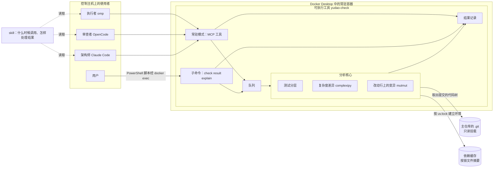

# 检查服务设计说明

状态：2026-09-30 设计，用户已确认方向（[决策记录](../decision.md) 2026-09-29 一条、2026-09-30 三条）：测试分层、复杂度差异与改动行上的变异先接入现有的开发流程，重点是 omp 使用方便；做成独立的工具，交付形式是可执行工具与 skill 加 MCP，便于以后集成；与自举相关的其余事项放到下一阶段。未实施，没有建立工单。本文规定检查服务的检查项、结果格式、三个组成部分与接入方式，以及现有流程中谁在什么时候使用它。

## 1. 出发点

- 现在每个 PR 的质量判断只依靠「测试通过」。测试计数由执行者自己写进交付评论，审查者只能再运行一遍；多个执行者与审查者叠加运行测试，多次耗尽控制主机的内存（[测试分层设计说明](test-pyramid.md)第 1 节）。
- 环境不一致时结果不同：各执行者的全局环境装的是 anthropic 0.112.0，锁文件是 1.7.0（[架构问题](../architecture-issues.md)中 #72 的登记）。
- 测试通过不说明测试检查了什么。2026-09-29 在 Linux 容器（4 核）中用 mutmut 3.8.0 试跑：
  - `compaction.py` 配 `test_compaction.py`：823 个变异，67 秒，测试发现 583 个，存活 240 个，其中 98 个在圈复杂度 37 的 `plan_compaction`；
  - `collaboration.py` 配 `test_collaboration_rules.py`：1534 个变异，536 个所在的函数没有单元测试调用，其余存活 331 个，其中把 `revise_requirements` 这样的动作名改掉也没有测试失败。
- 复杂度：`harness/` 的 1322 个函数中，圈复杂度超过 10 的有 155 个；认知复杂度超过 15 的有 113 个，最复杂的是 `smoke._model_input_audit` 与 `projection.apply_event`。
- mutmut 依赖 fork，Windows 上只能在 WSL 或 Linux 容器中运行（3.5.0 起在 Windows 上直接退出）。

目标：三项检查由一个独立的检查工具在固定的 Linux 环境中运行，结果由工具记录；执行者、审查者与架构师经 MCP 或命令行请求运行与查询，skill 告诉 agent 什么时候调用、怎样处理结果。检查的结果满足三个条件：输入是声明的（代码树、基准、检查名、镜像版本），由不参与判断的一方执行并记录，输出格式固定。满足以后，下游只读取结果，不需要再运行一遍。

## 2. 范围与边界

本文的范围：

- 三项检查：测试分层、复杂度差异、改动行上的变异（第 3 节）；
- 三个组成部分：可执行工具、它的常驻模式提供的 MCP、skill；运行环境、排队与记录（第 5 节）；
- 接入方式（第 7 节）；
- 在现有开发流程中的用法与规则的修改（第 8 节）。

下一阶段的事项，本文不做：

- Yudao 的检查定义与交出检查：主机在执行环境中对交付快照运行这个可执行工具，那时增加「两份代码树」形式的输入（第 5.1 节）；skill 进入 Yudao 带版本的技能定义（ADR-0014）；
- 集成层进入检查服务：依赖修正 `harness/workspace.py` 以文本模式写文件造成的换行差异，并重新生成事件序列基准（在 Linux 中运行时有 17 项基准不一致）；
- 自举的 ADR 与路线图的调整。

边界：

- 检查工具是独立的包，放在本仓库的独立目录中，有自己的依赖与锁文件。`harness` 不导入它，它也不导入 `harness`。
- 它对被检查的项目只做三件事：取出指定提交的代码树，按项目的锁文件建立环境，在容器中运行测试与分析工具。
- 它只运行检查、记录结果，不管工单与标签的流转。

## 3. 检查项

### 3.1 测试分层

- 运行单元层与模块层：`python -m pytest -m "unit or module"`，单进程，输出参数与测试分层设计说明第 6 节相同；另外运行属于单元层的前端测试 `node --test --test-reporter=dot harness/tests/test_web_ui.js`。
- 结果：通过或不通过，每层的项数与用时，失败项的名称与一行错误信息。
- 依赖 #158 的登记表与层标记，以及逐个文件降层（第 9 节）。

### 3.2 复杂度差异

- 认知复杂度，工具 complexipy，阈值 15。
- 基准：分支与 main 的合并基准。
- 不通过的两种情况：新函数超过阈值；原有函数的复杂度上升并超过阈值。原来就超过阈值而这次没有变复杂的函数不影响结果。
- 发现项：文件、函数、改动前与改动后的值、阈值、complexipy 的重构提示。

### 3.3 改动行上的变异

- 工具 mutmut。变异只放在相对基准新增或改动的行上，每行只运行一个变异，优先选比较、逻辑与算术运算的改动。
- 测试只用单元层与模块层，并且只把在一定调用深度以内执行到这个函数的测试算作相关（mutmut 的 `max_stack_depth`），被大量测试顺带执行的函数不会让每个变异都陪着运行几百项测试。
- 每次运行有时间上限，到时还没有运行的变异列为「未完成」。调用深度与时间上限的取值由实施工单实测确定。
- 发现项有两类：
  - 存活的变异：文件与行、所在函数、原来的写法与改动后的写法、类别（边界、逻辑、算术、字符串、删除参数或值）、执行过这个函数的测试；
  - 没有低层测试的函数：没有任何单元层或模块层测试执行到它。
- 变异检查没有分数与通过线；交付时要求每个发现项都有处理（第 6 节）。

## 4. 结果格式

每次检查的结果包含：

| 部分 | 内容 |
| --- | --- |
| 输入 | 仓库、提交号、代码树的摘要（git 的 tree 哈希）、基准提交与它的代码树摘要、检查名、镜像版本（包括 Python、mutmut、complexipy 的版本）、项目锁文件的摘要 |
| 状态 | 通过、不通过、有发现项、未完成（时间用尽）、出错（例如提交不存在、环境建立失败） |
| 计数与用时 | 各层的测试项数与用时；变异的总数、发现的、存活的、没有测试的、超时的数量 |
| 发现项 | 第 3 节各检查规定的字段 |

这一格式在下一阶段同时作为 Yudao 检查回执中发现项的格式。

## 5. 组成与运行

### 5.1 三个组成部分

| 部分 | 形式 | 使用者 | 作用 |
| --- | --- | --- | --- |
| 可执行工具 | 一个程序 `yudao-check`，子命令 `check`、`result`、`explain`、`serve` | 用户与脚本；下一阶段加上 Yudao 的主机 | `check` 在当前环境中直接运行检查，输出第 7.1 节规定的文字，或第 4 节格式的 JSON |
| MCP | `yudao-check serve` 启动的常驻模式，在控制主机的容器中运行 | omp、OpenCode、Claude Code | 排队运行、记录结果，提供 MCP 工具（第 7.1 节） |
| skill | 一份 `SKILL.md`，随工具发布 | omp、OpenCode、Claude Code | 告诉 agent 什么时候调用、怎样读结果、怎样处理发现项、交付评论怎样写（第 7.3 节） |

- 三部分共用同一个分析核心。可执行工具与常驻模式是同一个程序，MCP 工具与子命令一一对应，同样的输入得到同样的结果。
- 分析核心的输入是两份代码树：基准与当前。现在的输入形式是提交（第 5.3 节）；下一阶段 Yudao 集成时增加「两份代码树」的输入形式，分析核心不变。

### 5.2 运行环境

- 一个 Linux 容器镜像，装有可执行工具，固定 Python、uv、Node.js、git、mutmut 与 complexipy 的版本；镜像版本写进每条结果。
- 项目依赖按被检查提交中的 `uv.lock` 安装（`uv sync --frozen`），按锁文件的摘要缓存。
- 控制主机（Windows）上用 Docker Desktop 的 WSL2 后端运行，常驻模式的容器随 Docker Desktop 启动；Linux 主机上用 Docker Engine 运行，也可以不经容器直接运行可执行工具。容器引擎与 3.2C 选定的相同（[执行环境服务](execution-environment.md)第 5.2.1 节）。
- Windows 上的命令行经 `docker exec` 进入同一个容器运行；仓库提供一个 PowerShell 脚本包装这条命令，用法与 Linux 上直接运行相同。
- 常驻模式只供本机使用：容器把端口映射到主机的 `127.0.0.1`；MCP SDK 在容器内监听全部地址时不会自动校验请求的 Host，需要显式只接受 `127.0.0.1` 与 `localhost`。
- 镜像在 git 的系统配置中允许读取挂载进来的仓库（`safe.directory`），否则 git 会拒绝读取属于其他用户的仓库。

### 5.3 代码的来源

- 请求只接受提交：分支名或提交号。分支名在请求到达时解析为提交号。
- 容器只读挂载主仓库的 `.git` 目录。各个 worktree 的提交都在主仓库的对象库中，工具按提交号取出代码树，不读取任何工作区。
- 未提交的改动不检查。执行者先在本地提交；合并时使用 squash，临时提交不进入 main 的历史。

### 5.4 排队与并发

- 常驻模式中请求进入队列。同一时间只运行一个变异检查；测试分层与复杂度差异可以与它同时运行，上限按控制主机的内存确定。
- 多个执行者同时交付时检查依次运行，不会一起耗尽内存。

### 5.5 记录与复用

- 结果按「代码树摘要、基准代码树摘要、检查名、镜像版本、锁文件摘要」保存在容器的数据卷中。命令行在容器中运行时使用同一份记录。
- 相同的输入再次请求时直接返回记录，不重新运行。内容相同的两个提交（例如审查者通过时补做的提交没有改动代码）共用同一份记录。
- 审查者与架构师查询的就是这份记录。执行者只能请求运行，不能向记录写入结果。

## 6. 发现项的处理

- 复杂度不通过：拆分或简化函数，拆出来的函数要有独立的含义与名字；审查者判断拆分是否只为降低数字。
- 存活的变异，在交付评论中逐条写明下面三种处理之一：
  - **增加测试**：这处行为是需求要的。测试名写明检查的规则，对应工单的验收标准或设计文档的条目。
  - **删除代码**：这处行为不是任何需求要的，例如上游已经保证的下限。
  - **写明理由**：改了以后行为确实不变（等价变异），或者报错文字由集成层的事件序列基准核对。
- 没有低层测试的函数：增加一个单元层或模块层测试，或者写明只有集成层能到达它。后一种由架构师收集，作为测试往下层移（测试分层设计说明第 5 节）的清单。
- 不设分数目标。执行者不添加 `# pragma: no mutate`，不修改检查工具的配置与排除规则；这些只由架构师修改。

## 7. 接入

### 7.1 MCP 工具

面向 omp 设计：一次调用完成最常用的事，输出先给简短的结论，细节按需查询。

| 工具 | 参数 | 作用 |
| --- | --- | --- |
| `check` | 分支名或提交号；检查项（默认三项全部） | 请求运行。结果已有记录时立即返回；在等待上限内运行完时直接返回结果；否则返回任务编号 |
| `result` | 任务编号，或分支名、提交号 | 查询结果；可以等待到运行完，每次等待不超过等待上限 |
| `explain` | 发现项的编号 | 返回一个发现项的完整诊断：所在函数的完整代码、改动前后的写法、执行过它的测试所在的位置 |

返回的文字按下面的顺序组织，适合小模型直接使用：

1. 每项检查一行：状态、计数、用时、代码树摘要；
2. 需要处理的发现项，每项两三行：位置、改了什么、建议的处理方式；超过一定条数时只列出前面若干条，并给出总数；
3. 下一步应该做什么，例如「逐条处理以上存活的变异，写进交付评论」或「提交不存在，先在本地提交」。

等待上限是 9 分钟，按各个 agent 的 MCP 调用超时确定（第 7.4 节）。

### 7.2 命令行

子命令与 MCP 工具一一对应：`yudao-check check`、`result`、`explain`；`yudao-check serve` 启动常驻模式。输出与 MCP 工具相同的文字，加 `--json` 时输出第 4 节格式的 JSON。Linux 上直接运行；Windows 上经仓库提供的 PowerShell 脚本进入容器运行（第 5.2 节）。agent 不能使用 MCP 时，skill 指导它改用命令行，结果相同。

### 7.3 skill

一份 `SKILL.md`，按 agent 通用的 skill 格式编写，随工具发布，放进各 agent 在仓库中读取 skill 的位置（第 7.4 节）。内容按下面的顺序，每部分都简短：

1. 什么时候使用：开发中想确认改动是否被测试检查到时；交付前必须使用；审查时查询交付提交的记录。
2. 怎样调用：先在本地提交；调用 `check`，参数写分支名；返回任务编号时调用 `result` 等待；看不到 MCP 工具时改用命令行。
3. 怎样读结果：每项检查一行的状态；发现项的位置、改了什么、建议的处理方式。
4. 怎样处理发现项：第 6 节的规则，附一个存活变异的例子与三种处理各自的写法。
5. 交付评论怎样写：提交号、每项检查的状态行、每个发现项的处理（第 8.1 节的交付格式）。
6. 不要做的事：不添加 `# pragma: no mutate`，不修改检查工具的配置与排除规则，不把测试输出粘贴进评论。

AGENTS.md 只写「交付前按检查工具的 skill 运行检查」与交付评论的格式，调用细节放在 skill 中，只在需要时读取，不占用每次对话的上下文。

### 7.4 各 agent 的配置

MCP 与 skill 的配置提交进仓库，主仓库与各个 worktree 检出以后都有，不需要在每台机器上逐个配置。三个 agent 的做法（2026-09-30 核对：omp 18.4.3、OpenCode 1.18.33、Claude Code 2.1.284）：

| agent | MCP 配置 | 调用超时 | skill 的读取位置 | 无界面运行 |
| --- | --- | --- | --- | --- |
| omp | `.omp/mcp.json`，只从启动目录读取：`type` 为 `http`，`url` 指向本机端口，`timeout` 为 600000 毫秒 | 默认 30 秒，进度通知不会延长，必须在 `timeout` 中设置 | `.claude/skills/`，从启动目录向上查找到仓库根 | `-p` 时加载 MCP 与 skill；开始前最多等 MCP 服务 30 秒 |
| OpenCode | 仓库根的 `opencode.json`：`mcp.yudao-check`，`type` 为 `remote`，`timeout` 为 600000 毫秒。`.opencode/` 下的配置文件被本仓库的 `.gitignore` 忽略，不能使用 | 收到进度通知时重新计时 | `.claude/skills/` | `opencode run` 同样启动 MCP；skill 经内置的 `skill` 工具加载 |
| Claude Code | 仓库根的 `.mcp.json`：`type` 为 `http`，`timeout` 为 600000 毫秒 | 工具超时很长；HTTP 空闲时有上限，`timeout` 不小于 1000 时空闲上限不低于它 | `.claude/skills/` | `-p` 与云端会话不经询问直接加载项目的 MCP |

由此确定：

- **skill 只写一份**：`.claude/skills/yudao-check/SKILL.md`，三个 agent 都读取这个位置。格式遵守 Agent Skills 开放格式：`name` 与目录名相同，只用小写字母、数字与连字符；`description` 必填。
- **MCP 配置三份**，地址相同：`.omp/mcp.json`、`.mcp.json`、`opencode.json`。端口固定，避开 Yudao 控制台默认的 8765。
- **等待上限 9 分钟**：一次调用最多等 9 分钟，小于三份配置中的 10 分钟；等待期间发送进度通知；到时还没完成就返回任务编号，由 `result` 继续等待。MCP 2026-07-28 版规范建议跨调用的状态用服务生成的编号作为普通参数传递，与此一致。复杂度差异只要几秒，测试分层与大多数变异检查在一次调用内完成。
- **omp 的启动目录**要有 `.omp/mcp.json`：从主仓库或任何一个 worktree 启动都满足。

## 8. 在现有开发流程中的用法

| 时机 | 角色 | 做什么 |
| --- | --- | --- |
| 开发中 | 执行者 | 对本地最新的提交调用 `check`，按诊断修改代码或增加测试 |
| 交付前 | 执行者 | 对要交付的提交调用 `check`，三项都有结果；交付评论写明提交号与每个发现项的处理，不再粘贴测试输出与计数 |
| 审查 | 审查者 | 对 PR 的提交调用 `result` 查询记录，不重新运行单元层与模块层；判断每个发现项的处理是否成立，新增的测试是否检查了需求里的行为 |
| 合并前 | 架构师 | 对 PR 的最新提交调用 `result`，确认三项检查齐全、测试分层通过、复杂度差异通过、发现项都有处理 |

本次改动或新增的集成层测试文件，仍由执行者与审查者按现行规则在本机运行；集成层的批量运行仍由架构师按现行方式进行。

规则文件的修改在检查工具上线后进行，修改原文见第 8.1 节，写入之前经用户确认。

### 8.1 规则文件的修改原文

检查工具上线后按下表修改，写入之前经用户确认。「现在」一列是规则文件中的原文。

| 位置 | 现在 | 修改为 |
| --- | --- | --- |
| AGENTS.md「常用命令」，测试一项之后新增 | 无 | 检查工具（`docs/design/check-service.md`）：对一个提交运行测试分层（单元层、模块层与前端测试）、复杂度差异与改动行上的变异，结果由工具记录。用法见检查工具的 skill；只检查已经提交的内容，先在本地提交再调用。 |
| AGENTS.md 执行者普通流程第 4 步 | 自测：开发中运行与改动相关的测试文件；交付前运行「常用命令」中的单元层与模块层、本次改动或新增的集成层测试文件与前端测试，逐项核对工单的验收标准。 | 自测：开发中运行与改动相关的测试文件，可以随时按检查工具的 skill 检查本地最新的提交。交付前按 skill 检查要交付的提交，三项检查都要有结果：测试分层通过，复杂度差异通过，改动行上的每个发现项都有处理（增加测试、删除代码或写明理由）；另外在本机运行本次改动或新增的集成层测试文件；逐项核对工单的验收标准。不添加 `# pragma: no mutate`，不修改检查工具的配置与排除规则。 |
| AGENTS.md 执行者自主推进模式第 4 步 | 交付：在工单下评论，第一行写 `DELIVERY: 第 <k> 轮`，下面写改动清单、测试命令与每层结尾的计数行、逐条的验收核对，不粘贴测试输出；然后把标签从 `in-progress` 改为 `needs-review`。 | 交付：在工单下评论，第一行写 `DELIVERY: 第 <k> 轮`，下面写改动清单、交付的提交号、检查工具每项检查的状态行、每个发现项的处理、本机运行的集成层测试文件的计数行与逐条的验收核对，不粘贴测试输出；然后把标签从 `in-progress` 改为 `needs-review`。 |
| AGENTS.md 审查流程第 3 步 | 测试：运行「常用命令」中的单元层与模块层、本次改动或新增的集成层测试文件与前端测试，单进程；核对新增的测试文件已在登记表中，并登记在 `docs/design/test-pyramid.md` 第 2 节规定的层。 | 测试：按检查工具的 skill 查询 PR 提交的检查记录，不重新运行单元层、模块层与前端测试；记录缺少时请求运行。逐条判断发现项的处理是否成立：新增的测试是否检查了需求里的行为，删除的代码是否确实没有需求，写明的理由是否成立。在本机运行本次改动或新增的集成层测试文件，单进程；核对新增的测试文件已在登记表中，并登记在 `docs/design/test-pyramid.md` 第 2 节规定的层。 |
| AGENTS.md 审查结论「通过」第 4 条与「未通过」第 2 条 | 每层结尾的计数行与失败项名称 | 检查工具每项检查的状态行、本机运行的集成层测试文件的计数行与失败项名称 |
| CLAUDE.md 自主推进模式第 3 步 | Claude 检查 issue 评论、标签与 PR 内容是否齐全、是否符合工单要求，不重复运行测试； | Claude 检查 issue 评论、标签与 PR 内容是否齐全、是否符合工单要求，并查询 PR 最新提交的检查记录（测试分层与复杂度差异通过，改动行上的发现项都有处理），不重复运行测试； |

## 9. 与测试分层的关系

- 测试分层与改动行上的变异依赖 #158 的登记表与层标记。#158 按 2026-09-29 暂缓时写下的做法分两步：第一步建立登记表与检查，全部文件暂时登记为集成层；第二步逐个文件降层。
- 第二步改用机械的做法：把每个测试文件暂时登记为单元层运行一次，被审计钩子拒绝时改为模块层再运行，仍被拒绝时登记为集成层；运行完整三部门循环的文件按测试分层设计说明第 2 节登记为集成层。执行者不需要逐个阅读测试文件来判断层级。
- 变异检查依靠单元层与模块层的测试。#160、#161 把测试往下层移以后，能执行到改动函数的低层测试会增加，变异检查的「没有低层测试的函数」随之减少。

## 10. 模块交互

依赖方向：使用者经 MCP 或命令行访问可执行工具，skill 只描述用法，不参与运行；分析核心不知道有哪些使用者；工具只读取 `.git`，不写入仓库。

## 11. 实施顺序

1. **#158（恢复）**：登记表与检查，全部文件暂时登记为集成层。
2. **逐个降层**：按第 9 节的机械做法，被 1 阻塞。
3. **可执行工具与复杂度差异**：分析核心、子命令、常驻模式与 MCP、镜像、代码来源、队列、记录、复杂度差异；没有阻塞项，可以与 1、2 同时进行。
4. **测试分层检查**：被 2、3 阻塞。
5. **改动行上的变异**：被 2、3 阻塞，包括调用深度与时间上限的实测。
6. **skill 与接入现有流程**：`SKILL.md`、各 agent 的配置、控制主机上的部署说明与 PowerShell 脚本、规则文件按第 8.1 节修改；被 3 阻塞，测试分层与变异的部分随 4、5 生效。

复杂度差异在第 3 步完成后就可以使用。
