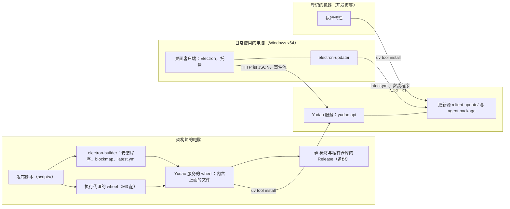

# 桌面客户端的安装、更新与发布设计说明

更新：2026-10-02，局域网访问方式的开启（第 4.3、4.4 节，第 10 节第 15 至 18 项）；同日桌面会话的托盘菜单项与提示框（第 4.5 节）。状态：设计已确认（2026-10-01 用户逐轮采纳推荐，第 10 节），未实施。路线位置：[Stage 3 计划](../stage-3-plan.md)界面工作线，里程碑 M1。工单见第 12 节。

依据：[ADR-0023](../adr/0023-client-installed-apart-release-is-one-wheel.md)（客户端与 Yudao 服务分开安装，一次发布是一个 wheel）；[ADR-0015](../adr/0015-desktop-client-and-http-contracts.md)（客户端是 Electron 桌面程序）；[ADR-0018](../adr/0018-single-control-host-remote-execution.md)（一台控制主机）；[ADR-0019](../adr/0019-project-stream-across-versions.md)（升级与排空）；[ADR-0022](../adr/0022-run-directly-without-containers.md)；[应用层与接口层设计说明](app-and-interface.md)第 5.7、6、7.2、10 节；[执行环境服务设计说明](execution-environment.md)第 5.3 节。调研：[客户端打包与更新调研](../research/client-packaging-and-update.md)。用词以 `CONTEXT.md` 为准。

## 1. 范围

交付：

- 控制主机上 Yudao 服务的安装、命令行入口、数据目录、运行与停止。
- 桌面客户端的安装包、本机服务的启动与停止、托盘菜单、更新。
- 一次发布的构成、版本号与发布脚本。

不在范围内：

- Yudao 服务开机自动启动、崩溃后重新启动与看门狗：Stage 4 的长时间运行。
- 客户端的 macOS 与 Linux 版本：现在需要安装客户端的电脑都是 Windows。
- 代码签名、访问令牌与 TLS：TODO，第 7 节。

## 2. 概念与模块

- **发布**：一个带版本号的 Yudao 版本，包含 Yudao 服务、桌面客户端与执行代理的安装包，三者同版本。
- **更新源**：Yudao 服务的 `/client-update/` 路径，提供客户端的更新清单与安装程序。客户端只从它连接的 Yudao 服务更新。
- **发布版本号与接口版本**：发布版本号标记一次发布；接口版本在删除或改变已有的查询、命令、事件种类与字段时提高（应用层与接口层设计说明第 6.1 节）。两者相互独立。客户端与 Yudao 服务只在接口版本相同时工作。

## 3. 安装

### 3.1 前提

- 控制主机与需要安装执行代理的机器上有 uv。
- 安装桌面客户端的电脑是 Windows x64。

### 3.2 控制主机上的 Yudao 服务

- 安装：`uv tool install --python 3.12 <发布的 wheel 的路径>`。`yudao` 命令安装到 uv 的可执行文件目录（Windows 为 `%USERPROFILE%\.local\bin`）；目录不在 PATH 中时 uv 提示运行 `uv tool update-shell`。
- 升级：按 ADR-0019 先排空，停止 Yudao 服务，`uv tool install --reinstall --python 3.12 <新的 wheel>`，再启动。同一个地址上的文件被替换以后，没有 `--reinstall` 的再次安装按「已经安装」结束。
- 控制主机换到另一台机器时，从私有仓库的 Release 取得 wheel（`gh release download`）。

### 3.3 桌面客户端

- 与控制主机在同一台电脑上：运行 `yudao client install`，它运行 wheel 附带的安装程序。
- 在另一台电脑上：用 `Invoke-WebRequest` 或 `curl.exe` 从 `http://<控制主机地址>:<端口>/client-update/Yudao-Setup-<版本>.exe` 下载后运行；这要求 Yudao 服务以局域网访问方式运行（第 4.3 节）。用浏览器下载会写入「来自网络」标记，出现 SmartScreen 警告，点「仍要运行」可以继续。
- 安装程序是 NSIS，按用户安装，不需要管理员权限；安装到 `%LOCALAPPDATA%\Programs\Yudao`，建立开始菜单快捷方式。卸载不删除 Yudao 服务的数据，客户端只保存自己的设置（连接设置等）。

### 3.4 数据目录

- 默认位置：Windows 为 `%LOCALAPPDATA%\Yudao`；Linux 为 `~/.local/share/yudao`，遵守 `XDG_DATA_HOME`；`--data-dir` 指定其他目录。
- 内容：事件日志、工件、进程锁 `service.lock`、Provider 目录文件 `providers.json`、`.env`、日志目录 `logs/`。Provider 目录文件与 `.env` 默认在数据目录内，不相对当前目录。
- 开发、评测与走查使用 `--data-dir` 指向其他目录。M1 试用从空的数据目录开始，开发时 `.yudao/` 下的数据不迁移；模型管理页里配置 Provider 与 Key 是试用内容之一。

## 4. Yudao 服务的运行

### 4.1 命令行入口

`pyproject.toml` 的 `[project.scripts]` 增加 `yudao`：

- `yudao api`：与现在的 `python -m harness api` 相同，参数为 `--data-dir`、`--host`、`--port`、`--access`、`--provider-config`，默认值按第 3.4 节。
- `yudao --version`：输出发布版本号。
- `yudao client install`：运行随包的客户端安装程序；没有随包（从源码运行）时说明原因并以非零状态退出。
- `replay`、`project`、`smoke`、`demo` 等子命令保持不变。

### 4.2 单实例与日志

- 每个数据目录只允许一个服务进程，已有的 `service.lock` 保证（应用层与接口层设计说明第 7.2 节）；第二次启动失败并写明占用的数据目录。
- 日志写在 `<数据目录>/logs/`，按大小轮换。

### 4.3 客户端启动本机服务

连接设置有一项「本机」，地址 `http://127.0.0.1:8765`，访问方式为本机。

1. 连接时先请求 health，服务已经运行就直接连接。
2. 没有运行：客户端在 PATH 与 uv 的可执行文件目录中寻找 `yudao` 命令，找到就启动 `yudao api`，使用默认数据目录。进程是独立的后台进程：没有窗口，输出写入日志，不随客户端退出。最多等待 30 秒，health 正常以后连接。
3. 找不到 `yudao` 命令：显示安装命令（`uv tool install --python 3.12 <wheel>`）与「重新检测」按钮。

只对「本机」这一项自动启动；按地址连接的其他部署不自动启动。退出客户端不停止 Yudao 服务（ADR-0023）。

**允许局域网访问。** 访问方式是服务的启动参数，由启动服务的一方决定。命令行启动时用 `yudao api --access lan --host 0.0.0.0`。客户端「本机」一项有开关「允许局域网访问」，默认关闭，保存在客户端的设置中，数据目录里不另外保存：

- 打开时，客户端启动服务带上 `--access lan --host 0.0.0.0`；关闭时不带，服务为本机访问方式。
- 服务已经在运行、访问方式与开关不同时（从能力清单的 `deployment.access` 读取），提示「重新启动服务后生效」，按钮「重新启动」用本机停止请求停止服务，再按第 2 步启动。有事项正在运行时先确认：「有 N 个事项正在运行，重新启动以后自动继续」。
- 开关的说明文字：其他电脑与开发板可以访问这台电脑上的 Yudao，局域网内不校验身份；第一次开启时 Windows 防火墙询问是否允许 Python 访问网络，需要管理员确认；电脑所在网络是「公用」类型时勾选「公用网络」，或者在 Windows 设置中把这个网络改为「专用」。客户端不修改防火墙。
- 客户端「本机」一项始终连接 `http://127.0.0.1:8765`，两种访问方式下都能连接。

Stage 4 由操作系统的服务管理负责开机启动时，访问方式写在那份服务定义的启动参数中。

### 4.4 本机停止请求

`POST /api/system/stop`：

- 两种访问方式下都只接受来自回环地址的请求，带 `Origin` 的请求只接受桌面客户端页面的来源；来自其他地址的请求拒绝。
- 不属于命令：它不产生领域事件，不带基准版本，不经过命令注册表。
- 服务收到以后停止接受新请求，关闭事件流连接，等待进行中的写入完成，释放进程锁，进程退出。进行中的 run 不等待结束，它们在下次启动时按 3.1 自动继续（[恢复契约](recovery-contract-and-fault-matrix.md)）；结果未知的外部动作照常交给用户决定。
- 与排空不同：排空停止开始新事项并等待 run 结束，用于升级之前；停止立即结束服务。
- `system.status` 增加服务的发布版本号与正在运行的 run 数。有事项正在运行时，客户端在停止之前显示确认：「有 N 个事项正在运行，停止以后下次启动时自动继续」。

### 4.5 托盘与登录时启动

- 托盘菜单：「打开窗口」「停止 Yudao」（只在连接「本机」一项时出现，两种访问方式下都可用）「退出客户端」。关闭窗口只隐藏窗口，保留托盘与事件流连接（应用层与接口层设计说明第 5.7 节）。
- 桌面会话（[浏览器与 computer use 设计说明](browser-and-computer-use.md)第 5.1 节）：控制主机上有进行中的桌面会话时，托盘菜单增加「停止使用桌面」，选择后调用 `trial.stop_desktop`；客户端在主显示器边缘显示一圈置顶的提示框，写明「<部门>正在使用桌面」与项目名称，提示框不出现在截图中（`setContentProtection`，即 `WDA_EXCLUDEFROMCAPTURE`）、鼠标可以穿透、不获得焦点，会话结束时关闭。做法参照 UI-TARS-desktop 的 ScreenMarker。工单 #247。
- 设置页有「登录时启动客户端」，默认关闭，使用 Electron 的 `app.setLoginItemSettings`，写入当前用户的注册表启动项，不需要管理员权限。
- 客户端同一时刻只有一个进程。

## 5. 更新

### 5.1 更新源

Yudao 服务提供：

- `GET /client-update/latest.yml` 与 `GET /client-update/<文件名>`（安装程序 `Yudao-Setup-<版本>.exe` 与 `.blockmap`），支持 Range，用于差分下载。
- 文件来自 wheel 内的发布资源目录 `harness/release_assets/`。没有这个目录（从源码运行）时返回 404，响应写明「没有客户端安装包」。
- 路由不属于查询与命令；按访问方式的 Host 与 Origin 检查照常执行，electron-updater 的请求来自 Node，不带 Origin。
- 执行代理的安装包（`agent.package`）来自同一个目录。

### 5.2 触发与过程

触发：连接时读取能力清单，接口版本与客户端构建时的接口版本不同，显示更新页，写明客户端与 Yudao 服务的发布版本号与接口版本，按钮「更新客户端」。接口版本相同时不提示，即使发布版本号不同。更新页不打开其他页面，不执行命令（应用层与接口层设计说明第 6.1 节）。

过程（electron-updater 6.x，generic 提供方）：

1. 更新地址设为已连接的地址加 `/client-update/`；`autoDownload` 关闭；`allowDowngrade` 开启。
2. 读取 `latest.yml`，发布版本号与客户端不同才继续。
3. 下载：按 blockmap 差分下载，失败时改为完整下载；校验 `latest.yml` 中的 SHA-512。
4. 安装：退出客户端，静默运行安装程序，安装完成以后启动新版本，重新连接。

客户端比 Yudao 服务更新时（例如服务还没有升级）同样更新，客户端降到服务的版本。更新过程中本机的 Yudao 服务继续运行。更新失败（下载中断、校验失败）时更新页显示原因与「重试」。更新不改变 Yudao 服务，升级控制主机由用户决定（第 3.2 节）。

### 5.3 完整性

下载后校验 `latest.yml` 中的 SHA-512。`latest.yml` 与安装程序来自同一个 Yudao 服务，信任程度与局域网内不认证的前提一致（应用层与接口层设计说明第 6.2 节）。代码签名与更新清单的签名见第 7 节。

## 6. 发布

### 6.1 一次发布的内容

一个 wheel `yudao_harness-<版本>-py3-none-any.whl`，约 130 MB。除 Yudao 服务的代码以外，`harness/release_assets/` 中有：

| 文件 | 来源 | 用途 |
| --- | --- | --- |
| `Yudao-Setup-<版本>.exe`、`Yudao-Setup-<版本>.exe.blockmap`、`latest.yml` | electron-builder | 客户端的安装与更新（第 5 节） |
| `yudao_agent-<版本>-py3-none-any.whl` | 发布脚本；M3 由 #144 加入 | 执行代理的安装（执行环境服务设计说明第 5.3.2 节） |

这些文件的版本号相同。

### 6.2 版本号

- 格式 `主.次.修订`。Stage 3 的 M1 至 M4 依次为 0.1.0、0.2.0、0.3.0、0.4.0，以后的里程碑接着递增次版本号；试用中 `/qa` 发现的问题修好以后发布修订版本，例如 0.1.1。
- `pyproject.toml` 的 `version`、客户端 `package.json` 的 `version` 与 git 标签 `v<版本>` 必须相同，发布脚本核对。

### 6.3 发布脚本

脚本放在仓库的 `scripts/` 下，由执行者编写（#209），架构师在试用流程中运行。步骤：

1. 核对：工作区干净；当前提交在 main 上并已推送；版本号三处相同；Node 版本不低于 22.12，uv 可用。
2. 构建客户端：`npm ci`，electron-builder 生成安装程序、blockmap 与 `latest.yml`。
3. M3 起构建执行代理的 wheel。
4. 把以上文件复制进 `harness/release_assets/`（该目录被 git 忽略），删除仓库根下的 `build/` 与 `*.egg-info`，`uv build --wheel` 生成 Yudao 服务的 wheel；核对 wheel 内含这些文件，`latest.yml` 中的 SHA-512 与安装程序一致，`harness/release_assets/` 中只有本次版本的文件（出现其他版本的文件时写明文件名退出；`client install` 与更新源都按服务自身版本的文件名取安装程序）。
5. 仅在带 `--publish` 时：打标签 `v<版本>` 并推送，`gh release create v<版本>` 把 wheel 上传到私有仓库的 Release，作为备份。
6. 输出 wheel 的路径与 SHA-256。

脚本只构建与上传，不安装、不升级这台电脑上已经安装的 Yudao 服务与客户端。构建在架构师的 Windows 电脑上进行，不使用 GitHub Actions：构建需要的 Node 22.12 以上这台电脑已满足（24.14），makensis 由 electron-builder 自动下载；私有仓库的 Actions 每月免费 2,000 分钟，Windows 运行器按约 1.67 倍计，偶尔发布够用，但要维护流水线。

### 6.4 谁在什么时候发布

每个试用里程碑的工单全部关闭、集成层批量运行通过以后，架构师先发布（[CLAUDE.md](../../CLAUDE.md)「工作流程」第 7 步），再写试用指南。发布记入 `docs/CHANGELOG.md` 与 `claude_jour.md`。平时开发不发布，执行者与审查者照旧在开发目录与 worktree 中工作。

### 6.5 架构师的走查

架构师按试用指南走一遍时使用发布出来的版本，不动用户已经安装的那一份：

- 把 wheel 安装到临时目录的虚拟环境（`uv venv` 加 `uv pip install`）。`uv tool install` 会覆盖用户的 `yudao` 命令，所以不使用它。
- 使用单独的数据目录与端口（例如 18765）。
- 客户端使用 electron-builder 输出目录中的未安装程序（`win-unpacked`），连接这个端口。
- 走完删除这个数据目录与虚拟环境。

## 7. 签名与完整性（TODO）

- 客户端安装程序与 wheel 都不签名。依据（调研第 4 节）：Azure Artifact Signing 对个人只开放美国与加拿大；OV 证书的私钥必须放在硬件里，每年约 $129，另加令牌 $379；自签名证书与不签名的表现相同。
- SmartScreen 只在文件带有浏览器写入的「来自网络」标记时警告。2026-10-01 在这台电脑上实测：`curl.exe` 与 `Invoke-WebRequest` 下载的文件没有这个标记；electron-updater 6.8.9 的代码里没有读写这个标记，下载后直接启动安装程序。所以 `yudao client install`、`Invoke-WebRequest` 下载与自动更新都不出现警告。
- 更新配置不写 `publisherName`：写了就要校验签名，未签名的安装包会更新失败。
- electron-builder 固定在 26 系列。28 起会拒绝没有 `publisherName` 的更新，27 系列还是预览版（2026-10-01 npm 的 latest 仍是 26.15.3）；升级到 28 之前先处理签名。
- 保留的位置：离开局域网或分发给他人之前，加入代码签名、更新清单的签名（electron-builder 27 起支持 Ed25519）与 TLS（应用层与接口层设计说明第 6.3 节）。

## 8. 与现有设计的关系

| 现有内容 | 改变 |
| --- | --- |
| 应用层与接口层设计说明第 10 节第 8 项：主进程启动 `python -m harness api`，作为附属进程管理 | 客户端在服务没有运行时启动独立的后台进程，退出客户端不停止；托盘有「停止 Yudao」 |
| 同上第 6.1 节：接口版本不同时只显示「请更新客户端」 | 更新页带「更新客户端」按钮，更新源是已连接的 Yudao 服务 |
| 同上第 6.2 节：后端不提供界面文件 | 另提供客户端安装包与执行代理安装包 |
| 同上 `agent.package`：按当前的执行代码生成 | 发布时构建，随 wheel 提供 |
| 执行环境服务设计说明第 5.3.2、5.3.4 节 | 同上 |
| 命令行默认数据目录 `.yudao/native-loop`，Provider 目录文件 `.yudao/providers.json`，`.yudao/.env` | 用户数据目录内（第 3.4 节） |
| `CLAUDE.md` 工作流程第 7 步 | 试用之前先发布 |

## 9. 验收

全部使用真实运行的系统，不使用模拟。

1. 发布脚本（不带 `--publish`）在干净的检出中得到 wheel；wheel 内含安装程序、blockmap 与 `latest.yml`；`latest.yml` 中的 SHA-512 与安装程序一致；工作区不干净或版本号不一致时脚本拒绝。
2. 把 wheel 安装进临时虚拟环境：`yudao --version` 输出发布版本号；`yudao api --data-dir <临时目录> --port <端口>` 启动；请求 `/client-update/latest.yml` 得到正确内容，对安装程序的 Range 请求得到正确的片段。
3. 同一数据目录第二次启动 `yudao api` 失败并写明原因；默认数据目录在 Windows 上为 `%LOCALAPPDATA%\Yudao`，Provider 目录文件与 `.env` 在其中。
4. 两种访问方式下，来自回环地址的停止请求使服务退出，进行中的 run 在下次启动时自动继续；局域网访问方式下来自其他地址的停止请求被拒绝。
5. Playwright 启动 Electron 客户端（测试用的 appId）：连接「本机」而服务没有运行时，客户端启动 `yudao api` 并连接；关闭客户端以后服务仍在运行；托盘的「停止 Yudao」使服务退出；找不到 `yudao` 命令时显示安装命令。打开「允许局域网访问」并重新启动以后，能力清单的访问方式为局域网，从这台电脑的局域网地址可以请求 health；关闭并重新启动以后只能从回环地址访问。
6. 在临时目录安装测试版本 A 的客户端（测试用的 appId，`/D=` 指定目录），连接接口版本不同的服务，出现更新页；更新以后客户端变为服务提供的版本 B 并重新连接；客户端比服务新时更新到服务的版本；更新过程没有 SmartScreen 警告（在这台 Windows 11 电脑上）。
7. 用户已经安装的客户端与 Yudao 服务在测试前后不变：测试使用不同的 appId、安装目录与数据目录。
8. M1 发布时，架构师首次执行 `--publish`：标签与 Release 存在，wheel 的 SHA-256 与 Release 中的文件一致。

## 10. 用户确认的决定

2026-10-01 用户选择专题 5 用 grill 讨论，逐轮回答「采纳建议」「采纳推荐」：

1. 控制主机上的 Yudao 服务与桌面客户端分开安装：服务用 uv 安装成 `yudao` 命令，客户端用 Windows 安装程序，出自同一个发布。
2. 退出客户端不停止 Yudao 服务；客户端只在服务没有运行时启动它；托盘有「停止 Yudao」；开机自动启动与崩溃后重新启动属于 Stage 4。
3. 客户端的版本跟随 Yudao 服务：服务提供同版本的客户端安装包，更新页一键更新。
4. 客户端只做 Windows x64。
5. 数据目录默认在用户数据目录；M1 试用从空的数据目录开始，开发时的数据不迁移。
6. 控制主机上运行的程序叫「Yudao 服务」。
7. 每个里程碑交给用户试用之前发布一次；版本号按里程碑递增，Stage 3 为 0.1.0 至 0.4.0，试用中修好的问题发布修订版本；发布由架构师执行，CLAUDE.md 工作流程第 7 步加入发布。
8. 架构师按指南走一遍时使用单独的数据目录、端口与未安装的客户端，不动用户已经安装的那一份；用户自己按指南安装与升级。
9. 打包与更新使用 electron-builder 26 系列加 electron-updater 的 generic 提供方，开启 `allowDowngrade`。
10. 一次发布就是一个 wheel，其中包含客户端安装包与执行代理安装包。
11. 不签名，列为 TODO。
12. 接口版本不同时显示更新页，更新源是已连接的 Yudao 服务。
13. 本机服务由客户端启动为独立后台进程；停止用来自回环地址的专用请求；命令行入口 `yudao`。
14. 在架构师的电脑上本机构建，发布脚本由执行者编写，打标签并上传到私有仓库的 Release 作为备份。

2026-10-02 用户用 grill 讨论遗留的局域网访问方式，回答「采纳建议」：

15. 访问方式是服务的启动参数；客户端「本机」一项的开关「允许局域网访问」决定客户端启动服务时的参数，设置保存在客户端，访问方式不同时提示重新启动。
16. 两种访问方式下都接受来自回环地址的停止请求，来自其他地址的拒绝。
17. 机器页的安装与升级命令按服务的每个 IPv4 地址各给一条（执行环境服务设计说明第 5.3.2 节）。
18. Windows 防火墙使用系统自己的询问，开关的说明与试用指南写明做法，客户端不修改防火墙。

## 11. 遗留

1. Yudao 服务的开机自动启动、崩溃后重新启动与看门狗：Stage 4。
2. 客户端的 macOS 与 Linux 版本：需要时再做。
3. 升级到 electron-builder 28 之前处理代码签名与更新清单的签名。
4. 一个客户端连接多个版本不同的 Yudao 服务时的更新行为：现在只有一个控制主机。

## 12. 工单拆分

全部属于里程碑 M1。

| 工单 | 交付 | 父工单 | 被阻塞于 |
| --- | --- | --- | --- |
| #206 Yudao 服务的命令行入口、数据目录、本机停止请求与更新源 | 第 3.4、4.1、4.2、4.4、5.1 节与 `system.status` 增加的字段 | #70 | 无 |
| #207 客户端的本机服务管理、托盘菜单与登录时启动 | 第 4.3、4.5 节 | #71 | #79、#206 |
| #208 客户端的安装包与更新页 | 第 3.3、5.2、5.3、7 节 | #71 | #79、#206 |
| #209 发布脚本：构建客户端安装包与 wheel，打标签并上传 | 第 6 节；README 的安装与启动说明 | #71 | #206、#208 |

#144（执行代理的安装、系统服务与升级）把执行代理的 wheel 加入发布脚本，被 #206 与 #209 阻塞。

## 13. 使用的技术

| 部分 | 选择 |
| --- | --- |
| 客户端打包 | electron-builder 26 系列（26.17.0，2026-09-26）的 NSIS 目标，按用户安装 |
| 客户端更新 | electron-updater 6 系列，generic 提供方 |
| Yudao 服务的安装 | `uv tool install`（uv 0.11.14） |
| 构建环境 | Node.js 22.12 以上（这台电脑 24.14.0） |
| 发布脚本 | Python 脚本 `scripts/`，经 `subprocess` 调用 npm、uv、git 与 gh |
