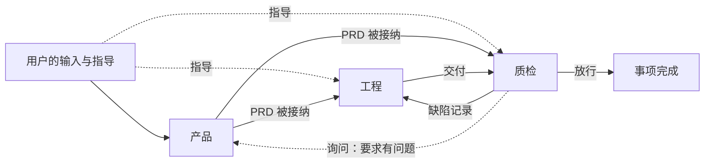
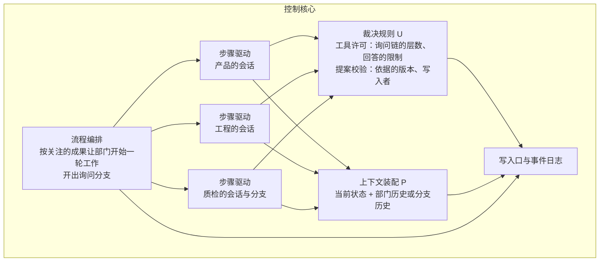
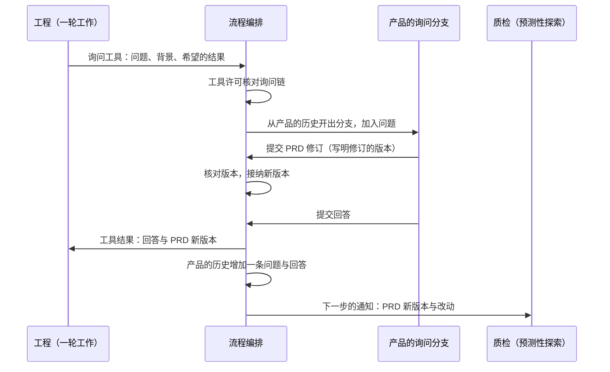

# 三部门的循环结构

本文是成果驱动路由实现（应用）的设计说明：路由契约与它在骨架里的位置见[骨架与应用设计说明](skeleton-and-application.md)第 5.1 节。状态：2026-10-27 第 2 节表、第 5 节与第 6 节补产品决定改了有效合同时的去向（#561 第三次分诊）；用户逐轮采纳推荐，部门同时运行由 #474 实施（已关闭），第 9 节的会话级用量与结果未知动作的交还已实施，放行等待由 #561 实现。需求：[D38](../requirements/system-intent.md)、[D20](../requirements/department-guidance.md)。 总图位置：第三节外环（成果驱动是第四节「路由」的缝的当前实现）。

## 1. 依据与范围

用户的意图（2026-10-12）：Yudao 是带有循环结构的 harness，由三个部门的 agent 循环驱动，其余做法与 OpenCode、pi、omp 一致，界面只负责显示；三个循环同时运行，循环之间可以互相发消息，用法与工具调用相同；事项是否完成，由质检的循环认定。

本文规定三个部门的循环怎样按关注的成果开始工作、怎样同时运行、怎样互相询问、用户的指导怎样送达、工作中途要求变化时怎样处理，以及工程计划的去留。以下内容不在本文范围内：不同项目之间的并行（3.4A）、部门内多角色（[部门内多角色设计说明](department-roles.md)）、工具的种类与边界（[本地通用工具设计说明](local-tools.md)）。工具在哪个工作区执行，见那份说明第 2 节。

## 2. 部门按关注的成果开始工作

每个部门是一个循环。部门关注一组成果与输入，称为关注的成果，写在组织定义的数据里：

| 部门 | 关注的成果 | 产出的正式成果 |
| --- | --- | --- |
| 产品 | 用户的输入，发给产品的指导 | PRD |
| 工程 | 有效合同的新版本（PRD 的新版本，或产品决定追加进合同），针对它最新交付的缺陷记录，发给工程的指导 | 交付 |
| 质检 | PRD 被接纳，新的交付，发给质检的指导 | 缺陷记录、放行 |

关注的成果有了新版本、部门在等待工作时，控制核心让它开始一轮工作；部门正在一轮工作中时，新版本在它的下一步作为通知送达（第 5 节）。一轮工作以提交正式成果或回答用户结束，然后部门等待工作，直到关注的成果再有新版本。控制核心不决定下一个轮到哪个部门：它记录事件，提交时核对依据的版本（第 7 节），送达通知，让关注的成果有了新版本的部门开始工作，并处理取消、暂停与上限。

循环来自成果之间的依赖：PRD 让工程与质检开始工作，交付让质检核验，缺陷记录让工程返工，PRD 的新版本让工程与质检重新看自己的工作。要求本身有问题时，质检询问产品（第 4 节），产品在回答里修订 PRD，工程看到新版本开始返工，质检等新的交付。只有质检的放行结束事项。

事项进行到哪一步不单独记录，从成果推算：当前的 PRD 版本，最新的交付与它依据的 PRD 版本，对最新交付的结论。界面按部门显示状态，用总图外环的状态词：等用户、一轮工作中、询问中、核验中、等待工作（条件与原因见第 2.1 节）。

内层是每个部门的步骤循环。每一步发给模型的请求由两部分组成：前面是每一步重新计算的当前状态（正式成果、通知等），后面是这个部门在本事项中的历史；模型的工具调用经过工具许可后执行，结果写成事件，然后进入下一步。部门提交正式成果或回答用户时，这一轮工作结束；询问不结束这一轮工作。

### 2.1 部门的状态

事项进行中，界面按部门显示三个部门各自的状态。状态词用总图第三节外环的九个，任务池以后用同一套（2026-10-25 按总图改，此前是工作中、等待工作、回答询问、等待用户四种）。状态不单独记录，由已经记录的事实推出（会话的状态、进行中的询问、没有回答的决定请求、成果与结论的版本），查询每次现算。成果驱动下的条件：

| 状态 | 条件 | 查询里的值 |
| --- | --- | --- |
| 等用户 | 这个部门有一条没有回答、阻塞事项的决定请求（待恢复、暂停以后继续、定义版本不同等），请求写明的部门是它 | `waiting_user` |
| 一轮工作中 | 它在一个询问分支里回答别人的询问（分支是嵌在提问方那一轮里的另一轮）；或者它的主线会话正在一轮工作中，并且没有停在自己发出的询问上 | `working` |
| 询问中 | 它的主线会话停在自己发出、还没有回答的询问上 | `asking` |
| 核验中 | 主线会话不在一轮工作中，它最新的正式成果在等下游的结论。成果驱动下只有工程有这种情况：最新的交付还没有质检的缺陷记录或放行。谁核验谁取自定义里的「谁能拒绝谁」 | `verifying` |
| 等待工作 | 其余情况：主线会话在等关注的成果有新版本 | `waiting` |

同时满足几条时，按这个顺序取第一条：等用户；在分支里回答询问的一轮工作中；询问中；主线的一轮工作中；核验中；等待工作。一个部门停在自己发出的询问上，又在分支里回答别人的询问时，显示「一轮工作中」，原因是回答询问。

状态带一句原因，只有四种，没有时为空：

- 询问中：「在等待{被询问的部门}的回答」。
- 一轮工作中，在分支里：「回答{提问方}的询问」。
- 质检一轮工作中，而事项还没有任何交付：「预测性探索：按 PRD r{n} 起草测试用例」（第 3.1 节），n 是当前 PRD 的修订号。
- 核验中：「等{核验的部门}核验交付 r{n}」，n 是这份交付的修订号。

外环另外四个词在成果驱动下不作为部门的持续状态显示：

- **接纳**与**返工**：成果驱动下，成果被接纳与下游开始一轮在同一步发生，缺陷记录送达与工程开始返工也在同一步发生，中间没有可以停留的状态；它们写在流转记录里。同一份成果反复被打回时，按反复退回的提醒通知用户（总图「连续无进展达到阈值就提醒你」）。
- **排空中**：实例升级之前不接新事项、等在途的结束，随实例升级的排空建成（总图第五节，看门狗与发布）。
- **停止**：事项以封闭清单里的原因结束，是事项的结束方式，不是某个部门的状态。

事项还没有开始、已经结束，或者进程中断后还没有继续时，没有部门状态：页面按事项的结束方式（停止的原因）或恢复观察状态显示。

## 3. 三个部门同时运行

### 3.1 各部门在什么时候工作

| 情况 | 工作的部门 | 工作的位置 |
| --- | --- | --- |
| 关注的成果有了新版本 | 关注它的部门 | 部门的历史，一轮工作 |
| 被询问 | 被询问的部门 | 询问分支（第 4 节） |

除这两种情况以外，部门等待工作。成果之间本身有先后：工程要先有 PRD，质检要先有交付。PRD 被接纳以后、交付到达之前，质检的一轮工作是预测性探索：按 PRD 起草测试用例，放在质检自己的材料里。这一轮是不是预测性探索，由它开始时有没有交付决定：工程先交付了，质检这一轮直接核验，预测性探索没有发生，这是允许的。不为它另设一轮，也不在已有交付时对质检隐去交付，因为每一步的请求按当前状态装配；质检判断的独立来自它是另一个部门、请求里只放工程内容的事实部分（第 4.6 节）、放行只由它做，不依赖它先于交付写出测试用例（#557 登记的架构问题）。同时运行带来的好处集中在四处：工程的一轮通常比质检起草测试用例长，质检多半能在看到交付之前按 PRD 写出测试用例，判断来自要求、不受实现的影响；PRD 改了以后工程立即返工，不用等质检核验完旧交付；用户的指导由接收部门立即处理，其他部门不用停下；不同部门发起的询问可以同时进行。

质检面对的代码随交付变化。预测性探索时还没有交付，质检的检查工作区从事项开始时的项目起点建立，看不到工程尚未交付的代码。交付到达后，质检在同一条历史上接着核验：下一步收到交付到达的通知，检查工作区换成从这份交付重建，测试材料的当前版本一并放入；返工以后的每一份交付相同（[本地通用工具设计说明](local-tools.md)第 2 节）。

预测性探索的一轮没有交付可以核验，质检在这一轮不提交结论：提交的结论被拒绝（`this work has no delivery to review`），这一轮因此结束。交付到达以后质检开始新一轮工作，检查工作区从这份交付建立（工单 #557）。结论是对当前交付的核验，没有交付就没有可以核验的对象，这条规则同样适用于质检不在预测性探索里的轮次。

### 3.2 同时运行的条件

1. 每次询问在被询问部门的历史上开一个分支（第 4.2 节）。分支与这个部门正在进行的工作互不等待，两个部门互相询问时也不会出现谁都在等对方的情况。
2. 询问链的层数有上限（第 4.4 节）。
3. 每块内容只有一个写入者：运行工作区只由工程的一轮工作写入；产品写入 PRD；质检写入自己的测试材料；其他每个会话使用自己的检查工作区，每次检查使用自己的检查副本。
4. 提交正式成果时写明依据的版本，依据的已经不是当前版本时，提交被拒绝（第 7 节）。
5. 只有质检的放行结束事项；放行时核对交付绑定的是当前的 PRD 与当前的代码快照，并且发给产品的用户输入都已处理完（第 6 节）。

6. 一个部门同一时刻最多一轮工作；提交以后等待，关注的成果有了新版本才开始下一轮，不会接连提交新版本让别人的结论过期。

一个事项同时运行的会话不另设上限：每个部门最多一轮工作，询问链从一轮工作开始，每条链的会话数不超过层数上限加一；模型服务忙时按「等待模型服务」处理。

## 4. 询问与回答

### 4.1 询问是一次工具调用

部门在工作中用询问工具向另一个部门提问，写明问题、背景与希望得到的结果；工程与质检之间的问题与回答分事实与解释两部分（第 4.6 节）。提问方的步骤循环停在这次工具调用上；控制核心为被询问的部门开一个询问分支；分支提交回答以后，回答作为这次工具调用的结果回到提问方原来的历史，提问方接着工作。回答总是回到提问方，不再由控制核心另外决定工作回到哪里。

### 4.2 询问分支

- 分支能看到被询问部门到此刻为止的全部历史、每一步重新计算的当前状态，以及这条问题。部门还没有工作过时，历史为空，分支只有当前状态与问题。
- 分支一直工作到提交回答。
- 分支结束后，被询问部门的历史只增加一条记录，内容是问题与回答。分支里的读取与检查过程保存在事件里，不进入这个部门以后的历史。
- 一个部门可以同时有几个分支，每个分支结束时各自增加一条记录。
- 分支是提问方这一轮里的一次旁支工作，它不接管事项的所在部门。事项的所在部门（事项卡、概览与楼层页写的部门）由主线会话的激活推出，分支的激活不改写它；提问方拿到回答以后接着工作，所在部门仍是提问方（工单 #842）。事项的轮次同样只计主线会话的激活：分支的激活不推进轮次，不占用轮次上限，页面上的「第 N 轮」不因一次询问多一轮；分支激活事件里的 `cycle` 本来就写提问方所在的这一轮。

部门可能正在做自己的任务，分支的读取过程进入历史，会挤占当前任务的上下文；它需要记住的是自己回答过什么，以后不前后矛盾。做法参照 OMP 的检查点与回退：模型从检查点出发做探索，结束时把探索过程换成一份报告，接在原来的历史后面（oh-my-pi@e3106be，`packages/coding-agent/src/session/agent-session.ts:8064-8080`、`packages/coding-agent/src/session/session-manager.ts:2700-2716`）。

### 4.3 回答能做什么

- 产品被询问时，可以在回答里修订 PRD，新版本随回答一起交回提问方。PRD 由产品裁决，澄清的结果写进 PRD。
- 工程与质检被询问时，在询问分支自己的检查工作区里读取文件、运行命令与检查，然后回答；不修改运行工作区、交付说明、缺陷记录与放行结论。交付快照是质检核验的对象，回答过程中改动它，质检的证据就不再独立。需要修改代码时，质检提交缺陷记录，工程关注它并返工。
- 提问方只收到回答，看不到被询问部门的工作过程。

### 4.4 询问链

一次询问与它里面嵌套的询问构成一条询问链。部门可以回问链上已有的部门，例如工程询问产品，产品要先了解现有代码的结构，再回问工程。回问在被问部门那里另开一个询问分支，不送进它正在等待的会话，否则两边会互相等待。

链的层数不超过规则参数 `organization.ask_chain_max_depth`，默认 3，例如质检询问工程、工程询问产品、产品再询问质检。超过时工具许可拒绝这次调用并写明原因，提问方可以把要问的内容写进回答。链一定会结束：每一层的上限取被询问部门的声明值与提问方剩余量中较小的一个（第 4.5 节），用量逐层计入最初的提问方，层数上限是最后的兜底。

被询问的部门回答不了时，在回答里写明，可以建议去问哪个部门，不另设拒绝或转交的返回格式。

### 4.5 用量与失败

询问分支的上限取被询问部门自己声明的上限与提问方剩余量中较小的一个，用量计入提问方，与子循环的规则相同（[循环与收敛设计说明](loops-and-convergence.md)第 4 节）。分支没能回答时，例如达到上限或模型反复不提交回答，失败原因作为工具结果交回提问方，由提问方决定接下来怎么做。模型服务不可用这类全系统的问题，按「等待模型服务」让整个事项等待。

### 4.6 工程与质检之间的问答：事实与解释

质检先独立形成判断，再看作者的解释（[D38](../requirements/system-intent.md) N-I2、N-I3，[验证的独立性设计说明](independent-verification.md)第 4 节）。询问让工程的解释多了进入质检上下文的通道，所以工程写给质检的内容与交付说明一样，分成事实与解释两部分：

- 工程向质检提的问题与背景、工程给质检的回答，都分两部分填写。事实：接口、使用方式、文件位置、怎样运行、主机证据的引用。解释：实现的理由、对正确性的判断、对失败与审查意见的看法。
- 质检对当前交付提交独立判断之前，质检的请求里只放工程内容的事实部分。覆盖三条通道：交付说明；质检询问工程得到的回答；工程询问质检时，质检的分支看到的问题。这些问答在质检历史中的记录同样只放事实部分。还没有交付时，「当前交付」指第一份交付，所以预测性探索中质检只看到事实部分。
- 质检提交独立判断以后，解释部分进入它之后的请求。新的交付到达时，条件按新交付重新计算，此前全部工程内容的解释部分要等新交付的独立判断以后才再次可见。这是上下文装配按事件计算的规则，事件里保存的原文不变。
- 独立判断事件由验证的独立性设计说明第 4 节加入（M4）；在那之前，以质检对当前交付提交缺陷记录或放行为界。
- 两部分由工程自己填写，填错的情况由解释翻转率与抽查发现。产品在回答里转述工程的说法不在这条规则内，产品的回答是裁决方的陈述。

### 4.7 询问的记录与查询

- 一次询问写两条事件。开始（`ask_started`）写明提问方、被询问的部门、问题、背景、希望得到的结果与分支的会话；结束（`ask_answered`）写明提问方、被询问的部门、结果（已回答、没能回答）、回答或没能回答的原因，产品附带 PRD 修订时写明新版本。两条事件都带提问方与被询问的部门，界面画传信时只读一条事件就知道两端。
- 查询 `run.asks` 按这两条事件列出一个事项中进行中与已结束的询问：提问方、被询问的部门、问题、状态（进行中、已回答、没能回答）与回答。流转记录里的「询问」、首页关键事实里的「询问」「回答」也来自这两条事件。部门状态与等待原因的推导见第 2.1 节。询问是在另一次询问的分支里发出的（回问）时，它的上一层就是那次询问；查询给出每次询问的上一层、询问链（从最外层的提问方起经过的部门，例如工程 → 产品 → 工程）与层数，产品的回答附带 PRD 新版本时给出修订号。
- 原来的协作请求随之删除：两类请求与四种动作、全系统一条待处理请求、回答以后由 `resume_phase` 另算工作去向、工作依据与调用记录里的请求编号、协作请求与协作回答的工具、提案、事件种类与投影字段。删除事件种类时 run 事件版本提高（[ADR-0019](../adr/0019-project-stream-across-versions.md)）。

## 5. 工作中途要求变化

PRD 有了新版本时（产品在回答里修订，或者在一轮工作中修订），正在工作的部门与在询问链上等待的部门在各自的下一步收到一条通知，写明新版本与改动，然后接着工作，已有的工作还算不算数由它们自己判断；在等待工作的工程与质检，PRD 的新版本是它们关注的成果，开始一轮工作。产品决定追加进合同、PRD 没有新版本时同样处理：有效合同变了，当前交付随之过期，各部门在下一步收到写明新增决定的通知；工程最近一份交付依据的合同不是当前的有效合同，开始一轮工作，按新合同重新交付（[部门指导的处理设计](department-guidance.md)第 2.1 节第 2 点）。控制核心在提交时核对版本（第 7 节）：质检正在核验时合同变了（PRD 新版本或产品决定），交付绑定的是旧合同，放行会被拒绝；工程已经按新合同返工，质检可以提交缺陷记录，或者等新的交付。

部门的工作只因为三种原因停止：用户取消、用户暂停、达到上限。取消与暂停作用于这个事项的全部会话，立即生效。

停下一个会话与结束整个事项是两件事（工单 #856）：

- 停下一个会话只停这个会话，不改变事项的状态。事项被未回答的决定请求挡住时（例如某个部门的模型不可用而进入待恢复），运行循环停下其余会话，事项等着用户回答；停下不是取消，事项不以「已取消」结束。
- 回答以后，运行循环照常按各部门关注的成果重新开始一轮，各会话从停下的位置接着工作（部门历史跨激活延续）。
- 用户取消事项仍然让事项进入取消，并停下全部会话。

## 6. 指导

- 用户在事项进行中发的话都指定一个接收部门。发给产品的指导就是新输入，原文照现在的方式保存进 intend。
- 指导是接收部门关注的成果。同一个部门收到的几段指导按接收的顺序处理。
- 接收部门正在一轮工作中，包括停在一次询问上等待回答：指导在它的下一步作为通知加入它的历史。
- 接收部门在等待工作：以这段指导开始一轮工作，可以读取、写入（工程写运行工作区）、运行检查、询问与提交正式成果；这一轮以提交正式成果或回答用户结束。回答用户就是不调用工具的文字回复，只对关注的成果里只有指导的那一轮成立，其他轮仍要求调用工具（[部门指导的处理设计](department-guidance.md)第 3 节）。其他部门照常运行。
- 接收、进入模型输入与回答分别写成事件，界面据此显示指导的状态。回答由主机在收到指导的那一轮正常结束时写，部门不提交。
- 放行要等发给产品的用户输入都处理完。处理完指输入已进入产品的模型输入，并且收到它的那一轮工作已经结束。质检提交放行时还有没处理完的输入，这次提交等到处理完再裁决：产品那一轮改了有效合同（PRD 有了新版本，或者提交了产品决定），放行因交付依据的是旧合同被拒绝（第 7 节）；合同没变（产品以文字回答结束），放行被接纳。等待期间其他部门照常工作，取消、运行时间用完与决定请求造成的暂停照常生效；重新启动以后这次提交仍在等待（做法：这次调用留在步骤驱动的安全节点上等，不返回模型，不写事件；重启以后没有处置的工具调用照常重新执行，见部门指导的处理设计第 2.1 节）。这样用户的新要求不会在产品处理期间被旧成果的放行越过，也不需要打断任何部门。

## 7. 提交与版本

每份正式成果写明它依据的版本：PRD 的修订写明它修订的 PRD 版本，交付写明它依据的 PRD 版本，质检的缺陷记录与放行写明它核验的交付。控制核心经写入口提交时，依据的已经不是当前版本，提交被拒绝，拒绝的原因与当前版本作为工具结果交回，部门看过新版本以后再决定。这项核对已由 #471 实现。

## 8. 工程的计划

工程怎样安排工作由工程自己决定，计划属于作者的工作过程（[验证的独立性设计说明](independent-verification.md)第 2 节），留在工程自己的历史里。工程计划不再是正式成果，写入文件之前没有计划的检查，也没有写入范围的检查；交付只绑定有效 PRD 的版本与代码快照，交付说明写明做了什么。

## 9. 停止与恢复

每个会话（部门历史上的一轮工作、每个询问分支）都有自己的步骤上限，询问分支的上限按第 4.5 节计算。会话可以丢弃：部门的历史与分支的过程都写在事件里，Yudao 重新启动以后，每个没有结束的会话从事件重新装配后继续（[骨架与应用设计说明](skeleton-and-application.md)第 5.2、6 节）；提问方等待的分支继续运行，结束时回答照常交回提问方；关注的成果有了新版本、还没有开始工作的部门开始一轮工作。

会话的用量各自累计，重新启动以后连续累计，不因中断清零（工单 #475）：

- 每个会话在它的激活结束事件里记下自己累计的已用时间、激活次数与模型步数（`session_elapsed_ms`、`session_activations`、`session_model_steps`）；事项（run）的累计已用时间另记在 `elapsed_ms` 里。
- 重新启动以后从事件恢复：会话的累计步数按这个会话的模型请求事件数算，累计时间取这个会话最后一条激活结束事件记下的值。中断时那次激活没有写结束事件，它用掉的步数仍然算在会话的累计里。
- 会话没有结束时的那次激活用掉的步数从它自己的步骤上限里扣掉：部门会话的下一次激活按剩下的步数继续，询问分支的上限按分支会话已经用掉的步数扣减（第 4.5 节的「上限」是剩余量，用掉的步数不重置）。
- 询问分支在另一个会话里运行，它的时间计入提问方所在的会话（用量计入提问方）；因此各会话的用时之和可以大于事项的用时。
- 一个会话里结果未知的动作交还这个会话：核实记录带着发出它的会话的编号，模型在这个会话的下一次请求里读到这次工具结果，由模型决定是否重新执行（[恢复契约](recovery-contract-and-fault-matrix.md)第 4 节）。分支会话的结果不进入部门主线的历史。

## 10. 模块交互

工程询问产品、产品在回答里修订 PRD 时的顺序：

## 11. 与现有代码的差异

| 现有做法 | 改为 | 位置 |
| --- | --- | --- |
| 每个 run 同时只允许一个部门调用模型 | 一个事项内同时运行多个会话，满足第 3.2 节的条件 | `harness/orchestrator.py:995-997` |
| 质检只关注新的交付 | 质检还关注「PRD 被接纳」：PRD 被接纳以后质检开始一轮预测性探索（工单 #557） | `harness/definitions/organization.json`、`harness/collaboration.py` |
| 取消只取消一个正在进行的激活 | 取消与暂停作用于事项的全部会话 | `harness/orchestrator.py`（`_abort_run`、`_wake`） |
| 询问是一份提案，提交后提问方的激活结束；回答在新的激活中作为材料出现 | 询问是一次工具调用，回答作为工具结果回到提问方 | `harness/engine.py:527-532`、`harness/context.py:195-198` |
| 全系统同时只有一条请求，被询问的部门不能再询问 | 询问链允许回问，层数不超过规则参数（第 4.4 节） | `harness/collaboration.py:39-90` |
| 请求分 consultation 与 action（inspect、check、revise_requirements、revise_delivery） | 只有一种询问，回答的限制见第 4.3 节；revise_delivery 改为质检提交缺陷记录、工程返工 | `harness/collaboration.py:39-90` |
| 回答以后由 `resume_phase` 决定工作回到哪里 | 回答总是回到提问方 | `harness/collaboration.py:336-351` |
| 合同、计划、请求、输入或指导一变化，激活就结束 | 送达通知，部门接着工作；只因取消、暂停、上限停止 | `harness/adjudication.py:45-51`、`harness/orchestrator.py:549-560` |
| 部门历史收集这个部门的全部事件 | 部门历史排除询问分支的过程，只加入问题与回答 | `harness/assembly.py:141-181` |
| 指导要提交正式回应，放行前所有指导都要有处理结果，非活动部门在当前激活结束后处理；新输入打断当前部门，交接改回产品 | 第 6 节：没有正式回应；放行前只核对发给产品的输入已处理完，不打断部门 | `harness/collaboration.py`（指导部分）、`harness/interactions.py` |
| 工程写入前必须提交计划，写入限于计划范围，交付与放行绑定计划 | 第 8 节 | `harness/adjudication.py:189-203`、`harness/context.py:178-180`、`harness/context.py:433-434`、`harness/validation.py:400-421`、`harness/validation.py:537-614`、`harness/definitions/proposal_contracts.json`、`harness/definitions/tools.json` |
| 正式成果的版本链由控制核心接在最新版本后面 | 提交写明依据的版本并核对 | `harness/validation.py:400-421`、`harness/validation.py:477-480` |
| 阶段状态机（`PHASES`、`department_for_phase`）决定持有交接的部门；定义中的部门必须与阶段相同 | 部门按组织定义里关注的成果开始一轮工作；事项进行到哪一步从成果推算（第 2 节） | `harness/models.py:17-34`、`harness/models.py:705-718`、`harness/orchestrator.py` |
| 质检的结论分返工给产品、返工给工程与放行 | 缺陷记录与放行；要求有问题时质检询问产品（第 2 节） | `harness/models.py:36` |
| 指导：接收部门不在工作时开以用户为提问方的询问分支 | 指导是接收部门关注的成果，等待工作的部门以它开始一轮工作（第 6 节） | `harness/collaboration.py`（指导部分）、`harness/interactions.py` |
