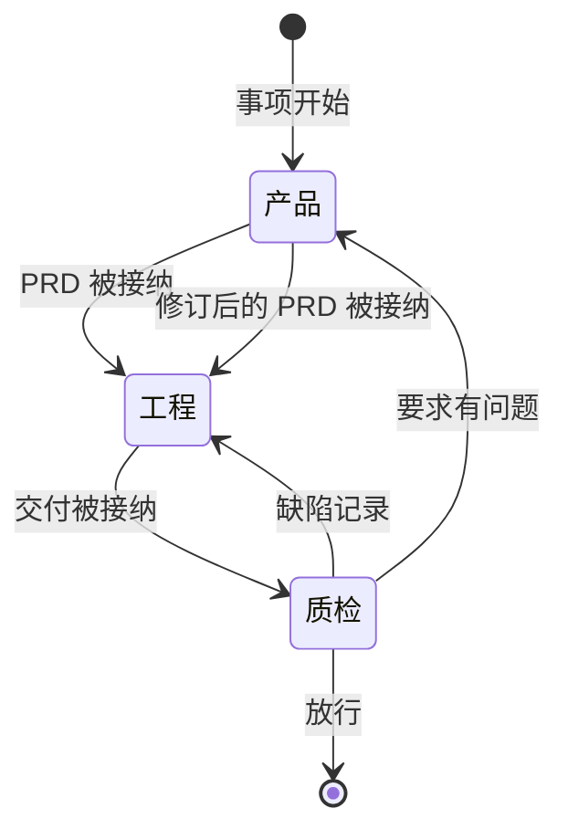
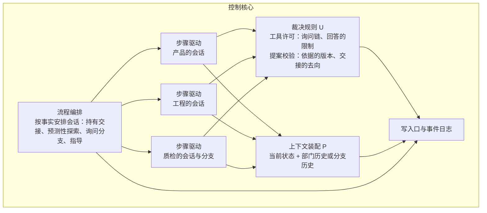
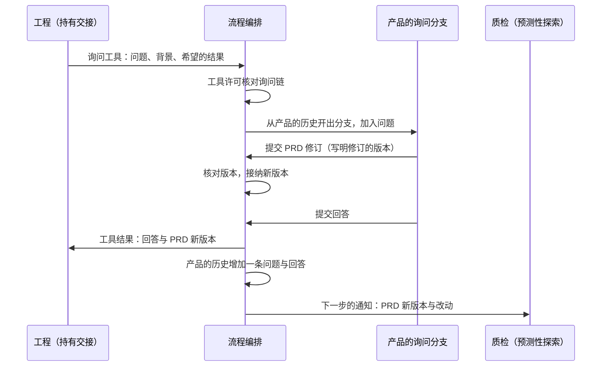

# 三部门的循环结构

日期：2026-10-12；2026-10-13 按 [ADR-0038](../adr/0038-function-first-commands-without-registration.md) 修改第 1 节的范围与第 3.2、4.3 节的工作区。状态：用户逐轮采纳推荐，未实施。ADR：[0036](../adr/0036-concurrent-departments-and-nested-asks.md)、[0037](../adr/0037-engineering-plan-stays-with-engineering.md)。需求：[D38](../requirements/system-intent.md)、[D20](../requirements/department-guidance.md)。

## 1. 依据与范围

用户的意图（2026-10-12）：Yudao 是带有循环结构的 harness，由三个部门的 agent 循环驱动，其余做法与 OpenCode、pi、omp 一致，界面只负责显示；三个循环同时运行，循环之间可以互相发消息，用法与工具调用相同；事项是否完成，由质检的循环认定。

本文规定三个部门的循环怎样同时运行、怎样互相询问、用户的指导怎样送达、工作中途要求变化时怎样处理，以及工程计划的去留。以下内容不在本文范围内：不同项目之间的并行（3.4A）、部门内多角色（[部门内多角色设计说明](department-roles.md)）、工具的种类与边界（[本地通用工具设计说明](local-tools.md)）。工具在哪个工作区执行，见那份说明第 2 节。

## 2. 两层循环

外层是交接。同一事项同一时刻只有一个部门持有交接。持有交接的部门提交正式成果以后，控制核心按这份成果决定下一个持有交接的部门：

只有质检的放行结束事项。交接的去向全部由控制核心依据已记录的事实决定，模型只提交成果。

内层是每个部门的步骤循环。每一步发给模型的请求由两部分组成：前面是每一步重新计算的当前状态（正式成果、通知等），后面是这个部门在本事项中的历史；模型的工具调用经过工具许可后执行，结果写成事件，然后进入下一步。持有交接的部门提交正式成果时，这一轮工作结束；询问不结束这一轮工作。

## 3. 三个部门同时运行

### 3.1 各部门在什么时候工作

| 情况 | 工作的部门 | 工作的位置 |
| --- | --- | --- |
| 持有交接 | 持有交接的部门 | 部门的历史 |
| PRD 被接纳以后、交付到达之前 | 质检做预测性探索：按 PRD 起草测试用例，放在质检自己的材料里 | 质检的历史 |
| 被询问 | 被询问的部门 | 询问分支（第 4 节） |
| 收到指导 | 接收的部门 | 部门的历史，或询问分支（第 6 节） |

除这几种情况以外，部门等待工作。外层循环的几步本身有先后：工程要先有 PRD，质检要先有交付。同时运行带来的好处集中在三处：质检在看到交付之前按 PRD 写出测试用例，判断来自要求、不受实现的影响；产品处理指导时，持有交接的部门不用停下；不同部门发起的询问可以同时进行。

### 3.2 同时运行的条件

1. 每次询问在被询问部门的历史上开一个分支（第 4.2 节）。分支与这个部门正在进行的工作互不等待，两个部门互相询问时也不会出现谁都在等对方的情况。
2. 一个部门在同一条询问链上只出现一次（第 4.4 节）。
3. 每块内容只有一个写入者：运行工作区只由持有交接的工程写入；产品写入 PRD；质检写入自己的测试材料；其他每个会话使用自己的检查工作区，每次检查使用自己的检查副本。
4. 提交正式成果时写明依据的版本，依据的已经不是当前版本时，提交被拒绝（第 7 节）。
5. 交接与完成只由控制核心决定；放行时核对交付绑定的是当前的 PRD 与当前的代码快照。

一个事项同时运行的会话不另设上限：每条询问链最多三个会话；链的起点只有持有交接的部门、质检的预测性探索，以及每个部门最多一段正在处理的指导；模型服务忙时按「等待模型服务」处理。

## 4. 询问与回答

### 4.1 询问是一次工具调用

部门在工作中用询问工具向另一个部门提问，写明问题、背景与希望得到的结果。提问方的步骤循环停在这次工具调用上；控制核心为被询问的部门开一个询问分支；分支提交回答以后，回答作为这次工具调用的结果回到提问方原来的历史，提问方接着工作。回答总是回到提问方，不再由控制核心另外决定工作回到哪里。

### 4.2 询问分支

- 分支能看到被询问部门到此刻为止的全部历史、每一步重新计算的当前状态，以及这条问题。部门还没有工作过时，历史为空，分支只有当前状态与问题。
- 分支一直工作到提交回答。
- 分支结束后，被询问部门的历史只增加一条记录，内容是问题与回答。分支里的读取与检查过程保存在事件里，不进入这个部门以后的历史。
- 一个部门可以同时有几个分支，每个分支结束时各自增加一条记录。

部门可能正在做自己的任务，分支的读取过程进入历史，会挤占当前任务的上下文；它需要记住的是自己回答过什么，以后不前后矛盾。做法参照 OMP 的检查点与回退：模型从检查点出发做探索，结束时把探索过程换成一份报告，接在原来的历史后面（oh-my-pi@e3106be，`packages/coding-agent/src/session/agent-session.ts:8064-8080`、`packages/coding-agent/src/session/session-manager.ts:2700-2716`）。

### 4.3 回答能做什么

- 产品被询问时，可以在回答里修订 PRD，新版本随回答一起交回提问方。PRD 由产品裁决，澄清的结果写进 PRD。
- 工程与质检被询问时，在询问分支自己的检查工作区里读取文件、运行命令与检查，然后回答；不修改运行工作区、交付说明、缺陷记录与放行结论。交付快照是质检核验的对象，回答过程中改动它，质检的证据就不再独立。需要修改代码时按交接处理：质检提交缺陷，交给工程返工。
- 提问方只收到回答，看不到被询问部门的工作过程。

### 4.4 询问链

一次询问与它里面嵌套的询问经过的部门构成一条询问链。一个部门在同一条链上只出现一次，三个部门时链最长两层，例如工程询问产品，产品再询问质检。向链上已有的部门发问时，工具许可拒绝这次调用并说明原因，例如「工程正在等待你的回答，把你要问的内容写进回答里」；提问方收到回答以后，可以带着补充的信息再询问一次。

### 4.5 用量与失败

询问分支的上限取被询问部门自己声明的上限与提问方剩余量中较小的一个，用量计入提问方，与子循环的规则相同（[ADR-0031](../adr/0031-declared-loop-layers-and-sub-loops.md)）。分支没能回答时，例如达到上限或模型反复不提交回答，失败原因作为工具结果交回提问方，由提问方决定接下来怎么做。模型服务不可用这类全系统的问题，按「等待模型服务」让整个事项等待。

## 5. 工作中途要求变化

PRD 有了新版本时（产品在回答里修订、产品处理指导、产品持有交接时修订），正在工作的部门与在询问链上等待的部门在各自的下一步收到一条通知，写明新版本与改动，然后接着工作，已有的工作还算不算数由它们自己判断。控制核心在提交时核对版本（第 7 节）：质检正在核验时 PRD 变了，交付绑定的是旧版本，放行会被拒绝，质检只能交回工程。

部门的工作只因为三种原因停止：用户取消、用户暂停、达到上限。取消与暂停作用于这个事项的全部会话，立即生效。

## 6. 指导

- 用户在事项进行中发的话都指定一个接收部门。发给产品的指导就是新输入，原文照现在的方式保存进 intend。
- 同一个部门收到的几段指导按接收的顺序处理。
- 接收部门正在工作，或者在询问链上等待：指导在它的下一步作为通知加入它的历史。
- 接收部门不在工作：控制核心立即让它按询问的规则在询问分支里处理，提问方是用户，回答交给用户，其他部门照常运行。回答的限制与第 4.3 节相同，产品可以在回答里修订 PRD。接收部门以后再工作时，它的历史里有这段指导与它的回答。
- 接收、进入模型输入与回答分别写成事件，界面据此显示指导的状态。

## 7. 提交与版本

每份正式成果写明它依据的版本：PRD 的修订写明它修订的 PRD 版本，交付写明它依据的 PRD 版本，质检的缺陷记录与放行写明它核验的交付。控制核心经写入口提交时，依据的已经不是当前版本，提交被拒绝，拒绝的原因与当前版本作为工具结果交回，部门看过新版本以后再决定。现在的版本链由控制核心直接接在最新版本后面（`harness/validation.py:400-421`、`harness/validation.py:477-480`），同时运行以后改为上面的核对。

## 8. 工程的计划

工程怎样安排工作由工程自己决定，计划属于作者的工作过程（[ADR-0029](../adr/0029-departments-form-by-information-cohesion.md)），留在工程自己的历史里。工程计划不再是正式成果，写入文件之前没有计划的检查，也没有写入范围的检查；交付只绑定有效 PRD 的版本与代码快照，交付说明写明做了什么。

## 9. 停止与恢复

每个会话（部门历史上的一轮工作、每个询问分支）都有自己的步骤上限，询问分支的上限按第 4.5 节计算。会话可以丢弃：部门的历史与分支的过程都写在事件里，Yudao 重新启动以后，每个没有结束的会话从事件重新装配后继续（[ADR-0010](../adr/0010-control-core-drives-role-steps.md)）；提问方等待的分支继续运行，结束时回答照常交回提问方。

## 10. 模块交互

工程询问产品、产品在回答里修订 PRD 时的顺序：

## 11. 与现有代码的差异

| 现有做法 | 改为 | 位置 |
| --- | --- | --- |
| 每个 run 同时只允许一个部门调用模型 | 一个事项内同时运行多个会话，满足第 3.2 节的条件 | `harness/orchestrator.py:995-997` |
| 询问是一份提案，提交后提问方的激活结束；回答在新的激活中作为材料出现 | 询问是一次工具调用，回答作为工具结果回到提问方 | `harness/engine.py:527-532`、`harness/context.py:195-198` |
| 全系统同时只有一条请求，被询问的部门不能再询问 | 询问链规则（第 4.4 节） | `harness/collaboration.py:39-90` |
| 请求分 consultation 与 action（inspect、check、revise_requirements、revise_delivery） | 只有一种询问，回答的限制见第 4.3 节；revise_delivery 改走返工交接 | `harness/collaboration.py:39-90` |
| 回答以后由 `resume_phase` 决定工作回到哪里 | 回答总是回到提问方 | `harness/collaboration.py:336-351` |
| 合同、计划、请求、输入或指导一变化，激活就结束 | 送达通知，部门接着工作；只因取消、暂停、上限停止 | `harness/adjudication.py:45-51`、`harness/orchestrator.py:549-560` |
| 部门历史收集这个部门的全部事件 | 部门历史排除询问分支的过程，只加入问题与回答 | `harness/assembly.py:141-181` |
| 指导要提交正式回应，放行前所有指导都要有处理结果，非活动部门在当前激活结束后处理 | 第 6 节 | `harness/collaboration.py`（指导部分）、`harness/interactions.py` |
| 工程写入前必须提交计划，写入限于计划范围，交付与放行绑定计划 | 第 8 节 | `harness/adjudication.py:189-203`、`harness/context.py:178-180`、`harness/context.py:433-434`、`harness/validation.py:400-421`、`harness/validation.py:537-614`、`harness/definitions/proposal_contracts.json`、`harness/definitions/tools.json` |
| 正式成果的版本链由控制核心接在最新版本后面 | 提交写明依据的版本并核对 | `harness/validation.py:400-421`、`harness/validation.py:477-480` |
