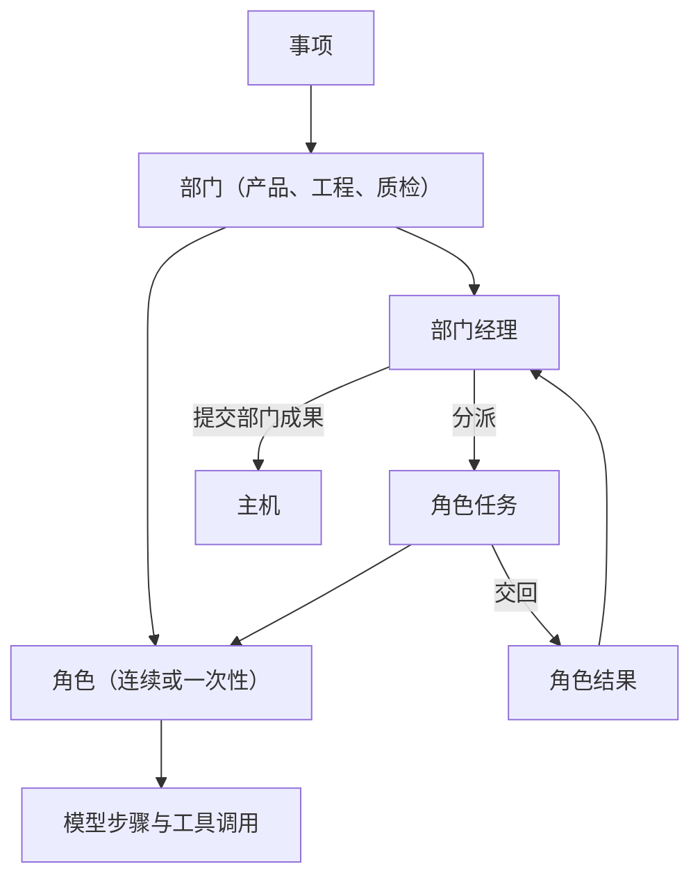
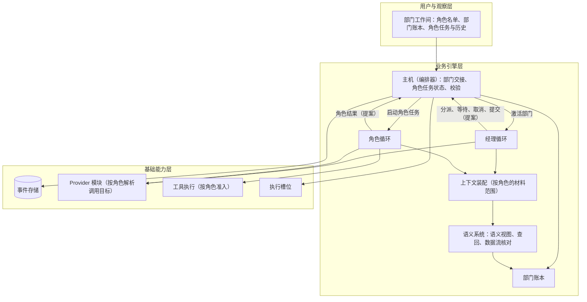
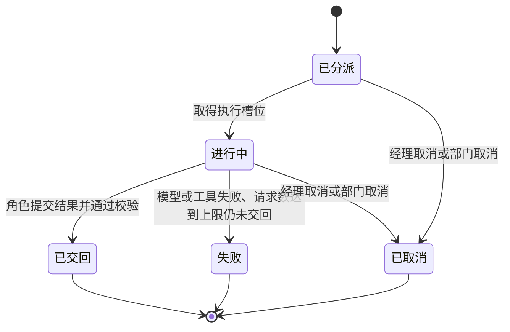

# 部门内多角色设计说明

日期：2026-09-24。状态：设计草案，第 15 节的规则待用户确认，未实施。需求：[D26 部门内多角色与多循环](../requirements/department-roles.md)。调研：[语义系统与部门内多角色：参照调研](../research/semantic-system-and-department-roles.md)。前置设计：[语义系统设计说明](semantic-system.md)、[模型管理设计说明](model-management.md)。术语以 [CONTEXT.md](../../CONTEXT.md) 为准，本说明新增的术语在用户确认后写入。

## 1. 要解决的问题

1. 每个部门目前是一个 Agent 循环，一段历史承担全部工作。查资料产生的大量中间内容、设计推敲与最终材料混在同一段历史里，占用上下文，也干扰后续判断。
2. 部门内部没有专门的角色核对本部门做到什么程度、数据流转是否正确。部门模型认为做完就提交；多 Agent 失败研究中，任务验证类问题（验证错误、验证缺失、过早结束）合计占 24%（调研第 3 节 MAST）。
3. 部门内不同性质的工作适合不同的模型：查资料适合快速模型，设计与判断适合推理更强的模型（D24 的 TODO）。

部门内多角色把部门变成一个小组：部门经理接收部门工作、分派角色任务、核对进展与数据流、代表部门对外；各角色在自己的上下文中完成任务，把结构化结果交回经理。

## 2. 参照对象与取舍

| 方面 | OMP | OpenCode | 其他来源 | Yudao |
| --- | --- | --- | --- | --- |
| 协调者 | vibe 导演只保留读取与分派类工具，读取文件核实工作者的说法 | primary Agent 调用 task 工具 | Magentic-One Orchestrator 不执行具体动作；OpenAI agents-as-tools 由经理保持控制 | 部门经理只分派、核对与提交，不编写产物 |
| 工作者上下文 | 从空白开始，看不到导演的对话；每个工作流一个持续工作者，积累上下文 | 子会话从全新上下文开始，可以按 task_id 续接 | Anthropic 要求任务说明写明目标、产出格式、工具与来源、边界 | 连续角色在事项内积累历史；一次性角色每个任务从新开始；都看不到经理的对话 |
| 交回 | yield 工具加输出 schema；预览 5000 字符，全文以引用取回 | 子会话最后一段文本 | Anthropic 建议产物写入外部存储、只传引用；LangChain 原文转发后成绩提升近 50% | 角色提交结构化结果，摘要上限 5000 字符，成果以材料引用交回 |
| 并行 | 异步分派与等待，并发上限默认 32 | 同一条消息中的多个工具调用 | Anthropic 通常 3 至 5 个子代理同时运行 | 分派立即返回，等待到第一个结束；一次性角色同时进行的任务不超过 5 个 |
| 嵌套 | 深度默认 2 | 深度默认 1 | — | 深度 1，角色不能再分派 |
| 步数 | 软请求上限 200，scout 与 sonic 为 100，1.5 倍时强制交回 | steps | — | 一次性角色任务采用 100 次请求的软上限；连续角色受事项运行时间限制 |
| 模型选择 | Agent 覆盖优先于 Agent 定义的模型，再其次是父 Agent 的模型 | Agent 自己的模型优先于父消息的模型 | — | 角色设置优先于部门设置，同一粒度内项目设置优先于全局设置 |
| 进展与停滞 | 由父模型决定 | 由父模型决定 | Magentic-One 任务账本与进展账本，停滞超过阈值后重新规划并清空代理上下文 | 部门账本分任务与进展两部分；连续 3 轮没有进展时重新规划 |
| 角色划分 | fast 与 good 两档 | 按工具权限区分 | Anthropic 反对按规划、实现、测试、审查拆分，推荐按上下文拆分 | 每个部门一个经理、一个持有主要工作上下文的连续角色、探索者；工程另设评审者 |

## 3. 概念层级

- **部门经理**：部门内的协调角色。接收部门工作，分派与核对角色任务，维护部门账本，代表部门与主机、其他部门往来，提交部门成果。
- **角色**：部门内固定的工作岗位，有自己的职责、Prompt、工具、材料范围与模型设置。分连续角色与一次性角色。
- **连续角色**：在一个事项内保持同一段历史，依次接受多个任务，一次只有一个任务在进行。
- **一次性角色**：每个任务从新的上下文开始，任务结束后历史不再延续，可以同时有多个任务。
- **角色任务**：经理分派给某个角色的一项工作，有分派说明、状态与角色结果。
- **角色结果**：角色结束任务时提交的结构化结果。
- **部门账本**：主机为每个部门维护的工作记录，包含任务部分与进展部分，每次经理请求都携带。

## 4. 角色清单

角色是固定的，随系统版本发布。用户可以修改角色的 Prompt 与模型（第 12 节），不能增删角色。角色清单的变化属于第四阶段的组织演化。

| 部门 | 角色 | 职责 | 类型 | 可以写入的范围 | 同时进行的任务 |
| --- | --- | --- | --- | --- | --- |
| 产品 | 产品经理 | 接收产品部门的工作；关注部门做到什么程度、数据流转是否正确；代表部门对外；提交产品成果 | 经理 | 不写入 | — |
| 产品 | 产品架构师 | 挖掘用户需求，设计产品，起草 ProductSpec 与补充决定，回答其他部门的需求咨询 | 连续 | 部门材料（草案） | 1 |
| 产品 | 产品探索者 | 查资料：项目材料、领域常见做法、同类产品设计，交回带来源的发现 | 一次性 | 不写入 | 与本部门其他一次性任务合计不超过 5 |
| 工程 | 工程经理 | 同产品经理，对象为工程部门 | 经理 | 不写入 | — |
| 工程 | 工程师 | 架构与技术设计、工程计划、代码实现、单元测试与自测 | 连续 | 工作区（唯一的写入者）与部门材料 | 1 |
| 工程 | 工程探索者 | 阅读代码、查阅库与接口文档、复现问题 | 一次性 | 不写入 | 合计不超过 5 |
| 工程 | 工程评审者 | 交付前按 ProductSpec 与工程计划独立审查改动，交回问题清单 | 一次性 | 不写入 | 合计不超过 5 |
| 质检 | 质检经理 | 同产品经理，对象为质检部门 | 经理 | 不写入 | — |
| 质检 | 测试工程师 | 依据 PRD 设计检查，在独立副本中运行检查，记录缺陷与复现方式 | 连续 | 质检副本中的检查文件（唯一的写入者）与部门材料 | 1 |
| 质检 | 质检探索者 | 探索性地操作交付物，查阅检查方法与标准，交回观察与来源 | 一次性 | 不修改交付快照 | 合计不超过 5 |

划分依据：

- 产品部门按用户给出的例子设置。
- 角色按上下文划分（调研第 3 节 Anthropic）。每个部门由一个连续角色持有主要工作的完整上下文；探索者承担会产生大量无关文本的查证，把结论以发现交回。
- 工程的设计与实现由同一个连续角色完成。设计与实现共享同一份需求与代码上下文，拆成两个角色会在交接中丢失隐含的决定（调研第 3 节 Cognition、Anthropic）。
- 工程评审者为提交前的验证步骤，每次评审从新的上下文开始，与工程师的推敲过程分开（调研第 3 节 MAST 增加验证 +15.6%）。质检部门本身是独立验证，不另设评审者。

## 5. 分层与模块关系

部门内多角色位于业务引擎层。经理循环与角色循环使用同一个 Agent 循环实现，区别只在工具、材料范围与 Prompt。主机（编排器）掌握角色任务的状态迁移。

依赖规则：

- 经理与角色都只提交提案（分派、结果、部门成果），由主机校验后写入事件；账本是事件的投影。
- 角色之间不直接通信，角色也不与其他部门通信，全部经过经理。
- 部门之间的规则不变：部门之间只传递主机接纳的结构化结果，对话不跨部门。

## 6. 部门经理

### 6.1 看到的内容

固定材料（与现有部门相同的范围）、部门规则（部门 Prompt）、经理规则（经理的角色 Prompt）、部门账本、语义视图、经理自己的历史。经理看不到角色的历史，只看到角色结果；需要细节时读取角色产出的材料，或用查回与读取来源工具。

### 6.2 工具

| 工具 | 作用 |
| --- | --- |
| 分派 | 给某个角色一项任务，立即返回任务编号 |
| 等待 | 等到经理的任一进行中任务结束，或部门收到新的输入（用户指导、协作回应、取消），返回结果 |
| 追加说明 | 给进行中的任务补充说明，在角色的下一个安全节点送达，规则与 D06、D20 相同 |
| 取消 | 取消一个进行中的任务 |
| 读取 | 读取部门材料与角色产出的材料，只读 |
| 查回、读取来源 | 见语义系统设计说明第 7.2 节 |
| 提交部门成果 | 现有的部门提交（ProductSpec、工程计划、交付、质检结论等），内容引用角色产出的材料 |
| 发起与回应专家请求 | 现有的 D07 协作 |

### 6.3 限制

- 经理不编写产物。提交部门成果时引用角色产出的材料，主机按引用取出原文，按现有规则校验。经理发现问题时，把问题写进新的分派说明，交回角色修改。
- 经理不修改角色结果，不能越过主机的提案校验。
- 角色完成任务只表示任务结束，结果是否正确由经理核对（OMP vibe 导演的规则）。

## 7. 角色任务

### 7.1 分派说明

分派说明包含：角色、目标、预期结果（结果类型与成果形式）、可用材料（材料与单元的引用）、边界（不做什么、不修改什么）。主机校验：角色存在；各项不为空；引用的材料与单元存在且在该角色的材料范围内；连续角色当前没有进行中的任务；一次性任务数量未超过上限。不通过时分派被拒绝，原因作为工具结果返回给经理。

### 7.2 生命周期

### 7.3 角色结果

角色通过「提交角色结果」工具结束任务。结果包含：状态（完成、需要输入、无法完成）、成果（材料引用）、摘要（上限 5000 字符）、待决问题、证据引用。主机校验引用存在且属于本任务产生或本角色可见的范围。角色需要其他部门回答时，以「需要输入」交回，写明问题，由经理决定自己回答、分派探索者，还是向其他部门发起专家请求。

### 7.4 一次性角色的请求数上限

参照 OMP：一次性角色任务的模型请求数到 100 次时，主机在请求中加入收尾提示；到 150 次时要求立即提交结果；之后再过 5 次仍未提交，任务以失败结束，已产生的材料保留。这只结束该任务，不影响事项。连续角色不设请求数上限，受事项运行时间限制。

## 8. 上下文

每次角色请求依次包含：该角色材料范围内的固定材料、部门规则、角色规则、当前角色任务的分派说明、语义视图、角色历史视图。

| 角色 | 材料范围 |
| --- | --- |
| 产品各角色 | intend 原文、当前 ProductSpec 与补充决定、项目共享单元、产品部门私有单元 |
| 工程各角色 | intend 原文、当前 ProductSpec 与补充决定、工程计划、工作区、项目共享单元、工程部门私有单元 |
| 质检各角色 | intend 原文、当前 ProductSpec 与补充决定、交付说明与交付快照、项目共享单元、质检部门私有单元 |

- 角色之间不共享历史。一个角色的结论通过角色结果交给经理，通过语义整理成为部门私有单元，其他角色在语义视图中看到。
- 连续角色的历史在事项内跨任务保留，接近窗口上限时按模型管理设计说明第 8 节分别压缩。一次性角色的历史只在本任务内。
- 每个角色任务结束是语义整理的检查点（语义系统设计说明第 6.2 节）。
- 角色历史不跨事项延续。部门在项目中的知识通过部门私有单元延续（语义系统设计说明第 9 节）。

## 9. 并行与执行槽位

- 连续角色一次只有一个任务在进行。
- 一次性角色的任务可以同时进行，每个部门合计不超过 5 个（Anthropic 通常 3 至 5 个子代理同时运行）。
- 每个部门只有一个角色可以写入工作区或质检副本，因此同时进行的任务之间不会互相修改文件。
- 每个进行中的角色任务占用一个执行槽位（3.4A）。没有空闲槽位时，任务保持已分派状态，等待槽位。
- 部门之间的规则不变：同一事项同一时刻只有一个部门处于激活状态。

## 10. 进展判断与结束

### 10.1 部门账本

主机为每个部门维护部门账本，每次经理请求都携带：

- **任务部分**：经理的工作计划条目、每条分派给哪个角色、状态与结果摘要；来自语义视图的已核实事实与待决问题。
- **进展部分**：数据流核对结果（语义系统设计说明第 7.3 节）；每一轮的进展判断；主机记录的进展事实。

### 10.2 每一轮的进展判断

经理每次调用分派或等待时，同时提交进展判断：部门工作是否完成、是否在重复同样的工作、是否有进展、下一步由哪个角色做什么。进展判断作为事件记录，可以重放。

### 10.3 主机记录的进展事实

一轮中出现以下任一事实，即记为有进展：新的角色产出材料、新的证据、待决问题得到回答、数据流核对中缺失的条目减少、专家请求得到回应。

### 10.4 停滞

经理的进展判断与主机的进展事实都显示没有进展，并且连续 3 轮（AutoGen 的默认值）时，主机在经理的下一次请求中要求更新工作计划。本轮涉及的连续角色从新的历史视图开始下一个任务：视图以语义视图和一段停滞说明开头，原始历史保留在事件存储中，可以查回。停滞不结束事项。

### 10.5 结束

部门激活在经理提交部门成果或发起专家请求时结束，与现有规则相同。事项运行时间限制（2026-09-22 决定）仍是整体收敛的保证。

## 11. 与现有流程的关系

- **部门之间（D07、D11）**：经理是部门唯一的对外接口。其他部门的专家请求由经理接收并分派给角色，回应由经理提交；同一事项一次一个未结请求、不嵌套的规则不变。
- **用户输入（D06）与部门指导（D20）**：送达部门经理，由经理决定交给哪个角色；指导的接收、进入请求与回应记录方式不变。
- **工程先计划（D05）**：工程师起草计划，经理提交，主机接纳后经理再分派实现任务。
- **质检独立（D11）**：质检各角色的材料范围不含工程部门私有单元与历史。
- **恢复（3.1）**：角色任务是执行单位。进程重启后，进行中的角色任务按恢复契约核实未完成的动作：连续角色从原历史继续同一任务；一次性角色不写入文件，重新运行该任务；经理的等待继续。[恢复契约与故障矩阵](recovery-contract-and-fault-matrix.md)需要增加角色任务。

## 12. 模型与 Prompt 设置

在[模型管理设计说明](model-management.md)第 5 节的基础上增加角色一层：

- **角色默认**：全局，每个角色一份，包含模型访问定义与请求档位，可以为未设置。
- **项目角色设置**：每个项目的每个角色一份，包含模型访问定义、请求档位与角色 Prompt，只写入覆盖的项。

解析顺序：

1. 模型访问定义：项目角色设置、角色默认、项目部门设置、部门默认，取第一个写入了的；都没有时解析失败。
2. 请求档位：与模型访问定义相同的顺序；都为空时使用所选模型的默认档位，并按模型管理设计说明第 7.3 节限制到支持范围。
3. 角色 Prompt：项目角色设置中有时使用它，否则使用内置角色 Prompt。
4. 部门 Prompt：继续按模型管理设计说明第 5.3 节解析，作为全部门规则放入本部门每个角色的请求。

角色设置优先于部门设置：角色设置表达的是按工作性质选择模型，例如探索者使用快速模型，与 OMP 中 Agent 覆盖优先于父 Agent 模型的规则相同。生效时机、引用无法使用时的处理与请求事件记录，按模型管理设计说明第 5.4、5.5、6 节，请求事件另外记录角色与选择来源。

## 13. 界面

- 部门工作间显示角色名单（状态、模型、当前任务）、部门账本与角色任务时间线；点开角色查看它的历史与模型请求。
- 模型管理页的部门默认下增加各角色的角色默认；部门设置弹窗列出本项目各角色的设置。
- 界面细节需要先做原型，之后按原型修改本节。

## 14. 验收

- 与现有单循环部门在同一组任务上对照：交付质量不低于单循环，同时报告模型请求数、用量与耗时的变化（调研第 3 节：多 Agent 的 token 用量为单 Agent 的 3 至 15 倍）。
- 反例：经理提交未引用角色材料的成果被拒绝；角色结果引用不存在的材料被拒绝；一次性角色写入工作区被拒绝；质检角色取不到工程私有单元；超过同时任务上限的分派被拒绝；连续 3 轮无进展触发重新规划；部门取消时全部角色任务取消；进程在角色任务进行中退出后按恢复契约继续。

## 15. 待用户确认的规则

以下规则按参照对象与现有约束提出，用户尚未逐项决定：

1. 工程与质检的角色清单（第 4 节）：工程由工程师一个连续角色负责设计与实现，另设工程探索者与工程评审者；质检由测试工程师负责设计与运行检查，另设质检探索者。
2. 经理不编写产物，提交时引用角色产出的材料（第 6.3 节）。
3. 一次性角色每个部门同时进行不超过 5 个任务，每个任务 100 次请求的软上限（第 7.4、9 节）。
4. 连续 3 轮无进展时重新规划，相关连续角色从新的历史视图开始（第 10.4 节）。这调整 D08「部门历史跨激活保留」在角色层面的含义，原始历史仍完整保留。
5. 模型选择顺序中角色设置优先于部门设置（第 12 节）。
6. 部门 Prompt 作为全部门规则，另设角色 Prompt（第 12 节）。
7. 角色历史不跨事项延续，部门知识通过语义单元延续（第 8 节）。

## 16. 对现有设计的影响

| 位置 | 改动 |
| --- | --- |
| [模型管理设计说明](model-management.md) | 第 5 节增加角色默认与项目角色设置；第 12 节 TODO「部门内 SubAgent 与角色」改为指向本说明 |
| [D02](../requirements/department-prompts.md) | 部门 Prompt 的含义为全部门规则，另有角色 Prompt |
| [D07](../requirements/expert-ask-react.md)、[D11](../requirements/three-department-loop.md)、[D20](../requirements/department-guidance.md) | 开头补充说明：部门由部门经理代表 |
| [恢复契约与故障矩阵](recovery-contract-and-fault-matrix.md) | 增加角色任务的恢复规则 |
| [Stage 3 计划](../stage-3-plan.md) | 3.6 改为本设计 |
| ADR | 用户确认后新增两项：部门经理是部门唯一的对外接口，角色经工具调用接受分派；模型选择中角色设置优先于部门设置 |
