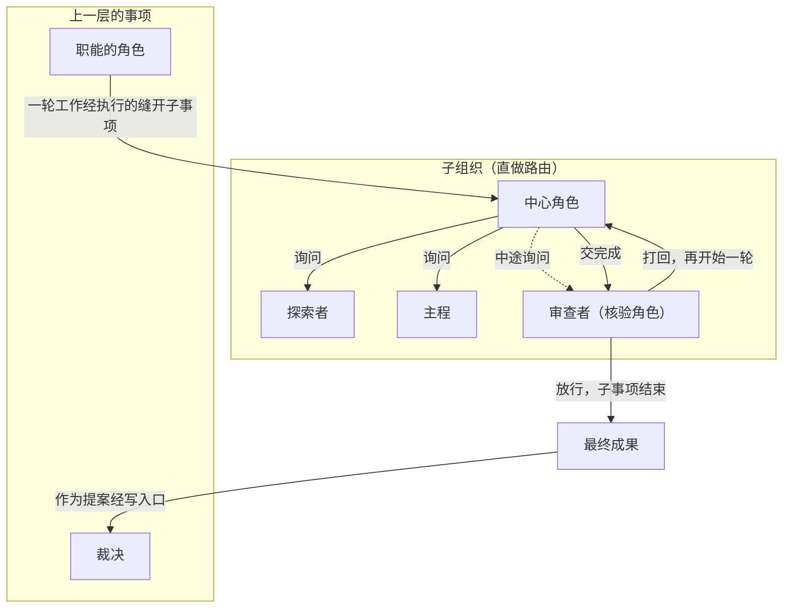
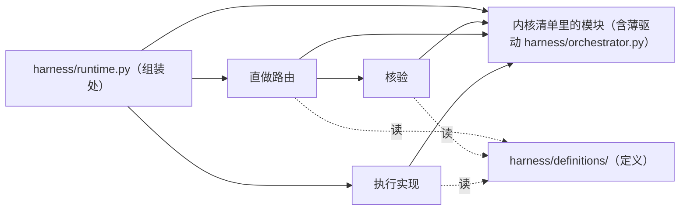

# 职能内多角色设计说明

总图位置：第一节「工程」方框（一个职能的内部也可以是一个子组织）；第二节「定义」里的角色材料；第三节「子组织」；第四节「执行」「定义」「写入口」的缝。依据：需求 [D26 职能内多角色](../requirements/department-roles.md)；设计 [形态与核验角色设计说明](forms-and-verifier-role.md)「子组织（位置与规矩）」「核验角色」「直做」、[项目的组织设计说明](project-organization.md)。

## 1. 功能与依据

职能内多角色不是一个模块，是一份子组织定义：职能的角色定义指向它，这个角色的一轮工作开一个子事项，子事项里由中心角色、探索者、主程、审查者按直做路由协作，结束时成果作为这个角色的普通提案回到上一层，照常过裁决。执行里不另做一套子 agent。

采用中心型协作，理由是中心角色承担职能核心的规划与判断，要保持上下文干净；查证、实现这类会产生大量中间内容的工作交给同伴，中心角色只收到它们的结论。审查者每次从新的上下文开始，审查不受作者思路的影响，职能内因此有一道独立的核对。

## 2. 边界与范围

做什么：

- 角色材料：四个角色各自的关注、目标、证据来源、可见范围、写入范围、工具许可与核验关系。
- 指向方式：职能的角色定义怎样指向一份子组织。
- 直做的接法：中心角色怎样把工作交给同伴，怎样交完成，审查者怎样核验。
- 审查者的上下文，外层返工，预测性探索。

不做什么：

- 不在执行里另做子 agent，不加骨架事件种类。
- 不设专门转交输入、提醒进度的角色：询问与指导按路由送达，进度与停滞由边界判定。
- 不重写子组织的规矩（事件流、冻结定义、扣量、层数、一起停），那些在形态与核验角色设计说明里。
- 不新增常量。层数上限引用[循环与收敛设计说明](loops-and-convergence.md)「循环层的声明」。

## 3. 接口

这份说明在三道缝上：

- 定义的缝：职能的角色定义指向一份子组织，子组织里每个角色按同一套字段声明。
- 执行的缝：一轮工作开子事项是执行缝的一种出。
- 写入口：子事项的成果作为普通提案经写入口回到上一层。

包图：

内核不导入路由、核验与执行实现，由组装处接上。不新增内核认识的词。

## 4. 方案

### 4.1 角色清单

子组织里的四个角色按定义缝的七个字段声明：

| 角色 | 关注的成果 | 目标 | 证据来源 | 可见范围 | 写入范围 | 工具许可 | 核验角色 |
| --- | --- | --- | --- | --- | --- | --- | --- |
| 中心角色 | 上一层交来的任务与本职能的设计、计划或检查设计 | 把任务做成能交完成的成果 | 项目材料、同伴交回的结论、本职能记录 | 本职能可见范围 | 只写自己的设计、计划或检查设计草案 | 询问（同伴与其他职能）、更新计划、追加说明、取消进行中的询问、查询与读取、记录、起草、交完成 | 否 |
| 探索者 | 询问里交来的查证任务 | 交回带来源的发现 | 项目材料、代码、外部文档 | 本职能可见范围 | 只读，不写入 | 查询与读取、记录 | 否 |
| 主程 | 询问里交来的实现任务 | 按设计与计划实现并自测 | 设计与计划、代码、自测结果 | 本职能可见范围 | 工作区 | 读写工作区、运行命令与自测、记录 | 否 |
| 审查者 | 中心角色交的完成，工作中途交来的草案 | 判断这一版成果是否可以放行 | 待审查的成果、它的依据、上一轮审查意见 | 成果与依据，不含作者的历史 | 检查材料，不写工作区 | 读取要求、材料与证据，在独立副本上运行检查，提交结论 | 是，核验中心角色交的完成 |

三个职能同构，各职能的中心角色与分工如下，运维按同一做法，不展开：

| 职能 | 中心角色 | 这个职能里各角色做什么 |
| --- | --- | --- |
| 产品 | 产品架构师 | 中心角色挖掘需求、设计产品、起草规格与补充决定，回答其他职能的需求咨询；探索者查项目材料、领域常见做法与同类产品；审查者审查需求与规格；没有主程 |
| 工程 | 工程架构师 | 中心角色做架构与技术设计、模块划分、起草工程计划，回答其他职能关于实现难度与成本的咨询；探索者读代码、查库与接口文档、复现问题；主程按设计与计划实现代码并自测；审查者审查设计与代码 |
| 质检 | 测试工程师 | 中心角色依据需求设计检查，在独立副本中运行检查，记录缺陷与复现方式，给出判定；探索者操作交付物、查检查方法与标准；审查者审查检查设计是否覆盖每条验收条件、缺陷记录是否有依据；没有主程 |

写入范围的几点：

- 中心角色只写设计、计划或检查设计草案。
- 工作区只由主程写入，质检副本只由测试工程师写入；同一时刻没有两个角色写同一处，同时进行的任务不会互相改文件。
- 探索者只读，可以几项同时进行。
- 产品与质检没有主程。
- 主程可以是外包角色（[D31](../requirements/outsourced-agent-roles.md)）；审查者作为核验角色不外包。
- 工具里没有分派与等待：交工作的方式是询问（4.3）。

角色由带版本的定义声明，随系统版本发布。项目上增删角色、改由谁做，在「高级」里采用，见[项目的组织设计说明](project-organization.md)「采用与历史」。教训与洞见不由角色写出，由教训发现模块产生（[D25](../requirements/semantic-system.md)）。

### 4.2 子组织怎样被指向

职能的角色定义可以指向一份子组织形态，默认是中心型小组。指向了，这个角色的一轮工作开一个子事项；不指向，就是一个模型或一个外包会话。

子事项的来源只有「上一层交来的任务」，由中心角色接。子事项的事件流、冻结的定义、时间与用量从上一层扣、层数上限、上一层停则一起停、结果作为普通提案回到上一层，都按[形态与核验角色设计说明](forms-and-verifier-role.md)「子组织（位置与规矩）」，这里不重写。

### 4.3 直做与审查者的核验

子组织的路由就是直做，与其他形态用的是同一条直做路由，不另写（[形态与核验角色设计说明](forms-and-verifier-role.md)「直做」）。

中心角色接任务，开始第一轮。中心角色把工作交给同伴的方式是询问：任务写进询问，同伴在这一轮里按自己的写入范围工作，回答就是它的结果；可以同时有几个询问。总图第一节写直做靠询问协作，所以不需要分派工具。

主程接询问时可以写工作区，因为写入范围是角色的性质。[产品 · 工程 · 质检的循环结构](department-loop.md)「回答能做什么」里不改运行工作区的限制说的是职能之间的询问，不是子组织内部。

其他职能的询问与用户指导按路由送到中心角色；职能随时可以询问另一个职能；进度与停滞由边界判定并提醒。所以不需要一个专门转交的角色。

中心角色交完成时，审查者作为核验角色核验中心角色交的这一版：产品审查需求与规格，工程审查设计与代码，质检审查检查设计是否覆盖每条验收条件、缺陷记录是否有依据。放行则子事项结束；打回则中心角色再开始一轮。结论绑定被审查那一版的内容摘要，审查后成果又改了就要再审。

工作中途中心角色也可以询问审查者，例如工程计划在交给主程之前先审。同样绑定版本，但只有交完成时的结论能结束子事项。

审查者放行只结束子事项，不是外层的放行。提案回到上一层照常过裁决，外层有核验角色时它的结论照常要。

### 4.4 审查者的上下文

审查者每次从新的上下文开始，只看待审查的成果、它的依据与上一轮的审查意见，看不到作者的历史。中途审查时，装配只放成果与依据的引用，不放问话里的解释。

审查者先下判断再看作者的解释，见[验证的独立性设计说明](independent-verification.md)「先判断后看解释」。是否看到本职能记录的事实、决定、推测，是可见范围的参数，也是对照实验里的一组取值，见同一说明「可见范围作为参数」。

### 4.5 外层返工

一轮一个子事项，所以外层打回时，上一层这个角色的下一轮开新子事项。任务里写返工原因与涉及的部分，从上一版成果起步，带上一个子事项的引用。中心角色只安排涉及的部分，已完成的部分保持完成。

角色历史不跨事项延续，要用的内容经轨迹与图谱取得（[语义系统设计说明](semantic-system.md)「可见范围与跨事项」）。

### 4.6 预测性探索

其他职能在等待时可以做预测性探索：

- 只读查证与起草本职能的草案，不写工作区，不向外提交。
- 只在有空闲执行槽位时进行，正式工作需要槽位时在安全节点让出；用量单独记录。
- 要求更新后，按旧版本做的结果作废。
- 做不做由中心角色决定。
- 草案经过审查才能用于正式成果。

### 4.7 模型与 Prompt 设置

角色设置优先于职能设置，解析顺序见[模型管理设计说明](model-management.md)「职能与角色的模型选择」。职能 Prompt 是全职能的规则，每个角色另有角色 Prompt。子组织内部的角色没写入的跟随职能（[项目的组织设计说明](project-organization.md)「职能详情」）。

### 4.8 与已有结构的对应

| 事项 | 对应 |
| --- | --- |
| 进展与停滞、反复退回的提醒 | 归裁决与边界，见[循环与收敛设计说明](loops-and-convergence.md)「收敛的检测」 |
| 并行与执行槽位 | 见[总体路线图](../program-roadmap.md)第 3 节道 10 与[应用层与接口层设计说明](app-and-interface.md)「运行与执行槽位」；主程一次接一件，探索者与审查者可以同时接几件 |
| 交出检查 | 职能提交时由主机按项目的检查定义运行（[D35](../requirements/self-hosting.md)、[D38](../requirements/system-intent.md) 的 N-S1），回执由主机产生，检查的策略写在检查定义里，不从被检查的代码读取。各职能查什么：全部职能查针对这一版的审查通过记录（比例见[验证的独立性设计说明](independent-verification.md)「验证密度」）以及引用的材料存在；产品查数据流核对通过；工程查交付说明写明的工作都有实现、交付引用的检查在这份快照上最近一次回执全部通过；质检查每条有效验收条件都有检查结果（[语义系统设计说明](semantic-system.md)「数据流核对与质检放行」）。产品、工程、质检各自这几项不依赖职能内有多个角色，职能只有一个角色时同样在提交时生效；审查通过记录只在职能内部是子组织时要求。不通过时提案被拒绝，原因回到上一层这个角色，它的下一轮开的子事项把原因交给中心角色 |
| 上下文 | [语义系统设计说明](semantic-system.md)「各角色的上下文」、[上下文装配](context-assembly.md) |
| 职能账本 | 子事项事件流上的一个视图，见[语义系统设计说明](semantic-system.md)「职能账本」，不是单独的机制 |
| 角色任务 | 不是单独的机制。从上一层看就是这个子事项，从子事项里看是同伴接一次询问开始的这一轮；轨迹与恢复按它归组（[恢复契约与故障矩阵](recovery-contract-and-fault-matrix.md)「角色任务的恢复」） |
| 界面与画面 | [项目的组织设计说明](project-organization.md)「职能详情」「外包与分形」、画面总图 [architecture-view.html](../architecture-view.html) |

## 5. 验收

- 换一份定义，工程从一个角色变成子组织，事实与裁决、循环两层的代码不改；换回去能撤回。
- 子事项的创建事件带上一层的事项、一轮与角色的引用和层数；结束时上一层只收到一份普通提案，骨架事件种类没有增加。
- 层数到上限时拒绝再开；上一层停，子事项跟着停。
- 审查者的结论是子组织里的核验，审查者看不到作者的历史，有用例守着。
- 没有对应版本的审查通过记录时，职能提交被拒绝。
- 中心角色、探索者、审查者写工作区被拒绝；质检副本只接受测试工程师写入。

## 6. 未决问题

1. 探索者与审查者的同时任务数、请求数与审查次数上限的默认值与范围没有定，只定了默认放宽（[循环与收敛设计说明](loops-and-convergence.md)「循环层的声明」）。
2. 子事项进行时，其他职能的询问与用户指导怎样从上一层的事项落到子事项的中心角色：询问分支开在哪一条事件流上。
