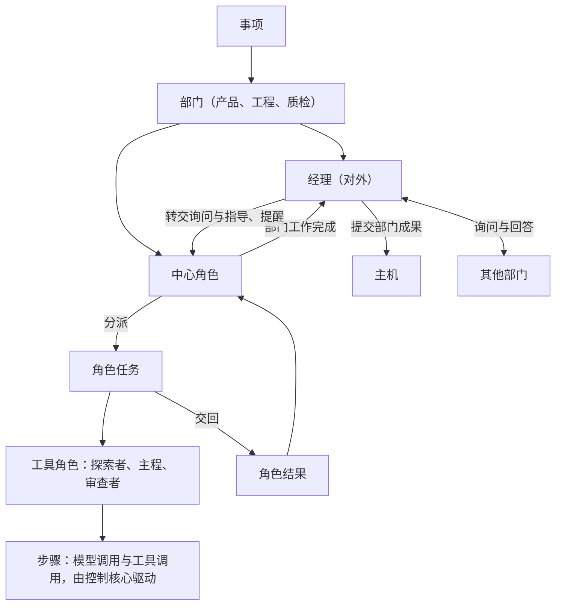
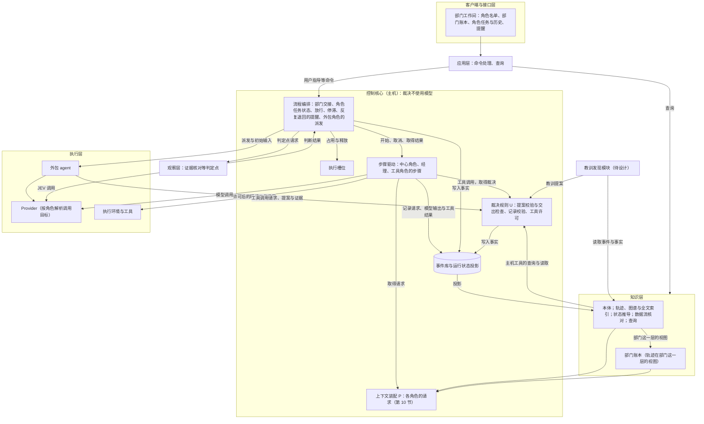
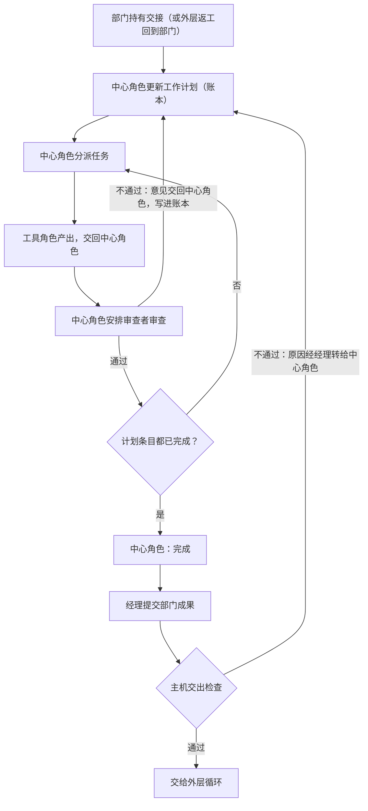
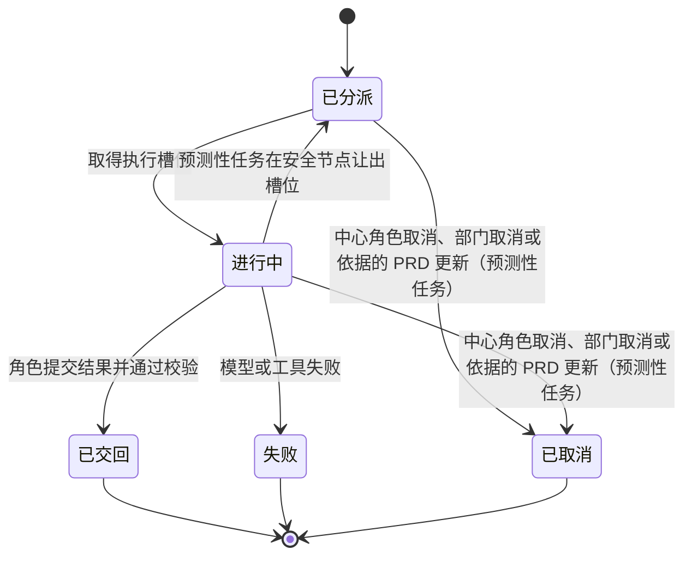

# 部门内多角色设计说明

日期：2026-09-25；2026-09-26 按总体架构与用户的决定修改，同日补全计划的更新、执行槽位的计数、停滞时的历史、交出检查的审查记录与自测、专家请求期间的角色任务、验收对照与角色任务的恢复这几项规则。状态：设计草案，规则已由用户确认（[D26](../requirements/department-roles.md) 2026-09-25 至 2026-09-26），未实施。需求：[D26 部门内多角色与多循环](../requirements/department-roles.md)。调研：[语义系统与部门内多角色：参照调研](../research/semantic-system-and-department-roles.md)。前置设计：[总体架构：职责分层](architecture/overall-architecture.md)、[语义系统设计说明](semantic-system.md)、[模型管理设计说明](model-management.md)。ADR：[0010](../adr/0010-control-core-drives-role-steps.md)、[0016](../adr/0016-center-role-collaboration.md)、[0017](../adr/0017-role-settings-override-department.md)。术语以 [CONTEXT.md](../../CONTEXT.md) 为准。

## 1. 要解决的问题

1. 每个部门目前是一个 Agent 循环，一段历史承担全部工作。查资料产生的大量中间内容、实现细节、设计推敲与最终材料混在同一段历史里，占用上下文，也干扰后续判断。
2. 部门内部没有独立的核对。部门模型认为做完就提交；多 Agent 失败研究中，任务验证类问题（验证错误、验证缺失、过早结束）合计占 24%（调研第 3 节 MAST）。
3. 部门内不同性质的工作适合不同的模型：查资料适合快速模型，设计与判断适合推理更强的模型（D24 的 TODO）。

部门内多角色把每个部门变成围绕一个中心角色的小组（中心型协作）：中心角色承担部门核心的规划与判断，保管部门的主要上下文；探索者、主程与审查者承担可以独立出来的任务，是中心角色的工具，只把结论交回中心角色；经理负责部门的对外沟通与提交。中心角色的上下文因此保持干净，工作保持高效。

## 2. 参照对象与取舍

| 方面 | OMP | OpenCode | 其他来源 | Yudao |
| --- | --- | --- | --- | --- |
| 中心与分派 | vibe 导演只保留读取与分派类工具，读取文件核实工作者的说法 | primary Agent 调用 task 工具派出子 Agent | Anthropic 多代理研究系统由主 Agent 保管计划，子 Agent 交回压缩后的结果 | 中心角色分派任务、安排审查与返工，保管部门的主要上下文，只写自己的设计、计划或检查设计 |
| 对外 | — | — | OpenAI agents-as-tools 由协调者保持对外控制 | 经理是部门唯一的对外接口，转交询问与指导，提交部门成果，关注进度与数据流转 |
| 工作者上下文 | 从空白开始，看不到导演的对话；每个工作流一个持续工作者，积累上下文 | 子会话从全新上下文开始，可以按 task_id 续接 | Anthropic 要求任务说明写明目标、产出格式、工具与来源、边界 | 连续角色在事项内积累历史；一次性角色每个任务从新开始；都看不到中心角色的对话 |
| 交回 | yield 工具加输出 schema；预览 5000 字符，全文以引用取回 | 子会话最后一段文本 | Anthropic 建议产物写入外部存储、只传引用 | 角色提交结构化结果，摘要上限 5000 字符，成果以材料引用交回 |
| 核对 | 导演核实工作者的说法 | — | MAST：任务验证类问题占 24% | 每个部门设审查者，每次从新的上下文开始；对外提交的每份成果都要有针对该版本的审查通过记录 |
| 并行 | 异步分派与等待，并发上限默认 32 | 同一条消息中的多个工具调用 | Anthropic 通常 3 至 5 个子代理同时运行 | 一次性角色的任务不设数量上限，受执行槽位与事项运行时间上限约束 |
| 嵌套 | 深度默认 2 | 深度默认 1 | — | 深度 1，工具角色不能再分派 |
| 模型选择 | Agent 覆盖优先于 Agent 定义的模型，再其次是父 Agent 的模型 | Agent 自己的模型优先于父消息的模型 | — | 角色设置优先于部门设置，同一粒度内项目设置优先于全局设置 |
| 进展与停滞 | 由父模型决定 | 由父模型决定 | Magentic-One 任务账本与进展账本，停滞超过阈值后重新规划并清空代理上下文 | 部门账本分任务与进展两部分；连续 3 轮没有进展时重新规划 |

## 3. 概念层级

- **中心角色**：部门内承担核心规划与判断的连续角色，保管部门的主要上下文。产品部门为产品架构师，工程部门为工程架构师，质检部门为测试工程师。
- **工具角色**：由中心角色分派任务的角色，包括探索者、主程与审查者。
- **经理**：部门的对外接口。转交询问与指导，向其他部门发问，提交部门成果，关注部门进度与数据流转并提醒中心角色；不分派部门内的工作，不编写产物。
- **审查者**：审查成果的一次性工具角色，每次从新的上下文开始。
- **连续角色**：在一个事项内保持同一段历史，依次接受多个任务，一次只有一个任务在进行。
- **一次性角色**：每个任务从新的上下文开始，任务结束后历史不再延续，可以同时有多个任务。
- **角色任务**：中心角色分派给某个工具角色的一项工作，有分派说明、状态与角色结果。
- **角色结果**：工具角色结束任务时提交的结构化结果。
- **部门账本**：轨迹在部门这一层的视图，由主机从事件生成，包含任务部分与进展部分。
- **持有交接**：同一事项同一时刻只有一个部门持有交接，负责产出当前需要的正式成果。
- **预测性探索**：没有持有交接的部门在 PRD 被接纳后先做的准备工作：只读查证并起草本部门的草案。

## 4. 角色清单

角色是固定的，随系统版本发布。用户可以修改角色的 Prompt 与模型（第 14 节），不能增删角色。角色清单的变化属于 Stage 6 的组织演化。本节的角色清单已由用户确认（2026-09-24 选择角色，2026-09-25 增加审查者、「开发者」改名「主程」、确定中心角色）。

| 部门 | 角色 | 职责 | 类型 | 可以写入的范围 |
| --- | --- | --- | --- | --- |
| 产品 | 产品部门经理 | 对外沟通；关注部门做到什么程度、数据流转是否正确；提交产品成果 | 经理 | 不写入 |
| 产品 | 产品架构师 | 中心角色：挖掘用户需求，设计产品，起草 ProductSpec 与补充决定，回答其他部门的需求咨询 | 连续 | 部门材料（草案） |
| 产品 | 产品探索者 | 查资料：项目材料、领域常见做法、同类产品设计，交回带来源的发现 | 一次性 | 不写入 |
| 产品 | 产品审查者 | 审查需求与规格 | 一次性 | 不写入 |
| 工程 | 工程经理 | 同产品部门经理，对象为工程部门 | 经理 | 不写入 |
| 工程 | 工程架构师 | 中心角色：架构与技术设计、模块划分、起草工程计划，回答其他部门关于实现难度与成本的咨询 | 连续 | 部门材料（设计与计划草案） |
| 工程 | 主程 | 按设计与已接纳的工程计划实现代码，编写单元测试并自测 | 连续 | 工作区（唯一的写入者）与部门材料 |
| 工程 | 工程探索者 | 阅读代码、查阅库与接口文档、复现问题 | 一次性 | 不写入 |
| 工程 | 工程审查者 | 审查设计与代码 | 一次性 | 不写入 |
| 质检 | 质检经理 | 同产品部门经理，对象为质检部门 | 经理 | 不写入 |
| 质检 | 测试工程师 | 中心角色：依据 PRD 设计检查，在独立副本中运行检查，记录缺陷与复现方式，给出判定 | 连续 | 质检副本中的检查文件（唯一的写入者）与部门材料 |
| 质检 | 质检探索者 | 探索性地操作交付物，查阅检查方法与标准，交回观察与来源 | 一次性 | 不修改交付快照 |
| 质检 | 质检审查者 | 审查检查设计是否覆盖每条验收条件、缺陷记录是否有依据 | 一次性 | 不写入 |

划分依据：

- 中心角色持有需要连续积累的核心上下文；可以独立出来、会产生大量中间内容的工作交给工具角色，查证过程不进入中心角色的上下文（调研第 3 节 Anthropic）。
- 工程架构师与主程之间的交接会丢失隐含的决定（调研第 3 节 Cognition、Anthropic），设计用三种方式交接：架构师的设计与计划作为部门材料，由主程的分派说明引用；工程计划的任务带编号，并写明它实现的要求编号（语义系统设计说明第 5.5 节）；设计决定连同理由记录为图谱中的决定，主程通过目录、接触时附加与查询看到（语义系统设计说明第 10.4、10.5、10.7 节）。MetaGPT 的架构师与工程师同样以结构化文档交接。
- 审查者每次从新的上下文开始，审查不受作者思路的影响。

## 5. 分层与模块关系

部门内多角色的层次沿用[总体架构：职责分层](architecture/overall-architecture.md)：客户端与接口层、应用层、控制核心、知识层、观察层、执行层。本说明中的「主机」指控制核心。

每次模型请求都由控制核心装配，控制核心驱动每个角色任务的步骤（[ADR-0010](../adr/0010-control-core-drives-role-steps.md)）：装配请求（P），经 Provider 调用模型（f），每个工具调用先经过工具许可（U），主机工具由控制核心执行、环境工具在执行环境中执行，记录结果并附加内容，然后进入下一步。中心角色、经理与工具角色的步骤都由步骤驱动执行，区别只在工具、上下文（第 10 节）与 Prompt。执行层只有 Provider、执行环境与工具、外包 agent。控制核心内部的模块与一步的顺序见总体架构第 5 节。

依赖规则：

- 流程编排只调用步骤驱动的开始、取消与取得结果；步骤驱动只通过 P 与 U 的接口取得请求与裁决结果（总体架构第 5.1 节）。执行槽位由流程编排分配（第 11.3 节）。
- 工具分两类，每次调用都先经过工具许可（总体架构第 5.3 节）：主机工具（提交、记录、查询、读取材料、分派等）由控制核心执行，查询范围由控制核心按角色身份填入；环境工具（读写文件、运行命令）在执行环境中执行。
- 经理、中心角色与工具角色都只通过主机工具提交提案（分派、记录、结果、完成、部门成果），由裁决规则校验后写入事件；轨迹、图谱与部门账本都由事件生成，属于知识层。
- 教训与洞见由教训发现模块找出，作为提案经过裁决规则（[D25](../requirements/semantic-system.md)）。部门内的角色不写出教训与洞见，通过常驻教训栏目、接触时附加与查询使用教训，通过查询取得洞见（第 10 节）。
- 外包角色与自有角色使用同一个角色定义，由流程编排派发给外包 agent（[D31](../requirements/outsourced-agent-roles.md)）。外包 agent 自己管理会话内的上下文，控制核心只装配它的初始输入；它的工具调用经过 Yudao 的工具，工具许可、接触时附加与查询范围照样有效；每次请求重新计算的当前状态栏目不适用于它。
- 工具角色之间不直接通信，也不与其他部门通信；工具角色的结果交回中心角色。
- 部门对外只经过经理；部门之间只传递主机接纳的结构化结果，对话不跨部门。

## 6. 中心角色

### 6.1 看到的内容

中心角色的请求按语义系统设计说明第 10.8 节组成（第 10 节）：

- 常驻栏目：规则（系统规则、部门 Prompt、中心角色的角色 Prompt、提案合同与工具定义）、intend 原文、当前有效要求（含当前有效的补充决定）、项目上下文、本部门的项目画像、常驻教训（本部门与具体实体无关的有效教训）。
- 历史：在事项内连续，包括经理转交的询问、指导与提醒，以及主机追加的通知（语义系统设计说明第 10.6 节）。
- 当前状态栏目（语义系统设计说明第 10.3 节）：当前工作是进行中的计划条目与本部门当前的交接；部门账本中进行中与未开始的计划条目完整显示，已完成的条目每条一行（第 12.1 节）；中心角色在轨迹中的位置；待复核与冲突提示；目录。
- 目录与接触时附加：焦点是进行中的计划条目及其引用的要求与实体（语义系统设计说明第 10.4、10.5 节）。
- 按需取得：用查询工具取得本部门可见范围内的内容（第 6.2 节）。

中心角色看不到工具角色的历史，只看到角色结果；需要细节时用读取材料取得角色产出的材料，或用查询轨迹、查询图谱与读取来源取得该任务的尝试、记录的内容与证据原文。

### 6.2 工具

| 工具 | 作用 |
| --- | --- |
| 更新计划 | 增加、修改、完成或放弃计划条目；每个条目写明要做的事与引用的要求编号。裁决规则（U）校验引用的编号存在且当前有效，通过后写成事件；这些事件是轨迹计划条目层的来源（语义系统设计说明第 6.1 节） |
| 分派 | 给某个工具角色一项任务，立即返回任务编号 |
| 等待 | 等到任一进行中任务结束，或收到经理转交的输入，返回结果 |
| 追加说明 | 给进行中的任务补充说明，在角色的下一个安全节点送达，规则与 D06、D20 相同 |
| 取消 | 取消一个进行中的任务 |
| 查询图谱、查询轨迹、读取来源、读取材料 | 按需取得本部门可见范围内的图谱内容与轨迹、证据原文与事件、材料全文，只读；读取材料除被接纳的材料外，也读取本部门的草案与角色产出的材料。见语义系统设计说明第 10.7 节 |
| 记录 | 记录事实、知识、决定与推测，事实附带证据引用；复盘时写出或更新画像，合并重复的实体。见语义系统设计说明第 7.1、8 节 |
| 起草 | 写入自己的草案：产品架构师的规格草案、工程架构师的设计与计划草案；测试工程师写入质检副本中的检查文件 |
| 对外发问 | 把需要其他部门回答的问题交给经理 |
| 完成 | 告诉经理部门工作完成，附成果引用 |

### 6.3 限制

- 中心角色不做工具角色的写入工作：工作区只由主程写入，质检副本只由测试工程师写入。
- 中心角色不直接与其他部门往来，不修改角色结果，不能越过主机的提案校验。
- 工具角色完成任务只表示任务结束，结果是否正确由中心角色核对，并按第 8 节安排审查。

## 7. 经理

### 7.1 看到的内容

经理的请求按语义系统设计说明第 10.8 节组成（第 10 节）：

- 常驻栏目：规则（系统规则、部门 Prompt、经理的角色 Prompt、提案合同与工具定义）、intend 原文、当前有效要求、项目上下文、本部门的项目画像。
- 历史：本部门的对外往来。
- 当前状态栏目：部门账本与数据流核对结果。账本的显示与中心角色相同；数据流核对只列出未通过的核对项与缺少的编号，通过的项合并为一行「其余 N 项通过」（语义系统设计说明第 10.3 节）。
- 没有目录与接触时附加；按需取得本部门可见范围内的内容，只读。

经理看不到中心角色与工具角色的历史。

### 7.2 工具

| 工具 | 作用 |
| --- | --- |
| 转交 | 把其他部门的询问、用户的指导与主机的通知转给中心角色 |
| 发起与回应专家请求 | 现有的 D07 协作；发问内容来自中心角色 |
| 提交部门成果 | 中心角色完成后提交 ProductSpec、工程计划、交付、质检结论等，内容引用中心角色给出的成果，由主机按第 12.6 节检查 |
| 提醒 | 对照账本与数据流核对，向中心角色指出遗漏的条目、停滞或数据流转的缺口 |
| 汇报进度 | 对外汇报部门做到什么程度 |

### 7.3 限制

- 经理不分派部门内的工作，不编写产物，不修改中心角色给出的成果。
- 提交被主机拒绝时，经理把原因转交给中心角色。

## 8. 内部循环

部门内部的工作是围绕中心角色的循环：中心角色规划并派出任务，工具角色产出，审查者审查，不通过时由中心角色安排返工；中心角色判断完成后，经理提交，主机检查通过才交给外层的三部门循环。

- 中心角色每调用一次分派或等待算一轮，用于第 12.2 节的进展判断。
- 审查者可以审查一部分成果（例如一个模块），也可以审查整份成果；对外提交前，必须有一条审查通过记录，其内容摘要等于提交成果的摘要（第 12.6 节）。
- 同一个计划条目第 2 次被审查退回时，主机提醒用户，此后每再退回一次就再提醒一次（第 12.5 节）。
- 外层返工回到部门后，返工原因写进账本，成为新的计划条目；连续角色保留事项内的历史，只处理返工涉及的部分，其余已完成的条目保持完成。

## 9. 角色任务

### 9.1 分派说明

分派说明包含：角色、目标、预期结果（结果类型与成果形式）、可用内容（材料、要求、计划条目、实体与其他图谱条目的引用）、边界（不做什么、不修改什么）。分派说明的引用构成工具角色的焦点，主机按焦点为工具角色选出目录（语义系统设计说明第 10.4 节）。主机校验：角色存在且是本部门的工具角色；各项不为空；引用的条目存在，并在本部门的可见范围与该角色的查询范围内（第 10 节）；连续角色当前没有进行中的任务。不通过时分派被拒绝，原因作为工具结果返回给中心角色。

### 9.2 生命周期

### 9.3 角色结果

工具角色在工作中随时用记录工具记录事实、知识、决定与推测，事实附带证据引用（语义系统设计说明第 7.1 节）。结束任务时，角色整理本任务的尝试，每个尝试写明目的、起止事件范围、结果与换用其他方法的原因（语义系统设计说明第 6.3 节），然后通过「提交角色结果」工具结束任务。结果包含：状态（完成、需要输入、无法完成）、成果（材料引用）、摘要（上限 5000 字符）、待决问题，以及按记录工具的结构提交的内容。审查者的结果另含审查结论（通过或不通过）、逐条意见与被审查成果的内容摘要（材料版本或快照摘要）。主机校验引用存在，并属于本任务产生的内容或本角色的查询范围。工具角色需要其他部门回答时，以「需要输入」交回，写明问题，由中心角色决定自己回答、分派探索者，还是经经理向其他部门发问。

一次性角色与连续角色都不设请求数上限，受事项运行时间限制（2026-09-22 决定）。

## 10. 上下文

各角色的请求按语义系统设计说明第 10.1 节的栏目与顺序组成：规则；intend 原文与当前有效要求；画像与常驻教训；历史；末尾的当前状态栏目。规则包括系统规则、部门规则（部门 Prompt）、角色规则（角色 Prompt，第 14 节）、提案合同与工具定义。各角色放入的内容如下（语义系统设计说明第 10.8 节）：

| 角色 | 常驻栏目 | 当前工作 | 目录与接触时附加 | 按需取得 | 历史 |
| --- | --- | --- | --- | --- | --- |
| 中心角色 | 全部 | 账本中进行中的计划条目 | 有 | 本部门可见范围 | 在事项内连续 |
| 经理 | 规则、intend 原文、当前有效要求、项目上下文、项目画像 | 账本与数据流核对结果 | 没有 | 本部门可见范围，只读 | 本部门的对外往来 |
| 探索者、主程 | 全部 | 分派说明 | 有，焦点来自分派说明 | 本部门可见范围 | 探索者只在本任务内；主程在事项内连续 |
| 审查者 | 规则、intend 原文、当前有效要求 | 分派说明、待审查的成果、上一轮审查意见 | 接触时只附加要求与验收条件、知识与教训 | 要求、材料、证据原文、知识与教训 | 只在本任务内 |

- 本部门可见范围按语义系统设计说明第 9 节：所有部门可见的内容，加上本部门轨迹中的计划条目、角色任务与尝试，以及本部门记录的内容。文件的读取范围按部门区分：工程各角色读取工作区，质检各角色读取交付快照与质检副本。
- 工具角色的分派说明、审查者的待审查成果与上一轮审查意见，作为任务历史的第一条消息放入（语义系统设计说明第 10.1 节）。
- 审查者每次从新的上下文开始，看不到作者的历史，也看不到本部门记录的事实、决定、推测与画像，自己从成果与依据出发核对。
- 角色之间不共享历史。工具角色的结论通过角色结果交给中心角色；各角色记录的图谱内容与整理的尝试写入轨迹与图谱，本部门其他角色通过目录、接触时附加与查询看到（语义系统设计说明第 10.4、10.5、10.7 节）。
- 其他部门与用户的输入经经理转交中心角色，中心角色用追加说明转给工具角色；角色目录或已附加内容中的条目变为待复核、失效或出现冲突时，主机直接通知该角色（语义系统设计说明第 10.6 节）。
- 连续角色的历史在事项内跨任务保留，每个角色的历史达到压缩阈值时，各自按语义系统设计说明第 11 节清理旧工具结果与压缩。一次性角色的历史只在本任务内。
- 角色任务结束时，角色整理本任务的尝试（语义系统设计说明第 6.3 节）。
- 角色历史不跨事项延续。部门在项目中的内容通过轨迹与图谱延续（语义系统设计说明第 9 节）。

## 11. 并行、预测性探索与执行槽位

### 11.1 可以同时进行的工作

- 探索者的多项查证。
- 审查与作者的下一项工作。
- 工程设计与实现分段进行：工程架构师设计下一部分时，主程实现已审查通过并被接纳的部分。
- 产品规格被接纳后，质检提前按 PRD 设计检查。
- 预测性探索（第 11.2 节）。

连续角色一次只有一个任务在进行；一次性角色的任务可以同时进行，不设数量上限。每个部门只有一个角色可以写入工作区或质检副本，同时进行的任务之间不会互相修改文件。

### 11.2 预测性探索

- 同一事项同一时刻只有一个部门持有交接；其他部门在 PRD 被接纳后可以做预测性探索。
- PRD 被接纳或更新后，主机通知各部门；由中心角色按角色的预设内容决定派哪些角色、做哪些探索，也可以不做。
- 范围：只读查证（查资料、读代码）并起草本部门的草案（例如工程的设计草案、质检的检查设计）；不写工作区，不向外层提交。部门持有交接后，草案经过审查才能用于正式成果。
- PRD 更新后，依据旧版本的预测性任务取消，已有的预测性结果全部作废，其中预测性任务记录的内容变为失效（语义系统设计说明第 10.8 节）；按新版本重新探索。

### 11.3 执行槽位

- 执行槽位按正在执行步骤的角色计数（3.4A）：中心角色、经理与工具角色，每个进行中的激活或角色任务各占一个执行槽位。角色在等待角色结果、等待回答或等待槽位期间不占用执行槽位。
- 没有空闲槽位时，角色任务保持已分派状态，与中心角色、经理的激活一起排队等待槽位。
- 预测性任务的优先级最低，只在有空闲执行槽位时进行；其他工作需要槽位时，预测性任务在安全节点让出，回到已分派状态。
- 预测性任务的用量单独记录。

## 12. 进展判断与结束

### 12.1 部门账本

部门账本是轨迹在部门这一层的视图（语义系统设计说明第 6.4 节），由主机从事件生成，包含两部分：

- **任务部分**：中心角色的工作计划条目、每条分派给哪个角色、状态（待分派、进行中、待审查、审查退回、审查通过）、审查次数与最近的审查意见、结果摘要；角色结果中的待决问题；尚未解决的冲突（语义系统设计说明第 7.4 节）；对外询问。
- **进展部分**：数据流核对结果（语义系统设计说明第 13 节）；每一轮的进展判断；主机记录的进展事实。

账本在中心角色与经理的当前状态栏目中显示（语义系统设计说明第 10.3 节）：进行中与未开始的计划条目完整显示（状态、分派的角色、审查结论），已完成的条目每条一行；账本栏目上限 4000 token，超出时已完成的条目从最早的开始合并为一行「已完成 N 条」。中心角色的当前状态栏目中，与计划条目相关的事实与决定由目录列出，待复核与冲突的条目由待复核与冲突提示列出（语义系统设计说明第 10.3、10.4 节）。

### 12.2 每一轮的进展判断

中心角色每次调用分派或等待时，同时提交进展判断：部门工作是否完成、是否在重复同样的工作、是否有进展、下一步由哪个角色做什么。进展判断作为事件记录，可以重放。

### 12.3 主机记录的进展事实

一轮中出现以下任一事实，即记为有进展：新的角色产出材料、新的证据、审查通过、待决问题得到回答、数据流核对中缺失的条目减少、专家请求得到回应。

### 12.4 停滞

中心角色的进展判断与主机的进展事实都显示没有进展，并且连续 3 轮（AutoGen 的默认值）时，主机要求中心角色更新工作计划，经理同时收到停滞的提醒。

- 中心角色保留自己的历史，停滞说明作为通知追加进它的历史（语义系统设计说明第 10.6 节）。
- 本轮涉及的连续工具角色（主程）从新的历史开始下一个任务：历史开头放入轨迹节录（语义系统设计说明第 11.3 节）与停滞说明，原始历史保留在事件中，可以用读取来源取回。
- 停滞不结束事项。

### 12.5 反复退回的提醒

同一个计划条目第 2 次被审查退回时，主机提醒用户；此后该条目每再被退回一次，主机就再提醒一次。

- 提醒写明计划条目、退回次数与最近一次的审查意见，并链接到部门账本中的这一条。
- 提醒写成事件，可以重放。
- 角色的历史保持不变。
- 用户可以通过部门指导（[D20](../requirements/department-guidance.md)）回应，指导经经理转给中心角色（第 13 节）。
- 停滞按第 12.4 节单独判断，两条规则可以同时生效。

### 12.6 交出检查

经理提交部门成果时，主机检查：

| 部门 | 检查 |
| --- | --- |
| 全部部门 | 存在一条审查通过记录，其内容摘要等于提交成果的摘要；成果引用的材料存在，并由本部门的角色产出 |
| 产品 | 数据流核对通过（语义系统设计说明第 13 节） |
| 工程 | 工程计划的条目都有对应的实现；自测通过，即工程计划写明的自测命令（登记的命令）在交付的快照上最近一次回执全部通过 |
| 质检 | 本事项 ProductSpec 中每条有效的验收条件都有检查结果；放行时每条都有通过的检查结果与证据（语义系统设计说明第 13 节） |

- 审查者的角色结果写明被审查成果的内容摘要：材料以材料版本为摘要，工作区的成果以快照摘要为摘要（第 9.3 节）。主机比较审查通过记录中的摘要与提交成果的摘要，两者相等才算有审查通过记录；审查之后成果又有修改时，需要再审查一次。
- 不通过时提交被拒绝，原因返回经理，由经理转给中心角色。
- 部门的激活在提交被接纳或发起专家请求时结束，与现有规则相同（专家请求期间的角色任务见第 13 节）。事项运行时间限制（2026-09-22 决定）仍是整体收敛的保证。

## 13. 与现有流程的关系

- **部门之间（D07、D11）**：经理是部门唯一的对外接口。其他部门的专家请求由经理接收并转给中心角色，回应由经理提交；同一事项一次一个未结请求、不嵌套的规则不变。「同一事项同一时刻只有一个部门处于激活状态」改为「只有一个部门持有交接」，其他部门可以做预测性探索（第 11.2 节）。
- **发起专家请求时的角色任务**：本部门发起专家请求时，进行中的角色任务照常进行。部门的激活在等待回答期间结束；回答到达后由经理转交中心角色，等待期间已交回的角色结果在中心角色的下一次激活中取得。
- **用户输入（D06）与部门指导（D20）**：送达经理，由经理转给中心角色；指导的接收、进入请求与回应记录方式不变。
- **工程先计划（D05）**：工程架构师起草计划，工程审查者审查通过后由经理提交，主机接纳后架构师再分派主程实现。
- **质检独立（D11）**：质检各角色看不到工程部门记录的内容与历史。
- **恢复（3.1）**：角色任务是执行与恢复的单位。进程重启后，先按恢复契约核实未完成的动作，再继续：连续角色从原历史继续同一任务；一次性角色（探索者、审查者）不写入文件，重新运行该任务；预测性任务按当前 PRD 版本继续或作废；中心角色与经理的等待继续。完整规则见[恢复契约与故障矩阵](recovery-contract-and-fault-matrix.md)第 5 节。

## 14. 模型与 Prompt 设置

[模型管理设计说明](model-management.md)第 5 节在部门设置之上有角色一层（[ADR-0017](../adr/0017-role-settings-override-department.md)）：

- **角色默认**：全局，每个角色一份，包含模型访问定义与请求档位，可以为未设置。
- **项目角色设置**：每个项目的每个角色一份，包含模型访问定义、请求档位与角色 Prompt，只写入覆盖的项。

解析顺序：

1. 模型访问定义：项目角色设置、角色默认、项目部门设置、部门默认，取第一个写入了的；都没有时解析失败。
2. 请求档位：与模型访问定义相同的顺序；都为空时使用所选模型的默认档位，并按模型管理设计说明第 7.3 节限制到支持范围。
3. 角色 Prompt：项目角色设置中有时使用它，否则使用内置角色 Prompt。
4. 部门 Prompt：继续按模型管理设计说明第 5.3 节解析，作为全部门规则放入本部门每个角色的请求。

角色设置优先于部门设置：角色设置表达的是按工作性质选择模型，例如探索者使用快速模型，与 OMP 中 Agent 覆盖优先于父 Agent 模型的规则相同。生效时机、引用无法使用时的处理与请求事件记录，按模型管理设计说明第 5.4、5.5、6 节，请求事件另外记录角色与选择来源。

## 15. 界面

- 部门房间围绕中心角色布置：中心角色的工位在房间中央，工具角色的工位在四周，经理的工位靠近门。
- 分派与交回由小人走到工位递送任务卡与结果卡表现；部门之间的交接经过管道。
- 白板显示部门账本的计划条目与状态；放不下时只显示计划条目与状态，点击白板弹出完整的账本（审查次数与最近的审查意见、每一轮的进展判断、待决问题与对外询问）。
- 部门工作间显示角色名单（状态、模型、当前任务），点开角色查看它的历史与每一步的模型请求、工具调用及工具许可的结果，以及它当前的焦点、目录与已附加的实体（语义系统设计说明第 14 节）；预测性任务与正式任务分开标示。
- 反复退回的提醒（第 12.5 节）在界面的通知中显示计划条目、退回次数与最近一次的审查意见，点击打开部门账本中的这一条；用户可以从这里给该部门写指导（D20）。
- 模型管理页的部门默认下增加各角色的角色默认；部门设置弹窗列出本项目各角色的设置。

## 16. 验收

- 与现有单循环部门在同一组任务上对照，每个任务运行 3 次：交付质量按独立于质检部门的检查判断，不低于单循环；同时报告模型请求数、用量与耗时的变化（调研第 3 节：多 Agent 的 token 用量为单 Agent 的 3 至 15 倍）。
- 反例：
  - 没有内容摘要等于提交成果摘要的审查通过记录时，提交被拒绝；
  - 成果引用不存在或不属于本部门角色产出的材料时，提交被拒绝；
  - 中心角色写入工作区被拒绝；一次性角色写入工作区被拒绝；
  - 审查者的请求中不含作者的历史，也不含本部门记录的事实、决定、推测与画像，用查询工具也取不到这些内容；
  - 质检各角色取不到工程部门记录的内容与历史，也取不到工程部门轨迹中的计划条目、角色任务与尝试；
  - 经理没有分派工具，工具角色之间不能直接往来；
  - 预测性任务写入工作区或向外层提交被拒绝；PRD 更新后预测性任务取消、结果作废；
  - 正式任务需要槽位时，预测性任务在安全节点让出；
  - 外层返工回到部门后，已完成且未涉及的条目保持完成；
  - 工具调用没有得到工具许可时不执行，拒绝原因作为工具结果返回；
  - 重放事件得到同样的角色任务状态与每次请求的内容，重放不调用模型；
  - 连续 3 轮无进展触发重新规划；
  - 同一计划条目第 2 次被审查退回时用户收到提醒，此后每再退回一次再收到一次，角色的历史不变；
  - 部门取消时全部角色任务取消；
  - 进程在角色任务进行中退出后按恢复契约继续。

## 17. 对现有设计的影响

| 位置 | 改动 |
| --- | --- |
| [总体架构：职责分层](architecture/overall-architecture.md) | 第 5.1 节流程编排的职责增加反复退回的提醒（本说明第 12.5 节） |
| [模型管理设计说明](model-management.md) | 第 5 节包含角色默认与项目角色设置、四层的解析顺序、生效时机与请求事件的记录，引用无法使用时由流程编排发出待恢复的决定请求；第 6 节的时序按角色解析；第 12 节 TODO「部门内 SubAgent 与角色」指向本说明 |
| [D02](../requirements/department-prompts.md) | 部门 Prompt 的含义为全部门规则，另有角色 Prompt |
| [D05](../requirements/engineering-plan.md) | 工程计划由工程架构师起草，经工程审查者审查通过后由经理提交 |
| [D07](../requirements/expert-ask-react.md)、[D20](../requirements/department-guidance.md) | 开头补充说明：部门由经理对外，询问与指导经经理转给中心角色；D20 另写明用户可以用部门指导回应反复退回的提醒 |
| [D11](../requirements/three-department-loop.md) | 「同一时刻只有一个部门激活」改为「只有一个部门持有交接」，其他部门可以做预测性探索 |
| [Stage 3 计划](../stage-3-plan.md) 3.4A | 执行槽位按正在执行步骤的角色计数，等待期间不占用；预测性任务优先级最低，在安全节点让出（本说明第 11.3 节） |
| [语义系统设计说明](semantic-system.md) | 第 10.8 节写明中心角色、经理、探索者与主程、审查者各自的上下文，以及 PRD 更新后依据旧版本的预测性任务记录的内容变为失效；第 10.3 节写明部门账本在中心角色与经理的当前状态栏目中的显示；第 4、8 节写明复盘由流程编排安排，中心角色通过一次单独的请求完成 |
| [恢复契约与故障矩阵](recovery-contract-and-fault-matrix.md) | 第 5 节写明角色任务（含审查任务与预测性任务）的恢复规则；进行中的角色任务由步骤驱动从已提交的状态重新装配后继续 |
| [D31](../requirements/outsourced-agent-roles.md) | 自有角色的步骤由控制核心驱动；外包角色由控制核心派发给外部 agent |
| [界面原型 v7](../prototypes/v7/design.md)、[D30](../requirements/web-game-frontend.md) | 房间围绕中心角色布置，增加审查者，「开发者」改为「主程」；角色详情显示每一步的模型请求、工具调用及工具许可的结果；通知增加反复退回的提醒 |
| [总体路线图](../program-roadmap.md) | Stage 5（部门内协作、上下文与界面）包含本设计，对产品、工程、质检、运维四个部门一起引入，运维部门的角色在 Stage 5 设计时确定；本阶段内各项工作的先后由 [D32](../requirements/comparison-experiment.md) 对照实验的结果决定 |
| ADR | [ADR-0010](../adr/0010-control-core-drives-role-steps.md) 记录每次模型请求在控制核心装配、自有角色的步骤由控制核心驱动；[ADR-0016](../adr/0016-center-role-collaboration.md) 记录部门采用中心型协作，经理是部门唯一的对外接口，工具角色经中心角色的分派接受任务；[ADR-0017](../adr/0017-role-settings-override-department.md) 记录模型选择中角色设置优先于部门设置 |
