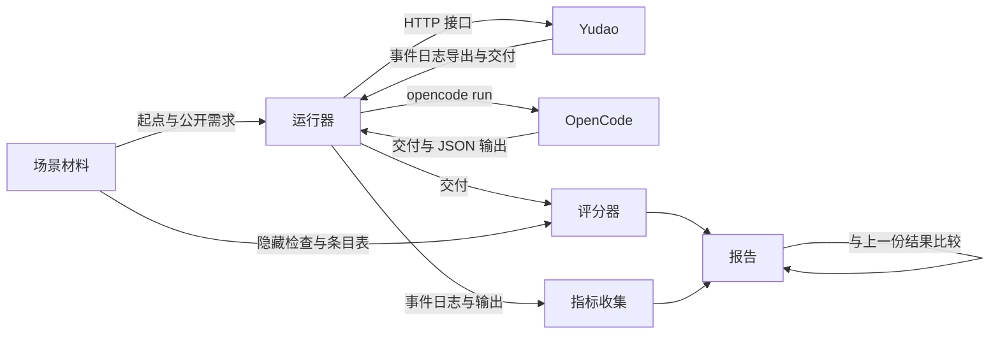

# 评测场景：版本回归与 OpenCode 对照

总图位置：第四节系统之外「评价」的缝；第五节验收表的「真实场景」一层。依据：[D32 与单个 agent 的对照实验](../requirements/comparison-experiment.md)（需求）、[架构与需求诊断](../research/architecture-diagnosis-2026-10-19.md)、[D38](../requirements/system-intent.md)、[规则登记与参数设计说明](rules-and-parameters.md)、[ADR-0038](../adr/0038-function-first-commands-without-registration.md)。

## 1. 用途

同一套场景、同一个评分器服务两件事：

| 用途 | 比较的对象 | 何时运行 |
| --- | --- | --- |
| 版本回归 | Yudao 的新版本与上一个版本 | 每个里程碑交给用户试用之前运行一次，与集成层批量运行放在一起，运行当时已经具备条件的场景，每个场景 3 次；平时手动运行 |
| OpenCode 对照 | Yudao 与单独运行的 OpenCode | OpenCode 的基础分在评测工具完成后运行一次；Yudao 一侧在第 9 节的前提满足后运行；之后每个阶段结束时重复 |

三个场景是回归场景，参与日常调整，是版本比较与后续优化的依据；另设留出场景，不参与日常调整，每个阶段结束时与每次结构性采用之前运行一次，用过以后转为回归场景（第 6.2 节）。回归场景与留出场景的材料对 Yudao 与 OpenCode 都隐藏，部门 Prompt、定义、工具说明与技能中不写入任何场景专属的内容（第 8 节）。

## 2. 三个场景

| | 场景 1：网页应用 | 场景 2：在已有代码上加功能 | 场景 3：从较长的 PRD 新建项目 |
| --- | --- | --- | --- |
| 来源 | WebGen-Bench 000080 待办清单（github.com/mnluzimu/WebGen-Bench `c89e074`；数据 HF `luzimu/WebGen-Bench` `c061fe8`；MIT） | FeatBench `openai__openai-agents-python-842`（github.com/TsinghuaISE/FeatBench `8157fef`，`dataset/featbench_v1_0.json`；MIT） | PRDBench 44 Beijing Subway Fare Calculation System（github.com/AGI-Eval-Official/PRDBench `050bbcb`；数据 HF `AGI-Eval/PRDbench` `9eaa708`；MIT） |
| 侧重 | 界面、交互操作、完成的丰富程度 | 新功能改对，原有功能不被破坏 | 理解较长的需求、自行决定未写明的细节、完成度 |
| 难度 | 简单：需求 441 个字符，单页面 | 中等：仓库包代码约 1.3 万行，标准答案改 4 个文件；单个 agent 通过论文 3/8、Harbor 4/9 | 较难：PRD 125 行，路径算法与票价规则，多个模块 |
| 起点 | 空目录 | 仓库在任务基准提交的代码 | 空目录加题目提供的 `subway_data.json` |
| 正确性与完成度 | 8 条固定用例，界面智能体在浏览器中执行 | 8 条新功能测试（F2P） | 24 条检查：单元 12、文件比对 2、命令行 10 |
| 原有功能 | 不适用 | 331 条原有功能测试（P2P） | 不适用 |
| 丰富程度 | 10 项检查清单，多模态裁判打分 | 不评 | 不评 |
| 评分用到的模型 | 界面智能体与裁判 | 不用 | 不用 |

### 2.1 场景 1：待办清单

- 需求：WebGen-Bench 000080 原文。新建、编辑、删除、标记完成、筛选、搜索；淡紫色背景、靛蓝色组件。
- 接口约定：只有启动方式，按 WebGen-Bench `c89e074` 评测脚本的约定写出；端口由环境变量 `PORT` 给出。页面元素不规定标识，用例由界面智能体按可见内容操作。
- 需求条目（8 条）与用例：新建、编辑、删除、标记完成、按完成状态筛选、搜索、页面导航、配色，每个条目对应 WebGen-Bench 的一条用例。
- 丰富程度清单：ArtifactsBench（github.com/Tencent-Hunyuan/ArtifactsBenchmark `88c968b`）1278 号题（待办清单）的 10 项清单。前 4 项是这道题的功能扩展、创新功能、视觉与交互条目，后 6 项是通用条目：健壮性、创新功能、冗余功能、工程质量、界面视觉、动态交互。每项 0 至 10 分。

### 2.2 场景 2：模型设置透传参数

- 需求：FeatBench 842 的原文，ModelSettings 新增任意参数字典 `extra_args`，透传给 OpenAI 与 LiteLLM 的调用，多层设置合并时字典合并、覆盖的一方优先。
- 接口约定：无。测试调用的是仓库已有的接口与需求中写明的字段名。
- 需求条目（6 条）：参数保存与序列化；合并时覆盖的一方优先；一方为空或两方都为空时的合并；透传到 Chat Completions；透传到 LiteLLM；参数为空时的行为。8 条 F2P 挂在这 6 个条目下。
- 环境：仓库按任务的基准提交检出，用仓库自己的锁文件建立环境（`uv sync --frozen --all-extras --all-packages --group dev`），使用 Python 3.13；建立环境时需要网络（GitHub 与 PyPI）。标准答案与上游提交 `0eee6b83` 相同。
  - Python 3.9 在 Windows 上的时钟精度为 15.6 毫秒，tracing 的 20 条原有功能测试结果不稳定。
  - Python 3.13 上，基准提交的 P2P 与标准答案的 F2P、P2P 各运行 3 次，全部通过。
  - 已知有 8 条用例因为缺少 API key 或 pydantic 版本不符而失败，它们不在 F2P 与 P2P 清单中，评分只运行清单中的用例。

### 2.3 场景 3：北京地铁票价

- 需求：PRDBench 44 的 PRD（英文译本）。三种路径（最短距离、最少换乘、综合最优）、最大换乘数、线路偏好、分段票价、行程时间、命令行连续查询、文本与 JSON 导出、数据完整性检查。
- 接口约定：约 12 条，写在 PRD 之后，两边拿到同一份：模块名 `models`、`data_loader`、`pathfinding`、`fare_calculator`；`Edge`、`Graph`、`ShortestPath`、`PathfindingConfig` 的构造参数与属性；`load_subway_data` 与 `DATA_FILE_PATH`；`Sum_money` 的输入单位为米；`calculate_estimated_time(米, 换乘数)`；程序入口 `src/cli.py`；文本导出的版面与 JSON 的字段名。综合模式的评分公式、换乘站处理与输出措辞等不写入约定，由产品部门决定。
- 需求条目（7 条）：三种路径模式、换乘限制、线路偏好、票价计算、行程时间、导出、命令行查询。24 条检查挂在这 7 个条目下。
- 检查的改造：
  - 10 条命令行检查改写成确定的输出断言（输入格式 PRD 已规定，期望的距离、票价、换乘次数由题目数据算出），不使用 PRDJudge。
  - 修正三条有缺陷的检查：两条（10.1、10.2）只检查题目自带的数据文件，改为检查交付的数据加载结果；`test_line_preference` 的断言 `any(" 1" in edge.line)` 在该路线上不成立——最少换乘的基准路径本就经过 Line 1，偏好完全没实现也能通过，改为在两条路线上各指定一条基准路径不经过的线路（天安门东到中关村指定 `Line 10`，丰台东大街到西单指定 `Line 4`，另加一组多线路偏好 `["Line 2", "Line 4"]`），要求路径真的走上所指定的线路且相对基准发生变化，只对某一条线路名称做特殊处理的交付会在另一条路线上失败。
  - 评分只记通过与不通过，不使用原评测的 0、1、2 分。

### 2.4 材料的冻结与校验

每个场景的材料包含：需求原文、接口约定、需求条目表（条目与检查的对应）、隐藏检查、运行环境、参考解法。材料带版本号，修改材料就是新版本，新旧版本的结果不直接比较。

参考解法必须通过全部隐藏检查，用来确认检查本身没有写错：场景 1 用 WebGen-Bench 提供的参考产物或执行者按需求写出的参考实现；场景 2 用 FeatBench 的标准答案；场景 3 用执行者按 PRD 与接口约定写出的参考实现。

## 3. 两边的运行条件

| 条件 | 规则 |
| --- | --- |
| 模型 | 两边使用同一个模型，由用户提供，具有视觉能力；Yudao 三个部门都绑定这个模型，模型与服务写进报告。用户指定 `ag/gemini-3.8-flash-medium`（9router，Chat Completions，带视觉），经用户的模型服务调用：OpenAI 兼容接口，模型名在用户环境变量 `YUDAO_EVAL_MODEL` 中，地址与 Key 在 `YUDAO_EVAL_BASE_URL`、`YUDAO_EVAL_API_KEY` 中，不写进仓库、工单与日志（[运行配置](../agents/autopilot-runtime.md)第 4 节）。`qhub/Qwen3.8-Flash` 在 OpenCode 一侧调不动工具（`opencode run --pure` 一要求改文件就报 `UnknownError: Expected 'function.name' to be a string.`），不用。模型变了，以前的结果不能和以后的直接比较，两边的基础分用新模型重新运行。 |
| 输入 | 同一份需求原文加同一份接口约定；Yudao 从正常入口作为用户原始意图提交，OpenCode 作为 `opencode run` 的消息。起点相同：材料起点里的文件（场景 3 是 `subway_data.json`）在 OpenCode 一侧复制进运行目录，在 Yudao 一侧经新建项目的起始文件夹（`project.create` 的 `initial_directory`）带入，事项文字不另写起点文件的说明 |
| 设置 | Yudao 使用当前版本的规则登记中的暂定默认值与参数，不为场景调整，结果记录定义版本与参数版本；OpenCode 固定版本号，使用默认 agent |
| 模型的容量 | 两边的上下文窗口与单次输出上限相同，取模型服务的模型列表为这个模型报告的值（`context_length`、`max_completion_tokens`），列表没有报告时用运行器参数给出；Yudao 写进模型访问定义，OpenCode 写进运行配置的模型限额；报告写明取值与来源 |
| 联网 | 两边都不联网：任务来自公开仓库，联网取回可能直接取回上游的答案。运行器以关闭取回的启动参数启动被测的 Yudao，评测项目不设置 MCP 服务器，部门没有这两类工具（[网络取回与 MCP 工具设计说明](network-and-mcp.md)「工具的提供」）；OpenCode 的运行配置关闭取回与搜索工具，运行器检查 JSON 输出中没有这两类工具的调用，报告写明这一条。两边的命令都能访问网络，运行器在 OpenCode 的 JSON 输出与 Yudao 的事件日志导出中查找对任务上游仓库的访问，找到时这次运行无效并写进报告。建立环境时的联网（GitHub 与 PyPI）由运行器在评测前完成，不属于模型的工具 |
| 时间上限 | 每次运行 120 分钟，两边相同，由运行器在 120 分钟时结束运行，与 Yudao 默认的运行时间上限相同。取 120 分钟的理由：90 分钟里三部门一次也没有走到质检的结论（[架构与需求诊断](../research/architecture-diagnosis-2026-10-19.md)第 7 节发现 2）。超时的运行标记超时：OpenCode 按结束时的目录评分；Yudao 按最后一次封存的交付评分，并写明质检是否已经放行，时间上限以内没有提交过交付的，全部检查记为「没有做」 |
| 运行环境 | 在控制主机上直接运行（[执行环境服务设计说明](execution-environment.md)「代码的权限、认证与加密」）。两边的命令在同一台机器上、使用同一套版本固定的工具：uv 管理的 Python 3.13、Node.js 的一个固定版本、Playwright 安装的 Chromium；报告记录宿主环境（系统与这些工具的版本）。OpenCode 在运行目录中以 `opencode run` 运行；Yudao 的项目使用默认的执行位置，也就是控制主机上的本机进程，工作区从封存快照建立（[执行环境服务设计说明](execution-environment.md)「实现与执行位置上的程序」）；场景 2 的建档不计入时间上限，用量与耗时单独列出。每次评测在检出被测提交的专门 worktree 里运行，运行期间不切换提交；运行器在每次运行启动 Yudao 服务时记下提交号 |
| 隔离 | 每次运行在 Yudao 仓库之外新建运行目录，从材料中的起点复制；被测的 Yudao 也使用仓库之外的数据目录。隐藏检查、条目表与参考解法不进入运行目录，运行结束以后才复制到单独的评分目录。两边的命令都能读写所在账户能访问的全部文件（[ADR-0038](../adr/0038-function-first-commands-without-registration.md)），运行器因此做两项核对：在 OpenCode 的 JSON 输出与 Yudao 的事件日志导出中查找材料目录的路径；评分之前计算材料的摘要，与材料版本记录的摘要比较。路径被找到或摘要不同时，这次运行无效并写进报告 |
| 次数 | 每个场景每边 3 次；对照的结论是无差别、预期的效果值得继续时，补到事先写好的次数（6 次），只在 3 次与 6 次两个位置查看结果。3 次、6 次与每次 120 分钟都是暂定默认值，属于评价标准，只由用户修改 |
| 模型服务故障 | 因为模型服务故障而结束的运行单独记录并补跑一次，不计入结果；Yudao 一侧等待模型服务时，这类情况是等待，不结束运行 |

## 4. 评分

### 4.1 完成度与正确性

每条检查挂在一个需求条目下。条目得分等于该条目下检查的通过比例；完成度等于各条目得分之和除以条目总数。报告列出每个条目的得分。

界面智能体对用例给出「通过、部分通过、不通过」，分别记 1、0.5、0。

每条失败的检查自动归入两类之一：

| 类别 | 判断依据 |
| --- | --- |
| 没有做 | 界面智能体报告找不到对应的元素或入口；单元测试因为模块、类、函数或入口不存在而失败 |
| 做了但结果不对 | 界面智能体完成了操作，结果不符；断言不符或抛出与需求不符的错误 |

正确性等于「做了」的检查中通过的比例。

### 4.2 原有功能（场景 2）

331 条 P2P 单独报告失败条数，不计入完成度。

### 4.3 丰富程度（场景 1）

- 裁判按第 2.1 节的 10 项清单逐项打分，每项 0 至 10 分，总分 100。
- 裁判的输入：界面智能体执行 8 条用例时在每条用例关键状态截下的图，加上交付的全部代码。
- 界面智能体与裁判各使用一个固定的模型，版本号写进报告；换模型就是评分器的新版本，新旧结果不直接比较。用户指定界面智能体与裁判都用 `ag/gemini-3.8-flash-high`。三者经同一个模型服务调用。
- 每次运行评分一次。

## 5. 过程检查点与指标

### 5.1 Yudao 的过程检查点

全部从导出的事件日志计算，不使用模型：

1. run 在限额内结束，状态为放行。
2. 质检的放行绑定最后提交的交付树；放行引用的检查回执取自主机，其中 `verification.recheck_ratio` 要求质检重新运行的检查，回执由质检自己取得（暂定默认值 1.0，即全部由质检自己取得）。
3. 重放结果与记录一致。
4. 质检误放行：质检放行，而隐藏检查中存在失败。报告写出失败的条目。
5. 每次放行附检验覆盖比例、靠模型阅读作出判断的条件数与开环的条件数；开环的条件列在放行记录里。

结束状态与放行状态分别核对：第 1 项同时要求 `DONE`、停止原因为 `released`、存在当前交付快照的质检放行、已用量没有超出冻结限额。`no_tool_call`、开环完成、取消、达到限额、模型服务故障以及运行器结束进程都不能通过第 1 项；以开环完成结束的运行，结果与报告的停止原因写「开环完成」，不写成放行。第 4 项在没有放行时记录「不适用：本次没有放行」，不作为验证质量通过的样本。

报告列出每次运行的阶段、停止原因、已用量与限额、是否存在放行、放行绑定的交付快照摘要，以及证据事件编号。结束状态取自事件日志，进程退出只作为运行器证据；两者不一致时报告写明差异。

### 5.2 指标

| 指标 | Yudao | OpenCode |
| --- | --- | --- |
| 结束状态与原因 | 事件日志 | 进程退出状态与输出 |
| 循环次数、返工次数、部门之间询问次数 | 事件日志 | 不适用 |
| 模型请求数、输入与输出用量 | 事件日志 | `--format json` 输出汇总 |
| 耗时 | 事件日志 | 运行器计时 |
| 建档的模型请求数、用量与耗时（场景 2） | 事件日志，单独列出，不计入上面三行 | 不适用 |
| 完成度、正确性、失败分类 | 评分器 | 评分器 |
| 第一次交付与最终交付的完成度 | 评分器分别对第一次与最后一次封存的交付评分 | 不适用：只有一份交付 |
| 质检是否在时间上限以内给出结论 | 事件日志 | 不适用 |
| 质检带来的提高：最终交付比第一次交付多通过的隐藏检查条数 | 评分器 | 不适用 |
| 原有功能失败条数（场景 2） | 评分器 | 评分器 |
| 丰富程度（场景 1） | 评分器 | 评分器 |
| 费用 | 用量乘以模型访问定义里用户填写的单价；没有填写单价时费用为未知；缺少用量时费用为未知 | 用量乘以同一个模型访问定义的单价；没有填写单价时费用为未知；缺少用量时费用为未知 |
| 检验覆盖比例、模型阅读的条件数、开环的条件数 | 质检的逐条结论 | 不适用 |
| 解释翻转率（[验证的独立性设计说明](independent-verification.md)「共享上下文的一组对照」的共享组） | 事件日志 | 不适用 |

每个指标报告每次运行的取值与它们的平均值、最小值、最大值，另报告噪声范围（同一版本重复运行时该指标的波动范围）。`unknown` 不转换为零，也不参与平均值、最小值、最大值和噪声范围；每项统计列出有效样本数与未知样本数。由于没有运行记录、用量字段缺失、单价缺失或运行被作废造成的未知分别记录原因。

## 6. 报告与版本比较

- 每次评测写出一份机器可读的结果（JSON）与一份中文报告。结果记录：Yudao 提交号或 OpenCode 版本号、定义版本与参数版本、模型、场景材料版本、评分器版本（含界面智能体与裁判的模型）、宿主环境、每次运行的全部指标（含费用与检验覆盖比例）与失败条目。每次运行必须同时记录结束状态、停止原因、是否存在放行、放行绑定的交付摘要、用量字段的来源和未知原因。
- 原始证据（事件日志导出、交付副本、截图、评分日志）保存在 `.yudao/evals/` 下，不进入 Git；结果与报告提交到 `docs/evaluation/`。
- 版本比较只在材料版本与评分器版本相同的结果之间进行：
  - 回归：完成度的下降超出噪声范围、原有功能失败条数增加、任一过程检查点失败、质检误放行次数增加。
  - 只报告变化：正确性、丰富程度、循环与返工次数、请求数、用量、耗时。

### 6.1 噪声范围与三种结论

版本比较按[规则登记与参数设计说明](rules-and-parameters.md)「对照」进行：噪声范围来自同一版本的重复运行，候选与基线配对比较（同一场景按运行的序号配对，第 1 次对第 1 次，不按运行编号），结论是改进、无差别、退化之一；只影响裁决与检测的改动用已有的事件日志离线重新裁决。

### 6.2 留出场景

留出场景从三个现有来源（WebGen-Bench、FeatBench、PRDBench）各取 2 个，评分器的结构沿用，不参与日常调整。在每个阶段结束时与每次结构性采用之前各运行一次；用过的转为回归场景，再补入新的。每个新场景的材料（需求原文、接口约定、需求条目表、隐藏检查、运行环境、参考解法）按第 2.4 节冻结与校验。采用任何定义版本与升级实例，都要求回归场景与留出场景不退化；只在自举工单上出现的改善不算数。

### 6.3 Yudao 对单个 agent

Yudao 对 OpenCode 的对照不用第 6.1 节的版本比较：质检误放行对 OpenCode 没有意义；每边 3 次时完成度的差别分辨不出，场景 3 上 OpenCode 同一版本 3 次之间差 0.31。判定按 [D38](../requirements/system-intent.md) 的 N-G1：

1. 「高于」看质检这一段：同一个场景 3 次运行中至少 2 次，质检在时间上限以内给出结论，并且最终交付比本次第一次交付多通过至少 1 条隐藏检查；第一次交付已经全部通过的那次运行不计入；3 次都没有质检误放行。
2. 两边每次运行的完成度、正确性、失败条目、用时、请求数与用量逐次并排列出，Yudao 一侧列第一次交付与最终交付两个完成度；这一部分只报告，不单独据此判定「高于」。
3. 结论写成「高于」「没有达到」「受阻」之一；受阻写明缺哪项证据，例如质检没有在时间上限以内给出结论的次数。

## 7. 模块划分

评测工具放在仓库根目录的 `evals/`，与 `harness/` 分开。它只通过 Yudao 的公开接口（HTTP 接口与事件日志导出）驱动和观察 Yudao，不导入 `harness` 的内部模块，所以同一个评测工具可以评测不同版本的 Yudao。评分器、隐藏检查与参考解法列入内核清单（[可信内核设计说明](trusted-kernel.md)）；评测使用的评分器与隐藏检查取自当前运行的已发布版本，不取自被开发的代码。

| 模块 | 职责 | 边界 |
| --- | --- | --- |
| 场景材料 | 三个场景的需求、接口约定、条目表、隐藏检查、运行环境、参考解法 | 只被运行器（起点与公开部分）和评分器（隐藏部分）读取 |
| 运行器 | Yudao 驱动：建立项目（场景 2 接入已有项目，等待建档结束并回答初始 PRD 的确认）、提交需求、等待结束、导出事件日志与交付；OpenCode 驱动：建立运行目录、运行 `opencode run`、取出交付与 JSON 输出；运行结束以后在输出与事件日志导出中查找材料目录的路径 | 只把起点与公开部分交给被测方 |
| 评分器 | 在评分目录中对交付运行隐藏检查；场景 1 由界面智能体执行用例并截图、由裁判按清单打分；按条目计算完成度与失败分类 | 不知道交付来自哪一方 |
| 指标收集 | 从 Yudao 事件日志计算过程检查点与指标；从 OpenCode 输出汇总用量 | 只读取导出的文件 |
| 报告 | 写结果与报告；与指定的上一份结果比较，给出改进、无差别、退化之一，附噪声范围、逐任务的差值与费用；保存对照记录 | 只读取结果文件 |

## 8. 过拟合与数据污染

- 三个场景是后续优化的依据，也因此容易被优化过度。部门 Prompt、定义、工具说明与技能中不写入场景的题目内容、条目或检查；发布检查在部门 Prompt、定义、工具说明与技能里检索评测场景的专有内容，命中即失败，执行者的代码审查继续核对。
- 三个来源的数据自 2025 年起公开，模型可能在训练中见过。同一模型下两边受到的影响相同，对照结论成立；绝对分数只在同一模型下比较。

## 9. 前提与未决事项

- 场景 1 的 Yudao 一侧需要质检部门的浏览器工具，按 PRD 自行生成测试并操作页面（浏览器工具见 [D34](../requirements/browser-and-computer-use.md)）；评测使用的模型具有视觉能力。工程按接口约定在交付说明中写启动方式，端口从 `PORT` 读取；质检按交付说明启动交付的网页（[浏览器与 computer use 设计说明](browser-and-computer-use.md)「启动方式」）。OpenCode 基础分与 Yudao 的场景 2、3 不依赖它。
- 场景 2 的 Yudao 一侧依赖接入已有项目：运行器用 `project.onboard` 接入仓库在基准提交的代码，建档完成以后由运行器回答初始 PRD 的确认，再新建事项提交需求；测试命令用 Python 3.13 运行（命令不登记，ADR-0038），例如 `uv run --python 3.13 pytest …`。建档的用量与耗时在报告中单独列出，与事项的指标分开（第 5.2 节；[接入已有项目设计说明](existing-project-onboarding.md)「用户确认的决定」第 1 项）。
- 界面智能体与裁判使用的模型由用户提供：要能看图、版本固定、与被测模型不同。第 3 节、第 4.3 节用到的模型都要经核对能读出网页截图中的文字。
