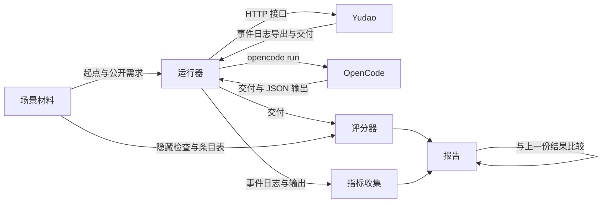

# 评测场景：版本回归与 OpenCode 对照

更新：2026-09-28。状态：设计，场景与评分方法经用户确认，未实施，没有建立工单。用户把评测列为最重要的工作，实施之前由用户逐项审阅本文，审阅以后再整理成工单。路线位置：Stage 3 的评测工作线，与界面工作线和后端工单并行进行，Stage 3 结束之前必须完成。需求：[D32 与单个 agent 的对照实验](../requirements/comparison-experiment.md)。选题依据：[评测场景选题调研](../research/evaluation-benchmarks.md)。

## 1. 用途

同一套场景、同一个评分器服务两件事：

| 用途 | 比较的对象 | 何时运行 |
| --- | --- | --- |
| 版本回归 | Yudao 的新版本与上一个版本 | 每个工作包验收时；平时手动运行 |
| OpenCode 对照 | Yudao 与单独运行的 OpenCode | OpenCode 的基础分在评测工具完成后运行一次；Yudao 一侧在第 9 节的前提满足后运行；之后每个阶段结束时重复 |

后续对 Yudao 的优化以这三个场景的结果为依据。三个场景的材料对 Yudao 与 OpenCode 都隐藏，部门 Prompt、定义与工具说明中不写入任何场景专属的内容（第 8 节）。

## 2. 三个场景

| | 场景 1：网页应用 | 场景 2：在已有代码上加功能 | 场景 3：从较长的 PRD 新建项目 |
| --- | --- | --- | --- |
| 来源 | WebGen-Bench 000080 待办清单（github.com/mnluzimu/WebGen-Bench `c89e074`；数据 HF `luzimu/WebGen-Bench` `c061fe8`；MIT） | FeatBench `openai__openai-agents-python-842`（github.com/TsinghuaISE/FeatBench `8157fef`，`dataset/featbench_v1_0.json`；MIT） | PRDBench 44 Beijing Subway Fare Calculation System（github.com/AGI-Eval-Official/PRDBench `050bbcb`；数据 HF `AGI-Eval/PRDbench` `9eaa708`；MIT） |
| 侧重 | 界面、交互操作、完成的丰富程度 | 新功能改对，原有功能不被破坏 | 理解较长的需求、自行决定未写明的细节、完成度 |
| 难度 | 简单：需求 441 个字符，单页面 | 中等：仓库包代码约 1.3 万行，标准答案改 4 个文件；单个 agent 通过论文 3/8、Harbor 4/9 | 较难：PRD 125 行，路径算法与票价规则，多个模块 |
| 起点 | 空目录 | 仓库在任务基准提交的代码 | 空目录加题目提供的 `subway_data.json` |
| 正确性与完成度 | 8 条固定用例，界面智能体在浏览器中执行 | 8 条新功能测试（F2P） | 23 条检查：单元 11、文件比对 2、命令行 10 |
| 原有功能 | 不适用 | 331 条原有功能测试（P2P） | 不适用 |
| 丰富程度 | 10 项检查清单，多模态裁判打分 | 不评 | 不评 |
| 评分用到的模型 | 界面智能体与裁判 | 不用 | 不用 |

### 2.1 场景 1：待办清单

- 需求：WebGen-Bench 000080 原文。新建、编辑、删除、标记完成、筛选、搜索；淡紫色背景、靛蓝色组件。
- 接口约定：只有启动方式与端口，按 WebGen-Bench `c89e074` 评测脚本的约定写出。页面元素不规定标识，用例由界面智能体按可见内容操作。
- 需求条目（8 条）与用例：新建、编辑、删除、标记完成、按完成状态筛选、搜索、页面导航、配色，每个条目对应 WebGen-Bench 的一条用例。
- 丰富程度清单：ArtifactsBench（github.com/Tencent-Hunyuan/ArtifactsBenchmark `88c968b`）1278 号题（待办清单）的 10 项清单。前 4 项是这道题的功能扩展、创新功能、视觉与交互条目，后 6 项是通用条目：健壮性、创新功能、冗余功能、工程质量、界面视觉、动态交互。每项 0 至 10 分。

### 2.2 场景 2：模型设置透传参数

- 需求：FeatBench 842 的原文，ModelSettings 新增任意参数字典 `extra_args`，透传给 OpenAI 与 LiteLLM 的调用，多层设置合并时字典合并、覆盖的一方优先。
- 接口约定：无。测试调用的是仓库已有的接口与需求中写明的字段名。
- 需求条目（6 条）：参数保存与序列化；合并时覆盖的一方优先；一方为空或两方都为空时的合并；透传到 Chat Completions；透传到 LiteLLM；参数为空时的行为。8 条 F2P 挂在这 6 个条目下。
- 环境：FeatBench 镜像 `ghcr.io/kndy666/featbench_openai_openai-agents-python:842`（Python 3.9，只含依赖）。仓库按任务的基准提交检出；构建与验证时需要网络（GitHub 与镜像中配置的 pip 源）。已知有 8 条用例因为缺少 API key 或 pydantic 版本不符而失败，它们不在 F2P 与 P2P 清单中，评分只运行清单中的用例。

### 2.3 场景 3：北京地铁票价

- 需求：PRDBench 44 的 PRD（英文译本）。三种路径（最短距离、最少换乘、综合最优）、最大换乘数、线路偏好、分段票价、行程时间、命令行连续查询、文本与 JSON 导出、数据完整性检查。
- 接口约定：约 12 条，写在 PRD 之后，两边拿到同一份：模块名 `models`、`data_loader`、`pathfinding`、`fare_calculator`；`Edge`、`Graph`、`ShortestPath`、`PathfindingConfig` 的构造参数与属性；`load_subway_data` 与 `DATA_FILE_PATH`；`Sum_money` 的输入单位为米；`calculate_estimated_time(米, 换乘数)`；程序入口 `src/cli.py`；文本导出的版面与 JSON 的字段名。综合模式的评分公式、换乘站处理与输出措辞等不写入约定，由产品部门决定。
- 需求条目（7 条）：三种路径模式、换乘限制、线路偏好、票价计算、行程时间、导出、命令行查询。23 条检查挂在这 7 个条目下。
- 检查的改造：
  - 10 条命令行检查改写成确定的输出断言（输入格式 PRD 已规定，期望的距离、票价、换乘次数由题目数据算出），不使用 PRDJudge。
  - 修正三条有缺陷的检查：两条（10.1、10.2）只检查题目自带的数据文件，改为检查交付的数据加载结果；`test_line_preference` 用「 1」匹配线路名的写法按数据中的线路名改正。
  - 评分只记通过与不通过，不使用原评测的 0、1、2 分。

### 2.4 材料的冻结与校验

每个场景的材料包含：需求原文、接口约定、需求条目表（条目与检查的对应）、隐藏检查、运行环境、参考解法。材料带版本号，修改材料就是新版本，新旧版本的结果不直接比较。

参考解法必须通过全部隐藏检查，用来确认检查本身没有写错：场景 1 用 WebGen-Bench 提供的参考产物或执行者按需求写出的参考实现；场景 2 用 FeatBench 的标准答案；场景 3 用执行者按 PRD 与接口约定写出的参考实现。

## 3. 两边的运行条件

| 条件 | 规则 |
| --- | --- |
| 模型 | 两边都通过 OpenCode Go 调用 `opencode-go/deepseek-v4.1-flash`；Yudao 三个部门都绑定这个模型 |
| 输入 | 同一份需求原文加同一份接口约定；Yudao 从正常入口作为用户原始意图提交，OpenCode 作为 `opencode run` 的消息 |
| 设置 | Yudao 使用当前版本定义中的默认限额，不为场景调整；OpenCode 固定版本号，使用默认 agent |
| 时间上限 | 每次运行 90 分钟，两边相同；超时的运行按结束时的交付评分，并标记超时 |
| 运行环境 | 每个场景一个 Docker 镜像，两边的命令都在同一个镜像中执行：场景 1 含 Node、Python 与 Chromium；场景 2 为 FeatBench 镜像；场景 3 为 Python 3.12。OpenCode 在容器内运行；Yudao 的工程与质检通过项目登记的命令在容器内执行，工作区挂载进容器 |
| 隔离 | 每次运行从材料中的起点复制出新的目录；隐藏检查、条目表与参考解法不进入运行环境 |
| 次数 | 每个场景每边 3 次 |
| 模型服务故障 | 因为模型服务故障而结束的运行单独记录并补跑一次，不计入结果；Yudao 实现等待模型服务以后，这类情况改为等待，不再结束 |

## 4. 评分

### 4.1 完成度与正确性

每条检查挂在一个需求条目下。条目得分等于该条目下检查的通过比例；完成度等于各条目得分之和除以条目总数。报告列出每个条目的得分。

界面智能体对用例给出「通过、部分通过、不通过」，分别记 1、0.5、0。

每条失败的检查自动归入两类之一：

| 类别 | 判断依据 |
| --- | --- |
| 没有做 | 界面智能体报告找不到对应的元素或入口；单元测试因为模块、类、函数或入口不存在而失败 |
| 做了但结果不对 | 界面智能体完成了操作，结果不符；断言不符或抛出与需求不符的错误 |

正确性等于「做了」的检查中通过的比例。

### 4.2 原有功能（场景 2）

331 条 P2P 单独报告失败条数，不计入完成度。

### 4.3 丰富程度（场景 1）

- 裁判按第 2.1 节的 10 项清单逐项打分，每项 0 至 10 分，总分 100。
- 裁判的输入：界面智能体执行 8 条用例时在每条用例关键状态截下的图，加上交付的全部代码。
- 界面智能体与裁判各使用一个固定的模型，版本号写进报告；换模型就是评分器的新版本，新旧结果不直接比较。
- 每次运行评分一次。

## 5. 过程检查点与指标

### 5.1 Yudao 的过程检查点

全部从导出的事件日志计算，不使用模型：

1. run 在限额内结束，状态为放行。
2. 质检的放行绑定最后提交的交付树，放行引用的检查回执由质检自己取得。
3. 工程的计划被接纳以前没有写入文件。
4. 重放结果与记录一致。
5. 质检误放行：质检放行，而隐藏检查中存在失败。报告写出失败的条目。

### 5.2 指标

| 指标 | Yudao | OpenCode |
| --- | --- | --- |
| 结束状态与原因 | 事件日志 | 进程退出状态与输出 |
| 循环次数、返工次数、部门之间询问次数 | 事件日志 | 不适用 |
| 模型请求数、输入与输出用量 | 事件日志 | `--format json` 输出汇总 |
| 耗时 | 事件日志 | 运行器计时 |
| 完成度、正确性、失败分类 | 评分器 | 评分器 |
| 原有功能失败条数（场景 2） | 评分器 | 评分器 |
| 丰富程度（场景 1） | 评分器 | 评分器 |

每个指标报告 3 次运行的平均值、最小值与最大值。

## 6. 报告与版本比较

- 每次评测写出一份机器可读的结果（JSON）与一份中文报告。结果记录：Yudao 提交号或 OpenCode 版本号、模型、场景材料版本、评分器版本（含界面智能体与裁判的模型）、宿主环境、每次运行的全部指标与失败条目。
- 原始证据（事件日志导出、交付副本、截图、评分日志）保存在 `.yudao/evals/` 下，不进入 Git；结果与报告提交到 `docs/evaluation/`。
- 版本比较只在材料版本与评分器版本相同的结果之间进行：
  - 回归：完成度下降、原有功能失败条数增加、任一过程检查点失败、质检误放行次数增加。
  - 只报告变化：正确性、丰富程度、循环与返工次数、请求数、用量、耗时。

## 7. 模块划分

评测工具放在仓库根目录的 `evals/`，与 `harness/` 分开。它只通过 Yudao 的公开接口（HTTP 接口与事件日志导出）驱动和观察 Yudao，不导入 `harness` 的内部模块，所以同一个评测工具可以评测不同版本的 Yudao。

| 模块 | 职责 | 边界 |
| --- | --- | --- |
| 场景材料 | 三个场景的需求、接口约定、条目表、隐藏检查、运行环境、参考解法 | 只被运行器（起点与公开部分）和评分器（隐藏部分）读取 |
| 运行器 | Yudao 驱动：建立项目、登记命令、提交需求、等待结束、导出事件日志与交付；OpenCode 驱动：准备容器、运行 `opencode run`、取出交付与 JSON 输出 | 只把起点与公开部分交给被测方 |
| 评分器 | 在场景镜像中对交付运行隐藏检查；场景 1 由界面智能体执行用例并截图、由裁判按清单打分；按条目计算完成度与失败分类 | 不知道交付来自哪一方 |
| 指标收集 | 从 Yudao 事件日志计算过程检查点与指标；从 OpenCode 输出汇总用量 | 只读取导出的文件 |
| 报告 | 写结果与报告；与指定的上一份结果比较 | 只读取结果文件 |

## 8. 过拟合与数据污染

- 三个场景是后续优化的依据，也因此容易被优化过度。部门 Prompt、定义、工具说明与技能中不写入场景的题目内容、条目或检查；执行者的代码审查核对这一点。
- 三个来源的数据自 2025 年起公开，模型可能在训练中见过。同一模型下两边受到的影响相同，对照结论成立；绝对分数只在同一模型下比较。

## 9. 前提与未决事项

- 场景 1 的 Yudao 一侧需要质检部门具备浏览器与 computer use 工具，按 PRD 自行生成测试并操作页面。这是用户确认的质检能力，路线位置待定。OpenCode 基础分与 Yudao 的场景 2、3 不依赖它。
- 场景 2 的 Yudao 一侧使用 3.2A 的可信代码快照接入，测试命令登记为在场景镜像中执行。
- 界面智能体与裁判使用哪个模型待定：要能看图、版本固定、与被测模型不同。

## 10. 实施顺序

1. 场景材料与参考解法校验。
2. 评分器（确定的检查、失败分类、完成度；场景 1 的界面智能体与裁判在模型确定后接入）。
3. OpenCode 运行器与指标收集，运行 OpenCode 基础分，提交第一份报告。
4. Yudao 运行器、过程检查点与版本比较，运行 Yudao 的场景 2、3。
5. 质检的浏览器工具就绪后，运行 Yudao 的场景 1。
