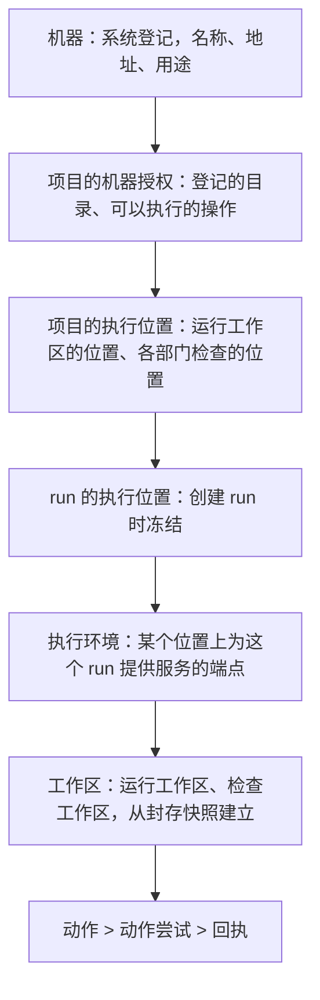
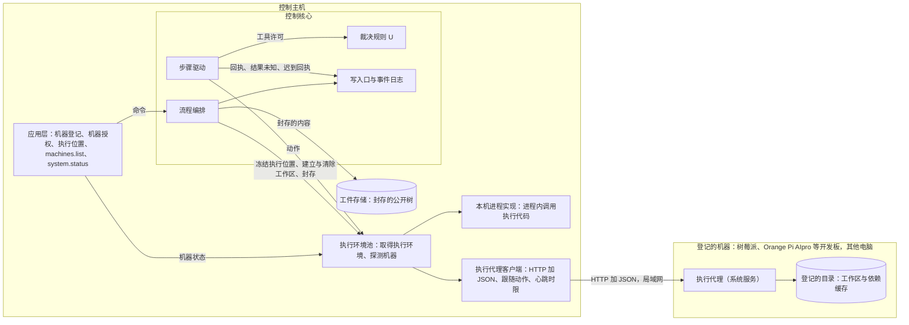
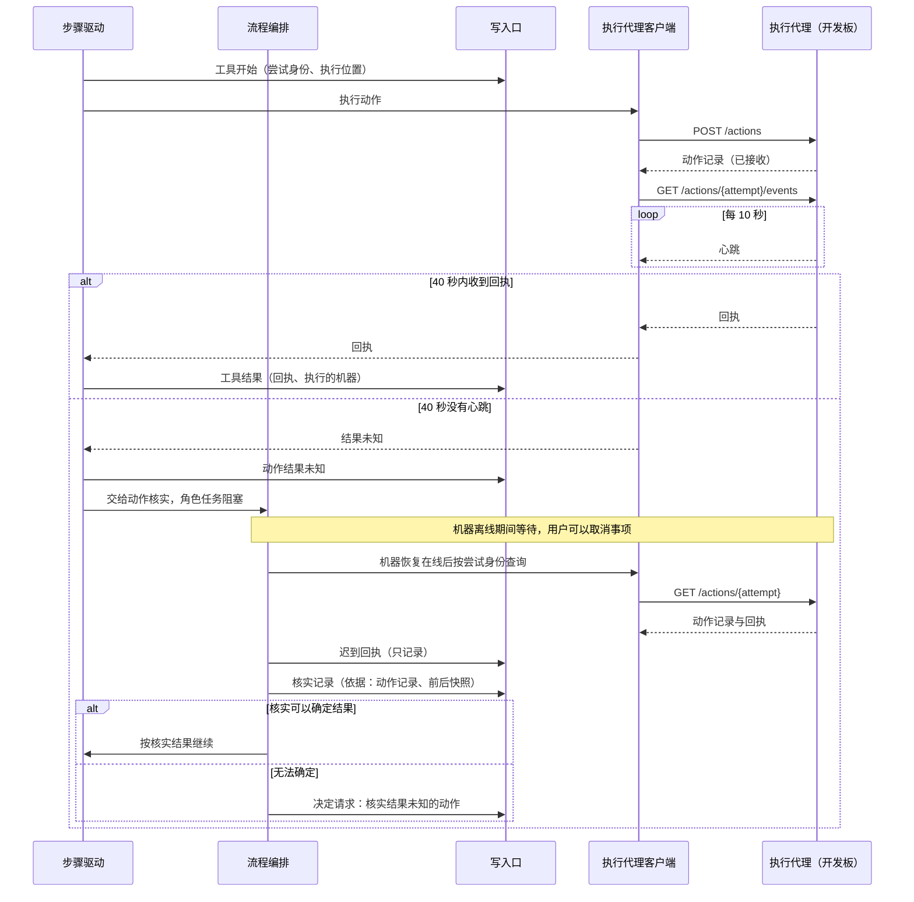
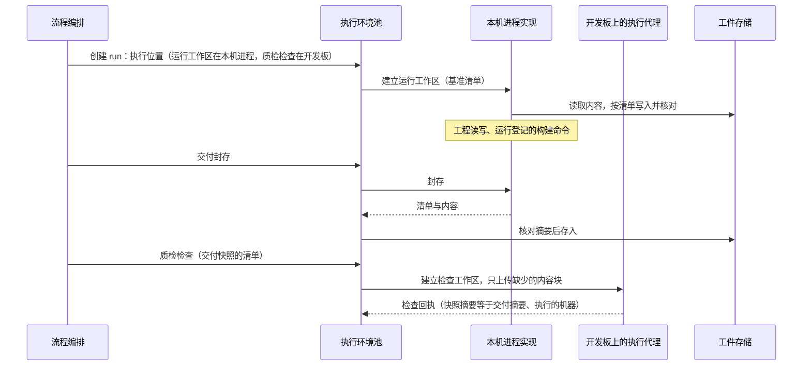

# 执行环境服务设计说明

更新：2026-10-02；2026-10-07 按 [ADR-0027](../adr/0027-trusted-kernel-outside-self-modification.md)、[ADR-0030](../adr/0030-rules-are-provisional-defaults.md)、[ADR-0031](../adr/0031-declared-loop-layers-and-sub-loops.md)：机器的上线与离线写入机器流，等待机器有时长上限，第 6.1 节的数值登记为暂定默认值，自举项目的执行位置。状态：设计已确认（2026-09-29 用户确认第 11 节的决定；2026-09-30 按 ADR-0022 修改，代码在执行位置上直接运行；2026-10-01 执行代理的安装包改为发布时构建，见第 5.3.2 节；同日 3.2B 的网络取回与登记的 MCP 服务器固定在控制主机，见第 1 节末；2026-10-02 冻结执行位置时记录每个位置的系统，见第 7.2 节），未实施；远程机器的真实验收在 Orange Pi AIpro 开发板上进行，开发板已经到位（第 1.1 节）。路线位置：[Stage 3 计划](../stage-3-plan.md) 3.2C，父工单 [#120](https://github.com/bender2333/yudao/issues/120)。

依据：需求 [D29](../requirements/remote-execution.md)；[ADR-0018](../adr/0018-single-control-host-remote-execution.md)（一台控制主机，执行环境分布到多台机器）、[ADR-0022](../adr/0022-run-directly-without-containers.md)（代码在执行位置上直接运行，不使用容器）、[ADR-0007](../adr/0007-boundaries-for-distributed-deployment.md)（其余边界作为执行环境服务的合同）、[ADR-0015](../adr/0015-desktop-client-and-http-contracts.md)（服务之间使用 HTTP 加 JSON）；[总体架构](architecture/overall-architecture.md)第 3、6.3、7 节；[恢复契约与故障矩阵](recovery-contract-and-fault-matrix.md)第 3、4、6 节；[应用层与接口层设计说明](app-and-interface.md)第 3.2、4.3、6.3 节；[本地通用工具设计说明](local-tools.md)；[原型 v9 设计说明](../prototypes/v9/design.md)（沿用 [v8 设计说明](../prototypes/v8/design.md)第 4.2、9.2 节）。调研：[执行环境服务调研](../research/execution-environment.md)。用词以 `CONTEXT.md` 为准。

## 1. 范围

3.2C 交付：

- 执行环境服务的合同：pydantic 类型与一个异步接口，跨进程时经过 HTTP 加 JSON。两种实现：本机进程、远程执行代理。
- 用户在系统中登记机器；项目授权使用机器，并设置执行位置（运行工作区在哪里，各部门的检查在哪里）；每个 run 按创建时冻结的执行位置把动作派发到对应的执行环境。
- 远程动作按心跳判断存活；超过时限没有心跳时动作结果记为未知，按 3.1 的动作核实处理；之后到达的回执记为迟到事实。
- 执行代理的安装、以操作系统服务运行、版本核对与升级。

3.2C 的合同同时是后续工作包的基础：3.2B 的网络取回与登记的 MCP 服务器、3.2D 的试用工具、Stage 4 运维部门的外部动作都作为新的动作类别加入同一份合同，3.2B 与 3.2D 的工单只依赖合同所在的 #128；3.2B 的两类动作固定在控制主机，由本机进程实现提供，执行代理不实现它们（[ADR-0025](../adr/0025-network-and-mcp-run-on-control-host.md)、[网络取回与 MCP 工具设计说明](network-and-mcp.md)第 3 节）；是否作为本项目的运行环境与常设授权在 Stage 4 加入项目的机器授权；3.4A 的执行槽位调度不改变执行环境的合同。

### 1.1 测试与验收用的机器

- 执行代理服务、客户端、结果未知与迟到回执的测试都在控制主机上启动真实的执行代理进程完成（第 12 节 #129、#130、#143）。
- 远程机器的真实验收在 Orange Pi AIpro 开发板上进行，开发板已经到位。#145 在开发板上执行第 10 节的全部场景；#144 在开发板上验收执行代理的系统服务：控制主机是 Windows 电脑，设计只生成 systemd 服务。3.2C 的关闭条件：同一事项的工程构建在控制主机上完成，质检检查在这块开发板上完成。
- 开发板的情况：Orange Pi AIpro（8T），昇腾 310B4，4 核 64 位 ARM（aarch64）；8 GB 内存，128 GB SATA SSD，数据盘 `/data` 约 56 GB 可用；Ubuntu 22.04.5 LTS，系统自带 Python 3.10.12，有 systemd；经 WiFi 接入局域网，与控制主机在同一网段。执行代理使用 uv 安装的 Python（第 5.3.2 节）。
- 控制主机按用户当前的 Windows 11 电脑处理。

## 2. 概念与分层

### 2.1 概念层级

- 授权回答「本项目可以用这台机器做什么」，执行位置回答「本项目的每类动作用哪一个位置」。执行位置必须在授权范围以内；修改执行位置不会扩大授权。
- 执行位置在创建 run 时冻结，run 进行期间不变。运行工作区保存着工程尚未交付的修改，run 中途换位置会丢失这些修改。
- 执行环境是一个位置上为一个 run 提供服务的端点：本机进程实现在控制核心的进程内；远程实现是登记的机器上的执行代理，同一个执行代理为多个 run 服务，工作区按身份分开。
- 每个 run 有一个运行工作区：各部门的读取、工程的写入与登记的命令都在这里执行。检查在检查位置执行；检查位置与运行工作区的位置相同时，检查在运行工作区公开树的副本中运行（现在的做法）；位置不同时，检查位置上有一个检查工作区，按清单从运行工作区的公开树建立（第 4.3 节）。

### 2.2 分层与职责

| 层 | 模块 | 职责 | 边界 |
| --- | --- | --- | --- |
| 控制核心 | 流程编排、步骤驱动、裁决规则 U、写入口 | 流程编排在创建 run 时冻结执行位置，建立与清除工作区，封存交付，处理结果未知的动作；步骤驱动经合同执行动作；U 在工具许可时核对动作类别在执行位置对应机器的授权范围以内 | 只经过 `ExecutionEnvironment` 接口调用执行环境，不知道动作在哪种实现上执行；不直接读写任何工作区文件 |
| 执行层 · 控制主机一侧 | 执行环境池（`harness/environments/`） | 按 run 的执行位置取得执行环境；定时探测登记的机器；把探测结果交给控制核心 | 不写事件；探测的瞬时值只经实时通道显示；机器的上线与离线（在线状态的转变）、结果未知与迟到回执由控制核心写成事件，上线与离线写入这台机器的机器流 |
| 执行层 · 合同 | `harness/execution/contract.py` | 合同类型与 `ExecutionEnvironment` 接口 | 只含可以序列化的数据 |
| 执行层 · 执行代码 | `harness/execution/` | 工作区、公开树、文件工具、进程与进程树、检查副本、动作前后快照、动作记录 | 本机进程实现在控制核心进程内使用它，执行代理在自己的进程内使用它；不导入 Yudao 的其他模块 |
| 执行层 · 执行代理 | `harness/agent/` | FastAPI 服务，把合同的每个操作映射到执行代码；发送心跳；把动作记录保存在本机 | 不访问事件日志、工件存储与模型凭据；只接受控制主机发起的请求，自己不连接控制主机 |

依赖规则用 import-linter 的合同在测试中检查：`harness.execution` 不导入 `harness` 的其他包；`harness.agent` 只导入 `harness.execution`；`harness.environments` 只导入 `harness.execution`，不导入控制核心；控制核心只通过接口使用执行环境池；应用层读取机器状态时导入执行环境池的只读接口（应用层与接口层设计说明第 2.4 节的允许清单增加这一项）。

### 2.3 模块交互

## 3. 现在的代码

提交 `82b0f34`：

- 合同类型在 `harness/actions.py`：`Action`（第 26–36 行）、`ActionReceipt`（第 39–52 行）、`FactsQuery` 与 `WorkspaceFacts`（第 55–118 行）。
- 本机实现 `LocalEnvironment` 在 `harness/environment.py` 第 74–140 行，提供 `perform`、`cancel`、`query`、`snapshot`；进程在新的进程组或会话中启动，超时或取消时结束整个进程树（第 466、491 行起）。它在构造时接收 `Workspace` 与登记命令，检查的绑定信息（激活身份、合同与计划摘要）由流程编排写在 `Workspace` 对象上（`orchestrator.py` 第 884–891 行）。
- `harness/workspace.py` 的 `Workspace` 负责受限读写、检查副本（第 114 行）与检查回执（写在工作区内的 `.checks/receipts.jsonl`，第 42、120 行）；`harness/public_tree.py` 定义公开树清单 `yudao-public-tree-v1`（第 15、48–56 行）与 `materialize_tree`（第 159 行）；`harness/tree_archive.py` 把公开树存进工件存储。
- 调用位置：`engine.py` 第 474 行（工具许可之前查询）、第 492 行（执行动作）；`orchestrator.py` 第 279–283 行（创建 run 时直接写入初始树）、第 895 行（每次激活新建 `LocalEnvironment`）、第 959 行（提案判断前查询）、第 998 行（提交时取得带内容的公开树）。
- [#110](https://github.com/bender2333/yudao/issues/110) 把创建 run 时写入初始树与提交时读取工作区改为执行环境的操作（从快照建立工作区、取得带内容的公开树），之后控制核心中没有直接读写工作区的代码。3.2C 在 #110 的基础上把这两个操作改成可以跨进程的形式（第 4.3 节）。[#17](https://github.com/bender2333/yudao/issues/17) 在执行环境中加入动作前后快照与动作核实，3.2C 把这部分放进执行代码，远程的动作同样具备。

## 4. 执行环境服务的合同

### 4.1 操作

控制核心看到的是一个异步接口 `ExecutionEnvironment`，两种实现都提供下表的操作。

| 操作 | 输入 | 输出 | 说明 |
| --- | --- | --- | --- |
| 建立工作区 | 工作区说明：工作区身份、项目、run、用途（运行、检查）、基准清单、登记的目录（远程）、执行权编号 | 建立以后的树事实（摘要必须等于基准清单的摘要） | 同一身份、同一清单重复调用不改变工作区；同一身份、不同清单时拒绝 |
| 执行动作 | 动作：逻辑动作与尝试的身份、类别、工具、输入、前置条件、限额、绑定信息、执行权编号 | 回执，或结果未知 | 覆盖读取、写入、编辑、删除、移动、检查、登记的命令；执行代理的实现在动作进行期间发送心跳 |
| 取消 | 尝试身份 | 没有直接输出；取消的确认是状态为已取消的回执 | 取消先于动作到达时记下，动作到达时不执行 |
| 查询 | 工作区身份、要取得的事实 | 公开树清单与摘要、检查回执、路径的规范形式与种类 | 只读，沿用 `FactsQuery` 与 `WorkspaceFacts` |
| 封存 | 工作区身份 | 公开树清单与检查回执；文件内容按摘要取得 | 执行环境在封存时把内容复制进自己的内容块存储，此后取得的内容不受工作区后续修改影响 |
| 动作记录 | 尝试身份 | 状态（已接收、进行中、已结束、中断）、回执、进程号与进程启动时间、起止时间 | 核实结果未知的动作时使用 |
| 删除工作区 | 工作区身份、执行权编号 | 没有输出 | run 结束时调用；内容块在没有工作区引用以后删除 |
| 环境信息 | 没有输入 | 机器编号、执行代码摘要、Yudao 版本、系统与架构、执行位置上的程序与版本（第 5.2 节）、进行中的动作数、数据目录的可用空间 | 执行环境池探测机器与核对版本时使用 |

D29 列出的操作与上表的关系：写文件与运行命令是执行动作；读取树清单与摘要是查询；心跳是执行动作期间的心跳消息与环境信息的定时探测（第 6 节）。

### 4.2 类型

全部是 pydantic 类型，可以序列化，不含进程内的对象（总体架构第 7 节）。

- **工作区说明**：如第 4.1 节所列。基准清单使用 `yudao-public-tree-v2`：目录列表，加上每个文件的路径、大小、`sha256:` 内容摘要与可执行标记；在 Linux 机器上建立的工作区据此恢复脚本的可执行权限（例如 `./gradlew`）。`yudao-public-tree-v1` 的清单继续可以读取，文件按不可执行处理：清单属于采纳成果，项目流中已采纳的快照跨 Yudao 版本读取（ADR-0019）。
- **动作**：在现有 `Action` 上增加尝试身份、工作区身份、执行权编号、限额与绑定信息。
  - 限额（时限、输出上限）由步骤驱动按定义填入，执行代码不读取定义：定义的新版本在控制主机上采用（ADR-0014），执行代理不需要随之更新。
  - 绑定信息是现在写在 `Workspace` 对象上的检查绑定（激活身份、产品合同、交付说明、有效合同与工程计划的摘要），以及 `run_command` 使用的那一条冻结的登记命令。执行环境不再按激活保存状态，同一个执行代理可以同时服务多个 run。
- **回执**：在现有 `ActionReceipt` 上增加尝试身份、执行位置说明（实现、机器编号、执行代码摘要）与动作前后的树摘要（#17 的前后快照）。检查回执与登记命令回执中的 `"executor": "host"` 改为执行位置说明，`run.actions` 与部门工作间据此写明执行的机器。
- **结果未知**：尝试身份、原因（心跳超时、派发没有得到确认）、最后一次心跳或确认的时间。
- **心跳**：尝试身份、已用时间、已产生的输出字节数、发送时间。
- **动作记录、环境信息**：如第 4.1 节所列。

### 4.3 工作区的建立、封存与传输

工作区的内容按清单加内容块传输，做法参照 Bazel Remote Execution API 的内容寻址存储（`FindMissingBlobs` 先问缺少哪些，再只上传缺少的，调研第 3.4 节）。Yudao 的公开树清单已经带有每个文件的内容摘要，传输直接使用它。

- **建立**：执行环境池把基准清单交给执行环境，执行环境回答缺少哪些内容块；执行环境池从工件存储读出这些内容块上传；执行环境按清单写入新目录，写完以后核对整棵树（沿用 `materialize_tree` 的规则），交回树事实。
- **封存**：执行环境取得公开树，把文件内容复制进自己的内容块存储，交回清单；执行环境池取得工件存储中还没有的内容块，重新计算摘要核对以后，由 `tree_archive` 存进工件存储。控制主机不采用没有经过摘要核对的内容。
- **在其他位置检查**：检查位置与运行工作区的位置不同时，流程编排先对运行工作区执行一次封存（与交付的封存是同一个操作，内容存进工件存储，作为这次检查的证据），再在检查位置按这份清单建立或更新检查工作区，检查在它的副本中运行。质检检查交付时，这份清单就是封存的交付快照，检查回执中的快照摘要与交付摘要相同。只改动过的文件需要传输。
- **本机进程**：在进程内调用同样的操作，内容直接在工件存储与本机目录之间复制，不经过内容块传输。

检查回执保存在检查所在的工作区中（现在的 `.checks` 目录）。流程编排在提案判断之前向运行工作区查询公开树事实，向每个检查位置的工作区查询检查回执，合并成交给 U 的事实；判断所依据的摘要照旧写进承载判断结果的事件（总体架构第 6.3 节）。

### 4.4 动作、尝试与回执

- 每次动作尝试由步骤驱动生成尝试身份。执行代理按尝试身份去重：同一尝试重复提交时返回已有的记录，不再执行一次，派发因此可以安全重发。
- 时限与输出上限由执行代码在执行的地方执行：进程类动作到时限时结束整个进程树，回执记为超时。控制主机与执行代理失去联系时，动作仍然在自己的时限内结束，不会无限期运行。
- 执行代理把每个尝试的记录保存在本机（第 5.3.1 节），保留 7 天；动作结束以后控制主机随时可以按尝试身份取得回执。

### 4.5 执行权编号

每个改变工作区的请求（建立与删除工作区、执行动作）带 run 当前的执行权编号（#16）。执行环境为每个工作区记下见过的最大编号，编号更小的请求以 `stale_execution_right` 拒绝，这就是 ADR-0007 理由中的递增编号核对（fencing token）。控制主机上两个进程同时恢复同一个 run 时，失去执行权的一方即使仍然在运行，也不能再修改远程机器上的工作区。

### 4.6 HTTP 路径

执行代理的路径如下。请求与响应都是第 4.2 节的 pydantic 类型，OpenAPI 由类型生成；FastAPI 自带的文档页面关闭。

| 路径 | 作用 |
| --- | --- |
| `GET /info` | 环境信息 |
| `POST /blobs/missing` | 给出一组内容摘要，返回缺少的那些 |
| `PUT /blobs/{digest}` | 上传一个内容块，执行代理核对摘要 |
| `GET /blobs/{digest}` | 取得一个内容块 |
| `PUT /workspaces/{id}` | 建立工作区 |
| `DELETE /workspaces/{id}` | 删除工作区 |
| `GET /workspaces` | 列出工作区（执行环境池清理已经结束的 run 的工作区时使用） |
| `POST /workspaces/{id}/query` | 查询 |
| `POST /workspaces/{id}/seal` | 封存 |
| `POST /actions` | 提交一次动作尝试，立即返回动作记录 |
| `GET /actions/{attempt}` | 动作记录 |
| `GET /actions/{attempt}/events` | 事件流（SSE）：先发当前状态，动作进行期间按请求中给出的间隔发送心跳，结束时发送回执后关闭；连接中断以后按同一路径重新接上 |
| `POST /actions/{attempt}/cancel` | 取消 |

所有连接都由控制主机发起，执行代理不需要知道控制主机的地址。动作的跟随方式参照 Bazel 的 `WaitExecution`：重新连接时执行代理立即给出当前状态，已经结束的动作直接给出回执。

### 4.7 版本核对

执行代码摘要是 `harness/execution/` 与 `harness/agent/` 全部源文件内容的摘要，控制主机与执行代理在启动时各自计算。执行环境池在每次探测时比较两边的摘要，不相同时这台机器显示为「需要升级」，不向它派发动作（第 6.5 节）。

用源文件摘要核对：工具的行为（搜索、编辑、检查副本、进程管理）全部在执行代码中，两边的代码完全相同，同一个动作在控制主机与远程机器上的含义才相同，检查回执才能作为同一种证据；摘要由代码本身得出，不依赖人工维护版本号。本机进程使用控制核心进程中的执行代码，摘要总是相同。

## 5. 实现与执行位置上的程序

### 5.1 本机进程

控制核心在进程内直接调用执行代码，使用同一个接口与同一组类型，不经过 HTTP，没有心跳。登记的命令与检查在控制主机上直接运行，使用运行 Yudao 的账户的权限（第 8 节）；进程在控制核心之下启动，控制主机重新启动时的遗留进程由 3.1 的核实处理。

### 5.2 执行位置上的程序与依赖缓存

- 执行位置上需要的程序由用户在这台机器上安装：git；Python 项目使用的 uv；项目自己的构建工具，例如 Node.js、Rust；3.2D 试用使用的 Node.js、Playwright MCP 与 Playwright 安装的 Chromium（[浏览器与 computer use 设计说明](browser-and-computer-use.md)第 3.2 节）。项目需要特定的语言版本时，登记的命令写明版本，例如 `uv run --python 3.13 …`。
- 环境信息（第 4.1 节）列出这些程序是否存在与各自的版本，机器页显示。缺少某个程序时，用到它的动作照常执行，失败的回执交回模型。
- 依赖缓存：本机进程使用各工具在控制主机上默认的缓存位置。执行代理把缓存放在 `<登记的目录>/cache` 下，执行代码在启动每个进程时设置缓存位置：`XDG_CACHE_HOME`（pip、uv 与遵守 XDG 的工具）、`npm_config_cache`、`CARGO_HOME`、`GOPATH`、`GRADLE_USER_HOME` 分别指向其中的 `xdg`、`npm`、`cargo`、`go`、`gradle` 子目录。
- 工作区的内容每次从封存快照建立（第 4.3 节）。依赖目录与构建产物被项目的忽略规则排除，不进入公开树、快照与交付；它们在每个 run 中重新生成，下载的内容来自缓存。缓存可以有任意内容，构建必须在缓存为空时同样成功，这与 BuildKit 缓存挂载的要求相同（调研第 2.4 节）。

### 5.3 远程执行代理

#### 5.3.1 程序与数据

- 执行代理是 Yudao 代码仓库中的 `harness/agent/`，使用 Python、FastAPI、uvicorn 与 pydantic（ADR-0015），命令为 `yudao-agent`，默认监听端口 8765。
- 数据目录（安装时指定，Linux 默认 `~/.local/share/yudao-agent`）中保存配置（机器编号、监听地址与端口）、动作记录（SQLite，Python 标准库 `sqlite3`）与内容块存储。机器编号在安装时生成，此后不变，控制主机据此确认连接到的是登记的那台机器。
- 工作区建立在项目授权中登记的目录下：`<登记的目录>/<run 身份>/<工作区身份>`；依赖缓存见第 5.2 节。
- 动作记录保存进程号与进程启动时间（psutil 取得），做法参照 OMP 的隔离目录所有者标记（调研第 3.3 节）。执行代理启动时把状态为进行中的记录改为中断；进程号仍然存在、启动时间也相同的遗留进程树由执行代理结束，结束的事实写进这条记录。
- 执行代理启动的进程使用最小环境（沿用 `sanitized_env`），不继承执行代理所在用户的其他环境变量；模型凭据从不发送给执行代理。

#### 5.3.2 安装

| 机器 | 前置条件 | 安装 |
| --- | --- | --- |
| 树莓派、Orange Pi AIpro 等 Linux 开发板，Linux 电脑 | uv，git；32 位与 64 位系统都可以运行执行代理。执行代理需要 Python 3.11 以上：以 Debian 12 为基础的系统自带 3.11，Debian 13 自带 3.13，Ubuntu 22.04 自带 3.10，低于要求；安装命令用 uv 指定 Python 3.12（`uv tool install --python 3.12 …`），机器上没有这个版本时 uv 自动下载。网络受限时使用 uv 的镜像设置：`UV_PYTHON_INSTALL_MIRROR` 指定 Python 的下载地址，`UV_DEFAULT_INDEX` 指定软件包索引 | `uv tool install --python 3.12 "http://<控制主机地址>:<端口>/<安装包路径>"`，然后 `yudao-agent init --data-dir <目录>`，再 `yudao-agent service install` |
| Windows 电脑 | uv，git，WinSW v2.12.0 的可执行文件；Python 同样由 uv 安装 | 同上；`yudao-agent service install --winsw <WinSW 路径>` |

Windows 电脑作为远程机器在真实测试之前不标为支持，表中的做法保留为设计。

安装包由控制主机提供：

- 执行代理的安装包（wheel）在发布时构建，包含在 Yudao 服务的 wheel 内（[网页界面的提供与发布设计说明](web-interface-and-release.md)第 6.1 节，[ADR-0032](../adr/0032-interface-served-as-web-pages.md)），控制主机的接口（`agent.package`）提供它正在运行的版本的这个文件，不在运行时生成。从源码运行（开发）没有这个文件，接口返回 404。
- 机器页显示的安装命令从控制主机的地址下载安装包，例如 `uv tool install --python 3.12 "http://<控制主机地址>:<端口>/<安装包路径>"`。控制主机可能有几个局域网地址，安装时还没有登记机器，无法按机器的地址选择：`machines.list` 按控制主机的每个 IPv4 地址各给一条命令，带网卡名称，去掉回环、169.254.0.0/16 与 198.18.0.0/15（虚拟网卡代理使用的地址）；界面经非回环地址打开时，那个地址排在第一位。用户选择与机器在同一网段的那一条。升级命令按同样规则给出。
- 远程机器上不需要 GitHub 凭据，执行代理的版本总是与控制主机一致。
- 远程机器要能下载安装包，控制主机的接口需要以局域网访问方式运行（[应用层与接口层设计说明](app-and-interface.md)第 6.2 节）。Yudao 服务默认是本机访问方式，用启动参数 `--access lan` 启动时为局域网访问方式（[网页界面的提供与发布设计说明](web-interface-and-release.md)第 4.4 节，[ADR-0032](../adr/0032-interface-served-as-web-pages.md)）；第一次以局域网访问方式启动时按 Windows 防火墙的询问允许访问。
- 升级同样从控制主机下载（第 5.3.4 节）。

`init` 生成机器编号与配置，输出机器编号与本机地址，用户在机器页登记时填写地址。

#### 5.3.3 以操作系统服务运行

- Linux：`service install` 写入 systemd 用户服务 `~/.config/systemd/user/yudao-agent.service`（`Restart=on-failure`，`WorkingDirectory` 为数据目录，`ExecStart` 为 `yudao-agent serve`），执行 `systemctl --user enable --now yudao-agent`，并提示用户执行一次 `sudo loginctl enable-linger <用户>`，使服务在开机时启动，不需要登录。服务停止时 systemd 结束服务中的全部进程，动作的进程树不会遗留。
- Windows：`service install` 生成 WinSW 的 XML 配置（失败后重启），注册并启动名为 `yudao-agent` 的服务。
- 执行代理的日志写在数据目录中，按大小轮换。

#### 5.3.4 升级

执行代理的执行代码摘要与控制主机不同时，机器页显示「需要升级」与升级命令：`uv tool install --reinstall --python 3.12 "http://<控制主机地址>:<端口>/<安装包路径>"`，从控制主机下载它正在运行的版本的安装包，然后重新启动服务。安装包的地址不变时 uv 会使用缓存中已经下载的安装包，`--reinstall` 使它重新下载。升级命令由用户在每台机器上运行，控制主机不远程安装软件。升级控制主机按 ADR-0019 排空时，执行代理与控制主机一起升级。

## 6. 心跳、结果未知与迟到回执

### 6.1 时间

| 项 | 取值 | 依据 |
| --- | --- | --- |
| 动作心跳间隔 | 10 秒 | Kubernetes 节点 Lease 每 10 秒续约；OpenCode 的事件流每 10 秒一次心跳（调研第 4 节） |
| 动作心跳时限 | 40 秒，从最后一次收到心跳或回执算起 | Kubernetes 的 Lease 时长与节点监视宽限期都是 40 秒，间隔与时限之比为 1:4，允许连续丢失三次心跳；树莓派、Orange Pi AIpro 等开发板在构建负载与无线网络下偶尔延迟不会被误判 |
| 派发确认时限 | 40 秒 | 与心跳时限相同 |
| 机器探测间隔 | 10 秒，每次请求最长 5 秒 | 与心跳间隔相同 |
| 机器离线判断 | 40 秒内没有一次成功的探测 | 与心跳时限相同 |

这些数值是规则登记中的暂定默认值（`execution.heartbeat_interval_sec`、`execution.heartbeat_timeout_sec`、`execution.dispatch_ack_timeout_sec`、`execution.probe_interval_sec`、`execution.probe_timeout_sec`、`execution.offline_after_sec`，数值保持表中的现值，理由保持表中「依据」一列），写在定义中（ADR-0014）；心跳间隔由控制主机在跟随动作的请求中告诉执行代理，两边只有一个来源。

### 6.2 动作进行期间

控制主机提交动作以后打开事件流跟随它。事件流断开时，控制主机在时限以内按 1、2、4、8 秒的间隔重新连接；重新接上时执行代理立即给出当前状态，连接期间的中断不影响结果。时限以内收到回执，动作照常结束。

派发请求没有得到确认时，控制主机按同一个尝试身份重发（执行代理按尝试身份去重）。40 秒内：

- 一直无法建立连接：执行代理没有收到这个请求，动作确定没有发出，按第 6.5 节等待机器。
- 连接建立过但没有得到确认：执行代理可能已经收到，动作结果记为未知。

### 6.3 超时以后

超过时限没有心跳时，步骤驱动写入「动作结果未知」事件（尝试身份、执行的机器、最后一次心跳的时间、原因），这个动作阻塞它所在的角色任务，未知的副作用解决之前不继续依赖它的步骤（恢复契约第 3、4 节）。之后由流程编排按 3.1 的动作核实处理：

1. 机器离线时，等待它恢复在线；等待期间 run 显示「待核实」与机器名称，用户可以取消事项。
2. 机器恢复在线以后，按尝试身份查询动作记录：
   - 进行中：继续跟随，直到得到回执。
   - 已结束：取得回执。
   - 中断，或者执行代理没有这个尝试的记录：没有回执可用。
3. 按 #17 的核实规则与恢复契约第 4 节开头的三步作出核实记录：回执与动作前后快照一致时确认已完成；能证实没有发生且前置条件仍然满足时，以新的尝试重新执行；契约声明可以重复的动作（检查、声明可以重新执行的登记命令）自动重新执行一次（#242）；其余情况发出「核实结果未知的动作」决定请求（重新执行只在契约声明可以重复时提供，按当前实际状态继续、停止事项始终可选）。
4. 核实记录确认以后，角色任务从这里继续，模型看到的是核实的结果。

控制主机在动作进行期间重新启动时（故障矩阵第 3 行），3.1 的恢复找到已经开始但没有结果的动作，按同一条路径按尝试身份查询动作记录，不盲目重新执行。

### 6.4 迟到回执

对已经记为结果未知的尝试，之后到达的回执写成「迟到回执」事件，按动作身份关联，只记录：

- 不改写「动作结果未知」的记录，不改变已经作出的决定。用户已经回答了决定请求、或者事项已经取消以后到达的回执，只作为事实保存，事项的状态不变。
- 核实记录还没有作出时，核实可以引用这份回执作为依据；核实产生新的记录，不改写原始观察（恢复契约第 4 节）。

### 6.5 等待机器

以下情况下动作没有发出，run 进入待恢复，原因写明机器与问题：机器离线、执行代码摘要不同（需要升级）。执行环境池发现问题解决（机器恢复在线、升级完成）时，流程编排自动继续这个 run；用户也可以取消事项。等待期间不计入运行时间上限，与等待模型服务的规则相同（总体路线图第 5.1 节）；等待的时长上限是 `wait.machine.max_sec`（暂定默认值，见规则登记），超过时发出决定请求并通知用户一次。机器的上线与离线按第 2.2 节写入机器流。

### 6.6 取消

取消经 `POST /actions/{attempt}/cancel` 送达，执行代理结束进程树以后在事件流中交回状态为已取消的回执，这是取消已经确认停止的依据。执行代理失去联系时，取消照常记录，事项不再派发新的动作；这个动作在确认进程已经停止之前显示为待核实（故障矩阵第 12 行）。执行代理恢复联系以后，按尝试身份查询动作记录确认；失去联系期间，动作仍然在自己的时限内结束（第 4.4 节）。

### 6.7 时序

## 7. 执行位置

### 7.1 三层设置

| 层 | 归属 | 内容 | 命令 | 事件 |
| --- | --- | --- | --- | --- |
| 机器登记 | 系统 | 名称、地址（主机名或 IP 加端口）、用途、认证（TODO，第 8 节） | `machine.save` | `machine_registered`、`machine_updated`，写在这台机器的机器流中；机器流跨 Yudao 版本保存（ADR-0019） |
| 项目的机器授权 | 项目流 | 每台机器：登记的目录、可以执行的操作（读取、写入、登记的命令、检查，对应动作类别）；Stage 4 加入是否作为运行环境与常设授权 | `machine_authorization.save` | `machine_authorization_configured` |
| 项目的执行位置 | 项目流 | 运行工作区的位置；产品、工程、质检各自检查的位置（缺省与运行工作区相同） | `execution_placement.save`（新增） | `execution_placement_configured` |

位置的取值：本机进程、一台登记的机器。控制主机不经过 `machine.save` 登记，本机进程不需要授权；机器页把控制主机列为固定的一项，显示系统与架构、执行位置上的程序（第 5.2 节）与正在执行的动作。

执行位置放在机器授权与事项之间的一层，理由：授权是权限，执行位置是选择，两者分开以后，调整在哪里构建与检查不需要修改权限，U 只需要核对选择在权限以内；执行位置按项目设置而不按事项设置，同一项目的事项在同样的平台上构建与检查，结果可以比较；事项只在创建 run 时读取一次。

### 7.2 核对

- 保存执行位置时：位置是登记的机器时，它必须在本项目的机器授权中，运行工作区的位置需要读取、写入与登记的命令三种操作，检查的位置需要检查。机器或操作不在授权以内时以 `not_allowed` 拒绝，写明原因。
- 修改机器授权时：授权不能减少到当前执行位置用到的操作以下，否则拒绝并写明哪一项执行位置依赖它。
- 创建 run 时：按当时的项目设置解析执行位置并冻结在 `run_created` 中（位置、机器编号、授权与执行位置的版本，以及每个位置的系统），与现在冻结登记命令的做法相同。系统取 `windows` 或 `linux`：本机进程取控制主机的系统，登记的机器取最近一次成功探测的环境信息，从未探测成功时记为未知。部门的请求中写明运行工作区与各部门检查位置的系统，工程据此写启动方式的命令（[浏览器与 computer use 设计说明](browser-and-computer-use.md)第 3.3 节）。机器的地址每次派发时从机器登记读取，用户修改地址以后下一次派发生效。
- 每个动作在工具许可时：U 核对动作类别在执行位置对应机器、按冻结版本的授权范围以内（本机进程除外）。

### 7.3 项目没有设置执行位置时

运行工作区与检查都在本机进程执行，这是现在的行为。

### 7.4 查询

| 查询 | 3.2C 增加的内容 |
| --- | --- |
| `machines.list` | 控制主机一项（系统与架构、执行位置上的程序、正在执行的动作）；每台登记的机器的名称、地址、用途、在线状态（最近一次成功探测的时间）、系统与架构、执行代码是否一致与升级命令、正在执行的动作（项目、部门、工具）、授权使用它的项目 |
| `system.status` | 离线的机器数 |
| `project.settings` | 机器授权与版本；执行位置与版本 |
| `run.actions` | 每个动作的执行位置说明；结果未知、迟到回执与核实记录 |
| `project.loop` | 本项目正在使用的机器与其上的动作 |

机器页、机房画面、通往机房的门与部门房间中的远程执行按这些查询显示（#117）。

## 8. 代码的权限、认证与加密

**代码的权限。** 代码在执行位置上直接运行（ADR-0022）：在控制主机上使用运行 Yudao 的账户的权限，在登记的机器上使用执行代理所在账户的权限。

- Yudao 保证：文件工具只读写工作区；命令只能是登记的命令；进程使用最小环境（`sanitized_env`），环境变量中没有凭据；模型凭据只保存在控制主机，不进入工作区，任何请求中都没有凭据（ADR-0018）。
- Yudao 不提供操作系统层面的沙箱：登记的命令运行的代码（测试、构建脚本、试用中启动的交付软件）能读写所在账户能访问的全部文件，在控制主机上包括事件日志与工件存储。
- 来源不明的仓库，以及自举项目（被开发的 Yudao 代码与它的测试），把项目的执行位置设到另一台登记的机器，隔离由机器的边界提供：执行位置上的代码接触不到实例的事件日志、工件、评测材料与接口的访问令牌。

**认证与加密（TODO）。** 只在局域网内使用期间不实施（D29，2026-09-28 用户决定），保留以下位置：

- 机器登记中的「认证」一栏保留，界面灰色显示并标注 TODO。
- 执行代理客户端在每个请求中带上机器登记的认证内容（当前为空）；执行代理处理请求之前有一个认证步骤，当前直接通过，代码中标注 TODO。
- 离开局域网之前加入：执行代理在 `init` 时生成访问令牌，只显示一次，用户在机器登记中填写；执行代理提供 TLS，控制主机在机器登记中保存证书指纹并核对；执行代理只接受控制主机的请求。
- 当前的风险，在加入认证时一并处理：局域网内任何设备都可以调用执行代理；执行代理接受请求中给出的任意登记目录，加入认证时同时在执行代理的配置中限定允许的目录。

## 9. 故障与处理

| 情况 | 控制主机看到 | 处理 | 故障矩阵 |
| --- | --- | --- | --- |
| 执行代理在动作进行期间断开（网络中断、机器断电） | 40 秒没有心跳 | 结果未知，等待机器，按第 6.3 节核实 | 第 3 行远程部分 |
| 执行代理进程重新启动 | 事件流中断，重新接上以后记录为中断 | systemd 已经结束进程树，或执行代理启动时结束遗留进程；记录为中断，按 #17 核实 | 第 3、5 行 |
| 控制主机在远程动作进行期间重新启动 | 启动时发现已经开始但没有结果的动作 | 按尝试身份查询动作记录，不盲目重新执行 | 第 3 行 |
| 两个控制进程同时恢复同一个 run | 失去执行权的一方的请求被执行代理拒绝 | 执行代理按执行权编号拒绝（第 4.5 节） | 第 4、5 行 |
| 取消时执行代理失去联系 | 取消没有得到确认 | 记录取消，停止派发；动作显示待核实，直到确认进程已经停止 | 第 12 行远程部分 |
| 派发之前机器离线或版本不同 | 无法建立连接或探测结果不符 | run 待恢复，问题解决以后自动继续（第 6.5 节） | |
| 迟到的回执 | 对已经记为结果未知的尝试收到回执 | 写成迟到回执事件，只记录（第 6.4 节） | |
| 执行代理磁盘已满 | 动作失败，回执写明原因 | 失败的回执交回模型；机器页显示数据目录的可用空间 | |
| run 结束时机器离线 | 删除工作区的请求无法送达 | 机器恢复在线后，执行环境池按 `GET /workspaces` 删除属于已结束 run 的工作区 | |

## 10. 验收场景

全部在真实的控制主机与登记的 Orange Pi AIpro 开发板上进行，使用真实进程与真实网络，不使用模拟。与 Stage 3 计划 3.2C 行及 #120 的验收标准一致。控制主机为用户的 Windows 11 电脑；开发板已经到位（第 1.1 节），本节的场景由 #145 执行。

1. **控制主机构建、开发板检查**：一个项目授权使用开发板（登记的目录、读取与检查），执行位置为「运行工作区在本机进程，质检的检查在开发板」。同一个事项中，工程在控制主机上写入并运行登记的构建命令；交付封存；质检在开发板上的检查工作区中运行检查并放行；项目采纳。证据：`run.actions` 中工程的动作写明控制主机，质检的检查写明开发板；检查回执的快照摘要等于交付摘要；交付中带可执行标记的脚本在开发板的检查工作区中恢复可执行权限，质检登记的检查命令直接执行它（第 4.2 节）。
2. **执行代理断开**：质检在开发板上运行一个持续约两分钟的检查，期间断开开发板的网络约 90 秒。40 秒后出现「动作结果未知」事件，run 显示待核实；网络恢复以后按尝试身份取得动作记录，回执写成迟到回执事件，核实记录引用它，角色任务按核实结果继续。
3. **迟到的回执只记录**：重复场景 2，网络断开期间用户取消事项；网络恢复后回执到达，只写成迟到回执事件，事项仍然是已取消，没有新的动作与状态变化。
4. **执行代理重新启动**：登记的命令进行期间在开发板上重新启动执行代理服务。动作记录为中断，没有遗留进程；核实无法确认命令的结果；这个命令没有声明可以重新执行，发出「核实结果未知的动作」决定请求。声明可以重新执行的命令在同样情况下自动重新执行一次。
5. **控制主机重新启动**：开发板上的检查进行期间结束控制主机的 Yudao 进程再启动。恢复按尝试身份取得回执，检查不重新执行。
6. **取消与失去联系**：断开开发板网络期间取消事项。动作显示待核实；网络恢复以后确认进程已经停止。
7. **版本不同**：开发板上安装另一个提交的执行代理。机器页显示需要升级与升级命令，该机器上的动作不派发，run 待恢复；升级以后自动继续。
8. **执行权编号**：以较小的执行权编号向执行代理提交动作，请求被拒绝，工作区没有变化。

## 11. 用户确认的决定

2026-09-29 用户采纳以下各项，原话：「采纳推荐，目前先支持本机进行，容器就是走本机RPC?这样的话与远程机器通信一致了」。第 2、5、6、7、10 项按 2026-09-30 的决定（ADR-0022）写。

1. **机器流。** 每台登记的机器一个机器流，记录机器的登记与修改，与项目流一样跨 Yudao 版本保存、只增加字段、事件种类或已有字段的取值；项目对机器的授权属于项目流（ADR-0019，规则 1 的例外包括机器流；第 7.1 节）。
2. **本机进程在进程内调用。** 本机进程实现在控制核心的进程内调用同一个接口与同一组类型，不经过 HTTP：进程内调用不增加一个需要照看的本机服务，控制主机重新启动时的核实沿用 3.1 的本机做法。代码在执行位置上直接运行（ADR-0018、ADR-0022、总体架构第 7.3 节；第 5.1、8 节）。
3. **核实可以引用迟到的回执。** 迟到回执不改变已经作出的决定；只在核实还没有作出时，核实可以引用它作为依据（第 6.4 节）。网络短暂中断以后不需要用户逐个回答决定请求。
4. **执行代理的版本核对与升级。** 执行代码摘要完全相同才派发；用户在每台机器上运行机器页显示的升级命令，控制主机不远程安装软件（第 4.7、5.3.4 节）。
5. **机器问题导致的待恢复自动继续。** 机器离线、需要升级时 run 进入待恢复，问题解决以后自动继续，等待时间不计入运行时间上限，有时长上限（第 6.5 节）。
6. **执行位置上的代码可以访问外网。** 构建需要下载依赖；局域网内执行代理没有认证带来的风险记在第 8 节的 TODO 中。
7. **项目没有设置执行位置时全部在本机进程运行。** 保持现在的行为，用户在项目设置中改为登记的机器（第 7.3 节）。
8. **公开树清单带可执行标记。** 清单格式 `yudao-public-tree-v2` 为文件增加可执行标记；`yudao-public-tree-v1` 的清单继续可以读取，文件按不可执行处理，因为清单属于采纳成果，在项目流中跨版本读取（ADR-0019；第 4.2 节）。新格式改变树摘要，单独一张工单，有意更新基准（第 12 节）。
9. **远程 Windows 机器。** 在真实测试之前不支持；WinSW 服务的做法保留为设计（第 5.3.2、5.3.3 节）。
10. **验收用的机器。** 远程执行代理的真实验收（#145）与执行代理系统服务的验收（#144）在 Orange Pi AIpro 开发板上进行，开发板已经到位（2026-09-30 用户说明）；3.2C 的关闭条件：同一事项的工程构建在控制主机上完成，质检检查在这块开发板上完成。控制主机按用户当前的 Windows 11 电脑处理（第 1.1 节）。

本设计的术语（机器流、执行位置、运行工作区、检查工作区、执行环境池、执行代码摘要）写在 `CONTEXT.md` 中。

## 12. 建议的工单拆分

全部挂在父工单 #120 下：#110、#117、#128、#129、#130、#140、#141、#142、#143、#144、#145。

| 工单 | 交付 | 验证方法 | 被阻塞于 |
| --- | --- | --- | --- |
| #128 执行代码与合同独立成包 | `harness/execution/`（合同类型、`ExecutionEnvironment` 异步接口、工作区、公开树、文件工具、进程树、检查副本、动作前后快照）；import-linter 合同；动作带尝试身份、工作区身份、限额与绑定信息，回执带执行位置说明；执行代码摘要；`LocalEnvironment` 实现新接口；检查回执按工作区查询后合并 | 全部测试通过；事件序列对照只在新增字段上不同，基准有意更新；控制核心中没有构造 `Workspace` 的代码 | #110、#17 |
| #129 执行代理服务 | `harness/agent/`：第 4.6 节的全部路径、内容块存储、SQLite 动作记录、SSE 心跳、按尝试身份去重、执行权编号核对、启动时处理中断的动作与遗留进程、`yudao-agent serve` 与 `init` | 在本机启动真实的执行代理进程，经 HTTP 完成建立、动作、查询、封存、取消；进行中结束执行代理进程再启动，记录为中断且没有遗留进程 | #128 |
| #130 控制主机的执行代理客户端 | `harness/environments/` 中的客户端：内容块协商与上传、派发与重发、跟随与重新连接、40 秒时限得到结果未知、封存时取得并核对内容、查询动作记录、环境信息与摘要核对 | 对真实的执行代理进程：正常动作；暂停执行代理进程超过 40 秒得到结果未知；恢复后查询得到回执；摘要不同时拒绝派发 | #129 |
| #140 机器登记、机器授权与执行位置 | `machine.save`、`machine_authorization.save`、`execution_placement.save` 与对应事件；机器流，其事件种类登记在项目流与机器流的字段清单中（第 11 节第 1 项）；第 7.2 节的核对；执行环境池的机器探测与在线状态；第 7.4 节的查询 | 应用层的命令与查询测试；对真实执行代理的探测，停止执行代理 40 秒后显示离线 | #130、#73、#74 |
| #142 run 按执行位置派发 | 创建 run 时冻结执行位置；执行环境池按位置取得执行环境；运行工作区的建立与交付封存经过执行环境池；在其他位置检查时的树传输；U 核对执行位置在授权以内；run 结束时删除工作区；`run.actions` 写明执行的机器 | 真实模型的一个事项运行工作区在本机进程、检查在一台登记的机器上，完成全链路（这台机器是控制主机上以单独进程运行、按地址登记的真实执行代理；开发板上的验收属于 #145） | #140、#141、#172 |
| #143 结果未知、核实、迟到回执与等待机器 | 「动作结果未知」「迟到回执」事件；与 #17 的核实衔接（按尝试身份查询动作记录）；第 6.5 节的待恢复与自动继续；远程取消在失去联系时的待核实；控制主机重新启动时的远程动作 | 第 10 节场景 2 至 8 在本机的真实执行代理进程上通过，网络断开用暂停执行代理进程实现 | #142、#242 |
| #144 执行代理的安装、系统服务与升级 | `yudao-agent service install`（systemd 用户服务；WinSW 等远程 Windows 机器经过真实测试以后再建工单，第 11 节第 9 项）；执行代理的 wheel 加入发布脚本，随 Yudao 服务的 wheel 提供，控制主机的接口（`agent.package`）读取它；机器页需要的安装与升级命令；README 中的安装说明 | 在控制主机上启动另一个提交的真实执行代理进程，机器页显示需要升级与升级命令；在开发板上按 README 从控制主机下载安装包安装，注册为 systemd 用户服务，重新启动开发板以后自动运行（控制主机是 Windows 电脑，设计只生成 systemd 服务，系统服务的验收因此在开发板上进行） | #129；升级命令的显示依赖 #140 |
| #145 执行环境服务的真实验收 | 第 10 节全部场景在真实控制主机与开发板上执行，开发板上的执行代理以 #144 安装的系统服务运行；报告写在 `docs/stage-3/` | 报告附事件、回执与截图；失败与缺失如实列出 | #143、#144 |
| #117 机器页面与机房画面（已有） | 见工单 | 见工单 | 增加 #140、#143 |

第 11 节第 8 项（清单格式 `yudao-public-tree-v2` 与可执行标记）是 #141，排在 #142 之前。3.2B（#122）与 3.2D（#123）的后端工单只依赖 #128 的合同（ADR-0022）。
