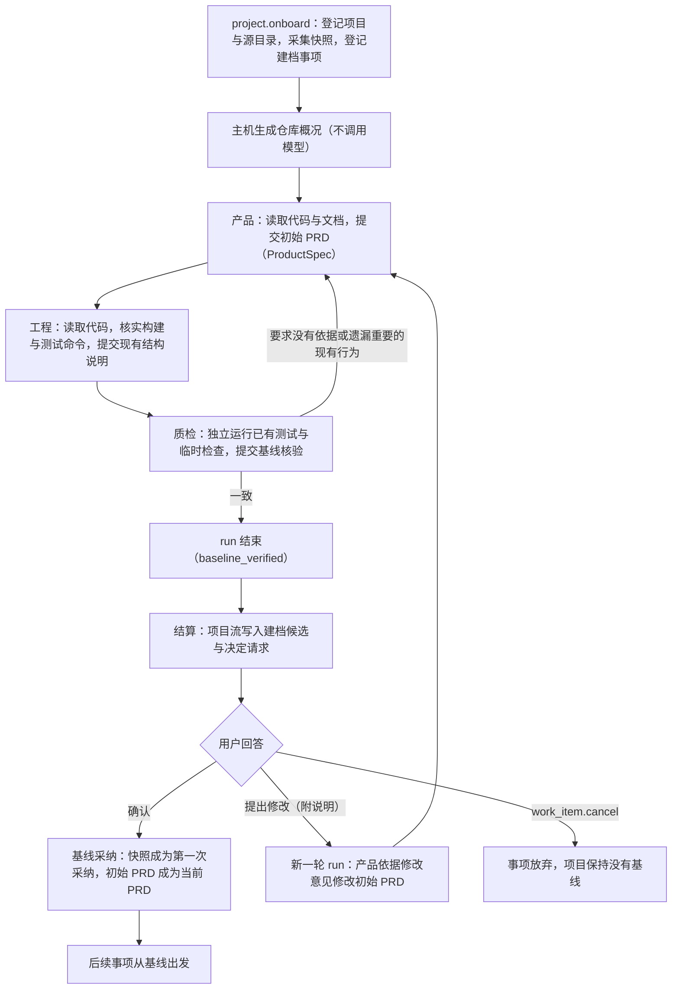
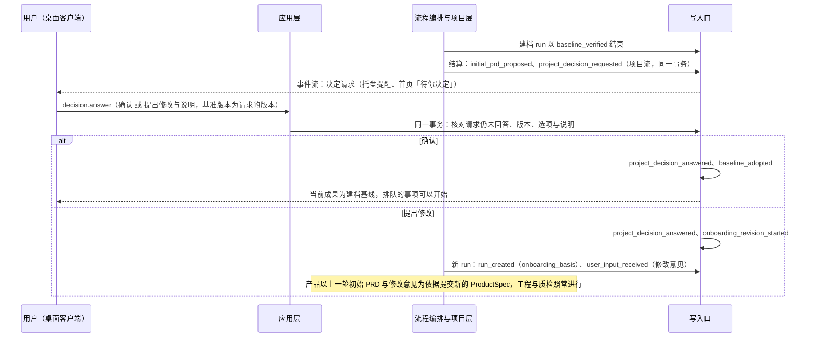
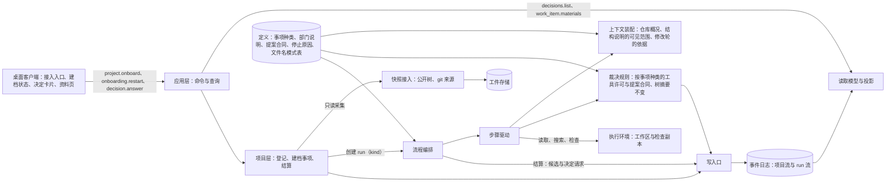

# 接入已有项目设计说明

更新：2026-09-30。状态：设计已确认（2026-09-29 用户确认第 12 节的五项决定），未实施。路线位置：Stage 3 的 3.8，父工单 [#124](https://github.com/bender2333/yudao/issues/124)，前置 3.1 的后端（#119）。

依据：[D33 接入已有项目](../requirements/existing-project-onboarding.md)、[ADR-0019](../adr/0019-project-stream-across-versions.md)（项目流跨版本保存）、[ADR-0014](../adr/0014-versioned-definitions.md)（带版本的定义）、[总体架构](architecture/overall-architecture.md)第 6、7.4 节、[应用层与接口层设计说明](app-and-interface.md)第 3、4 节、[本地通用工具设计说明](local-tools.md)（代码快照接入与公开树）、[Stage 3 计划](../stage-3-plan.md)第 2、3 节 3.8 行、[D09 运行限额](../requirements/execution-limits.md)、[原型 v9 设计说明](../prototypes/v9/design.md)（沿用 [v8 设计说明](../prototypes/v8/design.md)第 4、6、7.3、8、12 节）与[构建约定](../prototypes/v9/BUILD.md)（沿用 [v8 构建约定](../prototypes/v8/BUILD.md)第 5.2、8.3 节）。用词以 [CONTEXT.md](../../CONTEXT.md) 为准。

## 1. 要解决的问题

| 问题 | 现状与出处 | 影响 |
| --- | --- | --- |
| 已有代码进入 Yudao 时没有描述现有行为的要求 | 3.2A 的代码快照接入只建立初始工作区：`start_work_item_from_snapshot`（`harness/projects.py:416-440`）以快照为初始树、`baseline` 为空开始一个普通事项；产品只为这一次变更写 ProductSpec | 这个 ProductSpec 采纳以后成为项目的当前 PRD（`projects.py:244-268` 从采纳成果所属 run 的 ProductSpec 读出），它只覆盖本次变更；此后质检无法判断原有功能的失败是否属于缺陷 |
| 项目的第一次采纳必须来自一次放行的交付 | `_settle_run`（`projects.py:518-548`）要求 run 进入 DONE、有 DeliverySpec 与 release 结论 | 已有代码本身没有交付与放行，无法成为基线 |
| 质检放行要求全部检查退出码为 0 | `_accept_review`（`harness/validation.py:428-436`） | 已有项目常有失败的测试，放行规则无法表达「现有行为就是这样」 |
| 决定请求只能属于某个 run | 决定请求写在 run 流中（`harness/orchestrator.py:1210-1244`），种类只有 `model_unavailable`（`harness/decisions.py:29-31`） | 确认初始 PRD 可能等待数天；run 保持打开会占用运行时间上限，也会使排空一直等待 |
| 工程对现有结构的理解没有保存的地方 | 部门材料只有主机生成的 PRD.md 与 PLAN.md（`harness/definitions/organization.json` 的 `professional_completion` 规则） | 以后每个事项的工程都要重新摸索仓库 |

## 2. 接入的位置：建档事项

接入由一个事项完成，事项种类为「建档」（`kind: onboarding`）；普通事项的种类为 `change`。一个接入的项目由命令 `project.onboard` 在同一个事务中建立：登记项目（来源为已有项目）、登记源目录、登记建档事项；随后流程编排为建档事项创建 run。

建档使用事项的全部已有机制：三个部门按交接顺序工作、run 的执行权与 3.1 的自动继续、取消、执行槽位与同一项目的排队、决定请求、事件流与界面上的事项卡片。放进项目创建的做法需要在项目层另建一套部门调度、恢复与取消，与事项重复。

建档事项与普通事项的区别全部写在定义中（ADR-0014）：各部门可用的工具、提交的提案合同、提案接纳后的阶段迁移与结束 run 的停止原因（第 4 节）。控制核心按 run 记录的事项种类选择这些定义，步骤驱动与写入口的逻辑不变。

项目在建档事项被采纳之前没有基线：

- 3.4A 之前（只有一个执行槽位、没有排队）：在这个项目中新建事项被拒绝，原因 `work_item_in_progress`（建档进行中或等待确认）或 `not_allowed`（建档已停止，说明「项目还没有完成建档，请重新开始建档」）。
- 3.4A 之后：新建的事项进入该项目的队列，状态显示「等待建档」；只有项目有了基线采纳才开始，从基线出发。建档停止或被取消时，排队的事项保持等待，用户可以重新开始建档或用 `queue.cancel` 取消它们。`work_item.reorder` 不涉及建档事项，建档事项总在队列最前面。

## 3. 应用层命令、决定与领域事件

格式与[应用层与接口层设计说明](app-and-interface.md)第 3.2、3.3 节相同。

### 3.1 命令

**项目（左侧栏「接入已有项目」）**

| 命令 | 作用 | 参数 | 领域事件 | 基准版本 | 现状 |
| --- | --- | --- | --- | --- | --- |
| `project.onboard` | 接入已有项目：新建项目，登记源目录，只读采集代码快照，开始建档事项 | 名称、长期目标、源目录名称、源目录路径（控制主机上的路径） | `project_registered`（`source` 为 `existing`）、源目录登记事件（#74 为 `source_directory.save` 确定的名称）、`work_item_created`（`kind` 为 `onboarding`，带快照记录）、`run_created`、`user_input_received` | 空 | 新增（3.8）；原型暂用的 `project.onboard` 成为正式名称，参数增加源目录名称 |
| `onboarding.restart` | 重新开始建档：从登记的源目录重新采集快照，开始新的建档事项；只在项目来源为已有项目、还没有基线采纳、没有进行中或等待确认的建档事项时可用 | 项目、源目录（登记名） | `work_item_created`（`kind` 为 `onboarding`）、`run_created`、`user_input_received` | 空（新建一个事项） | 新增（3.8） |

- 源目录路径按 `source_directory.save` 的规则处理（应用层设计说明第 10 节第 6 项）：命令中填写的路径同时成为这个项目的第一条源目录登记，以后在项目设置中查看与修改。
- 快照在命令的事务之前采集（与 `start_work_item_from_snapshot` 相同），采集失败时命令被拒绝，不建立项目，不写入任何事件；已经保存的快照工件按内容摘要寻址，重复无害。
- 拒绝原因：`source_invalid`（新增：源目录不存在或不可读、含有宿主私有路径、公开树中有无法表示的条目，`message` 列出工作区内的相对路径与处理方法，处理方法与 D09 的 `workspace_unrepresentable` 相同）、`busy`（3.4A 之前）、`provider_unavailable`；`onboarding.restart` 另有 `not_found`、`project_archived`、`not_allowed`（项目由想法新建、已有基线、已有进行中或等待确认的建档事项）。
- 取消建档使用已有的 `work_item.cancel`：建档 run 进行中时按原有规则取消 run；run 已结束、正在等待确认时撤销决定请求，项目流记下这个事项的放弃结果（#126 定义的事项结果事件，原因为用户取消）。
- `project.archive` 在建档事项进行中或等待确认时按原有规则拒绝（`work_item_in_progress`），用户先取消建档事项。

### 3.2 决定种类

| 决定种类 | 选项 | 阻塞范围 | 来源 | 工单 |
| --- | --- | --- | --- | --- |
| 确认接入已有项目的初始 PRD（`initial_prd`） | 确认；提出修改（必须附说明，说明为空时以 `not_allowed` 拒绝） | 事项 | D33 | 3.8 |

这个决定请求写在项目流中（第 3.3 节），阻塞的是建档事项与同一项目中排在它后面的事项，不属于任何 run。回答仍使用 `decision.answer`，基准版本为决定请求的版本；`decisions.list` 同时返回 run 流与项目流中的决定请求，项目流中的请求 `run_id` 为空。Stage 4 中阻塞范围为「故障记录」的决定使用同一套项目流决定事件。

决定请求携带的材料（决定卡片据此显示，原型 v9 沿用 v8 设计说明第 6 节）：初始 PRD 的摘要与 PRD.md 的工件引用、现有结构说明（STRUCTURE.md）的工件引用、基线核验的汇总（各要求的核实结果计数、现有缺陷清单、失败的已有测试及说明）、快照来源（源目录、git 提交与是否有未提交的修改、文件数与总字节数）、第几轮，以及上一轮用户的修改意见（第二轮起）。

### 3.3 领域事件

事件名称是本设计确定的正式名称，代替原型的 `x_onboarding_started`、`x_existing_read`、`x_initial_prd_confirmed`。

**项目流**（登记在 #126 的项目流字段清单中；新增字段写明旧事件的缺省含义）

| 事件 | 内容 | 与现有事件的关系 |
| --- | --- | --- |
| `project_registered` | `source` 取值增加 `existing` | 字段已有，现有取值为 `idea`（`projects.py:335`） |
| `work_item_created` | 新字段 `kind`：`change` 或 `onboarding`，旧事件缺省为 `change`；`snapshot` 记录新增 `provenance`：git 提交、分支、是否有未提交的修改，源目录不是 git 仓库时为空，旧事件缺省为空 | `snapshot` 字段已有（`harness/snapshot.py:19-34`） |
| `initial_prd_proposed` | 建档候选：事项、run、第几轮；初始 PRD（ProductSpec 的工件引用与内容哈希、PRD.md 引用）；现有结构说明（STRUCTURE.md 引用、所描述的树摘要）；基线核验（接纳事件、逐条结论、现有缺陷、基线检查的名称、argv、退出状态与输出摘要引用）；快照（`tree_ref`、`tree_digest`、来源、文件数） | 新增 |
| `project_decision_requested`、`project_decision_answered`、`project_decision_withdrawn` | 项目流中的决定请求、回答与撤销，字段与 run 流中的决定事件相同，另带阻塞的事项 | 新增；run 流中的决定事件（#49）不变 |
| `onboarding_revision_started` | 用户提出修改以后的新一轮：事项、新的 run、所依据的候选事件、修改意见的工件引用 | 新增 |
| `baseline_adopted` | 建档采纳：采纳编号、事项、run、候选事件、`tree_ref` 与 `code_tree_digest`（等于快照）、当前 PRD（按 #126 为项目流中当前 PRD 规定的字段）、结构说明引用、基线检查、现有缺陷、快照来源 | 新增；投影把它作为项目的当前采纳成果，与 `deliverable_adopted` 并列（`harness/projection.py` 中 `DELIVERABLE_ADOPTED` 的处理） |

建档事项的放弃（取消、停止）使用 #126 定义的事项结果事件。

**run 流**（跟随 run 事件版本）

| 事件 | 内容 |
| --- | --- |
| `run_created` | 新字段 `kind`；修改轮另带 `onboarding_basis`：上一轮候选事件、修改意见引用 |
| `structure_accepted` | 工程的现有结构说明被接纳；主机由接纳结果生成 STRUCTURE.md |
| `baseline_review_accepted` | 质检的基线核验被接纳 |
| `run_done` | 建档 run 以停止原因 `baseline_verified` 结束（新增到定义的停止原因清单，结果为完成） |

原型中的「阅读已有项目」动作（原型 v9 沿用 v8 设计说明第 8 节）由建档事项中读取、搜索与区间阅读工具的 `tool_started` 事件驱动，不另设事件。

### 3.4 查询的变化

| 查询 | 增加的内容 |
| --- | --- |
| `decisions.list` | 项目流中的决定请求；`initial_prd` 的材料 |
| `projects.list` | 状态标记「建档中」「等待确认初始 PRD」「等待建档」（建档停止、还没有基线） |
| `project.overview` | 当前成果为建档采纳时显示「建档基线」、快照来源与现有缺陷数；事项的种类 |
| `project.loop` | 事项的种类；建档事项在等待确认时的状态 |
| `work_item.materials` | 各轮的初始 PRD 与确认记录、现有结构说明、基线核验与基线检查、仓库概况 |

`project.settings` 返回的源目录登记已由界面工作线提供，不需要改变。

## 4. 建档流程

### 4.1 总体

建档中各部门之间照常可以提出协作请求（例如质检询问产品某条要求的依据）。三个部门在建档中都没有写入、编辑、删除与移动文件的工具，工程没有 `submit_plan` 与 `submit_delivery`；工作区的树摘要从开始到结束都等于快照摘要，提案接纳时由 U 核对，不相等时拒绝。检查在检查副本中运行（`harness/environment.py:398-440`），不改变工作区。

### 4.2 仓库概况与读取范围

**范围。** 各部门能看到的只有快照的公开树：按项目的忽略规则（`.gitignore` 与 Git 的排除文件，由 Git 命令行判断，#104）排除之后的全部文件与目录；Git 元数据与宿主私有路径不在其中（`harness/public_tree.py:60-62`）。依赖目录与构建产物由忽略规则排除，不进入快照。公开树不设文件数或字节数的上限（D09「尽可能放开限制」），快照的文件数与总字节数写进仓库概况与决定材料。

**仓库概况。** 每个建档 run 创建时，主机从快照的公开树确定性地生成一份仓库概况，作为三个部门共同的常驻材料（栏目 `existing_overview`），内容：

- 文件数与总字节数；顶层目录及各自的文件数与主要扩展名。
- 按定义中的文件名模式表识别出的文件：说明文件（`README*`、`docs/`、`CHANGELOG*`）；清单与锁文件（`pyproject.toml`、`package.json`、`go.mod`、`Cargo.toml` 等）；构建与测试配置（`Makefile`、`tox.ini`、`pytest.ini`、`noxfile.py`、前端测试框架配置等）；持续集成配置（`.github/workflows/*`、`.gitlab-ci.yml` 等）；已有的 agent 说明文件（`AGENTS.md`、`CLAUDE.md`、`.cursor/rules/`、`.cursorrules`、`.github/copilot-instructions.md`）；测试目录。
- 快照来源：git 提交、分支、是否有未提交的修改。

每类列出的条目有定义中的上限，超出部分写明数量。概况只列路径与数量，不含文件内容。

**读取顺序。** 建档事项的部门说明（定义中按事项种类给出）规定读取顺序，做法参照 OpenCode 的 `/init`（第 9 节）：先读价值最高的来源，可执行的来源（配置、脚本、测试）与文字说明冲突时以可执行的来源为准。

| 部门 | 顺序 |
| --- | --- |
| 产品 | 仓库概况 → README 与文档 → 已有的 agent 说明文件 → 对外接口的定义（命令行帮助、接口路由、公开模块的导出、配置项）→ 测试（测试写明了预期行为）→ 需要确认时读取实现 |
| 工程 | 仓库概况 → 清单、构建与测试配置、持续集成 → 入口与包的边界 → 代表性的实现文件 → 用 `run_check` 核实构建与测试命令 |
| 质检 | 初始 PRD → 测试与持续集成配置，自己找出测试命令 → 用 `run_check` 运行已有测试（可以按目录或文件分组）→ 对没有测试覆盖的要求写临时检查（`run_check` 的 argv） |

**运行限额。** 建档 run 与普通 run 使用同一份限额定义（D09）：运行时间上限 `run_time_limit_sec`、工具输出上限与截断后的继续取回、按 D10 的自动压缩。建档 run 的运行时间上限与普通事项相同（定义中的 7200 秒）；每一轮（包括修改轮）是一个新的 run，单独计算运行时间。仓库概况与读取顺序限制了阅读的范围，没有核实的功能区域写进初始 PRD 的边界（第 4.3 节）。检查的时限为定义中的 `check_timeout_sec`，限额定义的新版本中为 600 秒（与登记命令的最大时限 `command_timeout_max_sec` 相同），普通事项的检查同样适用；超时的检查记为失败并带超时说明，按第 4.5 节处理。

### 4.3 产品：初始 PRD

产品提交的初始 PRD 使用已有的 ProductSpec 合同（`submit_product_spec`），主机由接纳结果生成 PRD.md，与普通事项相同。粒度规则写在建档的产品说明中：

| 字段 | 在初始 PRD 中写什么 |
| --- | --- |
| 目标 | 这个仓库为谁做什么，依据 README 与项目的长期目标 |
| 要求 | 每条写一项使用者能观察到的能力：一个命令、一个接口、一个页面、一组公开函数的行为；写到质检能用一个检查或一段操作核实的程度；不写内部函数与实现方式。条目以功能区域开头（例如「［模型设置］」），大仓库按功能区域覆盖全部对外能力，条目数由对外能力决定，不设固定上限 |
| 边界 | 仓库中不作为产品行为承诺的部分：示例、生成代码、第三方代码的拷贝、实验目录，写明路径；建档时没有核实的功能区域写在这里并标明「建档时未核实」 |
| 约束 | 运行环境、支持的版本、依赖的外部服务，依据清单与文档 |
| 验收 | 核实这些行为的方式：已有测试的名称与运行方式、操作步骤 |
| 致命条件 | 文档或测试写明的必须保持的性质，例如数据格式的兼容 |
| 非目标 | 文档明确写明不支持的能力 |

初始 PRD 描述现有的、有依据的行为。依据是文档、测试的预期或代码的实际行为：只有代码能说明的行为，按代码的实际行为写；文档或测试的预期与代码冲突时，产品按文档与测试的预期写要求，代码不满足的部分由质检记为现有缺陷（第 4.5 节），用户在决定卡片中看到这些缺陷，确认时一并认可它们是缺陷。

### 4.4 工程：现有结构说明

**内容。** 工程在建档中提交一种新提案 `submit_structure`，主机由接纳结果生成 STRUCTURE.md：

- 总体说明：仓库的组成与运行方式。
- 模块：路径与职责。
- 入口：程序、命令行、服务的入口文件。
- 构建与测试：名称、argv、用途；每一项必须有本次激活中绑定当前快照的 `run_check` 回执，退出状态照实记录（不要求为 0）。
- 要求所在的位置：初始 PRD 每条要求对应的主要文件或目录。
- 约定与注意事项：代码生成、特殊的环境变量、较慢或需要外部服务的测试。

参照 OpenCode `/init` 的写作规则：只写读取多个文件才能得出、以后工作时容易弄错的内容，不写通用建议与完整的文件树，不写无法核实的内容（第 9 节）。

**存放位置。** STRUCTURE.md 是建档 run 的材料工件（与 PRD.md、PLAN.md 相同，由主机生成，模型不能直接改写）；它的引用与所描述的树摘要写进项目流的 `initial_prd_proposed` 与 `baseline_adopted`，所以跨 Yudao 版本可以读取（ADR-0019）。它不写进仓库：OpenCode 的 `/init` 把说明写进仓库的 `AGENTS.md`，在 Yudao 中这会改变采纳的代码树，也会让产品与质检经过公开树读到工程的内部材料。

**谁能读取。**

| 读者 | 方式 |
| --- | --- |
| 工程（建档的修改轮与退回产品以后的下一次激活） | 常驻栏目 `existing_structure` |
| 工程（该项目以后的每个事项） | 常驻栏目 `existing_structure`，附「描述的是建档时的代码（树摘要）；当前基线为采纳 rN」，工程据此知道文件可能已经变化，需要时用工具核实 |
| 用户 | 决定卡片中的链接；资料页的项目材料（原型 v9 沿用 v8 设计说明第 7.3 节） |
| 产品、质检 | 不能读取 |

**隔离。** 可见范围写在角色定义的 `visibility` 中（`harness/definitions/roles.json`，由 `harness/context.py:81` 读取）：工程增加 `existing_structure`，产品与质检不增加。STRUCTURE.md 在材料目录中，材料目录不在公开树内，读取与搜索工具无法取得。质检的独立性由此保持：质检自己从仓库找出测试命令，核验初始 PRD，不依据工程的说明。Stage 5 的复盘写出工程部门的项目画像时，结构说明是它的来源之一（[语义系统设计说明](semantic-system.md)第 4 节）。

### 4.5 质检：基线核验

质检在建档中提交一种新提案 `submit_baseline_review`，核验初始 PRD 与现有行为是否一致。它不使用普通事项的放行规则（全部检查退出码为 0），由 U 按下列规则确定性地判断：

| 项 | 内容 |
| --- | --- |
| 逐条结论 | 初始 PRD 的每条要求一个结论：`verified`（有检查证据）、`read_only`（只由阅读代码或文档支持，写明位置）、`existing_defect`（要求有文档或测试的依据，现有代码不满足，引用失败的检查）、`unsupported`（代码、文档、测试都不支持这条描述） |
| 遗漏 | 仓库中重要的对外能力没有出现在 PRD 中，写明位置 |
| 基线检查 | 本次激活中绑定当前快照与当前 ProductSpec 的 `run_check` 回执，至少一个；退出状态照实记录 |
| 失败的检查 | 每个退出状态不为 0 的检查（包括超时）必须被某条 `existing_defect` 引用，或写进「其他失败」并说明原因（例如需要网络或外部服务） |
| 结论 | `consistent`：没有 `unsupported`、没有遗漏、失败的检查都有说明；`rework_product`：至少有一条 `unsupported` 或一项遗漏 |

`consistent` 使 run 以 `baseline_verified` 结束；`rework_product` 退回产品（阶段迁移与普通事项的退回产品相同：`QUALITY → REWORK_PRODUCT → PRODUCT_SPEC`），产品修改描述以后，工程更新要求所在的位置，质检重新核验。建档中不存在退回工程，工程不修改代码。

### 4.6 已有测试与 git 历史作为基线的证据

- **已有测试。** 基线检查是质检在快照上运行的检查回执（名称、argv、退出状态、输出摘要，绑定快照摘要），随 `baseline_adopted` 记入项目流。以后事项的质检从项目上下文看到基线检查与现有缺陷，据此区分原有的失败与新引入的失败（评测的「原有功能失败条数」依赖这一点）。工程在结构说明中记录的构建与测试回执是工程自己的核实，不作为基线检查。
- **git 历史。** 采集快照时主机用 Git 命令行读取提交、分支与是否有未提交的修改，写进快照记录的 `provenance`，使基线可以对应到源仓库的一个提交。提交历史的内容不交给部门：Git 元数据不在公开树中，历史中的作者与过去的决定也不描述现有行为。源目录有未提交的修改时照常接入，决定卡片显示这一点。

### 4.7 用户确认与修改的往返

- 修改轮是同一个建档事项的新 run，从快照重新建立工作区。产品的常驻材料增加上一轮的初始 PRD 与用户的修改意见（修改意见作为用户输入，按已有的输入处理规则必须由新的 ProductSpec 处理）；工程的常驻材料增加上一轮的结构说明；质检只看到新的初始 PRD，基线核验重新进行。
- 修改没有轮数上限。每一轮的候选、决定请求与回答都在项目流中，资料页按轮列出。
- 用户可以直接修改的只有修改意见，初始 PRD 由产品写出，与普通事项中 PRD 的归属相同。

## 5. 确认以后：当前有效要求与第一次采纳

用户确认时，写入口在同一个事务中追加 `project_decision_answered` 与 `baseline_adopted`：

- **第一次采纳的成果是快照本身。** `tree_ref` 与 `code_tree_digest` 就是 `project.onboard` 采集的快照；这是项目的第一个采纳成果（`previous_adoption_id` 为空）。
- **当前有效要求。** 确认的初始 PRD 成为项目流中的当前 PRD（ADR-0019，字段由 #126 确定）。以后的事项创建时按已有做法取得基线（`projects.py:394-406`），项目上下文写入「仍有效的决定」一节的内容来自这份 PRD；产品在它的基础上写出变更后的 ProductSpec，质检按变更后的完整 PRD 核验，原有功能的失败从此可以判定为缺陷。
- **项目上下文中的基线。** 项目上下文（`project_context_text`，`projects.py:211-241`）对建档采纳写出：「已有项目的代码快照」、文件数、git 提交、基线检查与现有缺陷；不逐个列出快照中的文件。
- **现有缺陷。** 基线核验中的 `existing_defect` 与其他失败记为采纳成果的已知风险，用户以后可以为它们新建事项修复。
- 源目录在整个过程中只被读取，不被改写；以后的变更由交付提供（本地通用工具设计说明第 1 节）。
- **源目录以后的修改不进入项目。** 项目从快照开始在 Yudao 中独立演进，建档以后源目录中的修改不会同步进来；要在源目录的新代码上工作，把它接入为新项目。
- **已有代码的唯一入口。** 已有代码只经 `project.onboard` 进入 Yudao；`work_item.create` 没有代码快照来源参数，事项总是从项目的采纳成果（或新项目的空树）开始。

## 6. 失败与中断

| 情况 | 处理 |
| --- | --- |
| 建档 run 执行中进程中断 | 按 3.1：Yudao 启动时自动继续；建档中的动作只有读取、搜索与检查，检查的契约声明可以重复 |
| 事项已登记、run 还没有创建时进程中断 | 与 `work_item.create` 相同，由 3.1 的启动核对建立 run（run 流从版本 0 开始，重复创建被拒绝） |
| run 结束以后、候选写入之前进程中断 | 启动时补做结算，与采纳结算的幂等补做相同（#74 的「采纳结算幂等」）；候选与决定请求在一个事务中写入，不会只写一半 |
| 回答了「提出修改」、新 run 还没有创建时进程中断 | 启动时按 `onboarding_revision_started` 建立缺少的 run |
| run 事件版本不同的升级 | 进行中的建档 run 按排空规则等待结束；强制升级时记为因升级停止，建档事项重新开始一个 run：第一轮从快照开始，修改轮带同一份上一轮候选与修改意见。等待确认的候选与决定请求在项目流中，升级以后照常显示与回答，不影响排空 |
| 模型引用无法使用 | 按 #49 的待恢复决定处理，与普通事项相同 |
| 运行时间用完、步数用完、连续没有工具调用、工作区出现无法表示的条目 | run 按 D09 的停止原因结束，建档事项停止，不发出确认请求；项目状态为「等待建档」，用户用 `onboarding.restart` 重新开始（重新采集快照，用户可以先修改源目录的忽略规则） |
| 用户拒绝接入 | 用 `work_item.cancel` 取消建档事项：决定请求撤销，事项记为放弃；项目保持没有基线，可以重新开始建档或归档 |
| 用户长期不回答 | 决定请求一直等待，不设期限，不自动确认；它不属于任何 run，不占用运行时间与执行槽位，也不阻碍排空。首页「待你决定」显示已经等待的时长与挡住的事项数量，托盘在请求发出时提醒一次 |

## 7. 模块交互

各层增加的内容：

| 层 | 增加的内容 |
| --- | --- |
| 客户端 | 左侧栏「接入已有项目」与对话框、建档状态标记、阅读已有项目的动作、`initial_prd` 决定卡片、资料页的初始 PRD 各轮与确认记录、结构说明与基线核验 |
| 应用层与接口层 | 命令 `project.onboard`、`onboarding.restart`；`decision.answer` 支持项目流中的决定；第 3.4 节的查询字段；拒绝原因 `source_invalid` |
| 控制核心 · 流程编排 | 按事项种类创建 run；建档 run 结束以后的结算写候选与决定请求；回答以后写基线采纳或开始修改轮；启动时补做以上步骤 |
| 控制核心 · 上下文装配 | 常驻栏目 `existing_overview`、`existing_structure`（按角色可见范围）、修改轮的上一轮初始 PRD 与修改意见 |
| 控制核心 · 裁决规则 | 按事项种类提供工具；`submit_structure` 与 `submit_baseline_review` 的校验；建档中树摘要等于快照摘要 |
| 定义 | 事项种类 `onboarding`：三个部门的说明（读取顺序与粒度规则）、工具清单、提案合同、阶段迁移；停止原因 `baseline_verified`；仓库概况的文件名模式表与每类的条目上限；工程的可见范围增加 `existing_structure` |
| 执行层 | 快照采集增加 git 来源；检查照常在检查副本中运行 |

执行建档中的检查就是运行已有项目自己的测试代码。本机进程只适用于可信的本地项目（本地通用工具设计说明第 2 节）；3.2C 以后，来源不明的仓库在本机容器中建档。

## 8. 与现有代码的关系

引用的行号为提交 `f9428b7` 时的代码。

| 位置 | 现状 | 本设计的关系 |
| --- | --- | --- |
| `harness/projects.py:325-339` `register` | 写入 `project_registered`，`source` 固定为 `idea` | `project.onboard` 使用同一个事件，`source` 为 `existing`，与源目录登记、建档事项在同一个项目流事务中 |
| `harness/projects.py:416-440` `start_work_item_from_snapshot` | 快照接入后以普通事项开始，`baseline` 为空；Web 的新建事项接口以 `source_dir` 调用它（`harness/web/server.py:116-122`） | 删除这个函数与 `source_dir`，`work_item.create` 不提供代码快照来源；建档事项沿用 `ingest_snapshot` 与 `_work_item_created`，另写 `kind` |
| `harness/projects.py:475-492` `_start` | 先登记事项再创建 run，失败时写 `work_item_start_failed` | 建档事项与修改轮沿用 |
| `harness/projects.py:518-548` `_settle_run` | DONE 且有 release 时写 `deliverable_adopted` 或 `adoption_held` | 建档事项的结算另走一支：写 `initial_prd_proposed` 与项目流决定请求；确认时写 `baseline_adopted` |
| `harness/projects.py:211-268` `project_context_text` | 从采纳成果所属 run 的 ProductSpec 写出「仍有效的决定」 | 建档采纳作为当前采纳成果进入同一段；当前 PRD 按 #126 从项目流取得 |
| `harness/snapshot.py:19-47` | 快照记录五个字段，恢复时要求字段集合完全相同 | 记录增加 `provenance`，恢复的字段核对随之修改 |
| `harness/public_tree.py:60-62`、`119` | 公开树排除 `.git` 与 `.checks`；忽略规则由 #104 加入 | 建档的读取范围就是公开树 |
| `harness/orchestrator.py:231-339` `create_run` | `run_created` 带项目、事项、快照等 | 增加 `kind` 与修改轮的 `onboarding_basis` |
| `harness/orchestrator.py:1036-1090` `_commit_accepted` | 接纳后按迁移写 `transition`，进入 DONE 时写 `run_done`（`released`） | 建档 run 进入 DONE 时的停止原因为 `baseline_verified` |
| `harness/orchestrator.py:1210-1244` `answer_decision`；`harness/decisions.py:29-31` | 决定请求在 run 流中，只有 `model_unavailable` | 增加项目流中的决定请求与 `initial_prd` 种类 |
| `harness/validation.py:321-384`、`387-470` | 交付与放行的校验；放行要求检查全部通过 | 建档中不提供 `submit_plan`、`submit_delivery`、`submit_review`；新增 `submit_structure`、`submit_baseline_review` 的校验 |
| `harness/adjudication.py:66` `offered_tools`；`harness/definitions/roles.json` | 按部门提供工具，可见范围按部门定义 | 按部门与事项种类提供工具；工程可见范围增加 `existing_structure` |
| `harness/context.py:81-230` | 常驻材料按固定顺序装配，交付说明按可见范围装配 | 增加 `existing_overview`、`existing_structure` 与修改轮的依据 |
| `harness/app/project_commands.py:27-36` | `project.create` 调用 `register` | 同一文件登记 `project.onboard`、`onboarding.restart` |

## 9. 参照的成熟做法

- OpenCode `/init`（提交 `0027387`，`packages/opencode/src/command/template/initialize.txt`）：第 10-15 行先读 README、清单、构建与测试配置、持续集成与已有的 agent 说明文件；第 17 行架构仍不清楚时只读少量代表性的代码文件，优先读说明系统如何连接的文件；第 19 行可执行的来源优先于文字；第 23-31 行要提取的内容（准确的命令、单个测试的运行方式、包的边界与入口、工具链的特殊之处、测试的前置条件）；第 46-62 行写作规则（只写高价值、与本仓库有关、可以核实的内容）。本设计的读取顺序与结构说明的内容采用这些做法。OpenCode 把结果写进仓库的 `AGENTS.md`（第 66 行），Yudao 为了保持代码树与部门隔离，把结构说明保存为工程的材料（第 4.4 节）。
- OMP（提交 `fdfeef1f78`，`packages/coding-agent/src/discovery/`）：从工作目录向上寻找各工具的说明文件并作为上下文文件读取，`agents-md.ts:20-22`（`AGENTS.md`）、`claude-md.ts:24-29`（`CLAUDE.md`）、`github.ts:52`（`.github/copilot-instructions.md`）、`cursor.ts:209-215`（`.cursor/rules/*.mdc` 与 `.cursorrules`），共同的向上查找在 `helpers.ts:694-734`。仓库概况的「已有的 agent 说明文件」一类按这份清单识别；这些文件在建档中作为材料由部门读取，不作为 Yudao 的规则执行。
- OpenCode 的快照按 Git 命令行判断忽略规则（提交 `0027387`，`packages/opencode/src/snapshot/index.ts` 第 172-270 行），公开树已按它设计（本地通用工具设计说明第 2 节）。

## 10. 验收

所有验收使用真实运行的系统；自动化测试中的模型回答由 FakeAdapter 脚本给出，事件日志、工件与工作区都是真实实现，不使用模拟对象。真实项目验收使用真实模型。

1. **真实项目建档（Stage 3 计划 3.8 行）。** openai-agents-python 在 FeatBench openai-agents-python-842 基准提交时的代码（原型 v9 的示例项目；约 1.3 万行，有完整的测试集）经 `project.onboard` 使用真实模型完成建档，用户在桌面客户端的决定卡片中确认初始 PRD，随后一个事项在它的基础上实现 issue 842 并被采纳；这个事项的工作区从快照建立，质检按变更后的完整 PRD 核验，采纳链为「建档基线 → 本事项」。
2. **界面。** 接入入口、建档状态与阅读动作、`initial_prd` 决定卡片（含第 3.2 节的材料与两个选项）、资料页的各轮初始 PRD、确认记录、结构说明与基线核验，在真实运行的系统上通过 Playwright 端到端测试，页面上的数据都来自查询与事件流。
3. **修改的往返。** 用户提出修改并附说明：出现第二轮 run，产品的 ProductSpec 处理了修改意见，质检重新核验，新的决定请求出现；空说明的「提出修改」被拒绝。
4. **退回产品。** 质检提交带 `unsupported` 或遗漏的基线核验时，run 退回产品；提交 `consistent` 时有 `unsupported` 或未说明的失败检查被拒绝。
5. **已有测试失败。** 快照中有失败的测试时，建档仍能以 `consistent` 结束，失败的检查全部有说明，并出现在决定材料与采纳成果的已知风险中。
6. **树摘要与源目录。** 建档全过程工作区的树摘要等于快照摘要，采纳成果的 `code_tree_digest` 等于快照摘要；源目录的内容与修改时间在建档前后相同。
7. **部门隔离。** 建档与以后事项中，产品与质检的上下文清单没有 `existing_structure`，读取与搜索工具取不到 STRUCTURE.md；工程的上下文清单有它。
8. **git 来源。** 源目录是 git 仓库时快照记录带提交、分支与是否有未提交的修改；不是 git 仓库时为空，建档照常进行。
9. **源目录无效。** 源目录不存在、含有宿主私有路径或公开树中有无法表示的条目时，`project.onboard` 返回 `source_invalid` 与相对路径，没有建立项目。
10. **建档之前的事项。** 3.4A 之前在建档中的项目新建事项被拒绝（`work_item_in_progress`）；3.4A 之后进入队列显示「等待建档」，确认以后从基线开始。
11. **失败与中断（第 6 节）。** 建档 run 在工具执行时被真实进程终止，重启后自动继续；在 run 结束与候选写入之间终止，重启后补做一次结算，只有一个决定请求；回答「提出修改」以后、新 run 创建之前终止，重启后建立缺少的 run；用 run 事件版本较早的数据目录启动，等待确认的决定请求照常显示并可以回答；运行时间用完以后 `onboarding.restart` 可用；`work_item.cancel` 撤销等待中的决定请求。
12. **版本回归。** 如果评测工作线（#118）的 Yudao 运行器已经完成：运行场景 2、3 的版本回归，与上一次结果比较；3.2D 完成以后加上场景 1（Stage 3 计划第 7 节）。场景 2 的 Yudao 一侧先建档，运行器回答确认（[评测场景设计](evaluation-scenarios.md)第 9 节）。
13. **快照来源与检查时限。** `work_item.create` 的合同与 OpenAPI 中没有代码快照来源参数；`check_timeout_sec` 在当前限额定义中为 600 秒。

## 11. 对其他文档的影响

本文件确定以后，由架构师修改：

- [应用层与接口层设计说明](app-and-interface.md)：第 3.2 节项目命令表加入 `project.onboard`、`onboarding.restart`，`work_item.create` 没有代码快照来源，`source_directory.save` 服务于接入已有项目；第 3.1 节拒绝原因加入 `source_invalid`；第 3.3 节 `initial_prd` 一行写明项目流中的决定；第 4.3 节 `decisions.list`、`projects.list`、`project.overview`、`project.loop`、`work_item.materials` 加入第 3.4 节的内容；第 10 节第 6 项改为接入已有项目的源目录；命令数量随之修改。
- [本地通用工具设计说明](local-tools.md)第 1 节：已有项目经建档进入。
- [评测场景设计](evaluation-scenarios.md)：场景 2 的 Yudao 一侧先建档，建档的用量与耗时单独列出。
- [原型 v9 构建约定](../prototypes/v9/BUILD.md)（第 5、8 节沿用 [v8 构建约定](../prototypes/v8/BUILD.md)）：`project.onboard` 去掉「合同待补」并增加源目录名称参数；3.8 的临时事件改为第 3.3 节的事件；`p-agents` 的示例数据按第 3.2 节的决定材料编写。
- [D33](../requirements/existing-project-onboarding.md)：「设计中待确定的内容」四项的结论指向本文第 4.2 至 4.7 节，实现状态写明设计完成。
- [设计文档索引](README.md)、[Stage 3 计划](../stage-3-plan.md) 3.8 行、`docs/CHANGELOG.md`。

## 12. 用户确认的决定

2026-09-29 用户采纳以下五项，原话：「采纳推荐，目前先支持本机进行，容器就是走本机RPC?这样的话与远程机器通信一致了，当前阶段我还不能提供树莓派，需要等等」。

1. **已有代码只经 `project.onboard` 进入。** `work_item.create` 没有代码快照来源参数（#74 的范围随之缩小为 `source_directory.save`）。由代码快照开始的普通事项没有初始 PRD，采纳以后项目的当前 PRD 只覆盖一次变更，正是 D33 要解决的问题。评测场景 2 的 Yudao 运行器先建档，由运行器回答初始 PRD 的确认，再新建事项；建档的用量与耗时在报告中单独列出（[评测场景设计](evaluation-scenarios.md)第 5.2、9 节）。
2. **建档以后源目录的修改不进入项目。** Yudao 从快照开始独立演进，源目录以后的修改不会同步进来；要在新代码上工作时，把源目录接入为新项目（第 5 节）。同步外部修改需要合并两条独立演进的代码与 PRD，属于单独的需求。
3. **检查的时限为 600 秒。** 原来定义中的 `check_timeout_sec` 为 30 秒，真实仓库的测试集常常超过这个时间，超时的检查只能记为失败，基线失真。限额定义的新版本中改为 600 秒（与登记命令的最大时限 `command_timeout_max_sec` 相同），普通事项的检查同样适用（第 4.2 节）。
4. **验收使用的真实项目。** openai-agents-python 在 FeatBench openai-agents-python-842 基准提交时的代码（原型 v9 的示例项目），建档以后的事项实现 issue 842；这个仓库约 1.3 万行、有完整的测试集，与原型的示例数据一致（第 10 节第 1 项）。
5. **建档 run 的运行时间上限与普通事项相同。** 定义中的 7200 秒，每一轮单独计算；仓库概况与读取顺序限制了阅读的范围，没有核实的功能区域写进初始 PRD 的边界（第 4.2 节）。

## 13. 建议的工单拆分

全部挂在 #124 下，编号依次为 #134 至 #139。后端工单不被界面工单阻塞；界面工单被自己的后端工单与 #80 阻塞（Stage 3 计划第 3 节的规则），并以原型 v9（#125）为依据。

| 工单 | 内容 | 验收 | 阻塞 |
| --- | --- | --- | --- |
| [3.8] 建档事项的定义与部门产出 | 定义中的事项种类 `onboarding`：三个部门的说明、工具清单、提案合同 `submit_structure` 与 `submit_baseline_review`、阶段迁移、停止原因 `baseline_verified`、文件名模式表；U 的校验与树摘要不变的核对；P 的 `existing_overview`、`existing_structure` 与工程可见范围；主机生成 STRUCTURE.md 与仓库概况；run 流事件 `structure_accepted`、`baseline_review_accepted`；限额定义的新版本把 `check_timeout_sec` 改为 600 秒（第 3.3、4.2 至 4.5 节） | 第 10 节第 4、5、6、7 项与第 13 项的检查时限，用 FakeAdapter 从快照开始的建档 run 走到 `baseline_verified` | #126 |
| [3.8] 接入命令与建档事项的开始 | `project.onboard`、`onboarding.restart`、`source_invalid`；删除 `work_item.create` 的代码快照来源与 `start_work_item_from_snapshot`；快照的 git 来源；`project_registered` 的 `existing` 与 `work_item_created` 的 `kind`（登记在项目流字段清单）；建档之前新建事项的拒绝与排队规则；`work_item.cancel` 对建档事项的处理；`projects.list`、`project.loop` 的状态（第 2、3.1、3.4、5 节） | 第 10 节第 8、9、10 项与第 13 项的快照来源；经 HTTP 命令完成从接入到 `baseline_verified` | 上一张；#74；#126 |
| [3.8] 初始 PRD 的确认与基线采纳 | 建档 run 结束后的结算；项目流中的决定事件与 `initial_prd` 种类，`decisions.list` 与 `decision.answer` 支持项目流的决定；确认写 `baseline_adopted`，当前 PRD 进入项目流；提出修改开始新一轮 run；以后事项的项目上下文；启动时的补做与强制升级的处理；`project.overview`、`work_item.materials` 的内容（第 3.2、4.7、5、6 节） | 第 10 节第 3、11 项；确认以后新建的事项从基线开始并完成采纳 | 上一张；#16 |
| [3.8] 界面：接入入口与建档状态 | 左侧栏「接入已有项目」与对话框（名称、长期目标、源目录名称与路径），`source_invalid` 的提示；项目列表与楼层中的建档状态标记；部门房间中「阅读已有项目」的动作，由建档事项的读取与搜索工具事件驱动（原型 v9 沿用 v8 设计说明第 4、8、12 节 3.8 档，场景 13） | Playwright 在真实运行的系统上完成接入并看到状态与动作 | 接入命令工单；#80；#125 |
| [3.8] 界面：初始 PRD 的决定卡片与资料 | 首页与项目页面的 `initial_prd` 决定卡片：第 3.2 节的材料、确认与提出修改（说明必填）；资料页的各轮初始 PRD 与确认记录、项目材料中的结构说明、基线核验与基线检查（原型 v9 沿用 v8 设计说明第 6、7.3 节） | Playwright 完成确认与一次提出修改的往返 | 确认工单；#80；#125 |
| [3.8] 真实项目验收 | 按第 12 节第 4 项确定的项目，用真实模型完成建档、在客户端确认、随后一个事项完成修改并采纳；如果 #118 的 Yudao 运行器已经完成，运行版本回归；写验收报告（`docs/stage-3/`） | 第 10 节第 1、2、12 项 | 以上五张 |
