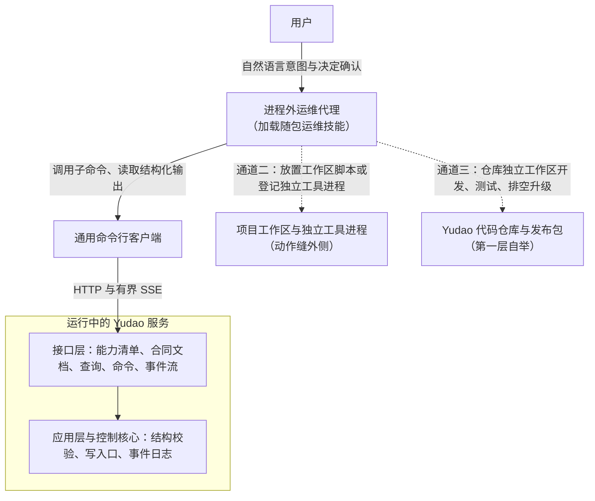
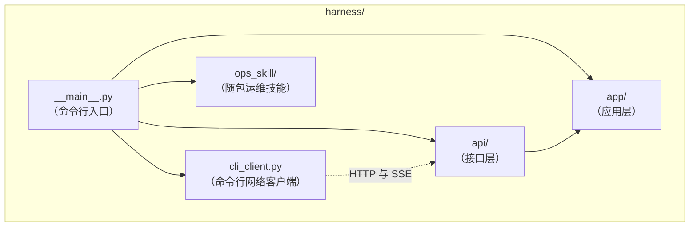

# 进程外运维代理与通用命令行设计说明

总图位置：第四节「接口」的缝（命令行一侧），关联第四节「定义」「动作」两道缝与第五节第一层自举。依据：[D42 进程外运维代理与页面的边界](../requirements/external-ops-agent.md)、[D38 系统意图与基础规则](../requirements/system-intent.md)、[应用层与接口层设计说明](app-and-interface.md)「命令」「查询与读取模型」「事件流」「能力清单与认证」「接口路径、执行归属与命令行」、[网页界面的提供与发布设计说明](web-interface-and-release.md)「控制主机上的 Yudao 服务」「Yudao 服务的运行」。

## 1. 功能与依据

页面的范围聚焦在日常查看状态、回答决定请求与输入意图；模型目录接入与准入、项目组织形态切换与合成、机器登记与授权、外部工具服务器配置与探测、参数调整与撤回、故障排查与排空升级等低频维护工作，由运行在 Yudao 服务进程之外的外部通用智能体（进程外运维代理）协助用户完成。

为使任意外部智能体在无需打开浏览器、无需手工拼接底层网络请求的条件下操作运行中的 Yudao 服务，系统在第四节「接口」的缝外侧提供两项配套能力：一项是经网络访问运行中服务的通用命令行客户端，覆盖能力清单读取、单项合同说明查看、通用查询读取、幂等命令提交与有界事件流订阅；另一项是随发布包分发的运维技能文档，规定读取基准版本、等待异步事件、隔离明文凭据，以及按改动性质划分的三条通道规程。

## 2. 边界与范围

做：

- 连接运行中 Yudao 服务的通用命令行操作：读取能力清单、读取单个命令或查询的合同说明、读取任意已登记查询的快照、提交任意已登记命令、在有界停止条件下订阅事件流。
- 服务地址、访问令牌与请求时限的传入方式（命令行参数与环境变量），支持本机回环默认访问与局域网令牌访问。
- 随发布包分发的运维技能文档，以及在终端输出技能全文、将技能复制到指定外部智能体技能目录的命令行操作。
- 运维技能中的三条改动通道规程（数据定义与参数命令、隔离动作与外部工具、Yudao 自身代码仓库开发事项）与凭据安全规程。

不做：

- 不在控制核心进程内设立拥有特权写权限的内置运维智能体，一切状态修改都经过接口层、应用层、结构校验与唯一写入口。
- 不提供向运行中的服务进程热加载代码或动态替换内存对象的入口（[D40 骨架与应用](../requirements/skeleton-and-application.md)第 8 条）。
- 不为进程外运维代理新增专用的服务端查询、命令或事件种类；通用命令行直接消费接口层已有的能力清单、接口合同文档、查询、命令与事件流。
- 不改动已有的进程内离线子命令（离线项目查看、历史重放核对、访问令牌管理、发布检查、演示与冒烟）。Yudao 服务运行时持有数据目录锁与内存瞬时状态（模型候选列表、测试进度、流式输出片段），针对运行中实例的全部查询、命令与事件等待均通过网络访问该服务进程。
- 不在本说明内建设看门狗程序与双槽位自动切换（归「职能之间：自己转一周」，见[骨架与应用设计说明](skeleton-and-application.md)「看门狗与健康协议」）。

本说明的常量：

| 常量 | 默认值 | 范围 | 理由 |
| --- | --- | --- | --- |
| 单次请求超时 | 30 秒 | 5–600 秒 | 覆盖常规能力清单、单项合同说明、查询与命令提交的网络往返；遇到耗时较长的同步操作时允许在范围内调大，防止连接异常时命令长期挂起 |
| 有界事件流等待超时 | 60 秒 | 1–3600 秒 | 供外部智能体通过单条前台命令等待模型测试、候选拉取、外部工具探测或事项进展；到达时限后返回已扫描位置与专用退出状态，避免无限流阻塞智能体终端会话 |
| 有界事件流单次收取上限 | 50 条 | 1–1000 条 | 限制单次调用输出的事件行数，防止大批量历史事件一次占满外部智能体上下文窗口；未读完时调用方按最后收到的全局位置继续订阅 |

## 3. 接口

- **接口的缝（命令行客户端 ↔ 接口层）**：通用命令行客户端位于接口缝外侧，经网络与运行中的 Yudao 服务交换五类内容：
  1. 能力清单：获取部署身份、接口版本、访问方式、已登记查询（含刷新事件种类与是否可按位置回放）、已登记命令（含拒绝原因）、决定种类、事件种类与覆盖层。
  2. 单项合同说明：从服务的接口合同文档与能力清单中提取指定命令或查询一项的输入字段、必填约束、默认值、枚举取值、返回结构摘要，以及命令的拒绝原因或查询的刷新事件与回放支持，免去外部智能体读取整份接口合同文档的上下文开销。
  3. 查询快照：传入查询名称与筛选条件（含可选的回放位置），接收带全局位置的只读快照。
  4. 命令与回执：传入命令名称、命令身份与载荷；服务返回接受（带写入后的位置与结果）或业务拒绝（带拒绝原因与说明）。
  5. 有界事件流：传入起始全局位置、筛选范围与停止条件，接收按全局位置排序的事件与检查点，满足停止条件后断开连接。
- **定义的缝（经接口层命令进入）**：组织形态、参数、模型目录与角色默认等修改经由接口层的对应命令进入定义与参数校验，不直接修改控制主机数据目录中的定义文件。
- **动作的缝（工作区与独立工具进程）**：运维代理生成的辅助脚本放入项目工作区执行环境，新增的外部工具配置为独立的 MCP 服务器子进程，均在动作缝外侧按工具许可运行。

包图（仅画本次涉及的包与相邻边界，全仓包图见[总体架构](architecture/overall-architecture.md)「包图」）：

`cli_client.py` 与 `ops_skill/` 位于接口缝外侧，只使用标准库与通用网络客户端库，不导入 `harness/` 内的应用层、接口层、契约或控制核心模块；该约束写入导入方向合同测试。

## 4. 方案

### 4.1 连接、认证与请求头规则

- 默认连接本机回环地址与默认服务端口；调用方可通过命令行选项或环境变量指定服务地址与访问令牌，命令行选项优先于环境变量。
- 访问本机回环服务时，请求主机头保持回环主机名与端口，不附带跨来源请求头，符合接口层的本机访问检查（[应用层与接口层设计说明](app-and-interface.md)「访问方式与认证」）。
- 访问局域网模式的服务时，请求头携带访问令牌，接口层将命令提出者记录为该令牌对应的用户身份；未携带令牌或令牌无效时服务返回未授权状态，命令行以认证失败退出码结束。
- 访问令牌与命令载荷中的敏感字段支持从标准输入或控制主机环境变量读取，避免明文凭据留在终端历史记录或进程命令行参数中；标准输入传入的结构化载荷解析失败时，错误提示只报告格式位置或结构要求，不回显标准输入原文。

### 4.2 零维护的单项合同自省

- 应用层的注册表是全部命令与查询的唯一登记处，能力清单与接口合同文档均由注册表生成。
- 通用命令行不按具体命令或查询逐个编写参数解析逻辑：应用层新增或调整任何命令与查询后，通用命令行自动支持，不产生额外的命令行同步维护负担。
- 单项合同说明操作从运行中服务读取能力清单与接口合同文档，展开目标项引用的嵌套结构定义（遇到递归结构引用时停止继续展开），合并输出单个命令或单个查询的完整调用说明：类别（命令或查询）、名称、请求字段表（名称、类型、是否必填、默认值、可选枚举与说明）、返回结构摘要，以及命令的可能拒绝原因列表，或查询的刷新事件种类列表与按位置回放支持标记。
- 请求的名称不在能力清单中时，明确输出中文提示，并按前缀或类别列出可用名称供调用方核对。

### 4.3 查询读取与幂等命令提交

- 通用查询操作支持键值对参数与结构化 JSON 参数，支持同一筛选键重复传入多个取值（如同时指定多个项目或多种事件种类），支持传入回放位置读取历史时刻快照，原样输出带全局位置与数据的快照 JSON。同时提供结构化参数与键值对参数时，以结构化参数为基底并按命令行键值对顺序覆盖同名项，显式指定的回放位置覆盖基底中的同名项。
- 通用命令操作支持从命令行参数或标准输入传入结构化 JSON 载荷，也支持键值对参数组装载荷；同时提供结构化载荷与键值对参数时，按命令行键值对顺序叠加覆盖同名项，显式指定的命令身份优先使用。调用方未传入命令身份时，命令行客户端自动生成唯一身份并在请求中使用；网络超时或连接中断后重试同一操作时，调用方传入上一次的命令身份，由服务端命令去重机制保证不重复执行。
- 命令行退出状态按结果类别划分，便于外部智能体判断后续动作：
  1. 零状态：查询成功返回快照，或命令被服务端接受。
  2. 业务拒绝非零状态：服务端返回业务拒绝（如基准版本冲突、当前状态不允许、目标引用不存在），标准输出完整打印拒绝原因与说明 JSON，调用方据此重读最新基准版本或向用户说明原因。
  3. 参数与合同错误非零状态：未知命令或查询名称、请求参数未通过服务端结构校验、或命令行参数超出本说明常量界限，输出中文错误说明。
  4. 连接与认证错误非零状态：服务未启动、连接超时、服务端内部错误、访问方式拒绝或令牌认证失败，输出目标地址与诊断说明。

### 4.4 有界事件流订阅

- 一步连接模型服务、选用模型、候选测试、外部工具服务器探测、事项运行、采纳写回与排空等待，均在命令接受后作为后台任务推进并追加事件。
- 有界事件流操作接受起始全局位置（通常取自前一条查询或命令返回的位置）与范围筛选条件（项目、事项、运行、职能、角色、事件种类，各项筛选均支持重复传入多个取值取并集），在收到匹配事件时按每行一条独立 JSON 对象实时刷新输出到标准输出；检查点消息用于推进最新扫描位置与判断目标位置停止条件，标准输出只打印匹配的事件对象。
- 订阅在满足以下任一停止条件时主动关闭连接并退出：
  1. 已输出的匹配事件条数达到单次收取上限（默认取本说明常量，可在界限内指定）。
  2. 收到的事件或检查点全局位置达到或超过调用方指定的目标位置。
  3. 收到的事件种类命中调用方指定的停止事件种类集合（例如模型测试完成事件、工具探测完成事件、运行结束事件或决定请求事件）。
  4. 订阅总等待时长达到有界事件流等待超时（服务端周期性的保活消息或检查点推进不会重置总等待计时）。
- 因前三种条件停止时返回零状态；连接尚未建立、服务端返回错误状态或在满足停止条件前断开事件流时，归入连接与认证错误非零状态；已进入事件流读取后到达总等待时限仍未命中停止条件时，在标准错误给出已扫描到的最新位置（含检查点推进的位置）并返回超时专用非零状态，外部智能体可据此决定继续从新位置等待或读取当前查询快照，无需编写定时轮询脚本。
- 收到服务端的重新同步消息时，输出重新同步原因与当前日志末尾位置，以重新同步专用非零状态退出，提示调用方重新读取查询快照后再续订。

### 4.5 随包运维技能

- 面向进程外运维代理的运维技能文档随 Yudao 服务的发布包打包分发，与本仓库内部开发使用的工作台技能分开存放。
- 命令行提供读取技能全文与安装技能到指定目录两项操作：读取操作将技能文档原样输出到标准输出，供外部智能体即时读取；安装操作自动建立缺失的上级目录并将技能文档写入调用方指定的目标技能目录，目标文件已存在且未显式允许覆盖时保留原文件不变、输出中文提示并以非零状态退出。
- 运维技能文档规定四项核心规程：
  1. **状态盘点与基准版本规程**：操作前先读取能力清单确认服务可达与访问方式；调用未接触过的命令或查询前先读取单项合同说明；发起带基准版本的修改命令前先读取对应查询获取当前版本号；发起异步命令后用有界事件流从命令返回的位置等待结果事件，再读取查询确认最终状态。
  2. **凭据隔离规程**：模型服务的密钥与访问令牌不在对话消息中索取明文，也不写入命令行历史、项目文件、事项输入或版本提交；优先引导用户在控制主机数据目录的环境文件或用户级环境变量中设置，或经标准输入传递给凭据命令。
  3. **三条改动通道的分流规程**（见 4.6）。
  4. **标准运维操作序列**：接入模型服务并完成准入测试、新建或接入已有项目、切换项目组织形态与增减独立核验、在规则界限内修改参数与按记录撤回、登记执行机器与探测外部工具服务器、巡检待回答决定请求并在取得用户确认后提交回答、升级前执行排空并等待进行中的运行结束。

### 4.6 三条改动通道与失败处理

进程外运维代理收到用户的配置或改造意图时，按改动触及的层次分三条通道执行：

| 通道 | 适用改动 | 进入位置与守卫 | 失败与回退方式 |
| --- | --- | --- | --- |
| 第一条通道：数据定义与参数 | 模型连接与职能默认、项目组织形态与角色设置、界限内参数、机器登记与授权、外部工具服务器登记 | 经通用命令行调用接口层已登记命令；由定义加载校验、规则界限核对、基准版本核对与写入口守卫 | 校验未过或版本冲突时命令直接被拒绝、不写事件；生效后需恢复时调用参数撤回、组织采用上一形态或定义撤回命令，全程留有事件记录 |
| 第二条通道：隔离动作与外部工具 | 项目定制辅助脚本、检查脚本、外部数据源或第三方服务接入 | 放入项目工作区（经执行环境运行并随快照封存）或启动独立外部工具服务器子进程（经工具探测与动作合同接入）；控制核心进程不加载这些代码 | 脚本报错或子进程异常只体现为工具回执失败或探测失败，不影响控制核心；删除工作区脚本或移除工具服务器登记即可停用 |
| 第三条通道：修改 Yudao 自身代码 | 新增路由或装配实现、修改接口合同、调整应用服务或修改可信内核 | 在 Yudao 代码仓库的独立工作区作为普通开发事项进行，运行测试并经过独立核验；触及内核清单路径时发出「内核修改」决定请求等待用户批准 | 测试或核验未过不采纳；实例升级前先发排空命令等待运行结束并执行发布检查，异常时切回上一发布版本（「职能之间：自己转一周」起由看门狗按双槽位与金丝雀自动回退） |

用户对待回答的决定请求（特别是「内核修改」「实例升级」「初始需求确认」等高影响决定）拥有最终裁决权：进程外运维代理负责读取决定请求的背景材料与选项并呈现给用户，只有在用户明确给出选择后，才代为提交回答命令，不得自行替用户拍板。

## 5. 验收

1. **能力发现与认证检查**：启动 Yudao 服务后，通用命令行在不导入应用层与控制核心模块的条件下经网络读取能力清单，准确输出部署身份、接口版本、已登记查询与已登记命令；本机默认回环连接正常通过主机头检查，局域网访问方式下携带有效访问令牌正常访问且命令事件记录对应的令牌用户身份，缺失或无效令牌返回认证失败非零退出状态。
2. **单项合同说明**：对任意已登记命令与任意已登记查询执行单项合同说明操作，输出包含输入字段、必填约束、返回结构摘要，以及该命令的拒绝原因列表或该查询的刷新事件列表与可回放标记；输入未知名称时返回参数错误退出状态并列出可用项提示。
3. **无界面完整配置与运行往返**：在无浏览器介入的条件下，仅通过通用命令行顺序完成新建项目、读取项目组织并切换形态、在界限内修改参数并撤回恢复原值、发起事项、读取项目概览与流转快照；缺省命令身份时自动生成唯一身份，使用相同命令身份重复提交保持幂等，使用过期基准版本提交时输出拒绝原因 JSON 并返回业务拒绝非零退出状态。
4. **凭据隔离**：经标准输入向凭据设置或服务连接命令传入密钥后，命令行标准输出与错误输出、服务端事件日志、日志目录与运行导出结果中均不出现该明文密钥。
5. **有界事件流订阅**：从指定全局位置订阅事件流，逐行输出独立 JSON；分别验证达到条数上限、到达目标位置、命中目标事件种类三种停止条件均以零状态立即退出；在等待超时未命中停止事件时输出最新扫描位置并以超时专用非零状态退出，进程不挂起；模拟重新同步场景时输出末尾位置并以重新同步非零状态退出。
6. **随包运维技能分发与安装**：将仓库构建为发布 wheel 并安装到独立环境后，命令行可直接输出运维技能全文，也可将技能安装到指定目标目录；目标文件已存在且未显式指定覆盖时拒绝覆盖并返回非零状态；技能文档完整涵盖先读取后修改与基准版本、凭据隔离、三条改动通道、决定请求确认规程与常见运维序列。
7. **模块分层守卫**：导入方向检查测试核对命令行网络客户端模块不导入 Yudao 的其他模块，检查通过。
