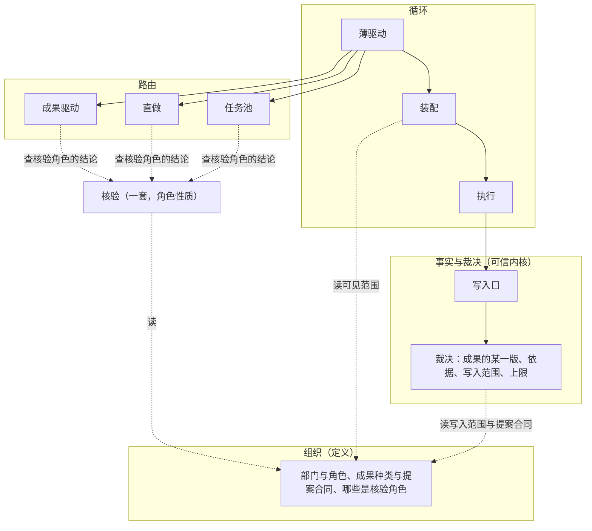
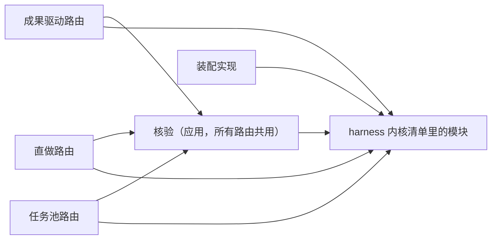

# 形态与核验角色设计说明

总图位置：第一节「轮转方式」「独立的证据」「质检」方框与开头一段的三样固定结构；第二节「定义」方框与四层；第三节「开环完成」「子组织」两条规矩；第四节「路由」「定义」「执行」三道缝。依据：[ADR-0044 核验是角色的性质](../adr/0044-verifier-role-and-open-loop.md)、[D38 系统意图与基础规则](../requirements/system-intent.md)、[骨架与应用设计说明](skeleton-and-application.md)「三道缝的契约」「第二种路由：骨架要满足的条件」、[验证的独立性设计说明](independent-verification.md)、[部门内多角色设计说明](department-roles.md)。

## 1. 功能与依据

同一套底下的层，只换路由与定义，就能跑出下面几种形态：

| 形态 | 组织 | 路由 | 核验角色 | 怎么结束 |
| --- | --- | --- | --- | --- |
| 单 agent | 一个角色 | 直做 | 没有 | 交完成，开环完成 |
| 普通多 agent | 几个角色，靠询问交流 | 直做 | 可有可无 | 指定角色交完成；有核验角色时它放行 |
| 三部门（默认） | 产品、工程、质检 | 成果驱动 | 质检 | 质检放行 |
| 外包退化 | 一个外包角色 | 直做 | 没有 | 外包交回快照，开环完成 |
| 子组织 | 某个角色的一轮工作开一个子事项 | 父层照旧，子层任选 | 各层自定 | 子事项的结果作为这个角色的提案回到父层 |

观察者不在表里：它不是部门，按总图第四节「观察者」的缝读写，哪种形态都一样。

## 2. 边界与范围

做：

- 四层的划分与每层认识的词（第 4.1 节）。
- 核验角色：一套核验，任何路由都能放（第 4.2 节）。
- 直做路由与开环完成（第 4.3、4.4 节）。
- 形态随事项冻结：同一个实例里，不同事项可以用不同的定义；项目设置里选形态，能改回（第 4.5 节）。
- 定义采纳前的校验：谁能拒绝谁无环、核验对象存在、开环的标记（第 4.7 节）。

只写位置与规矩，不在这一批做：

- 子事项（第 4.6 节）：随路线图「角色与外包」那条道的部门内多角色一起做。
- 观察者的写入：随「观察者」那条道做。

不做：

- 按固定顺序交接的路由。需要时它只是又一条路由，不改这里的任何一层。
- 运行中的实例改内核的分级放开，另行讨论。

## 3. 接口

- 路由契约不变：谁开工、一轮怎么结束、事项怎么结束。新增的只有结束原因要说明它是放行还是开环完成，路由自己按定义里有没有核验角色给出。
- 定义的缝只增字段：角色的写入范围；是否核验角色、核验谁；角色按事项种类的任务说明并进事项种类里已有的部门说明。旧定义不写这些字段时，等于今天三部门的行为。
- 执行契约不变。外包仍是执行的一种实现。

包图：

内核不导入路由、核验与装配；路由之间不互相导入。

## 4. 方案

### 4.1 四层各认识什么

| 层 | 负责 | 认识的词 | 不认识 |
| --- | --- | --- | --- |
| 事实与裁决 | 记事实，核对每次写入，一定会停 | 事项、事件、某种成果的某一版及其依据、提案、回执、角色的写入范围与工具许可、上限、决定请求 | 部门种类、PRD、交付、放行、检验方式 |
| 循环 | 让一轮一轮转起来 | 一轮工作；路由、装配、执行三道契约 | 任何一种协作方式的规矩 |
| 路由 | 谁开工、什么时候结束 | 自己的轮转规矩；核验角色的结论 | 具体的部门名 |
| 组织 | 往结构里填人 | 部门、角色、提示、工具、成果种类、核验角色 | |

成果驱动的那几种成果（PRD、交付、质检结论、结构说明、基线核验）与六种检验方式归成果驱动与核验，内核只按定义里的提案合同核对。已经写进日志的老事件照样能读；成果驱动继续写原来那几种接纳事件，所以已有的事件序列不变；新路由一律写通用的成果接纳。

验收这一节的办法只有一条：任何一种形态，都不改事实与裁决、循环两层。

### 4.2 核验角色

核验只有一套，角色在定义里声明「做核验、核验谁的成果」就有：

1. 写入范围是检查材料：它写的东西只进检查材料，不让被核验方的成果失效。写入范围是内核认识的通用权限，核验角色只是取了这一种。
2. 检查在独立副本上由主机跑，回执绑定被核验的那一版和检查材料的摘要。
3. 被核验方交了新的一版，通知核验角色；核验角色先看事实，下了结论才看被核验方的解释；双方的询问按事实与解释分开（[验证的独立性设计说明](independent-verification.md)「先判断后看解释」）。
4. 结论绑定当前版本；版本变了，结论失效。
5. 有核验角色时，只有它的结论能放行，它的结论不外包，也不交给判定点。

路由不写核验，只问核验：这个事项有没有核验角色；它对当前这一版的结论到了没有、是什么。成果驱动用它决定放行与打回；任务池用它判一个单元；直做在有核验角色时，把「指定角色交完成」改成「指定角色交完成并且核验角色放行」。

### 4.3 直做

1. 定义写明角色清单、谁能交完成、成果种类与提案合同。
2. 有用户输入或指导时，没有在工作的角色开始一轮；角色之间靠询问交流，询问照现有规矩嵌在一轮里。
3. 指定的角色交了完成，事项结束：没有核验角色核验它，结束原因是开环完成；有，等核验角色的结论，放行则结束，打回则被核验的角色再开始一轮（总图第三节「返工」打回给被核验的一方）。
4. 一个角色、一个外包角色，都是直做的特例，不另写路由。

### 4.4 开环完成

1. 开环完成是结束原因清单里的一条，结果是完成。
2. 按流程采纳，不因为缺少核验发决定请求；事项的记录、页面、离开期间的报告上写开环完成，不写放行，汇总里不算进放行的事项。画面上两者画法不同，见[画面与播放设计说明](visualization.md)「开环完成与放行」。
3. 角色在工作中拿不准时，是继续还是发决定请求问用户，由它按自己的角色材料判断，结构上不因为有没有核验角色而规定去向（总图第三节「判定点」）；选了什么写成事件，重放读事件。直做的默认角色材料写明：能按项目约定与常见做法补全的就继续，把拿不准的地方列进交完成的说明；只有目标本身读不通、继续会做出用户明显不要的东西时才问。
4. 外包退化时 Yudao 仍守四样：从封存快照建工作区、交回的是新快照与差异；总时间与用量有上限；交回的结果经写入口成为提案，日志能重放；记为开环完成并注明外包。
5. 自举不用没有核验角色的定义。
6. 建档事项也可以用没有核验角色的定义：没有基线核验这一步，以开环完成结束，初始 PRD 照常请用户确认，确认时看得到没有经过基线核验（[接入已有项目设计说明](existing-project-onboarding.md)「总体」）。

### 4.5 形态随事项冻结

形态就是事项创建时冻结的那份定义。写入口与薄驱动核对部门与停止原因时，读事项所用的那份定义，不读进程加载时的那份。对外合同里的部门是字符串，取值由事项的定义给出。默认仍是三部门。

形态怎么选：每个发布带几份具名的形态，每份是一份完整的定义版本，实例里同时加载这几份。项目设置里有一项「形态」，取值是这几份的名字，默认三部门。改它是一条命令，写成项目流的一条事件，带原值、新值与理由；命令带上用户看到的当前值，与项目现在的值对不上就拒绝，两处同时改时不会悄悄覆盖。改回就是再改一次，历史里每一次都看得到。事项创建时冻结项目当时的形态，之后的写入核对、路由、装配都按它；已经在跑的事项不受改动影响。项目设置页有「形态」一节：现在用哪一份，改与改回，历史。

发布默认带两份：三部门，与单角色直做。单角色直做只有一个角色，用工程这个部门的名字与工具，没有核验角色，所以以开环完成结束；它的模型按工程的设置解析，不为它另加模型设置。

### 4.6 子组织（位置与规矩）

1. 角色定义可以指向一份子组织（含它自己的路由与核验角色）。指向了，这个角色的一轮工作开一个子事项；不指向，就是一个模型或一个外包会话。
2. 子事项有自己的事件流和冻结的定义；创建事件带上一层的事项、一轮与角色的引用和层数。
3. 子事项的时间与用量从上一层剩下的里扣，层数到上限时拒绝再开（与子循环共用嵌套深度的上限，数值见[循环与收敛设计说明](loops-and-convergence.md)「循环层的声明」）；上一层停，子事项跟着停。整棵树一定会停。
4. 子事项结束时，它的最终成果作为这个角色的普通提案回到上一层，照常过裁决。对上一层来说，子组织就是一个慢一点的角色，所以不加新的骨架事件种类。
5. 部门内多角色（中心型协作）用这一种做法：中心角色是子组织里的一个角色，探索者、主程、审查者是它的同伴；不在执行里另做一套子 agent。
6. 开子事项是执行缝的一种出（总图第四节「执行」）。子组织建成之前，契约不为它预留字段；它进来时按契约只增字段、带版本。

### 4.7 定义的校验

定义在加载与采纳前校验，不满足的整份拒绝，错误写明是哪一项（总图第四节「定义」）：

1. 谁能拒绝谁无环：把「谁能打回谁的成果」看成一张图，图里不能有环。角色核验自己是长度为一的环，同样拒绝，所以核验角色不能核验自己。
2. 核验对象存在：核验角色声明核验的角色与成果种类都在这份定义里。
3. 开环的标记：事项创建时，按冻结的定义看事项最后采纳的成果（直做下是交完成的那一份，成果驱动下是交付）有没有核验角色核验；没有，事项标为开环，结束原因是开环完成。有核验角色、但它只核验中途的成果时，同样标为开环：标记说的是最后采纳的东西有没有经过独立核验。

几个核验角色核验同一份成果时，每一个都放行才算放行，任何一个打回就返工；结论绑定当前版本，新的一版要重新取得每一个的结论。不需要核验的成果（例如三部门里的 PRD）不经核验角色，直接接纳（总图第三节）。

## 5. 验收

1. 默认定义下，已有的事件序列基准与交给模型的请求快照一字不变。
2. 把三部门改名（例如质检改叫另一个名字）的定义跑同一个事项，事件序列除了名字以外与默认相同。
3. 事实与裁决、循环两层的代码里不出现部门名，也不出现 PRD、交付、质检结论这些成果种类的判断。
4. 一个角色的直做定义能跑完一个事项，以开环完成结束，记录与页面写开环完成，没有发决定请求。
5. 一个外包角色的直做定义能跑完一个事项，从快照进、快照出，到上限会停，以开环完成结束并注明外包。
6. 直做加一个核验角色：交完成以后等核验结论，放行才结束，打回则再做一轮；核验用的是和三部门质检同一套。
7. 任务池的判定改用核验角色，任务池原有的测试照常通过。
8. 同一个实例里，一个事项用三部门、另一个事项用直做，两个都能跑完，各按自己冻结的定义核对。
9. 一份定义里核验角色核验的对象不存在，加载时被拒绝；谁能拒绝谁有环（含核验自己）时，加载时被拒绝。
10. 有核验角色、但交完成的角色不在它核验的范围里，事项创建时标为开环，以开环完成结束。
11. 开环事项里角色拿不准时没有结构上的决定请求；角色按材料选择问用户时，请求与回答照常写成事件，重放读事件。
12. 在项目设置里把形态换成单角色直做，再建一个事项：它以开环完成结束；改回三部门以后新建的事项以放行结束；改的时候已经在跑的事项按原来的形态跑完；历史里两次改动都在，带原值与理由。

## 6. 未决问题

- 直做下的工作单元是什么。
