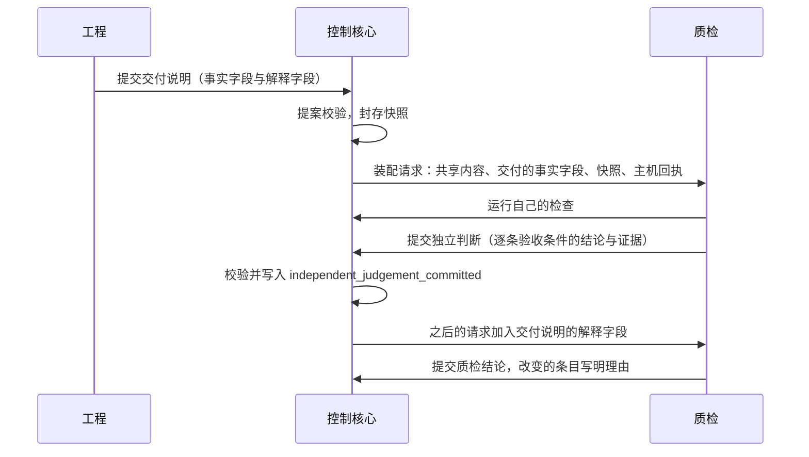

# 验证的独立性设计说明

总图位置：第一节「独立的证据」方框；第四节「装配」的缝里作者与验证者的可见范围。依据：[D38 系统意图与基础规则](../requirements/system-intent.md)（N-I1 至 N-I7、N-K1、N-K2、N-V7）、[D32 与单个 agent 的对照实验](../requirements/comparison-experiment.md)、[语义系统设计说明](semantic-system.md)、[浏览器与 computer use 设计说明](browser-and-computer-use.md)、[网络取回与 MCP 设计说明](network-and-mcp.md)。

文中的质检、工程是默认三部门里的核验角色与被核验方；第 2 至 8 节对任何核验角色和它核验的角色成立（[形态与核验角色设计说明](forms-and-verifier-role.md)第 4.2 节）。

## 1. 要解决的问题

| 问题 | 现状 | 影响 |
| --- | --- | --- |
| 隔开的范围比需要的宽 | 质检只见当前交付说明；现有结构说明只给工程；语义系统设计把部门记录的事实、知识、决定划为只本部门可见 | 验证者缺少架构与已有事实，重复探索，部门之间的询问增加 |
| 隔开的范围也比需要的窄 | 质检可见整份交付说明，其中有工程对实现的解释与自我评价 | 验证者在形成判断之前就被作者的解释影响 |
| 验证密度是固定值 | 质检只认自己本次激活的回执；每次对外提交必有一次审查；校准抽样固定 10% | 同一快照上的同一检查重复运行，连续可靠时也不减少 |
| 看不出放行有多少可执行的检验 | 放行的核对只核对结构条件；试用用例的结论由质检的模型给出 | 模型阅读被当作检验计入，没有检验的要求不被察觉地通过 |
| 边界有一处不一致 | 网络取回永远拒绝 Yudao 服务自己的地址；试用会话的浏览器不设置允许或禁止访问的来源 | 验证者可以经浏览器读到其他部门的私有内容；自举时被开发的代码与实例在同一张网里 |

## 2. 共享的与隔开的

划分的依据是信息的内聚：一个部门是围绕一个目标函数聚在一起的信息——它的证据来源、它的工作过程、它作出的判断。属于这个内聚的留在部门内，其余的属于全体。边界由此得出，可见范围的参数只调整其中有争议的部分。

| 类别 | 内容 | 默认谁可见 |
| --- | --- | --- |
| 共享 | 用户意图原文；当前有效的产品合同；架构与现有结构说明；被接纳的事实与决定；接口约定与启动方式；封存的代码快照；主机测量的回执；质检的缺陷记录 | 所有部门与角色；宽度是参数 |
| 作者的过程 | 角色的历史：推理、工具调用的经过、失败的尝试、草稿 | 只有作者自己 |
| 作者的解释 | 交付说明中的解释性陈述（为什么这样实现、已知的不足、对完成情况的自我评价）；对审查意见的答复 | 验证者提交独立判断以后可见 |
| 评价材料 | 评测的隐藏检查与参考解法；校准样本的标注 | 任何部门、角色、观察者都不可见 |

需要独立的是判断，所以隔开的是后三类；第一类的宽度是参数。

与语义系统的可见范围对应：事项层与一轮工作层的轨迹、要求类条目、材料与实体名称是共享的；计划条目、角色任务与尝试是作者的过程，继续隔开；部门记录的事实、决定与知识属于共享一类，是否对其他部门只读可见由可见范围参数决定，现值是只本部门可见，默认值取第 6 节对照的结果；推测保持本部门可见；教训、洞见与画像是部门自己的抽象，默认本部门可见，取值是参数。

## 3. 可见范围作为参数

可见范围已经是角色定义里的数据，取值来自一份封闭词表。词表保留工程使用的整份当前交付说明；质检使用交付事实与交付解释两项，把交付说明按事实与解释分开提供。质检还可以按规则读取既有结构、上一份交付、质检缺陷等共享材料。没有稳定来源的已接纳事实和检查回执不加入词表；它们仍通过各自的证据引用进入逐条结论。

质检角色有隔离与共享两套取值。隔离取值只提供交付事实与交付解释；共享取值再提供既有结构、上一份交付和质检缺陷等共享材料。工程保留当前交付说明的整份取值，产品与其他角色沿用各自登记的范围。两套取值都是规则登记中的参数，界限能够容纳词表中的六项取值。交付解释在两套取值中都受第 4 节的时间条件约束。默认仍采用隔离取值，由第 6 节的对照决定是否改为共享。

## 4. 先判断后看解释



- 交付说明的每个字段在提案合同里标明属于事实还是解释。启动方式、交付了哪些文件、声明运行过的检查属于事实；实现的理由、已知的不足、完成情况的自我评价属于解释。
- 交付说明的种类与它所依据的产品合同摘要属于事实；它们用于识别这份交付说明适用的合同和解释其内容的范围。上下文材料的分段范围只对交付说明生效，其他提案种类没有交付说明分段时不作这项校验。
- 工程与质检之间的问题与回答同样分事实与解释两部分（[三部门的循环结构](department-loop.md)第 4.6 节）：质检询问工程得到的回答、工程询问质检时质检分支看到的问题，以及这些问答在质检历史中的记录。质检的预测性探索与之后的核验是同一条历史，交付之前得到的解释同样受这条规则约束。
- 上下文装配的规则：验证者的请求里放入解释部分（交付说明的解释字段，以及上一条的问答的解释部分）的条件，是事件日志中已经有当前交付的独立判断。新的交付到达后按新交付重新计算。
- 裁决规则：质检结论必须引用一条独立判断；与独立判断不同的条目要写明改变的理由。
- 度量：解释翻转率，即看过解释以后改变结论的条目比例，按「不通过改为通过」与「通过改为不通过」分开统计。前一个方向的比例高，说明解释在说服验证者。
- 不变式（进入内核测试）：对每份交付，上下文清单里含有工程内容解释部分的验证者请求，位置都晚于这份交付的独立判断事件；工程内容包括交付说明、直接的问答与历史中的问答记录三条通道。反例覆盖从预测性探索到正式核验的同一条历史。
- 子组织里声明为核验角色的审查者使用同一个步骤。

## 5. 验证密度

密度是一个界内的参数，由确定的规则按记录调节。意外的定义由代码给出：主机测量的结果与角色的陈述或预期不一致。

```json
{
  "verification.recheck_ratio": {
    "value": 1.0,
    "bounds": [0.25, 1.0],
    "kind": "parameter",
    "form": "admission",
    "guards": "验证者照搬作者的结论",
    "cost": "同一快照上的同一检查重复运行",
    "relax_when": "连续 5 份交付，工程回执与质检回执在同一树摘要上一致",
    "tighten_when": "出现 reset_on 中的任一事件"
  },
  "verification.reset_on": [
    "receipt_mismatch", "qa_false_release", "rework_after_declared_pass",
    "write_outside_plan", "flaky_check"
  ]
}
```

- 比例的对象：工程已经有主机回执、并且树摘要相同的检查，质检按比例重新运行；其余直接引用工程的主机回执。
- 质检从验收条件导出的检查与试用用例不在这个比例之内，始终运行。
- 在另一台机器上运行同一检查算作新的独立证据，不计为重复。
- 连续一致达到次数以后比例减半，不低于下界；出现清单里的任一事件，比例回到 1.0。调节写成事件。
- 现有的三个固定密度用同样的办法登记为参数：每次对外提交必有一次审查成为 `review.ratio`，下界大于 0；校准抽样固定 10% 成为 `calibration.sample_ratio`；质检只认自己本次激活的回执就是 `verification.recheck_ratio` 等于 1.0。
- 阶段一、二保持 1.0，调节规则在阶段四启用。
- 用户 2026-09-25 把「模型固有的知识或者动作，但是结果反馈不行」称为需要记录的惊讶（[D25](../requirements/semantic-system.md)）；本节的意外事件清单是它在验证这一侧的代码化定义：预期与主机测量的结果不一致。

## 6. 共享上下文的一组对照

在 D32 的对照实验里增加一组：

| | 隔离（现值） | 共享 |
| --- | --- | --- |
| 可见范围 | 现在角色定义的取值 | 质检可见：交付事实、交付解释、既有结构、上一份交付和质检缺陷；解释受独立判断时机约束，其他部门沿用各自角色定义的取值 |
| 先判断后看解释 | 关闭 | 开启 |
| 模型、场景、次数、限额 | 相同（DeepSeek V4.1 Flash） | 相同 |

- 任务：三个回归场景，每个 3 次。隔离组直接使用 3.9 对照实验里 Yudao 一侧的运行，新增的只有共享组的 9 次运行。
- 主要指标：质检误放行，判据是不增加。次要指标：部门之间的询问次数、返工次数、完成度、请求数、费用、耗时、解释翻转率。
- 判定：共享组的误放行不增加，并且询问或返工的减少超出噪声范围，就把共享的取值与先判断后看解释一起作为默认值。误放行增加时保留隔离的取值，再对新增的可见项逐项对照。
- 这组对照同时改变两个因素，结论只适用于两项一起采用；以后要单独保留其中一项时，另做一组对照。
- 前提：第 3 节词表的扩充与第 4 节先判断后看解释先完成。

## 7. 检验覆盖与开环

这里的开环指一条验收条件没有可执行的检验，只出现在放行记录里；它和事项的开环完成（定义里没有核验角色）是两回事，开环完成的事项没有逐条结论，也不算检验覆盖比例。

1. 产品合同里的每条验收条件有编号。
2. 质检在工程开始之前为每条验收条件登记检验方式：命令检查、试用用例、主机测量、带参照材料的判定点、人、开环。时机是产品合同被接纳以后的第一次质检工作。
3. 放行时，每条验收条件的证据绑定当前的交付快照。
4. 检验覆盖比例等于「有可执行的检验并且已经在当前快照上运行」的条件数除以条件总数。同时报告另外两个数：靠模型阅读作出判断的条件数、开环的条件数。试用用例按步骤分类：含断言工具或检查回执的步骤算可执行的检验；只凭截图由质检的模型判断的算模型阅读。
5. 检验本身是否有效：新功能的检验在基线快照上运行应当失败，在交付快照上运行应当通过，两次都由主机执行。只有通过这一记录的检验单独计数。变异测试作为工程的工序补充。
6. 开环的条件：标记，写进放行记录与离开期间的报告，供用户事后查看。不增加模型审查来代替检验。用户可以指定某一类开环条件必须由本人确认，这时它成为决定请求。

### 7.1 口径（2026-10-29 总架构师定）

1. 检验方式的代码名固定为六个：`check`（命令检查）、`trial`（试用用例）、`measure`（主机测量）、`judgement`（带参照材料的判定点）、`human`（人）、`open`（开环）。`check`、`trial`、`measure` 是可执行的检验，`judgement`、`human`、`open` 不可执行。
2. 每条验收条件的结果只有 `passed`、`failed`、`unverified` 三个词；查询与画面沿用，原型数据里的 `pass`、`fail`、`not_run` 由翻译层对应。
3. 放行规则：逐条结论覆盖全部验收条件；没有 `failed`；可执行检验的条件都是 `passed`，且各有至少一个证据；不可执行检验的条件可以是 `unverified`，列进放行记录的开环明细。
4. 三个数的关系：检验覆盖比例 = 可执行检验的条件中已在当前快照上运行并通过的条数 ÷ 条件总数；开环的条件数 = 条件总数 − 可执行检验的条件数，其中只凭模型读截图或读文字作判断的是模型阅读的条件数（含于开环）。其中命令检查只有满足「检验的有效性」的基线区分条件才进入覆盖比例的分子；有效性不改变可执行检验与开环的分类。三个数在放行记录里一次算好，查询与画面读这个数，不重新计算。
5. 「质检无法核验」是独立的结论 `cannot_verify`，不是放行的一种形式。

### 7.2 检验的有效性

检验有效性只适用于命令检查。质检在形成逐条结论前，调用一次由主机执行的基线检查动作；该动作沿用普通检查的取消、超时、重启后重新执行和回执路径。质检负责触发，主机负责在副本中执行并写回结果，放行判断不在这次动作中同步执行命令。

基线副本由三部分组成：事项起点树的引用、质检测试材料、质检声明需要叠加的交付文件。事项返工时起点树保持不变。质检测试材料不进入交付快照，因此基线副本与交付副本使用同一份材料；声明涉及的交付文件必须属于起点到交付的改动范围。检查命令取已记录的同名交付检查，质检不能在基线运行时改写命令。

同一项检查必须在基线副本和交付副本上都由主机运行。基线失败且交付通过时，该检验才计入检验覆盖；基线也通过时不计入检验覆盖，并在放行记录中列出基线结果。基线没有回执时也不计入检验覆盖，并在放行记录中列出缺少回执的情况。基线回执必须在提交放行决定读取事实之前写入检查工作区，提交决定读取的事实必须包含该回执。上述情况都不改变放行准入、逐条结论的结果词或开环条件的数量。

基线结果不改写交付检查的结果词；放行仍按「口径」核对交付证据。覆盖计数如下：

| 基线结果 | 交付检查通过时计入检验覆盖 | 放行处理 |
| --- | --- | --- |
| 非零，排除超时与取消 | 是 | 沿用交付检查及原放行条件 |
| 通过 | 否 | 记录基线也通过，沿用原放行条件 |
| 缺少回执 | 否 | 记录缺少基线回执，沿用原放行条件 |
| 超时或取消 | 否 | 记录无法运行，沿用原放行条件 |

基线退出状态为非零且不属于 124 或 130 时，记录为可用于有效性判断的失败；124 表示超时，130 表示取消，二者记录为无法运行。主机只记录运行结果，不判断失败原因；质检在逐条结论中说明该检验预期失败的理由。基线运行只覆盖命令检查，试用用例和主机测量沿用各自的证据路径。

该机制衡量检验对新功能的区分能力，不衡量检验集合是否充分；变异测试仍属于工程的工序补充。基线环境损坏可能产生假失败，可用项目登记的检查命令先在基线副本中运行探针。是否把缺少基线回执改为拒绝放行，仍待决定；描述“保持不变”的回归防护条件目前按新功能检验处理，是否应在基线也通过仍待决定。

## 8. 边界的一致

试用会话的浏览器使用与网络取回相同的拒绝规则：拒绝 Yudao 服务自己的地址。可见范围的参数要成立，验证者就不能经另一条通道读到其他部门的内容；自举时被开发的代码与实例在同一张网里，这一条更重要。

## 9. 什么事到用户面前

到用户面前的有两种。一种是结构上的：下面清单第 2 至 6 条，以及「被评价者改不了评价标准」涉及的锚点，不论角色怎么想都发决定请求。另一种是角色自己的选择：角色在工作中拿不准时，是继续还是问用户，由它按角色材料判断（总图第三节「判定点」，[总体架构](architecture/overall-architecture.md)「拿不准时继续还是问用户」）；选择写成事件，它发出的请求与结构上的请求一样计入下面的度量。开环完成不因为缺少核验发请求：定义里没有核验角色的事项，交完成本身不到用户面前（[形态与核验角色设计说明](forms-and-verifier-role.md)「开环完成」）。

阻塞的决定请求（封闭清单，阻塞范围取最小；第 1 条是角色自己的选择，其余是结构上的）：

1. 角色按角色材料选择问用户（例如目标的读法互相矛盾、没有检验能够区分）；阻塞范围是发出它的那个角色这一轮。
2. 定义候选的采用；内核修改；实例升级。
3. 常设授权以外的外部动作，登记之外的取回。
4. 结果未知的动作，在自动核实与自动重新执行一次以后仍然没有结果。
5. 核验角色无法核验；校准样本的裁定。
6. 自动修复达到次数上限；待恢复；等待超过时长上限。

只进入离开期间的报告：达到上限的失败、返工与询问、带开环条件的放行、开环完成的事项（注明是否外包）、参数的自动调节、收敛状态的变化、反复退回的提醒。

对注意力的控制：

- 三个数字进入度量：每天的决定请求数、回答之前的等待时长、被阻塞的范围。
- 每一种决定请求是一条登记的规则，花费用占用用户的次数计。用户的回答与系统给出的建议选项连续一致（例如最近 20 次）时，规则复查提出把它改为「按建议执行，并列入报告」；这个修改是一次结构候选，经用户批准。
- 等待回答期间出现的同类请求合并到同一张卡片。
- 浏览器的系统通知只在出现阻塞的决定请求时提示，并且只在本机打开着页面时出现（[网页界面的提供与发布设计说明](web-interface-and-release.md)第 5.3 节）。

## 10. 模块交互


## 11. 验收

- 验证者在提交独立判断之前的任何请求里，没有作者的历史与解释字段；不变式测试覆盖。
- 两套可见范围的取值可以各自运行同一个评测场景，不修改代码。
- 每次放行附检验覆盖比例、模型阅读的条件数与开环的条件数。
- 试用会话的浏览器访问 Yudao 服务自己的地址时被拒绝。
- 3.9 的对照报告包含共享组的结果与解释翻转率。

## 12. 与现有设计的关系

- [语义系统设计说明](semantic-system.md)：可见范围表按第 2 节对应修改。
- [部门内多角色设计说明](department-roles.md)：审查者使用先判断后看解释；`review.ratio` 是参数。
- [接入已有项目设计说明](existing-project-onboarding.md)：现有结构说明的可见范围是参数。
- [浏览器与 computer use 设计说明](browser-and-computer-use.md)：逐条结论增加检验方式、基线与交付两次运行；试用浏览器的拒绝规则。
- [规则登记与参数设计说明](rules-and-parameters.md)：可见范围、先判断后看解释与验证密度都是登记的参数。

## 变更记录

- 2026-10-31 / claude-opus-5-5 / 开头注明质检、工程是默认的核验角色与被核验方；第 4 节审查者改为子组织里的核验角色；第 7 节区分开环与开环完成；第 9 节加开环完成的例外、第 5 条改为核验角色并注明开环事项同样升级、报告清单加开环完成 / 按总图 ADR-0044 的改动核对
- 2026-10-29 / claude-sonnet-5-5 / 按设计说明规范整理：开头改为总图位置与依据一行，删去状态、路线位置和工单号，第 7.1 节标题去掉括号中的核对依据，删去第 7.1 节第 5 项末尾的工单说法 / 设计与实施分离（decision.md 2026-10-29）
- 2026-10-29 / GPT-6（Codex） / 补充检验有效性、可见范围词表和共享材料范围 / 按阶段二交接核对基线检查、质检可见材料与工单依赖
- 2026-10-31 / claude-opus-5-5（子架构师） / 第 9 节分开结构上的请求与角色按材料的选择：删去「没有下游核验就升级」与第 5 条的判定点一项，第 1 条改为角色选择问用户 / 用户 2026-10-31 定判定点拿不准时由角色材料判断（总图第三节「判定点」）
