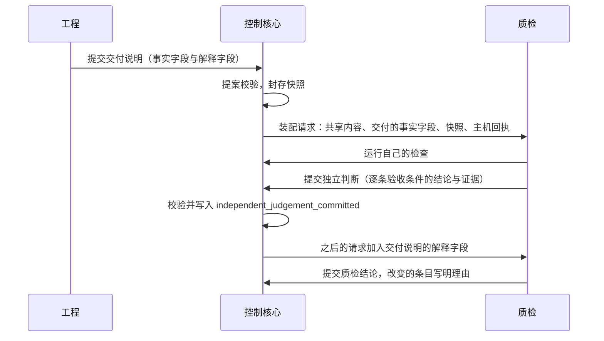

# 验证的独立性设计说明

更新：2026-10-07。状态：设计已确认（2026-10-07 用户确认按意图校准整理项目），未实施。路线位置：可见范围词表的扩充、交付说明的事实与解释、先判断后看解释是 Stage 3「迭代底座」工作包的 B5（M4，3.9 之前）；检验方式、覆盖比例与开环并入 3.2D 的 #151；试用浏览器的拒绝规则并入 #149；共享上下文的一组对照在 3.9（#100）；验证密度的调节规则在 Stage 5。

依据：[D38 系统意图与基础规则](../requirements/system-intent.md)（N-I1 至 N-I7、N-K1、N-K2、N-V7）、[ADR-0029](../adr/0029-departments-form-by-information-cohesion.md)、[ADR-0020](../adr/0020-block-only-when-no-downstream-check.md)、[D32 与单个 agent 的对照实验](../requirements/comparison-experiment.md)、[语义系统设计说明](semantic-system.md)、[浏览器与 computer use 设计说明](browser-and-computer-use.md)、[网络取回与 MCP 设计说明](network-and-mcp.md)。

## 1. 要解决的问题

| 问题 | 现状 | 影响 |
| --- | --- | --- |
| 隔开的范围比需要的宽 | 质检只见当前交付说明；现有结构说明只给工程；语义系统设计把部门记录的事实、知识、决定划为只本部门可见 | 验证者缺少架构与已有事实，重复探索，部门之间的询问增加 |
| 隔开的范围也比需要的窄 | 质检可见整份交付说明，其中有工程对实现的解释与自我评价 | 验证者在形成判断之前就被作者的解释影响 |
| 验证密度是固定值 | 质检只认自己本次激活的回执；每次对外提交必有一次审查；校准抽样固定 10% | 同一快照上的同一检查重复运行，连续可靠时也不减少 |
| 看不出放行有多少可执行的检验 | 放行的核对只核对结构条件；试用用例的结论由质检的模型给出 | 模型阅读被当作检验计入，没有检验的要求不被察觉地通过 |
| 边界有一处不一致 | 网络取回永远拒绝 Yudao 服务自己的地址；试用会话的浏览器不设置允许或禁止访问的来源 | 验证者可以经浏览器读到其他部门的私有内容；自举时被开发的代码与实例在同一张网里 |

## 2. 共享的与隔开的

划分的依据是信息的内聚：一个部门是围绕一个目标函数聚在一起的信息——它的证据来源、它的工作过程、它作出的判断。属于这个内聚的留在部门内，其余的属于全体。边界由此得出，可见范围的参数只调整其中有争议的部分。

| 类别 | 内容 | 默认谁可见 |
| --- | --- | --- |
| 共享 | 用户意图原文；当前有效的产品合同；架构与现有结构说明；工程计划；被接纳的事实与决定；接口约定与启动方式；封存的代码快照；主机测量的回执；质检的缺陷记录 | 所有部门与角色；宽度是参数 |
| 作者的过程 | 角色的历史：推理、工具调用的经过、失败的尝试、草稿 | 只有作者自己 |
| 作者的解释 | 交付说明中的解释性陈述（为什么这样实现、已知的不足、对完成情况的自我评价）；对审查意见的答复 | 验证者提交独立判断以后可见 |
| 评价材料 | 评测的隐藏检查与参考解法；校准样本的标注 | 任何部门、角色、观察者都不可见 |

需要独立的是判断，所以隔开的是后三类；第一类的宽度是参数。

与语义系统的可见范围对应：事项层与交接层的轨迹、要求类条目、材料与实体名称是共享的；计划条目、角色任务与尝试是作者的过程，继续隔开；部门记录的事实、决定与知识属于共享一类，是否对其他部门只读可见由可见范围参数决定，现值是只本部门可见，默认值取第 6 节对照的结果；推测保持本部门可见；教训、洞见与画像是部门自己的抽象，默认本部门可见，取值是参数。

## 3. 可见范围作为参数

可见范围已经是角色定义里的数据，取值来自一份封闭词表。做法是扩充词表，机制不变：增加 `engineering_plan`、`accepted_facts`、`check_receipts`、`delivery_facts`、`delivery_explanation`，把整份的 `current_delivery_spec` 分成事实与解释两项。

质检角色的两套取值：

```json
{
  "isolated": {
    "quality": {"visibility": ["delivery_facts", "delivery_explanation"]}
  },
  "shared": {
    "quality": {
      "visibility": [
        "delivery_facts", "existing_structure", "engineering_plan",
        "accepted_facts", "check_receipts", "prior_delivery", "qa_defects",
        "delivery_explanation"
      ]
    }
  }
}
```

两套取值都是规则登记中的参数。`delivery_explanation` 在两套里都受第 4 节的时间条件约束。现值保持隔离的一套，由第 6 节的对照决定是否改为共享。

## 4. 先判断后看解释



- 交付说明的每个字段在提案合同里标明属于事实还是解释。启动方式、交付了哪些文件、声明运行过的检查属于事实；实现的理由、已知的不足、完成情况的自我评价属于解释。
- 上下文装配的规则：验证者的请求里放入解释字段的条件，是事件日志中已经有这次交接的独立判断。
- 裁决规则：质检结论必须引用一条独立判断；与独立判断不同的条目要写明改变的理由。
- 度量：解释翻转率，即看过解释以后改变结论的条目比例，按「不通过改为通过」与「通过改为不通过」分开统计。前一个方向的比例高，说明解释在说服验证者。
- 不变式（进入内核测试）：对每次交接，上下文清单里含有该次交接解释字段的验证者请求，位置都晚于该次交接的独立判断事件。
- 部门内的审查者（Stage 5）使用同一个步骤。

## 5. 验证密度

密度是一个界内的参数，由确定的规则按记录调节。意外的定义由代码给出：主机测量的结果与角色的陈述或预期不一致。

```json
{
  "verification.recheck_ratio": {
    "value": 1.0,
    "bounds": [0.25, 1.0],
    "kind": "parameter",
    "form": "admission",
    "guards": "验证者照搬作者的结论",
    "cost": "同一快照上的同一检查重复运行",
    "relax_when": "连续 5 次交接，工程回执与质检回执在同一树摘要上一致",
    "tighten_when": "出现 reset_on 中的任一事件"
  },
  "verification.reset_on": [
    "receipt_mismatch", "qa_false_release", "rework_after_declared_pass",
    "write_outside_plan", "flaky_check"
  ]
}
```

- 比例的对象：工程已经有主机回执、并且树摘要相同的检查，质检按比例重新运行；其余直接引用工程的主机回执。
- 质检从验收条件导出的检查与试用用例不在这个比例之内，始终运行。
- 在另一台机器上运行同一检查算作新的独立证据，不计为重复。
- 连续一致达到次数以后比例减半，不低于下界；出现清单里的任一事件，比例回到 1.0。调节写成事件。
- 现有的三个固定密度用同样的办法登记为参数：每次对外提交必有一次审查成为 `review.ratio`，下界大于 0；校准抽样固定 10% 成为 `calibration.sample_ratio`；质检只认自己本次激活的回执就是 `verification.recheck_ratio` 等于 1.0。
- Stage 3 保持 1.0，调节规则在 Stage 5 启用。
- 用户 2026-09-25 把「模型固有的知识或者动作，但是结果反馈不行」称为需要记录的惊讶（[D25](../requirements/semantic-system.md)）；本节的意外事件清单是它在验证这一侧的代码化定义：预期与主机测量的结果不一致。

## 6. 共享上下文的一组对照

在 D32 的对照实验里增加一组：

| | 隔离（现值） | 共享 |
| --- | --- | --- |
| 可见范围 | 现在角色定义的取值 | 三个部门都可见：架构与现有结构说明、工程计划、被接纳的事实与决定、接口约定、主机回执、质检的缺陷 |
| 先判断后看解释 | 关闭 | 开启 |
| 模型、场景、次数、限额 | 相同（DeepSeek V4.1 Flash） | 相同 |

- 任务：三个回归场景，每个 3 次。隔离组直接使用 3.9 对照实验里 Yudao 一侧的运行，新增的只有共享组的 9 次运行。
- 主要指标：质检误放行，判据是不增加。次要指标：部门之间的询问次数、返工次数、完成度、请求数、费用、耗时、解释翻转率。
- 判定：共享组的误放行不增加，并且询问或返工的减少超出噪声范围，就把共享的取值与先判断后看解释一起作为默认值。误放行增加时保留隔离的取值，再对新增的可见项逐项对照。
- 这组对照同时改变两个因素，结论只适用于两项一起采用；以后要单独保留其中一项时，另做一组对照。
- 前提：第 3 节词表的扩充与第 4 节先判断后看解释先完成。

## 7. 检验覆盖与开环

1. 产品合同里的每条验收条件有编号。
2. 质检在工程开始之前为每条验收条件登记检验方式：命令检查、试用用例、主机测量、带参照材料的判定点、人、开环。时机是产品合同被接纳以后的第一次质检工作。
3. 放行时，每条验收条件的证据绑定当前的交付快照。
4. 检验覆盖比例等于「有可执行的检验并且已经在当前快照上运行」的条件数除以条件总数。同时报告另外两个数：靠模型阅读作出判断的条件数、开环的条件数。试用用例按步骤分类：含断言工具或检查回执的步骤算可执行的检验；只凭截图由质检的模型判断的算模型阅读。
5. 检验本身是否有效：新功能的检验在基线快照上运行应当失败，在交付快照上运行应当通过，两次都由主机执行。只有通过这一记录的检验单独计数。变异测试作为工程的工序补充。
6. 开环的条件：标记，写进放行记录与离开期间的报告，供用户事后查看。不增加模型审查来代替检验。用户可以指定某一类开环条件必须由本人确认，这时它成为决定请求。

## 8. 边界的一致

试用会话的浏览器使用与网络取回相同的拒绝规则：拒绝 Yudao 服务自己的地址。可见范围的参数要成立，验证者就不能经另一条通道读到其他部门的内容；自举时被开发的代码与实例在同一张网里，这一条更重要。

## 9. 什么事到用户面前

判据沿用 ADR-0020：没有独立的下游检验能够挡住错误判断的事，以及「被评价者改不了评价标准」涉及的锚点，才到用户面前。

阻塞的决定请求（封闭清单，阻塞范围取最小）：

1. 目标的读法互相矛盾，并且没有检验能够区分。
2. 定义候选的采用；内核修改；实例升级。
3. 常设授权以外的外部动作，登记之外的取回。
4. 结果未知的动作，在自动核实与自动重新执行一次以后仍然没有结果。
5. 质检无法核验；判定点升级以后仍然不确定、并且没有独立的下游核验；校准样本的裁定。
6. 自动修复达到次数上限；待恢复；等待超过时长上限。

只进入离开期间的报告：达到上限的失败、返工与询问、带开环条件的放行、参数的自动调节、收敛状态的变化、反复退回的提醒。

对注意力的控制：

- 三个数字进入度量：每天的决定请求数、回答之前的等待时长、被阻塞的范围。
- 每一种决定请求是一条登记的规则，花费用占用用户的次数计。用户的回答与系统给出的建议选项连续一致（例如最近 20 次）时，规则复查提出把它改为「按建议执行，并列入报告」；这个修改是一次结构候选，经用户批准。
- 等待回答期间出现的同类请求合并到同一张卡片。
- 浏览器的系统通知只在出现阻塞的决定请求时提示，并且只在本机打开着页面时出现（[ADR-0032](../adr/0032-interface-served-as-web-pages.md)）。

## 10. 模块交互


## 11. 验收

- 验证者在提交独立判断之前的任何请求里，没有作者的历史与解释字段；不变式测试覆盖。
- 两套可见范围的取值可以各自运行同一个评测场景，不修改代码。
- 每次放行附检验覆盖比例、模型阅读的条件数与开环的条件数。
- 试用会话的浏览器访问 Yudao 服务自己的地址时被拒绝。
- 3.9 的对照报告包含共享组的结果与解释翻转率。

## 12. 与现有设计的关系

- [语义系统设计说明](semantic-system.md)：可见范围表按第 2 节对应修改。
- [部门内多角色设计说明](department-roles.md)：审查者使用先判断后看解释；`review.ratio` 是参数。
- [接入已有项目设计说明](existing-project-onboarding.md)：现有结构说明的可见范围是参数。
- [浏览器与 computer use 设计说明](browser-and-computer-use.md)：逐条结论增加检验方式、基线与交付两次运行；试用浏览器的拒绝规则。
- [规则登记与参数设计说明](rules-and-parameters.md)：可见范围、先判断后看解释与验证密度都是登记的参数。
