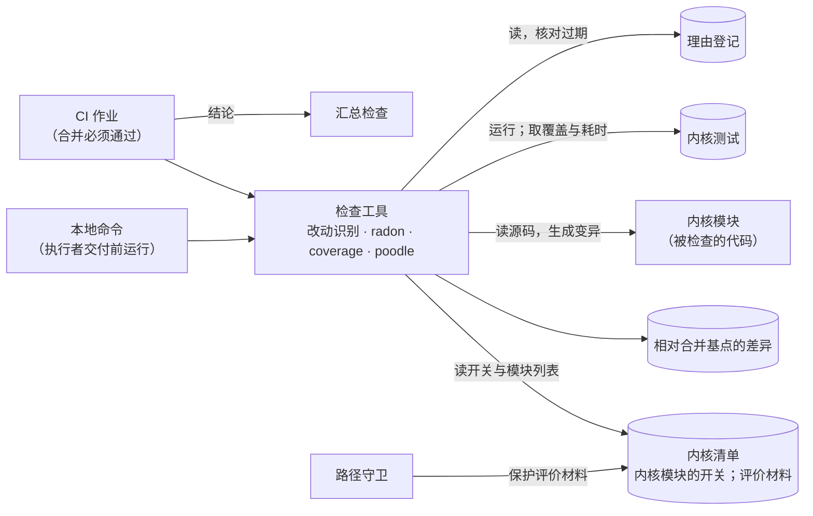
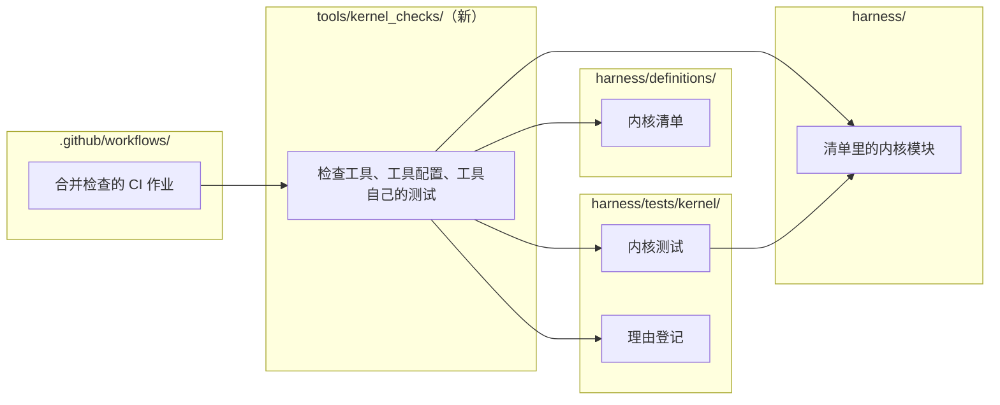

# 内核的代码质量检查设计说明

总图位置：第二节「只由你批准」那一环（在开发仓库里改它所守的代码要求）；第五节验收表的「内核」一层。依据：[基础规则](../foundation-rules.md)规则 4、[D38 系统意图与基础规则](../requirements/system-intent.md)「基础规则」与 N-K4、[ADR-0046](../adr/0046-kernel-trusted-by-checks-not-size.md)、[可信内核设计说明](trusted-kernel.md)「内核清单」、[测试分层设计说明](test-pyramid.md)「登记表与共用代码」与「测试按三环留」、[总体路线图](../program-roadmap.md)「内核的代码质量门槛」、[圈复杂度与变异测试调研](../research/complexity-and-mutation-testing.md)「本仓库的实测」与「手动进行的方法」、[ub-mode 调研](../research/uncle-bob-ub-mode.md)「做法与参数速查」。

## 1. 功能与依据

基础规则四要求改到的内核代码受两条比别处更高的检查：变异与复杂度。这份说明回答它们在开发仓库里怎样做：用什么工具，按模块怎样接入，各模块怎样「立住」，合并时怎样检查。

两条检查拦的是别的手段拦不到的两类错：测试名义上存在却没有真正检查，和代码复杂到说不清。用户不读内核代码，读的是清单里的规则表与测试名称；这两条检查替用户守住「内核的代码要求高于其他地方」。检查只看改到的部分，内核没有行数这类总量上限，存量不要求一次清完。

工具与选它的理由：

- 变异用 poodle。它在 Windows 上能运行，并且会改字符串。内核里的字符串多是动作名、字段名、停止原因这类业务取值，改掉以后测试仍然通过，是真实的漏洞，业务取值的字符串变异不能排除。mutmut 依赖 fork，在 Windows 上不能运行；cosmic-ray 与 ub-mode 的 mutator 没有字符串类的变异。
- 复杂度用 radon。纯 Python，Windows 上能安装，按函数和方法给出圈复杂度，运行的耗时可以忽略。
- 未覆盖用 coverage。poodle 分不出「没有任何测试执行到」的位点，这类位点上的变异永远杀不死，白占时间，要先单列出来。

## 2. 边界与范围

做什么：

- 对象是内核清单里的内核模块，并且只检查改到的语句与函数（见「改到的语句与函数」）。
- 两条检查按模块接入，变异检查比复杂度检查后接。
- 合并检查：本地命令与 CI 作业用同一个工具。

不做什么：

- 内核以外的代码不上这两条检查；清单里的评价材料（内核测试、评分器、文档、发布脚本）也不在检查之内。
- 覆盖率不降、导入方向、改到内核的 PR 由独立审查者审查，这些原有的守卫照旧。
- 发布检查（实例升级时的检查）不运行变异。
- 不设行数这类总量上限，不设变异分数目标，不在代码里写跳过标记。
- 不对只给人看的文字做变异：异常信息、日志文字与文档字符串。它们不影响事实、决定、事件和返回值，测试也不该去断言这些文字（[测试分层设计说明](test-pyramid.md)「测试的写法」）。其余字符串，包括字段名、动作名、停止原因，照常变异。
- 不证明规则本身是对的。规则错了或漏了、并发与重启造成的错，由内核目录里用真实事件序列写的不变式测试和独立审查发现。

与相邻部分的分界：内核清单的结构与路径守卫归[可信内核设计说明](trusted-kernel.md)，本说明只给清单里的内核模块加两个开关，并把检查用到的材料列为评价材料。内核测试怎样登记、怎样写归[测试分层设计说明](test-pyramid.md)，本说明只规定变异时取哪些测试、怎样分快慢。

常量：

| 常量 | 默认值 | 范围 | 理由 |
| --- | --- | --- | --- |
| 复杂度上限；接入条件里的「最近两周」与「一成」 | 取值见基础规则四与路线图「内核的代码质量门槛」 | 同左 | 别处已有，本说明引用 |
| 快层的耗时阈值（单个内核测试文件） | 5 秒 | 1 至 30 秒 | 分层只影响耗时，不影响结论（见「变异检查」）。试跑量得，直接执行到被改模块的小测试文件每个只要几秒，重放、基线、重启类的文件每个要几十秒到一百多秒，中间有很大的空档；阈值落在空档里取小值，快层才小而快。低于 1 秒几乎所有文件都成了慢层，高于 30 秒的文件已经不便宜 |
| 单个变异的超时 | 基线耗时的 10 倍，且不少于 2 秒 | 固定 | 借 ub-mode 的 mutator 的做法。基线耗时指这个变异要运行的那一层测试在没有变异时的耗时；倍数留出机器负载的波动，下限防止很快的测试被调度抖动误判 |
| 时间预算 | 不超过 20 行的改动，检查在 CI 上不超过 15 分钟 | 固定 | 试跑量得，无变异的基线运行要一到两分钟，每行语句约产生一个变异，快层杀死一个变异约十秒。二十行的改动加基线约五六分钟，余量留给机器变慢与排队。通过的改动里每个变异都在快层被杀死，所以预算以通过的改动为准；存活的变异要跑完两层，它们本来就不通过，应当在本地先清掉。更大的改动，时间随语句数增长 |
| 并行数 | 处理器核数减一，最少 1 | 1 至核数 | 留一个核给系统与 CI 代理；核数少的环境自动少开 |

## 3. 接口

这套检查不在总图第四节的十三道缝之内，属于第二节那一环的守卫。检查工具读五样东西：内核清单（哪些文件是内核模块、每个模块的开关）、相对 main 的合并基点的差异、被检查的内核模块、内核测试、理由登记。它运行内核测试，写出一份报告和一个结论（通过或不通过）。报告写：近两周改动的比值（窗口是到当前提交为止的 14 天，改动是这个模块文件在窗口内提交里新增行与删除行之和，分母是模块在当前提交上的全部行数，含空行与注释；清单里每个内核模块都写，开关开没开都写，只作读数，不进结论）、改到的函数及其复杂度、未覆盖的语句、存活的变异改动前后的文字、命中的登记项与过期的登记项、超时的变异、工具出错的原因。本地命令与 CI 作业都只是调用它的入口。

包图（箭头从调用或读取的一方指向被调用或被读取的一方）：

`harness/` 与 `harness/definitions/` 不导入 `tools/kernel_checks/`；工具也不导入 `harness/` 里的代码，只读文件、起进程：被评价的代码不能影响评价它的工具。

## 4. 方案

### 4.1 接入：按模块，两个开关

- 内核清单里的内核模块可以带两个开关，复杂度与变异；没写的就是关，新加进清单的模块因此两个开关都关。开关是清单里的数据，改它和改清单的其他部分一样，经独立审查（[可信内核设计说明](trusted-kernel.md)「内核清单」）。
- 复杂度开关的接入条件两条：模块所在的缝在总图第四节已定，并且 seam-diff 报告这道缝立住（模块与缝的对应见[总体架构](architecture/overall-architecture.md)「给子架构师：缝与设计说明」）；最近两周改动的行数少于这个模块行数的一成。
- 变异开关在这两条之外加第三条：这个模块的内核测试已经立住，即用内核目录的测试对整个模块做变异时，未覆盖的位点为零，存活的变异为零（等价变异在理由登记里写明理由的除外，死代码删掉）。所以变异开关打开的模块，复杂度开关也打开。
- 同一个模块可以只接复杂度。复杂度不依赖测试，成本很小；变异依赖测试先立住，所以后接。
- 条件在打开开关时核对：两周改动的比值由检查工具写在报告里，与 seam-diff 报告一起写进那次改动的说明；第三条由合并检查对这个模块运行全量（见「全量模式与『立住』」）。开关打开以后不再重新核对条件，检查不通过就不能合并。

### 4.2 改到的语句与函数

改到的语句：当前提交与合并基点相比，语法树里内容有变的语句，新增或改写。注释、空行与排版的改动不算，所以改写注释不触发检查。改到的函数：函数体里有语句新增、改写或删除的函数；类里的方法按单独的函数算。只看开关已打开的内核模块。

### 4.3 复杂度检查

对每个改到的函数用 radon 量圈复杂度，超过基础规则四的上限就不通过，报告写出函数与数值。改到一个已经超限的函数，就要把它降到上限以内：拆成有独立含义和名字的函数，或者减少分支；不为凑数字而拆。没有改到的超限函数不报。复杂度没有登记出口，超了就拆。

### 4.4 变异检查

1. 基线运行：在没有变异的副本里，把内核目录的全部测试运行一遍，同时记下覆盖、每个测试文件的耗时、每个文件执行到哪些模块。基线本身失败，算工具出错。
2. 未覆盖：改到的语句里没有被任何内核测试执行到的，列为未覆盖，不运行变异，直接不合格。未覆盖没有登记出口，补测试或者删掉这段代码。
3. 变异：poodle 在改到的、已覆盖的语句上一处处改坏：比较符号、常量、字符串、布尔、调用、返回值，删一行。poodle 自己不按行过滤，检查工具在变异生成以后筛掉没改到的语句上的变异，也筛掉只给人看的文字上的变异（异常信息、日志文字、文档字符串）。判断只用内核目录的测试，不借别处的。
4. 每个变异的判定分两层，快慢按基线里测试文件的耗时分：单个文件超过阈值的是慢层（重放、基线、重启类），其余是快层。分层与测试分层的单元、模块、集成无关。
   - 先运行直接执行到被改模块的快层文件，按耗时从短到长，遇到第一个失败就停，失败即被杀死。
   - 快层都通过，才运行直接执行到被改模块的慢层文件；慢层也通过，才算存活。
   - 被杀死只需要一层失败，存活要求两层都通过，所以分层只影响耗时，不影响结论；本地与 CI 的机器快慢不同，划分不同，结论相同。
5. 超时单列在报告里。超时的变异重跑一次，仍超时算被杀死（改坏后卡住也是被测试发现的）；这次没有超时的，按这次的结果判定，测试都通过就是存活。
6. 存活的变异先查理由登记。命中登记的，在报告里单列，不算不通过；其余的不通过。

### 4.5 存活的出口与理由登记

存活的变异只有三个出口：补测试杀掉；删掉多余的代码；在理由登记里写明理由。第三个只用于等价变异，也就是改了不影响行为。不用代码里的跳过标记：标记写在被评价的代码里，评价标准就由被评价者决定了。

登记的一项写这些意思：所在的文件与函数；整条语句改动前后的文字（同一函数里有两处完全相同的语句时，写明是第几处）；理由，也就是为什么这处改动不影响行为，写给审查者读；谁在什么时候登记的。

- 用函数加前后文字定位，不用行号。代码改动让文字变了，原来的登记自然对不上，要重新登记，也就是重新交审查者核对。
- 每一项必须有理由，没有理由的登记项不被接受，算不通过。
- 对不上任何变异的登记项（过期）要在报告里报出，算不通过，登记随代码一起清理。改动模式只核对落在改到的函数里的登记项，全量模式核对全部。
- 登记放在内核目录里，属于评价材料；改它的 PR 本来就要独立审查者核对，审查者看每一项理由站不站得住。

### 4.6 全量模式与「立住」

全量模式对整个模块的全部语句做变异，不限于改到的。试跑量得，对一个几百行的模块做全量要数十分钟，远超时间预算，所以不挂在每个 PR 上。它用在两处：

- 立住：一个模块一张维护单，做法是补测试、删死代码、写登记，直到全量报告里未覆盖为零、存活为零，然后打开变异开关。
- 打开变异开关的那次合并：合并检查对这个模块运行全量，立住由机器核对，不凭交付说明里的说法。

定期核对见「未决问题」。

### 4.7 合并检查

- 本地命令与 CI 作业调用同一个检查工具，输入同样是相对 main 的合并基点的改动，输出同一份报告和同一个结论。执行者交付前先在本地运行。
- 只有改到了开关已打开的模块才运行相应的检查；没改到时不运行，也不算失败。CI 作业的结论并入汇总检查，未触发按通过算。
- 工具自己出错一律算不通过，不能当作通过：poodle 崩了、测试环境起不来、基线失败、报告写不出来。
- CI 运行在 GitHub 托管的 Windows 环境，环境按锁文件建。临时工作目录放在仓库里已被 git 忽略的位置，不留在工作树里。
- CI 作业由架构师改，不放进执行者的工单。

### 4.8 评价材料

检查工具、它的配置、它自己的测试，和理由登记，都列进内核清单的评价材料，路径守卫保护它们：被评价的代码改不了评价标准。理由登记放在内核测试目录里，已在清单现有的评价材料范围内；检查工具所在的目录要新列一条。

### 4.9 接入的次序

先建检查工具、它的配置、登记的格式、本地命令与 CI 作业，并列入评价材料；然后复杂度检查对条件满足的模块逐个接。变异检查再逐个模块立住：从纯函数、内核测试最厚的模块开始，每个模块一张维护单，立住以后才打开它的变异开关。立住是维护工作，一个模块一张单，每张单只做一个模块。

## 5. 验收

- 内核清单里的内核模块可以带复杂度与变异两个开关，没写的就是关，新模块默认关；变异开关打开的模块，复杂度开关也打开。
- 复杂度：在复杂度开关已打开的模块里，把一个函数改到超过上限，合并检查不通过并写出函数与数值；改一个没超限的函数，通过；存量里超限而没改到的函数不报。
- 变异：在变异开关已打开的模块里改坏一处语句而不改测试，合并检查不通过，报告写出存活的变异改动前后的文字；补上检查这处的测试以后通过。
- 未覆盖：改动的语句没有任何内核测试执行到，报未覆盖并且不运行变异，不通过。
- 登记：等价变异写了有理由的登记项，通过；登记项没有理由，不通过；代码改动使登记项对不上任何变异，报告报出过期项。
- 只给人看的文字：改异常信息、日志文字或文档字符串里的文字，不产生变异，不影响结论；改字段名、动作名这类业务取值的字符串，产生变异，测试没有检查就是存活。
- 超时与出错：变异让程序卡住，超时单列，重跑仍超时算被杀死；poodle 崩了或基线失败，算不通过。
- 没改到开关已打开的模块，检查不运行也不算失败。
- 本地命令与 CI 作业对同一个改动给出同一个结论。
- 不超过 20 行的改动，检查通过时 CI 上的用时在时间预算内。
- 打开变异开关的那次合并，合并检查运行了该模块的全量，未覆盖与存活为零。
- 检查工具、配置与理由登记在内核清单的评价材料里；改它们的交付被路径守卫识别为改内核路径。发布检查不运行变异。

## 6. 未决问题

- 全量模式要不要定期运行、多久一次。倾向要有：每周一次，独立于合并检查，不影响合并，结果发到 Discussions，有存活时由架构师开维护单。理由是改动模式只看改到的语句，看不到「代码没变、测试被删或改弱」留下的存活。每周的全量超过 CI 单次作业时间时，按模块轮流。
- 快照差异缓存（只重跑改过的函数与上次存活的变异）要不要做。倾向不做：改动模式已把变异缩到改到的语句，缩小以后的主要成本是基线的固定耗时，缓存省不掉它；缓存要保存快照并保证快照不过期，多出一份要维护的状态，poodle 也没有这个功能。改动模式的时间在预算内放不下时再议。
- 评价材料的边缘：CI 工作流文件、三个工具在锁文件里的版本是否也列入评价材料。倾向列入：工作流改了就能让检查不运行，版本换了就能换掉评价标准。CI 运行的工具取 PR 所在提交里的那一份，改工具的 PR 本来就要独立审查，不另取 main 上的版本。
