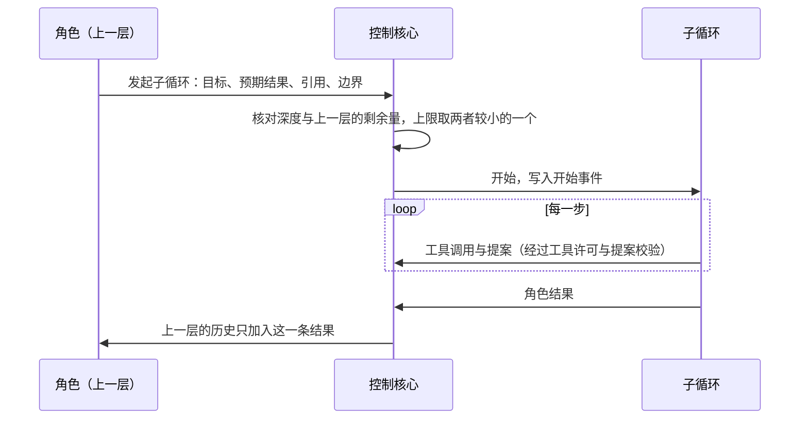
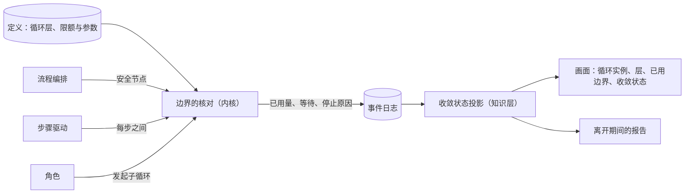

# 循环与收敛设计说明

总图位置：第三节的边界、停止与子循环；第一节「裁决与边界」方框。依据：[D38 系统意图与基础规则](../requirements/system-intent.md)（N-L1 至 N-L4、N-A1 至 N-A3、N-C1、N-C3、N-I6）、[D09 循环次数与超时限制](../requirements/execution-limits.md)、[部门内多角色设计说明](department-roles.md)、[恢复契约与故障矩阵](recovery-contract-and-fault-matrix.md)、[Loop System 原理](../archive/native-harness/loop-system-principles.md)第 7、12 节。

## 1. 要解决的问题

| 问题 | 现状 | 影响 |
| --- | --- | --- |
| 运行时间上限在进程重启以后失效 | 运行时间用单调时钟计算，起点保存在进程内存里，首次准备激活时写入 | 进程重启以后运行时间重新计算，「一定会停」只在一个进程的生命期内成立 |
| 几种等待没有上限 | 等待模型服务、等待桌面、等待桌面解锁、等待机器不计入运行时间上限，也没有自己的上限 | 用户不在场时，一个 run 可以无声地等待任意长的时间 |
| 循环层写成固定的结构 | 文档写四层；部门内多角色设计写深度 1、工具角色不能再分派；代码里没有嵌套结构 | 角色不能自己拆任务，拆分的位置只能预先写在定义里 |
| 看不出循环是否在收敛 | 评测报告有循环与返工次数；部门内多角色设计的停滞判定要求中心角色的进展判断与主机的进展事实都显示没有进展 | 用户隔几小时回来时看不出卡在哪一层；模型的自述可以抵消主机的事实 |
| 流转写在代码里 | 原来部门之间的流转是只为三个部门写的阶段状态机，控制代码中有部门名称的字面量 | 增加一个部门需要修改控制代码 |

## 2. 循环层的声明

| 层 | 一轮是什么 | 边界 | 进展的度量 | 上一层看到的记录 |
| --- | --- | --- | --- | --- |
| 角色的步骤循环 | 一次模型请求与它的工具调用 | 模型步数、连续不调用工具的次数、单次请求的时限 | 被接纳的记录与提案 | 一条角色结果或提案 |
| 部门激活 | 一次激活，从装配到提交 | 计入 run 的激活次数与时间 | 计划条目的完成数 | 被接纳的成果 |
| 部门内循环 | 一次角色任务或一次审查 | 角色任务数与审查次数的上限 | 部门内多角色设计列出的六类进展事实 | 部门成果 |
| 部门之间的循环（run） | 部门的一轮工作，包括返工与询问 | 运行时间、激活次数 | 未满足的验收条件数 | 事项的结果与停止原因 |
| 项目循环 | 一个事项 | 自动产生事项的来源各有次数上限 | 同一故障是否重复出现；队列长度 | 项目流中的事项结果 |
| 子循环（角色发起） | 与步骤循环相同 | 从上一层继承；深度不超过定义里的上限 | 与发起它的层相同 | 一条角色结果 |

层的集合写在定义里，例如：

```json
{
  "loops": [
    {"id": "run", "parent": "project", "round": "handoff",
     "limits": {"wall_time_sec": "run_time_limit_sec", "rounds": "max_cycles"},
     "progress": "unmet_acceptance_items", "fold": "work_item_result"},
    {"id": "sub", "parent": ["activation", "sub"], "round": "step",
     "limits": {"wall_time_sec": "inherit", "rounds": "inherit"},
     "fold": "role_result"}
  ],
  "max_depth": 2
}
```

- 新增一层需要运行证据：这一层声明的 `origin` 引用上一层在某类任务上反复停滞或达到边界的记录。
- 新增一层同时写明它内聚的目标函数、证据来源与工作过程（[验证的独立性设计说明](independent-verification.md)第 2 节）。
- 嵌套深度的上限和时间、次数、重试一样来自定义（上面例子里的 `max_depth`，规则登记里是 `loop.nesting_max`），现值为 2；上限必须存在，由内核的边界核对，数值的修改经用户批准（总图第三节「每一步先问边界」）。
- 部门内循环的角色任务数与审查次数上限进入规则登记，默认值放宽；停滞不结束事项。

## 3. 一定会停

1. 每个 run 有有限的运行时间上限，用单调时钟计量。已用的时间与次数在每个安全节点写入事件，进程重启以后从事件恢复，连续累计。
2. 任意两次模型请求或动作之间至少有一个安全节点，单次请求与单个动作各有时限。超出上限的时间因此不大于一次调用的最长时限。
3. 不计入运行时间的等待只有封闭清单里的几种：等待模型服务、等待用户决定、等待机器、等待桌面。等待期间不发出模型请求与动作，等待本身是带原因的停止状态。每种等待有一个时长上限参数（初值见[规则登记与参数设计说明](rules-and-parameters.md)第 8 节），超过时发出决定请求并通知用户一次，选项是继续等待或停止事项，选择继续等待以后重新计时；等待用户决定由用户结束。
4. 子循环的上限取声明值与上一层剩余量中较小的一个，深度不超过定义里的上限。按深度归纳，每一层都在有限时间内结束。
5. 写入结束状态时，停止原因必须属于封闭清单，由结构校验保证。
6. 项目层：队列为空时没有工作；自动产生事项的来源（运维的修复、自举的工单队列）各有次数上限。

对应三条性质测试，对全部事件序列基准与评测运行的事件日志执行：

- 每个 run 流以带原因的结束或等待事件收尾，原因属于清单；
- 扣除声明的等待以后，已用时间不超过上限加一次调用的最长时限；
- 计数在进程重启前后单调不减。

收敛无法事先保证。上面保证的是停止，是否收敛由第 5 节事后检测。

## 4. 子循环

- 角色通过一个主机工具发起子循环，写明目标、预期结果、可用内容的引用与边界，形状与部门内多角色设计的分派说明相同。
- 是否发起由角色决定。控制核心只核对深度与剩余量，核对通过就开始。
- 子循环结束时交回一条角色结果，上一层的历史只收到这一条；子循环内部的事件留在事件日志里，不进入上一层的上下文。
- 子循环里产生的修改与提案同样经过工具许可与提案校验。
- 工具角色同样可以发起子循环。



## 5. 收敛的检测

收敛状态是知识层的一个投影，只由事件计算，不调用模型，不写入事实。判定规则是确定的阈值规则：短序列的趋势判断不交给模型。

### 5.1 判定参数

| 参数含义 | 默认值 | 合理范围 | 取值理由 |
| --- | ---: | ---: | --- |
| 收敛判定所看的最近轮数 | 3 | 2 至 20 | 轮数必须大于等于 2；少于两轮无法比较变化。上限 20 为短循环保留足够反应速度，并覆盖较长的返工过程。达到 8 轮时改用秩相关的趋势检验。 |
| 步骤停滞所看的连续步数 | 8 | 3 至 100 | 三步是能发现连续无进展的最小窗口；上限 100 可容纳读文件、检查资料和整理上下文等正常工作序列，避免过早判停。 |
| 步骤层相同工具调用的重复次数 | 3 | 2 至 20 | 两次可能是合理重试；三次开始足以提示重复行为；上限 20 防止极长窗口掩盖震荡。 |

| 方法常量（当前值固定） | 当前值 | 设计可选区间 | 固定理由 |
| --- | ---: | ---: | --- |
| 采用趋势检验前的轮数 | 8 | 4 至 20 | 少于 4 轮时样本太短；8 轮足以从短窗口判定转入趋势判定；上限 20 与收敛判定窗口上限一致。该值固定在判定方法中，避免同一事件流因配置差异选择不同统计方法。 |
| 结论翻转的震荡阈值 | 2 | 2 至 5 | 两次翻转是确认同一条件反复改变结论的最小次数；超过 5 次才触发会延迟发现明显震荡。该值固定在判定方法中，保持震荡定义跨实例一致。 |

前三项是可登记、可在创建循环实例时冻结的运行参数。后两项是判定方法的固定常量；表中的区间只用于设计审查和未来调整决策，当前值固定，运行时不可配置。实例创建时冻结前三项取值，投影重放同一事件流时使用实例携带的冻结值。本节规定这三项运行参数的含义、默认值、范围和理由。

| 状态 | 判定规则（最近若干轮，轮数由判定参数提供） |
| --- | --- |
| 收敛中 | 未满足的验收条件数严格下降，或已经为 0 |
| 停滞 | 未满足数不变；并且没有新的交付，或交付的树摘要在变而未满足数不变 |
| 震荡 | 同一条验收条件的结论翻转 2 次以上；或交付的树摘要回到出现过的值；或同一对部门之间内容摘要相同的询问重复出现 |
| 漂移 | 写入的路径中不属于任何计划条目的比例上升；或与验收条件没有对应关系的改动持续增加 |
| 达到边界 | 停止原因属于限额类 |

- 各层使用自己的进展度量：步骤循环用连续没有被接纳记录的步数、名称与参数摘要相同的工具调用的重复次数；激活用计划条目的完成数；run 用未满足的验收条件数；项目层用同一故障的重复出现。轮数达到 8 轮时改用秩相关的趋势检验；8 是该判定方法的固定方法常量，不作为可调参数。
- 进展只按主机记录的事实判定。中心角色的进展判断照常记录，作为参考，不参与判定。部门内多角色设计列出的六类进展事实（新的产出材料、新的证据、审查通过、待决问题得到回答、数据流核对缺失减少、专家请求得到回应）是部门内循环的进展度量。
- 模型可以为已经算出的状态写一段说明，标为未经验证，不触发任何动作。
- 单位进展的花费（每满足一条验收条件的用量）作为停滞的辅助信号。
- **振荡信号**（总图第三、四节，2026-10-25 补）：收敛状态投影只读、不写事实，自己不停任何东西。观察者读到「震荡」以后，可以经写入口写一条振荡信号，写明哪个事项、哪条分支（一个会话或一条询问链）、依据的事件位置；它和其他写入一样经裁决，带不出依据的信号被拒绝。振荡信号是边界的输入：定义里写明它停什么（默认只停受影响的分支，不停整个事项），内核的边界核对在那条分支的下一个安全节点停下它，停止原因写振荡（停止原因清单加一条，只增），同时发一条决定请求交给用户：继续、停止事项。观察者不能自己停任何会话。
- run 层的未满足的验收条件数只计检验方式为命令检查、试用用例、主机测量的条件，每一轮按这一轮所依据的交付快照上的主机回执计算；判定点、人与开环的条件不计入收敛的判定，每一轮另外给出开环的条件数（[验证的独立性设计说明](independent-verification.md)第 7 节）。
- 步骤循环：最近一个步骤窗口内有被接纳的记录为收敛中；连续一个步骤窗口没有被接纳的记录为停滞；最近一个步骤窗口内名称与参数摘要相同的工具调用出现达到重复次数为震荡；步数用完为达到边界。步骤窗口与重复次数由判定参数提供。
- 一步是一次模型请求。一步有进展，当且仅当该请求产生了主机记录的事实：成果被接纳、检查回执、改变工作区树的写入，或询问得到回答。压缩步、失败的模型调用和没有改变事实的读取不算被接纳的记录。
- 循环树的层包括项目循环、事项、run、激活和步骤。事项是项目循环的一轮，作为该事项树的根节点；它不另造一套独立的事实或限额，事项下的 run、激活和步骤沿事件关系归组。
- 循环查询按运行实例标识请求一个事项树的投影。投影复用最小投影的事件折叠结果计算已用量，查询层只负责按冻结参数和事件归组，不另行计数。
- 达到边界只依据事件中的停止原因，不把已用数值直接与上限比较。限额类停止原因封闭为时间上限、轮数上限、模型步数耗尽。
- 每个层的已用量与上限都带上限数值和是否不设上限的标识。若上限达到该参数登记界限的上沿，且登记说明该值拦截不到失败，投影标为不设上限；投影仍携带数值，不使用空值。画面显示「不设上限」。
- 收敛投影判定步骤循环与 run 两层；run 层的逐条结果取自质检逐条结论。激活层、项目层与「漂移」照常给出层、已用量与上限、轮次与停止原因，收敛状态为「不判定」，并写明缺少的事实：激活层缺少计划条目完成的主机事实，项目层缺少故障记录，「漂移」缺少计划条目的写入范围以及改动与验收条件的对应关系。激活层与「漂移」在计划条目带写入范围、部门账本记录完成事实以后判定，项目层在运维记录故障以后判定。

## 6. 防止滑向静态编排的判据

五条判据都写成测试：

1. **定义里没有顺序。** 组织定义只有许可关系（每个部门关注哪些成果、可以询问谁）与边界。测试核对定义的数据模型没有 `next`、`sequence`、`steps`、`order` 这类字段，规则登记每条的形式属于许可、边界、接纳条件。
2. **控制代码里没有部门与角色的名称。** 在内核与流程编排的源码中检索定义里的部门、角色标识，命中数为 0。
3. **下一步由事实决定。** 同一份定义下，两段只在一个事实上不同的事件前缀（例如质检的结论分别是要求有矛盾与实现有缺陷），得到不同的开始工作的部门（[三部门的循环结构](department-loop.md)第 2 节）。
4. **增加部门不修改代码。** 测试夹具里只增加定义（第四个部门及其许可关系），一个经过它的事项运行到结束，控制核心的源码没有差异。
5. **边界以内没有按位置的规则。** 角色任务内部，控制核心作出的判断只有工具许可与边界核对。接纳条件只引用事实是否存在（例如存在当前有效的 PRD），不引用步骤的序号与工具调用的先后。测试核对裁决函数的输入里没有步骤序号。

另有一项运行中的指标，不作为测试：评测运行里不同的部门工作序列的数量。全部运行的序列都相同时在报告中标出，供复查。

顺序因此只来自对事实的前提条件，例如工程关注 PRD，PRD 有了新版本才开始一轮工作（[三部门的循环结构](department-loop.md)第 2 节）。

## 7. 容纳变化的判据

### 7.1 组成的变化

| 变化 | 需要写的声明 | 判据 |
| --- | --- | --- |
| 新增部门 | 组织定义：标识、目标函数、证据来源、许可关系、可见范围、工具；事项种类的工作说明 | 第 6 节第 4 条；结构校验拒绝没有填写独立性的部门 |
| 新增角色 | 角色定义：Prompt、工具、可见范围、执行者种类、独立性 | 增加一个只读角色前后，同一份记录的模型输出产生的事实事件只多出这个角色的任务与结果 |
| 外包角色 | 角色定义中执行者种类为外包 | 结构校验：外包角色不是核验角色（没有核验角色时可以外包，事项记为开环完成，见[形态与核验角色设计说明](forms-and-verifier-role.md)「开环完成」）；它的每个工具请求都有工具许可记录 |
| 观察者 | 读取范围、提案的种类 | 去掉观察者，同一份记录的模型输出产生相同的事实事件；观察者的写入只有证据、提案与振荡信号三种，都经写入口与裁决 |
| 判定点 | [总体架构](architecture/overall-architecture.md)第 7.2 节的合同 | 未校准时开启与关闭，事实事件相同 |
| 嵌套层 | 循环层的声明与运行证据的引用 | 子层的上限不大于上层的剩余量；上层的历史只收到一条结果；深度超过定义里的上限时发起被拒绝 |

新增项的声明写明它内聚的三样：目标函数（完成、挑错、观察）、证据来源（自己写的代码、自己运行的检查、事件）、模型（是否要求与被验证者不同）。它新增的独立性就是这三项与已有成员的差别；三项都与已有成员相同的新增项，结构校验给出提示，由用户决定是否保留。重新划分部门就是修改声明，走结构修改的候选流程。

### 7.2 规模的变化

| 变化 | 需要具备的性质 | 判据 |
| --- | --- | --- |
| 更多使用者 | 每条命令与决定回答带操作者；目标的所有者写在项目流里；「上次查看的位置」按操作者保存 | 裁决规则的输入里，操作者只出现在权限判断处；两位操作者的命令交错时事件的归属正确 |
| 更多机器 | 机器登记与项目授权 | 同一事项在本机进程与执行代理上运行，给定相同的回执，事实事件相同 |
| 多个控制核心实例 | 按项目划分（ADR-0018 的扩展途径） | 一个项目的事件流导出以后在另一个实例上重放，投影一致；裁决的输入只包含本项目的流、定义与机器流 |
| 多个写入者 | 工作区按事项或角色任务分开；采纳改为先合并、再验证 | 两个事项基于同一基线并行时，后一个在采纳之前对合并后的结果重新运行检查定义规定的检查；基线变化以后旧的验证结果不被采用 |

## 8. 模块交互



## 9. 验收

- 终止进程再启动，已用时间、激活次数、模型步数与重启之前连续。
- 每种等待超过时长上限时发出决定请求，并通知用户一次。
- 第 3 节的三条性质测试对全部事件序列基准通过。
- 收敛状态投影对录制的事件夹具给出期望的五种状态，进展只来自主机事实；步骤层按一次模型请求归组，并验证四类被接纳事实、压缩步、失败调用和无变化读取的区别。
- 循环查询按运行实例标识返回项目循环、事项、运行、激活和步骤五层，已用量复用最小投影的事件折叠结果，冻结参数参与重放，限额状态只由封闭的停止原因判定；无真实上限时保留数值并带不设上限标识。
- 第 6 节的五条判据写成测试，并在相应交付阶段持续通过。

## 10. 与现有设计的关系

- [恢复契约与故障矩阵](recovery-contract-and-fault-matrix.md)：已用时间从事件恢复。
- [部门内多角色设计说明](department-roles.md)：部门内循环作为一层登记边界；停滞只按主机事实判定；工具角色可以发起子循环。
- [浏览器与 computer use 设计说明](browser-and-computer-use.md)、[执行环境设计说明](execution-environment.md)、[模型管理设计说明](model-management.md)：各种等待的时长上限。
- [应用层与接口层设计说明](app-and-interface.md)：循环实例与收敛状态的读取模型。

## 变更记录

- 2026-10-29 / claude-sonnet-5-5 / 按设计说明规范整理：开头改为总图位置与依据一行，删去状态、路线位置、实施状态说法和工单号；第 1 节最后一行的现状改为「原来……」（现状已改） / 设计与实施分离（decision.md 2026-10-29）
- 2026-10-29 / GPT-6（Codex） / 补充收敛判定参数、主机进展事实、循环层级、查询输入、限额原因与上限投影规则 / 为阶段二的收敛投影与循环查询提供可执行的设计边界，并核对步骤、冻结值和最小投影的关系
- 2026-10-30 / claude-opus-5-5 / 第 5 节表「外包角色」一行的判据改为「外包角色不是核验角色」 / ADR-0044：核验是角色的性质，外包不再要求下游有核验
