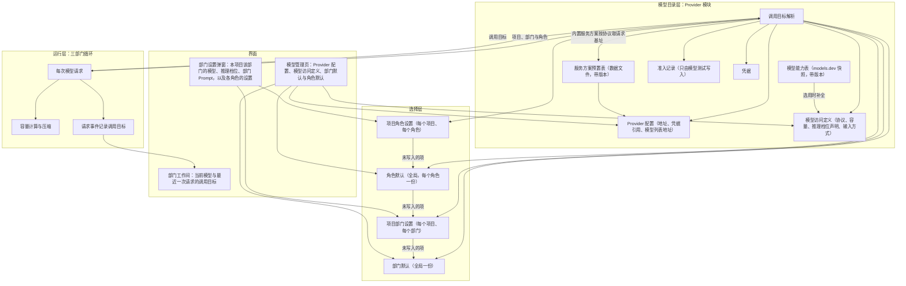
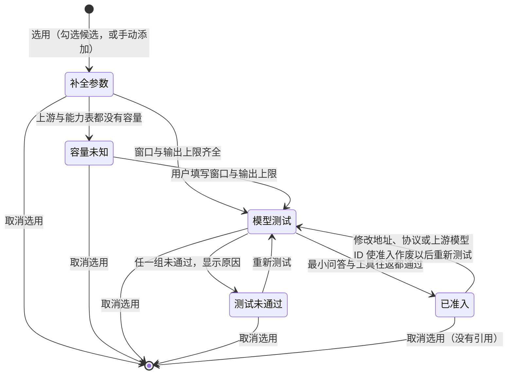
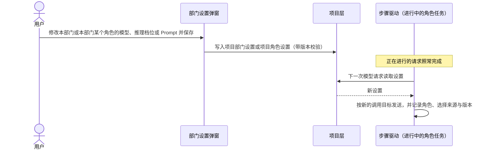
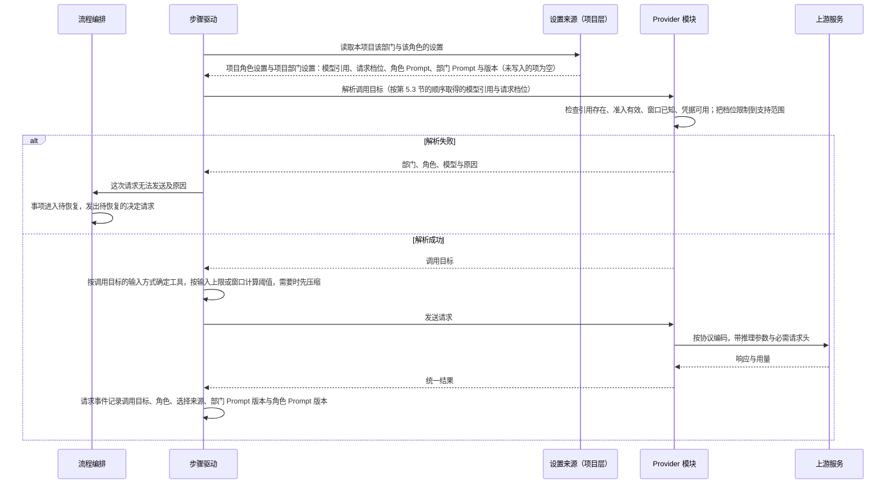

# 模型管理设计说明

总图位置：第四节「模型」的缝；第二节「定义」里的模型设置。依据：需求 [D24 模型管理与部门模型选择](../requirements/model-management.md)；界面原型 [v14 原型](../prototypes/v14/design.md)（模型管理页）与 [v13 原型](../prototypes/v13/design.md)（部门设置弹窗与部门工作间），按第 9 节制作。

本说明是模型目录、部门与角色的模型选择、推理档位、调用目标解析与上下文容量的判断标准。其他文档与本说明冲突时，以本说明为准。

## 1. 参照对象与取舍

参照 OMP（`C:/project/codes/oh-my-pi` @ fdfeef1f78）与 opencode（`anomalyco/opencode`，原 `sst/opencode`）：压缩的部分按 @ 7ab721a97f，模型数据来源的部分按 @ 0027387。用户原话与已确认的规则见 D24。

| 方面 | OMP | opencode | Yudao |
| --- | --- | --- | --- |
| 模型目录 | 全局一份；每个模型带窗口、输出上限、推理档位、图像与工具支持 | 全局一份，数据来自 models.dev | 全局一份；模型访问定义带窗口、输出上限、输入上限（可选）、推理档位声明与输入方式 |
| 能力数据来源 | 内置目录随版本发布，运行时发现，缺失时补默认值 | models.dev，构建时打包快照，运行时刷新；缺失时按 0 处理 | 上游模型列表给出的值优先，其次是模型能力表（models.dev 的快照，随版本发布，只在连接所属的服务商之内查找），两处都没有时由用户填写；都经模型测试 |
| 可以选用的条件 | 有凭据即可选用 | 有凭据即可选用 | 窗口与输出上限有值（来自上游、能力表或用户填写），并且模型测试通过（最小问答与工具往返，准入） |
| 未知窗口 | 跳过主动压缩，照常调用 | 跳过自动压缩，照常调用 | Provider 模块拒绝 |
| 选择层级 | 模型角色分全局层与项目层，项目只写入覆盖的角色 | agent 与会话级选择 | 全局的部门默认与角色默认，项目的项目部门设置与项目角色设置，项目只写入覆盖的项；角色设置优先于部门设置 |
| 运行中更换模型 | 支持，下一次请求按新模型计算 | 支持，每一轮按会话当前的模型解析 | 支持，从下一次模型请求起生效 |
| 推理档位 | 模型声明支持的档位，请求时限制到支持范围，各协议分别映射 | 模型声明档位，不支持时报错 | 模型声明支持的档位，请求时限制到支持范围，各协议分别映射 |
| 压缩阈值 | 窗口 − max(15% 窗口, 16384) | 基数 − max(15% 基数, 16000)，基数是模型的输入上限（有就用），否则是窗口 | 按 OpenCode 计算（第 8.3 节）：基数 − max(15% 基数, 16000)，基数取模型的输入上限，没有就取窗口，不设工作上限 |
| 压缩依据的用量 | max(上游回报用量, 本地估算) | 上游用量或本地估算 | 与 OMP 相同 |
| 引用的模型无法使用 | 静默改用其他有凭据的模型 | 报错 | 事项进入待恢复并说明原因，修复以后继续 |
| 角色 | default、smol、slow、task 等，子 Agent 按角色选择模型 | agent 配置 | 产品、工程、质检三个部门，每个部门内的角色由定义声明（[部门内多角色设计说明](department-roles.md)第 4 节），每个角色可以有自己的模型设置（第 5 节） |

OMP 的一个失效实例：内置目录 4776 个模型中有 764 个没有窗口数据，这些模型的主动压缩从不触发，只能等上游报告超限后补救。统一管理能否起作用，取决于目录里的能力数据是否准确。Yudao 以准入要求容量有值来保证这一点：容量取上游模型列表或模型能力表（第 4.1 节）中带来源的值，两处都没有时由用户填写。

## 2. 分层

系统分三层。每层只通过下一层的接口取得结果，不读取下一层的内部数据。

| 层 | 职责 | 边界 |
| --- | --- | --- |
| 模型目录层 | 服务方案、Provider 配置、模型访问定义、准入、凭据；给定一个选择，解析出调用目标或具体原因 | 不认识部门、角色与项目；只接收「连接 + 模型访问定义 + 请求档位」 |
| 选择层 | 部门默认、角色默认、项目部门设置与项目角色设置的保存、版本与合并规则 | 只保存引用、请求档位与 Prompt，不复制目录内容 |
| 运行层 | 每次模型请求前取得调用目标，按它计算容量、压缩、发送并记录 | 不缓存调用目标；同一请求的重试沿用该请求的调用目标 |

## 3. 数据与归属

| 数据 | 内容 | 保存位置 | 修改入口 | 生效 |
| --- | --- | --- | --- | --- |
| 服务方案预置表 | 默认协议、按协议的请求基址、获取模型列表与连接测试的认证方式、模型列表地址、文档链接、必需请求头、来源 | Provider 模块内的数据文件，整张表带 revision | 发布新版本 | 随新版本发布 |
| 模型能力表 | 每个服务商的接口地址与接入包，以及它下面各模型的调用协议（接入包没有对应的协议时为空）、输入方式、输出方式、窗口、输出上限、输入上限（可选）、是否支持工具调用与推理 | Provider 模块内的另一份数据文件，整张表带 revision、快照日期、来源与来源文件的 SHA-256 | 发布新版本 | 随新版本发布；只用于选用模型时补全参数 |
| Provider 配置 | ID、名称、服务方案、地址、凭据引用、超时、模型列表地址 | 模型目录文件 | 模型管理页、编辑 JSON | 下一次模型请求 |
| 模型访问定义 | 上游模型 ID、调用协议、窗口、输出上限、输入上限（可选）、推理档位声明、输入方式、是否接受要求调用工具 | 模型目录文件，属于一份 Provider 配置 | 同上 | 下一次模型请求 |
| 准入记录 | 测试时间、实际返回的模型、协议、测试时的受影响字段 | Provider 模块，与目录文档分开保存 | 只由模型测试写入 | 立即 |
| 凭据 | API Key 与来源；网络取回与 MCP 服务器的登记也按名称使用这个凭据来源（[网络取回与 MCP 工具设计说明](network-and-mcp.md)第 4.5 节） | 数据目录里的 `.env`，或进程环境 | 模型管理页的连接服务（高级部分可改为引用环境变量） | 下一次模型请求 |
| 部门默认 | 三个部门各自的模型访问定义引用与请求档位 | 模型目录文件 | 模型管理页的部门使用、编辑 JSON；第一个启用的模型自动填写还没有部门默认的部门（第 5.1 节） | 下一次模型请求，包括进行中的事项 |
| 项目部门设置 | 某项目某部门的模型访问定义引用、请求档位、部门 Prompt | 项目事件，与现有部门 Prompt 配置同一处，带版本 | 部门设置弹窗 | 该部门下一次模型请求，包括进行中的事项 |
| 角色默认 | 每个角色的模型访问定义引用与请求档位 | 模型目录文件，与部门默认同一处 | 模型管理页部门使用里每个部门的「更多」、编辑 JSON | 该角色下一次模型请求，包括进行中的事项 |
| 项目角色设置 | 某项目某角色的模型访问定义引用、请求档位、角色 Prompt | 项目事件，与项目部门设置同一处，带版本 | 部门设置弹窗中的角色设置 | 该角色下一次模型请求，包括进行中的事项 |
| 调用目标 | 一次模型请求实际使用的连接、协议、地址、上游模型、容量、输入方式、是否接受要求调用工具、发送的推理档位、凭据引用与版本、角色、选择来源、部门 Prompt 版本与角色 Prompt 版本 | 模型请求事件 | 由解析产生 | 只描述这一次请求 |

设置只有全局与项目两层。

## 4. 模型目录

### 4.1 服务方案预置表与模型能力表

预置表是 Provider 模块内的一份数据文件，记录需要特别接入规则的服务方案。每个服务方案一行，包含名称、默认协议、按协议列出的请求基址、获取模型列表与连接测试使用的认证方式、模型列表地址、文档链接、必需请求头（OpenCode Go 需要真实 User-Agent 与 `x-opencode-session`）和来源链接。整张表带 revision，模型管理页的高级部分显示 revision 与来源。

表中目前只有 OpenCode Go：默认协议是 Chat Completions，三种协议使用同一个请求基址 `https://opencode.ai/zen/go/v1`。连接的地址等于预置表中某个服务方案的请求基址时，连接按该方案接入；其余地址按「自定义」接入，获取模型列表与连接测试使用 Bearer，选用模型时协议预填 Chat Completions（第 4.2、4.3 节）。服务方案只描述接入规则，不带模型、容量、推理档位或准入。新增服务方案等于在文件中新增一行，随新版本发布生效；不做远端自动更新。

模型能力表是 Provider 模块内的另一份数据文件，内容取自 [models.dev](https://models.dev) 的快照。models.dev 是公开的模型能力数据库（仓库 [`anomalyco/models.dev`](https://github.com/anomalyco/models.dev)，原 `sst/models.dev`，MIT 许可证），数据按服务商（provider）把模型分组，每个服务商带接入包与接口地址（接口地址可以缺少），每个模型带 `modalities.input`、`modalities.output`（取值为 text、audio、image、video、pdf）、`limit.context`、`limit.output`、`tool_call`、`reasoning` 等字段。参照对象的做法：

- OpenCode（`anomalyco/opencode` @ 0027387）构建时下载 models.dev 的 `api.json` 并打包进程序（`packages/cli/script/generate.ts` 第 1–5 行、`packages/cli/script/build.ts` 第 87 行），运行时再从 `https://models.opencode.ai/api.json` 刷新并缓存（`packages/core/src/models-dev.ts` 第 160–231 行）；模型字段的定义见同一文件第 67–120 行。
- OMP（@ fdfeef1f78）的 `packages/catalog/scripts/generate-models.ts` 第 219–231 行读取 models.dev 格式的能力数据（地址为 `catalog.stencil.so`，见 `packages/catalog/src/provider-models/openai-compat.ts` 第 65 行），与其他来源合并，生成随版本发布的 `packages/catalog/src/models.json`。

Yudao 的模型能力表按以下规则维护：

- **范围**：收录 models.dev 中全部服务商的模型。服务商的接口地址取自 models.dev；models.dev 没有给出接口地址的官方服务商（OpenAI、Anthropic、Google）由提取脚本的补充表按官方地址补上。预置表中每个服务方案记录它在 models.dev 中对应的服务商（OpenCode Go 对应 `opencode-go`）。
- **字段**：每个服务商保留接口地址与接入包（`npm`）；每个模型只保留上游模型 ID、调用协议、模型自己声明的接入包（`provider.npm`，没有声明时不记录）、输入方式、输出方式、上下文窗口、输出上限、输入上限（可选）、是否支持工具调用与是否支持推理。调用协议的取法见下一条，其余字段分别取自 `modalities.input`、`modalities.output`、`limit.context`、`limit.output`、`limit.input`、`tool_call` 与 `reasoning`。models.dev 中 `modalities` 是可以缺少的字段，缺少时表中不记录该模型的输入方式与输出方式。
- **调用协议**：取自每个模型的接入包：模型自己声明了 `provider.npm` 时取它，没有声明时取服务商的接入包。提取脚本里有一张接入包映射表，每个接入包登记为三种协议之一，或者登记为「没有对应的协议」：`@ai-sdk/openai` 为 Responses，`@ai-sdk/anthropic` 为 Anthropic Messages，`@ai-sdk/openai-compatible` 与已知的兼容包（例如 OpenRouter 的）为 Chat Completions（OpenCode Go 为 Chat Completions，与 models.dev 中 `opencode-go` 的 `@ai-sdk/openai-compatible` 相同）。
  - 登记为某种协议要有依据：这个接入包的官方源码发出的是这种协议的请求（请求路径、认证方式与请求体），依据（仓库、提交与文件位置）写在映射表这一行旁边。没有这样的依据就登记为没有对应的协议，例如 `@ai-sdk/google` 向 `models/<模型>:generateContent` 发请求、用 `x-goog-api-key` 认证，三种协议都不是。
  - 接入包没有对应协议的模型照常收录：调用协议为空，接入包、容量、输入方式与输出方式照常记录。能力表不按服务商、也不按模型排除记录：这样的模型在它的服务商下的窗口与输出上限仍是真实值，排除它只会让用户手填 models.dev 已经给出的数字；预置服务方案对应的服务商也因此总在表里（2026-10-30 的快照中，`opencode-go` 的 `gemini-4-argon` 自己声明 `@ai-sdk/google`，它的同一服务商下其余模型不受影响）。
  - 映射表里没有某个接入包（服务商的，或模型自己声明的）时，脚本以错误结束，逐条列出服务商、模型与接入包，不写出能力表；由更新快照的人在映射表里登记这个接入包，再重新生成。
  - 能力表中没有这个模型，或者它的调用协议为空时，选用时协议怎样预填见第 4.3 节「参数的来源」。
- **版本与来源**：整张表带 revision、快照日期、来源链接与来源文件的 SHA-256（取回的 models.dev 文件，或用本地文件生成时的那份文件）；模型管理页的高级部分与模型详情显示 revision、快照日期与来源。映射表的登记与依据在提取脚本里，与生成的能力表在同一次提交中修改。
- **更新**：发布前由代码仓库中的提取脚本从 models.dev 取出上面的字段生成快照，随 Yudao 新版本更新，运行时不从远端刷新，与预置表的方式相同。
- **用途**：只用于选用模型（从模型列表勾选或手动添加）时补全协议、容量与输入方式（第 4.3 节），查找只在连接所属的服务商之内进行（第 4.3 节「服务商识别」）。运行、准入与建议能力的提醒只使用模型访问定义中的值，不读取能力表。

预置表与模型能力表是两份文件，各带 revision：预置表只含接入规则，能力表只含每个模型的协议与能力。

### 4.2 Provider 配置

一份 Provider 配置（连接）是一个服务的 ID、名称、地址、凭据引用、超时与模型列表地址。连接不声明协议，调用协议由其下每个模型访问定义声明（第 4.3 节）；一个订阅的模型无论使用哪种协议，都属于同一份连接。连接保存它所属的服务方案（地址等于预置表中的请求基址时是该方案，其余是自定义），请求时据此取得请求基址与必需请求头。

- **用户填写的两项**：服务地址与 API Key。ID、名称与凭据引用由系统生成，主路径上不让用户填写：ID 与名称取地址的主机名，与已有连接重名时加序号；凭据引用取 ID 转大写、把字母与数字以外的字符换成下划线、再加 `_KEY`，开头不是字母时加 `HOST_` 前缀。用户可以在高级部分修改它们（第 9.1 节）。
- **同一个地址只有一份连接**：地址按规范形式比较，规范形式是缺少协议头时补 `https://`、主机名小写、去掉末尾的 `/`。再次提交同一个地址时沿用这份连接，更新它的 Key 并重新获取模型列表，不新建重复的连接。
- **Key 的保存**：参照 OpenCode（提交 `7ab721a97f`：`packages/core/src/credential.ts` 的 `create`，`packages/core/src/database/database.ts` 第 89、90 行，`packages/core/src/integration.ts` 第 409 至 423 行）。
  - Key 随连接一起保存，始终保存在数据目录里，服务重启以后仍在。没有「只在本进程有效」的选择，OpenCode 的连接流程同样没有这个选择。
  - 存放在数据目录里的 `.env` 文件，键名就是凭据引用。系统支持文件权限时（Linux、macOS）文件只有所有者可读写；Windows 依靠数据目录所在的用户目录的访问权限。Key 以明文保存，OpenCode 也是明文：它把 Key 存在数据目录的 `opencode.db` 里，该文件与它的附属文件设为仅所有者可读写。
  - Key 不进入浏览器存储、日志、事件与导出；输入框始终为空，不回填；页面只显示「已保存」与来源。
  - 更换 Key 就是在同一份连接上提交新的 Key，覆盖原值。删除连接时，它的 Key 一并删除。
  - 连接也可以改为引用一个环境变量（高级部分）：Key 由进程环境提供，页面与文件都不保存。评测与持续集成使用这种来源。进程环境与 `.env` 里有同名引用时使用进程环境的值，页面显示来源为环境，并说明重启以后用哪一个。OpenCode 同样把环境变量与保存的凭据并列为连接的来源。
  - 凭据引用只能用 `.env` 键名允许的字符：字母、数字与下划线，不以数字开头。系统生成的引用符合这条规则；在高级部分自己填写而不符合时，保存之前拒绝并写明规则，文件与内存都不改，Yudao 不写出自己读不回的 `.env`。
  - 写入 `.env` 失败时，连接与 Key 都不保存，页面显示失败的原因，不悄悄改成只在内存里生效（[D22](../requirements/startup-provider-reload.md)第 5 节）。
- **地址**：地址没有写 `http://` 或 `https://` 时按 `https://` 处理，输入框显示补全后的地址。地址等于预置表中某个服务方案的请求基址时按该方案接入，需要其他地址时直接填写那个地址。
- **请求基址**：自定义服务取连接的地址；内置服务方案按访问定义的协议取预置表中的请求基址。
- **请求路径与认证方式**：由访问定义的协议的适配器决定，与 OMP、opencode 和官方 SDK 的用法相同：Responses 与 Chat Completions 在基址后拼接 `/responses`、`/chat/completions`，使用 Bearer；Anthropic Messages 去掉基址末尾的 `/v1` 后拼接 `/v1/messages`，使用 `x-api-key`。
- **模型列表地址**：内置服务方案使用方案的模型列表地址；自定义服务默认是连接地址加 `/models`，用户可以在高级部分修改。用户没有修改时，连接只保存地址，模型列表地址随地址变化；用户修改以后保存修改后的值；清空输入框回到默认值。
- **获取模型列表与连接测试的认证**：按服务方案规定的认证方式带上凭据；自定义服务使用 Bearer。

### 4.3 模型访问定义与准入

模型访问定义属于一份 Provider 配置，包含上游模型 ID、调用协议（Responses、Chat Completions、Anthropic Messages）、窗口、输出上限、输入上限（可选）、推理档位声明（第 7 节）、输入方式、是否接受要求调用工具，以及单价（输入、缓存读、缓存写、输出各一项，由用户填写，可以留空）。单价只用于费用的计算：费用等于用量乘以单价，进入评测报告与对照记录，不进入运行中的控制；没有填写单价时费用保持未知，不填零。单价的修改不使准入作废。窗口与输出上限必须有值，输出上限不大于窗口。输入方式的取值为文本与图像，文本总是包含；运行层按它决定提供哪些工具、哪些内容可以放入请求（第 5.6 节）。是否接受要求调用工具由模型测试测出，测出以前按接受处理；不接受的模型，最后一次主机提示之后的请求不带「要求调用工具」。

除「已准入」以外的状态统称候选定义：它们保存在目录里，没有准入，不能被部门默认与项目设置选用。

- **获取模型列表**：提交服务地址与 Key 时自动进行（第 4.2 节），之后可以随时刷新。请求连接的模型列表地址，按服务方案规定的认证方式带上凭据，自定义服务使用 Bearer。结果显示来源地址与采集时间，保存在服务进程的内存里：页面刷新以后仍能读到，服务重启以后需要重新获取。失败分五种，都写明请求的地址并显示在连接旁：
  - Key 被拒绝（返回 401 或 403）：写明状态码与「服务拒绝了这个 API Key」，不显示回应体，因为它可能回显凭据（第 13.4 节）。
  - 地址不可达（没有收到响应）：写明连接失败的原因，包括超时与证书错误。
  - 服务返回的不是模型列表（状态正常，内容不是列表）：写明收到的内容的类型。
  - 其他状态码：写明状态码；返回 404 而地址以 `/chat/completions`、`/responses` 或 `/messages` 结尾时，提示地址填到它的上一级。
  - 空列表：写明已连接而服务没有返回任何模型，提示检查 Key 的模型权限。

  失败时连接与 Key 保持已保存，用户修改以后重新获取。只接受 `x-api-key` 的自定义服务获取列表会失败；这样的服务、没有模型列表接口的服务，以及列表里没有所需模型的情况，用户用「手动添加」。
- **候选的内容与呈现**：每个候选显示名称（上游模型 ID）、提供方（上游模型 ID 里 `/` 之前的部分，没有就不显示）、窗口、输出上限、输入方式、是否支持推理，以及这些值的来源。上游或能力表明确给出输出不是文本（图像生成、语音、向量）的候选标「不适用于部门任务」，不能选用；没有给出类型的不推测，选用以后由模型测试给出结果。默认只列「可自动配置」的候选：窗口与输出上限都已知（来自上游或能力表）；其余候选在「全部模型」里，容量未知的标「容量未知」。支持按名称、提供方与上游模型 ID 搜索，按支持图像、支持推理、全部模型与已选用筛选；每次显示一批，可以继续显示更多。
- **选用**：用户勾选一个候选，或手动添加一个模型，就是选用它；一次勾选几个，各自独立进行。选用不要求另外保存，也不要求另外点测试。每个选用的模型依次经历：
  1. 补全参数：按下面的「参数的来源」填协议、窗口、输出上限与输入方式，生成模型访问定义并保存，此时它是候选定义。窗口或输出上限补不全时进入「容量未知」，页面写明缺哪一项；用户填写窗口与输出上限（来源标手动）以后继续，或者取消选用。
  2. 模型测试：见下面「模型测试」。
  3. 已准入（页面写「已启用」）：写入准入记录；定义出现在部门默认、角色默认、项目部门设置与项目角色设置的选项中；部门默认的自动填写见第 5.1 节。

  每一步的状态与失败原因显示在这个模型的行里，失败以后可以重新测试。同时进行的模型测试最多 3 个（默认值，范围 1 至 8；每次测试是几次真实请求，上限用来限制对上游的并发与费用），超出的显示「等待测试」。手动添加用于列表里没有的模型：用户填写上游模型 ID，协议默认 Chat Completions、可以修改，容量按下面的规则补全、补不全时填写，其余与勾选相同。
- **参数的来源**：
  - 窗口、输出上限与输入上限：先取上游模型列表给出的值；没有时取模型能力表中连接所属服务商下同一上游模型 ID 的值；两处都没有时由用户填写。上游模型列表描述的是这份连接当前的实际情况，能力表是随版本发布的快照，所以列表优先。上游列表里容量字段的写法因服务而异，Provider 模块按已知的几种写法依次识别，取第一个有效的正整数，窗口与输出上限各自独立取值。
  - 协议：先取能力表中连接所属服务商下这个模型的协议，内置服务方案同样如此（OpenCode Go 下声明 `@ai-sdk/anthropic` 的模型预填 Anthropic Messages）；识别不出服务商、能力表里没有这个模型，或者它的调用协议为空时，内置服务方案取方案的默认协议，其余取 Chat Completions。用户可以在高级部分修改。
  - 输入方式：上游模型列表给出输入类型时取它；否则取能力表中的值，包含 image 时是文本与图像；都没有时只有文本，由用户自己声明。不按模型名称推测。Yudao 信任这些来源，预填的输入方式就是运行时使用的输入方式，用户修改后的值同样直接使用；来源有误时替换来源，模型测试与准入不另外核实输入方式。
  - 是否接受要求调用工具：由模型测试测出。
  - 推理档位声明不预填（第 12 节）。
  - 每个值标明来源：上游模型列表、能力表（服务商与 revision）、手动，或默认；模型详情里可以查到。
- **服务商识别**：连接的地址等于预置表中某个服务方案的请求基址时，服务商取该方案在能力表中对应的服务商；否则连接地址的主机与能力表中某个服务商的接口地址的主机相同时，取这个服务商；同一个主机对应几个服务商时都不取。识别不出服务商时不查能力表，容量只来自上游模型列表与用户填写。能力表只在识别出的服务商之内按上游模型 ID 精确查找，不按型号名称在服务商之间借用，也不去掉「提供方/」之类的前缀再查：同一个型号在不同服务商下的窗口与输出上限常常不同（2026-10-30 的 models.dev 快照里，出现在多个服务商下的 1174 个型号中，有 752 个的窗口或输出上限不一致）。
- **模型测试**：按该定义的协议，用连接的凭据，向上游发送两组真实请求，两组都通过才写入准入：
  1. 最小问答：一次最小的推理请求；该定义声明了推理档位时，按它的默认档位发送推理参数。
  2. 工具往返：请求带一个没有副作用的测试工具并要求调用它，回应里必须有对这个工具的完整调用；再把工具结果回给模型，必须得到回应。上游以明确的参数错误拒绝「要求调用工具」时，改为不要求再试一次，通过则记录这个模型不接受要求调用工具；模型没有调用工具，或上游拒绝工具参数，测试不通过。

  每次请求最长等待 60 秒（默认值，范围 10 至 300；最小请求正常几秒内返回，更久说明服务或模型不可用，页面不能一直停在测试中）。结果写明用时、实际返回的模型与是否接受要求调用工具；不通过时写明是哪一组、哪一步，以及上游给出的原因（按第 13.4 节处理，401 与 403 只写状态码与含义）。三部门的每一步都靠工具调用推进，只测问答不能说明模型选完就能用；是否接受要求调用工具也只能由这次测试测出，主路径上没有手工声明它的地方。
- **准入记录**只由模型测试写入。目录文档的编辑、导入与导出都不含准入记录。
- **取消选用**：取消选用就是移除这个访问定义。模型测试进行中时同时取消它：已经发出的请求的结果到达以后丢弃，不写入准入，也不改变定义。每一次选用带一个序号，结果只在序号仍是当前这次选用时才生效，所以取消以后再选用同一个模型，旧的结果不会启用新的选用。被部门默认、角色默认或项目设置引用的定义不能取消选用，拒绝并列出引用方（第 4.5 节）。
- **连接测试**：只对已保存的连接进行，按服务方案规定的认证方式读取模型列表地址（自定义服务使用 Bearer），证明地址与凭据可用，不改变任何准入。连接下还没有访问定义时同样可以进行。更换 Key 以后自动进行一次，结果写在连接旁。
- **fake 协议**：只在以测试或演示方式启动的系统中可用，不需要凭据与准入；正常启动的系统读取目录时拒绝 fake 协议。

### 4.4 修改与准入

准入与访问定义自身及所属连接的受影响字段绑定，按下表逐个字段判断。

| 修改的字段 | 准入 | 部门默认与项目部门设置中的引用 |
| --- | --- | --- |
| 地址、凭据引用（连接） | 该连接下全部定义回到候选；系统重新获取模型列表，列表里仍有的已选用模型自动重新测试，列表里没有的标「不在新的模型列表中」 | 保留，显示「无法使用：准入已作废」，重新测试通过以后恢复 |
| 协议、上游模型 ID、推理参数方式（定义） | 该定义回到候选并重新测试 | 同上 |
| 名称、超时、模型列表地址（连接） | 保持 | 保持 |
| 窗口、输出上限、输入上限（可选）、支持档位、默认档位、输入方式、是否接受要求调用工具（定义） | 保持，从下一次模型请求起使用新值 | 保持 |
| 同一凭据引用下的 Key | 保持；更换以后自动做一次连接测试，结果写在连接旁 | 保持 |
| 测试另一个模型 | 保持 | 保持 |

保存会作废准入的修改之前，界面通过应用层的查询 `catalog.change_impact`（按拟议的修改计算，不写入任何内容）列出受影响的定义、引用方（部门默认的哪个部门、哪个项目的哪个部门）以及正在使用它们的进行中事项。进行中事项按（事项，部门）逐条列出：事项里哪个部门的模型选择（项目部门设置，没有时取部门默认）落在受影响的定义上，就列出这个部门，不论它此刻在不在工作，因为它下一次开始工作时同样会被挡住；一个事项可以出现几次。引用保留，相关角色的下一次模型请求不发送，事项进入待恢复（第 5.5 节），由用户重新测试或另选模型以后继续。

准入证明的是这份连接与这个模型按定义的协议能够收发请求，并且能完成一次工具往返。输入方式与是否接受要求调用工具只决定请求中放入的内容、提供的工具与是否要求调用工具，不改变请求发往哪里、怎样认证与编码，所以修改它们保持准入。它们的值来自上游模型列表、模型能力表（models.dev）与用户的声明，Yudao 直接使用；记录有误时，上游按请求内容错误拒绝，按已有规则处理，修正办法是替换来源或改正声明，不在准入中增加核实。

### 4.5 删除

- 取消选用（移除模型访问定义）：被部门默认、角色默认、项目部门设置或项目角色设置引用时拒绝，并列出引用方。
- 删除 Provider 配置：其下任何定义被引用时拒绝，并列出引用方；没有引用时，确认框列出将一并删除的定义与这份连接的 Key，确认后一起删除。

### 4.6 目录文档（编辑 JSON、导入、导出）

目录文档是 Provider 配置、模型访问定义、部门默认与角色默认的完整文本，格式与模型目录文件相同。它不含 API Key、准入记录、项目部门设置与项目角色设置。编辑 JSON、导入整份文档与界面表单使用同一套校验：未知字段拒绝，Provider 配置中出现协议字段时读取直接报错并指出字段位置；每个模型访问定义必须声明协议，窗口与输出上限必须有值；部门默认与角色默认只能引用已准入、并且属于所填连接的定义，请求档位只能为空或者属于档位全集。校验通过后整份写入；任何一项不通过时整份拒绝，界面指出字段位置。

### 4.7 目录文件重新读取

Provider 模块监视模型目录文件。合法的外部修改按第 4.4 节的规则生效，从下一次模型请求起影响包括进行中事项在内的全部部门。内容无效时保留上一个有效版本并显示原因。服务启动时没有目录文件，是「没有文件」（空目录），不是文件被删除；只有服务运行期间读到过的文件消失才按被删除处理。文件被删除时，目录、部门默认与角色默认一起清空，部门默认与角色默认变为「未设置」；进行中事项里没有另选模型的角色，下一次模型请求不发送，事项按第 5.5 节进入待恢复，用户重新设置模型以后继续；新建事项按第 5.5 节被拒绝。

## 5. 部门与角色的模型选择

选择分部门与角色两个粒度，每个粒度有全局与项目两层：部门默认、项目部门设置、角色默认、项目角色设置。角色是[部门内多角色设计说明](department-roles.md)第 4 节的固定角色。角色设置优先于部门设置：角色设置表达按工作性质选择模型，例如探索者使用快速模型，与 OMP 中 Agent 覆盖优先于父 Agent 模型的规则相同；角色设置没有写入的项继承部门设置。

### 5.1 部门默认与角色默认

模型管理页的「部门使用」为产品、工程、质检各设一项部门默认：一个已准入的模型访问定义，加一个可以为空的请求档位。部门默认全局只有一份，所有项目共用，可以为「未设置」。保存时要求所选定义已准入；之后准入作废时，引用保留并显示无法使用。

某个部门还没有部门默认时，第一个通过模型测试的定义自动成为它的部门默认，请求档位留空；已经有部门默认的部门保持不变。三个部门都没有部门默认时（初次配置），三个部门都得到这个模型；几个定义同时测试时按通过的先后，后通过的不覆盖先通过的。之后新启用的模型不改变任何已有的部门默认、角色默认与项目设置。自动写入的部门默认与手动保存的一样，可以随时修改，受同样的校验与提醒（第 5.6 节）。

每个部门默认下列出本部门各角色的角色默认：一个已准入的模型访问定义，加一个可以为空的请求档位，全局每个角色一份，可以为「未设置」；保存与准入作废时的处理和部门默认相同。角色默认与部门默认保存在模型目录文件的同一处，属于目录文档（第 4.6 节）。

### 5.2 项目部门设置与项目角色设置

每个项目的每个部门有一份项目部门设置，包含三项：模型访问定义、请求档位、部门 Prompt。每一项都可以不写入；没有写入的项使用部门默认，部门 Prompt 没有写入时使用内置默认 Prompt（版本 0）。写入项目部门设置不修改部门默认。设置保存在项目事件中，每个项目的每个部门一份设置、一个版本，三项一起保存，写成同一种事件；并发修改时按版本拒绝后提交的修改。

保存的内容与现值完全相同时按「没有改动」接受：不追加事件，设置的版本不变，接受结果里的建议能力提醒为空（提醒仍然一直显示在设置旁，见第 5.6 节）。先核对版本、再看有没有改动：基准版本过期时，内容即使与现值相同也按版本冲突拒绝，用户先看到别人改了什么。

每个项目的每个角色有一份项目角色设置，包含三项：模型访问定义、请求档位、角色 Prompt，只写入覆盖的项；角色 Prompt 没有写入时使用内置角色 Prompt。项目角色设置在部门设置弹窗中按角色列出，写入它不修改角色默认与部门设置；保存位置、版本与并发修改的处理和项目部门设置相同。

角色默认与项目角色设置中的引用，按第 4.4、4.5 节与部门默认、项目部门设置相同的规则处理：准入作废时引用保留并显示无法使用；被引用的定义不能移除，拒绝时列出引用方。

这与 OMP 的项目层角色相同：项目只写入自己覆盖的角色，未写入的角色继承全局。区别在于 OMP 的项目存储是可选模式，默认写入全局；Yudao 的部门设置弹窗固定写入项目层。

### 5.3 解析规则

某项目某部门某个角色的一次模型请求，按以下规则取得选择：

1. 模型访问定义：按项目角色设置、角色默认、项目部门设置、部门默认的顺序，取第一个写入了的；都没有时解析失败。
2. 请求档位：按与模型访问定义相同的顺序，取第一个写入了的；都为空时使用所选模型的默认档位。
3. 角色 Prompt：项目角色设置中有这一项时使用它，否则使用内置角色 Prompt。
4. 部门 Prompt：项目部门设置中有这一项时使用它，否则使用内置默认 Prompt。部门 Prompt 是部门的身份与全部门的规则，放入本部门每个角色的请求；内置默认只写这两类内容，不写某一种事项的做法。
5. 事项种类的工作说明：定义中每个事项种类为每个部门写一份工作说明（普通事项怎样提交计划、交付与检查，建档事项的读取顺序与产出），按 run 的事项种类放在部门 Prompt 之后，每次请求都放入，不受项目部门设置影响。请求事件记录部门 Prompt 的版本；工作说明随定义的版本确定，按事件重新装配请求时两部分都能复原。

模型与请求档位分别继承，与第 5.2 节「只写入覆盖的项」一致。某一层只修改了模型、没有写入请求档位时，按顺序取得的请求档位按新模型的支持范围限制（第 7.3 节）。选择来源是提供模型访问定义的那一层。

### 5.4 生效时机

项目角色设置、项目部门设置、角色默认、部门默认、目录与凭据的修改，都从相关角色的下一次模型请求起生效，包括进行中的事项。正在进行的模型请求不中断。一次请求内的重试沿用该请求的调用目标。

### 5.5 引用无法使用时

所选定义被移除、准入已作废、窗口未知、凭据缺失，或者项目角色设置、角色默认、项目部门设置与部门默认都没有写入模型、解析失败时，该角色的这次模型请求不发送；事项进入待恢复，停在这次请求之前。流程编排发出待恢复的决定请求（[总体架构](architecture/overall-architecture.md)第 7.4 节），写明部门、角色、模型与具体问题。角色的模型失败时，系统不改用解析顺序中的下一层或其他模型。用户修复配置后回答这个决定请求，事项从这次请求接着进行，已完成的工作与已用限额保留。回答「继续执行」以后，被挡住的部门按它关注的成果重新开始一轮，部门历史跨激活延续，已做的工作都在：PRD、交付、缺陷记录与用户输入有没有处理，都按有没有对应的成果判断，被挡住的一轮没有交出成果，所以会重新开始。质检的预测性探索是例外：它按这一轮开始时记下的 PRD 版本判断，被挡住以后不再重做，交付到达时质检照常核验；预测性探索本来就可以不发生（[三部门的循环结构](department-loop.md)第 3.1 节）。同一事项里同时有几个会话被挡住时，各发一条决定请求，各写明自己的部门、模型与问题，事项等这几条都回答以后再继续；不合成一条，因为几个部门被挡住的原因可以不同，一条请求写不准；继续执行的入口与执行权校验见[恢复契约](recovery-contract-and-fault-matrix.md)（3.1）。新建事项前，按该项目的设置解析每个部门的每个角色；任何一个解析失败时拒绝新建，并说明是哪个部门、哪个角色、哪一项。

上游拒绝凭据与证书校验失败发生在请求发出以后，按 [D17](../requirements/provider-retries.md) 进入等待模型服务：run 暂停，按间隔重试，用户在凭据来源或系统证书库中修复以后，下一次重试成功时自动继续（路线图 Stage 4）。等待的时长上限是 `wait.model_service.max_sec`（暂定默认值），超过时发出决定请求并通知用户一次。

### 5.6 部门的建议能力

部门定义写明本部门的模型最好具备的能力，取值来自模型访问定义的输入方式（第 4.3 节）。质检部门的建议能力是图像输入（[D34](../requirements/browser-and-computer-use.md)）；其他部门目前没有建议能力。部门内的角色继承部门的建议能力。建议能力只用于提醒，不阻止保存或请求。

提醒写明部门、角色（按角色的设置才有）、模型、缺少的能力与影响。质检缺少图像输入时的影响：不提供 computer use，浏览器只给可访问性结构，不给截图；依赖桌面程序或外观的验收条件无法核验（[浏览器与 computer use 设计说明](browser-and-computer-use.md)第 8.4 节）。

- **保存时**：保存部门默认、角色默认、项目部门设置或项目角色设置时，写入的模型的输入方式不具备该部门的建议能力，照常保存，保存结果同时带回提醒。没有写入模型的设置不检查。
- **一直显示**：以下位置在相关设置旁一直显示提醒，直到换成具备该能力的模型，或者把该模型的输入方式改为具备该能力。
  - 模型管理页：所选模型不具备建议能力的部门默认与角色默认。
  - 项目的部门设置弹窗：按第 5.3 节解析出的本项目该部门及各角色的生效模型判断，包括跟随部门默认或角色默认的情况；提醒显示在部门设置与对应的角色设置旁。
  - 部门工作间：当前生效模型不具备建议能力的角色，提醒显示在该角色的当前模型旁。
- **请求时**：按调用目标中的输入方式提供工具：定义中的工具用 `requires_image_input` 声明是否需要图像输入（3.2D 中为 `browser_take_screenshot`，以后阶段的 computer use 另有 8 个屏幕工具），不包含图像时这些工具不出现在请求的工具定义中，工具结果中的截图只保存为证据，不放入请求（[浏览器与 computer use 设计说明](browser-and-computer-use.md)第 6 节）。

## 6. 每次模型请求

- **设置来源**：事项创建时由项目层提供给运行层，返回该项目某部门当前的项目部门设置与该部门各角色的项目角色设置。不属于项目的运行（命令行与测试）使用空设置，即全部使用角色默认、部门默认、内置角色 Prompt 与内置默认 Prompt。
- **解析**：Provider 模块对本次请求实际选中的模型访问定义检查准入。
- **范围**：工作请求、整理请求与协作请求都按这一流程解析，按发出这次请求的角色解析；协作请求按接收部门中处理它的角色解析。
- **工具与内容**：步骤驱动按调用目标中的输入方式决定这次请求提供哪些工具，以及工具结果中的图片是否放入请求（第 5.6 节）。
- **凭据**：每次解析读取当前的凭据来源，Key 更换从下一次请求起生效；进程重启后按凭据来源恢复。
- **审计**：每个模型请求事件、尝试事件与压缩事件记录调用目标的公开部分（不含 Key）、角色、选择来源（项目角色设置、角色默认、项目部门设置或部门默认）、请求档位与实际发送的档位、部门 Prompt 版本与角色 Prompt 版本、定义版本与参数版本。界面与观测从这些事件读取调用目标。

## 7. 推理档位

### 7.1 档位与声明

档位全集为 minimal、low、medium、high、xhigh、max，由低到高排列，与 OMP 相同。模型访问定义可以声明三项：

- 支持档位：档位全集的一个子集，只包含上游接受的取值；
- 默认档位：支持档位中的一个；
- 推理参数方式：见第 7.4 节。

没有声明的模型，请求不带推理参数。声明与容量一样由用户填写。

### 7.2 请求档位

部门默认、项目部门设置、角色默认与项目角色设置保存的是请求档位，可以为空。请求档位为空时，使用模型的默认档位。

### 7.3 限制到支持范围

每次请求按调用目标的模型限制请求档位：取不高于请求档位的最高支持档位；没有这样的档位时，取最低支持档位；模型没有声明支持档位时，不发送推理参数。请求事件同时记录请求档位与实际发送的档位。运行中更换模型后，原请求档位按新模型重新限制，用户不需要逐项重新选择。

### 7.4 协议映射

| 推理参数方式 | 协议 | 上游参数 |
| --- | --- | --- |
| effort | Responses | `reasoning.effort` 取档位名 |
| effort | Chat Completions | `reasoning_effort` 取档位名 |
| adaptive | Anthropic Messages | `thinking.type` 为 `adaptive`，`output_config.effort` 取档位名 |
| budget | Anthropic Messages | `thinking.type` 为 `enabled`，`budget_tokens` 按档位取值：minimal 1024、low 4096、medium 8192、high 16384、xhigh 32768、max 32768；预算不超过本次输出上限减 4000 |

推理参数方式的修改作废准入；支持档位与默认档位的修改保持准入。Responses 与 Chat Completions 的输出上限包含推理内容，档位越高，可见输出能使用的部分越少。

### 7.5 压缩与测试

- 整理请求（第 8.4 节）使用该模型的最低支持档位；模型没有声明支持档位时不发送推理参数，上游按自身的默认档位推理。推理内容与整理输出共用输出上限。
- 模型测试按该模型的默认档位发送推理参数，使准入同时证明推理参数方式可用。

### 7.6 历史中的推理内容

- 部门历史只保存与协议无关的条目：消息、工具调用、工具结果与推理内容。适配器用于界面汇总显示的观测不进入历史。
- 适配器保存上游返回的推理内容：Responses 的 reasoning 条目（请求带 `include: ["reasoning.encrypted_content"]`，保存加密内容）、Chat Completions 的 `reasoning_content`、Messages 的 thinking 与签名。
- 回放时按「同一连接、同一协议、同一上游模型」判断：相同时原样回放推理内容，要求每一轮都回放推理内容的模型（例如 DeepSeek）因此可以连续工作；不同时丢弃推理内容与该协议专用的条目 ID，消息与工具调用的配对保持完整。

## 8. 上下文容量与压缩

容量的计算参照 OMP 与 opencode。压缩时，由角色整理的尝试、补录的图谱内容与主机生成的轨迹节录代替被移出的历史；旧工具结果清理、整理请求与轨迹节录的完整规则见[语义系统设计说明](semantic-system.md)第 11 节。部门历史独立、各角色分别压缩、部门之间只传递主机接纳的结构化结果。

### 8.1 有效窗口

有效窗口等于调用目标的模型窗口。Web 新建事项只提交事项原文，窗口与运行边界使用系统默认值。小窗口压缩的测试使用声明小窗口的模型访问定义。

### 8.2 用量

判断是否压缩时，用量取两者中较大的一个：上一次请求的上游回报用量（输入、缓存读写与输出之和），以及本次请求的本地估算。本地估算按 UTF-8 字节数除以 4；中文每个字至少三个字节，这一估算比按字符数除以 4 更接近真实用量。请求事件同时记录这两项数值。

「上一次请求」只取同一会话里的**工作**请求，整理请求本身不算；一次压缩生效以后它作废，不再参与判断（2026-10-29 定）。理由：压缩以后历史变短，拿压缩前那次的大用量继续判断会让下一次立刻再压一次；历史已经全是摘要时再压，整理回应就是「History is already summarized…」，会被当成压缩失败，把事项停下来。上游没有回报用量时，判据是这次尝试的 `usage.reported` 为假，不拿数值 0 当「回报了 0」。

请求里的图像（浏览器与 computer use 的截图）按张计入本地估算，每张一个固定值：1600 token（默认值，范围 500 至 5000）。理由：1280×800 的截图按 Anthropic 的宽高公式约 1400 token，按 OpenAI 的分块约 1100 token，取偏大的值；图像在请求里是几百 KB 的 base64 内容，按字节估算会把一张截图算成十几万 token，压缩每一步都到点，部门在压不完的历史上空转。文字内容照旧按字节估算。

### 8.3 预留与阈值

- 压缩不设固定长度的工作上限，在窗口快满时才做。压缩阈值 = 基数 − 余量：基数是模型声明的输入上限（有就用），否则是模型窗口；余量 = max(基数 × 15%, 16000 token)，基数不到 32000 时只留 15%。余量要同时装得下下一次回复和整理请求本身（整理请求要把整段历史再发一遍，还要给摘要留位置）。
- 余量的比例与下限是暂定默认值：比例 15%（范围 5% 至 30%），下限 16000 token（范围 4000 至 64000），范围也是暂定，由装配与语义的设计复核。窗口 100 万的模型约在 850000 token 处压缩；窗口 400000、输入上限 272000 的模型约在 231200 token 处压缩。
- 参照 OpenCode（提交 `7ab721a97f`，`packages/core/src/session/compaction.ts` 的 `calculateCeiling`）：同样以输入上限（没有就用窗口）为基数，按比例加下限留余量，没有固定封顶。它的注释写明余量还要吸收单步越过阈值的增长（真实会话里单步增长的第 99 百分位约 22000 token）。窗口未知时它只靠上游拒绝触发，本设计的准入要求窗口必有（第 4.3 节）。
- 输入越长模型表现越差（[上下文组装：参照调研](../archive/research/context-assembly-reference.md)第 4.7 节），这件事由旧工具结果的折叠与清理处理：用量超过工作上限（取值见[语义系统设计说明](semantic-system.md)「工作上限与阈值」一节）时从最旧的一轮开始折叠，规则见[上下文组装设计说明](context-assembly.md)「规则清单」一节的 R7，折叠不调用模型。
- 本次请求的输出上限 = min(模型输出上限, 窗口 − 输入估算)。

### 8.4 整理请求

- 模型：该角色本次的调用目标；推理档位见第 7.5 节。
- 工具：提交尝试、记录工具与查询工具。
- 输出上限：13107（暂定默认值；取 OMP 的取值，即 16384 的 80%），与窗口无关。
- 内容：整理规则、常驻栏目、分界之前的历史、本任务已有的轨迹节点。
- 结果：角色整理分界之前的尝试（进行中的尝试写明目标、已完成的部分、下一步、正在处理的文件与未完成的操作），并补录漏记的事实与决定；主机校验通过后，分界之前的历史从请求中移出，历史开头放主机按轨迹节点生成的轨迹节录（上限 13107 token）。整理使用事项原文的语言。

### 8.5 旧工具结果清理、分界位置与保留

- 用量超过工作上限（第 8.3 节）时，先把最近 40000 token 之外的工具结果换成带取回地址的占位；能节省至少 20000 token 才执行；两项都是暂定默认值，折叠规则与按实测调整后的取值以上下文组装设计说明「规则清单」一节为准。清理以后仍达到压缩阈值，再发出整理请求。
- 从最新记录向前累计，保留最近约 20000 token（暂定默认值）的原始记录（OMP 的取值），更早的部分由整理请求处理。
- 分界位置只能在步骤边界上，工具调用与它的结果不分开。
- 再次压缩时，整理范围为上一次分界之后、新分界之前的历史；轨迹节录按新的轨迹节点重新生成。

### 8.6 检查点有效性

压缩检查点（分界位置与整理出的尝试）在事项内一直有效。合同、计划、输入版本、模型、协议与 Prompt 的变化都保留检查点：轨迹节录每次按当前的轨迹与图谱生成，节录中列出的图谱内容显示当前状态；要求的变化通过通知与待复核送达角色（语义系统设计说明第 10.6 节、第 7.3 节）。这与 OMP、opencode 的检查点不绑定模型的做法相同。

### 8.7 失败处理

- 整理没有通过校验、超过输出上限或请求失败：本次压缩不生效，不写入检查点。这一步的工作请求按未压缩的历史照常发送；下一步再次尝试压缩。参照 opencode：压缩失败时，这一轮按原请求继续。
- 整理请求没有声明工具，回应里却带工具调用：工具调用不执行、不进入有效历史，原始回应留作证据；回应里有文字时，文字照常校验并作为整理结果，没有文字时这一次整理按上一条不生效。不因为一次这样的回应停止事项（2026-10-28 试用 Tf61ac6a6-01：两单在这里以压缩失败停止，第三单同样的输入四次压缩都成功）。
- 未压缩的历史已经放不进窗口（窗口减输入估算后没有输出空间）时，事项以上下文超限失败结束。
- 历史已经全是摘要、仍放不进窗口时，没有可以再压缩的内容：不再发出整理请求，事项以上下文超限失败结束，不算压缩失败。
- 上游返回上下文超限：按错误码与错误文本识别（例如 `context_length_exceeded`、`prompt is too long`、`maximum context length`、`exceeds the context window`、`model_context_window_exceeded`）。识别后移除失败的请求，压缩一次，重新发送一次；重新发送后仍超限时，事项以上下文超限失败结束。
- 规则、intend 原文与当前有效要求本身已超过阈值时，事项以上下文超限失败结束。
- 不无限压缩：每一次压缩都要接上同一会话的上一次压缩，覆盖范围往前走。压缩的结果没有被下一步接上（下一次压缩的覆盖范围与上一次相同），或整理一再不生效，连续达到上限（暂定默认值 3）时，run 进入待恢复，停在这次整理之前，发出待恢复的决定请求（第 5.5 节的同一种），写明部门、模型、连续的次数与最后一次的原因。用户可以先换这个部门的模型，再回答「继续执行」：连续次数清零，事项从这次整理接着进行，已完成的工作与已收下的交付保留；回答「停止事项」时事项以压缩失败（`compaction_failed`）结束，停止说明写明连续的次数与最后一次的原因。没有这一条，部门会在一段压不完的历史上空转到运行时间上限，期间不做工作也不提示（2026-10-24 试用 F1：31 次压缩、35 分钟）；停下来而不给用户选择，会让已经交付的事项整条作废（2026-10-29 试用：交付已收下，质检的整理连续失败，事项停止）。

## 9. 界面

本节以 [v6 原型](../archive/prototypes/department-workspace-v6.html)为基础写成，列出按本说明修改的地方；[v13 原型](../prototypes/v13/index.html)已按本节制作，模型管理页见 `js/ui/views/sys-models.js`。

### 9.1 模型管理页

入口在左侧栏底部，「返回原界面」回到进入前的页面；页面顶部路径只显示「模型管理」，不显示在项目名之后。主路径从上到下是四个区域，一个视口里能看到连接、部门使用与候选的开头：

| 区域 | 内容 |
| --- | --- |
| 连接服务 | 服务地址与 API Key 两个输入，一个「获取模型」按钮；按钮不可用时旁边写明还缺哪一项。已有连接时按连接显示卡片：地址、Key 状态（已保存与来源）、最近一次获取的结果与时间，操作有「修改地址或 Key」「刷新模型列表」「删除」；有多个连接时每个连接一张卡片，「添加服务」展开同一个表单。获取中、成功、失败与失败原因都写在这张卡片里 |
| 部门使用 | 产品、工程、质检各一个下拉框，选项是已启用的模型，按连接分组，另有「未设置」；选中以后立即保存，说明为「从各部门下一次模型请求起生效，没有另选模型的项目同样生效，包括进行中的事项」。每个部门的「更多」里是请求档位与本部门各角色的角色默认；请求档位的选项来自所选模型的声明，没有声明时禁用并显示「该模型未声明推理档位，请求不带推理参数」；已保存的档位不在当前模型的支持档位内时，下拉额外保留这一项并标明按模型限制（保存只核对档位属于档位全集，第 7.3 节）。所选模型不具备该部门的建议能力时，保存以后提醒，并在该项旁一直显示提醒（第 5.6 节） |
| 选择模型 | 搜索框与筛选；候选列表，每一项带勾选框；右侧的「已选模型」清单；列表下方的「找不到模型？手动添加」 |
| 高级 | 折叠。目录文档（编辑 JSON，带弹窗、格式化、重置与复制；导入与导出；第 4.6 节）与重新读取目录文件；各模型访问定义的协议、推理档位声明（支持档位多选、默认档位、推理参数方式）、输入方式、是否接受要求调用工具与单价；连接的 ID、名称、凭据引用（可以改为环境变量）、模型列表地址与超时；预置表与模型能力表的 revision、快照日期与来源 |

- **连接的填写与保存**：「获取模型」把连接、Key 与候选一步做完（第 4.2、4.3 节）。Key 输入框始终为空，不回填；结果回来之前保持原样；保存成功以后清空，卡片写「Key 已保存」与来源；保存失败时写服务端给出的原因，输入框保留，旁边只显示这一次的结果。
- **候选与已选模型**：候选的内容与筛选按第 4.3 节。「已选模型」清单里每个选用的模型一行，持续显示它的状态：补全参数、等待验证、验证调用、已启用、验证失败、容量未知。失败的写出原因与「重新验证」；容量未知的在这一行填写窗口与输出上限。已启用的模型可以展开「已自动配置 · 查看参数与验证结果」，看到窗口、输出上限、协议、是否接受要求调用工具、图像输入、各值的来源（上游模型列表，或能力表的服务商与 revision）、测试的用时与实际返回的模型。取消勾选就是取消选用（第 4.3 节）；被引用的模型取消不了，这一行写明引用方。
- **反馈的位置**：一个操作的进度、成功与失败写在被操作的那个对象旁边（连接卡片、模型的那一行、部门使用的那一项），在同一个视口里看得到。页面级提示只用于整个页面的事，例如目录文件的重新读取。
- **能力来源**：模型详情与高级部分显示能力表的 revision、快照日期与来源。
- **超时**：默认值由 Provider 模块给出（600 秒），页面从目录合同取值，不另写一份；超时按多久没有收到新数据计算，不按回复的总时长（[D09](../requirements/execution-limits.md)，2026-10-20）。

失败与未知的呈现：

| 情况 | 页面行为 | 用户可以继续做什么 |
| --- | --- | --- |
| Key 被拒绝 | 连接卡片显示状态码与「服务拒绝了这个 API Key」 | 修改 Key，再次获取 |
| 地址不可达 | 连接卡片显示连接失败的原因 | 修改地址或检查网络，再次获取 |
| 服务返回的不是模型列表，或其他状态码 | 连接卡片显示请求的地址，以及状态码或收到的内容类型 | 检查地址，再次获取 |
| 空列表 | 写明已连接而服务没有返回模型 | 检查 Key 的模型权限，刷新列表，或手动添加 |
| 单个模型验证失败 | 该模型的行显示原因，保留选用 | 重新验证，修改 Key，或取消选用后另选 |
| 容量未知 | 该模型的行写明缺窗口与输出上限中的哪一项，保持不可用 | 填写窗口与输出上限，或取消选用 |
| 搜索无结果 | 显示没有匹配 | 清除搜索与筛选 |

从填写地址到启用的操作：

1. 填写服务地址与 API Key，点「获取模型」：连接、Key 与候选一步完成，进度、成功或失败写在连接卡片里。
2. 在候选里搜索或筛选，勾选要用的模型。
3. 每个勾选的模型自动补全参数并测试，进度显示在已选模型清单里；通过的模型启用。
4. 第一个启用的模型自动成为还没有部门默认的部门的部门默认（第 5.1 节）；之后在「部门使用」里按部门更换。

### 9.2 部门设置弹窗

- 标题为「本项目 · 某部门设置」，写入本项目该部门的项目部门设置，不修改部门默认。
- 模型：下拉框第一项为「跟随部门默认（当前：…）」，其后为按连接分组的已准入定义；选择第一项即清除项目的模型选择。
- 推理档位：第一项为「跟随」，其后为当前生效模型声明的支持档位；保存时只核对档位属于档位全集，超出的选择由下一次请求按模型限制（第 7.3 节）。
- 部门 Prompt：文本框、撤销本次修改、使用内置默认 Prompt、一行说明这一段写不写；版本冲突时提示重新读取。这一段不由本项目写入时文本框是空的，保存时不发这一项，服务端按没有写入处理，部门用内置默认 Prompt（第 5.2 节）；清空文本框同样表示不写入，不是一次空内容。按钮的名字说它做的事：「撤销本次修改」只还原成已保存的内容，「使用内置默认 Prompt」才是不写入这一段。
- 来源按项说：模型（本项目写入 / 跟随部门默认）、推理档位（本项目写入 / 跟随）、部门 Prompt（本项目写入 / 内置默认）。按这一项有没有写入判断，不按设置记录有没有判断：有记录但没写这一项时，这一项仍然显示它自己的默认。
- 保存后提示「从本部门下一次模型请求起生效」。
- 建议能力提醒：保存时写入的模型不具备该部门的建议能力，照常保存，同时显示保存结果带回的提醒。弹窗打开期间，按本项目该部门及各角色的生效模型（包括跟随部门默认或角色默认）判断，不具备建议能力的，在部门设置或对应角色设置旁一直显示提醒，写明模型、缺少的能力与影响（第 5.6 节）；没有建议能力的部门不显示。

### 9.3 部门工作间

- 显示本部门当前生效的模型及来源（项目设置或部门默认）。
- 当前生效模型不具备本部门建议能力的角色，在该角色的当前模型旁显示提醒（第 5.6 节）。
- 显示最近一次模型请求实际使用的模型、协议与发送的档位，取自请求事件。
- 引用无法使用时显示「无法使用」与原因；没有设置时显示「未设置」；这两种情况都不显示其他连接或模型。
- 工位标签为「某部门 Agent」。

### 9.4 v6 中删除的元素

- AnyRouter、StepFun、Anthropic 三个服务方案，以及预置方案附带的模型、容量与准入状态。
- 表单与 JSON 中可以写入的准入状态。
- 固定四档的 Effort 滑块及其刻度文字。
- 部门设置弹窗中的 SubAgent 开关；房间中的「派发协作者」「动作步进」按钮、SUB 工位、MAIN 标记与「主 Agent」字样。
- Key 输入框中的预填值。

### 9.5 用词

模型管理页主路径上的用词：连接服务、服务地址、获取模型、选用（勾选）、补全参数、验证调用（设计里的模型测试）、已启用（设计里的已准入）、部门使用（设计里的部门默认）。设计与高级部分沿用下表的用词。

| v6 用词 | 改为 |
| --- | --- |
| 供应商、服务实例 | Provider 配置、服务方案 |
| 模型映射、映射表 | 模型访问定义 |
| 待核验、可用模型、远端模型 | 候选 |
| 单项测试、准入测试、验证通过 | 模型测试、模型测试通过 |
| 连通性探针、连接成功 | 连接测试、连接测试通过 |
| 密钥、环境变量引用 | API Key、凭据引用 |
| 全局分配、全机默认、基线、冻结 | 部门默认、生效 |
| 推理努力程度、推理思考努力程度、推理深度 | 推理档位 |
| System Prompt | 部门 Prompt |

## 10. 涉及的模块

| 模块 | 内容 |
| --- | --- |
| 预置表 | 数据文件；每个服务方案带默认协议、获取模型列表的认证方式与必需请求头，OpenCode Go 按协议列出请求基址；按连接的地址识别服务方案 |
| 模型能力表 | 数据文件：models.dev 快照中全部服务商的模型，只保留第 4.1 节的字段（包括接入包与按它映射的调用协议，映射不到时为空）与服务商的接口地址和接入包，带 revision、快照日期、来源与来源文件的 SHA-256；提取脚本带接入包映射表与每一行的依据 |
| 目录与校验 | 调用协议由模型访问定义声明，在连接上声明协议的目录读取时直接报错；修改协议只使这个定义回到候选；自定义服务的地址没有写协议头时补全为 `https://`；模型访问定义增加推理档位声明与输入方式；目录文档不含准入记录；准入按字段判断；部门默认保存时检查准入；删除按第 4.5 节检查两层引用 |
| 连接与凭据 | 一步连接：规范化地址、同一地址沿用同一份连接、生成 ID、名称与凭据引用、保存连接与 Key、获取候选；Key 始终保存在数据目录的 `.env`，系统支持文件权限时只有所有者可读写；环境变量引用作为另一种来源；删除连接时一并删除 Key |
| 候选与选用 | 获取模型列表与连接测试按服务方案的认证方式带上凭据，自定义服务使用 Bearer；获取失败按五种情况返回请求的地址与原因；按第 4.3 节的次序补全协议、容量与输入方式并标明来源，识别服务商；选用的流水线、同时测试的上限、序号隔离与取消；首个启用的模型填部门默认 |
| 模型测试 | 最小问答与工具往返两组真实请求，测出是否接受要求调用工具；每次请求的等待上限；结果写明用时、实际返回的模型与失败的组与步骤 |
| 调用目标解析 | 统一的「解析 + 准入检查 + 档位限制」入口，按实际选中的定义检查准入；调用目标带输入方式 |
| 协议适配器 | 按访问定义的协议决定请求路径与认证方式，内置服务方案按协议取预置表中的请求基址；三种协议的推理参数编码；保存并按同模型规则回放推理内容；界面汇总用的观测不进入历史 |
| 运行层 | 删除事项创建时的目标快照与 `provider_credentials_lost`；每次请求解析调用目标；请求事件记录调用目标、选择来源与部门 Prompt 版本；引用无法使用时记录待恢复事实（第 5.5 节）；按调用目标的输入方式提供工具（第 5.6 节）；删除事项内的 Prompt 编辑 |
| 容量与压缩 | 删除事项级窗口；按第 8 节修改用量计算、预留与阈值、旧工具结果清理、整理请求、分界位置、检查点有效性与失败处理 |
| 项目层 | 项目部门设置增加模型与请求档位；向运行层提供部门设置来源；新建事项前按项目设置检查三个部门 |
| Web | 新建事项只提交事项原文；模型管理页、部门设置弹窗与部门工作间按第 9 节：连接服务、候选的搜索与筛选、勾选选用与已选模型清单、部门使用、高级部分、建议能力提醒；就绪检查按项目设置计算 |

## 11. 被本说明取代的内容

- D18、D22、D23 与 [Provider 设计说明](../archive/design/provider-layer.md) 中的「任务创建时冻结目标」「仅新任务生效」「在途冻结」「任务期间不热切换」凭据。
- D18 与 CONTEXT.md 原有的「部门绑定全机一份、不按项目分开」。
- D02 的「默认修改当前任务，目标部门下一次激活生效」与事项内 Prompt 编辑。
- D10 与[决策记录](../decision.md)中「摘要请求不带推理参数」「摘要输出上限固定 4096」，以及按字符数估算用量。
- D23 原有的「连接地址为完整端点」。
- [OMP 能力差距清单](../archive/stage-3/omp-capability-gap.md)中「会话内换模型：不采用」。

## 12. TODO

| 项 | 内容 | 本设计中需要保持的前提 |
| --- | --- | --- |
| 推理档位预填 | models.dev 的 `reasoning_options` 列出模型接受的推理取值（OpenCode @ 0027387 `packages/core/src/models-dev.ts` 第 52–65、76 行），可以加入模型能力表，预填支持档位与推理参数方式 | 预填值标明来源，用户可以修改；准入要求模型测试通过 |
| 部门内 SubAgent 与角色 | 设计见[部门内多角色设计说明](department-roles.md)（D26）：部门经理与固定角色，角色默认与项目角色设置；参考 OMP 的 vibe 模式（fast 与 good 两类工作者，按 OMP 文档分别对应 smol 与 task 角色的模型） | 角色选择沿用「部门默认 + 项目部门设置」的解析与引用规则 |
| 切换到小窗口模型 | 当前只使用 1M 窗口的模型。OMP 的做法：切换前历史超过目标窗口时，先用当前模型压缩 | 有效窗口按每次请求的调用目标计算 |
| 更多推理参数方式 | 开关型、GLM 的 `thinking`、Qwen 的 `enable_thinking`、Gemini 的 `thinkingLevel`，以及「关闭推理」；按模型的兼容规则处理，例如 DeepSeek 在请求带 `tool_choice` 时由上游关闭推理 | 档位限制与请求事件记录保持第 7 节 |
| 输出耗尽恢复 | Responses 返回未完成、Chat Completions 因长度结束且没有有效产出时，参照 OMP 移除该请求、压缩后重试，连续三次后放弃 | 压缩失败处理保持第 8.7 节 |
| 精确分词 | 按模型使用原生分词器估算用量 | 压缩依据的用量仍取上游用量与本地估算中较大的一个 |
| 更多服务方案 | 按需在预置表中新增行 | 预置表只含接入规则 |
| OpenCode 新版的整理做法 | OpenCode 新版（提交 7ab721a97f）有四项整理做法，本设计还没有，逐项定采用或不采用并写明理由：整理请求自己被上游判过长时，按 0.85、0.7、0.5、0.35 逐级缩小再试（本设计现在是整理失败连续到上限进待恢复，见第 8.7 节）；上游拒绝「上下文过长」时触发一次压缩，目标是被拒请求大小的 85%（第 8.7 节现在是压缩一次重发一次）；用量到阈值的 85% 时在后台预先整理，到点直接换上；保留下来的最近内容里，单条工具输出截到 1250 字符。OpenCode 的保留量也从约 20000 变成默认 15000，是否跟随一并定。 | 整理失败与上下文超限的处理保持第 8.7 节，保留量保持第 8.5 节，逐项定下来之前不变 |
| 窄窗口按输出上限放宽 | 原做法：模型声明了输出上限时，窄窗口把余量放宽到窗口的一半，为的是思考型模型在小余量里把推理用完。 | 第 8.3 节的新公式里没有这一条；窗口不小于 32000 时下限 16000 已经给出余量。是否保留、保留成什么形式，由装配与语义的设计定；定之前按新公式。 |

## 13. 统一调用、取消与观测

2026-10-25 从 [Provider 设计说明](../archive/design/provider-layer.md)（Stage 2.7）并入，那份说明里仍然有效的只有这一部分；配置、目录、准入与界面以本说明第 4、5、9 节为准，那份说明同日归档。总图位置：第四节「模型」的缝。

### 13.1 模块边界

- Provider 模块（`harness/providers/`）是一个可以在没有网页、没有路由与执行实现的情况下使用和测试的 Python 模块，不是常驻服务，也不单独发布。
- 依赖只能从执行实现指向 Provider 模块。Provider 模块不导入流程编排、项目服务、接口处理器、事件库与部门、角色的名字，不写项目事实，不执行工具。
- 正式工作、整理请求、重试、冒烟与诊断都经过同一个接口。独立性的证明：不启动网页、不加载路由与执行实现，也能解析调用目标、完成一次模型调用并取消。

### 13.2 统一调用

| 接口能力 | 调用方提交 | 模块保证 |
| --- | --- | --- |
| 解析调用目标 | 模型引用与请求档位（第 5.3 节） | 一次读取一致的配置与凭据，返回调用目标或逐项原因；不偷偷借用其他目标 |
| 单次模型调用与取消 | 调用目标、统一的消息与工具说明、会话与尝试的身份、取消信号、观测接收方 | 一次实际尝试、统一结果、原协议的证据、只作用于本次尝试的取消 |
| 连接、模型与工具能力测试 | 明确选择的目标、配置修订与测试种类 | 使用与正式调用相同的协议、凭据与身份路径；结果说明测了什么，不创建事项、不改默认选择、不计入执行上限 |

- Provider 只返回工具请求，工具由执行实现经工具许可执行；它不自己再调用模型，不运行循环，不决定质检或完成。SDK 内部的重试关闭，重试次数、等待、新输入与停止只由执行实现与边界的核对决定（D17）。
- 统一消息：保留指令层级、消息顺序、工具调用编号与结果的配对，不把用户材料提升为系统指令。标准输出包含可见文本、完整的工具调用、结束原因、实际模型与标准用量；错误与不完整的结果不进入有效历史。推理签名、加密块等协议扩展作为有来源的不透明数据保留，按原协议续传，不伪造缺失项。
- 用量按协议的实际含义映射缓存输入、缓存写入、输出与推理 token，保留来源与未知，不把不同 SDK 的字段直接相加。不支持的工具能力、输入类型或必需的协议项在请求之前拒绝，不丢字段去「尽量调用成功」。
- 三种协议：Responses、Chat Completions（OpenAI SDK）、Anthropic Messages（官方 Python SDK）；流式传输复用 HTTPX，不自己写 SSE 协议栈。
- 会话身份：同一事项同一部门的会话有稳定、不含任务正文的会话身份，跨激活、重试与压缩保持不变，不同事项与部门隔离；OpenCode Go 的请求带真实的 Yudao User-Agent 与 `x-opencode-session`。测试连接用单独的诊断会话。会话身份只服务于上游的路由与缓存，不启用 `previous_response_id`，每次仍发送完整的有效上下文。
- 限流与失败：网络抖动与明确的临时限流按 D17 有界重试；凭据无效、没有订阅权限或额度耗尽时给出相应原因，按「等待模型服务」处理（时长上限 `wait.model_service.max_sec`），不自动换 Key、模型或服务。只凭 HTTP 429 不断定额度耗尽。

### 13.3 取消

- 取消总是针对一次尝试，不按 Provider 或会话身份批量取消其他工作。
- 连接按真实端点、协议与认证隔离复用；配置更新不把旧连接的认证改成新的 Key。删除配置不强制关闭正在进行的那次尝试的连接，资源随尝试的作用域释放。

### 13.4 观测

- 实际发送的请求在发送之前交给审计接收方并保存成功，保存不了就不发送（模型的缝：尝试与用量记进事实）。独立的 Provider 测试可以用自己的观测接收方，不加载事件库。
- 统一输入、实际发送的 JSON、原始响应与流事件分别记录并互相关联，不把统一格式冒充实际的线上内容。
- 记录里不含凭据；调用目标只记公开部分（第 6 节「审计」）。
- 上游以 HTTP 状态拒绝请求时，它的回应体也是原始响应：失败尝试在诊断里记下上游给出的错误原文（错误对象的 `message`，没有错误对象时取文本回应体），替换掉其中的凭据、截断到 2000 字符，与错误码、错误类型、参数放在一起；401 与 403 的回应体不记，因为它可能回显凭据。这段原文是上游的回应，不是异常原文。上下文超限按错误码与这段原文识别（第 8.7 节）。没有它，失败以后既判断不了原因，也判断不了与请求长度有没有关系（2026-10-28 试用 Tf61ac6a6-02）。

## 14. 验收

选用即启用的功能做到的样子：

1. 填写服务地址与 API Key、点「获取模型」，连接、Key 与候选一步完成；不要求填写 ID、名称与凭据引用，也没有「写入 .env」的选择；服务重启以后 Key 仍在，已启用的模型仍可使用。
2. 同一个地址再次提交沿用同一份连接；五种获取失败各写明请求的地址与原因，连接与 Key 保持已保存。
3. 候选默认只列窗口与输出上限已知的模型；搜索、筛选与分批显示可用；输出不是文本的候选标明「不适用于部门任务」且不能选用。
4. 勾选一个窗口与输出上限由上游模型列表给出的模型：不填写任何数字，经补全参数与模型测试变为已启用，各值的来源在详情里查得到。
5. 连接地址识别出服务商时，窗口与输出上限由能力表给出的模型同样如此，能力表里调用协议为空的模型也一样，协议按第 4.3 节预填；识别不出服务商时不借用其他服务商的值。
6. 上游与能力表都没有容量的模型进入「容量未知」，填写窗口与输出上限以后继续，不填写就不能启用。
7. 模型测试含最小问答与工具往返：模型不调用测试工具时不通过；上游拒绝「要求调用工具」时改为不要求再试一次，通过的记录为不接受要求调用工具。
8. 取消勾选使进行中的测试作废，迟到的结果不启用模型；被部门或项目引用的模型取消不了，并列出引用方。
9. 初次配置时，第一个通过测试的模型自动成为三个部门的部门默认；已有部门默认的部门不被覆盖；之后启用的新模型不改变已有的选择。
10. 更换 Key 保持准入并自动做一次连接测试；更换地址使该连接的准入作废，列表里仍有的已选用模型自动重新测试。
11. 点获取、点选用、点重新验证，进度与结果都显示在被点的对象旁边、同一个视口里；不可用的按钮旁写明缺哪一项。
12. 用真实的模型服务走通：填写连接、获取、选择、自动补全与测试，部门发出一次真实的模型请求，服务重启以后继续可用。

## 变更记录

- 2026-10-29 / claude-opus-5-5（总架构师） / 第 4.3 节「加入」一条：一次勾选多个时允许在上方填一对窗口与输出上限，只补没有值的勾选项、来源标手动；并写明没有勾选时「加入」要说明先勾选、缺容量时要说在哪里填 / 用户 2026-10-29 亲自试用 0.2.0（自定义连接 9router，139 个候选，models.dev 没有这些上游模型，逐个手填两个数字不可行；「加入」灰着时页面不写缺什么）
- 2026-10-29 / claude-sonnet-5-5 / 按设计说明规范整理：开头改为总图位置与依据一行，删去状态、工单号、见规则登记、「当前定稿」字样和「已实现」，第 8.5 节去掉两个参数键，第 8.7 节的参数键改为文字 / 设计与实施分离（decision.md 2026-10-29）
- 2026-10-29 / claude-sonnet-5-5 / 第 8.3 节预留与阈值改为参照 OpenCode 7ab721a97f（基数 − max(15% 基数, 16000)，基数取输入上限，没有就取窗口），撤销上午的「预留量 = min(模型输出上限, 32000)」；模型访问定义加可选的输入上限；第 12 节加 OpenCode 新做法的待定项；第 8.3 节准入要求的引用改为第 4.3 节、工作上限的数值改为指向语义系统设计说明，第 6 节时序图与第 10 节表里的阈值说法随之改；第 12 节再加「窄窗口按输出上限放宽」一行 / OpenCode 副本更新后复核，原来参照的 0027387 已过期（decision.md 2026-10-29）
- 2026-10-30 / claude-sonnet-5-5（总架构师） / 模型管理改为「填写地址与 Key、选择模型即可使用」：第 4.2 节连接只要地址与 Key，Key 随连接始终保存到数据目录的 `.env`（参照 OpenCode `7ab721a97f` 的凭据存放）；第 4.3 节改为选用即启用（获取候选的五种失败、候选的呈现与筛选、补全参数的来源次序、服务商识别、模型测试加工具往返、取消选用的序号隔离），第 4.1 节能力表扩到 models.dev 全部服务商；第 4.4、4.5 节随之调整；第 5.1 节加首个启用的模型自动成为部门默认；第 8.2 节加图像按张计 1600 token，第 8.7 节加历史全是摘要仍放不下的结局；第 9.1 节按 v14 原型重写，第 9.5、10 节随之改，第 12 节去掉工具能力检查，新增第 14 节验收 / 用户 2026-10-29 试用 0.2.0 卡在模型管理（「填完 url、key 以后，剩下就是选择，选完直接就能用」），2026-10-30 定 Key 的存法看 OpenCode；D24 原来的「工具能力检查暂不加入」改为加入，因为主路径上不再有手工声明是否接受要求调用工具的地方
- 2026-10-30 / claude-opus-5-5（被唤醒的架构师） / 第 4.1 节「调用协议」：接入包映射表的每一行登记为三种协议之一（要有官方源码的依据）或「没有对应的协议」；接入包没有对应协议的模型照常收录，调用协议为空，容量与输入方式保留；能力表不按服务商、也不按模型排除记录；映射表里没有的接入包使脚本逐条列出服务商、模型与接入包并以错误结束。「字段」加服务商与模型的接入包，「版本与来源」加来源文件的 SHA-256；第 3、10 节随之改。第 4.3 节「参数的来源」的协议改回能力表优先：内置服务方案也先取能力表中这个模型的协议，查不到或为空时才取方案的默认协议；第 14 节第 5 条补上协议为空的模型 / 用 2026-10-30 的完整 models.dev 快照生成能力表时，预置服务方案对应的 `opencode-go` 里 `gemini-4-argon` 自己声明 `@ai-sdk/google`（原生 generateContent 接口），原来的「整个服务商排除」与「预置服务方案必须在能力表里有条目」不能同时满足；第 4.3 节的协议句是 2026-10-30 改写时写错的，与 D24 用户 2026-10-07 的决定（内置服务方案取能力表中这个模型的协议）和第 4.1 节自身不一致（decision.md 2026-10-30）
