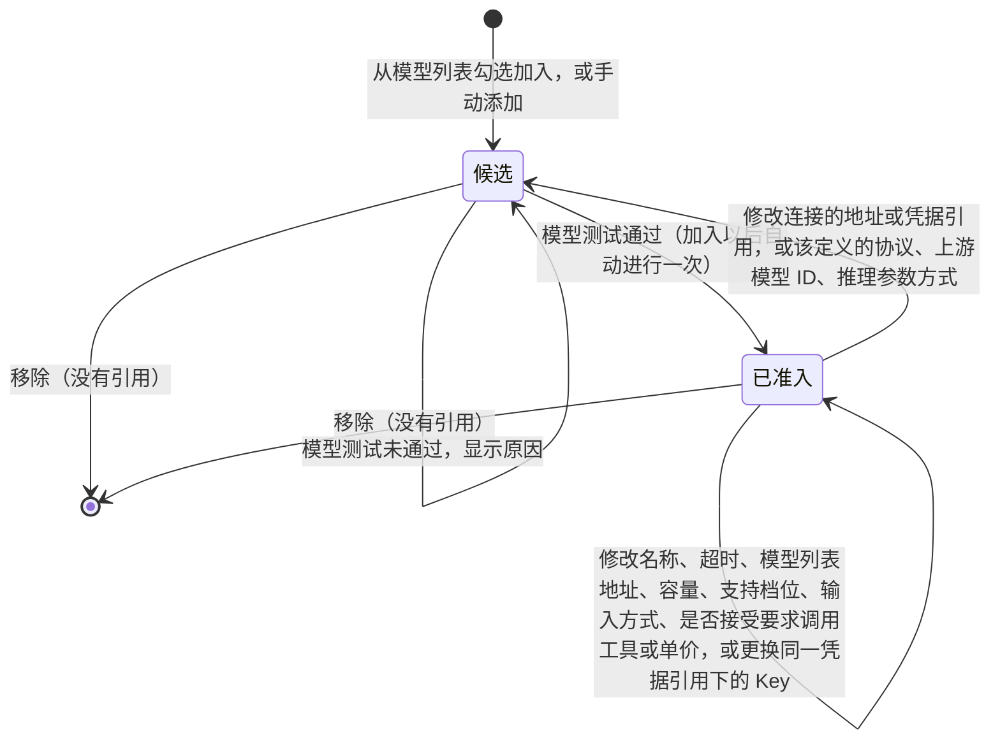
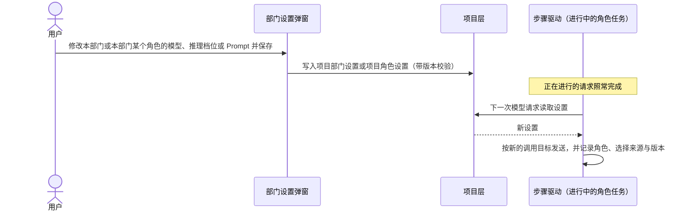
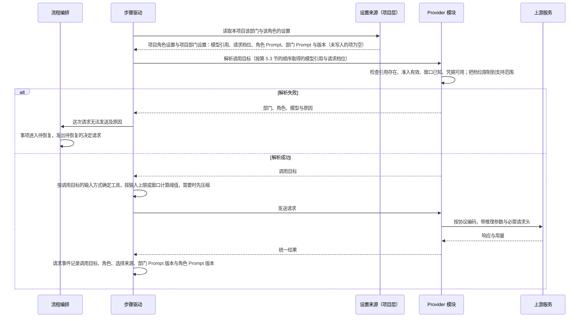

# 模型管理设计说明

总图位置：第四节「模型」的缝；第二节「定义」里的模型设置。依据：需求 [D24 模型管理与部门模型选择](../requirements/model-management.md)；界面原型 [v13 原型](../prototypes/v13/design.md)，模型管理页与部门设置弹窗按第 9 节制作。

本说明是模型目录、部门与角色的模型选择、推理档位、调用目标解析与上下文容量的判断标准。其他文档与本说明冲突时，以本说明为准。

## 1. 参照对象与取舍

参照 OMP（`C:/project/codes/oh-my-pi` @ fdfeef1f78）与 opencode（`anomalyco/opencode`，原 `sst/opencode`）：压缩的部分按 @ 7ab721a97f，模型数据来源的部分按 @ 0027387。用户原话与已确认的规则见 D24。

| 方面 | OMP | opencode | Yudao |
| --- | --- | --- | --- |
| 模型目录 | 全局一份；每个模型带窗口、输出上限、推理档位、图像与工具支持 | 全局一份，数据来自 models.dev | 全局一份；模型访问定义带窗口、输出上限、输入上限（可选）、推理档位声明与输入方式 |
| 能力数据来源 | 内置目录随版本发布，运行时发现，缺失时补默认值 | models.dev，构建时打包快照，运行时刷新；缺失时按 0 处理 | 模型能力表（models.dev 的快照，随版本发布）与上游模型列表预填，两处都没有时由用户填写，并经模型测试 |
| 可以选用的条件 | 有凭据即可选用 | 有凭据即可选用 | 窗口与输出上限有值（预填或用户填写），并且模型测试通过（准入） |
| 未知窗口 | 跳过主动压缩，照常调用 | 跳过自动压缩，照常调用 | Provider 模块拒绝 |
| 选择层级 | 模型角色分全局层与项目层，项目只写入覆盖的角色 | agent 与会话级选择 | 全局的部门默认与角色默认，项目的项目部门设置与项目角色设置，项目只写入覆盖的项；角色设置优先于部门设置 |
| 运行中更换模型 | 支持，下一次请求按新模型计算 | 支持，每一轮按会话当前的模型解析 | 支持，从下一次模型请求起生效 |
| 推理档位 | 模型声明支持的档位，请求时限制到支持范围，各协议分别映射 | 模型声明档位，不支持时报错 | 模型声明支持的档位，请求时限制到支持范围，各协议分别映射 |
| 压缩阈值 | 窗口 − max(15% 窗口, 16384) | 基数 − max(15% 基数, 16000)，基数是模型的输入上限（有就用），否则是窗口 | 按 OpenCode 计算（第 8.3 节）：基数 − max(15% 基数, 16000)，基数取模型的输入上限，没有就取窗口，不设工作上限 |
| 压缩依据的用量 | max(上游回报用量, 本地估算) | 上游用量或本地估算 | 与 OMP 相同 |
| 引用的模型无法使用 | 静默改用其他有凭据的模型 | 报错 | 事项进入待恢复并说明原因，修复以后继续 |
| 角色 | default、smol、slow、task 等，子 Agent 按角色选择模型 | agent 配置 | 产品、工程、质检三个部门，每个部门内的角色由定义声明（[部门内多角色设计说明](department-roles.md)第 4 节），每个角色可以有自己的模型设置（第 5 节） |

OMP 的一个失效实例：内置目录 4776 个模型中有 764 个没有窗口数据，这些模型的主动压缩从不触发，只能等上游报告超限后补救。统一管理能否起作用，取决于目录里的能力数据是否准确。Yudao 以准入要求容量有值来保证这一点：容量取上游模型列表或模型能力表（第 4.1 节）中带来源的值，两处都没有时由用户填写。

## 2. 分层

系统分三层。每层只通过下一层的接口取得结果，不读取下一层的内部数据。

| 层 | 职责 | 边界 |
| --- | --- | --- |
| 模型目录层 | 服务方案、Provider 配置、模型访问定义、准入、凭据；给定一个选择，解析出调用目标或具体原因 | 不认识部门、角色与项目；只接收「连接 + 模型访问定义 + 请求档位」 |
| 选择层 | 部门默认、角色默认、项目部门设置与项目角色设置的保存、版本与合并规则 | 只保存引用、请求档位与 Prompt，不复制目录内容 |
| 运行层 | 每次模型请求前取得调用目标，按它计算容量、压缩、发送并记录 | 不缓存调用目标；同一请求的重试沿用该请求的调用目标 |

## 3. 数据与归属

| 数据 | 内容 | 保存位置 | 修改入口 | 生效 |
| --- | --- | --- | --- | --- |
| 服务方案预置表 | 默认协议、按协议的请求基址、获取模型列表与连接测试的认证方式、模型列表地址、文档链接、必需请求头、来源 | Provider 模块内的数据文件，整张表带 revision | 发布新版本 | 随新版本发布 |
| 模型能力表 | 每个服务方案下各模型的调用协议、输入方式、输出方式、窗口、输出上限、输入上限（可选）、是否支持工具调用与推理 | Provider 模块内的另一份数据文件，整张表带 revision、快照日期与来源 | 发布新版本 | 随新版本发布；只用于预填 |
| Provider 配置 | ID、名称、服务方案、地址、凭据引用、超时、模型列表地址 | 模型目录文件 | 模型管理页、编辑 JSON | 下一次模型请求 |
| 模型访问定义 | 上游模型 ID、调用协议、窗口、输出上限、输入上限（可选）、推理档位声明、输入方式、是否接受要求调用工具 | 模型目录文件，属于一份 Provider 配置 | 同上 | 下一次模型请求 |
| 准入记录 | 测试时间、实际返回的模型、协议、测试时的受影响字段 | Provider 模块，与目录文档分开保存 | 只由模型测试写入 | 立即 |
| 凭据 | API Key 与来源；网络取回与 MCP 服务器的登记也按名称使用这个凭据来源（[网络取回与 MCP 工具设计说明](network-and-mcp.md)第 4.5 节） | 进程内存、进程环境或 `.yudao/.env` | 模型管理页凭据区 | 下一次模型请求 |
| 部门默认 | 三个部门各自的模型访问定义引用与请求档位 | 模型目录文件 | 模型管理页底部、编辑 JSON | 下一次模型请求，包括进行中的事项 |
| 项目部门设置 | 某项目某部门的模型访问定义引用、请求档位、部门 Prompt | 项目事件，与现有部门 Prompt 配置同一处，带版本 | 部门设置弹窗 | 该部门下一次模型请求，包括进行中的事项 |
| 角色默认 | 每个角色的模型访问定义引用与请求档位 | 模型目录文件，与部门默认同一处 | 模型管理页部门默认下的角色默认、编辑 JSON | 该角色下一次模型请求，包括进行中的事项 |
| 项目角色设置 | 某项目某角色的模型访问定义引用、请求档位、角色 Prompt | 项目事件，与项目部门设置同一处，带版本 | 部门设置弹窗中的角色设置 | 该角色下一次模型请求，包括进行中的事项 |
| 调用目标 | 一次模型请求实际使用的连接、协议、地址、上游模型、容量、输入方式、是否接受要求调用工具、发送的推理档位、凭据引用与版本、角色、选择来源、部门 Prompt 版本与角色 Prompt 版本 | 模型请求事件 | 由解析产生 | 只描述这一次请求 |

设置只有全局与项目两层。

## 4. 模型目录

### 4.1 服务方案预置表与模型能力表

预置表是 Provider 模块内的一份数据文件。每个服务方案一行，包含名称、默认协议、按协议列出的请求基址、获取模型列表与连接测试使用的认证方式、模型列表地址、文档链接、必需请求头（OpenCode Go 需要真实 User-Agent 与 `x-opencode-session`）和来源链接。整张表带 revision，界面显示 revision 与来源。

表中目前只有 OpenCode Go：默认协议是 Chat Completions，三种协议使用同一个请求基址 `https://opencode.ai/zen/go/v1`。「自定义」表示不使用预置表：地址、凭据引用与模型列表地址由用户填写，获取模型列表与连接测试使用 Bearer，新建访问定义时协议预填 Chat Completions（第 4.2、4.3 节）。服务方案只描述接入规则，不带模型、容量、推理档位或准入。新增服务方案等于在文件中新增一行，随新版本发布生效；不做远端自动更新。

模型能力表是 Provider 模块内的另一份数据文件，内容取自 [models.dev](https://models.dev) 的快照。models.dev 是公开的模型能力数据库（仓库 [`anomalyco/models.dev`](https://github.com/anomalyco/models.dev)，原 `sst/models.dev`，MIT 许可证），数据按 provider 把模型分组，每个模型带 `modalities.input`、`modalities.output`（取值为 text、audio、image、video、pdf）、`limit.context`、`limit.output`、`tool_call`、`reasoning` 等字段。参照对象的做法：

- OpenCode（`anomalyco/opencode` @ 0027387）构建时下载 models.dev 的 `api.json` 并打包进程序（`packages/cli/script/generate.ts` 第 1–5 行、`packages/cli/script/build.ts` 第 87 行），运行时再从 `https://models.opencode.ai/api.json` 刷新并缓存（`packages/core/src/models-dev.ts` 第 160–231 行）；模型字段的定义见同一文件第 67–120 行。
- OMP（@ fdfeef1f78）的 `packages/catalog/scripts/generate-models.ts` 第 219–231 行读取 models.dev 格式的能力数据（地址为 `catalog.stencil.so`，见 `packages/catalog/src/provider-models/openai-compat.ts` 第 65 行），与其他来源合并，生成随版本发布的 `packages/catalog/src/models.json`。

Yudao 的模型能力表按以下规则维护：

- **范围**：只收录预置表中服务方案的模型。每个服务方案记录它在 models.dev 中对应的 provider ID（OpenCode Go 对应 `opencode-go`）。自定义服务方案在表中没有条目。
- **字段**：每个模型只保留上游模型 ID、调用协议、输入方式、输出方式、上下文窗口、输出上限、输入上限（可选）、是否支持工具调用与是否支持推理。调用协议的取法见下一条，其余字段分别取自 `modalities.input`、`modalities.output`、`limit.context`、`limit.output`、`limit.input`、`tool_call` 与 `reasoning`。models.dev 中 `modalities` 是可以缺少的字段，缺少时表中不记录该模型的输入方式与输出方式。
- **调用协议**：取自每个模型的 `provider.npm`：`@ai-sdk/openai` 为 Responses，`@ai-sdk/anthropic` 为 Anthropic Messages，`@ai-sdk/openai-compatible` 为 Chat Completions。模型没有单独声明 `provider.npm` 时记录服务方案的默认协议（OpenCode Go 为 Chat Completions，与 models.dev 中 `opencode-go` 的 `@ai-sdk/openai-compatible` 相同）。遇到这三种以外的取值时，提取脚本以错误结束并列出这些模型，由更新快照的人决定。上游模型列表中有、能力表中没有的模型，预填服务方案的默认协议。
- **版本与来源**：整张表带 revision、快照日期与来源链接；界面显示 revision、快照日期与来源。
- **更新**：发布前由代码仓库中的提取脚本从 models.dev 取出上面的字段生成快照，随 Yudao 新版本更新，运行时不从远端刷新，与预置表的方式相同。
- **用途**：只用于新建模型访问定义（从模型列表加入或手动添加）时预填协议、容量与输入方式（第 4.3 节）。运行、准入与建议能力的提醒只使用模型访问定义中的值，不读取能力表。

预置表与模型能力表是两份文件，各带 revision：预置表只含接入规则，能力表只含每个模型的协议与能力。

### 4.2 Provider 配置

一份 Provider 配置（连接）是一个服务方案下的 ID、名称、地址、凭据引用、超时与模型列表地址。连接不声明协议，调用协议由其下每个模型访问定义声明（第 4.3 节）；一个订阅的模型无论使用哪种协议，都属于同一份连接。连接保存它所属的服务方案，编辑时据此恢复方案选择，请求时据此取得请求基址与必需请求头。

- **新建时自动填写**：ID、名称与凭据引用按服务方案自动填写：OpenCode Go 使用方案自己的名字，自定义服务按地址的主机名；用户可以修改。新建连接时填写的 Key 随连接一起保存（第 9.1 节）。
- **凭据引用的写法**：凭据引用就是环境变量名，写入 `.env` 时按 `.env` 的键名规则：字母、数字与下划线，不以数字开头（自动填写的引用本来就是这种写法，例如 `OPENCODE_GO_KEY`）。选「写入 .env」而引用不合这条规则时，在写入之前拒绝并写明规则，文件与内存都不动；Yudao 不写出自己读不回的 `.env`（2026-10-28 试用 Tf61ac6a6-04：带连字符的引用写坏了 `.env`，之后保存与删除都失败）。
- **写入 .env 以后的来源**：选「写入 .env」并写入成功时，这个引用的 Key 只在 `.env` 里，不另留一份内存覆盖，状态显示来源为 `.env`（进程环境里另有同名变量时显示环境，并说明重启以后用哪一个）；写入失败时什么都不改，不悄悄改成只在内存生效（[D22](../requirements/startup-provider-reload.md)第 5 节）。
- **地址**：选中内置服务方案时，地址取预置表中该方案默认协议的请求基址，只读显示；需要其他地址时使用自定义服务。自定义服务由用户填写，地址没有写 `http://` 或 `https://` 时按 `https://` 处理，输入框显示补全后的地址。
- **请求基址**：自定义服务取连接的地址；内置服务方案按访问定义的协议取预置表中的请求基址。
- **请求路径与认证方式**：由访问定义的协议的适配器决定，与 OMP、opencode 和官方 SDK 的用法相同：Responses 与 Chat Completions 在基址后拼接 `/responses`、`/chat/completions`，使用 Bearer；Anthropic Messages 去掉基址末尾的 `/v1` 后拼接 `/v1/messages`，使用 `x-api-key`。
- **模型列表地址**：内置服务方案使用方案的模型列表地址；自定义服务默认是连接地址加 `/models`，显示在新建与编辑连接的表单上，用户可以修改。用户没有修改时，连接只保存地址，模型列表地址随地址变化；用户修改以后保存修改后的值；清空输入框回到默认值。
- **获取模型列表与连接测试的认证**：按服务方案规定的认证方式带上凭据；自定义服务使用 Bearer。

### 4.3 模型访问定义与准入

模型访问定义属于一份 Provider 配置，包含上游模型 ID、调用协议（Responses、Chat Completions、Anthropic Messages）、窗口、输出上限、输入上限（可选）、推理档位声明（第 7 节）、输入方式、是否接受要求调用工具，以及单价（输入、缓存读、缓存写、输出各一项，由用户填写，可以留空）。单价只用于费用的计算：费用等于用量乘以单价，进入评测报告与对照记录，不进入运行中的控制；没有填写单价时费用保持未知，不填零。单价的修改不使准入作废。窗口与输出上限必须有值，输出上限不大于窗口。输入方式的取值为文本与图像，文本总是包含；运行层按它决定提供哪些工具、哪些内容可以放入请求（第 5.6 节）。是否接受要求调用工具默认为接受；不接受的模型，最后一次主机提示之后的请求不带「要求调用工具」。

- **获取模型列表**：只对已保存的连接进行，请求该连接的模型列表地址（第 4.2 节：内置服务方案取方案的地址，自定义服务取连接保存的地址，默认是连接地址加 `/models`），按服务方案规定的认证方式带上凭据，自定义服务使用 Bearer。结果显示来源地址与采集时间。请求失败时显示「候选未知」，并写明请求的地址与返回的状态码，没有收到响应时写明连接失败的原因；只接受 `x-api-key` 的自定义服务获取列表会失败，用户可以手动添加访问定义。连接还没有保存时，界面上的「获取模型列表」写明要先保存这份连接与原因，不发请求。
- **加入**：在模型列表中勾选要用的模型，点一次「加入」，每个勾选的模型按下面的预填成为一个访问定义并保存，状态为候选。勾选的模型中有窗口或输出上限没有预填值的，请用户填写，填好以后才能加入。
- **预填**：从模型列表加入或手动添加访问定义时，按连接的服务方案与上游模型 ID 预填。协议：内置服务方案取模型能力表中这个模型的协议，能力表中没有该模型时取服务方案的默认协议；自定义服务预填 Chat Completions；用户可以修改。窗口与输出上限先取上游模型列表返回的值，列表没有返回时取模型能力表中的值，两处都没有时留空，由用户填写；上游模型列表描述的是这份连接当前的实际情况，能力表是随版本发布的快照，所以列表优先。输入方式取能力表中的值：输入方式包含 image 时预填为文本与图像，否则预填为只有文本；能力表中没有该模型、没有记录输入方式，或服务方案为自定义时，预填为只有文本，由用户自己声明。不按模型名称推测。界面标明每个预填值的来源（上游模型列表，或能力表及其 revision）。
- **容量**：窗口与输出上限有预填值时直接采用，界面标明来源，用户以后可以修改；保存的容量就是运行时使用的限制。输入上限有预填值时同样采用，没有就空；有值时压缩阈值以它为基数（第 8.3 节）。
- **输入方式**：Yudao 信任模型能力表中的记录，预填的输入方式就是运行时使用的输入方式；用户可以修改，修改后的值同样直接使用。能力表记录有误时替换能力表的来源，模型测试与准入不另外核实输入方式。
- **连接测试**：只对已保存的连接进行，按服务方案规定的认证方式带上凭据读取模型列表地址（自定义服务使用 Bearer），证明地址与凭据可用，不改变任何准入。连接下还没有访问定义时同样可以进行。
- **fake 协议**：只在以测试或演示方式启动的系统中可用，不需要凭据与准入；正常启动的系统读取目录时拒绝 fake 协议。
- **模型测试**：对一个访问定义按它的协议发送一次真实的最小推理请求；该定义声明了推理档位时，按它的默认档位发送推理参数。从模型列表加入或手动添加的访问定义，保存以后自动测试一次；用户也可以在该行再次测试。测试通过时写入准入记录，定义出现在部门默认、角色默认、项目部门设置与项目角色设置的选项中；未通过时在该行显示原因，定义留在候选，用户修改以后可以再测试。结果只影响这一个定义。
- **准入记录**只由模型测试写入。目录文档的编辑、导入与导出都不含准入记录。

### 4.4 修改与准入

准入与访问定义自身及所属连接的受影响字段绑定，按下表逐个字段判断。

| 修改的字段 | 准入 | 部门默认与项目部门设置中的引用 |
| --- | --- | --- |
| 地址、凭据引用（连接） | 该连接下全部定义回到候选 | 保留，显示「无法使用：准入已作废」 |
| 协议、上游模型 ID、推理参数方式（定义） | 该定义回到候选 | 同上 |
| 名称、超时、模型列表地址（连接） | 保持 | 保持 |
| 窗口、输出上限、输入上限（可选）、支持档位、默认档位、输入方式、是否接受要求调用工具（定义） | 保持，从下一次模型请求起使用新值 | 保持 |
| 同一凭据引用下的 Key | 保持 | 保持 |
| 测试另一个模型 | 保持 | 保持 |

保存会作废准入的修改之前，界面通过应用层的查询 `catalog.change_impact`（按拟议的修改计算，不写入任何内容）列出受影响的定义、引用方（部门默认的哪个部门、哪个项目的哪个部门）以及正在使用它们的进行中事项。进行中事项按（事项，部门）逐条列出：事项里哪个部门的模型选择（项目部门设置，没有时取部门默认）落在受影响的定义上，就列出这个部门，不论它此刻在不在工作，因为它下一次开始工作时同样会被挡住；一个事项可以出现几次。引用保留，相关角色的下一次模型请求不发送，事项进入待恢复（第 5.5 节），由用户重新测试或另选模型以后继续。

准入证明的是这份连接与这个模型按定义的协议能够收发请求。输入方式与是否接受要求调用工具只决定请求中放入的内容、提供的工具与是否要求调用工具，不改变请求发往哪里、怎样认证与编码，所以修改它们保持准入。它们的值来自模型能力表（models.dev）与用户的声明，Yudao 直接使用；记录有误时，上游按请求内容错误拒绝，按已有规则处理，修正办法是替换能力表的来源或改正声明，不在准入中增加核实。

### 4.5 删除

- 移除模型访问定义：被部门默认或任何项目部门设置引用时拒绝，并列出引用方。
- 删除 Provider 配置：其下任何定义被引用时拒绝，并列出引用方；没有引用时，确认框列出将一并删除的定义，确认后连同定义一起删除。

### 4.6 目录文档（编辑 JSON、导入、导出）

目录文档是 Provider 配置、模型访问定义、部门默认与角色默认的完整文本，格式与模型目录文件相同。它不含 API Key、准入记录、项目部门设置与项目角色设置。编辑 JSON、导入整份文档与界面表单使用同一套校验：未知字段拒绝，Provider 配置中出现协议字段时读取直接报错并指出字段位置；每个模型访问定义必须声明协议，窗口与输出上限必须有值；部门默认与角色默认只能引用已准入、并且属于所填连接的定义，请求档位只能为空或者属于档位全集。校验通过后整份写入；任何一项不通过时整份拒绝，界面指出字段位置。

### 4.7 目录文件重新读取

Provider 模块监视模型目录文件。合法的外部修改按第 4.4 节的规则生效，从下一次模型请求起影响包括进行中事项在内的全部部门。内容无效时保留上一个有效版本并显示原因。服务启动时没有目录文件，是「没有文件」（空目录），不是文件被删除；只有服务运行期间读到过的文件消失才按被删除处理。文件被删除时，目录、部门默认与角色默认一起清空，部门默认与角色默认变为「未设置」；进行中事项里没有另选模型的角色，下一次模型请求不发送，事项按第 5.5 节进入待恢复，用户重新设置模型以后继续；新建事项按第 5.5 节被拒绝。

## 5. 部门与角色的模型选择

选择分部门与角色两个粒度，每个粒度有全局与项目两层：部门默认、项目部门设置、角色默认、项目角色设置。角色是[部门内多角色设计说明](department-roles.md)第 4 节的固定角色。角色设置优先于部门设置：角色设置表达按工作性质选择模型，例如探索者使用快速模型，与 OMP 中 Agent 覆盖优先于父 Agent 模型的规则相同；角色设置没有写入的项继承部门设置。

### 5.1 部门默认与角色默认

模型管理页底部为产品、工程、质检各设一项部门默认：一个已准入的模型访问定义，加一个可以为空的请求档位。部门默认全局只有一份，所有项目共用，可以为「未设置」。保存时要求所选定义已准入；之后准入作废时，引用保留并显示无法使用。

每个部门默认下列出本部门各角色的角色默认：一个已准入的模型访问定义，加一个可以为空的请求档位，全局每个角色一份，可以为「未设置」；保存与准入作废时的处理和部门默认相同。角色默认与部门默认保存在模型目录文件的同一处，属于目录文档（第 4.6 节）。

### 5.2 项目部门设置与项目角色设置

每个项目的每个部门有一份项目部门设置，包含三项：模型访问定义、请求档位、部门 Prompt。每一项都可以不写入；没有写入的项使用部门默认，部门 Prompt 没有写入时使用内置默认 Prompt（版本 0）。写入项目部门设置不修改部门默认。设置保存在项目事件中，每个项目的每个部门一份设置、一个版本，三项一起保存，写成同一种事件；并发修改时按版本拒绝后提交的修改。

保存的内容与现值完全相同时按「没有改动」接受：不追加事件，设置的版本不变，接受结果里的建议能力提醒为空（提醒仍然一直显示在设置旁，见第 5.6 节）。先核对版本、再看有没有改动：基准版本过期时，内容即使与现值相同也按版本冲突拒绝，用户先看到别人改了什么。

每个项目的每个角色有一份项目角色设置，包含三项：模型访问定义、请求档位、角色 Prompt，只写入覆盖的项；角色 Prompt 没有写入时使用内置角色 Prompt。项目角色设置在部门设置弹窗中按角色列出，写入它不修改角色默认与部门设置；保存位置、版本与并发修改的处理和项目部门设置相同。

角色默认与项目角色设置中的引用，按第 4.4、4.5 节与部门默认、项目部门设置相同的规则处理：准入作废时引用保留并显示无法使用；被引用的定义不能移除，拒绝时列出引用方。

这与 OMP 的项目层角色相同：项目只写入自己覆盖的角色，未写入的角色继承全局。区别在于 OMP 的项目存储是可选模式，默认写入全局；Yudao 的部门设置弹窗固定写入项目层。

### 5.3 解析规则

某项目某部门某个角色的一次模型请求，按以下规则取得选择：

1. 模型访问定义：按项目角色设置、角色默认、项目部门设置、部门默认的顺序，取第一个写入了的；都没有时解析失败。
2. 请求档位：按与模型访问定义相同的顺序，取第一个写入了的；都为空时使用所选模型的默认档位。
3. 角色 Prompt：项目角色设置中有这一项时使用它，否则使用内置角色 Prompt。
4. 部门 Prompt：项目部门设置中有这一项时使用它，否则使用内置默认 Prompt。部门 Prompt 是部门的身份与全部门的规则，放入本部门每个角色的请求；内置默认只写这两类内容，不写某一种事项的做法。
5. 事项种类的工作说明：定义中每个事项种类为每个部门写一份工作说明（普通事项怎样提交计划、交付与检查，建档事项的读取顺序与产出），按 run 的事项种类放在部门 Prompt 之后，每次请求都放入，不受项目部门设置影响。请求事件记录部门 Prompt 的版本；工作说明随定义的版本确定，按事件重新装配请求时两部分都能复原。

模型与请求档位分别继承，与第 5.2 节「只写入覆盖的项」一致。某一层只修改了模型、没有写入请求档位时，按顺序取得的请求档位按新模型的支持范围限制（第 7.3 节）。选择来源是提供模型访问定义的那一层。

### 5.4 生效时机

项目角色设置、项目部门设置、角色默认、部门默认、目录与凭据的修改，都从相关角色的下一次模型请求起生效，包括进行中的事项。正在进行的模型请求不中断。一次请求内的重试沿用该请求的调用目标。

### 5.5 引用无法使用时

所选定义被移除、准入已作废、窗口未知、凭据缺失，或者项目角色设置、角色默认、项目部门设置与部门默认都没有写入模型、解析失败时，该角色的这次模型请求不发送；事项进入待恢复，停在这次请求之前。流程编排发出待恢复的决定请求（[总体架构](architecture/overall-architecture.md)第 7.4 节），写明部门、角色、模型与具体问题。角色的模型失败时，系统不改用解析顺序中的下一层或其他模型。用户修复配置后回答这个决定请求，事项从这次请求接着进行，已完成的工作与已用限额保留。回答「继续执行」以后，被挡住的部门按它关注的成果重新开始一轮，部门历史跨激活延续，已做的工作都在：PRD、交付、缺陷记录与用户输入有没有处理，都按有没有对应的成果判断，被挡住的一轮没有交出成果，所以会重新开始。质检的预测性探索是例外：它按这一轮开始时记下的 PRD 版本判断，被挡住以后不再重做，交付到达时质检照常核验；预测性探索本来就可以不发生（[三部门的循环结构](department-loop.md)第 3.1 节）。同一事项里同时有几个会话被挡住时，各发一条决定请求，各写明自己的部门、模型与问题，事项等这几条都回答以后再继续；不合成一条，因为几个部门被挡住的原因可以不同，一条请求写不准；继续执行的入口与执行权校验见[恢复契约](recovery-contract-and-fault-matrix.md)（3.1）。新建事项前，按该项目的设置解析每个部门的每个角色；任何一个解析失败时拒绝新建，并说明是哪个部门、哪个角色、哪一项。

上游拒绝凭据与证书校验失败发生在请求发出以后，按 [D17](../requirements/provider-retries.md) 进入等待模型服务：run 暂停，按间隔重试，用户在凭据来源或系统证书库中修复以后，下一次重试成功时自动继续（路线图 Stage 4）。等待的时长上限是 `wait.model_service.max_sec`（暂定默认值），超过时发出决定请求并通知用户一次。

### 5.6 部门的建议能力

部门定义写明本部门的模型最好具备的能力，取值来自模型访问定义的输入方式（第 4.3 节）。质检部门的建议能力是图像输入（[D34](../requirements/browser-and-computer-use.md)）；其他部门目前没有建议能力。部门内的角色继承部门的建议能力。建议能力只用于提醒，不阻止保存或请求。

提醒写明部门、角色（按角色的设置才有）、模型、缺少的能力与影响。质检缺少图像输入时的影响：不提供 computer use，浏览器只给可访问性结构，不给截图；依赖桌面程序或外观的验收条件无法核验（[浏览器与 computer use 设计说明](browser-and-computer-use.md)第 8.4 节）。

- **保存时**：保存部门默认、角色默认、项目部门设置或项目角色设置时，写入的模型的输入方式不具备该部门的建议能力，照常保存，保存结果同时带回提醒。没有写入模型的设置不检查。
- **一直显示**：以下位置在相关设置旁一直显示提醒，直到换成具备该能力的模型，或者把该模型的输入方式改为具备该能力。
  - 模型管理页：所选模型不具备建议能力的部门默认与角色默认。
  - 项目的部门设置弹窗：按第 5.3 节解析出的本项目该部门及各角色的生效模型判断，包括跟随部门默认或角色默认的情况；提醒显示在部门设置与对应的角色设置旁。
  - 部门工作间：当前生效模型不具备建议能力的角色，提醒显示在该角色的当前模型旁。
- **请求时**：按调用目标中的输入方式提供工具：定义中的工具用 `requires_image_input` 声明是否需要图像输入（3.2D 中为 `browser_take_screenshot`，以后阶段的 computer use 另有 8 个屏幕工具），不包含图像时这些工具不出现在请求的工具定义中，工具结果中的截图只保存为证据，不放入请求（[浏览器与 computer use 设计说明](browser-and-computer-use.md)第 6 节）。

## 6. 每次模型请求

- **设置来源**：事项创建时由项目层提供给运行层，返回该项目某部门当前的项目部门设置与该部门各角色的项目角色设置。不属于项目的运行（命令行与测试）使用空设置，即全部使用角色默认、部门默认、内置角色 Prompt 与内置默认 Prompt。
- **解析**：Provider 模块对本次请求实际选中的模型访问定义检查准入。
- **范围**：工作请求、整理请求与协作请求都按这一流程解析，按发出这次请求的角色解析；协作请求按接收部门中处理它的角色解析。
- **工具与内容**：步骤驱动按调用目标中的输入方式决定这次请求提供哪些工具，以及工具结果中的图片是否放入请求（第 5.6 节）。
- **凭据**：每次解析读取当前的凭据来源，Key 更换从下一次请求起生效；进程重启后按凭据来源恢复。
- **审计**：每个模型请求事件、尝试事件与压缩事件记录调用目标的公开部分（不含 Key）、角色、选择来源（项目角色设置、角色默认、项目部门设置或部门默认）、请求档位与实际发送的档位、部门 Prompt 版本与角色 Prompt 版本、定义版本与参数版本。界面与观测从这些事件读取调用目标。

## 7. 推理档位

### 7.1 档位与声明

档位全集为 minimal、low、medium、high、xhigh、max，由低到高排列，与 OMP 相同。模型访问定义可以声明三项：

- 支持档位：档位全集的一个子集，只包含上游接受的取值；
- 默认档位：支持档位中的一个；
- 推理参数方式：见第 7.4 节。

没有声明的模型，请求不带推理参数。声明与容量一样由用户填写。

### 7.2 请求档位

部门默认、项目部门设置、角色默认与项目角色设置保存的是请求档位，可以为空。请求档位为空时，使用模型的默认档位。

### 7.3 限制到支持范围

每次请求按调用目标的模型限制请求档位：取不高于请求档位的最高支持档位；没有这样的档位时，取最低支持档位；模型没有声明支持档位时，不发送推理参数。请求事件同时记录请求档位与实际发送的档位。运行中更换模型后，原请求档位按新模型重新限制，用户不需要逐项重新选择。

### 7.4 协议映射

| 推理参数方式 | 协议 | 上游参数 |
| --- | --- | --- |
| effort | Responses | `reasoning.effort` 取档位名 |
| effort | Chat Completions | `reasoning_effort` 取档位名 |
| adaptive | Anthropic Messages | `thinking.type` 为 `adaptive`，`output_config.effort` 取档位名 |
| budget | Anthropic Messages | `thinking.type` 为 `enabled`，`budget_tokens` 按档位取值：minimal 1024、low 4096、medium 8192、high 16384、xhigh 32768、max 32768；预算不超过本次输出上限减 4000 |

推理参数方式的修改作废准入；支持档位与默认档位的修改保持准入。Responses 与 Chat Completions 的输出上限包含推理内容，档位越高，可见输出能使用的部分越少。

### 7.5 压缩与测试

- 整理请求（第 8.4 节）使用该模型的最低支持档位；模型没有声明支持档位时不发送推理参数，上游按自身的默认档位推理。推理内容与整理输出共用输出上限。
- 模型测试按该模型的默认档位发送推理参数，使准入同时证明推理参数方式可用。

### 7.6 历史中的推理内容

- 部门历史只保存与协议无关的条目：消息、工具调用、工具结果与推理内容。适配器用于界面汇总显示的观测不进入历史。
- 适配器保存上游返回的推理内容：Responses 的 reasoning 条目（请求带 `include: ["reasoning.encrypted_content"]`，保存加密内容）、Chat Completions 的 `reasoning_content`、Messages 的 thinking 与签名。
- 回放时按「同一连接、同一协议、同一上游模型」判断：相同时原样回放推理内容，要求每一轮都回放推理内容的模型（例如 DeepSeek）因此可以连续工作；不同时丢弃推理内容与该协议专用的条目 ID，消息与工具调用的配对保持完整。

## 8. 上下文容量与压缩

容量的计算参照 OMP 与 opencode。压缩时，由角色整理的尝试、补录的图谱内容与主机生成的轨迹节录代替被移出的历史；旧工具结果清理、整理请求与轨迹节录的完整规则见[语义系统设计说明](semantic-system.md)第 11 节。部门历史独立、各角色分别压缩、部门之间只传递主机接纳的结构化结果。

### 8.1 有效窗口

有效窗口等于调用目标的模型窗口。Web 新建事项只提交事项原文，窗口与运行边界使用系统默认值。小窗口压缩的测试使用声明小窗口的模型访问定义。

### 8.2 用量

判断是否压缩时，用量取两者中较大的一个：上一次请求的上游回报用量（输入、缓存读写与输出之和），以及本次请求的本地估算。本地估算按 UTF-8 字节数除以 4；中文每个字至少三个字节，这一估算比按字符数除以 4 更接近真实用量。请求事件同时记录这两项数值。

「上一次请求」只取同一会话里的**工作**请求，整理请求本身不算；一次压缩生效以后它作废，不再参与判断（2026-10-29 定）。理由：压缩以后历史变短，拿压缩前那次的大用量继续判断会让下一次立刻再压一次；历史已经全是摘要时再压，整理回应就是「History is already summarized…」，会被当成压缩失败，把事项停下来。上游没有回报用量时，判据是这次尝试的 `usage.reported` 为假，不拿数值 0 当「回报了 0」。

### 8.3 预留与阈值

- 压缩不设固定长度的工作上限，在窗口快满时才做。压缩阈值 = 基数 − 余量：基数是模型声明的输入上限（有就用），否则是模型窗口；余量 = max(基数 × 15%, 16000 token)，基数不到 32000 时只留 15%。余量要同时装得下下一次回复和整理请求本身（整理请求要把整段历史再发一遍，还要给摘要留位置）。
- 余量的比例与下限是暂定默认值：比例 15%（范围 5% 至 30%），下限 16000 token（范围 4000 至 64000），范围也是暂定，由装配与语义的设计复核。窗口 100 万的模型约在 850000 token 处压缩；窗口 400000、输入上限 272000 的模型约在 231200 token 处压缩。
- 参照 OpenCode（提交 `7ab721a97f`，`packages/core/src/session/compaction.ts` 的 `calculateCeiling`）：同样以输入上限（没有就用窗口）为基数，按比例加下限留余量，没有固定封顶。它的注释写明余量还要吸收单步越过阈值的增长（真实会话里单步增长的第 99 百分位约 22000 token）。窗口未知时它只靠上游拒绝触发，本设计的准入要求窗口必有（第 4.3 节）。
- 输入越长模型表现越差（[上下文组装：参照调研](../archive/research/context-assembly-reference.md)第 4.7 节），这件事由旧工具结果的折叠与清理处理：用量超过工作上限（取值见[语义系统设计说明](semantic-system.md)「工作上限与阈值」一节）时从最旧的一轮开始折叠，规则见[上下文组装设计说明](context-assembly.md)「规则清单」一节的 R7，折叠不调用模型。
- 本次请求的输出上限 = min(模型输出上限, 窗口 − 输入估算)。

### 8.4 整理请求

- 模型：该角色本次的调用目标；推理档位见第 7.5 节。
- 工具：提交尝试、记录工具与查询工具。
- 输出上限：13107（暂定默认值；取 OMP 的取值，即 16384 的 80%），与窗口无关。
- 内容：整理规则、常驻栏目、分界之前的历史、本任务已有的轨迹节点。
- 结果：角色整理分界之前的尝试（进行中的尝试写明目标、已完成的部分、下一步、正在处理的文件与未完成的操作），并补录漏记的事实与决定；主机校验通过后，分界之前的历史从请求中移出，历史开头放主机按轨迹节点生成的轨迹节录（上限 13107 token）。整理使用事项原文的语言。

### 8.5 旧工具结果清理、分界位置与保留

- 用量超过工作上限（第 8.3 节）时，先把最近 40000 token 之外的工具结果换成带取回地址的占位；能节省至少 20000 token 才执行；两项都是暂定默认值，折叠规则与按实测调整后的取值以上下文组装设计说明「规则清单」一节为准。清理以后仍达到压缩阈值，再发出整理请求。
- 从最新记录向前累计，保留最近约 20000 token（暂定默认值）的原始记录（OMP 的取值），更早的部分由整理请求处理。
- 分界位置只能在步骤边界上，工具调用与它的结果不分开。
- 再次压缩时，整理范围为上一次分界之后、新分界之前的历史；轨迹节录按新的轨迹节点重新生成。

### 8.6 检查点有效性

压缩检查点（分界位置与整理出的尝试）在事项内一直有效。合同、计划、输入版本、模型、协议与 Prompt 的变化都保留检查点：轨迹节录每次按当前的轨迹与图谱生成，节录中列出的图谱内容显示当前状态；要求的变化通过通知与待复核送达角色（语义系统设计说明第 10.6 节、第 7.3 节）。这与 OMP、opencode 的检查点不绑定模型的做法相同。

### 8.7 失败处理

- 整理没有通过校验、超过输出上限或请求失败：本次压缩不生效，不写入检查点。这一步的工作请求按未压缩的历史照常发送；下一步再次尝试压缩。参照 opencode：压缩失败时，这一轮按原请求继续。
- 整理请求没有声明工具，回应里却带工具调用：工具调用不执行、不进入有效历史，原始回应留作证据；回应里有文字时，文字照常校验并作为整理结果，没有文字时这一次整理按上一条不生效。不因为一次这样的回应停止事项（2026-10-28 试用 Tf61ac6a6-01：两单在这里以压缩失败停止，第三单同样的输入四次压缩都成功）。
- 未压缩的历史已经放不进窗口（窗口减输入估算后没有输出空间）时，事项以上下文超限失败结束。
- 上游返回上下文超限：按错误码与错误文本识别（例如 `context_length_exceeded`、`prompt is too long`、`maximum context length`、`exceeds the context window`、`model_context_window_exceeded`）。识别后移除失败的请求，压缩一次，重新发送一次；重新发送后仍超限时，事项以上下文超限失败结束。
- 规则、intend 原文与当前有效要求本身已超过阈值时，事项以上下文超限失败结束。
- 不无限压缩：每一次压缩都要接上同一会话的上一次压缩，覆盖范围往前走。压缩的结果没有被下一步接上（下一次压缩的覆盖范围与上一次相同），或整理一再不生效，连续达到上限（暂定默认值 3）时，run 进入待恢复，停在这次整理之前，发出待恢复的决定请求（第 5.5 节的同一种），写明部门、模型、连续的次数与最后一次的原因。用户可以先换这个部门的模型，再回答「继续执行」：连续次数清零，事项从这次整理接着进行，已完成的工作与已收下的交付保留；回答「停止事项」时事项以压缩失败（`compaction_failed`）结束，停止说明写明连续的次数与最后一次的原因。没有这一条，部门会在一段压不完的历史上空转到运行时间上限，期间不做工作也不提示（2026-10-24 试用 F1：31 次压缩、35 分钟）；停下来而不给用户选择，会让已经交付的事项整条作废（2026-10-29 试用：交付已收下，质检的整理连续失败，事项停止）。

## 9. 界面

本节以 [v6 原型](../archive/prototypes/department-workspace-v6.html)为基础写成，列出按本说明修改的地方；[v13 原型](../prototypes/v13/index.html)已按本节制作，模型管理页见 `js/ui/views/sys-models.js`。

### 9.1 模型管理页

| 元素 | 保留 | 按本说明修改 |
| --- | --- | --- |
| 入口与「返回原界面」 | 左侧栏底部入口；返回进入前的页面 | 页面顶部路径只显示「模型管理」，不显示在项目名之后 |
| Provider 配置卡片 | 一份连接一张卡片，默认收起，展开查看模型表 | 摘要行：名称、服务方案、地址、凭据状态（缺失，或来源为内存、环境、`.env`）、「已准入 x · 候选 y」。模型表列：上游模型 ID、协议、窗口、输出上限、推理档位声明、输入方式（是否支持图像）、准入（测试时间与实际返回的模型）；操作：模型测试、移除，模型测试（包括加入以后的自动测试）的结果写在该模型所在行：通过写用时，失败写上游给出的原因 |
| 编辑 JSON | 弹窗、格式化、重置、复制 | 按第 4.6 节校验；不含 Key、准入记录与项目部门设置 |
| 添加或编辑 Provider 配置 | 就地展开的表单，高级选项折叠 | 标题为「添加 Provider 配置」「编辑 Provider 配置」；打开时模型访问定义表为空；新建时 ID、名称与凭据引用按服务方案自动填写（OpenCode Go 使用方案自己的名字，自定义服务按地址的主机名），用户可以修改（第 4.2 节）；编辑时按连接保存的服务方案恢复选中项 |
| 服务方案 | 方案按钮 | 只有 OpenCode Go 与自定义；显示预置表 revision 与来源，以及模型能力表的 revision、快照日期与来源；文档链接只读显示在方案区 |
| 地址 | 输入框 | 选中内置服务方案时取预置表中该方案默认协议的请求基址，只读；自定义服务由用户填写；没有写 `http://` 或 `https://` 时按 `https://` 处理，输入框显示补全后的地址；编辑时修改地址，保存前按第 4.4 节提示 |
| 模型列表地址 | 输入框 | 直接显示在新建与编辑连接的表单上；自定义服务的默认值是连接地址加 `/models`，用户修改以后随配置保存，清空回到默认值；内置服务方案使用方案的模型列表地址（第 4.2 节） |
| 凭据 | 凭据引用输入框 | 新建连接时填写的 Key 在点击「添加」时随连接一起保存，按所选的写入方式写入；Key 输入框始终为空，不回填；显示凭据状态与来源；写入方式为「只在本进程有效」或「写入 .env」；「清除内存覆盖」与「删除持久凭据」分成两个操作；保存以后把结果写在表单旁：成功写「已保存 API Key」与凭据版本、来源（进程内存、`.env`），失败写服务端给出的原因原样；结果回来之前不清空 Key 输入框，保存以后也不让「还不能保存：填写 API Key」这一行留在原处顶替结果（2026-10-29 试用 Tc1f7185a-04） |
| 高级选项 | 超时 | 超时的默认值由 Provider 模块给出（`harness/providers/store.py` 的 `DEFAULT_TIMEOUT_SEC`，600 秒），新建表单从目录合同的 `default_timeout_sec` 取值，客户端不另写一份；超时按多久没有收到新数据计算，不按回复的总时长（[D09](../requirements/execution-limits.md)，2026-10-20） |
| 获取模型列表与候选 | 按钮 | 按第 4.3 节；显示来源地址与采集时间；每个候选带勾选框，显示预填的窗口与输出上限及来源；勾选要用的模型后点一次「加入」；勾选的模型没有预填窗口或输出上限时在该候选旁填写，两项缺一或输出上限大于窗口时「加入」不可用，并在按钮旁写明缺少或不对的那一项（与目录文档校验同一份判断）；失败时显示「候选未知」，并写明请求的地址与返回的状态码，没有收到响应时写明连接失败的原因；连接还没有保存时，候选区一直写明要先保存这份连接，点这个按钮给出同一件事的说明，不发请求也不停在「候选获取中…」 |
| 模型访问定义表 | 行内编辑 | 协议为下拉框（Responses、Chat Completions、Anthropic Messages），按第 4.3 节预填，修改协议时保存前按第 4.4 节提示；单价（可以留空，留空时显示「费用未知」）；窗口、输出上限与输入方式按第 4.3 节预填并标明来源，可以修改，两项缺一或输出上限大于窗口时不能保存，并写明缺少或不对的那一项；输入方式为「支持图像输入」勾选框；推理档位声明（支持档位多选、默认档位、推理参数方式）；准入列只读，删除状态下拉框 |
| 测试连接、保存 | 按钮 | 测试连接只测试已保存的连接，连接下没有访问定义时也可以测试；保存按第 4.4 节提示受影响的引用与进行中事项 |
| 部门默认（页面底部） | 三张部门卡片 | 标题为「部门默认」；模型为一个按连接分组的下拉框，只含已准入定义，另有「未设置」；推理档位的选项来自所选模型的声明，没有声明时禁用并显示「该模型未声明推理档位，请求不带推理参数」；已保存的档位不在当前模型的支持档位内时，下拉额外保留这一项并标明按模型限制（保存只核对档位属于档位全集，第 7.3 节）；点击保存才写入；说明文字为「从各部门下一次模型请求起生效，没有另选模型的项目同样生效，包括进行中的事项」；部门默认与角色默认的所选模型不具备该部门的建议能力时，保存后提醒，并在该项旁一直显示提醒（第 5.6 节） |

从新建连接到准入的操作：

1. 新建连接：选择服务方案（自定义服务另外填写地址），粘贴 Key，点「添加」。ID、名称与凭据引用已按服务方案填好，Key 随连接一起保存。
2. 展开这份连接，点「获取模型列表」。失败时按显示的地址与状态码修改模型列表地址或凭据，或者手动添加访问定义。
3. 勾选要用的模型，点一次「加入」。窗口与输出上限有预填值时直接采用并标明来源；两处都没有时在该候选旁填写。协议按第 4.3 节预填。
4. 加入以后，每个新的访问定义自动进行一次模型测试。通过的定义出现在部门默认与部门设置弹窗的模型选项中；未通过的在该行显示原因，留在候选，用户修改以后可以再测试。

### 9.2 部门设置弹窗

- 标题为「本项目 · 某部门设置」，写入本项目该部门的项目部门设置，不修改部门默认。
- 模型：下拉框第一项为「跟随部门默认（当前：…）」，其后为按连接分组的已准入定义；选择第一项即清除项目的模型选择。
- 推理档位：第一项为「跟随」，其后为当前生效模型声明的支持档位；保存时只核对档位属于档位全集，超出的选择由下一次请求按模型限制（第 7.3 节）。
- 部门 Prompt：文本框、撤销本次修改、使用内置默认 Prompt、一行说明这一段写不写；版本冲突时提示重新读取。这一段不由本项目写入时文本框是空的，保存时不发这一项，服务端按没有写入处理，部门用内置默认 Prompt（第 5.2 节）；清空文本框同样表示不写入，不是一次空内容。按钮的名字说它做的事：「撤销本次修改」只还原成已保存的内容，「使用内置默认 Prompt」才是不写入这一段。
- 来源按项说：模型（本项目写入 / 跟随部门默认）、推理档位（本项目写入 / 跟随）、部门 Prompt（本项目写入 / 内置默认）。按这一项有没有写入判断，不按设置记录有没有判断：有记录但没写这一项时，这一项仍然显示它自己的默认。
- 保存后提示「从本部门下一次模型请求起生效」。
- 建议能力提醒：保存时写入的模型不具备该部门的建议能力，照常保存，同时显示保存结果带回的提醒。弹窗打开期间，按本项目该部门及各角色的生效模型（包括跟随部门默认或角色默认）判断，不具备建议能力的，在部门设置或对应角色设置旁一直显示提醒，写明模型、缺少的能力与影响（第 5.6 节）；没有建议能力的部门不显示。

### 9.3 部门工作间

- 显示本部门当前生效的模型及来源（项目设置或部门默认）。
- 当前生效模型不具备本部门建议能力的角色，在该角色的当前模型旁显示提醒（第 5.6 节）。
- 显示最近一次模型请求实际使用的模型、协议与发送的档位，取自请求事件。
- 引用无法使用时显示「无法使用」与原因；没有设置时显示「未设置」；这两种情况都不显示其他连接或模型。
- 工位标签为「某部门 Agent」。

### 9.4 v6 中删除的元素

- AnyRouter、StepFun、Anthropic 三个服务方案，以及预置方案附带的模型、容量与准入状态。
- 表单与 JSON 中可以写入的准入状态。
- 固定四档的 Effort 滑块及其刻度文字。
- 部门设置弹窗中的 SubAgent 开关；房间中的「派发协作者」「动作步进」按钮、SUB 工位、MAIN 标记与「主 Agent」字样。
- Key 输入框中的预填值。

### 9.5 用词

| v6 用词 | 改为 |
| --- | --- |
| 供应商、服务实例 | Provider 配置、服务方案 |
| 模型映射、映射表 | 模型访问定义 |
| 待核验、可用模型、远端模型 | 候选 |
| 单项测试、准入测试、验证通过 | 模型测试、模型测试通过 |
| 连通性探针、连接成功 | 连接测试、连接测试通过 |
| 密钥、环境变量引用 | API Key、凭据引用 |
| 全局分配、全机默认、基线、冻结 | 部门默认、生效 |
| 推理努力程度、推理思考努力程度、推理深度 | 推理档位 |
| System Prompt | 部门 Prompt |

## 10. 对现有实现的改动范围

| 模块 | 改动 |
| --- | --- |
| 预置表 | Python 元组改为数据文件；每个服务方案带默认协议与获取模型列表的认证方式，OpenCode Go 按协议列出请求基址 |
| 模型能力表 | 新增数据文件：models.dev 快照中预置表各服务方案的模型，只保留第 4.1 节的字段（包括按 `provider.npm` 映射的调用协议），带 revision、快照日期与来源 |
| 目录与校验 | 调用协议由模型访问定义声明，在连接上声明协议的目录读取时直接报错；修改协议只使这个定义回到候选；自定义服务的地址没有写协议头时补全为 `https://`；模型访问定义增加推理档位声明与输入方式；目录文档不含准入记录；准入按字段判断；部门默认保存时检查准入；删除按第 4.5 节检查两层引用 |
| 候选与测试 | 获取模型列表与连接测试按服务方案的认证方式带上凭据，自定义服务使用 Bearer；自定义服务的模型列表地址默认取连接地址加 `/models`；获取失败时返回请求的地址与状态码；按第 4.3 节从上游模型列表与模型能力表预填协议、容量与输入方式；勾选「加入」以后对每个新的访问定义自动进行模型测试；连接测试读取模型列表地址，连接下没有访问定义时也可以进行 |
| 调用目标解析 | 统一的「解析 + 准入检查 + 档位限制」入口，按实际选中的定义检查准入；调用目标带输入方式 |
| 协议适配器 | 按访问定义的协议决定请求路径与认证方式，内置服务方案按协议取预置表中的请求基址；三种协议的推理参数编码；保存并按同模型规则回放推理内容；界面汇总用的观测不进入历史 |
| 运行层 | 删除事项创建时的目标快照与 `provider_credentials_lost`；每次请求解析调用目标；请求事件记录调用目标、选择来源与部门 Prompt 版本；引用无法使用时记录待恢复事实（第 5.5 节）；按调用目标的输入方式提供工具（第 5.6 节）；删除事项内的 Prompt 编辑 |
| 容量与压缩 | 删除事项级窗口；按第 8 节修改用量计算、预留与阈值、旧工具结果清理、整理请求、分界位置、检查点有效性与失败处理 |
| 项目层 | 项目部门设置增加模型与请求档位；向运行层提供部门设置来源；新建事项前按项目设置检查三个部门 |
| Web | 新建事项只提交事项原文；模型管理页、部门设置弹窗与部门工作间按第 9 节修改，包括访问定义的协议、模型列表地址、勾选加入、新建连接的自动填写与 Key 的保存、输入方式、模型能力表 revision 与建议能力提醒；就绪检查按项目设置计算 |

## 11. 被本说明取代的内容

- D18、D22、D23 与 [Provider 设计说明](../archive/design/provider-layer.md) 中的「任务创建时冻结目标」「仅新任务生效」「在途冻结」「任务期间不热切换」凭据。
- D18 与 CONTEXT.md 原有的「部门绑定全机一份、不按项目分开」。
- D02 的「默认修改当前任务，目标部门下一次激活生效」与事项内 Prompt 编辑。
- D10 与[决策记录](../decision.md)中「摘要请求不带推理参数」「摘要输出上限固定 4096」，以及按字符数估算用量。
- D23 原有的「连接地址为完整端点」。
- [OMP 能力差距清单](../archive/stage-3/omp-capability-gap.md)中「会话内换模型：不采用」。

## 12. TODO

| 项 | 内容 | 本设计中需要保持的前提 |
| --- | --- | --- |
| 推理档位预填 | models.dev 的 `reasoning_options` 列出模型接受的推理取值（OpenCode @ 0027387 `packages/core/src/models-dev.ts` 第 52–65、76 行），可以加入模型能力表，预填支持档位与推理参数方式 | 预填值标明来源，用户可以修改；准入要求模型测试通过 |
| 部门内 SubAgent 与角色 | 设计见[部门内多角色设计说明](department-roles.md)（D26）：部门经理与固定角色，角色默认与项目角色设置；参考 OMP 的 vibe 模式（fast 与 good 两类工作者，按 OMP 文档分别对应 smol 与 task 角色的模型） | 角色选择沿用「部门默认 + 项目部门设置」的解析与引用规则 |
| 切换到小窗口模型 | 当前只使用 1M 窗口的模型。OMP 的做法：切换前历史超过目标窗口时，先用当前模型压缩 | 有效窗口按每次请求的调用目标计算 |
| 工具能力检查 | 一次无副作用的工具往返，证明模型能参与 Agent 循环 | 准入定义保持第 4.3 节 |
| 更多推理参数方式 | 开关型、GLM 的 `thinking`、Qwen 的 `enable_thinking`、Gemini 的 `thinkingLevel`，以及「关闭推理」；按模型的兼容规则处理，例如 DeepSeek 在请求带 `tool_choice` 时由上游关闭推理 | 档位限制与请求事件记录保持第 7 节 |
| 输出耗尽恢复 | Responses 返回未完成、Chat Completions 因长度结束且没有有效产出时，参照 OMP 移除该请求、压缩后重试，连续三次后放弃 | 压缩失败处理保持第 8.7 节 |
| 精确分词 | 按模型使用原生分词器估算用量 | 压缩依据的用量仍取上游用量与本地估算中较大的一个 |
| 更多服务方案 | 按需在预置表中新增行 | 预置表只含接入规则 |
| OpenCode 新版的整理做法 | OpenCode 新版（提交 7ab721a97f）有四项整理做法，本设计还没有，逐项定采用或不采用并写明理由：整理请求自己被上游判过长时，按 0.85、0.7、0.5、0.35 逐级缩小再试（本设计现在是整理失败连续到上限进待恢复，见第 8.7 节）；上游拒绝「上下文过长」时触发一次压缩，目标是被拒请求大小的 85%（第 8.7 节现在是压缩一次重发一次）；用量到阈值的 85% 时在后台预先整理，到点直接换上；保留下来的最近内容里，单条工具输出截到 1250 字符。OpenCode 的保留量也从约 20000 变成默认 15000，是否跟随一并定。 | 整理失败与上下文超限的处理保持第 8.7 节，保留量保持第 8.5 节，逐项定下来之前不变 |
| 窄窗口按输出上限放宽 | 原做法：模型声明了输出上限时，窄窗口把余量放宽到窗口的一半，为的是思考型模型在小余量里把推理用完。 | 第 8.3 节的新公式里没有这一条；窗口不小于 32000 时下限 16000 已经给出余量。是否保留、保留成什么形式，由装配与语义的设计定；定之前按新公式。 |

## 13. 统一调用、取消与观测

2026-10-25 从 [Provider 设计说明](../archive/design/provider-layer.md)（Stage 2.7）并入，那份说明里仍然有效的只有这一部分；配置、目录、准入与界面以本说明第 4、5、9 节为准，那份说明同日归档。总图位置：第四节「模型」的缝。

### 13.1 模块边界

- Provider 模块（`harness/providers/`）是一个可以在没有网页、没有路由与执行实现的情况下使用和测试的 Python 模块，不是常驻服务，也不单独发布。
- 依赖只能从执行实现指向 Provider 模块。Provider 模块不导入流程编排、项目服务、接口处理器、事件库与部门、角色的名字，不写项目事实，不执行工具。
- 正式工作、整理请求、重试、冒烟与诊断都经过同一个接口。独立性的证明：不启动网页、不加载路由与执行实现，也能解析调用目标、完成一次模型调用并取消。

### 13.2 统一调用

| 接口能力 | 调用方提交 | 模块保证 |
| --- | --- | --- |
| 解析调用目标 | 模型引用与请求档位（第 5.3 节） | 一次读取一致的配置与凭据，返回调用目标或逐项原因；不偷偷借用其他目标 |
| 单次模型调用与取消 | 调用目标、统一的消息与工具说明、会话与尝试的身份、取消信号、观测接收方 | 一次实际尝试、统一结果、原协议的证据、只作用于本次尝试的取消 |
| 连接、模型与工具能力测试 | 明确选择的目标、配置修订与测试种类 | 使用与正式调用相同的协议、凭据与身份路径；结果说明测了什么，不创建事项、不改默认选择、不计入执行上限 |

- Provider 只返回工具请求，工具由执行实现经工具许可执行；它不自己再调用模型，不运行循环，不决定质检或完成。SDK 内部的重试关闭，重试次数、等待、新输入与停止只由执行实现与边界的核对决定（D17）。
- 统一消息：保留指令层级、消息顺序、工具调用编号与结果的配对，不把用户材料提升为系统指令。标准输出包含可见文本、完整的工具调用、结束原因、实际模型与标准用量；错误与不完整的结果不进入有效历史。推理签名、加密块等协议扩展作为有来源的不透明数据保留，按原协议续传，不伪造缺失项。
- 用量按协议的实际含义映射缓存输入、缓存写入、输出与推理 token，保留来源与未知，不把不同 SDK 的字段直接相加。不支持的工具能力、输入类型或必需的协议项在请求之前拒绝，不丢字段去「尽量调用成功」。
- 三种协议：Responses、Chat Completions（OpenAI SDK）、Anthropic Messages（官方 Python SDK）；流式传输复用 HTTPX，不自己写 SSE 协议栈。
- 会话身份：同一事项同一部门的会话有稳定、不含任务正文的会话身份，跨激活、重试与压缩保持不变，不同事项与部门隔离；OpenCode Go 的请求带真实的 Yudao User-Agent 与 `x-opencode-session`。测试连接用单独的诊断会话。会话身份只服务于上游的路由与缓存，不启用 `previous_response_id`，每次仍发送完整的有效上下文。
- 限流与失败：网络抖动与明确的临时限流按 D17 有界重试；凭据无效、没有订阅权限或额度耗尽时给出相应原因，按「等待模型服务」处理（时长上限 `wait.model_service.max_sec`），不自动换 Key、模型或服务。只凭 HTTP 429 不断定额度耗尽。

### 13.3 取消

- 取消总是针对一次尝试，不按 Provider 或会话身份批量取消其他工作。
- 连接按真实端点、协议与认证隔离复用；配置更新不把旧连接的认证改成新的 Key。删除配置不强制关闭正在进行的那次尝试的连接，资源随尝试的作用域释放。

### 13.4 观测

- 实际发送的请求在发送之前交给审计接收方并保存成功，保存不了就不发送（模型的缝：尝试与用量记进事实）。独立的 Provider 测试可以用自己的观测接收方，不加载事件库。
- 统一输入、实际发送的 JSON、原始响应与流事件分别记录并互相关联，不把统一格式冒充实际的线上内容。
- 记录里不含凭据；调用目标只记公开部分（第 6 节「审计」）。
- 上游以 HTTP 状态拒绝请求时，它的回应体也是原始响应：失败尝试在诊断里记下上游给出的错误原文（错误对象的 `message`，没有错误对象时取文本回应体），替换掉其中的凭据、截断到 2000 字符，与错误码、错误类型、参数放在一起；401 与 403 的回应体不记，因为它可能回显凭据。这段原文是上游的回应，不是异常原文。上下文超限按错误码与这段原文识别（第 8.7 节）。没有它，失败以后既判断不了原因，也判断不了与请求长度有没有关系（2026-10-28 试用 Tf61ac6a6-02）。

## 变更记录

- 2026-10-29 / claude-sonnet-5-5 / 按设计说明规范整理：开头改为总图位置与依据一行，删去状态、工单号、见规则登记、「当前定稿」字样和「已实现」，第 8.5 节去掉两个参数键，第 8.7 节的参数键改为文字 / 设计与实施分离（decision.md 2026-10-29）
- 2026-10-29 / claude-sonnet-5-5 / 第 8.3 节预留与阈值改为参照 OpenCode 7ab721a97f（基数 − max(15% 基数, 16000)，基数取输入上限，没有就取窗口），撤销上午的「预留量 = min(模型输出上限, 32000)」；模型访问定义加可选的输入上限；第 12 节加 OpenCode 新做法的待定项；第 8.3 节准入要求的引用改为第 4.3 节、工作上限的数值改为指向语义系统设计说明，第 6 节时序图与第 10 节表里的阈值说法随之改；第 12 节再加「窄窗口按输出上限放宽」一行 / OpenCode 副本更新后复核，原来参照的 0027387 已过期（decision.md 2026-10-29）
