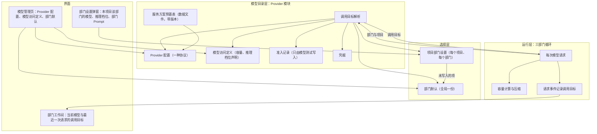
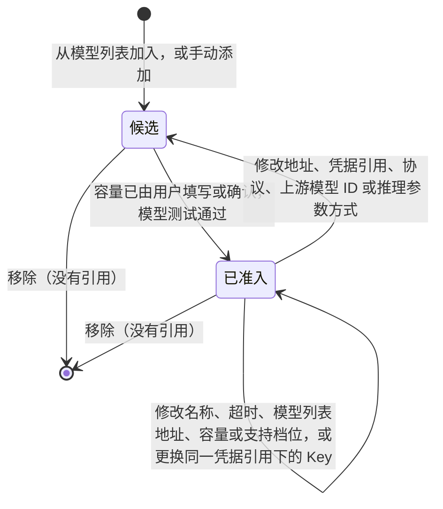
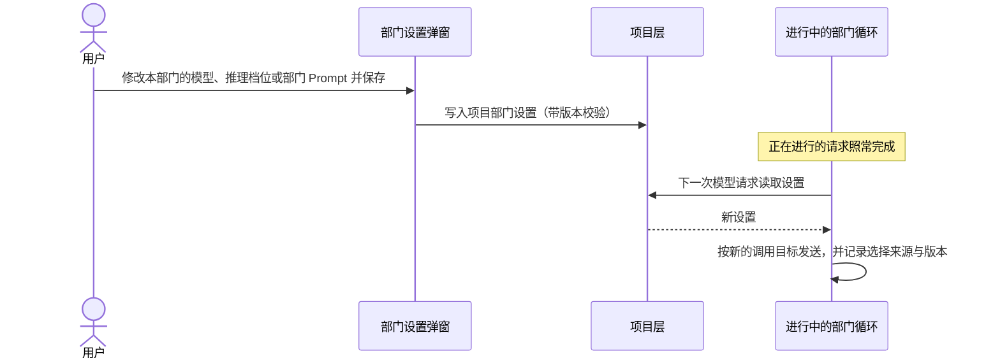
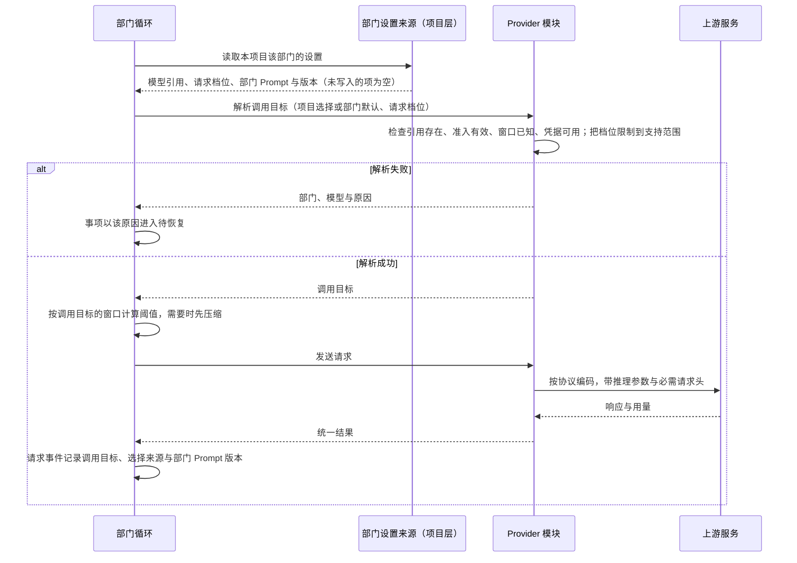

# 模型管理设计说明

日期：2026-09-24。状态：设计已确认，未实施。需求：[D24 模型管理与部门模型选择](../requirements/model-management.md)。术语以 [CONTEXT.md](../../CONTEXT.md) 为准。相关决定：[ADR-0002 准入](../adr/0002-candidates-need-test-to-admit.md)、[ADR-0003 预置表](../adr/0003-versioned-preset-table-no-remote-refresh.md)、[ADR-0004 连接与协议](../adr/0004-one-protocol-per-connection.md)、[ADR-0005 按请求解析调用目标](../adr/0005-resolve-call-target-per-request.md)、[ADR-0006 推理档位](../adr/0006-reasoning-levels-declared-per-model.md)。界面原型：[v7 原型](../prototypes/v7/design.md)，模型管理页与部门设置弹窗按第 9 节制作。

本说明是模型目录、部门模型选择、推理档位、调用目标解析与上下文容量的判断标准。其他文档与本说明冲突时，以本说明为准。

## 1. 参照对象与取舍

参照 OMP（`C:/project/codes/oh-my-pi` @ fdfeef1f78）与 opencode（`anomalyco/opencode`，原 `sst/opencode` @ 5fcfb06f）。用户原话与已确认的规则见 D24。

| 方面 | OMP | opencode | Yudao |
| --- | --- | --- | --- |
| 模型目录 | 全局一份；每个模型带窗口、输出上限、推理档位、图像与工具支持 | 全局一份，数据来自 models.dev | 全局一份；模型访问定义带窗口、输出上限与推理档位声明 |
| 能力数据来源 | 内置目录随版本发布，运行时发现，缺失时补默认值 | models.dev，缺失时按 0 处理 | 用户填写或确认，并经模型测试；带来源的能力目录列入 TODO |
| 可以选用的条件 | 有凭据即可选用 | 有凭据即可选用 | 容量已由用户填写或确认，并且模型测试通过（准入） |
| 未知窗口 | 跳过主动压缩，照常调用 | 跳过自动压缩，照常调用 | Provider 模块拒绝 |
| 选择层级 | 模型角色分全局层与项目层，项目只写入覆盖的角色 | agent 与会话级选择 | 部门默认（全局）与项目部门设置，项目只写入覆盖的项 |
| 运行中更换模型 | 支持，下一次请求按新模型计算 | 支持，每一轮按会话当前的模型解析 | 支持，从下一次模型请求起生效 |
| 推理档位 | 模型声明支持的档位，请求时限制到支持范围，各协议分别映射 | 模型声明档位，不支持时报错 | 模型声明支持的档位，请求时限制到支持范围，各协议分别映射 |
| 压缩阈值 | 窗口 − max(15% 窗口, 16384) | 窗口 − 输出预留 | 与 OMP 相同 |
| 压缩依据的用量 | max(上游回报用量, 本地估算) | 上游用量或本地估算 | 与 OMP 相同 |
| 引用的模型无法使用 | 静默改用其他有凭据的模型 | 报错 | 请求失败并说明原因 |
| 角色 | default、smol、slow、task 等，子 Agent 按角色选择模型 | agent 配置 | 产品、工程、质检三个部门；部门内角色与 SubAgent 列入 TODO |

OMP 的一个失效实例：内置目录 4776 个模型中有 764 个没有窗口数据，这些模型的主动压缩从不触发，只能等上游报告超限后补救。统一管理能否起作用，取决于目录里的能力数据是否准确。Yudao 以准入要求容量由用户填写或确认来保证这一点；目前只使用少数固定模型，能力目录列入 TODO。

## 2. 分层

系统分三层。每层只通过下一层的接口取得结果，不读取下一层的内部数据。

| 层 | 职责 | 边界 |
| --- | --- | --- |
| 模型目录层 | 服务方案、Provider 配置、模型访问定义、准入、凭据；给定一个选择，解析出调用目标或具体原因 | 不认识产品、工程、质检，也不认识项目；只接收「连接 + 模型访问定义 + 请求档位」 |
| 选择层 | 部门默认与项目部门设置的保存、版本与合并规则 | 只保存引用与请求档位，不复制目录内容 |
| 运行层 | 每次模型请求前取得调用目标，按它计算容量、压缩、发送并记录 | 不缓存调用目标；同一请求的重试沿用该请求的调用目标 |

## 3. 数据与归属

| 数据 | 内容 | 保存位置 | 修改入口 | 生效 |
| --- | --- | --- | --- | --- |
| 服务方案预置表 | 按协议的请求基址、认证方式、模型列表地址、文档链接、必需请求头、来源 | Provider 模块内的数据文件，整张表带 revision | 发布新版本 | 随新版本发布 |
| Provider 配置 | 名称、服务方案、协议、地址、凭据引用、超时、模型列表地址 | 模型目录文件 | 模型管理页、编辑 JSON | 下一次模型请求 |
| 模型访问定义 | 上游模型 ID、窗口、输出上限、推理档位声明 | 模型目录文件，属于一份 Provider 配置 | 同上 | 下一次模型请求 |
| 准入记录 | 测试时间、实际返回的模型、协议、测试时的受影响字段 | Provider 模块，与目录文档分开保存 | 只由模型测试写入 | 立即 |
| 凭据 | API Key 与来源 | 进程内存、进程环境或 `.yudao/.env` | 模型管理页凭据区 | 下一次模型请求 |
| 部门默认 | 三个部门各自的模型访问定义引用与请求档位 | 模型目录文件 | 模型管理页底部、编辑 JSON | 下一次模型请求，包括进行中的事项 |
| 项目部门设置 | 某项目某部门的模型访问定义引用、请求档位、部门 Prompt | 项目事件，与现有部门 Prompt 配置同一处，带版本 | 部门设置弹窗 | 该部门下一次模型请求，包括进行中的事项 |
| 调用目标 | 一次模型请求实际使用的连接、协议、地址、上游模型、容量、发送的推理档位、凭据引用与版本、选择来源、部门 Prompt 版本 | 模型请求事件 | 由解析产生 | 只描述这一次请求 |

设置只有全局与项目两层。

## 4. 模型目录

### 4.1 服务方案预置表

预置表是 Provider 模块内的一份数据文件（[ADR-0003](../adr/0003-versioned-preset-table-no-remote-refresh.md)）。每个服务方案一行，包含名称、按协议列出的请求基址、认证方式、模型列表地址、文档链接、必需请求头（OpenCode Go 需要真实 User-Agent 与 `x-opencode-session`）和来源链接。整张表带 revision，界面显示 revision 与来源。

表中目前只有 OpenCode Go，它的三种协议使用同一个请求基址 `https://opencode.ai/zen/go/v1`。「自定义」表示不使用预置表，所有字段由用户填写。服务方案只描述接入规则，不带模型、容量、推理档位或准入。新增服务方案等于在文件中新增一行，随新版本发布生效；不做远端自动更新。

### 4.2 Provider 配置

一份 Provider 配置只声明一种协议（Responses、Chat Completions、Anthropic Messages）；同一服务方案要使用另一种协议时，另建一份配置，默认沿用同一凭据引用（[ADR-0004](../adr/0004-one-protocol-per-connection.md)）。

地址保存该协议的请求基址，请求路径由各协议适配器按协议规范拼接，与 OMP、opencode 和官方 SDK 的用法相同：Responses 与 Chat Completions 在基址后拼接 `/responses`、`/chat/completions`，Anthropic Messages 去掉基址末尾的 `/v1` 后拼接 `/v1/messages`。选中服务方案与协议后，地址取预置表中该协议的请求基址；自定义服务由用户填写。连接保存它所属的服务方案，编辑时据此恢复方案选择，请求时据此取得必需请求头。

### 4.3 模型访问定义与准入

模型访问定义属于一份 Provider 配置，包含上游模型 ID、窗口、输出上限和推理档位声明（第 7 节）。窗口与输出上限必须有值，输出上限不大于窗口。

- **获取模型列表**：只对已保存的连接进行，请求该连接生效的模型列表地址（连接中填写的地址优先，其次是服务方案的地址），带上凭据。结果显示来源地址与采集时间；请求失败或没有地址时显示「候选未知」。点击候选，把它加入模型访问定义表。
- **容量**：加入时窗口与输出上限可以预填；每一行在用户修改或点击「接受」之前不能保存。确认后的容量就是运行时使用的限制。
- **连接测试**：只对已保存的连接进行，发送一次真实请求，证明地址与凭据可用，不改变任何准入。
- **模型测试**：对一个访问定义发送一次真实的最小推理请求；该定义声明了推理档位时，按它的默认档位发送推理参数。测试通过且容量已确认时，写入准入记录。结果只影响这一个定义。
- **准入记录**只由模型测试写入。目录文档的编辑、导入与导出都不含准入记录（[ADR-0002](../adr/0002-candidates-need-test-to-admit.md)）。

### 4.4 修改与准入

准入与访问定义自身及所属连接的受影响字段绑定，按下表逐个字段判断。

| 修改的字段 | 准入 | 部门默认与项目部门设置中的引用 |
| --- | --- | --- |
| 地址、凭据引用、协议（连接） | 该连接下全部定义回到候选 | 保留，显示「无法使用：准入已作废」 |
| 上游模型 ID、推理参数方式（定义） | 该定义回到候选 | 同上 |
| 名称、超时、模型列表地址（连接） | 保持 | 保持 |
| 窗口、输出上限、支持档位、默认档位（定义） | 保持，从下一次模型请求起使用新值 | 保持 |
| 同一凭据引用下的 Key | 保持 | 保持 |
| 测试另一个模型 | 保持 | 保持 |

保存会作废准入的修改之前，界面列出受影响的定义、引用方（部门默认的哪个部门、哪个项目的哪个部门）以及正在使用它们的进行中事项。引用保留，相关部门的下一次模型请求失败并说明原因（第 5.5 节），由用户重新测试或另选模型。

### 4.5 删除

- 移除模型访问定义：被部门默认或任何项目部门设置引用时拒绝，并列出引用方。
- 删除 Provider 配置：其下任何定义被引用时拒绝，并列出引用方；没有引用时，确认框列出将一并删除的定义，确认后连同定义一起删除。

### 4.6 目录文档（编辑 JSON、导入、导出）

目录文档是 Provider 配置、模型访问定义与部门默认的完整文本，格式与模型目录文件相同。它不含 API Key、准入记录和项目部门设置。编辑 JSON、导入整份文档与界面表单使用同一套校验：未知字段拒绝；部门默认只能引用已准入、并且属于所填连接的定义，请求档位必须属于该定义声明的支持档位。在 JSON 中修改容量等同于用户确认。校验通过后整份写入；任何一项不通过时整份拒绝，界面指出字段位置。

### 4.7 目录文件重新读取

Provider 模块监视模型目录文件。合法的外部修改按第 4.4 节的规则生效，从下一次模型请求起影响包括进行中事项在内的全部部门。内容无效时保留上一个有效版本并显示原因。文件被删除时，目录与部门默认一起清空，部门默认变为「未设置」，没有另选模型的部门在下一次模型请求时失败并说明原因。

## 5. 部门模型选择

### 5.1 部门默认

模型管理页底部为产品、工程、质检各设一项部门默认：一个已准入的模型访问定义，加一个可以为空的请求档位。部门默认全局只有一份，所有项目共用，可以为「未设置」。保存时要求所选定义已准入；之后准入作废时，引用保留并显示无法使用。

### 5.2 项目部门设置

每个项目的每个部门有一份项目部门设置，包含三项：模型访问定义、请求档位、部门 Prompt。每一项都可以不写入；没有写入的项使用部门默认，部门 Prompt 没有写入时使用内置默认 Prompt（版本 0）。写入项目部门设置不修改部门默认。设置保存在项目事件中，带版本，并发修改时按版本拒绝后提交的修改。

这与 OMP 的项目层角色相同：项目只写入自己覆盖的角色，未写入的角色继承全局。区别在于 OMP 的项目存储是可选模式，默认写入全局；Yudao 的部门设置弹窗固定写入项目层。

### 5.3 解析规则

某项目某部门的一次模型请求，按以下规则取得选择：

1. 模型访问定义：项目部门设置中有这一项时使用它，否则使用部门默认；两处都没有时解析失败。
2. 请求档位：项目部门设置中有这一项时使用它，否则使用部门默认的请求档位，两处都为空时使用所选模型的默认档位。
3. 部门 Prompt：项目部门设置中有这一项时使用它，否则使用内置默认 Prompt。

模型与请求档位分别继承，与第 5.2 节「只写入覆盖的项」一致。项目只修改模型、没有写入请求档位时，部门默认的请求档位按新模型的支持范围限制（第 7.3 节）。

### 5.4 生效时机

项目部门设置、部门默认、目录与凭据的修改，都从相关部门的下一次模型请求起生效，包括进行中的事项。正在进行的模型请求不中断。一次请求内的重试沿用该请求的调用目标。

### 5.5 引用无法使用时

所选定义被移除、准入已作废、窗口未知、凭据缺失或上游拒绝凭据时，该部门的这次模型请求不发送或不再重试；事项进入待恢复，停在这次请求之前，待恢复原因写明部门、模型与具体问题。系统不改用部门默认或其他模型。用户修复配置后，用「继续执行」从这次请求接着进行，已完成的工作与已用限额保留；继续执行的入口与执行权校验见[恢复契约](recovery-contract-and-fault-matrix.md)（3.1）。新建事项前，按该项目的设置解析三个部门；任何一个部门解析失败时拒绝新建，并说明是哪个部门、哪一项。

## 6. 每次模型请求

- **部门设置来源**：事项创建时由项目层提供给运行层，返回该项目某部门当前的项目部门设置。不属于项目的运行（命令行与测试）使用空设置，即全部使用部门默认与内置默认 Prompt。
- **解析**：Provider 模块对本次请求实际选中的模型访问定义检查准入。
- **范围**：工作请求、压缩请求与协作请求都按这一流程解析；协作请求按接收部门解析。
- **凭据**：每次解析读取当前的凭据来源，Key 更换从下一次请求起生效；进程重启后按凭据来源恢复。
- **审计**：每个模型请求事件、尝试事件与压缩事件记录调用目标的公开部分（不含 Key）、选择来源（项目部门设置或部门默认）、请求档位与实际发送的档位、部门 Prompt 版本。界面与观测从这些事件读取调用目标。

## 7. 推理档位

### 7.1 档位与声明

档位全集为 minimal、low、medium、high、xhigh、max，由低到高排列，与 OMP 相同（[ADR-0006](../adr/0006-reasoning-levels-declared-per-model.md)）。模型访问定义可以声明三项：

- 支持档位：档位全集的一个子集，只包含上游接受的取值；
- 默认档位：支持档位中的一个；
- 推理参数方式：见第 7.4 节。

没有声明的模型，请求不带推理参数。声明与容量一样由用户填写。

### 7.2 请求档位

部门默认与项目部门设置保存的是请求档位，可以为空。请求档位为空时，使用模型的默认档位。

### 7.3 限制到支持范围

每次请求按调用目标的模型限制请求档位：取不高于请求档位的最高支持档位；没有这样的档位时，取最低支持档位；模型没有声明支持档位时，不发送推理参数。请求事件同时记录请求档位与实际发送的档位。运行中更换模型后，原请求档位按新模型重新限制，用户不需要逐项重新选择。

### 7.4 协议映射

| 推理参数方式 | 协议 | 上游参数 |
| --- | --- | --- |
| effort | Responses | `reasoning.effort` 取档位名 |
| effort | Chat Completions | `reasoning_effort` 取档位名 |
| adaptive | Anthropic Messages | `thinking.type` 为 `adaptive`，`output_config.effort` 取档位名 |
| budget | Anthropic Messages | `thinking.type` 为 `enabled`，`budget_tokens` 按档位取值：minimal 1024、low 4096、medium 8192、high 16384、xhigh 32768、max 32768；预算不超过本次输出上限减 4000 |

推理参数方式的修改作废准入；支持档位与默认档位的修改保持准入。Responses 与 Chat Completions 的输出上限包含推理内容，档位越高，可见输出能使用的部分越少。

### 7.5 压缩与测试

- 摘要请求使用该模型的最低支持档位；模型没有声明支持档位时不发送推理参数，上游按自身的默认档位推理。推理内容与摘要正文共用输出上限。
- 模型测试按该模型的默认档位发送推理参数，使准入同时证明推理参数方式可用。

### 7.6 历史中的推理内容

- 部门历史只保存与协议无关的条目：消息、工具调用、工具结果与推理内容。适配器用于界面汇总显示的观测不进入历史。
- 适配器保存上游返回的推理内容：Responses 的 reasoning 条目（请求带 `include: ["reasoning.encrypted_content"]`，保存加密内容）、Chat Completions 的 `reasoning_content`、Messages 的 thinking 与签名。
- 回放时按「同一连接、同一协议、同一上游模型」判断：相同时原样回放推理内容，要求每一轮都回放推理内容的模型（例如 DeepSeek）因此可以连续工作；不同时丢弃推理内容与该协议专用的条目 ID，消息与工具调用的配对保持完整。

## 8. 上下文容量与压缩

压缩参照 OMP 与 opencode。部门历史独立、各部门分别压缩、部门之间只传递主机接纳的结构化结果，这些规则保持不变。

### 8.1 有效窗口

有效窗口等于调用目标的模型窗口。Web 新建事项只提交事项原文，窗口与运行边界使用系统默认值。小窗口压缩的测试使用声明小窗口的模型访问定义。

### 8.2 用量

判断是否压缩时，用量取两者中较大的一个：上一次请求的上游回报用量（输入、缓存读写与输出之和），以及本次请求的本地估算。本地估算按 UTF-8 字节数除以 4；中文每个字至少三个字节，这一估算比按字符数除以 4 更接近真实用量。请求事件同时记录这两项数值。

### 8.3 预留与阈值

- 预留量 = max(窗口 × 15%, 16384)。这个值达到窗口的 85% 时（窗口约 19275 以下，只在小窗口测试中出现），预留量取窗口的 15%。
- 压缩阈值 = 窗口 − 预留量。1M 窗口约在 850000 时压缩。
- 本次请求的输出上限 = min(模型输出上限, 窗口 − 输入估算)。

### 8.4 摘要请求

- 模型：该部门本次的调用目标；推理档位见第 7.5 节；不带工具。
- 输出上限：13107（OMP 的取值，即 16384 的 80%），与窗口无关。
- 内容：摘要规则、部门固定材料（只作参考）、上一次摘要与待摘要的历史片段。
- 结构：采用 OMP 的固定小节，依次为目标、约束与偏好、进展（已完成、进行中、受阻）、关键决定、下一步、关键上下文。已有上一次摘要时，按更新规则合并：保留旧摘要的信息，把完成的进行中项移到已完成，更新下一步。固定材料每次请求单独放入，摘要不复述固定材料；摘要使用事项原文的语言。

### 8.5 分界位置与保留

- 从最新记录向前累计，保留最近约 20000 token 的原始记录（OMP 的取值），更早的部分进入摘要。
- 分界位置只能在步骤边界上，工具调用与它的结果不分开。
- 再次压缩时，材料为上一次摘要，加上上一次保留的原始记录及其后的新记录，已保留的记录全部覆盖。

### 8.6 检查点有效性

检查点绑定部门、合同、计划与输入版本。模型、协议与部门 Prompt 的变化保留检查点：摘要不复述固定材料与部门规则，更换模型或部门 Prompt 后仍然适用，这与 OMP、opencode 的检查点不绑定模型的做法相同。

### 8.7 失败处理

- 摘要为空、超过输出上限或请求失败：本次压缩不生效，不写入检查点。这一步的工作请求按未压缩的历史照常发送；下一步再次尝试压缩。参照 opencode：压缩失败时，这一轮按原请求继续。
- 未压缩的历史已经放不进窗口（窗口减输入估算后没有输出空间）时，事项以上下文超限失败结束。
- 上游返回上下文超限：按错误码与错误文本识别（例如 `context_length_exceeded`、`prompt is too long`、`maximum context length`、`exceeds the context window`、`model_context_window_exceeded`）。识别后移除失败的请求，压缩一次，重新发送一次；重新发送后仍超限时，事项以上下文超限失败结束。
- 固定材料本身已超过阈值时，事项以上下文超限失败结束。

## 9. 界面

本节以 [v6 原型](../archive/prototypes/department-workspace-v6.html)为基础写成，列出按本说明修改的地方；[v7 原型](../prototypes/v7/design.md)已按本节制作。

### 9.1 模型管理页

| 元素 | 保留 | 按本说明修改 |
| --- | --- | --- |
| 入口与「返回原界面」 | 左侧栏底部入口；返回进入前的页面 | 页面顶部路径只显示「模型管理」，不显示在项目名之后 |
| Provider 配置卡片 | 一份连接一张卡片，默认收起，展开查看模型表 | 摘要行：名称、服务方案、协议、地址、凭据状态（缺失，或来源为内存、环境、`.env`）、「已准入 x · 候选 y」。模型表列：上游模型 ID、窗口、输出上限、推理档位声明、准入（测试时间与实际返回的模型）；操作：模型测试、移除 |
| 编辑 JSON | 弹窗、格式化、重置、复制 | 按第 4.6 节校验；不含 Key、准入记录与项目部门设置 |
| 添加或编辑 Provider 配置 | 就地展开的表单，高级选项折叠 | 标题为「添加 Provider 配置」「编辑 Provider 配置」；打开时模型访问定义表为空；编辑时按连接保存的服务方案恢复选中项 |
| 服务方案 | 方案按钮 | 只有 OpenCode Go 与自定义；显示预置表 revision 与来源；文档链接只读显示在方案区 |
| 协议 | 下拉框 | 选择后地址取该方案该协议的请求基址；编辑时修改协议，保存前按第 4.4 节提示 |
| 凭据 | 凭据引用输入框 | Key 输入框始终为空，不回填；显示凭据状态与来源；写入方式为「只在本进程有效」或「写入 .env」；「清除内存覆盖」与「删除持久凭据」分成两个操作 |
| 高级选项 | 超时、模型列表地址 | 模型列表地址随配置保存；留空时使用服务方案的地址 |
| 获取模型列表与候选 | 按钮、候选标签 | 按第 4.3 节；显示来源地址与采集时间，失败时显示「候选未知」 |
| 模型访问定义表 | 行内编辑 | 窗口与输出上限预填后逐行「接受」或修改；推理档位声明（支持档位多选、默认档位、推理参数方式）；准入列只读，删除状态下拉框 |
| 测试连接、保存 | 按钮 | 测试连接只测试已保存的连接；保存按第 4.4 节提示受影响的引用与进行中事项 |
| 部门默认（页面底部） | 三张部门卡片 | 标题为「部门默认」；模型为一个按连接分组的下拉框，只含已准入定义，另有「未设置」；推理档位的选项来自所选模型的声明，没有声明时禁用并显示「该模型未声明推理档位，请求不带推理参数」；点击保存才写入；说明文字为「从各部门下一次模型请求起生效，没有另选模型的项目同样生效，包括进行中的事项」 |

### 9.2 部门设置弹窗

- 标题为「本项目 · 某部门设置」，写入本项目该部门的项目部门设置，不修改部门默认。
- 模型：下拉框第一项为「跟随部门默认（当前：…）」，其后为按连接分组的已准入定义；选择第一项即清除项目的模型选择。
- 推理档位：第一项为「跟随」，其后为当前生效模型声明的支持档位。
- 部门 Prompt：文本框、恢复默认、版本号；版本冲突时提示重新读取。
- 保存后提示「从本部门下一次模型请求起生效」。

### 9.3 部门工作间

- 显示本部门当前生效的模型及来源（项目设置或部门默认）。
- 显示最近一次模型请求实际使用的模型、协议与发送的档位，取自请求事件。
- 引用无法使用时显示「无法使用」与原因；没有设置时显示「未设置」；这两种情况都不显示其他连接或模型。
- 工位标签为「某部门 Agent」。

### 9.4 v6 中删除的元素

- AnyRouter、StepFun、Anthropic 三个服务方案，以及预置方案附带的模型、容量与准入状态。
- 表单与 JSON 中可以写入的准入状态。
- 固定四档的 Effort 滑块及其刻度文字。
- 部门设置弹窗中的 SubAgent 开关；房间中的「派发协作者」「动作步进」按钮、SUB 工位、MAIN 标记与「主 Agent」字样。
- Key 输入框中的预填值。

### 9.5 用词

| v6 用词 | 改为 |
| --- | --- |
| 供应商、服务实例 | Provider 配置、服务方案 |
| 模型映射、映射表 | 模型访问定义 |
| 待核验、可用模型、远端模型 | 候选 |
| 单项测试、准入测试、验证通过 | 模型测试、模型测试通过 |
| 连通性探针、连接成功 | 连接测试、连接测试通过 |
| 密钥、环境变量引用 | API Key、凭据引用 |
| 全局分配、全机默认、基线、冻结 | 部门默认、生效 |
| 推理努力程度、推理思考努力程度、推理深度 | 推理档位 |
| System Prompt | 部门 Prompt |

## 10. 对现有实现的改动范围

| 模块 | 改动 |
| --- | --- |
| 预置表 | Python 元组改为数据文件；OpenCode Go 按协议列出请求基址 |
| 目录与校验 | 协议从模型访问定义移到 Provider 配置（ADR-0004），在模型上声明协议的目录读取时直接报错；模型访问定义增加推理档位声明；目录文档不含准入记录；准入按字段判断；部门默认保存时检查准入；删除按第 4.5 节检查两层引用 |
| 候选与测试 | 获取模型列表时带上凭据；连接测试对三种协议发送真实请求 |
| 调用目标解析 | 统一的「解析 + 准入检查 + 档位限制」入口，按实际选中的定义检查准入 |
| 协议适配器 | 三种协议的推理参数编码；保存并按同模型规则回放推理内容；界面汇总用的观测不进入历史 |
| 运行层 | 删除事项创建时的目标快照与 `provider_credentials_lost`；每次请求解析调用目标；请求事件记录调用目标、选择来源与部门 Prompt 版本；引用无法使用时记录待恢复事实（第 5.5 节）；删除事项内的 Prompt 编辑 |
| 容量与压缩 | 删除事项级窗口；按第 8 节修改用量计算、预留、摘要上限、分界位置、检查点有效性与失败处理 |
| 项目层 | 项目部门设置增加模型与请求档位；向运行层提供部门设置来源；新建事项前按项目设置检查三个部门 |
| Web | 新建事项只提交事项原文；模型管理页与部门设置弹窗按第 9 节修改；就绪检查按项目设置计算 |

## 11. 被本说明取代的内容

- D18、D22、D23 与 [Provider 设计说明](provider-layer.md) 中的「任务创建时冻结目标」「仅新任务生效」「在途冻结」「任务期间不热切换」凭据。
- D18 与 CONTEXT.md 原有的「部门绑定全机一份、不按项目分开」。
- D02 的「默认修改当前任务，目标部门下一次激活生效」与事项内 Prompt 编辑。
- D10 与[决策记录](../decision.md)中「摘要请求不带推理参数」「摘要输出上限固定 4096」，以及按字符数估算用量。
- D23 与 ADR-0004 原有的「连接地址为完整端点」。
- [OMP 能力差距清单](../stage-3/omp-capability-gap.md)中「会话内换模型：不采用」。

## 12. TODO

| 项 | 内容 | 本设计中需要保持的前提 |
| --- | --- | --- |
| 能力目录 | 参考 OMP 内置目录与 models.dev，为模型提供带来源的窗口、输出上限与推理档位提示，并处理数据缺失（OMP 内置目录有 764 个模型没有窗口数据） | 提示只用于预填，准入仍要求用户确认容量并通过模型测试 |
| 部门内 SubAgent 与角色 | 设计见[部门内多角色设计说明](department-roles.md)（D26）：部门经理与固定角色，角色默认与项目角色设置；参考 OMP 的 vibe 模式（fast 与 good 两类工作者，按 OMP 文档分别对应 smol 与 task 角色的模型） | 角色选择沿用「部门默认 + 项目部门设置」的解析与引用规则 |
| 部门知识图谱、语义压缩与事实检索 | 每个部门各自的知识图谱、语义压缩与事实检索系统，替代长期记忆；草案见[语义系统设计说明](semantic-system.md)（D25），单独讨论 | 部门之间只传递主机接纳的结构化结果，对话不跨部门 |
| 固定材料上限 | 项目上下文随已采纳事项增长，没有上限；目前超过阈值时事项以上下文超限失败结束（第 8.7 节）。[语义系统设计说明](semantic-system.md)第 9 节提出由语义视图提供已采纳事项与有效决定 | 固定材料不进入摘要 |
| 切换到小窗口模型 | 当前只使用 1M 窗口的模型。OMP 的做法：切换前历史超过目标窗口时，先用当前模型压缩 | 有效窗口按每次请求的调用目标计算 |
| 工具能力检查 | 一次无副作用的工具往返，证明模型能参与 Agent 循环 | 准入定义保持第 4.3 节 |
| 更多推理参数方式 | 开关型、GLM 的 `thinking`、Qwen 的 `enable_thinking`、Gemini 的 `thinkingLevel`，以及「关闭推理」；按模型的兼容规则处理，例如 DeepSeek 在请求带 `tool_choice` 时由上游关闭推理 | 档位限制与请求事件记录保持第 7 节 |
| 输出耗尽恢复 | Responses 返回未完成、Chat Completions 因长度结束且没有有效产出时，参照 OMP 移除该请求、压缩后重试，连续三次后放弃 | 压缩失败处理保持第 8.7 节 |
| 精确分词 | 按模型使用原生分词器估算用量 | 压缩依据的用量仍取上游用量与本地估算中较大的一个 |
| 更多服务方案 | 按需在预置表中新增行 | 预置表只含接入规则 |
