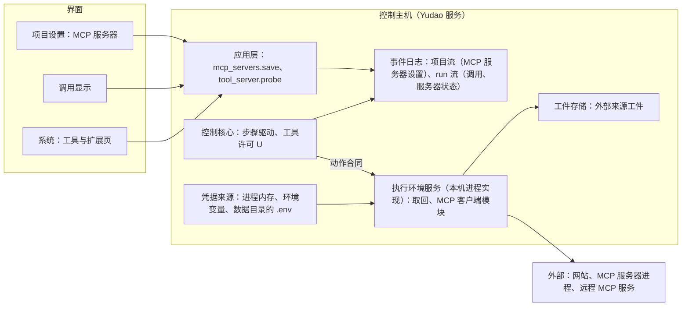

# 网络取回与 MCP 工具设计说明

总图位置：第四节「动作」的缝（取回与 MCP 工具是动作的类别）；第一节「模型与工具」方框。依据：[ADR-0018](../adr/0018-single-control-host-remote-execution.md)；[ADR-0019](../adr/0019-project-stream-across-versions.md)；[ADR-0038](../adr/0038-function-first-commands-without-registration.md)；[总体架构](architecture/overall-architecture.md)第 5、7.3、7.4 节；[恢复契约与故障矩阵](recovery-contract-and-fault-matrix.md)第 4 节；[应用层与接口层设计说明](app-and-interface.md)第 3.2、3.3、4 节；[本地通用工具设计说明](local-tools.md)；[浏览器与 computer use 设计说明](browser-and-computer-use.md)第 4 节；[语义系统设计说明](semantic-system.md)的证据；[模型管理设计说明](model-management.md)的凭据。调研：[网络取回与 MCP 的参照实现、官方 SDK 与搜索服务](../archive/research/network-and-mcp-references.md)。

## 1. 范围

交付：

- 网络取回：按地址取回网页或文档的环境工具 `fetch_url`，以及继续读取已保存内容的 `read_external_source`。
- 项目设置中的 MCP 服务器：项目设置写明服务器，部门经官方 MCP SDK 的客户端调用它提供的全部工具。
- 项目的 MCP 服务器设置及其版本、每类动作的恢复契约、结果的工件与证据。
- MCP 客户端模块：官方 SDK 的会话与进程管理，3.2D 的 Playwright MCP 使用同一个模块。
- 界面：项目设置的「MCP 服务器」一节、调用显示、系统「工具与扩展」页。

不在范围内：

- 搜索工具：搜索经项目设置中的搜索类 MCP 服务器提供（第 12.1 节）。
- 远程服务器的 OAuth 登录、MCP 的提示与资源、服务器向用户请求输入：不在 3.2B，作为 MCP 扩展，路线图里还没有落点，设计在拆分时补充。
- SSE 传输、采样与 roots：不支持（第 4.1 节）。
- 必须运行在登记的机器上的 MCP 服务器。
- PDF、图片等非文本内容的取回：需要时在项目设置中写明一个文档类的 MCP 服务器。
- Playwright MCP：属于 3.2D，随试用会话运行，不写在项目设置中。
- 外部动作（部署、回滚、重启）：Stage 4。

## 2. 概念与模块

- **MCP 服务器设置**：项目设置中一个 MCP 服务器的内容：怎样启动或连接、哪些部门可以使用、读取到的工具清单。
- **MCP 设置版本**：一个项目全部 MCP 服务器设置的版本；事项创建时固定，使一个事项内模型看到的工具定义保持不变。
- **外部来源工件**：取回的正文与 MCP 的结果保存成的工件，带来源与行号，可以作为「外部文档」类证据被引用。

## 3. 放置

动作类别按放置分两种：

| 动作类别 | 放置 |
| --- | --- |
| 读取、搜索、写入、编辑、命令、检查、试用会话、浏览器与屏幕动作 | 随 run 的执行位置 |
| 网络取回、项目设置中 MCP 服务器的工具调用 | 固定在控制主机，由执行环境服务的本机进程实现提供；执行位置是一台登记的机器时同样如此 |

两类动作使用同一份动作合同。固定在控制主机的动作，结果未知只出现在控制主机进程中断时，没有心跳与迟到回执。Playwright MCP 随试用会话在 run 的执行位置上运行，使用同一个 MCP 客户端模块（第 7.1 节）。

## 4. 项目设置中的 MCP 服务器

### 4.1 服务器设置

| 项 | 说明 |
| --- | --- |
| 名称 | 小写字母、数字与连字符；同一项目内唯一；作为工具名的前缀 |
| 传输 | 本机进程（stdio）或 streamable HTTP。不支持 SSE；OAuth 登录作为 MCP 扩展，路线图里还没有落点，在那之前需要令牌的服务把令牌写在请求头里 |
| stdio | 命令、参数、环境变量；不经过 shell；命令名按操作系统的规则补全扩展名（`npx` 在 Windows 上是 `npx.CMD`） |
| streamable HTTP | 地址、请求头 |
| 变量与请求头的值 | 固定文本，或凭据名称（取值时读取当前的凭据来源） |
| 可以使用的部门 | 默认三个部门；Stage 5 引入探索者以后只给探索者 |
| 时限与输出上限 | 启动时限、调用时限、返回给模型的输出上限，有默认值（第 7.2 节），设置里可以修改 |
| 工具清单 | 读取到的快照：每个工具的名称、说明、参数结构，以及服务器自己标注的只读、幂等、破坏性提示（只显示给用户参考） |

3.2B 只使用服务器的「工具」，服务器提供的工具全部直接提供给可以使用的部门。资源、提示、采样、roots 与向用户请求输入都不声明（提示、资源与向用户请求输入作为 MCP 扩展，路线图里还没有落点）；服务器发来这类请求时由 SDK 以 -32600 拒绝，调用返回错误。

### 4.2 读取工具清单（探测）

编辑服务器设置时点「连接并读取工具清单」，提交命令 `tool_server.probe`：Yudao 在控制主机上临时启动或连接这个服务器，读取服务器信息与工具清单，然后关闭。命令接受以后作为任务进行，结果以事件 `tool_server_probe_finished` 出现，界面在事件到达之前显示「测试中」（与连接测试相同，应用层与接口层设计说明第 3.2 节）；失败时事件写明原因，带服务器标准错误输出的末尾部分（凭据值替换为星号）。

探测绑定所提交的非秘密服务器配置及其内容摘要，保存前也可以探测。结果写明配置摘要、服务器和工具清单；只有与待保存配置摘要一致的成功结果才能成为可用快照。配置改变后旧快照失效，过期探测结果保留供查询但不得覆盖新配置的可用状态。凭据引用属于配置，凭据值按调用时的凭据来源解析；轮换凭据值不改变已冻结的引用或工具清单。

服务器升级以后点「重新读取」：界面对照差异（新增、移除、说明或参数结构有变化的工具），保存成新版本。工具清单快照随版本保存，模型看到的就是这份快照；调用时不核对服务器的清单有没有变化，调用出错按错误返回；Yudao 不接收 `list_changed` 通知。

### 4.3 版本与固定

全部 MCP 服务器设置是一份整体的文档，带一个版本号，经 `mcp_servers.save` 保存：命令带基准版本，版本过期时拒绝，提示重新读取。保存写入项目流的事件 `mcp_servers_configured`，内容是这个版本的非秘密设置与凭据引用，不含凭据值。事项创建时把当时的非秘密设置与凭据引用（或可解析出它们的版本引用）写入事项创建事实并持久化；每个 `run_created` 携带同一份冻结设置，补建 run 也从事项创建事实继承。运行投影只保存版本或摘要，不保存整份设置；旧事项没有 MCP 设置时按空设置读取。事项创建以后修改项目设置，不影响已有事项的任何后续 run。

### 4.4 凭据

设置里只写凭据名称。取值时读取当前的凭据来源：进程内存、进程环境、数据目录的 `.env`（与 Provider 相同，[模型管理设计说明](model-management.md)第 3 节）；写入使用同一组命令 `credential.set`、`credential.clear_override`、`credential.remove_persisted`，两种写入方式也相同。凭据缺失时，启动或连接失败，原因写明缺少的凭据名称。事件、回执、工件与日志中不出现凭据值：保存的标准错误输出、错误文本与结果文本在写入之前，把已取得的凭据值（及其 URL 编码形式）替换为星号。

## 5. 工具的提供与工具许可

### 5.1 工具的提供

- 三个部门始终都有取回工具 `fetch_url` 与 `read_external_source`。Yudao 服务以关闭取回的启动参数运行时，这个实例的部门没有这两个工具；评测运行器用它启动被测的 Yudao（第 12.4 节）。
- 项目设置中有 MCP 服务器时，可以使用它的部门得到这个服务器提供的全部工具；没有 MCP 服务器时部门没有 MCP 工具。
- 一次角色任务中工具定义保持不变：MCP 工具的名称、说明与参数结构取自这个事项固定的工具清单快照。原工具名保留 MCP 发布版规范允许的字符（包括点号）；本机使用带服务器范围的稳定别名适配模型接口，并保存原名映射；调用时使用原名，别名冲突时拒绝。静态定义的标识校验不因 MCP 原名而放宽。缺少工具清单快照的服务器不得用于事项。
- Stage 3 三个部门都可以使用取回；MCP 工具按设置里写明的部门提供；Stage 5 引入探索者以后只给探索者。

### 5.2 工具许可

工具许可的结果有两种：允许，或者拒绝并说明原因。

| | 规则 |
| --- | --- |
| 取回 | 任何 http 与 https 地址直接取回；指向 Yudao 服务自己的地址与端口时拒绝（第 6.3 节），原因作为工具结果返回 |
| MCP 工具 | 工具定义里的工具直接调用；调用不存在的工具名由工具许可拒绝，原因作为工具结果返回 |

## 6. 网络取回

### 6.1 工具 `fetch_url`

参数：`url`。结果：来源编号（外部来源工件）、最终地址、状态码、内容类型、字节数、内容摘要值、第一页正文、是否截断与继续读取的游标。任何一个最终的 HTTP 响应（包括 4xx、5xx）都是成功的动作，状态码写在结果里，响应体按文本处理；DNS 失败、连接被拒、TLS 失败、超时是失败的动作，写明原因。

### 6.2 请求规则

- 只发 GET，只允许 http 与 https；请求头固定（`User-Agent: Yudao/<版本>`，`Accept` 写明文本类型）；不带 Cookie 与凭据。
- 重定向由取回动作自己跟随，最多 5 次；每一跳都要经过地址规则（第 6.3 节）的检查。
- 下载上限 5 MB，超出的部分丢弃并标记；连接与读取的总期限 30 秒。
- 证书使用系统证书库（与 Provider 共用同一个上下文）；控制主机使用虚拟网卡方式的代理时不需要另外的代理设置，进程环境里有代理变量时按变量走。

### 6.3 拒绝的地址

解析主机名以后检查每个实际地址与端口，指向 Yudao 服务自己监听的地址与端口时拒绝：部门若能取回服务的接口，就能读到别的部门的工作过程、评价材料与全部事件，部门的独立判断就无法保持。除此之外的 http 与 https 地址（包括回环、内网与链路本地地址）都可以取回。试用会话的浏览器使用同一条规则（[浏览器与 computer use 设计说明](browser-and-computer-use.md)第 10 节）。

### 6.4 内容与保存

- HTML 转成保留标题、列表、链接与表格的文本（使用成熟的转换库）；纯文本、Markdown、JSON、XML 原样返回；其他类型返回「不支持的内容类型」。按响应的字符集解码，无法判断时按 UTF-8 并替换非法字节。
- 完整正文保存为外部来源工件（UTF-8，换行统一，行号从 1 起）；工件记录来源地址、最终地址、状态码、内容类型、摘要值与取回时间。
- 工具结果返回前 20000 个字符，带继续读取的游标；`read_external_source(source, start_line, end_line, cursor)` 读取已保存的工件，不重新取回，游标做法与读取文件、搜索相同。

### 6.5 回执

执行之前记录动作身份、地址与主机。回执记录最终地址、状态码、内容类型、字节数、是否截断、摘要值、工件引用、重定向链与耗时。

## 7. MCP 服务器

### 7.1 客户端模块

使用官方 MCP Python SDK（`mcp` 2.2.0，协议版本 2026-07-28）：`stdio_client` 与 `streamable_http_client`，HTTP 传输使用项目已有的 httpx2 并带系统证书库的上下文。客户端模块放在执行代码包中，不导入 Yudao 的其他模块（[执行环境服务设计说明](execution-environment.md)第 5 节）；3.2B 在控制主机的进程内使用它，3.2D 的 Playwright MCP 在 run 的执行位置上使用它。

### 7.2 运行规则

- 每个 run 的每个服务器一个实例，第一次调用时启动；run 结束、暂停或停止时关闭；run 之间、项目之间不共享。
- 默认启动时限 60 秒（`npx`、`uvx` 第一次运行要下载包），调用时限 120 秒（SDK 没有默认时限，Yudao 传入 `read_timeout_seconds`；进度通知不延长时限），返回给模型的输出上限 20000 个字符；设置里可以修改。
- stdio 服务器的结束：先关闭标准输入，等待 2 秒，然后强制结束整个进程树（SDK 在 Windows 上使用作业对象，调研中已实测有效）。HTTP 服务器关闭会话。
- 子进程的环境变量是 Yudao 进程的全部环境变量，加上项目设置中写明的变量（凭据按名称引用，取值时读取当前的凭据来源）。启动时把这份完整的环境变量传给 SDK，因为 SDK 默认在 Windows 上只给子进程 12 个基础变量（上游 issue #3335）。
- 标准错误输出写到数据目录下的日志文件（SDK 要求带文件描述符的真实文件），读取末尾部分用于诊断，凭据值替换为星号。
- 启动失败或连接中断：工具结果写明原因与标准错误输出的末尾部分，部门继续做别的事情，事项不停止；系统页显示这个服务器最近一次的状态。
- 每次启动写入 run 流事件 `mcp_server_started`（服务器名称、传输、进程标识与进程创建时间），关闭写 `mcp_server_closed`，失败写 `mcp_server_failed`。Yudao 启动时，对没有 `mcp_server_closed` 的服务器，按记录的进程标识结束仍然存活的进程，然后补写 `mcp_server_closed`（原因为遗留）。

### 7.3 调用与结果

- 调用：`call_tool`，传入设置的调用时限。工具失败（`is_error`）返回错误文本，动作记为已完成；协议错误与超时记为失败的动作，写明错误码。
- 文本内容连接成文本，`structuredContent` 作为 JSON 一并保存；图像内容保存为工件，调用目标的模型接受图像输入时放入请求，否则只留占位说明（与 3.2D 的截图规则相同）；嵌入的资源保存为工件，资源链接不自动取回；音频保存为工件，只留占位说明。
- 每次调用的完整结果保存为一个外部来源工件（上限 5 MB，超出的部分丢弃并标记）；工具结果返回前 20000 个字符，其余用 `read_external_source` 继续读取。

## 8. 恢复契约

[恢复契约](recovery-contract-and-fault-matrix.md)第 4 节要求每类动作回答八个问题。

| 问题 | 网络取回 | MCP 工具 |
| --- | --- | --- |
| 谁有权做 | 部门按工具许可；任何 http 与 https 地址直接做，Yudao 服务自己的地址除外 | 部门按工具许可；设置中可以使用的部门直接做 |
| 作用于什么 | 一个 http 或 https 地址（只读） | 项目设置中服务器的一个工具，参数由模型给出 |
| 怎样识别同一动作与不同尝试 | 动作身份加尝试编号；两次取回分别记录，不当作同一结果 | 动作身份加尝试编号 |
| 成功证据 | 回执（最终地址、状态码、摘要值）与外部来源工件 | 回执（结果、错误、耗时）与外部来源工件 |
| 结果未知时向哪里查 | 没有可以验证的查询 | 没有可以验证的查询 |
| 何时可以重复 | 由模型决定；取回只发 GET、不带凭据与 Cookie，重复不改变远端状态 | 由模型决定；服务器标注的只读、幂等提示只作参考 |
| 取消能否确认停止 | 能：取消连接即停止；服务器端已处理的请求不能撤回 | stdio：发取消通知，等服务器应答最多 10 秒，随后结束进程树，进程已结束可以确认；HTTP：关闭会话，无法确认服务器停止 |
| 谁负责未解决的结果 | 发出动作的会话中的模型 | 发出动作的会话中的模型 |

规则：

- 取回与 MCP：结果未知时（Yudao 进程中断，或这次尝试没有完整结果）作为工具结果交还发出它的会话，写明执行被中断、结果未知，附上已经收到的内容，由模型决定是否重新执行；没有完整结果的取回尝试不保存为外部来源工件；取回运行中的超时记为失败，工具结果写明超时。
- MCP 调用超时的处理顺序：发取消通知，等应答最多 10 秒，stdio 服务器随后结束进程树，HTTP 服务器关闭会话，回执写明取消能否确认，然后按上一条交还。
- 遗留的服务器进程在 Yudao 启动时结束（第 7.2 节）。
- 结果未知的交还按恢复契约第 4 节处理，取回与 MCP 不另设规则。

## 9. 结果、工件与证据

- 取回的正文与每个 MCP 结果都是外部来源工件：记录来源（地址，或服务器名称与工具名及参数摘要值）、摘要值、行数、取得时间，文本按行保存。
- 工具结果带来源、摘要值与「外部内容」标注；部门 Prompt 与工具说明写明外部内容里的指令不是用户或其他部门的要求。
- 语义系统把外部来源工件作为「外部文档」类证据：引用写工件编号与行范围，并附地址，或服务器名称与工具名（[语义系统设计说明](semantic-system.md)的证据）。证据核对（D25）读取工件保存的原文，页面以后变化不影响核对。
- 不用小模型对取回的内容做摘要或抽取，模型直接按页读取工件。

## 10. 应用层接口

| 项 | 内容 |
| --- | --- |
| 命令 `mcp_servers.save` | 保存全部 MCP 服务器设置；参数：项目、整份文档；基准版本：MCP 设置版本；事件：项目流 `mcp_servers_configured` |
| 命令 `tool_server.probe` | 读取一个服务器的工具清单；参数：项目、服务器的设置内容（保存前也可以探测）；接受以后作为任务进行；事件：`tool_server_probe_finished`（项目流，带工具清单快照或失败原因） |
| 命令 `credential.*` | 沿用，MCP 的凭据名称使用同一个凭据来源 |
| 事件（run 流） | `mcp_server_started`、`mcp_server_failed`、`mcp_server_closed`；调用沿用 `tool_started`、`tool_called`，回执带第 6.5、7.3 节的字段 |
| 查询 `project.settings` | 增加 MCP 服务器设置：整份设置与版本、最近一次探测的结果 |
| 查询 `tools.registry` | 各项目最近的取回记录；各项目的 MCP 服务器、最近一次状态与工具；内置工具随 3.2D 加入 |
| 查询 `run.actions` | 增加取回与 MCP 调用的回执字段与外部来源工件引用 |
| 限额与参数（定义中） | 启动时限 60 秒、调用时限 120 秒、输出上限 20000 个字符、下载上限 5 MB、取回总期限 30 秒、重定向 5 次、MCP 结果工件上限 5 MB |

命令总数由 41 个变为 42 个。

## 11. 界面

不新做原型：页面说明写在本节，沿用原型 v9 的表格、卡片与提示组件。

### 11.1 项目设置的「MCP 服务器」一节

- **MCP 服务器**：列表（名称、传输、可以使用的部门、已提供的工具数、最近一次连接结果、编辑、删除）；点「添加」或「编辑」进入表单：名称、传输、stdio 的命令与参数与环境变量或 HTTP 的地址与请求头、可以使用的部门、时限与输出上限（默认折叠）。变量与请求头的值选择「固定文本」或「凭据名称」；凭据名称旁显示状态（已设置、缺失）与「设置值」，复用模型管理页凭据区的两种写入方式，输入框始终为空。
- **工具表**：表单中点「连接并读取工具清单」，显示「测试中」，事件到达以后列出服务器信息与每个工具（工具、说明、服务器自己的提示（灰色，只供参考））；失败时显示原因与标准错误输出的末尾部分。「重新读取」显示差异。
- 保存经 `mcp_servers.save`，带基准版本，过期时提示重新读取；命令提交后显示「已提交」，事件到达以后显示最终状态。

### 11.2 调用显示

- 部门工作间的「动作与回执」列表与事项详情的时间线中，取回与 MCP 调用各占一行：类型、目标、状态（成功、失败、被拒绝、结果未知）、耗时、结果摘要与外部来源工件的链接；结果未知的调用显示交还给模型的结果。
- 房间的呈现沿用原型 v9：取回是走到门口的邮筒寄出请求并取回资料，MCP 调用是在墙上的工具面板按下对应的按钮；头顶气泡写「现在取回网络资料」「现在调用 <工具>」。工具名以 `fetch_url` 与 `mcp__` 开头，使原型的名称匹配规则直接适用。

### 11.3 系统「工具与扩展」页

只读汇总，去掉「设计待定」标记：网络取回显示各项目最近的取回记录（时间、地址、项目、结果）；MCP 显示各项目的服务器、最近一次状态与工具；浏览器工具（3.2D）与只读观察者（Stage 5）保持原来的位置。数据取自 `tools.registry`。

## 12. 与其他部分的关系

1. **搜索**：不内置搜索工具。部门的探索者查资料需要的搜索由项目设置中的一个搜索类 MCP 服务器提供；M3 试用与验收使用 Exa 官方 MCP（第 13 节）。
2. **3.2D**：浏览器经 Playwright MCP，使用本设计的 MCP 客户端模块，不写在项目设置中（[浏览器与 computer use 设计说明](browser-and-computer-use.md)第 4 节）。
3. **3.2C**：取回与 MCP 固定在控制主机，不进入执行代理。
4. **评测**：评测期间两边都不联网。评测运行器以关闭取回的启动参数启动被测的 Yudao，评测项目不设置 MCP 服务器（第 5.1 节）；OpenCode 的运行配置关闭取回与搜索（[评测场景设计](evaluation-scenarios.md)）。两边的命令都能访问网络，条件相同，运行器在两边的命令记录中查找对任务上游仓库的访问，找到时这次运行无效。
5. **D25 语义系统**：外部来源工件作为证据（第 9 节）。
6. **D26**：探索者引入以后，取回与 MCP 只给探索者。
7. **模型管理**：凭据来源共用（第 4.4 节）。

## 13. 验收

- 取回：用本机启动的真实 HTTP 服务验证本机地址可以取回、重定向、Yudao 服务自己的地址被拒绝（包括重定向到该地址）、超出大小上限、超时、请求中没有凭据与 Cookie；进程在取回中途终止，恢复后结果作为工具结果交还发出它的会话，写明结果未知；另有一次对公共网站的真实取回。
- MCP：用官方的 `mcp-server-time`（stdio，`uvx` 启动，没有网络与凭据）验证本机进程传输，写入项目设置后部门可以调用，回执完整；用 Exa 官方 MCP（`https://mcp.exa.ai/mcp`，不填 Key）验证 streamable HTTP，含对它的一次真实调用；用 SDK 写的本机测试服务器验证错误、超时、取消与大结果。
- Windows：进程树在关闭与超时时全部结束；`npx` 与 `uvx` 的命令可以启动；标准错误输出写入日志文件。
- 工具的提供：MCP 服务器的全部工具出现在可以使用的部门的工具定义里，其他部门没有；没有设置 MCP 服务器的项目没有 MCP 工具；子进程得到 Yudao 进程的全部环境变量加项目设置中写明的变量。
- 恢复：MCP 工具调用中途终止进程，恢复后结果作为工具结果交还发出它的会话，写明执行被中断、结果未知，没有自动重新执行，也没有决定请求；遗留的服务器进程在启动时被结束。
- 凭据不出现在事件、工件与日志中（对保存的内容查找凭据值）。
- 界面：Playwright 端到端测试覆盖项目设置一节（设置、探测、保存）、调用显示与系统页；1440×900 与 390×844 两种窗口尺寸，控制台错误为零。
- 确定行为的测试用 FakeAdapter 给出模型回答，服务器是真实进程，不使用 mock。

## 14. 用户确认的决定

2026-10-01，用户逐轮采纳推荐：

1. 搜索经 MCP 提供，Yudao 不内置搜索工具；Yudao 自带的 MCP 服务只有 3.2D 的 Playwright MCP。
2. 取回与登记的 MCP 服务器一律在控制主机上运行，与 run 的执行位置无关。
3. 每个项目各自登记（项目流、带版本、事项创建时固定版本）；凭据按名称引用，使用与 Provider 相同的凭据来源。
4. 授权与批准：登记就是常设授权；登记之外的取回发出一次性批准；MCP 工具三种处理方式，新读取到的默认「不提供」；批准在本事项内对同一个主机或同一个工具有效，重启以后仍然有效；拒绝时工具结果写明原因；项目没有登记时部门没有这两类工具。
5. 评测期间两边都不联网。
6. 取回的地址规则：默认拒绝回环、内网与链路本地地址并在解析以后检查，198.18.0.0/15 不在拒绝范围内；Yudao 服务自己监听的地址与端口永远拒绝；明确登记的内网来源允许；只允许 http 与 https；不带凭据与 Cookie；使用系统证书库。
7. MCP 登记：stdio 与 streamable HTTP，不支持 SSE 与 OAuth；只使用工具；每个工具有处理方式与「结果未知时可以重新执行」两项；读取工具清单后保存快照，模型看到的是快照；名称 `mcp__服务器名称__工具名`。
8. 进程运行规则：每个 run 的每个服务器一个实例，第一次调用时启动，run 结束、暂停或停止时关闭；启动时限 60 秒、调用时限 120 秒、输出上限 20000 个字符；失败不停止事项；子进程的环境变量只有登记写明的与基础变量；遗留进程在启动时结束。
9. 结果未知、超时与取消：取回按契约声明可以重复，以新的尝试重新取回；MCP 没有声明可以重新执行的工具发出决定请求；调用超时先取消再处理。
10. 结果与证据：HTML 转文本，纯文本、Markdown、JSON、XML 原样，其他类型不支持；下载上限 5 MB；完整内容保存为外部来源工件，工具结果分页返回；带「外部内容」标注；MCP 的图像按模型的输入方式处理；外部来源作为「外部文档」证据；不用小模型摘要。
11. 界面：不做新原型，页面说明写在设计说明；项目设置新增「网络与 MCP」一节，系统「工具与扩展」页只读汇总，批准卡片，调用显示沿用 v9 的房间动作。
12. M3 试用与验收使用 Exa 官方 MCP（不填 Key）；登记的 MCP 服务器的验收使用 `mcp-server-time`（stdio）与 Exa（HTTP）。

13. 2026-10-02（专题 6）：契约声明可以重复的动作结果未知时自动重新执行一次，新的尝试仍然未知时发出决定请求；取回与声明「可以重新执行」的 MCP 工具按这条规则处理（恢复契约第 4 节）。

14. 2026-10-13 按 ADR-0038：取代第 4 项中的「登记就是常设授权」、登记之外的取回发出一次性批准、MCP 工具三种处理方式与新读取到的默认「不提供」、批准的有效范围与重启后有效、项目没有登记时部门没有这两类工具；第 6 项中默认拒绝回环、内网与链路本地地址与 198.18.0.0/15 的说明、明确登记的内网来源允许；第 7 项中每个工具的处理方式与「结果未知时可以重新执行」两项；第 8 项中子进程的环境变量只有登记写明的与基础变量；第 9 项中取回以新的尝试重新取回、MCP 没有声明可以重新执行的工具发出决定请求；第 11 项中批准卡片；第 13 项中自动重新执行一次与决定请求；补充的约定中「按登记提供」与决定种类。新的规定：取回三个部门始终都有，任何 http 与 https 地址都可以取回，仍然拒绝 Yudao 服务自己监听的地址与端口；MCP 服务器写在项目设置中，服务器提供的工具全部直接提供给可以使用的部门，子进程得到 Yudao 进程的全部环境变量加项目设置中写明的变量；取回与 MCP 工具结果未知时作为工具结果交还发出它的会话，由模型决定是否重新执行。

15. 2026-10-12：第 7 项中的「不支持 OAuth」与「只使用工具」只是 3.2B 的范围；OAuth 登录、提示与资源、服务器向用户请求输入作为 MCP 扩展，路线图里还没有落点；SSE、采样与 roots 继续不支持。

补充的约定（由已定的规则推出，用户确认清单时一并确认）：Stage 3 三个部门都可以使用取回；工具名 `fetch_url`、`read_external_source`、`mcp__服务器名称__工具名`；应用层的命令、事件与决定种类（第 10 节）；使用的技术（第 17 节）；取回的请求头固定，重定向最多 5 次。

## 15. 遗留

无。

## 16. 构成与先后

- 动作的缝：动作请求带核实方法与能否取消，类别加 `fetch`、`mcp`、`trial`、`browser`，回执带被拒绝标记；无依赖。
- 读取已保存的外部来源：`read_external_source`、外部来源工件与读取它的查询；无依赖。
- 取回：`fetch_url`、拒绝服务自己的地址、回执与外部来源工件，加上关闭取回的启动参数和取回中途终止时结果交还发出它的会话；依赖动作的缝与读取已保存的外部来源。
- MCP 客户端：官方 SDK 的会话、进程管理、取消与凭据替换；无依赖。
- 项目设置里的 MCP 服务器：保存非秘密设置、版本与事项创建时冻结；保存本身不启动客户端，工具探测另行进行。
- 探测：`tool_server.probe` 与工具清单快照；依赖项目设置里的 MCP 服务器与 MCP 客户端。
- 部门调用 MCP 工具：事项自己的工具定义（第 18 节）、结果与工件、回执；依赖项目设置里的 MCP 服务器、MCP 客户端、读取已保存的外部来源与动作的缝。
- 生命周期与中断：run 结束时关闭、超时与取消、遗留进程、中断以后交还；依赖部门调用 MCP 工具。
- 查询：`tools.registry`，给出各项目的取回记录、MCP 服务器与最近一次状态；依赖项目设置里的 MCP 服务器与取回。
- 界面三处：项目设置的「MCP 服务器」一节（第 11.1 节，依赖项目设置里的 MCP 服务器与探测）、取回与 MCP 调用的显示（第 11.2 节，依赖取回、部门调用 MCP 工具与读取已保存的外部来源）、系统「工具与扩展」页（第 11.3 节，依赖查询）。

## 17. 使用的技术

| 用途 | 技术 | 说明 |
| --- | --- | --- |
| MCP 客户端 | 官方 `mcp` 2.2.0（Python >=3.10，项目要求 >=3.11） | 2.x 在超时与取消时发送取消通知；SDK 在 Windows 上用作业对象结束进程树；不读取工具注解 |
| HTTP | 取回使用项目已有的 httpx 与系统证书库；MCP 的 HTTP 传输使用项目已有的 httpx2 | 与 Provider 共用证书上下文 |
| HTML 转文本 | 成熟的转换库，参照 OMP 使用的 html-to-markdown（Rust 实现的转换库，有 Python 包） | 实现时核对 Windows x64 的安装包 |
| 进程 | 命令使用的进程树管理 | 3.2A 已有，Windows 与 POSIX 分别验证 |
| 凭据 | Provider 的凭据来源 | 进程内存、进程环境、数据目录的 `.env` |

## 18. 本机的做法（2026-10-29 总架构师定）

阶段二只做本机；远程执行代理与执行代码独立成包（阶段四）时，这里的模块搬位置，合同不变。

1. **位置**：MCP 客户端放在执行代码包中，与 Yudao 的其他模块隔离；取回处理保持独立。执行环境按动作类别分派，网络取回与 MCP 各有自己的处理分支，共用动作合同。
2. **动作合同**：动作请求带 `verification`（核实方法）与 `cancellable`（取消能否确认停止），回执带 `refused` 与 `refused_reason`；类别取值加 `fetch`、`mcp`、`trial`、`browser`。
3. **限额**：取回的时限、大小上限、重定向次数与 MCP 的启动时限、调用时限、输出上限写在工具定义或设置文档里，不登记成可改参数；以后要界内可改时再接入参数的冻结机制。
4. **动态工具**：事项创建时，将冻结的项目设置叠加到事项定义副本，形成该事项唯一使用的工具定义。叠加后的同一副本贯穿装配、工具许可、提案校验和环境分派；四处不得分别回读默认定义或项目当前设置。MCP 工具名使用带服务器范围的名称，动态名称的校验规则由本机做法规定，静态定义的校验规则不因动态工具改变。工具类别由事项定义决定。
5. **事件版本**：运行流里新增的事件是应用事件（`register_application_event_types`），不升 `RUN_EVENT_VERSION`；项目流事件 `mcp_servers_configured`、`tool_server_probe_finished` 是骨架事件，登记在 `harness/kernel_events.py`，客户端两端清单同步。
6. **服务自己的地址**：接口层在启动时把监听地址与端口交给应用，应用交给控制核心的取回动作与浏览器导航检查；取回与浏览器都只拒绝这些地址与端口。
7. **依赖**：MCP 客户端使用成熟的官方 SDK，版本约束为 `mcp>=2.2,<3`；HTML 结果转换使用 `html-to-markdown`；进程创建时间与遗留进程树处理使用 `psutil`。设置与工具清单快照由保存与探测流程提供；事项调用依赖这两者。生命周期与中断单独负责服务器启动、关闭、失败、超时和遗留进程。
8. **图像**：MCP 与浏览器返回的图像存成工件；放进模型请求的办法（最近 3 张、占位文字）是装配的一项通用机制。

## 变更记录

- 2026-10-29 / claude-sonnet-5-5 / 按设计说明规范整理：开头改为总图位置与依据一行（总图位置是整理时按内容判断补写的），删去状态和工单号，第 16 节标题「工单拆分」→「构成与先后」并按部件改写，第 18 节标题去掉括号中的核对依据，MCP 工具名统一为 `mcp__服务器名称__工具名`，删去补充约定里已被取代的「按登记提供」 / 设计与实施分离（decision.md 2026-10-29）
- 2026-10-29 / GPT-6（Codex） / 明确事项事实持久化冻结设置、run 继承同一份设置、投影只保留版本或摘要；确定动态工具别名、原名反查与冲突拒绝规则，并将服务器生命周期归入独立的生命周期与中断流程 / 消除设置冻结与投影语义冲突，避免重复负责生命周期事件。

- 2026-10-29 / GPT-6（Codex） / 明确保存前探测绑定所提交非秘密配置的内容摘要、工具快照只供同摘要配置使用以及过期结果处理 / 防止配置修改后错误复用旧工具清单
