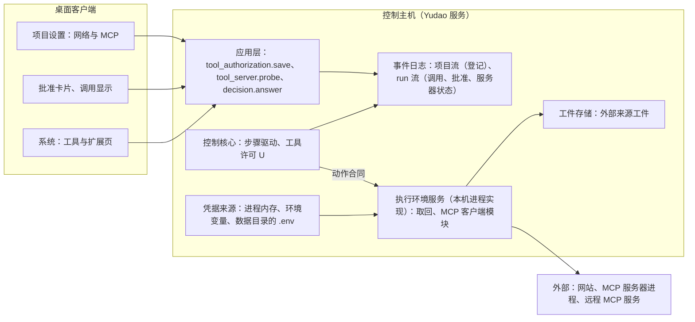
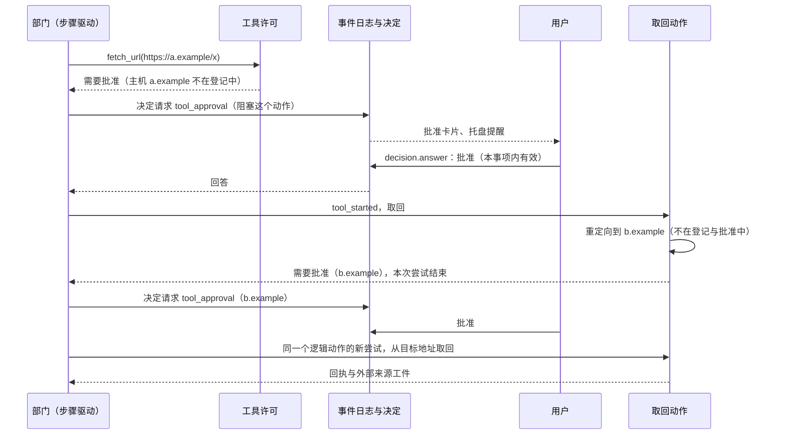

# 网络取回与 MCP 工具设计说明

更新：2026-10-02，第 8 节结果未知的处理按恢复契约第 4 节的通用规则（第 14 节第 13 项）。状态：设计已确认（2026-10-01 用户逐轮采纳推荐，第 14 节），未实施。路线位置：[Stage 3 计划](../stage-3-plan.md) 3.2B，里程碑 M3，父工单 [#122](https://github.com/bender2333/yudao/issues/122)。需求：[D36](../requirements/network-and-mcp.md)。工单见第 16 节。

依据：[ADR-0025](../adr/0025-network-and-mcp-run-on-control-host.md)（取回与登记的 MCP 服务器固定在控制主机上运行）；[ADR-0022](../adr/0022-run-directly-without-containers.md)；[ADR-0018](../adr/0018-single-control-host-remote-execution.md)；[ADR-0019](../adr/0019-project-stream-across-versions.md)；[总体架构](architecture/overall-architecture.md)第 5、7.3、7.4 节；[恢复契约与故障矩阵](recovery-contract-and-fault-matrix.md)第 4 节；[应用层与接口层设计说明](app-and-interface.md)第 3.2、3.3、4 节；[本地通用工具设计说明](local-tools.md)；[浏览器与 computer use 设计说明](browser-and-computer-use.md)第 4 节；[语义系统设计说明](semantic-system.md)的证据；[模型管理设计说明](model-management.md)的凭据。调研：[网络取回与 MCP 的参照实现、官方 SDK 与搜索服务](../research/network-and-mcp-references.md)。用词以 `CONTEXT.md` 为准。

## 1. 范围

交付：

- 网络取回：按地址取回网页或文档的环境工具 `fetch_url`，以及继续读取已保存内容的 `read_external_source`。
- 登记的 MCP 服务器：项目登记服务器与工具，部门经官方 MCP SDK 的客户端调用它的工具。
- 项目的工具授权登记（取回的来源与 MCP 服务器）、一次性批准、每类动作的恢复契约、结果的工件与证据。
- MCP 客户端模块：官方 SDK 的会话与进程管理，3.2D 的 Playwright MCP 使用同一个模块。
- 界面：项目设置的「网络与 MCP」一节、批准卡片、调用显示、系统「工具与扩展」页。

不在范围内：

- 搜索工具：搜索经项目登记的搜索类 MCP 服务器提供（第 12.1 节）。
- OAuth 登录、SSE 传输，以及 MCP 的资源、提示、采样、roots 与向用户请求输入：登记不支持（第 4.2 节）。
- 必须运行在登记的机器上的 MCP 服务器（[ADR-0025](../adr/0025-network-and-mcp-run-on-control-host.md)）。
- PDF、图片等非文本内容的取回：需要时登记一个文档类的 MCP 服务器。
- Playwright MCP：属于 3.2D，随试用会话运行，不经项目登记。
- 外部动作（部署、回滚、重启）：Stage 4。

## 2. 概念与模块

- **登记的来源**：项目登记的、允许取回的主机。
- **MCP 服务器登记**：项目登记的一个 MCP 服务器：怎样启动或连接、哪些部门可以使用、读取到的工具清单与每个工具的处理方式。
- **工具授权版本**：一个项目的整份登记（来源与服务器）的版本；事项创建时固定。
- **处理方式**：每个 MCP 工具有三种：不提供、使用前询问、直接使用。
- **一次性批准**：用户对登记之外的取回地址或「使用前询问」的 MCP 工具作出的批准，在本事项内对同一个主机或同一个工具有效。
- **外部来源工件**：取回的正文与 MCP 的结果保存成的工件，带来源与行号，可以作为「外部文档」类证据被引用。

## 3. 放置

动作类别按放置分两种（[ADR-0025](../adr/0025-network-and-mcp-run-on-control-host.md)）：

| 动作类别 | 放置 |
| --- | --- |
| 读取、搜索、写入、编辑、登记的命令、检查、试用会话、浏览器与屏幕动作 | 随 run 的执行位置 |
| 网络取回、登记的 MCP 服务器的工具调用 | 固定在控制主机，由执行环境服务的本机进程实现提供；执行位置是一台登记的机器时同样如此 |

两类动作使用同一份动作合同。固定在控制主机的动作，结果未知只出现在控制主机进程中断时，没有心跳与迟到回执。Playwright MCP 随试用会话在 run 的执行位置上运行，使用同一个 MCP 客户端模块（第 7.1 节）。

## 4. 登记

### 4.1 取回的来源

一条登记写主机名，可以带端口，可以写 `*.example.com`（匹配任意深度的子域，不含根域，需要根域时另写一条），可以附说明。不带端口的条目匹配 80 与 443，带端口的条目只匹配这个端口。另有一个开关「任意公网地址」，打开以后任何解析到公网地址的主机都算登记的来源。回环、内网与链路本地地址只在条目里明确写出时才允许（第 6.3 节）。

### 4.2 MCP 服务器

| 项 | 说明 |
| --- | --- |
| 登记名 | 小写字母、数字与连字符；同一项目内唯一；作为工具名的前缀 |
| 传输 | 本机进程（stdio）或 streamable HTTP。不支持 SSE 与 OAuth 登录；需要令牌的服务把令牌写在请求头里 |
| stdio | 命令、参数、环境变量；不经过 shell；命令名按操作系统的规则补全扩展名（`npx` 在 Windows 上是 `npx.CMD`） |
| streamable HTTP | 地址、请求头 |
| 变量与请求头的值 | 固定文本，或凭据名称（取值时读取当前的凭据来源） |
| 可以使用的部门 | 默认三个部门；Stage 5 引入探索者以后只给探索者（#62） |
| 时限与输出上限 | 启动时限、调用时限、返回给模型的输出上限，有默认值（第 7.2 节），登记里可以修改 |
| 工具清单 | 登记时读取的快照：每个工具的名称、说明、参数结构，以及服务器自己标注的只读、幂等、破坏性提示（只显示给用户参考） |
| 每个工具的处理方式 | 不提供 / 使用前询问 / 直接使用；新读取到的工具默认「不提供」 |
| 每个工具的「结果未知时可以重新执行」 | 是 / 否，默认否；为是时结果未知自动重新执行一次（第 8 节），只在重复执行不会造成问题时打开 |

只使用服务器的「工具」。资源、提示、采样、roots 与向用户请求输入都不声明；服务器发来这类请求时由 SDK 以 -32600 拒绝，调用返回错误。

### 4.3 读取工具清单（探测）

登记时点「连接并读取工具清单」，提交命令 `tool_server.probe`：Yudao 在控制主机上临时启动或连接这个服务器，读取服务器信息与工具清单，然后关闭。命令接受以后作为任务进行，结果以事件 `tool_server_probe_finished` 出现，界面在事件到达之前显示「测试中」（与连接测试相同，应用层与接口层设计说明第 3.2 节）；失败时事件写明原因，带服务器标准错误输出的末尾部分（凭据值替换为星号）。

服务器升级以后点「重新读取」：界面对照差异（新增、移除、说明或参数结构有变化的工具），用户逐项确认处理方式，保存成新版本。工具清单快照随版本保存，模型看到的就是这份快照；调用时不核对服务器的清单有没有变化，调用出错按错误返回；Yudao 不接收 `list_changed` 通知。

### 4.4 版本与固定

登记是一份整体的文档（来源加服务器），带一个版本号，经 `tool_authorization.save` 保存：命令带基准版本，版本过期时拒绝，提示重新读取。保存写入项目流的事件 `tool_authorization_configured`，内容是这个版本的整份文档。事项创建时记录工具授权的版本，run 的投影保存当时的整份登记（与登记的命令相同）；进行中的事项修改登记，只影响之后创建的 run。

### 4.5 凭据

登记里只写凭据名称。取值时读取当前的凭据来源：进程内存、进程环境、数据目录的 `.env`（与 Provider 相同，[模型管理设计说明](model-management.md)第 3 节）；写入使用同一组命令 `credential.set`、`credential.clear_override`、`credential.remove_persisted`，两种写入方式也相同。凭据缺失时，启动或连接失败，原因写明缺少的凭据名称。事件、回执、工件与日志中不出现凭据值：保存的标准错误输出、错误文本与结果文本在写入之前，把已取得的凭据值（及其 URL 编码形式）替换为星号。

## 5. 授权与批准

### 5.1 工具的提供

- 项目没有登记来源时，部门没有取回工具 `fetch_url`；没有处理方式为「使用前询问」或「直接使用」的 MCP 工具时，部门没有 MCP 工具；两类工具都没有时，也没有 `read_external_source`。这样没有联网需要的项目与评测不会看到这些工具，也不会停下来等批准。
- 一次角色任务中工具定义保持不变：MCP 工具的名称、说明与参数结构取自这个事项固定的登记快照，名称是 `mcp__登记名__工具名`（只用字母、数字、下划线与连字符，总长度超过 64 个字符时截短并附哈希）。
- Stage 3 三个部门都可以使用取回；MCP 工具按登记里写明的部门提供；Stage 5 引入探索者以后只给探索者（#62）。

### 5.2 规则

| | 登记范围内 | 登记范围之外 |
| --- | --- | --- |
| 取回 | 主机在登记的来源中：直接取回 | 发出一次性批准的决定请求，批准以后取回；拒绝时工具结果写明用户拒绝 |
| MCP 工具 | 「直接使用」：直接调用。「使用前询问」：本事项第一次调用这个工具时发出一次性批准的决定请求 | 「不提供」的工具与登记之外的工具不在工具定义里；调用不存在的工具名由工具许可拒绝，原因作为工具结果返回 |

工具许可的结果有三种：允许、拒绝并说明原因、需要批准（带决定种类与批准的对象）。

### 5.3 一次性批准

- 决定种类 `tool_approval`，阻塞范围为动作，选项「批准（本事项内有效）」「拒绝」；回答可以附一段说明，拒绝时的说明随工具结果交给模型。
- 批准的有效范围是本事项内的同一个主机（取回）或同一个工具（MCP，键是登记名加工具名）；事项结束后失效。批准写成决定事件，Yudao 重启以后仍然有效（run 的投影从事件重建）。想长期允许，在项目设置里加入登记。
- 请求的内容：项目、事项、部门；取回写完整地址与主机，重定向时写原地址与目标地址；MCP 写登记名、工具名与参数摘要（超过 500 个字符时截断）；有效范围的说明。
- 等待批准的动作没有写入 `tool_started`（它在批准以后才写入），Yudao 在等待期间重启时，这个动作分类为未发送，决定请求仍然等待回答（恢复契约第 4 节、#17）。

## 6. 网络取回

### 6.1 工具 `fetch_url`

参数：`url`。结果：来源编号（外部来源工件）、最终地址、状态码、内容类型、字节数、内容摘要值、第一页正文、是否截断与继续读取的游标。任何一个最终的 HTTP 响应（包括 4xx、5xx）都是成功的动作，状态码写在结果里，响应体按文本处理；DNS 失败、连接被拒、TLS 失败、超时是失败的动作，写明原因。

### 6.2 请求规则

- 只发 GET，只允许 http 与 https；请求头固定（`User-Agent: Yudao/<版本>`，`Accept` 写明文本类型）；不带 Cookie 与凭据。
- 重定向由取回动作自己跟随，最多 5 次；每一跳的主机都要经过登记或批准的检查（第 5 节）与地址规则（第 6.3 节），遇到登记与批准之外的主机时本次尝试结束并要求批准。
- 下载上限 5 MB，超出的部分丢弃并标记；连接与读取的总期限 30 秒。
- 证书使用系统证书库（与 Provider 共用同一个上下文）；控制主机使用虚拟网卡方式的代理时不需要另外的代理设置，进程环境里有代理变量时按变量走。

### 6.3 地址规则

解析主机名以后检查每个实际地址：

- 拒绝：回环、链路本地、RFC 1918 私有地址、100.64.0.0/10、IPv6 唯一本地地址、未指定地址；主机名是 `localhost` 或不含点号时同样拒绝。198.18.0.0/15 不在拒绝范围内：虚拟网卡代理把域名解析到这个范围，按「私有地址」拒绝会使所有取回失败。
- 登记的来源条目明确写出的内网主机或地址允许取回（例如内网的文档站）。
- Yudao 服务自己监听的地址与端口永远拒绝，登记了也不例外：部门若能取回服务的接口，就能读到其他部门的私有上下文与全部事件。

### 6.4 内容与保存

- HTML 转成保留标题、列表、链接与表格的文本（使用成熟的转换库）；纯文本、Markdown、JSON、XML 原样返回；其他类型返回「不支持的内容类型」。按响应的字符集解码，无法判断时按 UTF-8 并替换非法字节。
- 完整正文保存为外部来源工件（UTF-8，换行统一，行号从 1 起）；工件记录来源地址、最终地址、状态码、内容类型、摘要值与取回时间。
- 工具结果返回前 20000 个字符，带继续读取的游标；`read_external_source(source, start_line, end_line, cursor)` 读取已保存的工件，不重新取回，游标做法与读取文件、搜索相同。

### 6.5 回执

执行之前记录动作身份、地址、主机与授权依据（命中的登记条目或批准的决定编号）。回执记录最终地址、状态码、内容类型、字节数、是否截断、摘要值、工件引用、重定向链与耗时。

## 7. MCP 服务器

### 7.1 客户端模块

使用官方 MCP Python SDK（`mcp` 2.2.0，协议版本 2026-07-28）：`stdio_client` 与 `streamable_http_client`，HTTP 传输使用项目已有的 httpx2 并带系统证书库的上下文。客户端模块放在执行代码包中，不导入 Yudao 的其他模块（[执行环境服务设计说明](execution-environment.md)第 5 节）；3.2B 在控制主机的进程内使用它，3.2D 的 Playwright MCP 在 run 的执行位置上使用它。

### 7.2 运行规则

- 每个 run 的每个服务器一个实例，第一次调用时启动；run 结束、暂停或停止时关闭；run 之间、项目之间不共享。
- 默认启动时限 60 秒（`npx`、`uvx` 第一次运行要下载包），调用时限 120 秒（SDK 没有默认时限，Yudao 传入 `read_timeout_seconds`；进度通知不延长时限），返回给模型的输出上限 20000 个字符；登记里可以修改。
- stdio 服务器的结束：先关闭标准输入，等待 2 秒，然后强制结束整个进程树（SDK 在 Windows 上使用作业对象，调研中已实测有效）。HTTP 服务器关闭会话。
- 子进程的环境变量只有登记里写明的变量与操作系统运行所需的基础变量。SDK 在 Windows 上只给子进程 12 个基础变量（上游 issue #3335），Yudao 启动时补上 `COMSPEC`、`WINDIR`、`SystemRoot`、`PATHEXT` 等。
- 标准错误输出写到数据目录下的日志文件（SDK 要求带文件描述符的真实文件），读取末尾部分用于诊断，凭据值替换为星号。
- 启动失败或连接中断：工具结果写明原因与标准错误输出的末尾部分，部门继续做别的事情，事项不停止；系统页显示这个服务器最近一次的状态。
- 每次启动写入 run 流事件 `mcp_server_started`（登记名、传输、进程标识与进程创建时间），关闭写 `mcp_server_closed`，失败写 `mcp_server_failed`。Yudao 启动时，对没有 `mcp_server_closed` 的服务器，按记录的进程标识结束仍然存活的进程，然后补写 `mcp_server_closed`（原因为遗留）。

### 7.3 调用与结果

- 调用：`call_tool`，传入登记的调用时限。工具失败（`is_error`）返回错误文本，动作记为已完成；协议错误与超时记为失败的动作，写明错误码。
- 文本内容连接成文本，`structuredContent` 作为 JSON 一并保存；图像内容保存为工件，调用目标的模型接受图像输入时放入请求，否则只留占位说明（与 3.2D 的截图规则相同）；嵌入的资源保存为工件，资源链接不自动取回；音频保存为工件，只留占位说明。
- 每次调用的完整结果保存为一个外部来源工件（上限 5 MB，超出的部分丢弃并标记）；工具结果返回前 20000 个字符，其余用 `read_external_source` 继续读取。

## 8. 恢复契约

[恢复契约](recovery-contract-and-fault-matrix.md)第 4 节要求每类动作回答八个问题。

| 问题 | 网络取回 | MCP 工具 |
| --- | --- | --- |
| 谁有权做 | 部门按工具许可；登记范围内直接做，范围之外经一次性批准 | 部门按工具许可；「直接使用」直接做，「使用前询问」经一次性批准 |
| 作用于什么 | 一个 http 或 https 地址（只读） | 登记的服务器的一个工具，参数由模型给出 |
| 怎样识别同一动作与不同尝试 | 动作身份加尝试编号；两次取回分别记录，不当作同一结果 | 动作身份加尝试编号 |
| 成功证据 | 回执（最终地址、状态码、摘要值）与外部来源工件 | 回执（结果、错误、耗时）与外部来源工件 |
| 结果未知时向哪里查 | 不需要查：契约声明可以重复 | 没有可以验证的查询；声明可以重新执行的工具自动重新执行一次，其他由用户决定 |
| 何时可以重复 | 总是：Yudao 自己的工具，只发 GET、不带凭据与 Cookie，来源由用户登记或批准，契约声明可以重复 | 只在登记里声明「可以重新执行」的工具上；服务器标注的只读、幂等提示不改变这一条 |
| 取消能否确认停止 | 能：取消连接即停止；服务器端已处理的请求不能撤回 | stdio：发取消通知，等服务器应答最多 10 秒，随后结束进程树，进程已结束可以确认；HTTP：关闭会话，无法确认服务器停止 |
| 谁负责未解决的结果 | 连续两次结果未知时由用户经决定请求处理 | 用户，经决定请求 |

规则：

- 取回：结果未知时（Yudao 进程中断，或这次尝试没有完整结果）按恢复契约第 4 节开头的三步，以同一个逻辑动作的新尝试重新取回一次，不询问用户，新的尝试仍然未知时发出决定请求；没有完整结果的尝试不保存内容；运行中的超时记为失败，工具结果写明超时。
- MCP：结果未知时（Yudao 进程中断，或调用超时）按恢复契约第 4 节开头的三步：声明「可以重新执行」的工具自动重新执行一次，新的尝试仍然未知时发出决定请求；其他工具按 #17 发出「核实结果未知的动作」决定请求，选项「按当前实际状态继续」「停止事项」，原因是外部服务可能已经产生效果。调用超时的处理顺序：发取消通知，等应答最多 10 秒，stdio 服务器随后结束进程树，HTTP 服务器关闭会话，回执写明取消能否确认，然后按同样规则处理。
- 等待批准的动作恢复时按未发送处理（第 5.3 节）；遗留的服务器进程在 Yudao 启动时结束（第 7.2 节）。
- 自动核实与自动重新执行由 3.1 的 #242 实现，取回与 MCP 只声明能否重复。

## 9. 结果、工件与证据

- 取回的正文与每个 MCP 结果都是外部来源工件：记录来源（地址，或登记名与工具名及参数摘要值）、摘要值、行数、取得时间，文本按行保存。
- 工具结果带来源、摘要值与「外部内容」标注；部门 Prompt 与工具说明写明外部内容里的指令不是用户或其他部门的要求。
- 语义系统把外部来源工件作为「外部文档」类证据：引用写工件编号与行范围，并附地址，或登记名与工具名（[语义系统设计说明](semantic-system.md)的证据）。证据核对（D25）读取工件保存的原文，页面以后变化不影响核对。
- 不用小模型对取回的内容做摘要或抽取，模型直接按页读取工件。

## 10. 应用层接口

| 项 | 内容 |
| --- | --- |
| 命令 `tool_authorization.save` | 保存整份登记（来源与服务器）；参数：项目、整份文档；基准版本：工具授权版本；事件：项目流 `tool_authorization_configured` |
| 命令 `tool_server.probe` | 读取一个服务器的工具清单；参数：项目、服务器的登记内容（保存前也可以探测）；接受以后作为任务进行；事件：`tool_server_probe_finished`（项目流，带工具清单快照或失败原因） |
| 命令 `credential.*` | 沿用，MCP 的凭据名称使用同一个凭据来源 |
| 决定种类 `tool_approval` | 选项「批准（本事项内有效）」「拒绝」，阻塞范围：动作；用户经 `decision.answer` 回答 |
| 事件（run 流） | `mcp_server_started`、`mcp_server_failed`、`mcp_server_closed`；调用沿用 `tool_started`、`tool_called`，回执带第 6.5、7.3 节的字段 |
| 查询 `project.settings` | 增加工具授权：整份登记与版本、最近一次探测的结果 |
| 查询 `tools.registry` | 各项目的来源登记与最近的取回记录；各项目的 MCP 服务器、最近一次状态、工具与处理方式、恢复约定（可重复或不自动重试）；内置工具随 3.2D 加入 |
| 查询 `run.actions` | 增加取回与 MCP 调用的回执字段与外部来源工件引用 |
| 限额与参数（定义中） | 启动时限 60 秒、调用时限 120 秒、输出上限 20000 个字符、下载上限 5 MB、取回总期限 30 秒、重定向 5 次、MCP 结果工件上限 5 MB |

命令总数由 41 个变为 42 个。

## 11. 界面

不新做原型：页面说明写在本节，沿用原型 v9 的表格、卡片与提示组件；界面工单按本节建立。

### 11.1 项目设置的「网络与 MCP」一节

- **取回的来源**：表格（来源、说明、删除）；添加来源的输入框；开关「任意公网地址」；提示内网地址只在条目里明确写出时才允许。
- **MCP 服务器**：列表（登记名、传输、可以使用的部门、已提供的工具数、最近一次连接结果、编辑、删除）；点「添加」或「编辑」进入表单：登记名、传输、stdio 的命令与参数与环境变量或 HTTP 的地址与请求头、可以使用的部门、时限与输出上限（默认折叠）。变量与请求头的值选择「固定文本」或「凭据名称」；凭据名称旁显示状态（已设置、缺失）与「设置值」，复用模型管理页凭据区的两种写入方式，输入框始终为空。
- **工具表**：表单中点「连接并读取工具清单」，显示「测试中」，事件到达以后列出服务器信息与每个工具（工具、说明、服务器自己的提示（灰色，只供参考）、处理方式、结果未知时可以重新执行）；失败时显示原因与标准错误输出的末尾部分。「重新读取」显示差异。
- 保存经 `tool_authorization.save`，带基准版本，过期时提示重新读取；命令提交后显示「已提交」，事件到达以后显示最终状态。

### 11.2 批准卡片

决定卡片（#175 的页面卡片与 #179 的世界里的决定卡片共用同一份材料）：写明项目、事项、部门、已经等待的时长；取回写完整地址与主机，重定向时写原地址与目标地址；MCP 写登记名、工具名与参数摘要；说明有效范围「本事项内的这个主机（或这个工具）」；选项「批准（本事项内有效）」「拒绝」，说明栏可以写给模型的话。出现在系统首页的「待你决定」、项目标签栏的「待你决定」、托盘提醒与部门工作间。

### 11.3 调用显示

- 部门工作间的「动作与回执」列表与事项详情的时间线中，取回与 MCP 调用各占一行：类型、目标、状态（成功、失败、被拒绝、等待批准、结果未知）、耗时、结果摘要与外部来源工件的链接；结果未知的调用在恢复页显示 #17 的卡片。
- 房间的呈现沿用原型 v9：取回是走到门口的邮筒寄出请求并取回资料，MCP 调用是在墙上的工具面板按下对应的按钮；头顶气泡写「现在取回网络资料」「现在调用 <工具>」；等待批准时小人举着申请单。工具名以 `fetch_url` 与 `mcp__` 开头，使原型的名称匹配规则直接适用。

### 11.4 系统「工具与扩展」页

只读汇总，去掉「设计待定」标记：网络取回显示各项目的来源登记与最近的取回记录（时间、地址、项目、结果）；MCP 显示各项目的服务器、最近一次状态、工具、处理方式与恢复约定（可以重新执行的标「可重复」，其余标「不自动重试」）；浏览器工具与 computer use（3.2D，#154 增加内置工具一节）、只读观察者（Stage 5）与准入钩子（Stage 6）保持原来的位置。数据取自 `tools.registry`。

## 12. 与其他部分的关系

1. **搜索**：不内置搜索工具。部门的探索者查资料需要的搜索由项目登记一个搜索类 MCP 服务器提供；M3 试用与 #236 的验收使用 Exa 官方 MCP（第 13 节）。
2. **3.2D**：浏览器经 Playwright MCP，使用本设计的 MCP 客户端模块（#69），不经项目登记与一次性批准（[浏览器与 computer use 设计说明](browser-and-computer-use.md)第 4 节）。
3. **3.2C**：取回与 MCP 固定在控制主机，不进入执行代理（[ADR-0025](../adr/0025-network-and-mcp-run-on-control-host.md)）。
4. **评测**：评测期间两边都不联网。Yudao 的评测项目不登记来源与 MCP 工具，按第 5.1 节部门看不到这两类工具；OpenCode 的运行配置关闭取回与搜索（[评测场景设计](evaluation-scenarios.md)）。
5. **D25 语义系统**：外部来源工件作为证据（第 9 节）。
6. **D26**：探索者引入以后，取回与 MCP 只给探索者（#62）。
7. **模型管理**：凭据来源共用（第 4.5 节）。

## 13. 验收

- 取回：用本机启动的真实 HTTP 服务验证登记的来源、一次性批准、重定向到登记之外的主机、回环与内网与服务自己的地址被拒绝、超出大小上限、超时、请求中没有凭据与 Cookie；进程在取回中途终止，恢复后以新的尝试取回，两次尝试分别记录；另有一次对公共网站的真实取回，证据随工单评论提交。
- MCP：用官方的 `mcp-server-time`（stdio，`uvx` 启动，没有网络与凭据）验证本机进程传输，登记后部门可以调用，回执完整；用 Exa 官方 MCP（`https://mcp.exa.ai/mcp`，不填 Key）验证 streamable HTTP，对它的一次真实调用把证据放在工单评论里；用 SDK 写的本机测试服务器验证错误、超时、取消与大结果。
- Windows：进程树在关闭与超时时全部结束；`npx` 与 `uvx` 的命令可以启动；标准错误输出写入日志文件。
- 授权：「使用前询问」的工具第一次调用出现批准卡片，批准以后同一事项内不再询问；Yudao 重启以后批准仍然有效；标为「不提供」的工具不在工具定义里；没有登记的项目没有这两类工具。
- 恢复：没有声明可以重新执行的 MCP 工具调用中途终止进程，恢复后出现「核实结果未知的动作」决定请求，没有自动重试；声明可以重新执行的工具自动重新执行一次；遗留的服务器进程在启动时被结束。
- 凭据不出现在事件、工件与日志中（对保存的内容查找凭据值）。
- 界面：Playwright 端到端测试覆盖项目设置一节（登记、探测、保存）、批准卡片、调用显示与系统页；1440×900 与 390×844 两种窗口尺寸，控制台错误为零。
- 确定行为的测试用 FakeAdapter 给出模型回答，服务器是真实进程，不使用 mock。

## 14. 用户确认的决定

2026-10-01，用户逐轮采纳推荐：

1. 搜索经 MCP 提供，Yudao 不内置搜索工具；Yudao 自带的 MCP 服务只有 3.2D 的 Playwright MCP。
2. 取回与登记的 MCP 服务器一律在控制主机上运行，与 run 的执行位置无关（ADR-0025）。
3. 每个项目各自登记（项目流、带版本、事项创建时固定版本）；凭据按名称引用，使用与 Provider 相同的凭据来源。
4. 授权与批准：登记就是常设授权；登记之外的取回发出一次性批准；MCP 工具三种处理方式，新读取到的默认「不提供」；批准在本事项内对同一个主机或同一个工具有效，重启以后仍然有效；拒绝时工具结果写明原因；项目没有登记时部门没有这两类工具。
5. 评测期间两边都不联网。
6. 取回的地址规则：默认拒绝回环、内网与链路本地地址并在解析以后检查，198.18.0.0/15 不在拒绝范围内；Yudao 服务自己监听的地址与端口永远拒绝；明确登记的内网来源允许；只允许 http 与 https；不带凭据与 Cookie；使用系统证书库。
7. MCP 登记：stdio 与 streamable HTTP，不支持 SSE 与 OAuth；只使用工具；每个工具有处理方式与「结果未知时可以重新执行」两项；读取工具清单后保存快照，模型看到的是快照；名称 `mcp__登记名__工具名`。
8. 进程运行规则：每个 run 的每个服务器一个实例，第一次调用时启动，run 结束、暂停或停止时关闭；启动时限 60 秒、调用时限 120 秒、输出上限 20000 个字符；失败不停止事项；子进程的环境变量只有登记写明的与基础变量；遗留进程在启动时结束。
9. 结果未知、超时与取消：取回按契约声明可以重复，以新的尝试重新取回；MCP 没有声明可以重新执行的工具按 #17 发出决定请求；调用超时先取消再处理。
10. 结果与证据：HTML 转文本，纯文本、Markdown、JSON、XML 原样，其他类型不支持；下载上限 5 MB；完整内容保存为外部来源工件，工具结果分页返回；带「外部内容」标注；MCP 的图像按模型的输入方式处理；外部来源作为「外部文档」证据；不用小模型摘要。
11. 界面：不做新原型，页面说明写在设计说明；项目设置新增「网络与 MCP」一节，系统「工具与扩展」页只读汇总，批准卡片，调用显示沿用 v9 的房间动作。
12. M3 试用与验收使用 Exa 官方 MCP（不填 Key）；登记的 MCP 服务器（#236）的验收使用 `mcp-server-time`（stdio）与 Exa（HTTP）。

13. 2026-10-02（专题 6）：契约声明可以重复的动作结果未知时自动重新执行一次，新的尝试仍然未知时发出决定请求；取回与声明「可以重新执行」的 MCP 工具按这条规则处理（恢复契约第 4 节）。

补充的约定（由已定的规则推出，用户确认清单时一并确认）：取回与 MCP 各自按登记提供；Stage 3 三个部门都可以使用取回；工具名 `fetch_url`、`read_external_source`、`mcp__登记名__工具名`；应用层的命令、事件与决定种类（第 10 节）；使用的技术（第 17 节）；取回的请求头固定，重定向最多 5 次。

## 15. 遗留

无。

## 16. 工单拆分

全部属于父工单 #122，里程碑 M3。

| 工单 | 内容 | 阻塞 |
| --- | --- | --- |
| #68 网络取回 | 登记的基础（来源的登记、版本固定、`tool_approval`、本事项内的批准检查）、`fetch_url` 与 `read_external_source`、地址规则、回执、外部来源工件、恢复 | #18、#128、#242 |
| #69 MCP 客户端模块 | 官方 SDK 的会话、进程管理、取消、凭据替换、标准错误输出文件，放在执行代码包中；3.2D 的 #149 依赖它 | #128 |
| #236 登记的 MCP 服务器 | 服务器登记与探测、工具清单快照、三种处理方式、使用前询问、动作回执与恢复、运行规则 | #68、#69、#18、#242 |
| #237 界面：项目设置的「网络与 MCP」一节 | 第 11.1 节 | #80、#236 |
| #238 界面：一次性批准的卡片与取回、MCP 调用的显示 | 第 11.2、11.3 节 | #175、#177、#80、#236 |
| #239 界面：系统「工具与扩展」页 | 第 11.4 节；#154 在其中增加内置工具一节 | #80、#236 |

同时修改的工单：#122（子工单与验收）、#189（OpenCode 的运行配置关闭取回与搜索）、#192（评测项目不登记来源与 MCP 工具）、#154（被 #239 阻塞）、#185（M3 试用内容）。

## 17. 使用的技术

| 用途 | 技术 | 说明 |
| --- | --- | --- |
| MCP 客户端 | 官方 `mcp` 2.2.0（Python >=3.10，项目要求 >=3.11） | 2.x 在超时与取消时发送取消通知；SDK 在 Windows 上用作业对象结束进程树；不读取工具注解 |
| HTTP | 取回使用项目已有的 httpx 与系统证书库；MCP 的 HTTP 传输使用项目已有的 httpx2 | 与 Provider 共用证书上下文 |
| HTML 转文本 | 成熟的转换库，参照 OMP 使用的 html-to-markdown（Rust 实现的转换库，有 Python 包） | 实现时核对 Windows x64 的安装包 |
| 进程 | 登记的命令使用的进程树管理 | 3.2A 已有，Windows 与 POSIX 分别验证 |
| 凭据 | Provider 的凭据来源 | 进程内存、进程环境、数据目录的 `.env` |
