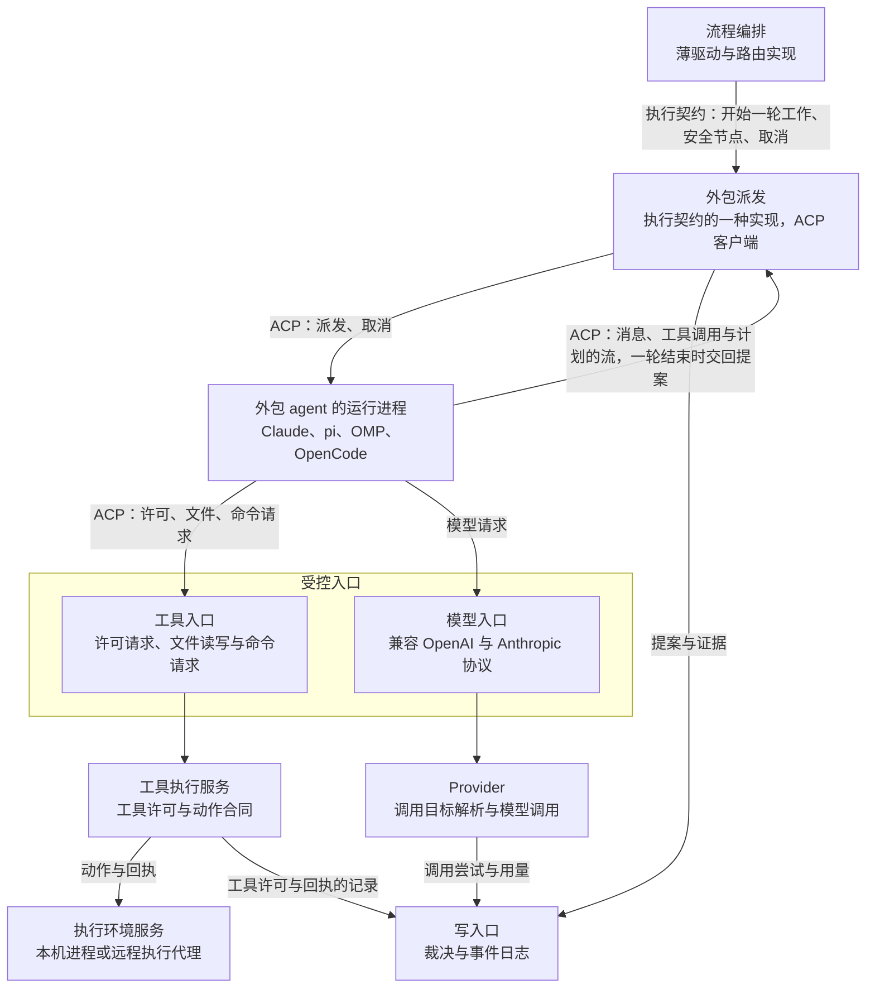

# 外包角色设计说明

总图位置：第四节「执行」的缝（外包角色是执行契约的一种实现）与「动作」「模型」两道缝（外包角色的工具请求与模型请求经过这两道缝）。依据：需求 [D31 部门内的外包角色](../requirements/outsourced-agent-roles.md)；[ADR-0044](../adr/0044-verifier-role-and-open-loop.md)（外包不要求下游有核验角色）；总图第三节「开环完成」；[总体架构](architecture/overall-architecture.md)「五种合同」「两类工具」「动作契约」「身份」；[骨架与应用设计说明](skeleton-and-application.md)「执行契约」「薄驱动」「对外合同的兼容」；[形态与核验角色设计说明](forms-and-verifier-role.md)「开环完成」「子组织（位置与规矩）」；[执行环境服务设计说明](execution-environment.md)「工作区的建立、封存与传输」「代码的权限、认证与加密」；[恢复契约与故障矩阵](recovery-contract-and-fault-matrix.md)「动作分类与处置」；[模型管理设计说明](model-management.md)「统一调用、取消与观测」；[验证的独立性设计说明](independent-verification.md)「共享的与隔开的」。

## 1. 功能与依据

部门里的一个角色可以由外部 agent 担任，例如 Claude、pi、OMP、OpenCode，这样的角色叫外包角色。外包角色与自有角色使用同一个角色定义。控制核心通过 ACP（Agent Client Protocol）把一轮工作派发给外部 agent；外部 agent 在自己的进程里完成会话内部的工作，向控制核心交回提案与证据，提案经写入口和裁决才成为事实。

控制核心里负责派发的部分叫外包派发，它是执行契约的另一种实现，路由、写入口、裁决与边界对外包角色和自有角色相同。外部 agent 使用的工具走动作的缝，使用的模型走模型的缝，所以工具许可、动作回执、调用尝试与用量记录对它照样成立。没有下游核验角色时，外包照样可以进行，事项以开环完成结束并注明外包；最差的配置是一个外包角色直做，等于调用一次外部 agent，工作区快照的进出、上限、写入口与开环完成的标记仍由 Yudao 守住。有核验角色时，放行只来自 Yudao 自己的核验角色。

## 2. 边界与范围

做：

- 接入方式：ACP，Yudao 作为客户端，每种外部 agent 一个适配。
- 一轮外包工作的派发与交回：交给外部 agent 什么，收回什么。
- 外部 agent 的许可请求、文件读写与命令执行怎样经 Yudao 的工具完成。
- 外部 agent 的模型调用怎样经 Provider。
- 会话内部与 Yudao 的分工，状态主权与可见范围。
- 取消，以及会话中断以后的恢复。

不做：

- 外包角色担任核验角色。核验角色的结论不外包，定义的结构校验拒绝把外包角色声明为核验角色（[循环与收敛设计说明](loops-and-convergence.md)「容纳变化的判据」）。
- 把作出流程决定、需求取舍、放行判断的角色外包，这些角色由 Yudao 自己执行。在这条限制以内哪些角色允许外包，由需求记录 D31 的待定项决定。
- 驱动外部 agent 会话内部的每一步，为它装配每次请求的上下文。
- 凭据与用量的选择（订阅账号还是 API 密钥），由需求记录 D31 的待定项决定。
- ACP 以外的接入协议。

与相邻模块的分界：

- 薄驱动与路由：薄驱动按同一份执行契约开始一轮工作，路由决定谁开工，两者都不区分执行方式是步骤驱动还是外包派发。
- 执行环境服务：外部 agent 的文件读写与命令请求属于读取、写入与命令这几类动作，不为外包角色增加动作类别（[总体架构](architecture/overall-architecture.md)「动作契约」）。
- Provider：模型入口是 Provider 对外的一面，调用尝试与用量的记录与自有角色相同（[模型管理设计说明](model-management.md)「统一调用、取消与观测」）。

本说明没有新的常量。一轮外包工作的时间与用量受执行契约交给这一轮的上限约束，并计入事项的上限（[循环与收敛设计说明](loops-and-convergence.md)「一定会停」）。

## 3. 接口

外包角色在下面几处与系统的其他部分相接。

- 执行的缝：薄驱动按执行契约开始一轮外包工作，把安全节点接口交给外包派发，外包派发交回一轮工作的结果。契约与自有角色的步骤驱动相同（[骨架与应用设计说明](skeleton-and-application.md)「执行契约」）。
- 装配的缝：外包派发按装配契约取得一次初始输入，不取每次请求的上下文。
- 派发：外包派发经 ACP 与外部 agent 的进程相连。交给外部 agent 的有分派说明、该角色可见范围内的资料、无历史的工作区快照、全新的状态目录、受控的工具入口与模型入口、派发编号；外部 agent 交回消息、工具调用与计划的流，一轮结束时交回提案，随时接受取消。派发合同带版本，字段只增（[骨架与应用设计说明](skeleton-and-application.md)「对外合同的兼容」）。完整的清单在[总体架构](architecture/overall-architecture.md)「五种合同」的外包派发一行，具体做法见方案。
- 动作的缝：外部 agent 的许可请求、文件读写与命令请求到达工具入口，先经过工具许可，再按动作合同交给工具执行服务，在执行环境服务里执行并交回回执。本说明里的工具执行服务指「工具许可、动作合同、执行环境服务」这一条链路，自有角色的环境工具走的是同一条（[总体架构](architecture/overall-architecture.md)「两类工具」）。
- 模型的缝：外部 agent 的模型地址指向 Provider 对外提供的模型入口，入口兼容 OpenAI 与 Anthropic 的协议。

派发开始以后，写入口记录的工具许可与回执、模型的调用尝试与用量、作为证据的消息流和提案，都带这一次的派发编号；旧编号交回的结果只记录，不接纳（[总体架构](architecture/overall-architecture.md)「身份」）。

外包派发与步骤驱动是执行槽位的两个并列实现，路由、装配、执行三个槽位的实现之间不互相导入，只经契约和薄驱动相连（[总体架构](architecture/overall-architecture.md)「包图」）。

## 4. 方案

### 4.1 同一个角色定义

外包角色与自有角色使用同一个角色定义：职责、输入、输出和权限（工具许可、可见范围、写入范围）都写在定义里，定义里的执行者种类为外包。谁开工、一轮怎么结束、事项怎么结束由路由决定，路由不区分角色背后是模型还是外部 agent。角色定义不指向子组织时，这个角色的一轮就是一个模型会话或一个外包会话（[形态与核验角色设计说明](forms-and-verifier-role.md)「子组织（位置与规矩）」）。

自有角色的每一步由控制核心驱动（[骨架与应用设计说明](skeleton-and-application.md)「执行契约」「薄驱动」）。外包角色的一轮由控制核心派发给外部 agent：外部 agent 收到分派说明和该角色可以看到的资料，交回提案与证据。

### 4.2 一轮外包工作的经过

1. 薄驱动问边界能不能开始。能，就经写入口写一条事件，取得这一轮的派发编号，按执行契约开始这一轮，把派发编号交给外包派发。
2. 外包派发按装配契约取得初始输入：分派说明加该角色可见范围内的资料。交给外部 agent 的初始输入与上下文清单记进事实（总图第四节「装配」）。
3. 外包派发在执行位置上从封存快照建立工作区，工作区只含按内容摘要取出的文件，没有历史（[执行环境服务设计说明](execution-environment.md)「工作区的建立、封存与传输」）；再建立全新的状态目录，外部 agent 在里面保存会话状态，里面没有以前会话的内容。外部 agent 在执行位置上以自己的进程运行。
4. 外包派发经 ACP 与外部 agent 建立会话，声明 Yudao 提供文件与终端能力，把初始输入交给它。
5. 外部 agent 工作。它每次向 Yudao 提出请求（许可、文件、命令、模型），先问安全节点：继续就处理，停止就拒绝这次请求并取消会话。它的消息、工具调用与计划以流的形式到达 Yudao，记录为证据。
6. 外部 agent 结束一轮对话，Yudao 视为交回提案：角色有写入范围时，对工作区封存，得到新快照和前后差异，连同证据整理成提案，带派发编号经写入口，由裁决核对。
7. 路由按事实判断这一轮怎么结束、事项怎么结束。定义里有核验角色核验这份成果时，由核验角色取得独立证据，放行只来自它；没有核验角色时，交了完成的事项以开环完成结束，事项的记录、页面与离开期间的报告写开环完成并注明外包。

外部 agent 在两次请求之间可能很久不与 Yudao 往来，所以一轮外包工作的总时间另有计时，到上限就取消会话，不依赖外部 agent 自己停止。用量由模型入口记录，与时间一起计入事项的上限。取消会话以后，Yudao 结束外部 agent 的进程和它启动的进程，结束这个会话在执行环境里启动的后台命令。这次派发结束时，状态目录清除。

### 4.3 接入方式

接入方式使用 ACP，Yudao 作为客户端，外部 agent 在 ACP 里是 agent 一侧。每种外部 agent 有一个适配，适配写明怎样启动它，它支持的能力由它自己声明；派发的内容和交回的内容对所有外部 agent 相同。

| 外部 agent | 接入 |
| --- | --- |
| Claude | 经基于 Claude Agent SDK 的适配程序 `@agentclientprotocol/claude-agent-acp` |
| pi | 经 `pi-acp` 适配程序 |
| OMP | 自带 ACP 模式，直接接入 |
| OpenCode | 自带 ACP 支持，直接接入 |

文件与终端交给客户端、取消会话、载入以前的会话这几项，参照 OMP 的 ACP 实现。

### 4.4 ACP 提供的控制手段

1. 许可：外部 agent 调用工具之前向客户端请求许可，Yudao 按这个角色的工具许可批准或拒绝。批准和拒绝都记录，拒绝的原因回给外部 agent。
2. 文件与终端：Yudao 作为客户端声明提供文件与终端能力以后，外部 agent 的文件读写与命令执行交给 Yudao 完成。Yudao 把这些请求按动作合同转交工具执行服务，在执行环境里执行；工具许可、写入范围、命令与输出的记录、动作回执和工作区的控制继续有效，与自有角色的环境工具相同。
3. 流：外部 agent 的消息、工具调用与计划以流的形式发给客户端，Yudao 记录为证据。
4. 取消与载入：客户端可以取消会话，也可以载入以前的会话。取消用于用户取消、边界停止和时间上限，载入用于会话中断以后的恢复（「中断与恢复」）。

Claude 的适配程序是否同样把文件读写与命令执行交给客户端完成，见未决问题。

### 4.5 模型调用

外部 agent 的模型调用只通过 Provider（总图第四节「模型」的缝）。Provider 对外提供兼容 OpenAI 与 Anthropic 协议的模型入口，入口使用三种协议：OpenAI Responses、OpenAI Chat Completions 与 Anthropic Messages，与 Provider 调用上游时用的三种协议相同（[模型管理设计说明](model-management.md)「统一调用、取消与观测」）。外部 agent 把模型地址指向这个入口。

上游的凭据由 Yudao 管理，只在控制主机上，不交给外部 agent 的进程，也不进工作区和状态目录。每次调用的尝试与用量照样记进事实，用量计入事项的上限。

### 4.6 会话内部的分工

外包角色把会话内部的上下文管理与规则遵守交给外部 agent：怎样压缩上下文、怎样遵守分派说明里的规则，由它自己负责。控制核心只装配它的初始输入，每次请求重新计算的当前状态栏目（[语义系统设计说明](semantic-system.md)「当前状态栏目」）不适用于它。

Yudao 保留三样：

- 流程决定，也就是状态主权：是否开始、何时结束、是否完成、是否放行，都由控制核心按事实决定。
- 信息流向：输入哪些资料（该角色可见范围内的），交出什么内容（提案、证据与摘要）。
- 工具：外部 agent 的工具调用经过 Yudao 的工具，工具许可、接触时附加与查询范围照样有效（[总体架构](architecture/overall-architecture.md)「两类工具」）。

外部 agent 会话内部的每一步不由控制核心驱动，所以它的结果交给独立核验检验：确定性检查与质检；定义里没有核验角色时，事项以开环完成结束，记录上写明。作出流程决定、需求取舍、放行判断的角色由 Yudao 自己执行。

外部 agent 的完整对话记录属于作者的工作过程，不越过部门边界；其他部门只看到 Yudao 整理的提案、证据与摘要（[验证的独立性设计说明](independent-verification.md)「共享的与隔开的」）。

### 4.7 状态主权与可见范围

- 外部 agent 结束一轮对话只代表交回提案，宣布完成仍由控制核心决定；它只提交提案与证据，无权直接修改事实。
- 外部 agent 只拿到该角色可见范围内的资料：初始输入只含可见范围内的资料；工作区从封存快照建立，只含公开树，不含其他部门的私有材料；经过 Yudao 的工具的读写，部门的可见范围照样有效。
- 代码在执行位置上直接运行，外部 agent 的进程拥有所在账户的权限，Yudao 不提供操作系统层面的沙箱，这一点与自有角色的命令相同；来源不明的仓库，把项目的执行位置设到另一台登记的机器（[执行环境服务设计说明](execution-environment.md)「代码的权限、认证与加密」）。

### 4.8 中断与恢复

会话中断（Yudao 进程重新启动、外部 agent 的进程退出、连接断开）时，在途动作的结果无法确定，按[恢复契约与故障矩阵](recovery-contract-and-fault-matrix.md)「动作分类与处置」处理：

1. 有核实方法的动作先自动核实，核实出确定结果就交回这个结果。
2. 其余动作交还发出它的会话：载入以前的会话（外部 agent 支持，并且这次派发的状态目录还在），让外部 agent 知道这个动作的执行被中断、结果未知，附上已经收到的输出，由它检查以后决定是否重新执行。
3. 不能载入以前的会话时，按重派处理：重派先写事件，派发编号加一，从最近的封存快照重新开始；旧编号交回的结果只记录，不接纳（总图第三节「重派与迟到的结果」）。重派不重置事项已用的时间与用量。

## 5. 验收

全部用真实运行的系统，外部 agent 用一个经 ACP 接入的真实 agent。

1. 一个外包角色的直做定义完成一个事项：工作区从封存快照建立，交回新快照与前后差异，经写入口成为提案；到上限会停；事项以开环完成结束，记录、页面与离开期间的报告写开环完成并注明外包，没有因为缺少核验而发决定请求。
2. 外部 agent 结束一轮对话只产生提案：裁决不接纳时事项不结束，接纳以后才有成果的新版本。
3. 定义里有核验角色核验这份成果时，放行只来自核验角色的结论；把外包角色声明为核验角色的定义，加载时被拒绝。
4. 外部 agent 的每个许可请求、文件读写与命令都有工具许可的记录。角色没有权限的请求被拒绝，原因回给外部 agent；执行了的文件读写与命令有动作回执，写入只落在角色的写入范围内。
5. 外部 agent 的每次模型调用都经模型入口和 Provider，有调用尝试与用量记录，用量计入事项的上限；上游凭据不在外部 agent 进程的环境变量和启动参数里，不在工作区、状态目录和它收到的任何内容里。
6. 外部 agent 的初始输入与可读的资料只含该角色可见范围内的内容；初始输入与上下文清单记在事实里；其他部门收到的只有提案、证据与摘要，没有外部 agent 的对话。
7. 用户取消、边界停止或到达时间与用量上限时，Yudao 取消会话，结束外部 agent 的进程和它启动的后台命令，这一轮以带原因的停止结束；之后迟到的结果只记录。
8. 一轮外包工作进行中结束 Yudao 进程再启动：有核实方法的动作先自动核实，其余作为结果未知交还发出它的会话；会话不能继续时重派，派发编号加一，旧编号交回的结果只记录，已用的时间与用量不重置。
9. 重放同一份事件日志得到同样的状态，重放不启动外部 agent。
10. 增加一种外部 agent 只增加一个适配，派发的内容与交回的内容不变；外包派发与步骤驱动通过同一套执行契约的测试。

## 6. 未决问题

- Claude 的适配程序（`@agentclientprotocol/claude-agent-acp`）是否同样把文件读写与命令执行交给客户端完成。其他外部 agent 以 OMP 的实现为参照，接入时逐个核对。
- 外部 agent 使用订阅账号还是 API 密钥，各家的使用条款是否允许这样的自动化调用（需求侧的选择见 D31 的待定项）。
- 外部 agent 的模型调用是否必须经过 Provider 的模型入口。必须经过时，不能修改模型地址的 agent 无法接入；允许绕过时，这类调用的尝试与用量不在 Yudao 的记录里，用量上限也约束不到它。模型入口要接收外部进程的请求，需要有一个常驻的监听者，而 Provider 模块自己不常驻运行（[模型管理设计说明](model-management.md)「统一调用、取消与观测」的模块边界），入口由 Yudao 服务的哪一部分提供，也在这里定。
- 外部 agent 的文件读写与命令执行是否必须由工具执行服务完成，不支持把文件与命令交给客户端的 agent 能否接入。能接入时，它在自己的进程里读写工作区、运行命令，工具许可和可见范围约束不到这些操作，工作区的内容只能靠封存快照限定。
- 执行位置是远程机器时，外部 agent 的进程怎样在那台机器上启动，ACP 连接怎样经过网络到达那台机器。

出处：

- https://github.com/agentclientprotocol/claude-agent-acp
- https://www.npmjs.com/package/@agentclientprotocol/claude-agent-acp
- https://agentclientprotocol.com/get-started/agents
