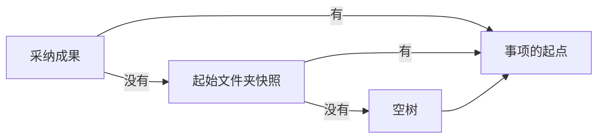
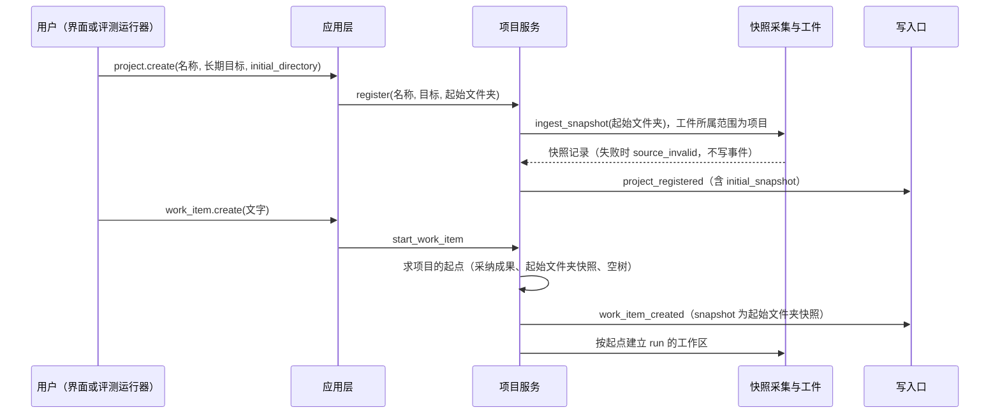

# 项目的起始文件夹设计说明

更新：2026-10-06。状态：设计已确认（2026-10-06 用户同意），未实施。路线位置：Stage 3 的 3.8 的补充，父工单 [#124](https://github.com/bender2333/yudao/issues/124)，属于里程碑 M2。 总图位置：第一节「一份事实」方框（起始文件夹的快照是事项的起点）。

依据：[D37 新建项目的起始文件夹](../requirements/project-initial-files.md)、[接入已有项目设计说明](existing-project-onboarding.md)（快照采集、`source_invalid` 与公开树的规则）、[本地通用工具设计说明](local-tools.md)（公开树）、[应用层与接口层设计说明](app-and-interface.md)第 3.1、3.2 节、[ADR-0019](../adr/0019-project-stream-across-versions.md)（项目流只增加字段）、[恢复契约](recovery-contract-and-fault-matrix.md)第 6 节第 10 行。用词以 [CONTEXT.md](../../CONTEXT.md) 为准。

## 1. 要解决的问题

| 问题 | 现状 | 影响 |
| --- | --- | --- |
| 新建项目只能从空树开始 | `project.create` 登记名称与长期目标，不带文件；`start_work_item` 在没有采纳成果时用空树建立工作区（`harness/projects.py` 约 519 至 553 行） | 题目带数据文件、脚手架或样例的场景无法开始：评测场景 3 的 `subway_data.json`（71,666 字节）进不了新项目的工作区，Yudao 一侧与 OpenCode 一侧的起点不同，完成度无法比较（#192 登记） |
| 已有文件进入项目的唯一入口是建档 | `project.onboard` 建立建档事项、核验基线、等用户确认初始 PRD | 只想带几份起点文件的用户被迫走完整的建档，而且建档把项目来源记为已有项目 |

起始文件夹是第二条入口：用户在新建项目时给出一个文件夹，它的快照成为项目的起点文件。它不建档：没有建档事项、基线核验与初始 PRD，项目来源仍是想法新建。

## 2. 项目的起点

项目的起点是下一个事项开始时工作区里的代码树，按下面的顺序取第一个存在的：

1. 当前采纳成果的代码树；
2. 项目的起始文件夹快照（只在第一次采纳之前使用）；
3. 空树。

三处使用同一个起点：开始事项（`work_item.create`）、排空期间排队的事项（`queue_work_item`）、因升级重新开始的事项（`restart_work_item_for_upgrade`，包括启动时发现 run 事件版本不同的未结束 run）。代码里只在一处求出起点，三处调用它，不各写一遍；`harness/projects.py` 现在的三处重复写法由这个函数代替。

第一次采纳以后，采纳成果的代码树是起点，起始文件夹快照不再使用，它仍保留在项目流中供查阅。

## 3. 命令与事件

`project.create` 增加可选参数 `initial_directory`：控制主机上的文件夹路径（与 `project.onboard` 的源目录路径同样是主机上的路径）。

- 采集：命令处理时在事务之前，用与 `project.onboard` 相同的采集路径（`harness/snapshot.py` 的 `ingest_snapshot`）只读采集公开树，源目录不被写入。忽略规则、宿主私有路径与无法表示的条目与建档相同（[接入已有项目设计说明](existing-project-onboarding.md)第 3.1 节），失败时命令被拒绝，原因 `source_invalid`，`message` 列出工作区内的相对路径与处理方法，不建立项目，不写入任何事件。
- 存放：快照的代码树作为工件保存，所属范围是项目（与 `project_goal` 工件相同），不属于任何 run。引用快照的位置（`tree_ref`）带所属范围，读取时按它取得所属范围，不假设属于某个 run。
- 事件：`project_registered` 增加可选字段 `initial_snapshot`，内容是快照记录（`source`、`tree_digest`、`files`、`directories`、`tree_ref`、`provenance`，字段与 `work_item_created.snapshot` 相同）。旧事件没有这个字段，缺省含义为没有起始文件夹（ADR-0019，字段清单登记）。
- 与 `project.onboard` 的区别：不登记源目录（以后不能重新采集，不能用 `onboarding.restart`）；不建立建档事项；项目来源保持 `idea`；起始文件夹只能在新建项目时给出，以后不能增加或替换，需要不同的文件时新建项目，或者由事项的交付提供。
- 起始文件夹是一次性的采集：建档以后源目录的修改不进入项目（接入已有项目设计说明第 5 节），起始文件夹同理。

## 4. 事项

没有采纳成果的项目开始事项时，从起始文件夹快照建立工作区：

- `work_item_created.snapshot` 带这份快照记录（与建档事项相同），事项种类仍是 `change`；run 创建被中断时，启动核对按这条记录建立缺少的 run（`restore_snapshot`）。
- `baseline` 为空：快照不是采纳成果，没有采纳链上的上一版。第一次采纳的 `previous_adoption_id` 为空，`code_tree_digest` 是事项交付的代码树摘要，与没有起始文件夹时相同。
- 快照里的文件进入公开树，产品、工程、质检都能用读取与搜索工具看到它们，没有按部门的隔离；起始文件夹的内容不在部门的材料目录中。
- 第一个事项的 PRD 由产品依据事项文字与项目的长期目标写出，起始文件夹里的文件是它可以读取的材料，没有初始 PRD 与基线核验。这一点与建档不同：起始文件夹适合少量的起点文件（数据、脚手架、样例）；完整的已有仓库用 `project.onboard`，建档以后才有描述现有行为的 PRD 与基线检查。

## 5. 界面与评测

- 界面「从想法新建」表单增加可选项「起始文件夹」：单行文本，提示「控制主机上的文件夹路径，留空则从空项目开始」；提交以后项目概览的「项目摘要」在没有采纳成果时写「起点：起始文件夹（N 个文件）」，有采纳成果以后不再写。
- 评测场景 3 的 Yudao 运行器用 `initial_directory` 带入 `subway_data.json`，与 OpenCode 一侧起点相同（[评测场景设计](evaluation-scenarios.md)第 3 节「隔离」）；#192 的第一份报告记录了没有这个入口时的结果，重新运行以后另出一份。

## 6. 模块交互

## 7. 失败与中断

| 情况 | 处理 |
| --- | --- |
| 起始文件夹不可读、含宿主私有路径、公开树中有无法表示的条目 | 命令被拒绝，`source_invalid`，不建立项目 |
| 快照采集完成、`project_registered` 写入之前进程中断 | 没有事件，没有项目；已保存的快照工件按内容摘要寻址，重复无害 |
| 第一个事项的 run 创建之前进程中断 | 与普通事项相同，启动核对按 `work_item_created.snapshot` 建立缺少的 run |
| 因升级重新开始（启动时发现 run 事件版本不同，或排空期间的强制升级） | 新 run 取项目的起点：没有采纳成果时用起始文件夹快照 |

## 8. 验收

全部使用真实运行的系统，不使用模拟。

1. `project.create` 带 `initial_directory`：项目流中的 `project_registered` 带 `initial_snapshot`，快照摘要等于文件夹的公开树摘要；不带时没有这个字段，行为与现在相同；旧版本写入的 `project_registered` 事件读回为没有起始文件夹。
2. 无法表示的条目、宿主私有路径或不可读的文件夹得到 `source_invalid`，没有项目与事件。
3. 在没有采纳成果的项目上开始事项：run 的工作区含起始文件夹的全部文件，部门用读取工具能读到；第一次采纳以后下一个事项的起点是采纳成果。
4. 因升级重新开始的第一个事项（没有采纳成果）带着起始文件夹重新开始。
5. 开始事项时 run 创建之前终止进程，重启以后建立的 run 含起始文件夹的文件。
6. 界面表单：填写起始文件夹的新建项目出现「起点」一行；填写不存在的路径时显示拒绝原因。
7. 项目流字段清单登记 `initial_snapshot`；接口合同、OpenAPI 快照与界面代码中的类型同步。
8. 评测场景 3 的 Yudao 运行器经 `initial_directory` 带入 `subway_data.json`，工作区中可以读到它。

## 9. 与现有设计的关系

| 现有内容 | 改变 |
| --- | --- |
| 接入已有项目设计说明第 5 节「已有代码的唯一入口」与第 12 节第 1 项 | 已有项目的代码仍只经 `project.onboard` 接入并建档；新建项目的起始文件夹是另一条入口，不建档 |
| 应用层与接口层设计说明第 3.2 节 `project.create` | 增加可选参数与事件字段 |
| 恢复契约第 6 节第 10 行 | 因升级重新开始的事项取项目的起点 |
| `harness/projects.py` 三处重复的起点写法 | 合为一个函数 |
