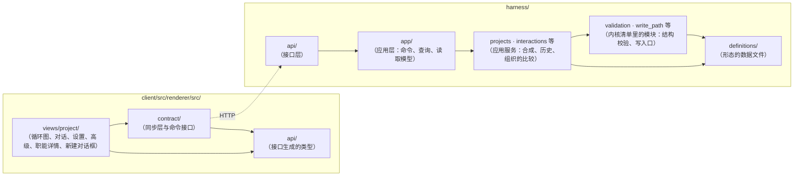

# 项目的组织设计说明

总图位置：第二节「定义」方框与四层；第一节「页面」「下一个职能」「运维」（目录里占位）「观察者」方框；第三节「开环完成」「子组织」两条规矩；第四节「定义」「接口」「执行」「观察者」四道缝。依据：[ADR-0045 项目的组织是一份形态加本项目的改动](../adr/0045-project-organization-form-plus-changes.md)、[ADR-0044 核验是角色的性质](../adr/0044-verifier-role-and-open-loop.md)、[基础规则](../foundation-rules.md)第 5 条、[形态与核验角色设计说明](forms-and-verifier-role.md)「四层各认识什么」「形态随事项冻结」「定义的校验」、[规则登记与参数设计说明](rules-and-parameters.md)「采用与撤回」「命令与事件」、[模型管理设计说明](model-management.md)「职能与角色的模型选择」、[职能内多角色设计说明](department-roles.md)「角色清单」、[D31 职能内的外包角色](../requirements/outsourced-agent-roles.md)、[D28 元观察与规则检查](../requirements/meta-observer.md)、术语[事项的来源](../../CONTEXT.md)。画面总图：「画面」方框里项目页的部分。

## 1. 功能与依据

用户在一个项目上看清并改动这个项目用什么组织：有哪些职能，每个职能由谁做，谁关注什么成果，谁核验谁，事项怎么结束。范围是一份目录：几份形态、两个层，同一个页面、同一套规矩。默认是「产品 · 工程 · 质检」：产品、工程、质检三个职能，方案里的例子都用它。

形态就是预设的组织：用户平时只选一张形态卡，一步用上这份组织（4.12）。改名、加职能、三样说明、编辑定义这些形态里没有的东西收进「高级」，走草稿、校验、采用与历史（4.4、4.5）。

项目页只有两页：对话与设置。对话上面是循环图，按这个事项冻结的组织画：节点是职能，箭头是职能之间传的成果与版本，放行与打回标在那一版上。职能之间怎么传、卡在哪一步、打回了几轮，都在这张图上看（4.14、4.15）。

总图把职能、角色、轮转方式、核验角色写成填进结构的内容，住在定义里。一个项目的组织是发布带的一份形态加本项目的改动，合成以后过同一套结构校验，新建事项时整份冻结进事实。用户在自己的项目上采用一份组织，经结构校验与确认就生效，范围只有这个项目。新增的职能或角色要写明它对什么负责、凭什么判断、怎么工作（基础规则第 5 条）。

## 2. 边界与范围

同一个页面、同一套规矩覆盖下面的目录：几份形态，两个层。每份形态都回答四个问题：事项从哪来（事项的来源，接它的职能）、谁做、谁核验、怎么结束。事项的来源写在定义里，每一种都要有职能接；现值是你的输入与建档；「产品 · 工程 · 质检 · 运维」随发布带之后再加运维发现的故障。它说的是事项为什么存在，和项目的起点（事项开始时的代码树）不是一回事。

| 形态 | 事项从哪来（事项的来源 → 接它的职能） | 谁做 | 谁核验 | 怎么结束 |
| --- | --- | --- | --- | --- |
| 「工程」 | 你的输入、建档 → 工程 | 工程一个角色，自有或外部 agent（职能详情里选） | 没有 | 交完成，开环完成；外部 agent 做时注明外包 |
| 「产品 · 工程」 | 你的输入、建档 → 工程 | 产品、工程两个职能各一个角色，工程交付，要求不清就询问产品，产品回答询问（需求的边界与取舍）；每个职能由谁做在职能详情里选 | 没有；可以加独立核验（例如质检核验工程交的完成） | 开环完成；加了独立核验以后，质检放行才结束 |
| 「产品 · 工程 · 质检」（默认） | 你的输入、建档 → 产品 | 产品、工程、质检，按成果轮转 | 质检 | 质检放行 |
| 「产品 · 工程 · 质检 · 运维」（目录里占位，发布带还没有） | 多一种来源：运维发现的故障 | | | 发布带还没有这一份，只在目录里占位，不写它的声明、页面与校验 |

两个层各自叠在不同的东西上：观察者层叠在任何一份形态上；子组织层叠在任何自有角色上。外包不是形态，是职能详情里「由谁做」的一个选项：外部 agent 本来就由别人做，不再分形，所以选了外部 agent 的职能没有子组织层；核验的职能（质检）不外包。

- 观察者：不开事项、不做、不核验、不改事项怎么结束；在事项外读事实，产出证据、提案、振荡信号；不在循环图里，没有页面，开关在设置页，开了就生效，不进草稿；读取范围在「高级」里改，不在新建项目里；发现问题变成对话里「要你决定」的气泡。
- 职能里的子组织：在职能详情里把这个职能的角色选成「一个小组」，不在新建项目里；这个角色的一轮工作开一个子事项；子事项的来源是「上一层交来的任务」；子组织里自己定谁核验（默认的中心型小组里是审查者）；结果作为这个角色的提案回到上一层。

职能再多也不单列一份形态：「产品 · 工程 · 质检」加上本项目加的职能与两个层就够了。

做：

- 项目上组织的合成、校验、采用、历史、冻结与升级。
- 形态卡的选用：新建项目、接入已有项目、换组织都是选一张卡。
- 「高级」入口：加职能；编辑定义；组织的四问、职能表、版本与历史；新建事项时临时选一份形态。
- 职能详情（从循环图的节点进）：由谁做（自有角色或外部 agent）、一个角色还是一个小组；观察者的开关（设置页）与读取范围（高级）。
- 项目页：循环图加对话的交互骨架（4.14）与图跟着组织长（4.15）。

不做：

- 运行中改组织。
- 观察者的实现与新增。
- 组织的图形编辑：循环图只看、只发指导，不在图上改组织；画面里的编辑入口接到同一条采用命令。
- 「产品 · 工程 · 质检 · 运维」的声明、页面与校验（发布带还没有这一份）。
- 修改基础规则与内核清单。

和相邻说明的分界：

| 说明 | 它管 | 本说明管 |
| --- | --- | --- |
| [形态与核验角色设计说明](forms-and-verifier-role.md) | 四层各认识什么、核验角色、直做、开环完成、形态随事项冻结、定义的校验 | 项目上怎样选形态、怎样改、怎样改回 |
| [规则登记与参数设计说明](rules-and-parameters.md) | 发布带的默认形态与系统提出的候选：对照、限定采用、撤回 | 用户在自己的项目上采用组织 |
| [模型管理设计说明](model-management.md) | 模型目录、职能默认与角色默认、项目职能设置与项目角色设置的解析顺序；模型管理页 | 职能清单从组织得出；自己加的职能怎样选模型 |
| [职能内多角色设计说明](department-roles.md) | 「产品 · 工程 · 质检」的角色清单与中心型协作的内容 | 项目上怎样改角色清单 |
| [执行环境服务设计说明](execution-environment.md)、[网络取回与 MCP 工具设计说明](network-and-mcp.md) | 机器授权、执行位置、MCP 服务器 | 各职能的选项从组织得出 |

本说明没有自己的常量。子组织的嵌套深度上限见[循环与收敛设计说明](loops-and-convergence.md)「循环层的声明」。

## 3. 接口

组织在总图第四节「定义」的缝上：形态、本项目的改动和合成规则是定义格式的一部分，合成结果过加载与校验的同一套结构校验。用户从页面经「接口」的缝发命令、读查询；观察者在事项外面读项目现在的组织；外包与子组织走「执行」的缝，职能详情只选用哪一种，合同不变。

```mermaid
flowchart TB
  subgraph Page["页面"]
    OrgPage["高级与职能详情（草稿存在浏览器里）"]
    Graph["循环图（读事项冻结的组织，只读）"]
    Dialogs["形态卡（新建项目、接入已有项目、换组织）、对话里写一句"]
  end
  subgraph App["应用层"]
    Query["校验草稿、项目的组织（查询，不写入）"]
    Adopt["采用（命令）"]
    Compose["合成：形态 + 本项目的改动"]
  end
  subgraph Kernel["内核"]
    Check["定义的结构校验"]
    Write["写入口"]
  end
  Forms["发布带的形态（定义的版本）"]
  Facts[("事实：项目流、事项创建时冻结的组织")]
  subgraph Others["组织以外的两层"]
    ModelPrompt["模型与 Prompt：项目职能设置、项目角色设置"]
    Machine["机器与位置：机器授权、执行位置"]
  end
  Obs["观察者（系统之外）"]
  OrgPage -->|"校验草稿"| Query
  OrgPage -->|"采用"| Adopt
  Dialogs -->|"带组织的命令"| App
  Query --> Compose
  Adopt --> Compose
  Compose -->|"读"| Forms
  Compose -->|"读本项目的改动"| Facts
  Compose --> Check
  Adopt --> Write --> Facts
  Others -.->|"职能清单取自组织"| Compose
  Obs -.->|"读开关与读取范围"| Query
```

| 缝 | 谁调用谁 | 交换什么 |
| --- | --- | --- |
| 定义 | 应用层 → 加载与校验 | 输入：形态、本项目的改动，以及它们的合成结果；输出：通过，或拒绝项与提醒。定义的格式增加三样，只增字段、带版本：形态（一份完整定义的一个版本，有名字）、本项目的改动（按身份只写不同的项）、身份与显示名分开 |
| 接口：命令 | 页面 → 应用层 | 采用：项目、形态名、改动、理由、用户看到的组织版本，带命令身份；换形态是形态名加空改动的一次采用，理由可不写。新建项目、接入已有项目：增加组织（页面上是一张形态卡，可选）。新建事项：增加组织（可选，临时选形态属于高级） |
| 接口：查询 | 页面 → 应用层 | 校验草稿（不写入）：输入项目、形态、改动，输出合成结果、拒绝项、提醒、「这样改以后事项怎么结束」。项目的组织：合成结果与每项的来源、版本、历史、发布带的形态清单、和上一个事项用的组织的不同 |
| 写入口 | 应用层 → 内核 | 采用写成项目流的一条事件；新建事项把合成结果整份写进事项创建事实 |
| 执行 | 薄驱动 → 执行实现 | 外部 agent：快照进，快照与差异出，经写入口成为提案；子组织：一轮工作开子事项的请求。组织只决定哪个角色用哪一种 |
| 观察者 | 观察者 → 接口、写入口 | 按读取范围读事实；开关与读取范围写在项目的组织里，读项目现在的这份，不读事项冻结的那份 |

包图：

合成与组织的比较放在应用服务里，只读定义的数据与内核的公开接口；结构校验在内核里，合成结果与别处的定义过同一套；页面只经接口层读与发。

## 4. 方案

### 4.1 项目上配的三层

项目上配的东西分三层，生效的时候不同：

| 层 | 内容 | 什么时候生效 | 由谁保存 |
| --- | --- | --- | --- |
| 组织 | 轮转方式、事项的来源与接它的职能、职能与角色、成果种类、谁关注什么、谁核验谁、谁交完成、由谁做（自有角色或外部 agent；一个角色或一个小组）、工具许可、写入范围、观察者 | 之后新建的事项；事项创建时冻结 | 项目事件 |
| 模型与 Prompt | 模型、推理档位、职能 Prompt、角色 Prompt | 下一次模型请求，包括进行中的事项 | 项目职能设置、项目角色设置 |
| 机器与位置 | 可用的机器、运行工作区的位置、各职能做检查的位置 | 创建 run 时 | 机器授权、执行位置 |

组织决定事项怎么走：谁开工、谁核验、怎么结束。事项走到一半不能换人，所以按事项冻结。模型和 Prompt 只影响下一次模型请求，请求的字节已经记进事实，随时能换。后两层的规矩不变，职能清单从组织读：项目职能设置与项目角色设置的对象、各职能检查的位置、MCP 服务器可以使用的职能，都取自组织。

两点特殊：

- 可见范围写在定义里，现值按参数的规矩改（[规则登记与参数设计说明](rules-and-parameters.md)「命令与事件」）；职能详情里它和工具许可放在同一组。
- 观察者在事项外面读事实，它的开关与读取范围在采用以后立即生效，不随事项冻结。

### 4.2 组织是形态加本项目的改动

发布带四份形态，每份是一份完整的定义版本；前三份可以选给项目或事项，第四份给职能里的子组织用：

- 「产品 · 工程 · 质检」（默认）。
- 「工程」：用工程这个职能的名字与工具，模型按工程的设置解析；工程由自有角色做，或在职能详情里改成外部 agent。
- 「产品 · 工程」：产品、工程两个自有角色，用这两个职能的名字与工具，模型按各自职能的设置解析；你的输入与建档由工程接，工程交付，要求不清就询问产品，产品回答；没有核验角色，可以加独立核验（在本项目的改动里加质检职能）。
- 中心型小组：工程架构师是中心角色，主程、探索者是同伴，审查者是这个子组织的核验角色。它给职能里的子组织用，只出现在职能详情里选「一个小组」的时候。外包不是形态：某个职能由谁做选外部 agent，只改这个职能的执行者种类。

「产品 · 工程 · 质检 · 运维」在目录里占位，发布带有这一份之后才能选。

本项目的改动按身份只写不同的项，其余跟随发布。身份归职能、角色、成果种类、观察者所有，由系统给出，显示名可以另改。例如本项目把质检改名为「验收」、给工程多加一个工具、新增一个设计职能：改动里写三项，其余全部跟随发布。

合成结果的内容摘要就是这份组织的版本。

只写不同的项，是因为发布会一直改工具、提案合同与内置材料：项目没有改过的项始终是发布的最新内容。OpenCode（在内置 agent 上逐项覆盖，可以去掉内置的 agent）与 OMP（项目、用户、内置按名字覆盖）是同一种做法。

### 4.3 合成规则

1. 单值的项（显示名、由谁做、写入范围、核验声明、三样说明：它对什么负责、凭什么判断、怎么工作）整项替换。
2. 清单类的项（工具许可、关注的成果、交出的成果）记「增加」与「去掉」；发布以后往清单里加的新工具照样进来。
3. 事项的来源的种类由发布给出（现在是你的输入与建档）；本项目只改每一种来源接它的职能，这是单值，整项替换；不能新增也不能去掉来源。子组织这份形态只有一种来源「上一层交来的任务」，由它的中心角色接。发布新加的来源（例如运维发现的故障）照样进来，按形态给的职能接。去掉一个正接着某种来源的职能时，这一来源没有职能接，校验拒绝（4.6 拒绝第 3 条），页面提示改给哪个职能接。
4. 可以新增职能、角色、成果种类，改动里写全部内容。
5. 可以去掉形态里的职能、角色、成果种类；要去掉的对象在形态里已经不存在时（发布升级以后可能出现），这条去掉不起作用。页面上去掉一个职能时，别的职能对它独占交出的成果的关注一起去掉，写进改动，差异里看得到，恢复时一起恢复：去掉质检时工程对缺陷记录的关注一起去掉，事项最后采纳的成果不变，所以只出现开环完成的提醒。
6. 改名只改显示名，身份不变。改了名的质检仍然跟随全局「职能使用」里原来那一行；内置材料提到别的职能时按身份引用，发给模型时填当时的显示名。
7. 子组织也是一份形态加改动，同一套规则，按路径写（工程 › 内部 › 主程）。

### 4.4 草稿与校验

本节与 4.5 说的草稿、校验、采用与历史，是「高级」这条路（4.12）；选形态卡与「加独立核验」不经草稿。

改动先进草稿。草稿存在这个浏览器里，不进事实，别的电脑看不到。草稿的基准是用户看到的组织版本；基准变了（别处采用了新的组织，或发布升级了形态），页面按新的版本重新校验草稿。

校验草稿是一个查询，不写入：输入是项目、形态、改动；输出是合成结果、拒绝项、提醒、「这样改以后事项怎么结束」。

「这样改以后事项怎么结束」由合成结果得出：看轮转方式，再看事项最后采纳的成果有没有核验角色核验。例如「质检放行才算完成，打回时工程返工」，或「交了完成就结束，记为开环完成」；外部 agent 做时注明外包。

### 4.5 采用与历史

本节是「高级」这条路的采用；换形态一步生效，写在 4.12。

- 采用是一条命令，带形态名、改动、理由、用户看到的组织版本；写成项目流的一条事件。版本对不上时拒绝，页面按新的版本重新校验草稿；走「高级」的采用理由为空拒绝（这条只对高级这条路）；重发不重做。
- 只有用户能采用。职能与观察者不能改组织（基础规则：运行中 agent 与观察者不能修改定义）。
- 用户在自己的项目上采用，经结构校验与确认就生效，范围只有这个项目，不经对照。对照与限定采用管发布的默认形态和系统提的候选（[规则登记与参数设计说明](rules-and-parameters.md)「采用与撤回」）。系统提的候选也显示在「高级」里，写明差异与证据，通过对照以后走同一条命令。
- 历史：每次采用的时间、谁、原版本、新版本、理由、差异。差异按两条采用事件里的形态名与改动比较。改回就是把那一条的形态与改动再采用一次；采用时照常合成、校验，版本是合成当时的内容摘要。
- 换一份形态走形态卡（4.12），不经草稿。

### 4.6 拒绝与提醒

结构校验在三个时候跑，是同一套，属于定义的加载与校验：采用前、新建事项时（发布可能已经变了）、加载时。

拒绝（不能采用，写明是哪一项）：

1. 谁能拒绝谁有环，含核验自己。
2. 核验对象不存在。
3. 有一种事项的来源没有职能接（例如接你的输入的职能被去掉），这种事项开始不了。
4. 关注的成果没有职能交（事项的来源与指导除外）。
5. 事项无法结束：直做没有指定谁交完成；按成果没有写明事项最后采纳哪种成果，或没有职能交它。
6. 核验角色由外部 agent 做。
7. 运行工作区有两个写入者。
8. 新增的职能或角色缺基础规则第 5 条要的三样：它内聚的目标函数、证据来源、工作过程；页面写「它对什么负责」「凭什么判断」「怎么工作」。
9. 子组织超过嵌套深度的上限。
10. 未知的字段，或这个发布没有的工具、轮转方式。

提醒（可以采用）：

1. 事项最后采纳的成果没有核验角色核验，事项以开环完成结束（外部 agent 做时注明外包）。
2. 核验角色只核验中途的成果，同样开环。
3. 核验角色的模型不具备建议能力（[模型管理设计说明](model-management.md)「职能的建议能力」）。
4. 职能还没有可用的模型，新建事项会被拒绝。
5. 职能不交出任何成果，只回答询问。
6. 还有几个事项在按旧组织跑或在排队。

### 4.7 冻结与升级

- 新建事项时：合成、校验，把合成结果整份存进事实（总图方程里事实包含冻结的定义版本），事项记录形态名与版本。之后写入核对、路由、装配、执行、重放都读这一份。观察者一节不在冻结的内容里。
- 事项详情有「这个事项用的组织」：形态名、版本、和项目现在的组织相同或不同（比较职能、角色、成果、核验与轮转，不含观察者），能打开只读的那一份。
- 发布升级以后，跟随发布的项下一个事项自动用上新内容。「高级」里写明和这个项目上一个事项用的组织相比有什么不同；比较的是两份合成结果，不另存状态。
- 发布的改动与本项目的改动合不到一起（合成结果过不了校验，例如发布不再带本项目加过的工具；或者形态已经不在发布里）：「高级」里写明原因，新建事项被拒绝并给同样的原因，用户在草稿里处理；进行中的事项不受影响。事项记录的定义版本与当前加载的不同时，「定义版本不同时继续或停止」的决定请求照旧（[骨架与应用设计说明](skeleton-and-application.md)「薄驱动」）。
- 事项冻结的那份定义取不到时（例如形态已经不在发布里），事项不继续：不换别的定义顶替，不按默认形态继续，不发「定义版本不同」的决定请求；原因写在项目流上，对话里一句话、「高级」与事项详情显示这个状态。那份定义取得到了，事项从停住的地方接着跑，这时版本与记下的不同，照上一条发决定请求。创建记录里没有形态名的旧事项用默认形态。

项目一级读取（职能设置、投影设置、默认设置与材料）按项目当前形态取定义；这个形态不在这个发布里时，读取退回进程加载的定义，页面读取不被挡住；写命令仍由应用层核对。事项一级的选择、恢复与升级重新开始不退回：按 #1392 已定口径，事项停在原处、不换定义、不按默认形态、不发「定义版本不同」的决定请求，原因写进项目流。两种口径不同的理由：读服务于页面看当前设置，写与事项运行必须守住事项冻结的那份定义。证据：`harness/tests/test_routing_per_form.py::test_project_reads_fall_back_to_the_loaded_definitions_when_the_form_is_gone`。

### 4.8 组织的内容在「高级」里

组织不再是项目的一页。它的内容在「高级」里，从设置页底部的入口进；平时看组织靠循环图（4.14、4.15），一眼看到有哪些职能、成果怎么传、谁核验。「高级」里从上到下：

1. 头部：先回答四个问题，每问一句，由合成结果得出：事项从哪来、谁做、谁核验、怎么结束。四问只在这里出现。配一张由组织得出的小图：事项的来源 → 接它的职能 → 关注关系 → 核验 → 结束；它和循环图是同一份计算，图下面给几行文字，由关注关系与核验声明得出。「产品 · 工程 · 质检」是「你的输入、建档 → 产品」「产品 → PRD → 工程、质检」「工程 → 交付 → 质检」「质检 → 缺陷记录 → 工程」「质检 → 放行 → 事项完成」；「工程」只有一行「你的输入、建档 → 工程 → 交完成 → 开环完成」，工程由外部 agent 做时在工程后注明外包。然后是用哪份形态、改过几处、版本。按钮：换形态（4.12）。提示：改动只对之后新建的事项生效，有几个事项在按旧组织跑（能点开）。
2. 职能表：每个职能一行，写职能名（带做核验的标记、外包、由子组织做的标记）、目标、什么时候开工、交出什么、谁核验它或它核验谁、模型、来源（跟随发布、本项目改过、本项目加的）。点一行进职能详情。列跟着轮转方式变：按成果时「什么时候开工」写关注的成果；直做时写接哪种事项的来源，或在收到指导、询问时，多一列谁交完成；任务池时多一列工作单元的大小。去掉的职能灰着显示，能恢复。
3. 待采用的候选：系统提的候选，平时没有就不显示。
4. 历史。

观察者不在其中：它不算职能，不进职能表，不能核验；开关在设置页，读取范围在「高级」里改，实现随发布。

「换形态」就是目录：每一张卡一个形态名，带轮转与结束两个标记，配一句人话和一张小图（4.12），不再写四问。「产品 · 工程 · 质检 · 运维」那张卡灰着，标「发布带还没有」，不能选。两个层不是形态，不在卡里：观察者在设置页打开，子组织在职能详情里选。选一张卡的规矩见 4.12「换组织」。

高级的修改状态（4.4、4.5 那条路）：顶部一条「草稿，还没有生效」，校验结果常驻显示（拒绝项、提醒、这样改以后事项怎么结束）；按钮「采用」（有拒绝项时不可用，点了写理由、看差异）与「放弃草稿」。旁边有「编辑定义」：文档视图，左边编辑本项目的改动，右边只读显示合成结果，和表单过同一套校验，做法同模型管理页的编辑 JSON（[模型管理设计说明](model-management.md)「目录文档（编辑 JSON、导入、导出）」）。草稿与校验的常驻显示只在进了高级以后出现，平时不显示。

设置页留下：基本信息（名字、长期目标可选）、源目录、成果写回、机器授权、执行位置（各职能一项，从组织得出）、MCP 服务器（职能的选项从组织得出）。职能设置与各角色设置并进职能详情。设置页的组织一行与按钮见 4.15。

### 4.9 职能详情

从循环图的节点进，或从「高级」的职能表进；路径「工程」。分组，每组标明生效时机，每项标跟随发布或本项目改过，能恢复：

- 职责（之后新建的事项）：显示名；它对什么负责、凭什么判断、怎么工作；关注的成果；交出的成果；核验声明（不核验，或核验某职能的某种成果）。
- 由谁做（之后新建的事项）：两件事，各自选。一，自有角色，或外部 agent（选一个，例如 OpenCode；质检不外包）。二，一个角色还是一个小组（子组织，打开内部）；由谁做选外部 agent 时不再分小组。
- 权限（之后新建的事项）：工具许可按类别分组；写入范围（运行工作区、只写检查材料、不写入，核验角色固定只写检查材料）；可见范围。
- 模型与 Prompt（下一次模型请求）：模型、推理档位、职能 Prompt、角色 Prompt，写入本项目，没写入的跟随；建议能力的提醒照旧。由谁做是外部 agent 时，写明「模型经受控入口由本项目定；推理档位由外部 agent 自己定」，推理档位不显示成可调的样子。由谁做是一个小组时，这一组只有职能这一层的模型、推理档位与职能 Prompt，内部的角色在各自的详情里写，没写入的跟随职能。
- 位置（创建 run 时）：做检查的地方，只读显示，链到设置页；能用哪些 MCP 服务器，只读显示，链到设置页。
- 事项种类的工作说明：折叠显示，要改在「编辑定义」里。

一个职能由一个角色做时，职能与角色合成一页。内部是小组的路径是「工程 › 内部」：同样的头部、表与成果怎么走，每一行是一个角色。这里事项的来源是「上一层交来的任务」，成果怎么走的最后一行写结果作为提案回到上一层。层数到上限时「由谁做」不再能选小组。

### 4.10 加职能

在「高级」里加。

- 起点：发布的职能（「产品 · 工程 · 质检」里这份组织还没有的，例如给「工程」加独立核验时多出的质检，带上它的三样说明、工具、写入范围与核验声明，身份就是发布的那个，模型跟随全局「职能使用」里那一行）；复制一个已有职能（带上工具、写入范围、核验声明，模型预选被复制职能的生效模型）；或者空白。
- 必填：它对什么负责、凭什么判断、怎么工作。这三样同时生成 Prompt 的底稿，用户可以改。
- 关注的成果、交出的成果：从已有种类里选，或者新建一种成果。
- 新建成果种类填：名字、一句说明、依据哪种成果的当前版、要不要带检查回执、要不要带代码快照。这几项对应提案合同里已有的条件，更细的写法在「编辑定义」。新种类走通用的成果接纳（[形态与核验角色设计说明](forms-and-verifier-role.md)「四层各认识什么」）。
- 模型：必选，写进项目职能设置。自己加的职能不进全局的职能默认与角色默认；职能的内置 Prompt 就是加职能时写的那份，以后改 Prompt 写项目职能设置，和别的职能同一种用法。
- 身份由系统给，用户只看到显示名。

### 4.11 外包与分形

- 外包是职能里「由谁做」的一个选项，不是一种组织。外部 agent 经 ACP 开一个会话，它的消息、工具调用与计划流回 Yudao，在职能里就是一个对话 agent。在职能详情里选一个外部 agent；模型与工具走受控入口，模型按同一条解析顺序由本项目定，推理档位由外部 agent 自己定。外包的职能在循环图的节点上带外部 agent 的名字，并写明推理档位由外部 agent 定。外部 agent 交回的东西叫「交付」（交回的快照与差异），循环图的箭头、线程与「高级」里用同一个名字，经写入口成为提案。质检不外包。
- 外包仍守四样：从封存快照建工作区、交回新快照与差异；总时间与用量有上限；交回的结果经写入口成为提案，日志能重放；开环完成并注明外包（[外包角色设计说明](outsourced-roles.md)）。
- 子组织：职能详情里「由谁做」选一个小组，从一份形态起步（默认中心型小组）。循环图里这个节点能点进去看内部的循环图与内部角色在做什么，并链到子事项。子事项的规矩见[形态与核验角色设计说明](forms-and-verifier-role.md)「子组织（位置与规矩）」。

### 4.12 形态一键选用

目录里的形态就是预设的组织。选一张卡就用上这份组织，没有草稿、校验的常驻显示和理由要填。

卡片：形态名列出它有哪几个职能；每张卡带两个标记，轮转（直做 / 按成果）与结束（开环完成 / 独立核验放行），再配一句话和一张小循环图（和项目页的循环图同一种画法），不写四问。「产品 · 工程 · 质检」排第一并标「默认」。

| 形态 | 轮转 | 结束 | 卡上的一句话 |
| --- | --- | --- | --- |
| 「产品 · 工程 · 质检」（默认） | 按成果 | 独立核验放行 | 产品写需求、工程做、质检核验，放行才算完成 |
| 「工程」 | 直做 | 开环完成 | 工程一个角色做完就结束，没有人核验 |
| 「产品 · 工程」 | 直做 | 开环完成 | 工程做并交付，要求不清就问产品，没有人核验 |
| 「产品 · 工程 · 质检 · 运维」 | — | — | 发布带还没有（灰着，不能选） |

小图的画法：「产品 · 工程」画成工程交付、产品在旁边接询问，不画成先后两步；「产品 · 工程 · 质检」的小图里质检节点带核验标记。

检验标准：只看卡片和小图，分得清谁交付、有没有独立核验、怎么轮转、子组织从哪里展开。

形态名只说有哪几个职能，轮转与结束由两个标记说，所以凡是写出形态名的地方（项目头部、设置、卡片）都带上这两个标记。同名的组织靠标记与图分开：「产品 · 工程」加独立核验以后照规矩叫「产品 · 工程 · 质检」，标记是直做、独立核验放行，图上工程交付、产品在旁边接询问；它不是新建项目里的一张卡，只出现在改过的项目上。按成果之外的轮转（例如任务池）同样写进轮转标记，不写进名字。

- 长期目标不在选形态时填，它可选，在设置页里写；不写时项目上下文里没有这一项。
- 换组织：选另一张卡，一步生效。理由可以不写，历史里仍记一条。本项目没有改动时不确认；有改动时确认一次，列出会丢掉哪些（历史里还在，改回能找回）。换形态也带用户看到的组织版本，版本对不上时拒绝并刷新。形态本身过校验，所以换形态没有拒绝项；发布的改动与本项目的改动合不到一起的情况照 4.7。
- 「高级」入口：改名、加职能、三样说明、编辑定义、草稿与校验的常驻显示、版本与历史、「和某项目一样」、新建事项时临时选一份形态、接来源的职能改给谁，都是形态里没有的东西才用，收进设置页底部的「高级」，平时不出现。走「高级」的采用仍要写理由，内容见 4.4、4.5。
- 由谁做（外部 agent、小组）在职能详情里选，从循环图的节点进，不经草稿。
- 观察者与子组织不在新建项目里：观察者的开关在设置页，开了就生效，读取范围在高级里改；子组织在职能详情里选。

### 4.13 新建的入口

- 新建项目：只填名字，选一张形态卡（4.12），完成，没有别的输入。点卡就建好；名字空着时不能点卡，提示先写名字。起始文件夹可选，收在一个「选起始文件夹」的小入口里。「和某项目一样」属于高级，收在这个界面底部的「高级」小入口里。
- 和某项目一样：复制一次形态名、本项目的改动、项目职能设置与项目角色设置；机器授权、执行位置、源目录、MCP 服务器不复制；之后两边各改各的。
- 接入已有项目：名字、源目录、一张形态卡。建档由接「建档」这一来源的职能接。没有核验角色的组织按[形态与核验角色设计说明](forms-and-verifier-role.md)「开环完成」的建档规矩走。
- 新建事项：任何级别都不弹对话框，在线程里写一句，收件人选「开始一个新事项」（4.14）。这段话先交给谁，由事项的来源「你的输入」接它的职能得出，写在收件人一行；组织是开环的时，对话里写明以开环完成结束；合成结果过不了校验时不能开始并写明原因。组织默认本项目的组织；临时选发布带的一份形态属于高级，只影响这个事项，项目的组织不变。

### 4.14 项目页是循环图加对话

项目页只有两页：对话与设置。对话的上面是循环图。职能的状态、往来、成果与版本、组织都在这张图上，不另设页面；改定义（改名、加职能、三样说明、编辑定义、草稿与校验、版本与历史、「和某项目一样」、接来源的职能改给谁）走设置页里的「高级」。

**循环图按这个事项冻结的组织画。**

- 节点是职能。箭头只放成果与版本（原文、PRD、交付、缺陷记录），箭头上写成果与版本号，旁边写第几轮。
- 放行与打回是对某一版的结论，标在那一版上，不画成一条成果箭头；打回之后工程交出的新一版是新的一条箭头，写第几轮。
- 事项的来源（你的输入、建档）从图外进来，接它的职能是第一个节点。结束：有核验角色时，放行标在交完成的那一版上，写核验角色的显示名；没有核验角色时写开环完成。
- 节点标记：做核验的节点有核验标记；由外部 agent 做时，节点上写它的名字，并写明推理档位由它定；由子组织做时，节点有子组织标记，能点进去看内部的循环图，内部那张图的出口写「交回」加一层职能的名字（例如「交回工程」），「放行」只留给事项自己那一圈；自有角色不加标记。
- 「产品 · 工程」画成工程交付、产品在旁边接询问，不画成先后两步。
- 点节点：看这个职能在做什么、它的往来，给它发指导（收件人跟着切到给这个职能的指导），以及进职能详情的入口（4.9）。点箭头：看那一版与差异；同一种成果的几条箭头能逐版看。验收就在这里：交完成的那一版，从对话里交完成那一条的「看这一版」或从放行所在的那条箭头进。
- 观察者在圈外，不进图；发现问题成为对话里的「要你决定」。运维是多一个运维节点；运维发现的故障从图外进来，开一件新事项，和打回分开画（发布带还没有）。
- 窄屏时图收成一行（节点名与当前箭头），不挤线程。
- 同时有几件事在跑时，图只画选中的那件：图上方一行选事项，默认最近在跑的，点线程里事项之间的细线也能选；别的事项在对应节点上记数。

**交互骨架**对每一种组织都一样。用户只做四个动作：提要求、纠偏、拍板、验收。

1. 对话永远是一条线程。一条对话跨多个事项，事项之间一条细线写标题与结果。
2. 输入框在底部，上方一行收件人，默认按状态选好，能切，不按状态悄悄分流。
   - 选项：直做是「开始一个新事项」「给工程的指导」（工程换成接「你的输入」的角色的显示名）；按成果轮转是「开始一个新事项」「追加输入（产品接，重新验收）」「给某个职能的指导」（每个职能一项，点图上的节点也能切到它）。
   - 默认：没有事项在做时是「开始一个新事项」；有事项在做时是给正在工作的职能或角色的指导，「产品 · 工程 · 质检」也是；追加输入要重新验收，比指导重，不做默认。
   - 有事项在做时切到「开始一个新事项」，新事项排在后面：收件人一行写明「排在〈事项标题〉后面，它做完才开始」，线程里写同样一句。
3. 线程默认只显示三种话：你写的、要你决定的、交完成或放行。角色之间的往来折成一行，如「工程与产品往来 N 条」，点开才展开。外部 agent 在跑时，图上节点带它的名字，线程里多一条状态条：在跑，档位由它定。
4. 四个动作各有固定位置：
   - 提要求与纠偏在输入框，收件人不同。
   - 拍板只在对话里「要你决定」的气泡，按钮在气泡里；别处（循环图的节点、左侧栏）只标记并跳到气泡。左侧栏项目名旁的数字是待你决定的数量，从两个职能起显示，点了跳到那条气泡。
   - 验收在交完成那一条的「看这一版」与循环图的箭头。
5. 升级不走对话框：设置页「加独立核验」或「换形态」，图自己长出多的那一样，只对之后的事项生效，线程里一句话说明。

### 4.15 循环图跟着组织长

页面固定为对话加设置，不按级别多出别的页。变的只有图，图读的是这份组织的合成结果，不按形态名判断：

| 组织 | 图是什么样 |
| --- | --- |
| 一个职能（「工程」） | 一行：你的输入 → 原文 → 工程 → 交付 → 开环完成。版的清单就在交付这条箭头上 |
| 两个职能（「产品 · 工程」） | 两个节点：工程交付，产品在旁边接询问，不画成先后两步；询问的往来在节点与线程里的折叠行 |
| 产品 · 工程 · 质检 | 三个节点，成果箭头（PRD、交付、缺陷记录）旁边写第几轮；放行与打回标在那一版上，打回之后工程交出的新一版是新的一条箭头 |
| 加了独立核验 | 多一个质检节点，带核验标记，核验交完成的那一版，结束写放行；轮转仍是直做，形态名变成「工程 · 质检」 |
| 由子组织做 | 节点带子组织标记，能点进去看内部的循环图，内部那张图的出口写「交回」加一层职能的名字 |
| 外部 agent 做 | 节点带外部 agent 的名字，写明推理档位由它定 |
| 观察者 | 在圈外，不进图 |
| 运维 | 多一个运维节点；运维发现的故障从图外进来，开一件新事项，和打回分开画（发布带还没有，灰着） |

没有核验角色时，交完成的那一版指向开环完成，不画放行；有核验角色时，放行标在交完成的那一版上，写核验角色的显示名。

只有一个职能时：

- 新建事项不弹对话框，收件人一行的写法与默认、能切见 4.14：没有事项在做时默认「开始一个新事项」，有事项在做时默认「给工程的指导」，能切到「开始一个新事项」，写明排在后面。
- 开环完成仍然写明（[形态与核验角色设计说明](forms-and-verifier-role.md)「开环完成」）：交完成那一条写「开环完成：没有人核验」，不写放行；外部 agent 做时注明外包。
- 已用时间与上限是一条时间条，在对话上方，旁边一个「停止」。
- 模型没有可用的时：对话里一句话提示并链到模型管理，写一句不能开始。
- 「产品 · 工程」的对话同这个：写一句由接「你的输入」的角色接，指导也发给它。

设置页：名字、长期目标（可选）、起始文件夹或源目录、模型一行、组织一行（例如「工程」只有一个职能，没有人核验；由外部 agent 做时写明）与按钮「加独立核验」「换形态」、观察者开关（开了就生效，不进草稿）、「高级」。成果写回、机器授权、执行位置、MCP 服务器收进高级。「加独立核验」一次点击生效：多一个质检职能，它的角色是核验角色，加上发布的质检，核验交完成的那一版，轮转仍是直做；图上多一个质检节点，带核验标记；项目头部的形态名随之变成「工程 · 质检」（在原名后加「· 质检」）；写一条历史，只对之后新建的事项生效，在跑的事项按原来的做完，线程里一句话写明；同一处能「去掉独立核验」。

其余规矩（各级通用）：

- 事项详情、指导的接收方、决定请求里的职能、循环图都读这个事项冻结的组织。
- 项目的职能清单 = 当前组织的职能 + 还在跑的事项里旧组织的职能，后者在图与清单里标「只在旧组织里」。
- 放行写核验角色的显示名；没有核验角色时写开环完成，并注明是否外包。
- 项目头部一行标签：形态名（改过时写改过几处）、轮转方式、有核验或开环。
- 职能多到图放不下时，节点收进一个「职能」下拉。
- 系统页（模型管理、机器、运行与执行槽位、工具与扩展）结构不变。

## 5. 验收

每份脚本既是页面原型的走查，也是真实实现的页面验收按的同一份。原型给每份脚本一个同名的示例项目。每份脚本六段：谁、要做什么项目；新建项目选这一级时对话框说什么；第一个事项谁接；中途有哪些页、没有哪些页；怎么结束、页面上写什么；这一级的用户最常做的一个改动。项目页只有对话（上面带循环图）与设置两页，没有成果库页、职能页、组织页与窄带。

### 脚本一：「工程」，由外部 agent 做

1. 谁、要做什么项目：已经习惯用外部 agent（例如 OpenCode）的独立开发者，想让 Yudao 管住时间与用量、留下快照与记录；项目「日志清理脚本」。
2. 新建项目选这一级时对话框说什么：写名字，点「工程」那张卡，项目就建好；没有别的输入。外部 agent 在建好以后的职能详情里「由谁做」选（从循环图的工程节点进）。
3. 第一个事项谁接：工程，由外部 agent 做。在对话里写一句就开始，快照进，外部 agent 在工作区里做。
4. 中途有哪些页、没有哪些页：对话（上面一行图：你的输入 → 工程 → 交完成，工程节点带 OpenCode 的名字，写明推理档位由它定）、设置页、时间条（已用时间与上限，旁边「停止」）；每一版与差异看最后一个箭头；没有成果库页、职能页、组织页。
5. 怎么结束、页面上写什么：外部 agent 交回的东西叫「交付」（交回的快照与差异），经写入口成为提案，被采纳；到时间或用量上限会停。线程里与记录写「开环完成：没有人核验」并注明外包，不写放行；图上最后一个箭头指向开环完成。
6. 最常做的改动：在职能详情里把由谁做换成另一个外部 agent；采用以后新建的事项用新的。职能详情的模型一组写明「模型经受控入口由本项目定；推理档位由外部 agent 自己定」，推理档位不显示成可调的样子。

### 脚本二：「工程」

1. 谁、要做什么项目：做个人小项目、不想要三个职能往返的人；项目「个人博客」。
2. 新建项目：左侧栏点「新建项目」，写名字，点「工程」那张卡，进项目就是对话。没有别的输入；长期目标以后想写再去设置页。
3. 第一个事项：没有事项在做，在对话里写一句，收件人默认「开始一个新事项」；工程接。
4. 中途：图只有一行（你的输入 → 工程 → 交完成），版的清单就在最后的箭头上；有对话、设置页、时间条（已用时间与上限，在对话上方，旁边「停止」）。有事项在做时收件人默认「给工程的指导」，能切到「开始一个新事项」，写明排在后面；工程的决定请求与你的回答也在线程里。不出现：成果库页、职能页、组织页、窄带、门牌、确定规则、轮次、执行槽位、冻结的组织版本、角色陈述、所在职能、新建事项对话框。
5. 结束：工程交完成，线程里写「开环完成：没有人核验」，不写放行，没有发决定请求；最后的箭头上多一版，带「看这一版」与差异；事项之间一条细分隔线写标题与结果。
6. 最常做的改动：设置页点「加独立核验」，一次点击生效：图上多一个质检节点，带核验标记，加上发布的质检，核验工程交完成的那一版，轮转仍是直做，项目头部的形态名变成「工程 · 质检」，历史里记一条；只对之后新建的事项生效，在跑的事项按原来的做完，线程里一句话写明。之后新建的事项以质检放行结束；同一个位置有「去掉独立核验」。

### 脚本三：「产品 · 工程」

1. 谁、要做什么项目：两三个人的小团队，想要「一个人做、一个人把关需求」；项目「活动报名小程序」。
2. 对话框说什么：写名字，点「产品 · 工程」那张卡；你的输入与建档由工程接，产品回答询问，以后可以加独立核验。
3. 第一个事项谁接：在线程里写一句，收件人默认「开始一个新事项」，工程接。
4. 中途有哪些页、没有哪些页：对话与设置页；图上产品与工程两个节点；工程与产品的往来在节点上与线程里的折叠行（「工程与产品往来 N 条」，点开才展开）；要你决定的气泡在线程里，左侧栏项目名旁有数字（两个职能起显示）；有事项在做时收件人默认「给工程的指导」，点产品节点能切到给产品的指导，切到「开始一个新事项」时写明排在后面。没有质检的往返，没有成果库页、职能页、组织页。
5. 怎么结束、页面上写什么：工程交完成，线程里写「开环完成：没有人核验」；设置页的组织一行写明加独立核验就会等它放行。
6. 最常做的改动：在高级里加一个自己的职能「运营」，回答活动规则的询问，必填它对什么负责、凭什么判断、怎么工作；图上多一个节点。

### 脚本四：「产品 · 工程 · 质检」

1. 谁、要做什么项目：要独立核验的团队项目；项目「订单系统重构」。
2. 对话框说什么：写名字，「产品 · 工程 · 质检」那张卡默认排第一并标「默认」，点它就建好；你的输入与建档由产品接。
3. 第一个事项谁接：在线程里写一句，收件人默认「开始一个新事项」，产品接。
4. 中途有哪些页、没有哪些页：对话上面的循环图是产品 → 工程 → 质检，成果箭头写 PRD、交付与版本号和第几轮，质检的结论标在那一版上，打回之后工程交出的新一版是新的一条箭头，写第几轮；点节点看这个职能在做什么并给它发指导，点箭头看那一版与差异；职能之间的往来折成一行；要你决定的气泡在线程里，左侧栏有数字；收件人有「开始一个新事项」「追加输入（产品接，重新验收）」「给某个职能的指导」，有事项在做时默认给正在工作的职能。没有成果库页、职能页、组织页、窄带；PRD、交付、缺陷记录一路可见。窄屏时图收成一行。
5. 怎么结束、页面上写什么：质检放行，线程里写放行与核验角色的显示名，放行标在交完成的那一版上。高级里显示三个职能，质检标核验角色，全部标跟随发布；没有改动时事件序列基准与交给模型的请求快照一字不变。
6. 最常做的改动：在高级里加一个设计职能，新建一种成果「界面稿」，工程关注它；事项跑完，图上多一个节点；缺「它对什么负责、凭什么判断、怎么工作」三样时被拒绝；模型只写在本项目，全局「职能使用」没有多一行。

### 脚本五：「产品 · 工程 · 质检 · 运维」

1. 谁、要做什么项目：已经上线、要长期运行的服务；项目「线上商城」，现在用「产品 · 工程 · 质检」。
2. 对话框说什么：在新建项目的形态卡与设置页「换形态」的卡里看到「产品 · 工程 · 质检 · 运维」灰着、标「发布带还没有」；读得懂它在图上多一个运维节点和一条从外面进来的故障箭头（事项多一种来源「运维发现的故障」）；知道现在不能选。
3. 第一个事项谁接：运维形态进发布带后再写。
4. 中途有哪些页、没有哪些页：运维形态进发布带后再写。
5. 怎么结束、页面上写什么：运维形态进发布带后再写。
6. 最常做的改动：运维形态进发布带后再写。

### 脚本六：观察者层

1. 谁、要做什么项目：长期跑、常不在场，想有人在事项外面看着有没有来回打转的用户；项目「内部报表工具」，用「工程」加观察者（说明观察者层能叠在任何一份形态上）。
2. 对话框说什么：新建项目时只有名字和一张卡，点「工程」；观察者不在新建里，建好以后在设置页打开。
3. 第一个事项谁接：工程，与不加观察者时相同。
4. 中途有哪些页、没有哪些页：没有观察者页面，也不进循环图；设置页一个开关，打开就生效，不进草稿；发现问题变成对话里「要你决定」的气泡；观察者不进职能表。
5. 怎么结束、页面上写什么：不改事项怎么结束，仍是开环完成；观察者不能核验；关掉以后不再写入，它的写入只经写入口。
6. 最常做的改动：在高级里改一个观察者的读取范围，采用以后立即生效，不随事项冻结。

### 脚本七：职能里的子组织层

1. 谁、要做什么项目：项目大、工程一个角色忙不过来；项目「固件升级服务」，用「产品 · 工程 · 质检」，工程由谁做选一个小组（中心型小组）。
2. 对话框说什么：新建项目时只有名字和「产品 · 工程 · 质检」那张卡；小组不在新建里，建好以后在职能详情里「由谁做」选。
3. 第一个事项谁接：产品接，与「产品 · 工程 · 质检」相同；工程的一轮工作开一个子事项，它的来源是上一层交来的任务。
4. 中途有哪些页、没有哪些页：图上工程节点带子组织标记，能点进去，看内部的循环图，内部那张图的出口写「交回工程」，链到子事项；路径「工程 › 内部」。
5. 怎么结束、页面上写什么：子事项的结果作为这个角色的提案回到上一层，照常过裁决；超过嵌套上限被拒绝，层数到上限时「由谁做」不再能选小组。
6. 最常做的改动：在内部去掉探索者。

### 补充条

按机制排的几条，脚本里没有单独写到：

1. 把质检改名并采用（高级）：新建的事项跑完，事件序列除名字外相同，模型仍跟随全局「职能使用」里原来那一行；进行中的事项按改名之前的名字跑完。
2. 在草稿里去掉质检（高级）：出现以开环完成结束的提醒；采用后新建的事项以开环完成结束；改回以后新建的事项以放行结束；历史里两条都在。
3. 「拒绝与提醒」里每一条拒绝各有一个反例，包括「有一种事项的来源没有职能接」；每一条提醒都不挡采用。
4. 看到的版本已被别处改过，采用被拒绝；命令重发不重做；走「高级」的采用理由为空被拒绝（理由为空拒绝只对高级这条路）。
5. 发布改了工程的工具，本项目的改动里没有碰它：下一个事项用上新工具，「高级」里写明不同；本项目加过的工具仍在。合不到一起时新建事项被拒绝并写明原因，进行中的事项不受影响。
6. 和某项目一样（高级）：改动与模型、Prompt 复制过来，机器与源目录没有；之后两边互不影响。
7. 项目的职能清单在冻结着旧组织的事项还在跑时包含旧组织的职能并标出；事项详情与循环图读的是它冻结的那一份。
8. 目录里的任何一份形态与两个层，都不改事实与裁决、循环两层（总图四层的判据）。
9. 换形态一步生效：理由可不写，历史里记一条；本项目没有改动时不确认，有改动时确认一次并列出会丢掉哪些；带的组织版本对不上时拒绝并刷新；形态本身没有拒绝项。
10. 新建事项时临时选一份形态（高级）：只影响这个事项，项目的组织不变，记录上写开环完成（选开环的形态时）。
11. 循环图：选中的事项换了，图跟着换，别的事项在节点上记数；窄屏收成一行；点节点把收件人切到这个职能；拍板只在气泡里，图与左侧栏只标记并跳到气泡。
12. 外包的职能：节点带外部 agent 的名字并写明推理档位由它定；把质检选成外部 agent 被拒绝；交回的结果仍经写入口成为提案。

## 6. 未决问题

- 外部 agent 在哪里登记，外包角色可用的工具范围是什么（[D31](../requirements/outsourced-agent-roles.md) 留下的）；外部 agent 中途怎么收指导见[外包角色设计说明](outsourced-roles.md)的未决问题。
- 观察者用哪个模型；观察者的设置是每个项目一份，还是整个实例一份。
- 自举项目怎样识别，从而拒绝没有核验角色的组织（[形态与核验角色设计说明](forms-and-verifier-role.md)「开环完成」写了自举不用开环）。
